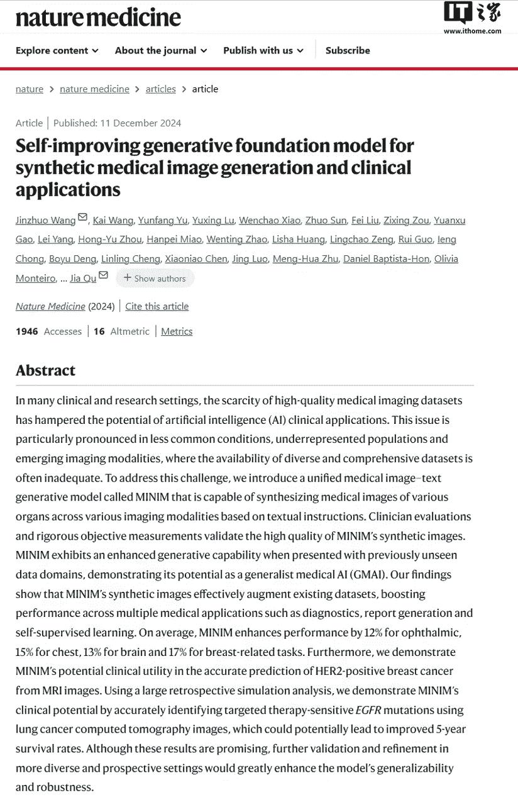

# 【光年日报】2024.12.18周三

## Mark的AI产品经理知识库——互联网前沿资讯推送！

### 胖东来补偿被顾客掌掴员工3万元；TikTok请求美国最高法阻止“不卖就禁”法案；过境免签外国人停留时间延长为240小时

> 来源：https://qqs7y1hozd1.feishu.cn/docx/HBF3dPL06ojIgoxNZ9IcT083n1c

> [胖](https://qqs7y1hozd1.feishu.cn/wiki/ZVh3wNOJriCqGOkmLXxcg8lHnpe#share-Lod1dMoh6o3DE7xR2ZWc39OHnLb)东来补偿被顾客掌掴员工3万元；TikTok请求美国最高法阻止“不卖就禁”法案；过境免签外国人停留时间延长为240小时

### 我国科学家建立生成式模型为医学 AI 训练提供技术支持

### OpenAI 称目前尚无推出视频生成模型 Sora API 的计划

### [举报人「自杀」，OpenAI表示震惊！NYU教授发长文悼念：警钟仍在回响](https://qqs7y1hozd1.feishu.cn/wiki/ZVh3wNOJriCqGOkmLXxcg8lHnpe#share-UYRxdZ7O0oxOWtxrg4bc2XnfnpN)

### [谷歌版Sora来了，4K高清暴击OpenAI！视频生图新卷王，更理解物理世界](https://qqs7y1hozd1.feishu.cn/wiki/ZVh3wNOJriCqGOkmLXxcg8lHnpe#share-PAUCdEIdLoQ7xSxk3Evc5T9Mnre)

> 欢迎加入社群

## 今日热点 💎

### 💡胖东来补偿被顾客掌掴员工3万元；TikTok请求美国最高法阻止“不卖就禁”法案；过境免签外国人停留时间延长为240小时

36氪 |
https://www.36kr.com/p/3083609301481858

（⬅️原文直达）

### 胖东来发公告称保障员工的人格尊严，员工被顾客多次掌掴补偿30000元

据每日经济新闻报道，12月17日，于东来发布胖东来人格尊严补偿标准执行公告：“当人格尊严受到侵犯时，我们每个人都要有采取法律手段维护自身合法权益的意识和勇气，主动追究相应责任，不允许轻易签署谅解书，同时主动向公司申请侵犯人格尊严补偿，管理层必须正确引导并鼓励，由店长对当事人进行沟通疏导，必要要请专业对心理健康咨询师进行心理疏导减轻因人格尊严受到侵害后对员工心心理对伤害。”

从执行情况来看，员工人格尊严受到侵犯时，胖东来给予的补偿金在2千元至3万元不等。其中最高的3万元补偿发生在禹州店超市，当时超市员工在阻止顾客之间进一步冲突时，其中一方顾客对员工进行掌掴、用手机多次击打头部、抓伤手部；当员工将施暴的顾客带到办公区等待警方到达期间，施暴顾客再次对员工进行两次掌掴并用手机击打员工头部。公告表示，按照许昌市胖东来超市部《奖励项目》侵犯人格尊严补偿标准，对于此次重件发放30000元补偿。（每日经济新闻）

### TikTok向美国最高法院提交紧急请求，寻求推迟并阻止“不卖就禁”法案

TikTok当地时间12月16日宣布，已向美国最高法院提交紧急请求，寻求法院阻止“不卖就禁”法案。文件显示，TikTok和字节跳动呼吁美国最高法院在明年1月6日前对其推迟实施“不卖就禁”法案的请求做出裁决。

本月13日，美国哥伦比亚特区巡回上诉法院驳回TikTok此前申请的临时禁制令。早前TikTok提交紧急动议以阻止“不卖就禁”法案。（界面新闻）

### 国家移民管理局：过境免签外国人停留时间延长为240小时

国家移民管理局12月17日发布公告，即日起全面放宽优化过境免签政策，将过境免签外国人在境内停留时间由原72小时和144小时均延长为240小时（10天），同时新增21个口岸为过境免签人员入出境口岸，并进一步扩大停留活动区域。（新华社）

## 大公司/大事件

### 阿里巴巴出售银泰股权，雅戈尔回应

36氪获悉，阿里巴巴公告，公司与另一名少数股东同意将银泰100%的股权向由雅戈尔集团和银泰管理团队成员组成的购买方财团出售，阿里巴巴就银泰出售的所得款项总额约为人民币74亿元，预计因出售银泰而录得的亏损约为人民币93亿元。

另据每经网报道，针对接盘银泰百货， 雅戈尔方面回应称，雅戈尔集团（宁波）有限公司一直以来注重时尚领域的投资和发展，旗下上市公司“雅戈尔时尚股份有限公司”更是致力于时尚产业的运营。本次集团与银泰管理层共同投资银泰，旨在“强链补链”，完善时尚生态圈。投资完成后，雅戈尔集团将给予银泰管理层充分的运营空间，支持银泰进一步高质量发展。（36氪、每经网）

### 美团回应“骑手过度跑单将被强制下线”：试点中，相关规则将在完善后公布

近日，有网传通知称，为保障安全，外卖平台对于跑单时长累计过长的骑手将采取强制下线。美团相关负责人回应称，确实有相关举措。美团在今年三季度财报中也披露，已在部分城市试点优化疲劳管理机制。当骑手APP检测到骑手工作时间过长时，起初会提示骑手休息，如果骑手没有理会，最终会强制骑手下线并休息。不过对于具体强制下线的时长，美团方面表示，目前方案正在试点中，相关规则将在完善后公布。（澎湃新闻）

### 蜜雪冰城回应多个城市门店涨价：运营成本变化

12月16日，广州多家蜜雪冰城门店在小程序上发布公告称，“综合门店经营情况，12月16日起，本店堂食/小程序App饮品（含冰淇淋系列）门市价加1元”。从蜜雪冰城方面获悉，此次涨价涉及的是广州、深圳、北京部分区域门店。蜜雪冰城总部客服回应称，“综合考虑市场因素和门店经营，我们针对个别区域产品进行了统一调整，其他区域的价格维持不变。”

针对后续是否会继续调整和恢复原价，蜜雪冰城官方客服则称，暂时未接到通知。有消费者认为，涨价一元可以接受，但希望不要再高了。业内人士表示，在上下游及供应链成本攀升的节点，涨价属于正常商业行为。（南方都市报、第一财经）

### 字节跳动否认与中兴通讯合作成立新品牌

针对网传的豆包大模型与中兴手机合作一事，豆包相关负责人回应表示，消息不实。豆包大模型已经和许多手机有了深度合作，但并没有和中兴通讯探讨过成立新品牌可能性，芯片也没有相关的合作。（财联社）

### 美股三大指数集体收跌，道指创近半个世纪以来最长连跌

36氪获悉，12月17日收盘，美股三大指数集体下跌，纳指跌0.32%，标普500指数跌0.39%，道指跌0.61%。其中，道指录得日线九连跌，创1978年2月以来最长连跌。大型科技股多数下跌，英特尔、英伟达跌超1%，奈飞、谷歌、亚马逊、Meta小幅下跌；特斯拉涨超3%，苹果、微软小幅上涨。热门中概股普涨，哔哩哔哩、富途控股、腾讯音乐均涨超4%，小鹏汽车涨超3%，拼多多、百度、蔚来、理想汽车涨超2%，阿里巴巴、京东涨超1%。

### 王思聪明年要开100家牛排店，加盟费49800元

近日，一家名为“牛校长”的现烤牛肉干专营店在北京望京商圈开业，该店为王思聪创立的品牌，无论是背后资本还是宣传上都与王思聪进行了深度绑定。天眼查显示，牛校长品牌隶属于北京牛校长餐饮服务有限公司，大股东北京寰聚商业管理有限公司持股35%，而寰聚商管的董事长正是王思聪。

据官方的抖音账号显示，“牛校长”运营策略是用“做奢侈品”的思路做牛排快餐，要把牛排+意面+例汤套餐打到20元的低价。且2025年第一季度计划开出100家门店。蓝鲸新闻记者联系到“牛校长”品牌方，对方表示目前的加盟费是49800元。（蓝鲸新闻）

### 比亚迪选定6家韩国企业作为当地经销商

比亚迪在韩国的子公司12月17日表示，在比亚迪计划进入韩国乘用电动车市场之前，该公司已经敲定了在韩国的经销商合作伙伴。比亚迪韩国公司称，已经选定了Samchully EV、DT Networks、Harmony Automobile、Vision Mobility等6家韩国企业作为韩国经销商。选定的合作伙伴将负责比亚迪乘用车的销售和客户服务，该公司将于明年初在韩国正式推出乘用车电动车型。（新浪财经）

### 华为车BU拟于2025年1月1日并入引望

从多位知情人士处获悉，华为车BU预计将在2025年1月1日并入引望，规模将达到数千人。目前长安汽车和赛力斯分别以115亿元购买由华为持有的引望公司10%股权。据了解，当下华为车BU处于业务高速增长期，未来的签约将会以引望的形式出现。（财联社）

### 奇瑞汽车1650万成立新科技公司，含太阳能发电技术服务业务

36氪获悉，天眼查App显示，近日，芜湖市三山经济开发区瑞晟科技有限公司成立，法定代表人为吴常胜，注册资本1650万人民币，经营范围为太阳能发电技术服务、风力发电技术服务、储能技术服务、节能管理服务、合同能源管理、运行效能评估服务、新材料技术研发、资源再生利用技术研发。股东信息显示，该公司由奇瑞汽车旗下安徽奇瑞绿能生态科技有限公司全资持股。

### 海马汽车：目前正在开展包括氢燃料电池汽车等多领域多类型的对外合作

36氪获悉，海马汽车在互动平台表示，关于对外合作，公司始终持积极、开放的态度，在落地现有业务的同时，公司利用自身资源，与各方合作伙伴积极沟通，寻求并争取更多合作、共赢，努力提升经营业绩。目前，公司正在开展包括氢燃料电池汽车、加工业务、出行业务等多领域多类型的对外合作；后续，公司将继续争取更多合作落地。

### 一汽吉林陷入经营困境，已停产数月

据第一财经报道，一汽吉林汽车有限公司已停产数月。多名员工表示，自从8月份起一汽吉林就没有发放工资，希望一汽集团领导与员工座谈，给出相应解决方案。接近一汽吉林的人士认为，一汽吉林产品研发未跟上市场节奏，同时在新能源领域布局缓慢。随着竞争加剧，一汽吉林陷入经营困境。官网信息显示，一汽吉林在售乘用车包括燃油车产品鸿雁、鸿雁pro，新能源产品森雅鸿奕EV和鸿鹄（增程混动）。（第一财经）

### 境外银联合作钱包可扫境内🛰️支付收款码支付

12月17日获悉，银联国际将与🛰️支付达成合作，支持境外银联合作钱包扫境内🛰️支付收款码支付，中国香港地区中银香港BoC Pay、八达通、PayMe by HSBC、Tap & Go拍住赏，泰国Bangkok Bank Mobile Banking、K PLUS，韩国NAVER Pay，马来西亚ICBC Mobile Banking（ICBC Pay）8款钱包首批开通该功能，进一步丰富了境外人士来华移动支付选择。（21世纪经济报道）

### 百度回应进军短剧领域：是当前内容生态的一个重点发展方向

天眼查知识产权信息显示，近日，百度在线网络技术（北京）有限公司申请注册“百度短剧”商标，国际分类为网站服务、科学仪器、教育娱乐，当前商标状态均为等待实质审查。对此，百度相关负责人表示，短剧是当前内容生态的一个重点发展方向，目前百度短剧平台已汇聚2.4 万+部短剧。2025年，将从分发、分账、奖励、独播以及招商五大方面进行全新升级。（新浪科技）

### 商业航天“独角兽”东方空间联席创始人姚颂离职？知情人士：仍在职

近日有市场传闻称，商业航天企业东方空间联席创始人及联席CEO姚颂已离职。12月17日自知情人士处获悉，姚颂未离职，目前仍是东方空间联席创始人及联席CEO。东方空间成立于2020年，是一家运载火箭和空天信息应用公司。（界面新闻）

### 台积电2纳米制程技术细节出炉：性能跃升15%，功耗降低30%

在旧金山举行的IEEE国际电子器件会议（IEDM）上，全球晶圆代工巨头台积电公布了其备受瞩目的2纳米（N2）制程技术的更多细节。据介绍，相较于前代制程，N2制程在性能上提升了15%，功耗降低了高达30%，能效显著提升。此外，得益于环绕式栅极（GAA）纳米片晶体管和N2 NanoFlex技术的应用，晶体管密度也提高了1.15倍。N2 NanoFlex技术允许制造商在最小的面积内集成不同的逻辑单元，进一步优化了制程的性能。N2制程晶圆的价格将比3纳米制程高出10%以上。（财联社）

### 保时捷回应中国区裁员

12月17日，关于网传保时捷计划中国区裁员及相关信息，保时捷回应表示不属实。面对复杂的市场环境，保时捷对内部组织架构进行优化重组。保时捷中国正持续提升各部门及项目的效率、优化成本。根据实际情况，相关措施也将涉及间接和直接人力成本。

此前，据多家媒体报道，豪华汽车品牌保时捷开启中国区裁员，包含正式、外包等岗位，赔偿或按N+6的标准执行。保时捷内部员工称情况属实，公司计划裁员30%。（第一财经、界面新闻）

### 锁屏音量调节滑块在苹果iOS18.2上悄悄回归

12月16日消息，苹果在iOS18.2中悄悄带回了一个曾在两年前被移除的锁屏功能 ——媒体播放器控制区域的音量调节滑块。苹果2022年发布iOS16后，苹果同样悄悄“砍掉了”这项功能，且并未对此给出明确解释，曾引起不少用户的困惑。目前在iOS18.2中恢复的音量调节滑块则是隐藏在“辅助功能”选项中，用户可以自行选择开启或关闭。（IT之家）

### Meta因数据泄露遭爱尔兰监管机构罚款2.51亿欧元

爱尔兰数据保护委员会（Data Protection Commission）12月17日宣布对Meta爱尔兰公司调查结果及最终决定。该机构称，Meta公司此前的数据泄露事件影响了全球约2900万个Facebook账户，其中约300万个账户位于欧盟/欧洲经济区，泄露信息包括用户姓名、邮件、电话等。爱尔兰数据保护委员会因此决定对Meta处以总额为2.51亿欧元的行政罚款。（界面新闻）

### 英国薪资增长一年来首次加速，削弱降息预期

英国工资增长一年多来首次加速，促使交易员缩减对英国央行降息的押注。英国国家统计局本周二表示，在截至10月底的三个月，不包括奖金的薪资增长加速至5.2%，受私营部门工资激增助推。这是自2023年8月以来首次加速增长，高于经济学家预期的5%。在公布令人意外的数据发布后，货币市场解除降息押注。（新浪财经）

### 摩根士丹利据悉将为SpaceX持股员工提供专项贷款

据界面新闻援引彭博社报道，随着SpaceX的估值达到创纪录的约3500亿美元，埃隆·马斯克本人的净资产推向新的高度，摩根士丹利也将从中受益。知情人士透露，摩根士丹利已经向SpaceX的员工开放了专门的贷款计划，这些员工希望在SpaceX股价飙升时套现，但又不想失去股权。其中一些人说，员工需要至少价值50万美元的既得SpaceX股票才能参与。（界面新闻）

## AI最前沿

### 蚂蚁集团1亿在上海成立科技公司，含多项AI业务

36氪获悉，天眼查App显示，近日，上海蚂蚁灵波科技有限公司成立，法定代表人为朱兴，注册资本1亿人民币，经营范围含软件开发、互联网数据服务、智能机器人销售、智能机器人的研发、数字技术服务、人工智能基础软件开发、人工智能应用软件开发、人工智能公共服务平台技术咨询服务、人工智能公共数据平台、人工智能理论与算法软件开发、信息系统集成服务等。股东信息显示，该公司由蚂蚁集团旗下蚂蚁智能（杭州）科技有限公司全资持股。

### 中信建投：重视端侧AI机会和ASIC带来的产业变化

36氪获悉，中信建投研报表示，综合近期海外科技公司财报，算力的需求及展望保持强劲，AI应用的发展超预期。我们坚定推荐算力板块相关公司，超大规模客户在ASIC方面积极布局，将进一步打开市场规模，关注其可能带来的产业变化。端侧AI产业发展提速。ChatGPT 全面接入苹果。下周火山引擎将举办2024冬季火山引擎FORCE原动力大会。建议关注AI模组机会。通过“端侧算力+通信+API”功能的AI模组产品，直接可以将大模型能力带入到各种终端设备，从而变成“AI终端”。

### OpenAI开放满血o1模型API，成本下降60%

12月18日凌晨，OpenAI开启了第9天技术分享直播，正式发布了o1模型的API，并且对实时API进行大升级支持WebRTC。其中，o1模型的API与之前的预览版本相比，思考成本降低了60%，并且附带高级视觉功能；GPT-4o的音频成本降低60%，而mini版本价格更是暴降了10倍。同时OpenAI还发布了全新的偏好微调方法，通过直接偏好优化算法可以让大模型更好地掌握用户的偏好风格。（第一财经）

## 投融资

### 阿维塔获超110亿C轮融资

从知情人士处获悉，由长安、华为与宁德时代联合打造的阿维塔科技将获超110亿元C轮融资。11月19日，阿维塔增资项目在上海产权交易所挂牌，项目挂牌期满日期为12月16日。根据公告，阿维塔增资项目对增资人资格条件要求包括：单一意向投资人拟投资总额不低于2亿元；联合体投资成员不超过3家且联合体合计出资不低于2亿元。此轮融资将加速助推阿维塔当期经营及未来新豪华核心竞争力的持续打造。（财联社）

### 思路迪诊断旗下病理AI平台“书答科技”完成近千万元天使轮融资

近日，思路迪诊断旗下病理AI平台上海书答科技完成近千万元天使轮融资，由慕华科创领投，兰尚挺秀、同杨基金跟投。资金将投入书答科技相关产品的研发与商业运营。书答科技于2023年成立，是思路迪诊断孵化的创新型病理AI平台。（动脉网）

### 秦皇岛伏英馆科技有限公司获得3000万元A轮融资

36氪获悉，秦皇岛伏英馆科技有限公司已完成3000万元人民币的融资，由中良华太投资有限公司投资。此次融资将助力伏英馆在伏英馆海参肽领域的技术创新和市场拓展。

## 酷产品

### 科大讯飞推出的新一代AI录音笔S8离线版

36氪获悉，科大讯飞推出的新一代AI录音笔旗舰新品S8离线版。据官方介绍，该录音笔采用了无网络模块的硬件设计，结合了讯飞独有的离线录音、转文字、翻译等功能。目前该产品已正式上市。

### 屋伴OS推出PAI助手之家

36氪获悉，近日，Joyoful公司旗下的屋伴OS发布了全新产品PAI助手之家，其核心功能为“跨平台无缝集成”，用户无需频繁切换多个AI平台，PAI助手可以一键调用不同AI服务，如ChatGPT、文心一言等，实现高效管理和个性化服务。用户还可根据个人需求，打造独一无二的AI智能体。

### 💡我国科学家建立生成式模型为医学 AI 训练提供技术支持

IT之家 | https://www.ithome.com/0/818/266.htm（⬅️原文直达）

人工智能（AI）日趋一日地在医疗领域变得越来越重要，尤其是在医学影像分析方面。医生们可以通过 AI 更快更准地诊断疾病，制定治疗方案。而要让 AI 更聪明，就需要大量高质量的医学影像数据来“喂养”它，也就是进行训练。

然而，由于患者隐私保护、高昂的数据标注成本等多种因素，要获得高质量、多样化的医学影像数据往往存在障碍。为此，近年来，研究者们开始探索使用生成式 AI 技术合成医学影像数据，以此来扩充数据。

为了解决这个问题，北京大学与温州医科大学的研究团队建立一种生成式多模态跨器官医学影像基础模型（MINIM），可基于文本指令以及多器官的多种成像方式，合成海量的高质量医学影像数据，为医学影像大模型的训练、精准医疗及个性化诊疗等提供有力技术支持。

该成果已于 12 月 11 日发表在国际权威期刊《自然・医学》上（IT之家附 DOI:10.1038 / s41591-024-03359-y）。

## 💡OpenAI 称目前尚无推出视频生成模型 Sora API 的计划

IT之家 | https://www.ithome.com/0/818/331.htm（⬅️原文直达）

在 OpenAI 开发团队成员的在线问答活动中，OpenAI 开发者体验负责人 Romain Huet 明确指出：“我们目前还没有推出 Sora API 的计划。”

此前，**由于访问量远超预期，OpenAI 此前不得不紧急关闭了基于 Sora 的视频创作和编辑套件的申请通道。** OpenAI 首席执行官 Sam Altman 为此在社交平台 X 上公开道歉，承认“严重低估了对 Sora 的需求”，并表示“需要一段时间才能让所有人都能使用，正在努力寻找尽快实现的方法！”值得一提的是，OpenAI 已于数日前重新开放了 Sora 的注册申请。

## 💡举报人「自杀」，OpenAI表示震惊！NYU教授发长文悼念：警钟仍在回响

新智元| https://www.163.com/dy/article/JJKFM7OD0511ABV6.html?spss=dy_author（⬅️原文直达）

曾任OpenAI核心研发者的Suchir Balaji，于10月发文直指ChatGPT等生成式AI违背「合理使用」原则。然而，上月底26岁的他被发现离世，疑为自杀。马库斯发文悼念，称Suchir是个勇敢的年轻人，他对AI训练数据的版权问题提出的担忧「切中要害」。

几天前，消息曝出，曾在OpenAI工作四年，指控公司侵犯版权的Suchir Balaji，上月底在旧金山公寓中被发现死亡，年仅26岁。

Suchir Balaji曾参与了ChatGPT后训练、GPT-4预训练，以及o1推理的研发工作。

## 💡谷歌版Sora来了，4K高清暴击OpenAI！视频生图新卷王，更理解物理世界

新智元 |https://www.163.com/dy/article/JJK3LM0D0511ABV6.html?spss=dy_author（⬅️原文直达）

penAI的Sora翻车后，迎来谷歌的暴击：昨天深夜，Veo 2、Imagen 3、Whisk一套组合拳打来，AI视频和生图根据，再次被谷歌改变了。

就在昨天，谷歌再次爆打OpenAI。

全新发布的Veo 2，实测效果已经被许多人公认「超越Sora」。

作为谷歌最先进的视频生成模型，Veo 2更好地理解现实世界物理和运动的细微差别，理解电影摄影语言的能力（如镜头类型和效果），分辨率高达4K。

同时放出的，还有Imagen 3图像生成模型，和用图像而非文本作为prompt的工具Whisk。

无论是在LLM上，还是在视觉创作上，谷歌正在缩小和OpenAI的差距。

举个栗子，我们用相同的提示「A pair of hands skillfully slicing a ripe tomato on a wooden cutting board」生成一个切西红柿的视频。

在Veo 2中，西红柿不仅会随着刀子的前后移动而移动，并且其横断面清晰可见。切片虽略显厚实，但前后始终保持一致，而且还能正确地叠放起来。

相比之下，Sora不仅照着手指疯狂下刀，而且切了半天的西红柿依然「完好无损」……
