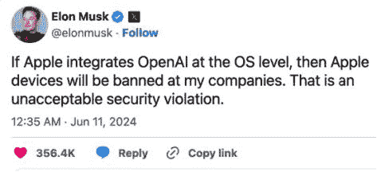
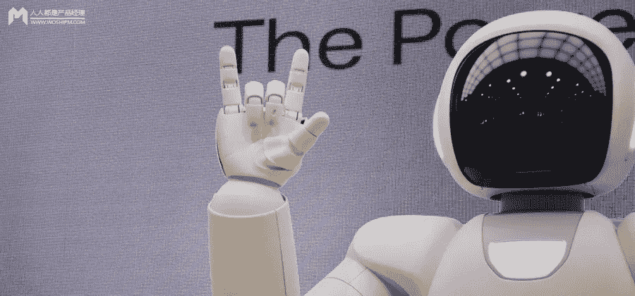

# 苹果，马斯克的新“仇人”？

> 来源：[https://qqs7y1hozd1.feishu.cn/docx/PiTpdZ5BAoE04vxmBZPcvRwhnPe](https://qqs7y1hozd1.feishu.cn/docx/PiTpdZ5BAoE04vxmBZPcvRwhnPe)

# 2024.12.16周一

# Mark的AI产品经理知识库——互联网前沿资讯推送！

######### [苹果，马斯克的新“仇人”？](https://qqs7y1hozd1.feishu.cn/wiki/SPL5whGx7ishC9kC80fcu9dunie#share-ZFRRdv2CsozSECxazI7crJ8LnNc)

######### 泰勒·斯威夫特巡演结束后发放了14亿奖金

######### [出海泛娱乐应用靠AI玩法月入百万美](https://qqs7y1hozd1.feishu.cn/wiki/SPL5whGx7ishC9kC80fcu9dunie#share-T64UdiGyuo2mBJxIvTLc8DEbnnc)金，背后技术竟是来自同一家中国大模型企业

######### [马斯克宣布 SpaceX 总部将正式迁至美国得州，](https://qqs7y1hozd1.feishu.cn/wiki/SPL5whGx7ishC9kC80fcu9dunie#share-Vlm9dCc6joTxntxbRNPcv4YLnrd)打造新的「星际基地城」，商业上如何解读？

######### AI产品调研｜数字人交互视频创作类产品

> 欢迎加入社群

# 今日热点 💎

## 💡苹果，马斯克的新“仇人”？

字母榜 | https://www.36kr.com/p/3079892172338824（⬅️原文直达）

OpenAI好像好久没有这么热闹了。

12天的直播活动还在进行着，目前进度条刚一半，就已经抛出了不少重磅消息。

Sora终于发布了，和苹果的合作也终于正式落地。当地时间12月12日，OpenAI宣布全面登陆苹果生态，可以运行苹果智能（Apple Intelligence）的设备现在可以无需注册一键呼出ChatGPT了。

与此同时，OpenAI的外界压力愈发的大了。

先是马斯克起诉OpenAI这件事又有了新进展，马斯克直接申请法官禁止OpenAI转为营利性公司。然后谷歌瞄准OpenAI的靠山，在FTC来问话的时候，表示应该终止微软和OpenAI就云服务的独家协议。

可惜X（前推特）不显示用户用的什么设备。半年前苹果官宣和OpenAI合作的时候，马斯克曾怒发消息称如果成真，那么“苹果设备将在我的公司禁止使用”，而他手里的公司可不少。如今ChatGPT正式“上岸”苹果，不知道马斯克的新X消息是用什么设备发布的。

## 💡泰勒·斯威夫特巡演结束后发放了14亿奖金

8点1氪 https://www.36kr.com/p/3080764339287687（⬅️原文直达）

泰勒·斯威夫特刷新全球最高巡演票房纪录，结束后发放14亿奖金

近日，泰勒·斯威夫特的时代巡演圆满落幕，总票房突破20亿美元，刷新了全球最高巡演票房纪录。据报道，霉霉在支付所有工作人员的基本薪水后，还发放了高达1.97亿美元的奖金，相当于约14亿人民币。12月8日，霉霉在加拿大温哥华结束了最后一场演出。此次巡演从2023年3月18日在美国亚利桑那州首演开始，遍及五大洲50多个城市，共举办了149场演唱会。每场演出都座无虚席，吸引了来自世界各地的歌迷。

## 💡出海泛娱乐应用靠AI玩法月入百万美金，背后技术竟是来自同一家中国大模型企业

白鲸出海 | https://www.baijing.cn/article/51037（⬅️原文直达）

近期，一场社交应用下架风波引发出海应用企业圈层广泛关注，如何让应用工具在更合法合规的模式下运行，并且要保证应用玩法不断更新，为用户带来新鲜的体验感，这个课题成为出海人关注的重点。在对大量泛娱乐赛道产品进行观察过程中我们发现，AI 技术和新玩法的融入，成为当下泛互出海产品最佳的选择。

在社交应用中添加 AI 特效、AI 互动等新功能；直播应用中实现 AI 个性化的玩法，例如 AI 定制打赏礼物等；图视频编辑应用中加入极具趣味性的 AI 模版素材等，类似趣味玩法大大增加了用户粘性和付费意愿，为背后的应用产品创造了流水数据的暴增。

这背后的技术实现逻辑是什么？还有哪些新的技术玩法可以填补泛娱乐产品功能的空白？带着这些问题，我们挖掘到这些技术背后的一家中国大模型企业，并通过对这家企业技术的探索，寻找出海泛娱乐产品的下一个增长点。

## 💡马斯克宣布 SpaceX 总部将正式迁至美国得州，打造新的「星际基地城」，商业上如何解读？

知乎| https://www.zhihu.com/question/6867560931（⬅️原文直达）

地时间12月13日，全球首富、美国企业家埃隆·马斯克在社交媒体X平台上发文宣布，美国太空探索技术公司SpaceX总部将正式迁至美国得州，并将打造新的“星际基地城”。

星际基地（Starbase）位于得州南部卡梅伦县，用来建造并发射重型运载火箭“星舰”。

当地时间12日，SpaceX致信美国地方官员，要求进行民选，将其位于得克萨斯州南部卡梅伦县的工厂基地——星际基地（Starbase）转变为一个新的注册城市。

该基地靠近墨西哥边境，是SpaceX制造和发射搭载大型星际飞船的猎鹰火箭的基地。据该公司称，这份请愿书是由星际基地的居民联合提交的。

据券商中国，星际基地总经理Kathryn Lueders表示，为了培养快速开发和制造星际飞船所需的劳动力，SpaceX需要将星际基地发展为一个社区。这就是公司请求卡梅伦县举行选举，使星际基地成为一座新城市的原因。

卡梅伦县法官表示，这是SpaceX公司第一次正式提交请愿书。当地法律和选举管理部门将审查该请愿书，判断其是否符合所有法定要求，然后再采取行动。

早在2021年，马斯克就曾提出过将星际基地打造成城市的想法。马斯克当时在社交媒体上发帖称，将在得克萨斯州创建星际基地城。

## 💡AI产品调研｜数字人交互视频创作类产品

人人都是产品经理 |https://www.woshipm.com/evaluating/6156666.html（⬅️原文直达）

随着 AIGC、3D 建模、文生视频等技术发展，虚拟数字人能够通过智能交互协助企业进行知识传递、互动问答、智能咨询、产品推介、服务导览等；相较于真人，有「及时反馈互动性高、全天候服务、个性化和定制化、跨文化跨语言传播、成本低效益高」等优势。