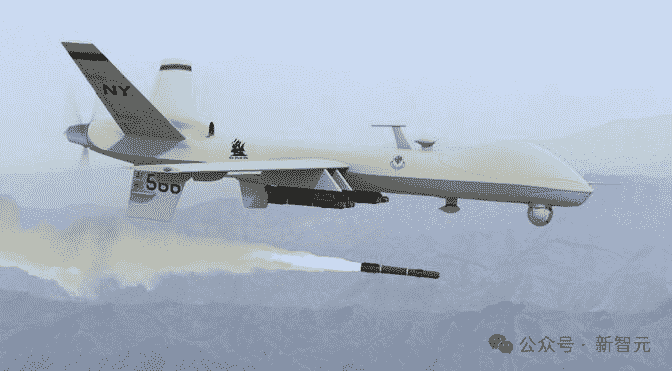
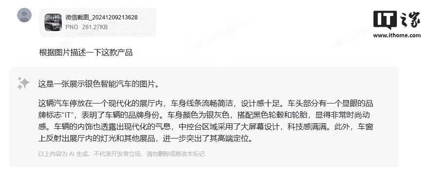
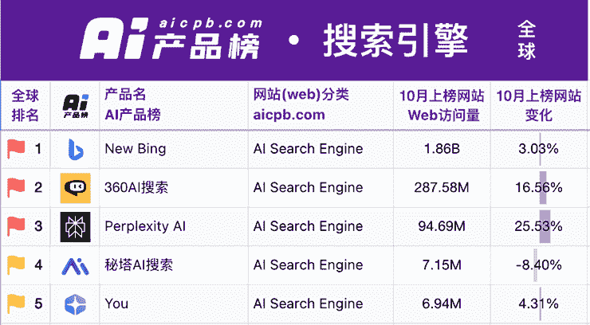

# OpenAI首次跨界军事AI，联合军工巨头提出绝密协议，AI无人机重塑现代战争

> 来源：[https://qqs7y1hozd1.feishu.cn/docx/WaUvdKDR9oBwzLxnWvhcITTQnyc](https://qqs7y1hozd1.feishu.cn/docx/WaUvdKDR9oBwzLxnWvhcITTQnyc)

# 【光年日报】2024.12.10周二

# Mark的AI产品经理知识库——互联网前沿资讯推送！

######### [OpenAI首次跨界军事AI，联合军工](https://qqs7y1hozd1.feishu.cn/wiki/Ea05w0v3piHugPkRvwScuHvRnPb#share-DzvsdTwJQoTmdVxPp7QcYnVWn8g)巨头提出绝密协议，AI无人机重塑现代战争

######### [刚刚，OpenAI 王炸 Sora 正式上](https://qqs7y1hozd1.feishu.cn/wiki/Ea05w0v3piHugPkRvwScuHvRnPb#share-TyAAdaOIKoIeJKxAvLvcmVgQnOd)线！网站火到崩溃，奥特曼紧急关闭用户注册

######### [智谱首个免费多模态模型 GLM-4V-Fla](https://qqs7y1hozd1.feishu.cn/wiki/Ea05w0v3piHugPkRvwScuHvRnPb#share-HHtKdilsJo8tO6xIUt4cevhWnJU)sh 上线，支持图像描述生成、视觉问答等

######### 小米系首家具身大模型公司「小雨智造」获北京市投资，已在工业化场景落地

######### 一位全网用户150万的独立开发者，又做了一款高评价AI搜索引擎

> 欢迎加入社群

# 今日热点 💎

## 💡OpenAI首次跨界军事AI，联合军工巨头提出绝密协议，AI无人机重塑现代战争

新智元 | [OpenAI首次跨界军事AI](https://www.36kr.com/p/3070897165775748)（⬅️原文直达）

OpenAI正悄然跨入一个全新的领域——军事AI。最新官宣中，OpenAI将联手国防技术公司Anduril，将技术整合进无人机中，未来战争的样貌要被重新定义了。

OpenAI正式进军军事领域！

周三，国防技术公司Anduril Industries和OpenAI宣布达成合作，共同开发和部署用于国家安全任务的先进人工智能解决方案。

此次合作将专注于提升美国反无人机系统（Counter-UAS，简称CUAS）的性能，增强其实时侦测、评估和应对空中无人机袭击的能力。

## 💡刚刚，OpenAI 王炸 Sora 正式上线！网站火到崩溃，奥特曼紧急关闭用户注册

APPSO | [openAI王炸Sora上线](https://mp.weixin.qq.com/s/91pFS1uzyHsYHUGeZYb-vw)（⬅️原文直达）

就在刚刚，OpenAI Sora 正式登场。本次发布会延续了「短剧」的快节奏风格，全程 20 分钟左右，由 CEO Sam Altman、Sora 负责人 Bill Peebles 等人主持。

OpenAI 在 X 平台表示，自 2 月份以来，他们一直在构建 Sora Turbo，后者是一个速度明显更快的模型版本，今天也将其作为独立产品向 Plus 和 Pro 用户开放。

有趣的是，由于 Sora 热度太高，大批用户涌入体验网站，导致该网站一度崩溃，停止注册登录。不给力的服务也让 Altman 连连在 X 平台安抚用户：「由于需求超出预期，我们将不得不间歇性地关闭新用户注册，并且生成内容的速度会在一段时间内减慢。我们正在全力以赴！」

## 💡智谱首个免费多模态模型 GLM-4V-Flash 上线，支持图像描述生成、视觉问答等

IT之家 |[智谱首个免费多模态模型 GLM-4V-Flash 上线，支](https://www.ithome.com/0/816/468.htm)持图像描述生成、视觉问答等 - IT之家（⬅️原文直达）

[IT之家](https://www.ithome.com/) 12 月 9 日消息，继 8 月语言模型 GLM-4-Flash 免费后，智谱 AI 在今天上线第一款免费的多模态模型 —— GLM-4V-Flash。GLM-4V-Flash 不仅基于 4V 系列模型的各项优秀能力，更在图像处理上实现了精确度的提升。

据介绍，GLM-4V-Flash 模型拥有图像描述生成、图像分类、视觉推理、视觉问答（VQA）以及图像情感分析等高级图像处理功能，并且支持包括中文、英语、日语、韩语、德语在内的 26 种语言。

在企业应用中，GLM-4V-Flash 能够针对特定垂直行业提供精准的场景解决方案，以低成本投入助力开发者迅速融入大模型时代，无需顾虑大模型图像处理的高昂成本。

+   体验中心：[https://www.bigmodel.cn](https://www.bigmodel.cn/console/trialcenter)/console/trialcenter

+   说明文档：[https://www.bigmodel.cn/dev/api](https://www.bigmodel.cn/dev/api/normal-model/glm-4v)/normal-model/glm-4v

## 💡小米系首家具身大模型公司「小雨智造」获北京市投资，已在工业化场景落地

36氪| [小雨智造](https://mp.weixin.qq.com/s/5NJcRbjYJ3TtImCRHD4ahg)（⬅️原文直达）

小米投资的首家大模型机器人公司——北京小雨智造科技有限公司（以下简称「小雨智造」）完成亿元A轮融资。

本轮融资由北京信息产业发展投资基金独家投资，这是继天使轮获得小米集团、王田苗教授、北京智源研究院等亿元投资后，小雨智造再次获得亿元级别的融资。

「小雨智造」由小米集团的核心创始团队于2023年创立，专注于开发适用于工业领域的大模型机器人技术，为机器人打造能够适应各种任务的“通用大脑”。

团队方面，「小雨智造」创始人乔忠良，作为小米的初创成员之一，曾担任MIUI研发负责人；联合创始人王文林，曾任小米软件系统平台部总经理，主导了“小米大脑”的开发。核心团队成员均来自小米、微软、华为和字节等。

产品方面，「小雨智造」研发了「Xiaoyu Brain」通用机器人大脑，使机器人能够在工业环境中执行各种任务。目前，「小雨智造」已经形成了一套自主研发的机器人大模型解决方案，主要特点是高精度、高鲁棒性和高泛化性。

## 💡一位全网用户150万的独立开发者，又做了一款高评价AI搜索引擎

白鲸出海 | [又做了一款高评价AI搜索引擎](https://www.baijing.cn/article/50786)（⬅️原文直达）

在 Owen 的博客中，他预期 BiLin 将会成为“国际互联网的入口”。但是理性分析，作为注定是“大流量赛道”的搜索引擎，一个独立开发者的产品想要成为“国际互联网的入口”有很大概率是力有未逮。但凭借着 Owen 对用户的洞察，对低成本、注意力自由的坚持，收获一批用户，并为解决他们在搜索中的痛点，还是没有问题的。

上线一个月左右，BiLin 官网的访问量已经达到了 3w，有的时候一个简单的设计变化，也可以为一个产品提供强大的活力。