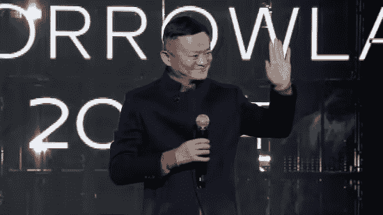
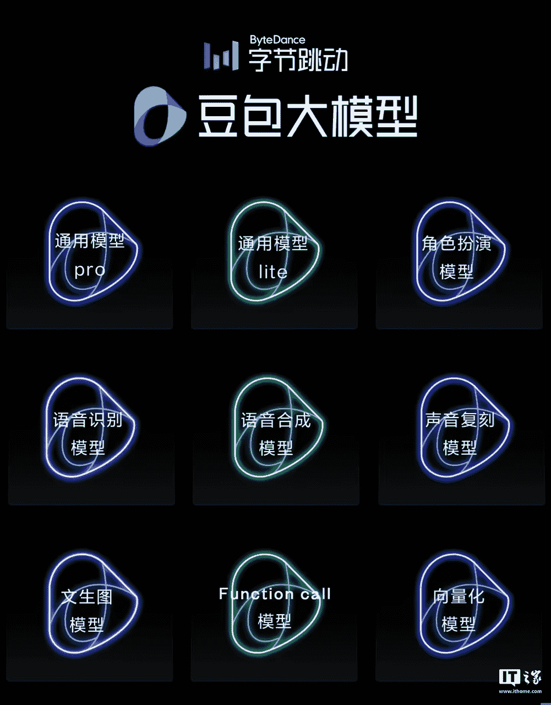
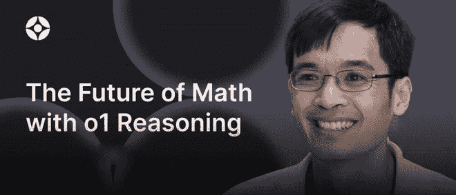
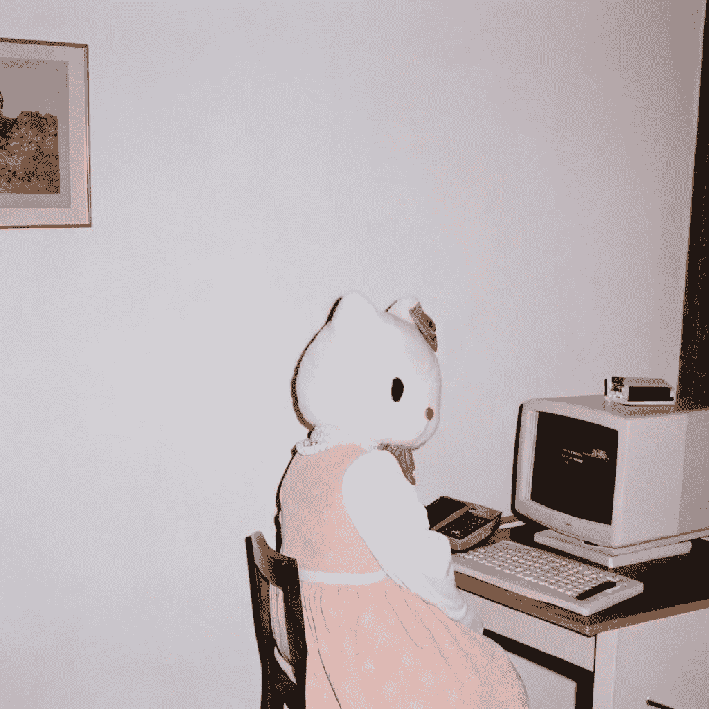

# 马云现身杭州祝福蚂蚁 20 岁生日：希望蚂蚁用科技为生活带去进步和改变

> 来源：[https://qqs7y1hozd1.feishu.cn/docx/W5wKdSrwooz57Yx5TUBcEkR0nwh](https://qqs7y1hozd1.feishu.cn/docx/W5wKdSrwooz57Yx5TUBcEkR0nwh)

# 【光年日报】2024.12.9 周一

# Mark的AI产品经理知识库——互联网前沿资讯推送！

######### 马云现身杭州祝福蚂蚁 20 岁生日：希望蚂蚁用科技为生活带去进步和改变

######### 张一鸣被曝全力押注 AI，亲自监督字节跳动招聘高端人才

######### [**很快OpenAI能证明陶哲轩错了**](https://qqs7y1hozd1.feishu.cn/wiki/WkwlwVhXniNAj3kOhnGcFWj1ngc#share-E1yddKBC4oYGrAxrwjEcEgcSntI)？陶哲轩一句话，被OpenAI高管怼回去

######### 从喧嚣回归理性：从大模型回归业务

######### [**一秒变身Hello Kitty整顿**](https://qqs7y1hozd1.feishu.cn/wiki/WkwlwVhXniNAj3kOhnGcFWj1ngc#share-CHGedk7ZEo8pYoxingccTggMn8a)职场，这个AI工具能把一切都变成 CCD

> 欢迎加入社群

# 今日热点 💎

## 💡马云现身杭州祝福蚂蚁 20 岁生日：希望蚂蚁用科技为生活带去进步和改变

抖音 | [马云谈AI变革](https://www.douyin.com/search/%E9%A9%AC%E4%BA%91%E8%B0%88AI%E5%8F%98%E9%9D%A9)（⬅️原文直达）

马云首先向 20 岁的蚂蚁送上深深的祝福，他说：很高兴和大家一起庆祝支付宝的 20 周年，过去的 20 年，你们无中生有，创造了支付宝，余额宝，蚂蚁森林．．．．．．以自己的努力和方式参与了社会的发展建设。我在这里代表最早的创始群体，致敬支付宝，致敬蚂蚁，祝福蚂蚁！

他表示，“**今天，我不是为蚂蚁过去的 20 年**而来，而是为了蚂蚁未来的 20 年而来。”

马云说，每一个时代都给了每一代人不同的际遇和挑战，但不是每一个人都能把握住这些际遇和挑战。20 年前，互联网刚刚到来的时候，我们这一代人很幸运，抓住了互联网时代的机遇。从今天来看，未来 20 年的 AI 时代能带来的改变会超出所有人的想象，因为 AI 会是一个更加伟大的时代。

近几年马云在全球范围内观察新科技、新趋势，他跟蚂蚁员工分享自己的思考：“AI 会改变一切，但这不代表，AI 能决定一切。技术固然重要，但是未来真正决定胜负的，还是今天我们为这个即将到来的时代做些什么真正有价值而又是与众不同的事。”

他说，“我们未来能做的，依然应该是我们过去 20 年所坚**持的那些，让科**技给每一个普通老百姓的生活带去进步和改变。我们要让 AI 赋能我们的情怀，我们也要让情怀赋能我们的 AI！”

## 💡张一鸣被曝全力押注 AI，亲自监督字节跳动招聘高端人才

IT之家 | [张一鸣被曝全力押注 AI](https://www.ithome.com/0/816/253.htm)（⬅️原文直达）

据英国《金融时报》12 月 8 日报道，字节跳动内部人士称，字节跳动创始人张一鸣虽然已卸任 CEO 一职，但他一直积极参与该集团的 AI 战略。

这些人士说，张一鸣亲自监督了从竞争对手公司招聘 AI 工程师和研究人员的工作。张一鸣在内部谈到了他的“通用人工智能”目标，即具有类似人类智能的系统。

报道还称，在从竞争对手的芯片公司挖来领先人才后，字节跳动拥有一支致力于 AI 芯片的团队。据知情人士透露，该团队正在构建一个 AI 加速器专用集成电路（ASIC），这是一种用于机器学习的专用 AI 芯片，以谷歌的 Tensor Processing Unit 为蓝本。

## 💡很快OpenAI能证明陶哲轩错了？陶哲轩一句话，被OpenAI高管怼回去

IT之家 | 很快OpenAI能证明陶哲轩错了（⬅️原文直达）

o1推理代表着推理的未来。菲尔兹奖得主陶哲轩在OpenAI最新访谈中表示，AI可以帮助从头开始重新设计数学，以前所未有的规模处理数学问题，引领着一个全新的发现时代。

这周，OpenAI连更两弹，又将o1模型推向全网最高潮。

就连奥特曼本人激动地预告，「迫不及待期待着下周的Day 3发布，感觉周一是那么地遥远」。

## 💡从喧嚣回归理性：从大模型回归业务

人人都是产品经理 | 从喧嚣回归理性：从大模型回归业务（⬅️原文直达）

四月，我满怀期待与渴望发布了关于 RAG 重塑智能客服行业的文章。那时，对未来充满无限幻想。然而，历经几个月的 AI 产品经理之旅，如今的我与市场一同回归理性。

这段时间，我见证了大模型的奇妙变化，看到了它的无限可能性，也掉入过它的 “坑”。虽有诸多问题，但不可否认，大模型为工作带来极大便捷，数据分析精准高效、代码编写轻松省力、文章创作才华尽显。从最初的满心憧憬到探索中的迷茫困惑，再到如今的冷静思考，我深刻体会到 AI 之路的波澜起伏。

## 💡一秒变身Hello Kitty整顿职场，这个AI工具能把一切都变成 CCD

APPSO | 变身Hello Kitty整顿职场（⬅️原文直达）

最近热门的 Recraft 却是个例外——你可能不陌生了，我们之前研究过它在排版方面的强大功能。只是没想到，它因为一个新出的「滤镜」成为了社交媒体爆款，而且不是火一小会儿就过去了，而是火了一波又一波。先是梦核神器，后是出产「打工版 Hello Kitty」。

留心观察了这段时间 Recraft 的火热变化，我意识到，AI 生图工具已经进入到了一个新阶段。网友们追求的不是模型、算法，而是没有「AI 味」的效果。