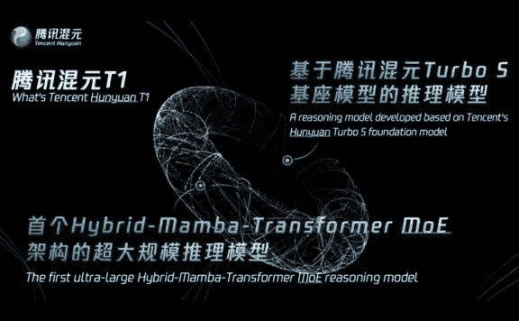
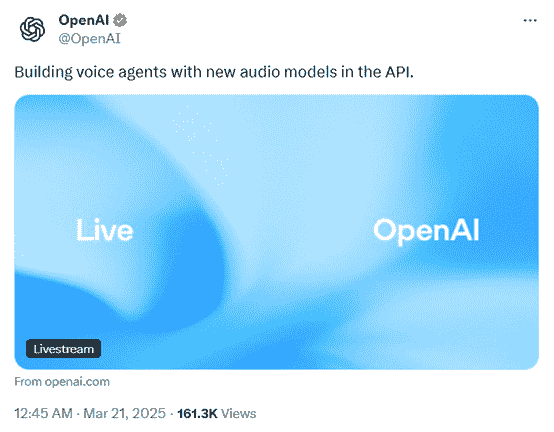
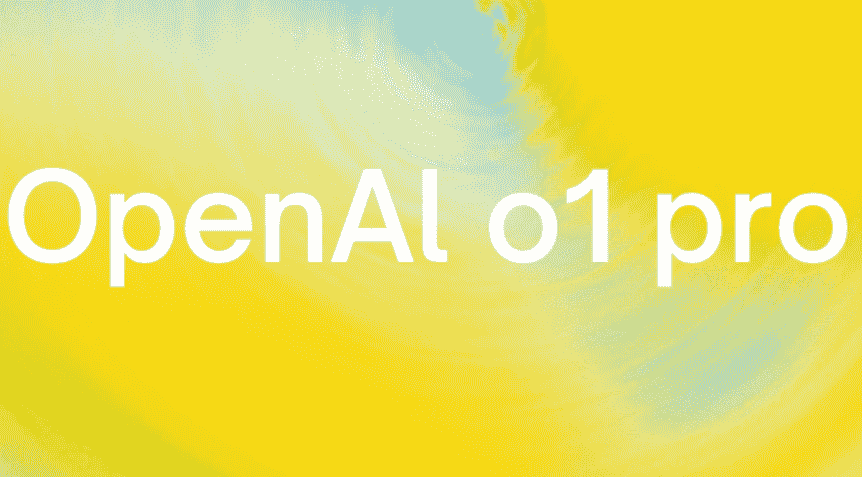
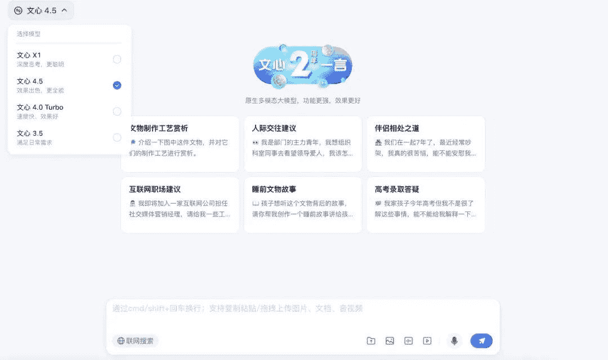
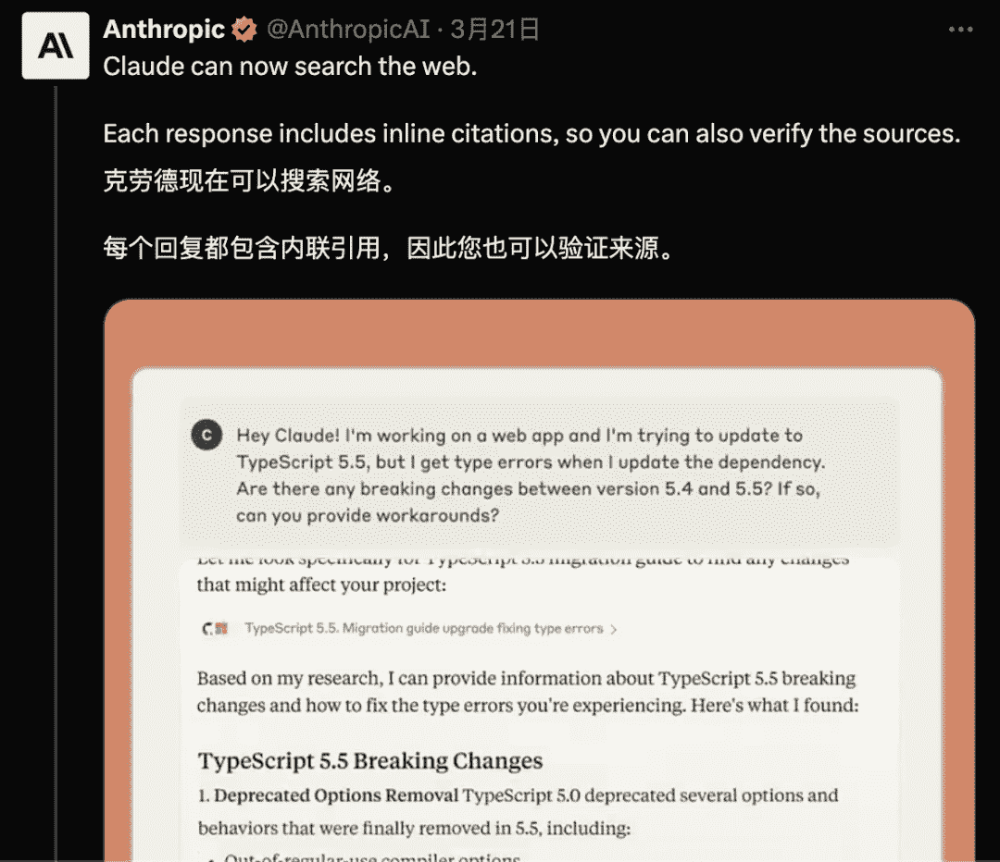

# AI行业资讯3.24

> 来源：[https://qqs7y1hozd1.feishu.cn/docx/UuMLddsi4omVsnxieVFccWaVnad](https://qqs7y1hozd1.feishu.cn/docx/UuMLddsi4omVsnxieVFccWaVnad)

+   **腾讯发布自研混元T1正式版**

+   英伟达GTC 2025大会发布多款重磅产品，涵盖AI芯片和人形机器人

+   **OpenAI发布语音Agent**

+   **OpenAI发布史上最贵模型o1-**pro API，定价远超DeepSeek

+   GitHub CEO谈AI Agent对程序员的影响，未来将更个性化

+   **百度发布文心大模型4.5及X1**

+   Anthropic发布Claude联网搜索功能，强调安全与信息透明

# 腾讯发布自研混元T1正式版

3月21日，腾讯宣布推出自研深度思考模型混元T1正式版，并已在腾讯云官网上线。

混元T1正式版沿用了混元Turbo S的创新架构，采用Hybrid-Mamba-Transformer融合模式，这是工业界首次将混合Mamba架构无损应用于超大型推理模型。这一架构有效降低了计算复杂度，并显著降低了训练和推理成本，让混元T1实现首字秒出，吐字速度达到最快80 tokens/s。

通过大规模强化学习，并结合数学、逻辑推理、科学和代码等理科难题的专项优化，混元T1正式版进一步提升了推理能力。与此前已上线腾讯元宝的混元T1-preview模型相比，综合效果明显提升。

在多个常见Benchmark上，混元T1表现优异：

+   在大语言模型评估增强数据集MMLU-PRO中，混元T1取得87.2分，仅次于o1。

+   在CEval、AIME、Zebra Logic等中英文知识及竞赛级数学、逻辑推理的公开基准测试中，混元T1的成绩达到业界领先推理模型的水平。

+   此外，混元T1还在多项对齐任务、指令跟随任务和工具利用任务中展现出非常强的适应性。

价格方面，混元T1输入价格为每百万tokens 1元，输出价格为每百万tokens 4元。

此外，本周腾讯混元大模型推出5个基于Hunyuan3D-2.0打造的全新3D生成模型并宣布全部开源，同时升级了自研的3D AI创作引擎。引擎提升了PBR材质生成效果，让模型的光影看起来更真实，兼容多种主流格式（如OBJ、GLB、FBX等），无缝对接3D打印和移动端实时交互需求。

目前，腾讯混元3D AI创作引擎已上线官网，而模型也已上架HuggingFace和Github。

# 英伟达GTC 2025大会发布多款重磅产品，涵盖AI芯片和人形机器人

在GTC 2025大会上，英伟达创始人黄仁勋带来了一系列重磅产品，包括全新Blackwell芯片、下一代AI芯片「Vera Rubin」以及全球首款开源人形机器人功能模型「Isaac GR00T N1」。

### Blackwell芯片

+   Blackwell Ultra：代号「Ultra」的GB300 AI芯片，包括GB300 NVL72机架级解决方案和HGX B300 NVL16系统。GB300 NVL72将于今年下半年发布，提供20 petaflops的AI性能，配备288GB的HBM3e内存，适用于AI智能体和「物理AI」。

+   DGX Station：包含单个GB300 Blackwell Ultra芯片的台式电脑，配备784GB系统内存和800Gbps的ConnectX-8 SuperNIC网络，支持20 petaflops的AI性能。

+   DGX Spark：CES 2025展示的「迷你主机」正式命名为DGX Spark，搭载GB10 Grace Blackwell超级芯片，每秒可提供高达1000万亿次AI计算操作，用于最新AI推理模型的微调和推理。

### 下一代AI芯片「Vera Rubin」

+   Vera Rubin的性能将达到Hopper的900倍，而Blackwell相较Hopper已实现了68倍的提升。

+   Vera Rubin NVL144预计将在2026年下半年发布，英伟达还计划推出Rubin Ultra版本。

### 人形机器人「Isaac GR00T N1」

+   Isaac GR00T N1在大会上亮相，展示了其强大的功能和灵活性。

+   一台搭载Newton平台的机器人「Blue」登上了舞台，能够用声音和动作与黄仁勋互动，外观神似《星球大战》中的BDX机器人。

这些产品的发布展示了英伟达在AI和机器人领域的强大实力和创新能力，为未来的技术发展和应用提供了新的方向。

# OpenAI发布语音Agent

3月21日凌晨1点，OpenAI在技术直播中发布了三款全新语音模型，专用于开发语音AI Agent。这三款模型包括两个语音转文本模型GPT-40 Transcribe和GPT-4 Mini Transcribe，以及一个文本转语音模型GPT-40 Mini TTS。OpenAI还开发了一个新网站来展示这些新功能。

### 三款语音模型介绍

+   GPT-40 Transcribe：高性能版本，基于最新的语音模型架构，经过海量音频数据训练，能够处理复杂的语音信号并准确转换为文本。其训练数据量达到了前所未有的规模，涵盖多种语言和方言，使其在不同语言环境下的转录任务中表现出色。

+   GPT-4 Mini Transcribe：通过模型压缩技术，将模型大小大幅减小，提高了运行速度并降低了资源消耗。这种设计使其更适合在资源受限的设备上运行，例如移动设备或嵌入式系统，同时也能满足实时性要求较高的应用场景。

+   GPT-40 Mini TTS：不仅能够将文本内容转换为自然流畅的语音，还允许开发者通过指令控制语音的语调、情感和风格。这使得语音Agent能够根据不同的情境和用户需求调整语音的表达方式，从而更好地传达信息和情感。该模型支持多种语言，并能够生成不同性别、年龄和口音的语音，适应不同地区、不同文化背景的用户需求。

### API和SDK重大更新

OpenAI为语音转文本API增添了强大的streaming模式，允许开发者将连续的音频流实时输入模型，模型也能实时返回连续的文本和响应。这种实时交互的特性对于需要即时反馈的应用场景非常有帮助。此外，API集成的噪声消除技术和语义语音活动检测器进一步优化了语音转文本的体验。

OpenAI还对其SDK进行了重大更新，新的Agents SDK采用了模块化设计，将语音转文本、文本处理和文本转语音等功能模块化。开发者可以根据自己的需求灵活组合这些模块，构建出符合特定应用场景的语音Agent系统。SDK提供了丰富的接口和工具，帮助开发者处理语音输入、文本处理和语音输出等各个环节，减少了开发工作量和复杂性。

目前，这些语音模型已经可以在API和SDK中使用。

# OpenAI发布史上最贵模型o1-pro API，定价远超DeepSeek

近日，OpenAI在其开发者API中推出了o1-pro模型。该模型相较于o1使用了更多的计算资源，旨在提供“更稳定、更优质的回答”。目前，o1-pro向Tier 1–5的特定开发者开放，支持视觉处理、函数调用、结构化输出，并兼容Responses API和Batch API。

然而，o1-pro的使用成本也大幅提高：输入每百万token需支付150美元，输出每百万token则需600美元。这一价格是OpenAI的GPT-4.5输入费用的两倍，是o1模型的十倍，堪称OpenAI最贵的模型。

相比之下，DeepSeek-V3的每百万输入token价格分别为0.07美元（缓存命中）和0.27美元（缓存未命中），输出token价格为1.10美元。而DeepSeek-R1每百万输入token价格为0.14美元和0.55美元，输出token为2.19美元。

尽管OpenAI认为o1-pro的性能提升足以让开发者愿意支付这笔高昂的费用，但据外媒TechCrunch报道，一些内部基准测试显示，在编程和数学问题上，o1-pro的表现仅比o1略好一些，尽管其在回答问题时的稳定性更高。

Sam Altman曾预测，使用固定级别AI的成本大约每12个月骤降90%，将极大推动AI的普及化。然而，o1-pro的定价似乎背道而驰，走起了“高奢”路线。在算力成本不断攀升的背景下，性能提升的边际收益是否能够持续匹配价格的增长，成为AI行业值得深思的话题。

# GitHub CEO谈AI Agent对程序员的影响，未来将更个性化

近日，GitHub CEO Thomas Dohmke在接受播客No Priors采访时表示，AI Agent的广泛采用需满足可预测、可操控、可验证和可容忍的标准。他认为，AI Agent的主要目的是提高用户效率，而非浪费时间，并需具备良好的推理模型和明确的开发流程。

然而，目前AI Agent在系统思维方面仍落后于人类，无法像人类一样在开发过程中不断提出和解决问题，而是只能将任务分解为小块逐一解决。

Thomas还展望了AI Agent的未来，认为其将更加个性化，能够根据用户的思路提供符合其想法的解决方案，并使结果更贴近用户风格。同时，AI模型将变得更加多元化，为用户提供更多选择。

# 百度发布文心大模型4.5及X1

3月16日，百度正式发布文心大模型4.5及文心大模型X1。

文心大模型4.5是百度首个原生多模态大模型，其多模态理解、文本和逻辑推理能力显著提升，在多项测试中表现优于GPT4.5，API调用价格仅为GPT4.5的1%。文心大模型X1为深度思考模型，性能对标DeepSeek-R1，并增加多模态、多工具调用能力，API调用价格约为R1的一半。

百度此前宣布文心一言将于4月1日免费，本次发布不仅带来两款全新大模型，还将免费时间提前，全面提升用户体验。文心大模型4.5已在百度智能云千帆大模型平台上线，输入价格低至0.004元/千tokens；文心大模型X1价格仅为DeepSeek R1一半，输入价格0.002元/千tokens。

目前，在文心一言官网即可免费体验文心大模型4.5和文心大模型X1。

# Anthropic发布Claude联网搜索功能，强调安全与信息透明

近日，Anthropic宣布其AI聊天机器人Claude现支持联网搜索功能。用户可启用「联网搜索」，在需要时自动联网提取信息，反馈结果中会提供直接引用来源，方便用户核实。值得注意的是，Claude的「联网搜索」并非Deep Research（深度研究）。

Anthropic作为第一梯队AI企业，因将「安全」作为核心理念，成为最后一批更新「联网搜索」的公司

