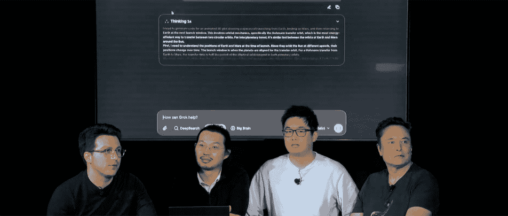
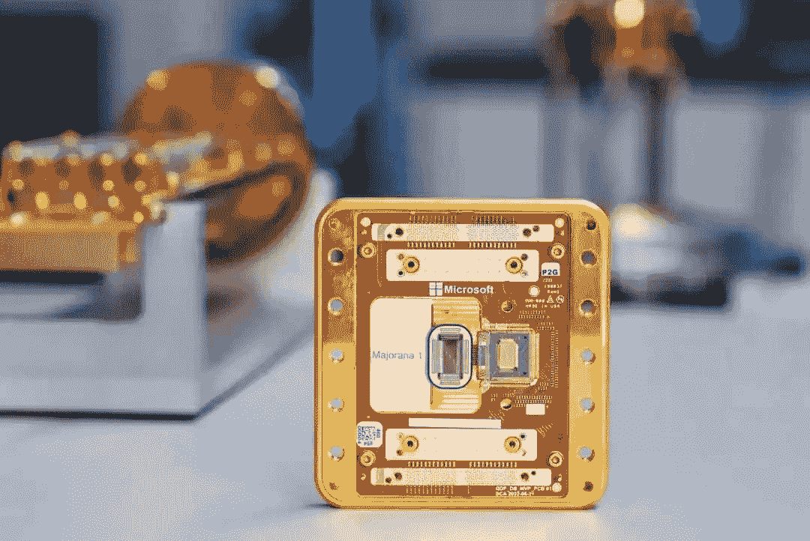
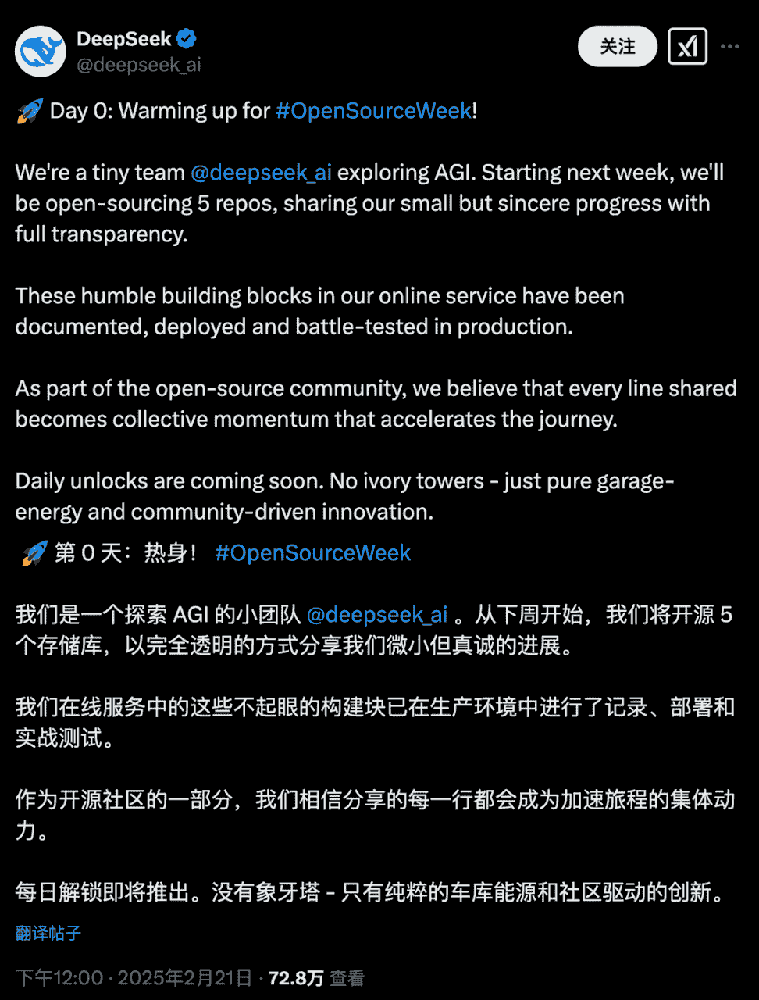
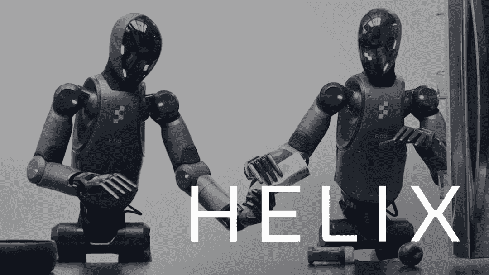
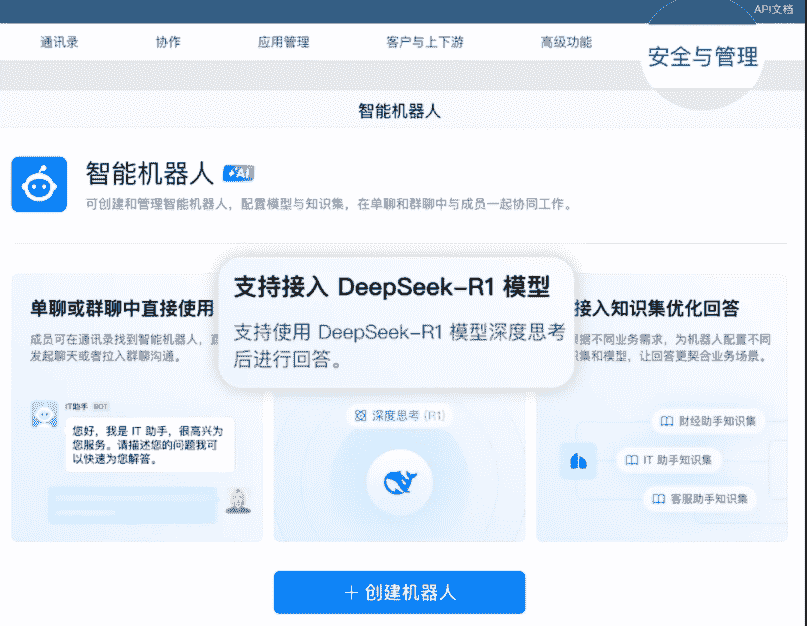
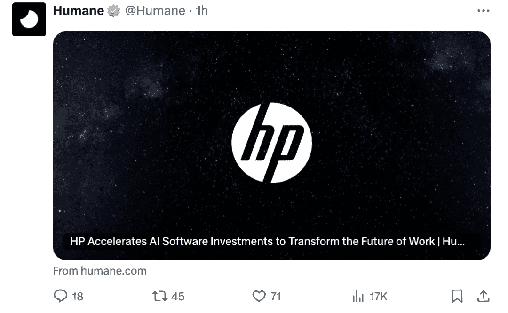

# Al 行业资讯 2.24

> 来源：[https://qqs7y1hozd1.feishu.cn/docx/TX1IdXqhToPSE1xYAEOcZBMvnxf](https://qqs7y1hozd1.feishu.cn/docx/TX1IdXqhToPSE1xYAEOcZBMvnxf)

+   **xAI发布Grok 3模型**

+   微软发布量子计算新突破，推出Majorana 1芯片

+   DeepSeek下周将开源五个项目

+   Figure AI发布首个通用视觉语言行动模型Helix

+   挪威机器人公司1X发布家用机器人Neo Gamma

+   企业🛰️宣布接入DeepSeek满血版大模型

+   惠普将收购 Humane 核心 AI 技术

# **xAI发布Grok 3模型**

2月18日，马斯克旗下的xAI正式发布了Grok 3模型。在LMSYS盲测中，Grok 3在代码、指令响应等各个方面排名第一，超过了Gemini-2 Pro、DeepSeek-V3、GPT-4o等模型。同时，Grok-3 mini也一同公布，它牺牲部分性能以换取更快的响应能力。推理版本的Grok 3 Reasoning Beta支持深度思考，在最新的AIME竞赛中表现断层领先。对比模型中还包括了近期火爆的DeepSeek R1模型。不过，Grok-3 Reasoning目前仍处于测试阶段。

Grok 3的训练累积使用了20万张H100显卡。xAI表示，最大的挑战是让整个模型在海量的H100上进行训练，并保持一致性。xAI还带来了由Grok 3加持的DeepSearch，号称是下一代搜索引擎。该模型将自主像agent一样运作，理解用户提问背后的意图，并在互联网以及X中进行全面检索。

备受关注的语音模式也有了进一步的公布。马斯克在直播中透露，语音模式将是Grok最好的体验之一。在发布直播尾声，xAI还放出了一段语音模式的预览视频，其效果十分接近人类声音。语音模式预计在一周内发布早期版本。

费用方面，X的Premium+订阅用户（每月40美元）将率先体验Grok 3，而其他高级功能则被纳入xAI推出的新计划「SuperGrok」中。SuperGrok的月费为30美元，年费为300美元，仅提供额外的推理和DeepSearch查询功能，还包含了无限量的图像生成服务。

此外，Grok API还将在未来几周内推出，包含推理模型和深度研究功能。xAI还宣布，当Grok 3成熟稳定之后，大概几个月将会开源Grok 2。

# 微软发布量子计算新突破，推出Majorana 1芯片

近期，微软宣布在量子计算领域取得重大突破，发布了世界上首个由拓扑内核驱动的量子处理单元（QPU）——Majorana 1芯片。这一成果标志着量子计算技术向前迈进了一大步，为未来构建大规模量子计算机铺平了道路。

根据微软发布的论文，Majorana 1芯片是基于一种新型的拓扑超导材料，该材料结合了砷化镓（半导体）和铝（超导体），首次实现了对马约拉纳粒子的精准操控。这种操控能力使得量子比特（qubits）更加稳定、抗干扰，为量子计算的可扩展性提供了坚实基础。

在过去17年中，微软一直在探索新材料和体系结构以实现量子计算。如今，微软已经成功将8个拓扑量子比特集成在一个仅有手掌大小的芯片上。这一芯片架构的目标是最终容纳100万个拓扑量子比特，这将是目前唯一明确具备可扩展性的架构。

微软技术研究员Chetan Nayak表示：“我们重新发明了量子时代的晶体管，这是通向实用量子计算的清晰路径。”他还强调，团队从一开始就致力于制造一台对商用有影响力的量子计算机，不仅要在思想上引领，更要实现规模化。微软预计在未来几年内能够造出解决工业规模问题的量子计算机。

# DeepSeek下周将开源五个项目

2月21日，DeepSeek在X平台发文宣布，将在下周（OpenSourceWeek开源周）连续五天开源五个项目的代码库。这些项目已经被记录、部署并在生产环境中经过实战测试。

DeepSeek团队强调，作为开源社区的重要一员，他们坚信每一行共享的代码都将成为推动整个AI领域发展的重要力量。对此，不少网友表示，真正的OpenAI来了。

# Figure AI发布首个通用视觉语言行动模型Helix

2月20日，美国人形机器人公司Figure AI发布了首个通用视觉-语言-行动（VLA）模型「Helix」。Helix能够像人类一样推理，并将感知、语言理解和学习控制融为一体。该模型可以通过自然语言直接控制人形机器人整个上半身。

Helix的主要特点包括：

+   强大的物体理解能力：搭载Helix模型的Figure机器人只需通过自然语言询问，就能拿起数千种形状、大小、颜色和材料属性各异的小型家居产品。

+   即时生成操作：Helix能够在没有特定任务演示或大量手动编程的情况下，即时生成长期、协作、灵巧的操作。

+   多机器人协作：Helix能够在两个机器人上同时运行VLA，使它们能够解决共享的长程操作任务，操作它们从未见过的物品。

+   商业部署能力：Helix是首个在完全板载嵌入式低功耗GPU上运行的VLA，可立即投入商业部署。

此外，Helix是首创的「系统1 + 系统2」VLA模型。通过解耦合的架构方式，允许每个系统以其最佳时间尺度运行。

# 挪威机器人公司1X发布家用机器人Neo Gamma

挪威机器人公司1X日前发布了其最新家用人形机器人产品Neo Gamma。作为Neo Beta的升级版本，这款新型人形机器人在设计理念上更加注重家庭使用场景，展示了包括冲咖啡、洗衣服和吸尘等多项家务能力。

为确保居家使用安全，Neo Gamma采用了针织尼龙材质的外壳设计，可以有效降低机器人与人类接触时可能造成的伤害。同时，该产品还搭载了先进的AI系统，能够精确感知周围环境，最大程度避免对人员和财物造成损害。

OpenAI是1X公司的早期投资者之一。与此同时，1X正在开发自己的AI模型，旨在提升机器人的语言交互能力和肢体语言表现。1X公司表示，Neo Gamma目前仍处于有限的居家测试阶段，距离商业化规模部署还有很长的路要走。

# 企业🛰️宣布接入DeepSeek满血版大模型

2月24日，🛰️公开课发文宣布企业🛰️正式接入了DeepSeek满血版大模型，并支持腾讯混元大模型。同时，企业🛰️一次性发布了多项AI能力，包括「智能机器人」、「智能表格-客户跟进总结」等，旨在大幅提升企业内部协作和客户服务效率。

企业🛰️的「智能机器人」功能全量上线，无需单独开发。管理员仅需设定好机器人角色、选定应用的AI大模型，如DeepSeek（陆续灰度开放）、混元模型等，即可一键创建专属「智能机器人」。每一位员工都可以从通讯录中添加这一内部工具，实现高效协作。

此外，企业🛰️的「智能表格」客户跟进模板也迎来了DeepSeek的加持。在灰度范围中的企业可以在智能表格中调用DeepSeek，自动生成「客户跟进总结」，进一步提升客户服务效率。

这些新功能不仅提升了企业的运营效率，还为企业提供了更智能的管理工具。通过「智能机器人」，企业可以快速部署AI驱动的自动化工具，减少人工操作。而「智能表格」功能借助DeepSeek的强大能力，能够自动生成详细的客户跟进总结，帮助企业管理层更好地掌握客户动态，优化服务策略。

随着DeepSeek和混元模型的不断优化，企业🛰️的AI能力将为更多企业提供更强大的支持。

# 惠普将收购 Humane 核心 AI 技术

本周，Humane宣布惠普公司将以1.16亿美元收购其关键人工智能能力，包括人工智能平台Cosmos、高技能技术人才以及300多项专利和专利申请的知识产权。这一收购标志着Humane的技术和人才将融入惠普，为后者带来强大的AI能力。

与此同时，Humane发布了AI Pin支持文件，宣布自即日起停止销售新的Ai Pin。对于已经购买Ai Pin的用户，设备将正常工作至2025年2月28日12点（太平洋标准时间）。在此之后，Ai Pin将不再连接到Humane的服务器，通话、消息、AI查询/响应或云访问等功能都将无法使用。

这一举措意味着Humane将专注于与惠普的合作，推动AI技术在更广泛领域的应用和发展。对于用户来说，虽然Ai Pin的销售和部分功能将停止，但Humane的技术和创新将继续在新的平台上展现其价值。

