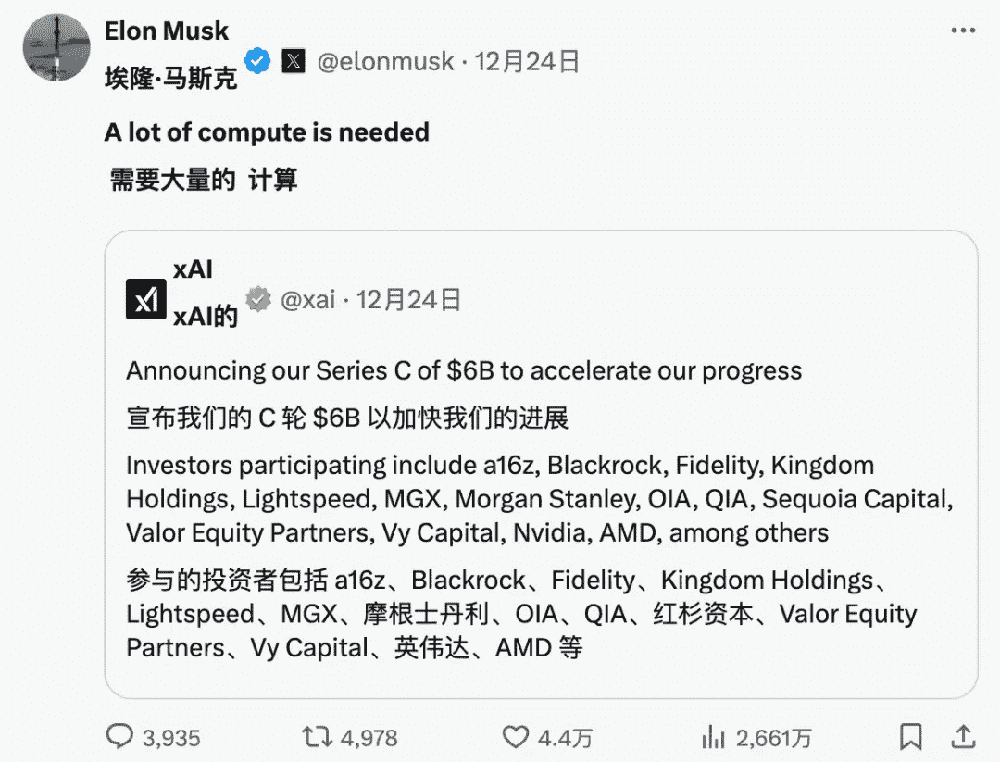
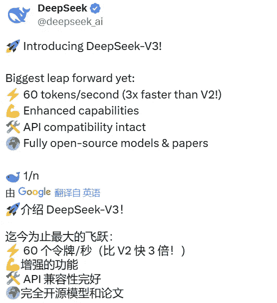
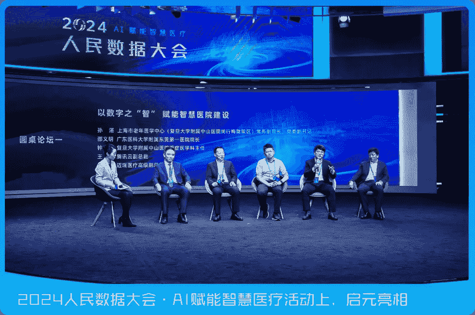
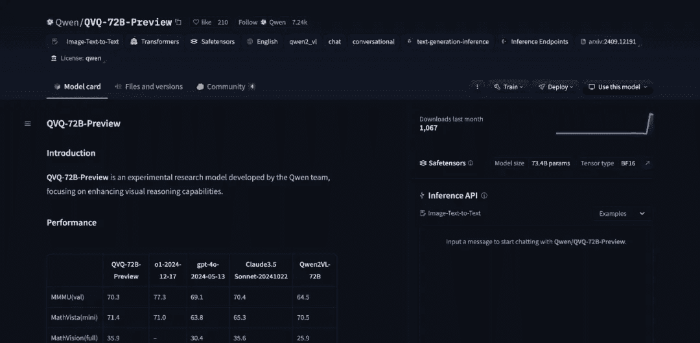
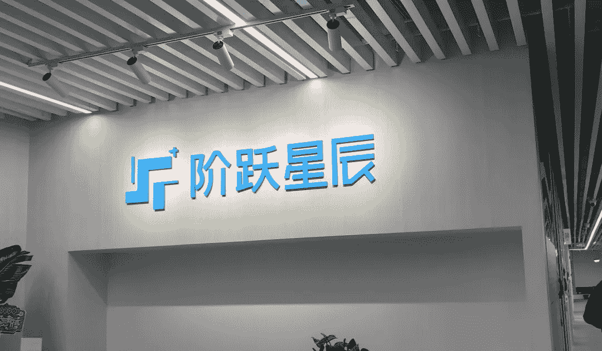
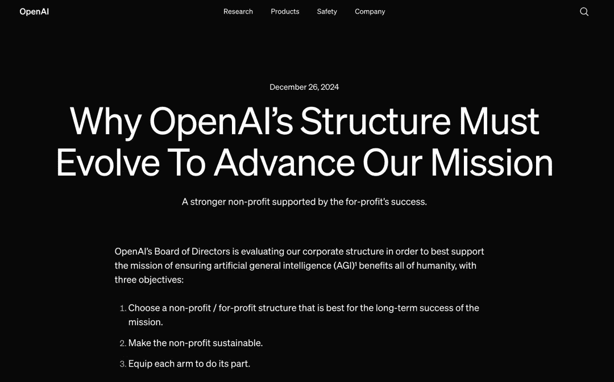
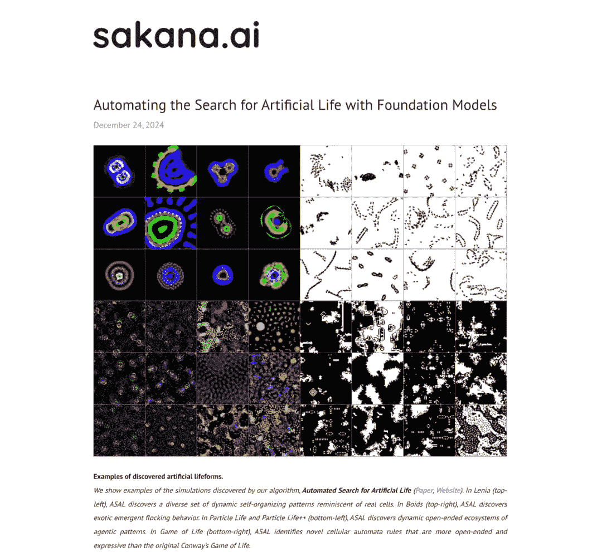

# AI行业资讯12.30

> 来源：[https://qqs7y1hozd1.feishu.cn/docx/GiGfdPbN5oH253xfQdjcFfERnQf](https://qqs7y1hozd1.feishu.cn/docx/GiGfdPbN5oH253xfQdjcFfERnQf)

1.  xAI完成60亿美元融资，加速基础设施建设与技术研发

1.  **国产大模型DeepSeek-V3火爆**全球，671B参数训练成本仅558万美元

1.  腾讯与迈瑞医疗合作推出全球首个重症医疗大模型「启元」

1.  通义千问开源多模态推理模型QVQ

1.  阶跃星辰完成数亿美元B轮融资，加速AI大模型研发

1.  OpenAI宣布转型为特拉华州公共利益公司

1.  Sakana AI联合研究团队提出「自动搜索人工生命」新算法

---

# xAI完成60亿美元融资，加速基础设施建设与技术研发

本周，xAI在社交平台上宣布已经成功完成了60亿美元的融资。此次融资的主要投资者包括A16Z、Blackrock、Fidelity Management & Research Company等知名投资机构，同时英伟达和AMD也参与了本轮融资。

xAI在官网的文章中表示，此轮融资的资金将用于进一步加速公司的基础设施建设，推出将被数十亿人使用的开创性产品，并加速未来技术的研发。

今年11月，xAI已获得50亿美元融资，公司估值达到500亿美元。参与此轮融资的投资者包括卡塔尔投资局、Valor Equity Partners、红杉资本和Andreessen Horowitz等。

xAI的这一系列融资活动显示了其在全球AI领域的重要地位和影响力，以及其在推动技术创新和基础设施建设方面的雄心。随着资金的注入，xAI有望在AI技术的研发和应用方面取得更多突破，为用户提供更加先进和个性化的服务。

# 国产大模型DeepSeek-V3火爆全球，671B参数训练成本仅558万美元

本周，一个国产大模型DeepSeek-V3火遍全球。DeepSeek-V3的参数量高达671B，但其预训练过程仅用了266.4万H800 GPU小时，总训练成本仅为558万美元。

尽管DeepSeek-V3的训练计算量较少，其性能却非常出色。在英语、代码、数学、汉语以及多语言任务上，基础模型DeepSeek-V3 Base表现优异，在AGIEval、CMath、MMMLU-non-English等任务上远超其他开源大模型。与GPT-4o和Claude 3.5 Sonnet相比，DeepSeek-V3在MATH 500、AIME 2024、Codeforces上也有明显优势。

DeepSeek-V3的惊人表现得益于其采用的MLA（多头隐注意力）和DeepSeekMoE架构。这些技术在DeepSeek-V2上已得到验证，现在成为DeepSeek-V3实现高效推理和经济训练的基石。此外，DeepSeek-V3率先采用无辅助损失的负载平衡策略，并设定了多token预测训练目标，以实现更强大的性能。

Meta AI研究科学家田渊栋和著名AI科学家Andrej Karpathy对DeepSeek-V3的进展大加赞赏。贾扬清也表示，DeepSeek-V3的诞生标志着我们正式进入了分布式推理的疆域，671B的参数量已经无法放入单台GPU。

DeepSeek-V3的开源再次引爆了人们对开源模型的热情。OpenRouter表示自发布以来，DeepSeek-V3的使用量已经翻了3倍。用户纷纷在网上分享他们的体验。

# 腾讯与迈瑞医疗合作推出全球首个重症医疗大模型「启元」

12月27日，腾讯宣布与迈瑞医疗合作，共同搭建了全球首个重症医疗大模型——「启元重症大模型」。这一创新合作标志着医疗AI领域的一个重要进展。

「启元重症大模型」能够读取患者的生命体征数据，并建立患者的「数字画像」。该模型仅需5秒即可总结患者的病情，为医护人员提供快速的病情概览。在建立「数字画像」后，启元大模型会以「重症医生的思维」对画像进行深度分析，并提供诊疗建议，辅助医护人员进行后续治疗干预。

据介绍，「启元重症大模型」的整体参数量达到万亿级别，是经过大量医学文本数据训练的医学大模型。它涵盖了285万医学实体、1,250万医学关系，并覆盖了98%的医学知识，包括医学知识图谱和医学文献，为重症医疗提供了强大的数据支持。

「启元重症大模型」的推出，不仅展示了腾讯在AI技术应用方面的深入探索，也体现了迈瑞医疗在医疗设备和数据处理方面的专业能力。这一合作有望为重症医疗领域带来革命性的变化，提高诊疗效率和质量，为患者提供更精准的医疗服务。

# 通义千问开源多模态推理模型QVQ

通义千问于12月25日宣布，基于Qwen2-VL-72B构建的开源多模态推理模型QVQ正式开源。

官方介绍称，QVQ在人工智能的视觉理解和复杂问题解决能力方面实现了重大突破。在MMMU评测中，QVQ取得了70.3的优异成绩，并且在各项数学相关基准测试中相比Qwen2-VL-72B-Instruct都有显著提升。

QVQ通过细致的逐步推理，在视觉推理任务中展现出增强的能力，尤其在需要复杂分析思维的领域表现出色。

通义千问的愿景是开发一个“全能”和“智能”的模型，目前正在增强其视觉语言基础模型，赋予其基于视觉信息的深度思考和推理的高级能力。在不久的将来，通义计划将更多的模态整合到一个统一的模型中，使其更加智能，能够应对复杂的挑战并参与科学探索。

目前，QVQ模型已在魔搭社区和HuggingFace等平台上开源，供研究人员和开发者使用和进一步开发。

# 阶跃星辰完成数亿美元B轮融资，加速AI大模型研发

阶跃星辰完成了数亿美元的B轮融资，投资方包括上海国有资本投资有限公司及其基金，以及腾讯投资、五源资本和启明创投等。资金将用于研发基础模型，增强多模态和复杂推理能力，并扩展C端应用场景。

阶跃星辰已发布11个自研基座模型，其Step系列在国内外大模型评测中表现优异。公司战略聚焦于开发“超级模型”和“超级应用”，以基座大模型能力为基础，为C端用户创造创新体验。

未来，阶跃星辰将继续向通用人工智能（AGI）发展，并在基座模型和C端产品方面发力，提供先进的大模型产品。

# OpenAI宣布转型为特拉华州公共利益公司

12月27日，OpenAI突然宣布计划将其公司结构从营利性公司转变为特拉华州公共利益公司（PBC）。PBC是一种特殊的营利性公司形式，要求公司在决策时平衡股东利益、利益相关者利益以及公共利益。OpenAI希望通过这一转型，既能保持其非营利的初心，又能在商业竞争中更好地生存。

OpenAI在X平台上发文强调，董事会正在评估公司的结构，目标是建立一个由营利公司成功支持的更强大的非营利组织。该计划旨在打造历史上资源最充足的非营利组织之一，以便更有效地筹集资金用于AI模型的开发。

这一转型标志着OpenAI在追求技术创新与社会责任之间寻求平衡的努力，预计将为其未来的发展带来新的机遇和挑战。

# Sakana AI联合研究团队提出「自动搜索人工生命」新算法

Sakana AI 联合来自MIT、OpenAI、瑞士AI实验室IDSIA等机构的研究人员，提出了一种名为「自动搜索人工生命」（ASAL）的新算法。这一算法能够利用视觉-语言基础模型自动发现人工生命，仅需描述要搜索的模拟空间，ASAL便能自动发现最有趣、具有开放式的人造生命体。

ASAL的提出，标志着人工生命研究的一个新里程碑。它能够在各种经典的人工生命模拟中发现新的生命形式，包括Boids、Particle Life、生命游戏（Game of Life）、Lenia和神经元胞自动机（Neural Cellular Automata）。此外，ASAL还发现了一些全新的元胞自动机规则，这些规则比原始的康威生命游戏更具开放式和表现力。

研究者相信，这种全新的范式能够克服手动设计模拟的瓶颈，重新激发人工生命研究的热情，突破人类创造力的极限。ALife，即「人工生命」，旨在通过模拟生命的行为、特性和演化过程来理解生命的本质，涉及计算科学、生物学、复杂系统科学以及物理学等领域。

值得一提的是，世界上首个「AI科学家」也是由Sakana AI提出的。AI科学家能够独立进行科研工作，从提出研究想法、实验、写代码，到在GPU上执行实验、收集结果，AI承包了整个机器学习研究的全过程。

