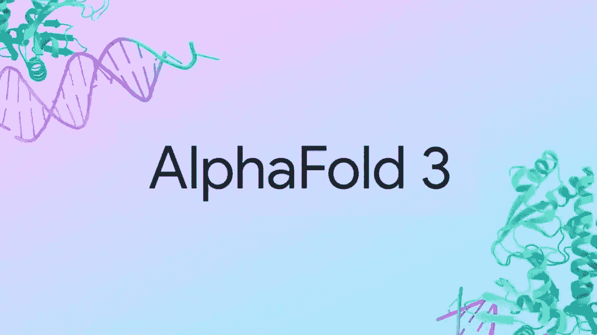
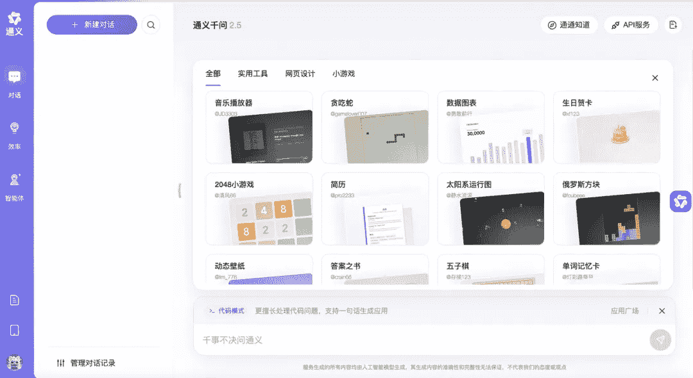
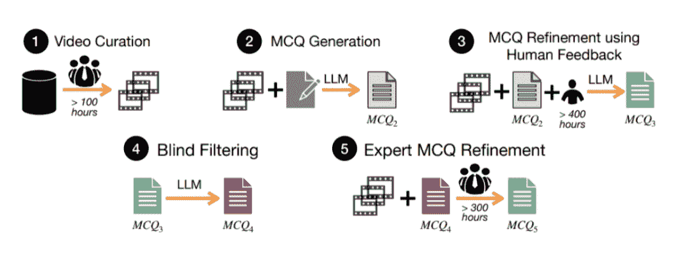

# AI 行业资讯 11.17

> 来源：[https://qqs7y1hozd1.feishu.cn/docx/TSKHdLJrioPWKPxBIGkc9LKpn7b](https://qqs7y1hozd1.feishu.cn/docx/TSKHdLJrioPWKPxBIGkc9LKpn7b)

# **本周亮点：**

1.  月之暗面发布Kimi新模型k0-math，对标OpenAI o1

1.  DeepMind开源AlphaFold 3，推进科学界蛋白质研究

1.  通义推出「代码模式」，无编程知识也能创造应用

1.  苹果开发新型智能家居显示屏，集成Siri和视频会议功能

1.  OpenAI发布Windows版ChatGPT应用

1.  阿里国际推出全球首个B2B AI搜索引擎Accio，简化全球贸易流程

1.  斯坦福大学推出长视频理解基准数据集HourVideo

---

# 月之暗面发布Kimi新模型k0-math，对标OpenAI o1

月之暗面发布了新一代数学推理模型k0-math，旨在对标OpenAI的o1系列。

基准测试显示，k0-math的数学能力可与全球领先的OpenAI o1系列模型相媲美。在中考、高考、考研以及MATH等4个数学基准测试中，k0-math初代模型的成绩超过了o1-mini和o1-preview模型。在难度更大的OMNI-MATH和AIME基准测试中，k0-math初代模型的表现分别达到了o1-mini最高成绩的90%和83%。

k0-math没有前置设计模板，而是希望AI在学习过程中自己衍生出思考方式。尽管k0-math在简单问题上仍可能会出现过度思考的情况，但其深度思考能力是其一大特点。

杨植麟透露，k0-math模型和更强大的Kimi探索版将在未来几周内分批上线Kimi网页版和Kimi智能助手APP，帮助用户解决更具挑战性的数学和搜索调研类任务。这标志着AI产品在深度推理能力上的重要发展。

# DeepMind开源AlphaFold 3，推进科学界蛋白质研究

11月11日，DeepMind宣布科学家们可以下载AlphaFold 3的软件代码，用于非商业目的，目前仅限于具有学术背景的科学家根据要求获得训练权重。

这款工具能够进行蛋白质的协同建模，预测蛋白质与DNA相互作用时的结构，并评估潜在药物的性能。开源版本的发布，标志着科学界在蛋白质研究领域的一大进步。

最初，AlphaFold 3通过网页服务器提供服务时，由于对预测数量和类型的限制，以及未公开代码和模型权重，受到了科学界的批评。DeepMind对此作出回应，承诺在半年内发布开源版本。如今他已兑现了他的承诺。

AlphaFold 3的开源，将极大地促进全球科学家在生物医学研究、药物开发等领域的工作。

# 通义推出「代码模式」，无编程知识也能创造应用

通义最近推出了一项创新功能——「代码模式」，这一功能使得没有编程背景的用户也能够轻松创建各种应用程序。用户可以通过简单的指令生成小游戏、数据图表、网站和简历等多种应用。只需访问通义网页版并点击「代码模式」，用户即可开始体验这一便捷的功能。

「代码模式」的核心在于其动态窗口，它能够将用户输入的简单指令转换成实际的代码，并直接在网页上渲染成应用，支持预览和分享。这一模式基于通义强大的Qwen2.5-Coder代码模型，该模型在多项基准评测中表现出色，确保了AI编程的性能和效率。

通义「代码模式」的推出，旨在降低编程的门槛，让每个人都能轻松将创意转化为现实，使应用开发变得更加便捷和普及。这一功能的实现，不仅为非技术用户提供了实现创意的工具，也为教育和初学者提供了学习编程的途径。

# 苹果开发新型智能家居显示屏，集成Siri和视频会议功能

根据彭博社的Mark Gurman报道，苹果公司正在研发一款壁挂式智能家居显示屏，这款设备将集成家电控制、Siri互动以及视频会议等功能。

这款方形显示屏类似于iPad，预计拥有约6英寸的屏幕，并配备顶部摄像头、内置扬声器和可充电电池。该产品已在开发中超过三年，有望在明年3月正式亮相。

这款新设备在功能上与Google Home Hub和亚马逊的Echo Show相似，但其独特之处在于集成了苹果的AI技术。包括10月下旬开始向用户推出的Apple Intelligence以及即将到来的App Intents系统，后者可以使用AI控制软件程序，进一步提升用户体验。

此外，苹果还在探索开发一款带有机械臂的版本，这款设备能够移动平板设备，显示出苹果在智能家居领域的雄心不仅仅是开发一个简单的智能设备控制面板，而是寻求更先进的智能家居解决方案。

# OpenAI发布Windows版ChatGPT应用

OpenAI正式宣布为微软Windows 10和11用户推出桌面版ChatGPT应用。这款应用不仅支持拍照识别和高级语音交流两大功能，还允许用户通过语音与AI进行互动，并通过快捷键“Alt + 空格”快速调用ChatGPT，实现文件、照片或截图的上传和聊天问答，无缝集成到用户的工作流程中。

桌面版ChatGPT具备网络版的大部分功能，包括ChatGPT搜索和高级模式，但这些高级功能仅对每月20美元订阅了ChatGPT Plus服务的用户开放。Windows版的ChatGPT还支持截图功能，并允许用户自定义快捷键以调出伴随窗口，使用户能够更加便捷地与聊天机器人交流。

此外，Windows用户还可以使用包括GPT-4o、OpenAI o1-preview的所有模型以及内置的文生图模型DALL-E 3。这些功能的集成，这使得Windows版的ChatGPT成为一个强大的工具，能够满足用户在工作和日常生活中的各种需求。

# 阿里国际推出全球首个B2B AI搜索引擎Accio，简化全球贸易流程

在欧洲科技峰会Web Summit上，阿里国际宣布推出全球首个B2B AI搜索引擎——Accio，正式进军AI搜索领域。Accio提供了一个对话形式的搜索体验，能够理解并拆解用户需求，精准推荐供应商和商品。

Accio的目标是简化B2B贸易流程，降低全球贸易门槛。测试结果表明，使用Accio后，用户从搜索到采购的转化率提升了20%到30%。Accio不仅整合了阿里国际站的供给，还链接了全球独立站、第三方电商网站和线下工厂的供给，覆盖了亿级商品，极大地丰富了平台的商品多样性。

阿里国际站总裁张阔表示，Accio的上线版本仅展示了公司对AI时代B2B生意形态想象的10%，未来将不断迭代升级，以满足用户的需求并推动B2B贸易的数字化转型。

# 字节跳动发布通用图像编辑模型SeedEdit，实现自然语言驱动图像编辑

字节跳动在其豆包大模型团队官网上公布了最新通用图像编辑模型——SeedEdit。这款模型支持用户通过简单的自然语言指令进行图像编辑，包括修图、换装、美化、风格转换以及在指定区域添加或删除元素等操作。SeedEdit的推出标志着图像编辑领域的一个重要进步，它使得非专业用户也能轻松实现复杂的图像编辑任务。

目前，SeedEdit基于豆包文生图大模型，支持中文和英文输入，并能够对中文成语和专有名词进行精准响应。这使得SeedEdit在理解和执行用户指令时更为准确和高效。

字节跳动表示，SeedEdit的下一步计划是开放多轮复杂编辑的功能，进一步提升用户体验。同时，豆包的大模型团队也致力于在真实图片保真、ID保持、编辑精确性以及长时序的故事类、漫画类生成等方面进行优化和探索，以满足用户在不同场景下的需求。

# 斯坦福大学推出长视频理解基准数据集HourVideo

斯坦福大学李飞飞和吴佳俊团队最近推出了HourVideo，这是一个长视频理解基准数据集，旨在评估多模态模型对长视频内容的理解能力。

HourVideo包含500个第一人称视角视频，时长从20至120分钟不等，覆盖77种日常活动，为长视频理解技术的发展提供了重要的测试平台。

HourVideo的主要功能包括长视频理解评估、多任务测试套件、高质量问题生成以及模型性能比较。数据集基于一系列任务，如总结、感知、视觉推理和导航，测试模型对视频中多个时间片段信息的识别和综合能力。

HourVideo从Ego4D数据集中筛选出视频，并设计了包含多个子任务的任务套件，每个任务都需要模型对视频内容进行长期依赖关系的理解和推理。此外，HourVideo还基于多阶段的数据生成流程，包括视频筛选、问题生成、人工反馈优化等，生成了12,976个多项选择题，为标准化测试提供了基础。

HourVideo的应用场景广泛，包括多模态人工智能研究、自主代理和助手系统、增强现实（AR）等。这些应用场景展示了HourVideo在推动长视频理解和多模态交互技术发展中的潜力。

