# Python爬取天气数据及可视化分析

> 来源：[https://qqs7y1hozd1.feishu.cn/docx/Dgq9dyIIuo8Hikx1oi1cYqdjnug](https://qqs7y1hozd1.feishu.cn/docx/Dgq9dyIIuo8Hikx1oi1cYqdjnug)

## 1.数据获取

### 请求网站链接

> 首先查看中国天气网，这里就访问本地的天气网址，如果想爬取不同的地区只需修改最后的地区编号即可，前面的weather代表是7天的网页，weather1d代表当天，weather15d代表未来14天。这里就主要访问7天和14天的中国天气网。采用requests.get()方法，请求网页，如果成功访问，则得到的是网页的所有字符串文本。这就是请求过程。

```
def getHTMLtext(url):     
        &quot;&quot;&quot;请求获得网页内容&quot;&quot;&quot;
        try:         
                r = requests.get(url, timeout = 30)         
                r.raise_for_status()         
                r.encoding = r.apparent_encoding         
                print(&quot;成功访问&quot;)         
                return r.text     
        except:         
                print(&quot;访问错误&quot;)         
                return&quot; &quot; 
```

### 提取有用信息

**这**里采用BeautifulSoup库对刚刚获取的字符串进行数据提取，首先对网页进行检查，找到需要获取数据的标签：

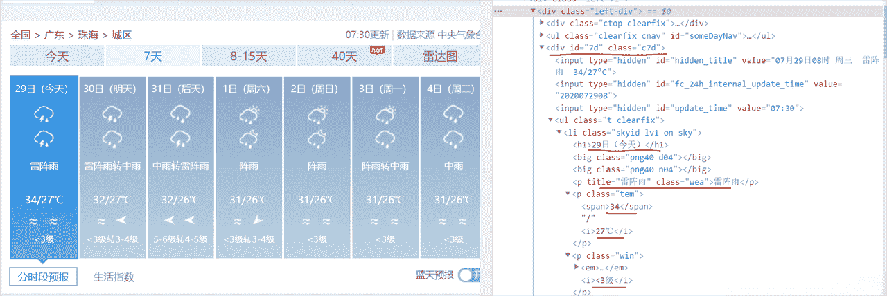

> 可以发现7天的数据信息在div标签中并且id=“7d”，并且日期、天气、温度、风级等信息都在ul和li标签中，所以我**们可以使用BeautifulSoup对获**取的网页文本进行查找div标签id=“7d”，找出他包含的所有的ul和li标签，之后提取标签中相应的数据值，保存到对应列表中。这里要注意一个细节就是有时日期没有最高气温，对于没有数据的情况要进行判断和处理。另外对于一些数据保存的格式也要提前进行处理，比如温度后面的摄氏度符号，日期数字的提取，和风级文字的提取，这需要用到字符查找及字符串切片处理。

```
def get_content(html):
        &quot;&quot;&quot;处理得到有用信息保存数据文件&quot;&quot;&quot;
        final = []                                                           # 初始化一个列表保存数据
        bs = BeautifulSoup(html, &quot;html.parser&quot;)  # 创建BeautifulSoup对象
        body = bs.body
        data = body.find(&#x27;div&#x27;, {&#x27;id&#x27;: &#x27;7d&#x27;})    # 找到div标签且id = 7d
        # 下面爬取当天的数据
        data2 = body.find_all(&#x27;div&#x27;,{&#x27;class&#x27;:&#x27;left-div&#x27;})
        text = data2[2].find(&#x27;script&#x27;).string         
        text = text[text.index(&#x27;=&#x27;)+1 :-2]                 # 移除改var data=将其变为json数据
        jd = json.loads(text)
        dayone = jd[&#x27;od&#x27;][&#x27;od2&#x27;]                                 # 找到当天的数据
        final_day = []                                                     # 存放当天的数据
        count = 0
        for i in dayone:
                temp = []
                if count &lt;=23:
                        temp.append(i[&#x27;od21&#x27;])                                 # 添加时间
                        temp.append(i[&#x27;od22&#x27;])                                 # 添加当前时刻温度
                        temp.append(i[&#x27;od24&#x27;])                                 # 添加当前时刻风力方向
                        temp.append(i[&#x27;od25&#x27;])                                 # 添加当前时刻风级
                        temp.append(i[&#x27;od26&#x27;])                                 # 添加当前时刻降水量
                        temp.append(i[&#x27;od27&#x27;])                                 # 添加当前时刻相对湿度
                        temp.append(i[&#x27;od28&#x27;])                                 # 添加当前时刻控制质量
                        #print(temp)
                        final_day.append(temp)
                count = count +1
        # 下面爬取7天的数据        
        ul = data.find(&#x27;ul&#x27;)                                         # 找到所有的ul标签
        li = ul.find_all(&#x27;li&#x27;)                                         # 找到左右的li标签
        i = 0                          # 控制爬取的天数
        for day in li:                                                           # 遍历找到的每一个li
            if i &lt; 7 and i &gt; 0:
                temp = []                                                           # 临时存放每天的数据
                date = day.find(&#x27;h1&#x27;).string                   # 得到日期
                date = date[0:date.index(&#x27;日&#x27;)]          # 取出日期号
                temp.append(date)                                        
                inf = day.find_all(&#x27;p&#x27;)                           # 找出li下面的p标签,提取第一个p标签的值，即天气
                temp.append(inf[0].string)

                tem_low = inf[1].find(&#x27;i&#x27;).string          # 找到最低气温

                if inf[1].find(&#x27;span&#x27;) is None:          # 天气预报可能没有最高气温
                    tem_high = None
                else:
                    tem_high = inf[1].find(&#x27;span&#x27;).string  # 找到最高气温
                temp.append(tem_low[:-1])
                if tem_high[-1] == &#x27;℃&#x27;:
                        temp.append(tem_high[:-1])
                else:
                        temp.append(tem_high)
                wind = inf[2].find_all(&#x27;span&#x27;)                # 找到风向
                for j in wind:
                        temp.append(j[&#x27;title&#x27;])
                wind_scale = inf[2].find(&#x27;i&#x27;).string # 找到风级
                index1 = wind_scale.index(&#x27;级&#x27;)
                       temp.append(int(wind_scale[index1-1:index1]))
                final.append(temp)
            i = i + 1
        return final_day,final
```

> 同样对于/weather15d：15天的信息，也做同样的处理，这里经过查看后发现他的15天网页中只有8-14天，前面的1-7天在/weather中，这里就分别访问两个网页将爬取得到的数据进行合并得到最终14天的数据。

> 前面是未来14天的数据爬取过程，对于当天24小时的天气信息数据，经过查找发现他是一个json数据，可以通过json.loads()方法获取当天的数据，进而对当天的天气信息进行提取。

### 保存csv文件

> 前面将爬**取的数据添加到列表中，这里引**入csv库，利用f_csv.writerow(header)和f_csv.writerows(data)方法，分别写入表头和每一行的数据，这里将1天和未来14天的数据分开存储，分别保存为weather1.csv和weather14.csv，下面是他们保存的表格图：

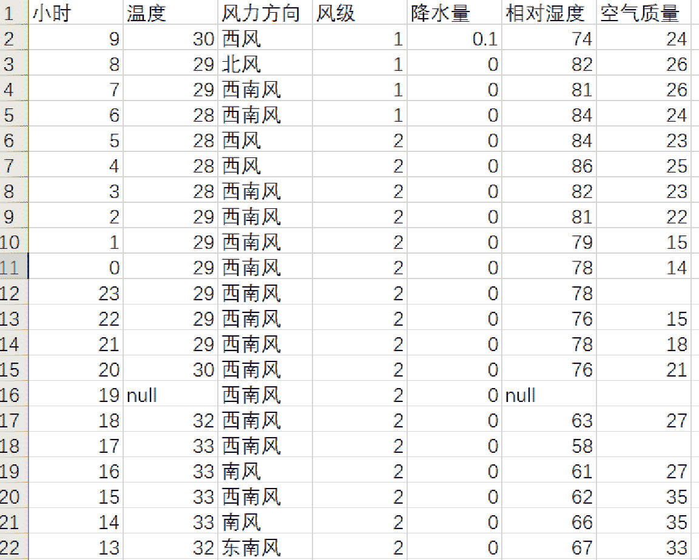

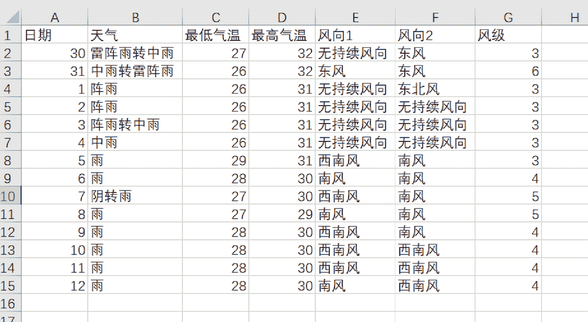

## 2.可视化分析

### 当天温度变化曲线图

> 采用matplotlib中plt.plot()方法绘制出一天24小时的温度变化曲线，并用plt.text()方法点出最高温和最低温，并画出平均温度线，下图为温度变化曲线图：(代码见附录)

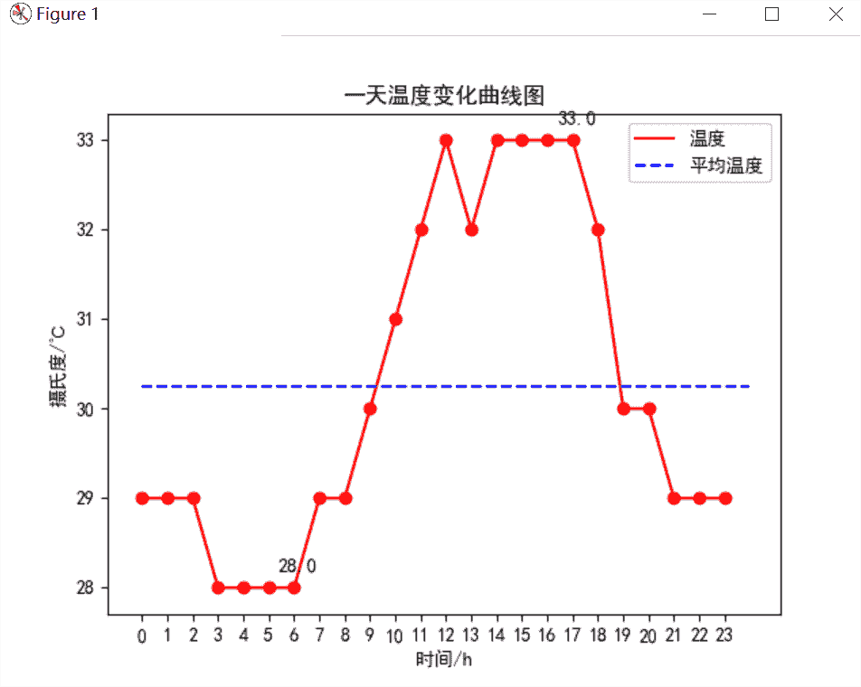

> 分析可以发现这一天最高温度为33℃，最低温度为28℃，并且平均温度在20.4℃左右，通过对时间分析，发现昼夜温差5℃，低温分布在凌晨，高温分布在中午到下午的时间段。

### 当天相对湿度变化曲线图

> 采用matplotlib中plt.plot()方法绘制出一天24小时的湿度变化曲线，并画出平均相对湿度线，下图为湿度变化曲线图：(代码见附录)

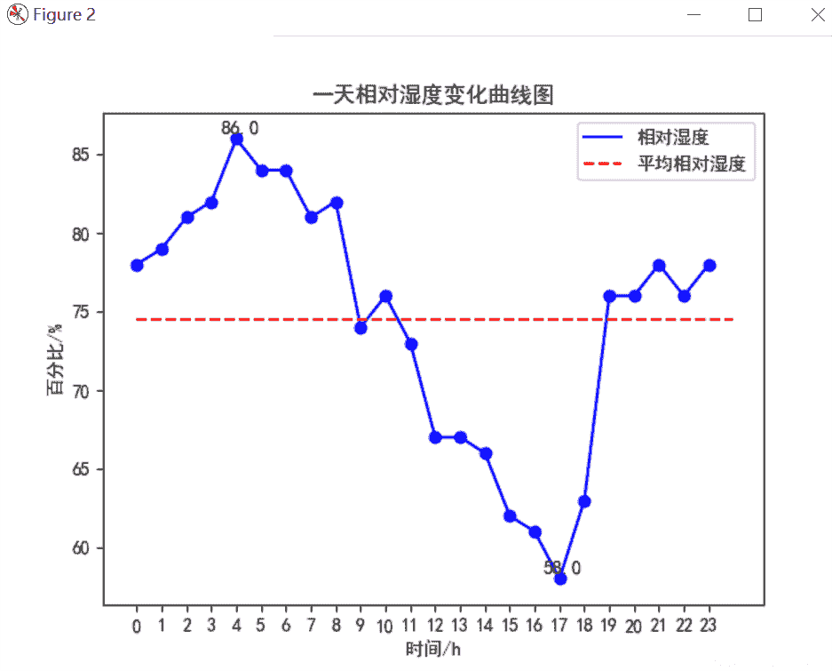

> 分析可以发现这一天最高相对湿度为86%，最低相对湿度为58℃，并且平均相对湿度在75%左右，通过对时间分析，清晨的湿度比较大，而下午至黄昏湿度较小。

### 温湿度相关性分析图

> 经过前面两个图的分析我们可以感觉到温度和湿度之间是有关系的，为了更加清楚直观地感受这种关系，使用plt.scatter()方法将温度为横坐标、湿度为纵坐标，每个时刻的点在图中点出来，并且计算相关系数，下图为结果图：

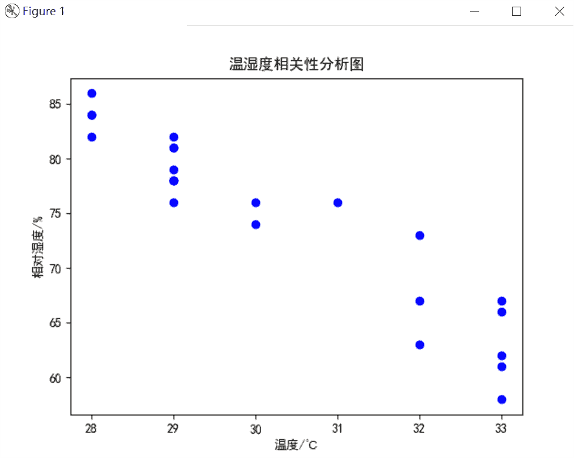

> 分析可以发现一天的温度和湿度具有强烈的相关性，他们呈负相关，这就说明他们时间是负相关关系，并且进一步分析，当温度较低时，空气中水分含量较多，湿度自然较高，而温度较高时，水分蒸发，空气就比较干燥，湿度较低，符合平时气候现象。

### 空气质量指数柱状图

> 空气质量指数AQI是定量描述空气质量状况的指数，其数值越大说明空气污染状况越重，对人体健康的危害也就越大。一般将空气质量指数分为6个等级，等级越高说明污染越严重，下面使用plt.bar方法对一天24小时的空气质量进行了柱状图绘制，并且根据6个等级的不同，相应的柱状图的颜色也从浅到深，也表明污染逐步加重，更直观的显示污染情况，并且也将最高和最低的空气质量指数标出，用虚线画出平均的空气质量指数，下图是结果图：

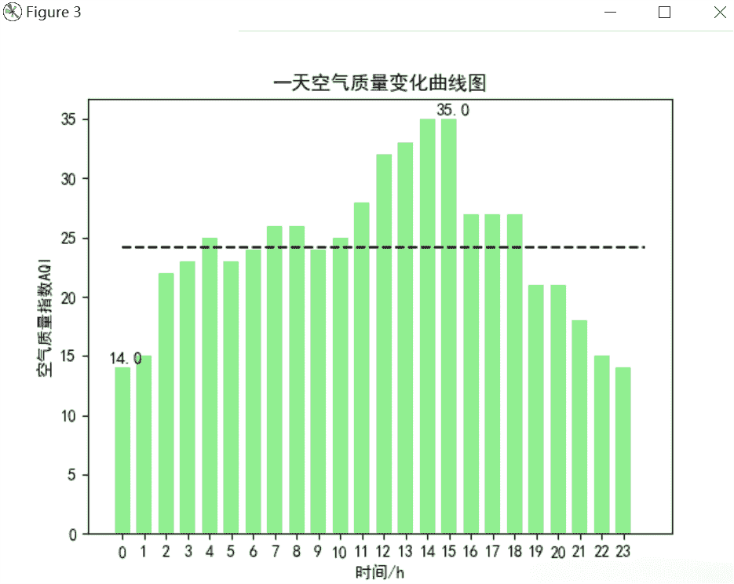

> 上面这张是南方珠海的控制质量图，可以看出空气质量指数最大也是在健康范围，说明珠海空气非常好，分析可以发现这一天最高空气质量指数达到了35，最低则只有14，并且平均在25左右，通过时间也可以发现，基本在清晨的时候是空气最好的时候（4-9点），在下午是空气污染最严重的时候，所以清晨一般可以去外面呼吸新鲜的空气，那时污染最小。

> **而下面这个空气质量图是选取的北方的一个**城市，可以看到这里的环境远远比不上珠海。

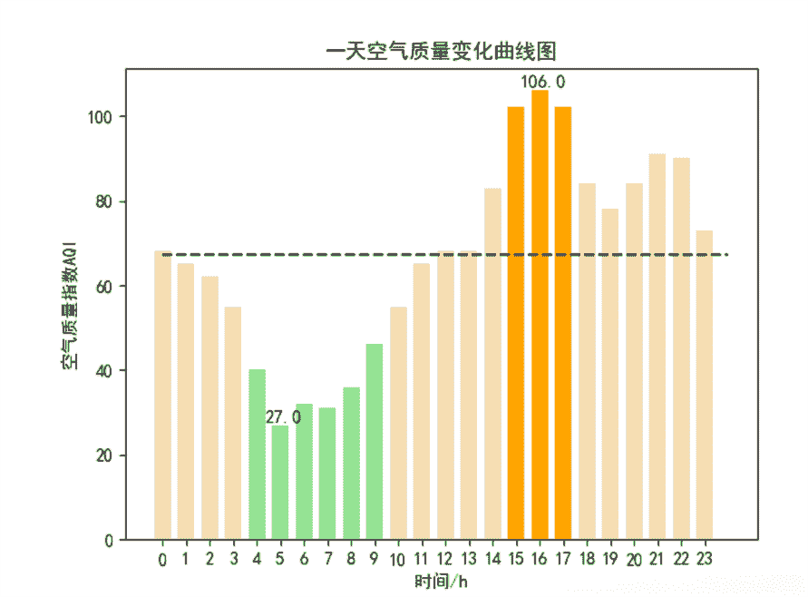

### 风向风级雷达图

> 统计一天的风力和风向，由于风力风向使用极坐标的方式展现较好，所以这里采用的是极坐标的方式展现一天的风力风向图，将圆分为8份，每一份代表一个风向，半径代表平均风力，并且随着风级增高，蓝色加深，最后结果如下所示：

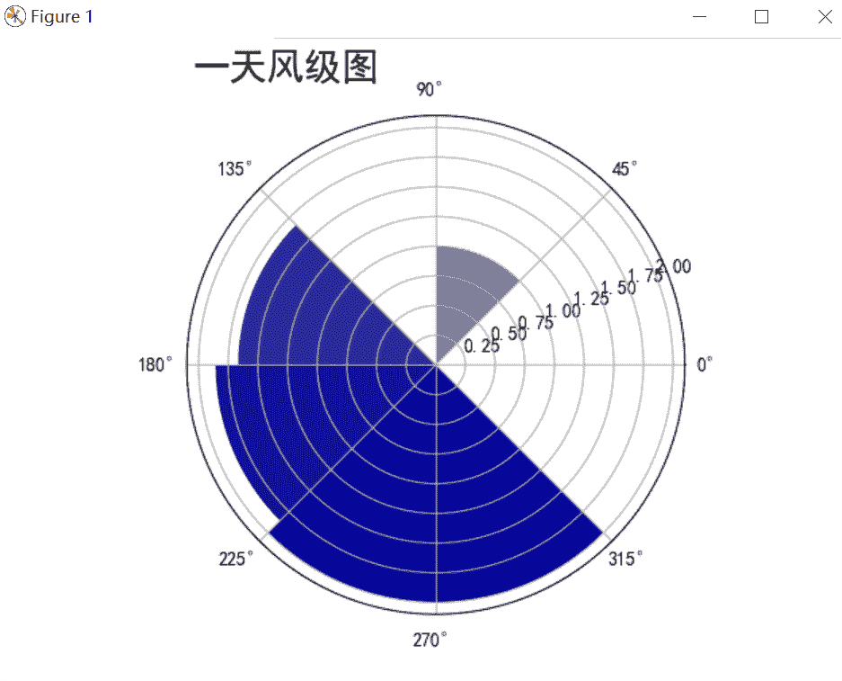

> 分析可以发现这一天西南风最多，平均风级达到了1.75级，东北风也有小部分1.0级，其余空白方向无来风。

### 未来14天高低温变化曲线图

> 统计未来14天的高低温度变化，并绘制出他们的变化曲线图，分别用虚线将他们的平均气温线绘制出来，最后结果如下所示：

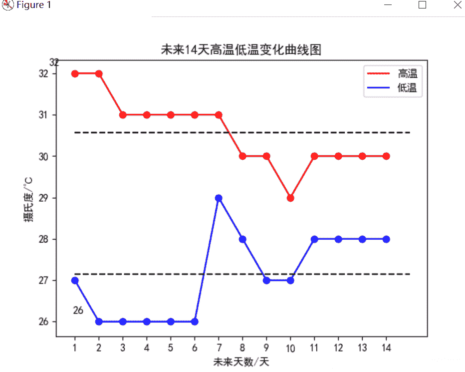

> 分析可以发现未来14天高温平均气温为30.5℃，温度还是比较高，但是未来的第8天有降温，需要做好降温准备，低温前面处于平稳趋势，等到第8天开始下降，伴随着高温也下降，整体温度下降，低温平均在27℃左右。

### 未来14天风向风级雷达图

> **统计未来14天的风向和平均风**力，并和前面一样采用极坐标形式，将圆周分为8个部分，代表8个方向，颜色越深代表风级越高，最后结果如下所示：

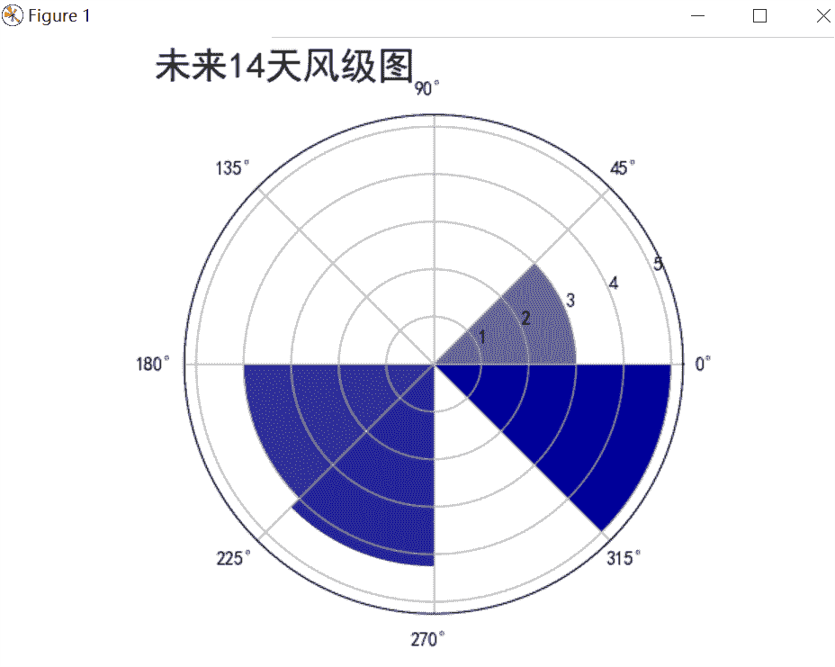

> 分析发现未来14天东南风、西南风占主要风向，风级最高达到5级，最低的西风平均风级也有3级。

### 未来14天气候分布饼图

> **统计未来14天的气候，并求每个气候的总天数，最后**将各个气候的饼图绘制出来，结果如下所示：

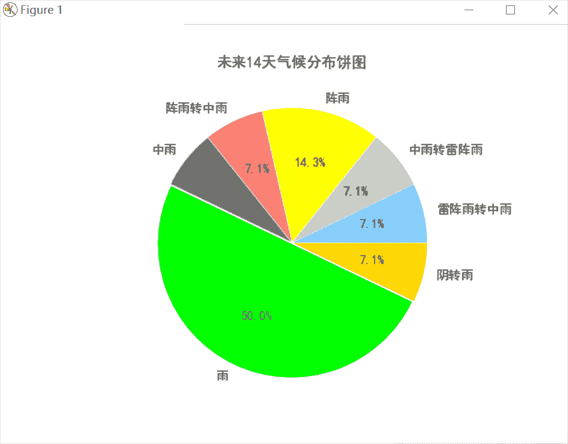

> 分析可以发现未来14天气候基本是“雨”、“阴转雨”和“阵雨”，下雨的天数较多,结合前面的气温分布图可以看出在第8-9天气温高温下降，可以推测当天下雨，导致气温下降。

## 3.结论

1.  首先根据爬取的温湿度数据进行的分析，温度从早上低到中午高再到晚上低，湿度和温度的趋势相反，通过相关系数发现温度和湿度有强烈的负相关关系，经查阅资料发现因为随着温度升高水蒸汽蒸发加剧，空气中水分降低湿度降低。当然，湿度同时受气压和雨水的影响，下雨湿度会明显增高。

1.  经查阅资料空气质量不仅跟工厂、汽车等排放的烟气、废气等有关，更为重要的是与气象因素有关。由于昼夜温差明显变化，当地面温度高于高空温度时，空气上升，污染物易被带到高空扩散；当地面温度低于一定高度的温度时，天空形成逆温层，它像一个大盖子一样压在地面上空，使地表空气中各种污染物不易扩散。一般在晚间和清晨影响较大，而当太阳出来后，地面迅速升温，逆温层就会逐渐消散，于是污染空气也就扩散了。

1.  风是由气压在水平方向分布的不均匀导致的。风受大气环流、地形、水域等不同因素的综合影响，表现形式多种多样，如季风、地方性的海陆风、山谷风等，一天的风向也有不同的变化，根据未来14天的风向雷达图可以发现未来所有风向基本都有涉及，并且没有特别的某个风向，原因可能是近期没有降水和气文变化不大，导致风向也没有太大的变化规律。

1.  天气是指某一个地区距离地表较近的大气层在短时间内的具体状态。跟某瞬时内大气中各种气象要素分布的综合表现。根据未来14天的天气和温度变化可以大致推断出某个时间的气候，天气和温度之间也是有联系的。

## 4.代码框架

> **代码主要分为：**

> weather.py：对中国天气网进行爬取天气数据并保存csv文件；

> data1_analysis.py：对当天的天气信息进行可视化处理；

> data14_analysis.py：对未来14天的天气信息进行可视化处理。下面是代码的结构图：

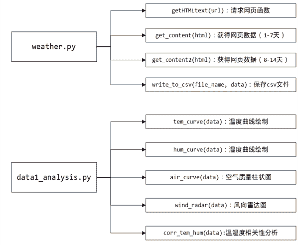

## 附：源代码

**weather.py**

```
# weather.py
import requests
from bs4 import BeautifulSoup
import csv
import json
def getHTMLtext(url):     
        &quot;&quot;&quot;请求获得网页内容&quot;&quot;&quot;
        try:         
                r = requests.get(url, timeout = 30)         
                r.raise_for_status()         
                r.encoding = r.apparent_encoding         
                print(&quot;成功访问&quot;)         
                return r.text     
        except:         
                print(&quot;访问错误&quot;)         
                return&quot; &quot; 

def get_content(html):
        &quot;&quot;&quot;处理得到有用信息保存数据文件&quot;&quot;&quot;
        final = []                                                           # 初始化一个列表保存数据
        bs = BeautifulSoup(html, &quot;html.parser&quot;)  # 创建BeautifulSoup对象
        body = bs.body
        data = body.find(&#x27;div&#x27;, {&#x27;id&#x27;: &#x27;7d&#x27;})    # 找到div标签且id = 7d
        # 下面爬取当天的数据
        data2 = body.find_all(&#x27;div&#x27;,{&#x27;class&#x27;:&#x27;left-div&#x27;})
        text = data2[2].find(&#x27;script&#x27;).string         
        text = text[text.index(&#x27;=&#x27;)+1 :-2]                 # 移除改var data=将其变为json数据
        jd = json.loads(text)
        dayone = jd[&#x27;od&#x27;][&#x27;od2&#x27;]                                 # 找到当天的数据
        final_day = []                                                     # 存放当天的数据
        count = 0
        for i in dayone:
                temp = []
                if count &lt;=23:
                        temp.append(i[&#x27;od21&#x27;])                                 # 添加时间
                        temp.append(i[&#x27;od22&#x27;])                                 # 添加当前时刻温度
                        temp.append(i[&#x27;od24&#x27;])                                 # 添加当前时刻风力方向
                        temp.append(i[&#x27;od25&#x27;])                                 # 添加当前时刻风级
                        temp.append(i[&#x27;od26&#x27;])                                 # 添加当前时刻降水量
                        temp.append(i[&#x27;od27&#x27;])                                 # 添加当前时刻相对湿度
                        temp.append(i[&#x27;od28&#x27;])                                 # 添加当前时刻控制质量
                        #print(temp)
                        final_day.append(temp)
                count = count +1
        # 下面爬取7天的数据        
        ul = data.find(&#x27;ul&#x27;)                                         # 找到所有的ul标签
        li = ul.find_all(&#x27;li&#x27;)                                         # 找到左右的li标签
        i = 0                          # 控制爬取的天数
        for day in li:                                                           # 遍历找到的每一个li
            if i &lt; 7 and i &gt; 0:
                temp = []                                                           # 临时存放每天的数据
                date = day.find(&#x27;h1&#x27;).string                   # 得到日期
                date = date[0:date.index(&#x27;日&#x27;)]          # 取出日期号
                temp.append(date)                                        
                inf = day.find_all(&#x27;p&#x27;)                           # 找出li下面的p标签,提取第一个p标签的值，即天气
                temp.append(inf[0].string)

                tem_low = inf[1].find(&#x27;i&#x27;).string          # 找到最低气温

                if inf[1].find(&#x27;span&#x27;) is None:          # 天气预报可能没有最高气温
                    tem_high = None
                else:
                    tem_high = inf[1].find(&#x27;span&#x27;).string  # 找到最高气温
                temp.append(tem_low[:-1])
                if tem_high[-1] == &#x27;℃&#x27;:
                        temp.append(tem_high[:-1])
                else:
                        temp.append(tem_high)

                wind = inf[2].find_all(&#x27;span&#x27;)                # 找到风向
                for j in wind:
                        temp.append(j[&#x27;title&#x27;])

                wind_scale = inf[2].find(&#x27;i&#x27;).string # 找到风级
                index1 = wind_scale.index(&#x27;级&#x27;)
                       temp.append(int(wind_scale[index1-1:index1]))
                final.append(temp)
            i = i + 1
        return final_day,final
        #print(final)    
def get_content2(html):
        &quot;&quot;&quot;处理得到有用信息保存数据文件&quot;&quot;&quot;
        final = []                                                                                                           # 初始化一个列表保存数据
        bs = BeautifulSoup(html, &quot;html.parser&quot;)                                                  # 创建BeautifulSoup对象
        body = bs.body
        data = body.find(&#x27;div&#x27;, {&#x27;id&#x27;: &#x27;15d&#x27;})                                                    # 找到div标签且id = 15d
        ul = data.find(&#x27;ul&#x27;)                                                                                         # 找到所有的ul标签
        li = ul.find_all(&#x27;li&#x27;)                                                                                         # 找到左右的li标签
        final = []
        i = 0                                                                                                                          # 控制爬取的天数
        for day in li:                                                                                                   # 遍历找到的每一个li
            if i &lt; 8:
                temp = []                                                                                                   # 临时存放每天的数据
                date = day.find(&#x27;span&#x27;,{&#x27;class&#x27;:&#x27;time&#x27;}).string                  # 得到日期
                date = date[date.index(&#x27;（&#x27;)+1:-2]                                                  # 取出日期号
                temp.append(date)                
                       weather = day.find(&#x27;span&#x27;,{&#x27;class&#x27;:&#x27;wea&#x27;}).string                  # 找到天气
                temp.append(weather)
                tem = day.find(&#x27;span&#x27;,{&#x27;class&#x27;:&#x27;tem&#x27;}).text                                  # 找到温度
                temp.append(tem[tem.index(&#x27;/&#x27;)+1:-1])                                        # 找到最低气温
                temp.append(tem[:tem.index(&#x27;/&#x27;)-1])                                         # 找到最高气温
                wind = day.find(&#x27;span&#x27;,{&#x27;class&#x27;:&#x27;wind&#x27;}).string                  # 找到风向
                if &#x27;转&#x27; in wind:                                                                                        # 如果有风向变化
                        temp.append(wind[:wind.index(&#x27;转&#x27;)])
                        temp.append(wind[wind.index(&#x27;转&#x27;)+1:])
                else:                                                                                                        # 如果没有风向变化，前后风向一致
                        temp.append(wind)
                        temp.append(wind)
                wind_scale = day.find(&#x27;span&#x27;,{&#x27;class&#x27;:&#x27;wind1&#x27;}).string                  # 找到风级
                index1 = wind_scale.index(&#x27;级&#x27;)
                       temp.append(int(wind_scale[index1-1:index1]))
                        
                final.append(temp)
        return final

def write_to_csv(file_name, data, day=14):
        &quot;&quot;&quot;保存为csv文件&quot;&quot;&quot;
        with open(file_name, &#x27;a&#x27;, errors=&#x27;ignore&#x27;, newline=&#x27;&#x27;) as f:
                if day == 14:
                        header = [&#x27;日期&#x27;,&#x27;天气&#x27;,&#x27;最低气温&#x27;,&#x27;最高气温&#x27;,&#x27;风向1&#x27;,&#x27;风向2&#x27;,&#x27;风级&#x27;]
                else:
                        header = [&#x27;小时&#x27;,&#x27;温度&#x27;,&#x27;风力方向&#x27;,&#x27;风级&#x27;,&#x27;降水量&#x27;,&#x27;相对湿度&#x27;,&#x27;空气质量&#x27;]
                f_csv = csv.writer(f)
                f_csv.writerow(header)
                f_csv.writerows(data)

def main():
        &quot;&quot;&quot;主函数&quot;&quot;&quot;
        print(&quot;Weather test&quot;)
        # 珠海
        url1 = &#x27;http://www.weather.com.cn/weather/101280701.shtml&#x27;    # 7天天气中国天气网
        url2 = &#x27;http://www.weather.com.cn/weather15d/101280701.shtml&#x27; # 8-15天天气中国天气网
        
        html1 = getHTMLtext(url1)
        data1, data1_7 = get_content(html1)                # 获得1-7天和当天的数据

        html2 = getHTMLtext(url2)
        data8_14 = get_content2(html2)                        # 获得8-14天数据
        data14 = data1_7 + data8_14
        #print(data)
        write_to_csv(&#x27;weather14.csv&#x27;,data14,14)        # 保存为csv文件
        write_to_csv(&#x27;weather1.csv&#x27;,data1,1)

if __name__ == &#x27;__main__&#x27;:
        main()
```

data1_analysis.py:

```
# data1_analysis.py
import matplotlib.pyplot as plt
import numpy as np
import pandas as pd
import math
def tem_curve(data):
        &quot;&quot;&quot;温度曲线绘制&quot;&quot;&quot;
        hour = list(data[&#x27;小时&#x27;])
        tem = list(data[&#x27;温度&#x27;])
        for i in range(0,24):
                if math.isnan(tem[i]) == True:
                        tem[i] = tem[i-1]
        tem_ave = sum(tem)/24                                        # 求平均温度 
        tem_max = max(tem)                                
        tem_max_hour = hour[tem.index(tem_max)]        # 求最高温度
        tem_min = min(tem)
        tem_min_hour = hour[tem.index(tem_min)]        # 求最低温度
        x = []
        y = []
        for i in range(0, 24):
                x.append(i)
                y.append(tem[hour.index(i)])
        plt.figure(1)
        plt.plot(x,y,color=&#x27;red&#x27;,label=&#x27;温度&#x27;)                                                        # 画出温度曲线
        plt.scatter(x,y,color=&#x27;red&#x27;)                        # 点出每个时刻的温度点
        plt.plot([0, 24], [tem_ave, tem_ave], c=&#x27;blue&#x27;, linestyle=&#x27;--&#x27;,label=&#x27;平均温度&#x27;)         # 画出平均温度虚线
        plt.text(tem_max_hour+0.15, tem_max+0.15, str(tem_max), ha=&#x27;center&#x27;, va=&#x27;bottom&#x27;, fontsize=10.5)  # 标出最高温度
        plt.text(tem_min_hour+0.15, tem_min+0.15, str(tem_min), ha=&#x27;center&#x27;, va=&#x27;bottom&#x27;, fontsize=10.5)  # 标出最低温度
        plt.xticks(x)
        plt.legend()
        plt.title(&#x27;一天温度变化曲线图&#x27;)
        plt.xlabel(&#x27;时间/h&#x27;)
        plt.ylabel(&#x27;摄氏度/℃&#x27;)
        plt.show()

def hum_curve(data):
        &quot;&quot;&quot;相对湿度曲线绘制&quot;&quot;&quot;
        hour = list(data[&#x27;小时&#x27;])
        hum = list(data[&#x27;相对湿度&#x27;])
        for i in range(0,24):
                if math.isnan(hum[i]) == True:
                        hum[i] = hum[i-1]
        hum_ave = sum(hum)/24                                        # 求平均相对湿度 
        hum_max = max(hum)                                
        hum_max_hour = hour[hum.index(hum_max)]        # 求最高相对湿度
        hum_min = min(hum)
        hum_min_hour = hour[hum.index(hum_min)]        # 求最低相对湿度
        x = []
        y = []
        for i in range(0, 24):
                x.append(i)
                y.append(hum[hour.index(i)])
        plt.figure(2)
        plt.plot(x,y,color=&#x27;blue&#x27;,label=&#x27;相对湿度&#x27;)                                                        # 画出相对湿度曲线
        plt.scatter(x,y,color=&#x27;blue&#x27;)                        # 点出每个时刻的相对湿度
        plt.plot([0, 24], [hum_ave, hum_ave], c=&#x27;red&#x27;, linestyle=&#x27;--&#x27;,label=&#x27;平均相对湿度&#x27;)         # 画出平均相对湿度虚线
        plt.text(hum_max_hour+0.15, hum_max+0.15, str(hum_max), ha=&#x27;center&#x27;, va=&#x27;bottom&#x27;, fontsize=10.5)  # 标出最高相对湿度
        plt.text(hum_min_hour+0.15, hum_min+0.15, str(hum_min), ha=&#x27;center&#x27;, va=&#x27;bottom&#x27;, fontsize=10.5)  # 标出最低相对湿度
        plt.xticks(x)
        plt.legend()
        plt.title(&#x27;一天相对湿度变化曲线图&#x27;)
        plt.xlabel(&#x27;时间/h&#x27;)
        plt.ylabel(&#x27;百分比/%&#x27;)
        plt.show()

def air_curve(data):
        &quot;&quot;&quot;空气质量曲线绘制&quot;&quot;&quot;
        hour = list(data[&#x27;小时&#x27;])
        air = list(data[&#x27;空气质量&#x27;])
        print(type(air[0]))
        for i in range(0,24):
                if math.isnan(air[i]) == True:
                        air[i] = air[i-1]
        air_ave = sum(air)/24                                        # 求平均空气质量 
        air_max = max(air)                                
        air_max_hour = hour[air.index(air_max)]        # 求最高空气质量
        air_min = min(air)
        air_min_hour = hour[air.index(air_min)]        # 求最低空气质量
        x = []
        y = []
        for i in range(0, 24):
                x.append(i)
                y.append(air[hour.index(i)])
        plt.figure(3)
        
        for i in range(0,24):
                if y[i] &lt;= 50:
                        plt.bar(x[i],y[i],color=&#x27;lightgreen&#x27;,width=0.7)  # 1等级
                elif y[i] &lt;= 100:
                        plt.bar(x[i],y[i],color=&#x27;wheat&#x27;,width=0.7)                 # 2等级
                elif y[i] &lt;= 150:
                        plt.bar(x[i],y[i],color=&#x27;orange&#x27;,width=0.7)                 # 3等级
                elif y[i] &lt;= 200:
                        plt.bar(x[i],y[i],color=&#x27;orangered&#x27;,width=0.7)         # 4等级
                elif y[i] &lt;= 300:
                        plt.bar(x[i],y[i],color=&#x27;darkviolet&#x27;,width=0.7)         # 5等级
                elif y[i] &gt; 300:
                        plt.bar(x[i],y[i],color=&#x27;maroon&#x27;,width=0.7)                 # 6等级
        plt.plot([0, 24], [air_ave, air_ave], c=&#x27;black&#x27;, linestyle=&#x27;--&#x27;)         # 画出平均空气质量虚线
        plt.text(air_max_hour+0.15, air_max+0.15, str(air_max), ha=&#x27;center&#x27;, va=&#x27;bottom&#x27;, fontsize=10.5)  # 标出最高空气质量
        plt.text(air_min_hour+0.15, air_min+0.15, str(air_min), ha=&#x27;center&#x27;, va=&#x27;bottom&#x27;, fontsize=10.5)  # 标出最低空气质量
        plt.xticks(x)
        plt.title(&#x27;一天空气质量变化曲线图&#x27;)
        plt.xlabel(&#x27;时间/h&#x27;)
        plt.ylabel(&#x27;空气质量指数AQI&#x27;)
        plt.show()

def wind_radar(data):
        &quot;&quot;&quot;风向雷达图&quot;&quot;&quot;
        wind = list(data[&#x27;风力方向&#x27;])
        wind_speed = list(data[&#x27;风级&#x27;])
        for i in range(0,24):
                if wind[i] == &quot;北风&quot;:
                        wind[i] = 90
                elif wind[i] == &quot;南风&quot;:
                        wind[i] = 270
                elif wind[i] == &quot;西风&quot;:
                        wind[i] = 180
                elif wind[i] == &quot;东风&quot;:
                        wind[i] = 360
                elif wind[i] == &quot;东北风&quot;:
                        wind[i] = 45
                elif wind[i] == &quot;西北风&quot;:
                        wind[i] = 135
                elif wind[i] == &quot;西南风&quot;:
                        wind[i] = 225
                elif wind[i] == &quot;东南风&quot;:
                        wind[i] = 315
        degs = np.arange(45,361,45)
        temp = []
        for deg in degs:
                speed = []
                # 获取 wind_deg 在指定范围的风速平均值数据
                for i in range(0,24):
                        if wind[i] == deg:
                                speed.append(wind_speed[i])
                if len(speed) == 0:
                        temp.append(0)
                else:
                        temp.append(sum(speed)/len(speed))
        print(temp)
        N = 8
        theta = np.arange(0.+np.pi/8,2*np.pi+np.pi/8,2*np.pi/8)
        # 数据极径
        radii = np.array(temp)
        # 绘制极区图坐标系
        plt.axes(polar=True)
        # 定义每个扇区的RGB值（R,G,B），x越大，对应的颜色越接近蓝色
        colors = [(1-x/max(temp), 1-x/max(temp),0.6) for x in radii]
        plt.bar(theta,radii,width=(2*np.pi/N),bottom=0.0,color=colors)
        plt.title(&#x27;一天风级图&#x27;,x=0.2,fontsize=20)
        plt.show()

def calc_corr(a, b):
        &quot;&quot;&quot;计算相关系数&quot;&quot;&quot;
        a_avg = sum(a)/len(a)
        b_avg = sum(b)/len(b)
        cov_ab = sum([(x - a_avg)*(y - b_avg) for x,y in zip(a, b)])
        sq = math.sqrt(sum([(x - a_avg)**2 for x in a])*sum([(x - b_avg)**2 for x in b])) 
        corr_factor = cov_ab/sq
        return corr_factor


def corr_tem_hum(data):
        &quot;&quot;&quot;温湿度相关性分析&quot;&quot;&quot;
        tem = data[&#x27;温度&#x27;]
        hum = data[&#x27;相对湿度&#x27;]
        plt.scatter(tem,hum,color=&#x27;blue&#x27;)
        plt.title(&quot;温湿度相关性分析图&quot;)
        plt.xlabel(&quot;温度/℃&quot;)
        plt.ylabel(&quot;相对湿度/%&quot;)
        plt.text(20,40,&quot;相关系数为：&quot;+str(calc_corr(tem,hum)),fontdict={&#x27;size&#x27;:&#x27;10&#x27;,&#x27;color&#x27;:&#x27;red&#x27;})
        plt.show()
        print(&quot;相关系数为：&quot;+str(calc_corr(tem,hum)))

def main():
        plt.rcParams[&#x27;font.sans-serif&#x27;]=[&#x27;SimHei&#x27;]        # 解决中文显示问题
        plt.rcParams[&#x27;axes.unicode_minus&#x27;] = False  # 解决负号显示问题
        data1 = pd.read_csv(&#x27;weather1.csv&#x27;,encoding=&#x27;gb2312&#x27;)
        print(data1)
        tem_curve(data1)
        hum_curve(data1)
        air_curve(data1)
        wind_radar(data1)
        corr_tem_hum(data1)
if __name__ == &#x27;__main__&#x27;:
        main()
```

data14_analysis.py:

```
# data14_analysis.py
import matplotlib.pyplot as plt
import numpy as np
import pandas as pd
import math

def tem_curve(data):
        &quot;&quot;&quot;温度曲线绘制&quot;&quot;&quot;
        date = list(data[&#x27;日期&#x27;])
        tem_low = list(data[&#x27;最低气温&#x27;])
        tem_high = list(data[&#x27;最高气温&#x27;])
        for i in range(0,14):
                if math.isnan(tem_low[i]) == True:
                        tem_low[i] = tem_low[i-1]
                if math.isnan(tem_high[i]) == True:
                        tem_high[i] = tem_high[i-1]

        tem_high_ave = sum(tem_high)/14                                        # 求平均高温 
        tem_low_ave = sum(tem_low)/14                                        # 求平均低温 
        
        tem_max = max(tem_high)                                
        tem_max_date = tem_high.index(tem_max)                        # 求最高温度
        tem_min = min(tem_low)
        tem_min_date = tem_low.index(tem_min)                        # 求最低温度

        x = range(1,15)
        plt.figure(1)
        plt.plot(x,tem_high,color=&#x27;red&#x27;,label=&#x27;高温&#x27;)                                # 画出高温度曲线
        plt.scatter(x,tem_high,color=&#x27;red&#x27;)                                        # 点出每个时刻的温度点
        plt.plot(x,tem_low,color=&#x27;blue&#x27;,label=&#x27;低温&#x27;)                                # 画出低温度曲线
        plt.scatter(x,tem_low,color=&#x27;blue&#x27;)                                        # 点出每个时刻的温度点
        
        plt.plot([1, 15], [tem_high_ave, tem_high_ave], c=&#x27;black&#x27;, linestyle=&#x27;--&#x27;)         # 画出平均温度虚线
        plt.plot([1, 15], [tem_low_ave, tem_low_ave], c=&#x27;black&#x27;, linestyle=&#x27;--&#x27;)         # 画出平均温度虚线
        plt.legend()
        plt.text(tem_max_date+0.15, tem_max+0.15, str(tem_max), ha=&#x27;center&#x27;, va=&#x27;bottom&#x27;, fontsize=10.5)  # 标出最高温度
        plt.text(tem_min_date+0.15, tem_min+0.15, str(tem_min), ha=&#x27;center&#x27;, va=&#x27;bottom&#x27;, fontsize=10.5)  # 标出最低温度
        plt.xticks(x)
        plt.title(&#x27;未来14天高温低温变化曲线图&#x27;)
        plt.xlabel(&#x27;未来天数/天&#x27;)
        plt.ylabel(&#x27;摄氏度/℃&#x27;)
        plt.show()
def change_wind(wind):
        &quot;&quot;&quot;改变风向&quot;&quot;&quot;
        for i in range(0,14):
                if wind[i] == &quot;北风&quot;:
                        wind[i] = 90
                elif wind[i] == &quot;南风&quot;:
                        wind[i] = 270
                elif wind[i] == &quot;西风&quot;:
                        wind[i] = 180
                elif wind[i] == &quot;东风&quot;:
                        wind[i] = 360
                elif wind[i] == &quot;东北风&quot;:
                        wind[i] = 45
                elif wind[i] == &quot;西北风&quot;:
                        wind[i] = 135
                elif wind[i] == &quot;西南风&quot;:
                        wind[i] = 225
                elif wind[i] == &quot;东南风&quot;:
                        wind[i] = 315
        return wind


def wind_radar(data):
        &quot;&quot;&quot;风向雷达图&quot;&quot;&quot;
        wind1 = list(data[&#x27;风向1&#x27;])
        wind2 = list(data[&#x27;风向2&#x27;])
        wind_speed = list(data[&#x27;风级&#x27;])
        wind1 = change_wind(wind1)
        wind2 = change_wind(wind2)
        
        degs = np.arange(45,361,45)
        temp = []
        for deg in degs:
                speed = []
                # 获取 wind_deg 在指定范围的风速平均值数据
                for i in range(0,14):
                        if wind1[i] == deg:
                                speed.append(wind_speed[i])
                        if wind2[i] == deg:
                                speed.append(wind_speed[i])
                if len(speed) == 0:
                        temp.append(0)
                else:
                        temp.append(sum(speed)/len(speed))
        print(temp)
        N = 8
        theta = np.arange(0.+np.pi/8,2*np.pi+np.pi/8,2*np.pi/8)
        # 数据极径
        radii = np.array(temp)
        # 绘制极区图坐标系
        plt.axes(polar=True)
        # 定义每个扇区的RGB值（R,G,B），x越大，对应的颜色越接近蓝色
        colors = [(1-x/max(temp), 1-x/max(temp),0.6) for x in radii]
        plt.bar(theta,radii,width=(2*np.pi/N),bottom=0.0,color=colors)
        plt.title(&#x27;未来14天风级图&#x27;,x=0.2,fontsize=20)
        plt.show()

def weather_pie(data):
        &quot;&quot;&quot;绘制天气饼图&quot;&quot;&quot;
        weather = list(data[&#x27;天气&#x27;])
        dic_wea = { }
        for i in range(0,14):
                if weather[i] in dic_wea.keys():
                        dic_wea[weather[i]] += 1
                else:
                        dic_wea[weather[i]] = 1
        print(dic_wea)
        explode=[0.01]*len(dic_wea.keys())
        color = [&#x27;lightskyblue&#x27;,&#x27;silver&#x27;,&#x27;yellow&#x27;,&#x27;salmon&#x27;,&#x27;grey&#x27;,&#x27;lime&#x27;,&#x27;gold&#x27;,&#x27;red&#x27;,&#x27;green&#x27;,&#x27;pink&#x27;]
        plt.pie(dic_wea.values(),explode=explode,labels=dic_wea.keys(),autopct=&#x27;%1.1f%%&#x27;,colors=color)
        plt.title(&#x27;未来14天气候分布饼图&#x27;)
        plt.show()

def main():
        plt.rcParams[&#x27;font.sans-serif&#x27;]=[&#x27;SimHei&#x27;]        # 解决中文显示问题
        plt.rcParams[&#x27;axes.unicode_minus&#x27;] = False  # 解决负号显示问题
        data14 = pd.read_csv(&#x27;weather14.csv&#x27;,encoding=&#x27;gb2312&#x27;)
        print(data14)
        tem_curve(data14)
        wind_radar(data14)
        weather_pie(data14)

if __name__ == &#x27;__main__&#x27;:
        main()
```