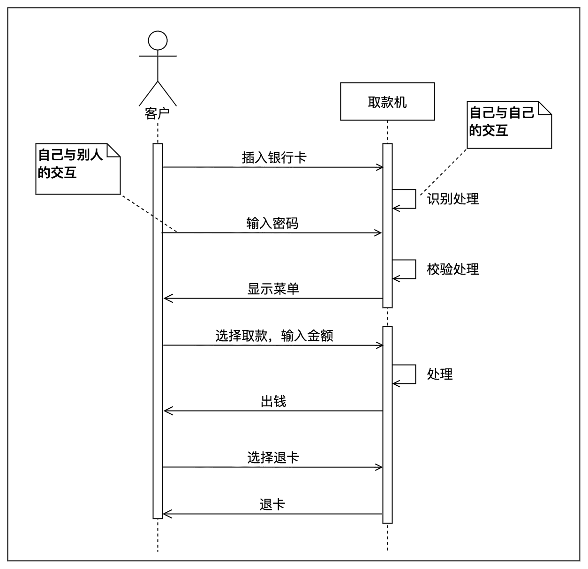
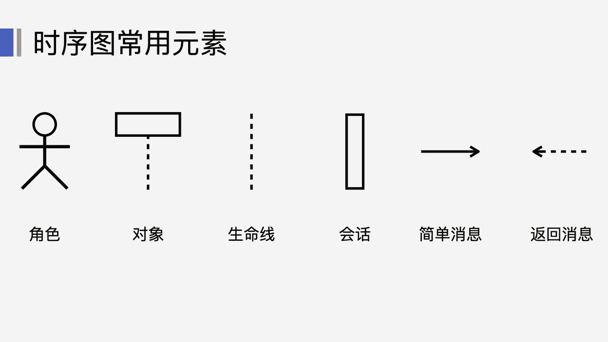
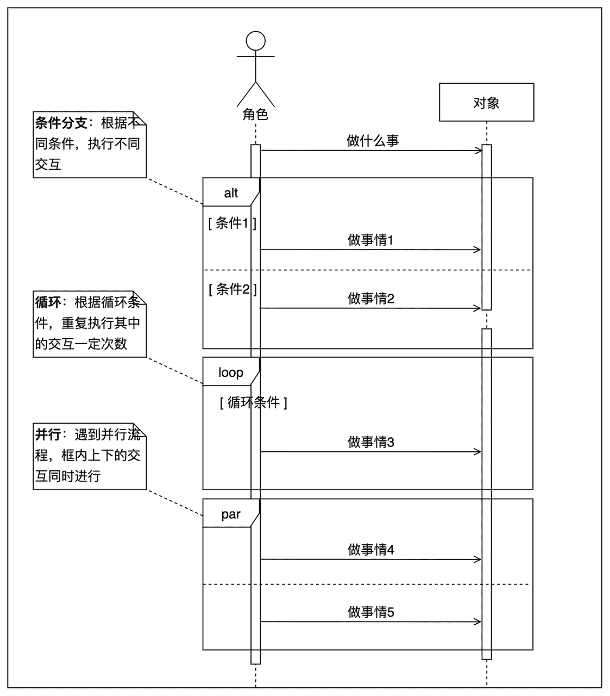
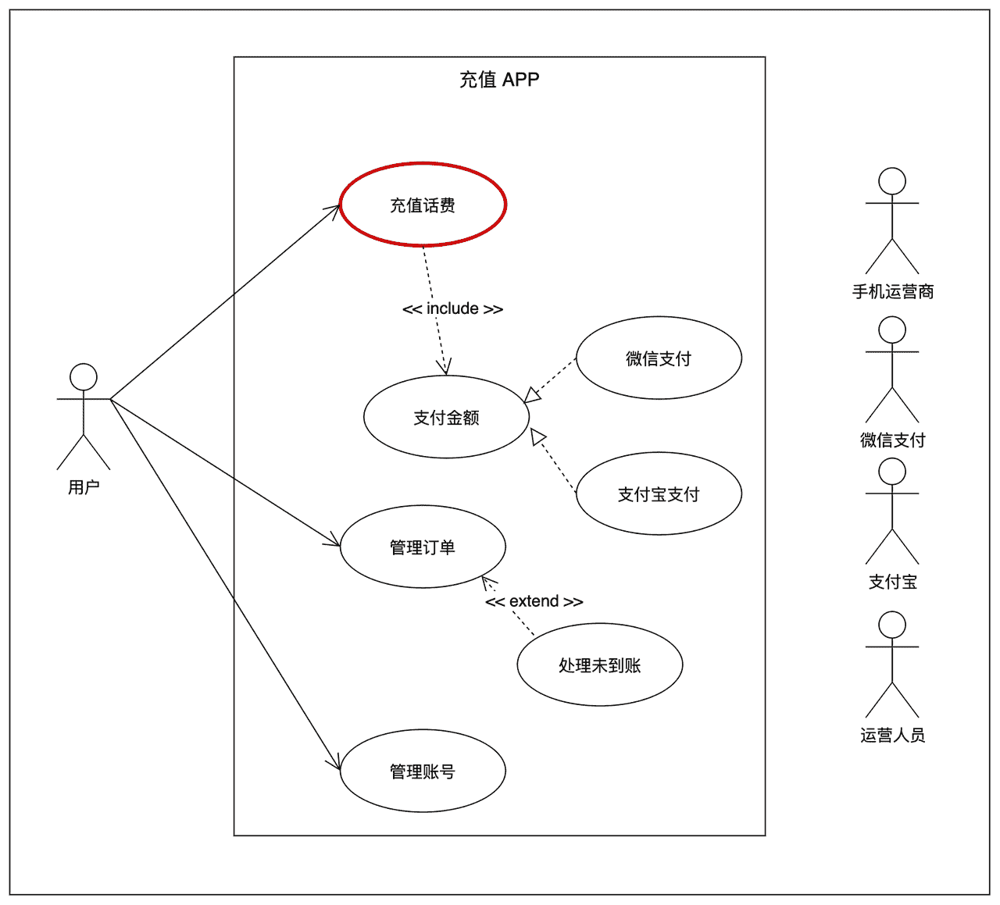
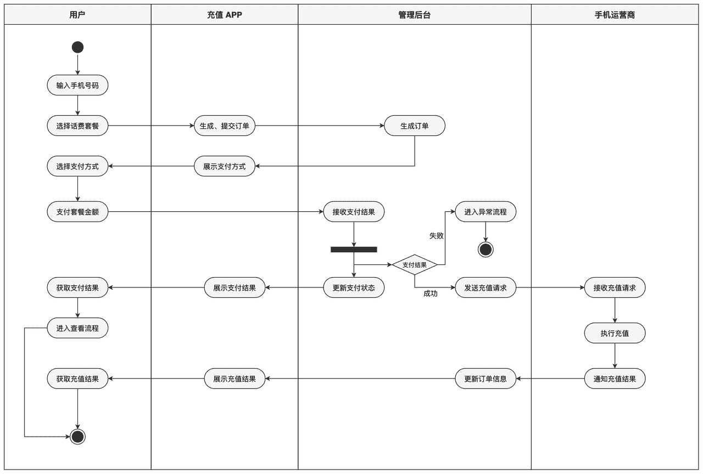
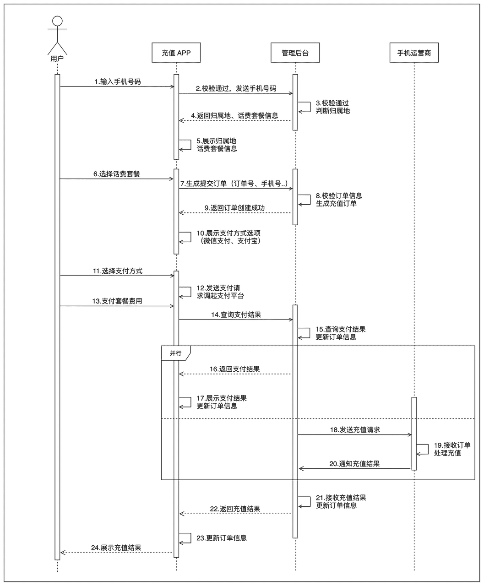

# 手把手教会产品经理如何画好时序图

> 来源：[https://qqs7y1hozd1.feishu.cn/docx/J2eld3GpYoexYDxH3zocErOFnZc](https://qqs7y1hozd1.feishu.cn/docx/J2eld3GpYoexYDxH3zocErOFnZc)

> 编辑导语：[时序图](https://so.csdn.net/so/search?q=%E6%97%B6%E5%BA%8F%E5%9B%BE&spm=1001.2101.3001.7020)可以有效地描述交互顺序，并帮助研发团队更清晰地理顺系统逻辑，做好流程分析，若利用得当，则可以一定程度上降低沟通成本，更快速地推进业务进行。本篇文章里，作者就时序图的构成与画法等方面做了总结，一起来看一下。

### 一、解读时序图

**时序图****，也叫序列图、顺序图，是**** UML 中常用的动态视图****，**用于描述多个对象参与实现业务目标时，彼此之间按时间顺序进行交互的过程。

时序图，用来表达对象或角色之间交互的信息传递和时间顺序，特别方便。

每次梳理流程，跟开发沟通，我都会借助它来描述。

绘制时序图，将一个个对象和其交互动作列出来，可以直观反映出，每**个对象对其****他**对象、或其自身做的交互动作，让我们看到业务内部的运作、系统之间的互动，从而搞清楚业务规则、系统逻辑。

**在《火球：UML 大战需求分析》一书**中，作者总结特别好：“任何复杂的交互，都可以分解为自己与自己、自己与别人、别人与别人的多个简单交互”。

时序图正体现了这种逻辑，所以，它表达交互逻辑时，非常清晰简单。

**客户用 ATM 取款的时序图**

**作**为产品经理，如果我们能掌握这一利器，用来分析业务、定义需求，与开发沟通，定能大大提高效率。

时序图常见的应用场景，是在支付领域。例如，🛰️支付的开发者文档，就用时序图来表达支付的实现逻辑。

这么好的工具，赶紧学一下吧。

### 二、时序图的构成

时序图的常用元素很简单，分别有：对象（角色）、生命线、会话、消息（简单消息、返回消息）。

**时序图的常用元素**

1.  **对象**

对象，指与业务、产品或系统相关的人、事、物，可以是人、部门、系统等。

通常用**矩形**表示，画在时序图的顶部，对象名写在矩形内。

其中，参与交互过程的人，如用例图的参与者**、参**与完成业务目标的相关人员，通常称之为角色。

网上有的会把对象和角色分开来，我理解这些都是对象。只不过**，在图**形上，角色与用例图的参与者一样，用火柴人表示，比较好理解。

因为，**UML 是在面向对象思想的指导下**，来描述软件产品的分析与设计。面向对象，则将现实世界的人事物，看成一个个独立的个体，称之为「 对象 」。

它们又可以根据不同的需要，以不同**的角度，被**归纳在一起，这就是开发人员常说的「 类 」。

比如，西瓜、苹果、梨是不同的对象，它们可以归为一类——水果；苹果手机、华为手机、小米手机，可以归为手机。

对象的命名，一般格式为：**对象名：类名**，如「 李四：客户 」。

按照语法，冒号和类名是必需的，对象名是可选的。具体地说，「 李四：客户 」表示李四是客户的实例，即具体到某个客户的名字。

实践中，并不需要具体到实例，对象名可以不写。我的做法是，直接写一类对象的名称，如某某系统、某某部门。

1.  **生命线**

每个对象下有一条垂直的虚线，这就是对象的生命线，从上往下，代表时间的先后顺序。

1.  **会话**

会话，也叫激活框，它代表在对象生命线上某个阶段执行的操作，以一个偏窄的矩形表示。

每一次会话，表示一次相对完整的交互过程。不过，怎样算一次会话，实践中有点难区分，需要多练习体会。

我常按照操作的完整度来画，有时甚至不画，有些专业的 UML 工具还能自动生成会话。

1.  **消息**

消息，表示对象之间发送的信息或做的事情。消息，有的分为三种：同步消息、异步消息、返回消息。

从产品层面，并不需要规定技术的实现方式，是同步还是异步，这交给开发人员设计，会更为合理。

**因此，我基本只用两**种消息来表达：简单消息、返回消息。

> **1）简单消息**

> 简单消息，用**箭头实线**，表示一个对象，向另一个对象发的信息，或做的事情。它不强调消息的类型，只表示交互，足以满足大部分情况。

> **2）返回消息**

> 返回消息，用**箭头虚线**，表示一个对象，收到另一个对象的信息后，再向其返回的信息，或做的事情。

> **消息线上**方的文字，则是注明传递的消息或执行的动作，一般用动宾短语。

> 这些对象间的交互消息，画在两个对象的生命线之间。对象自身做的事情，则画在自己的生命线上。

1.  **组合框**

现实业务、系统流程中，总会有特殊情况，不可能完全按时间顺序、一条线走完。

这时，就需要用到组合框（frame）来表示常见的特殊情况，如分支、循环、并行等。

遇到这些特殊情况时，就可以把相应的交互流程放入这个框中。

**时序图三种常用的特殊结构**

### 三、时序图的画法

下面，还是以之前的 「 手机话费充值 APP 」 为例（案例详见《用例图这样画，3步让你做需求分析有理有据），来了解时序图如何用。

常用的画图工具，有 Visio、ProcessOn ，现在很多在线文档也支持 UML ，如腾讯文档、飞书云文档。

时序图的画法也很简单，一句话就能说完，可是要灵活掌握，还得多加练习。

首先，**选定要展开分析的用例或目标**；接着，**分**析都有哪些对象、角色参与了实现过程；然后，将它们在实现目标过程中，彼此之间的交互动作，按照时间轴的顺序列出来。

再简单点，就是**定目标、找对象、列消息**三步走。

1.  **定目标**

画时序图，与活动图一样，要指定某个用例，或目标展开。这些动态视图，是用来描述在静态视图（如用例图）定义的结构下对象的行为。

本质上，它们都是在描述谁如何参与完成业务目标。

明确了用例或目标，才能保证绘制的流程，边界清晰，过程完整，不会越画越乱。

比如，我们用时序图来分析案例中「 充值话费 」用例的实现过程。这时，就别把「 支付金额 」用例的交互也画进去，把它们画在一起，会增加阅读难度，不利于沟通表达。

案例中「 充值 APP」 的系统用例图

1.  **找对象**

之前的文章已经分析出，案例中，充值得有手机运营商支持；支付得对接🛰️支付、支付宝；协助用户处理未到账，还需要有运营人员介入。

整个充值 APP ，还应包括管理后台系统 ，才能完成相关的管理操作。

因此，先将它们列出来，每一竖列，表示一个对象或角色，每个对象有一条生命线。

**为方便阅读，****可****将**流程中最先发起消息的对象放在最左边；再将交互多的对象摆在附近，别隔太多对象，这样画出来的图会更清晰简洁。

1.  **列消息**

**找**到了对象，就可以列出对象间的交互消息。为了方便你回顾 「 充值话费 」用例的实现过程，咱们先上之前已经得出的活动图。

充值 APP 「 充值话费 」用例活动图

工作中，我们把**流程弄明白后，就可以边理边画，将对象间的交互，从**最先发起的消息，一个个从上往下依次列出。

有些消息有带参数的，可以在描述文字后注明。如下图的第 7 步，充值 APP 生成并提交订单至管理后台，可以在括号里写上订单有哪些字段信息（如订单号、手机号码、购买时间等）。

充值 APP 「 充值话费 」用例对象交互时序图

**在** UML 中，时序图的消息是没有序号的。使用中，我发现为每个消息加上序号，比较方便描述与阅读，一直习惯这么用。

**「 充值**话费 」用例的流程中，刚好有一个并行流程，即上图的第 16 至 20 步。

**管理后台在返回支付结果时，还需同步向手机**运营商发起充值请求，这是常见的并行流程。

因此，将其画在组合框中，表示这里面上下两部分交互是同时进行的，不分先后。

从这里不难看出，分支一多，时序图会比较难画，也不好理解。

确实，时序图不**太适合表达多分支的复杂流程。因此，我们**用时序图更多是描述主干流程，复杂的分支可单独抽取出来画，也可以用文字说明。

1.  经验之谈

看到上面的泳道活动图和时序图，你可能会想，它们俩还挺像的，工作中究竟用哪个呢？

> **它们都用于描述不同对象之间的动作。不过，泳道活动图，更侧重于表达**谁做了什么事；而时序图，除了强调流程中交互的消息和顺序，还表达谁对谁做了什么事。

> **我的体会是，遇到强调消息传递、时间顺序的，用时序图；遇**到流程比较复杂、分支比较多的，用活动图。

> 还可以**多尝试两种都画，通过不同视角来观察同**一个流程，会让我们的理解更加全面、深刻。

实践中，时序图，常用于表达系统的接口请求与反馈消息，更偏向技术实现。

作为产品经理，我们可以从产品视角、操作层面，用它来表达业务流程、产品流程。

这样，开发人员也很好理解，便于他们进行系统设计。

### 四、总结

信息量还是不少，我给你总结下。

> **时序图，用来描述多个对象参与实现业务目**标时，彼此之间按时间顺序进行交互的过程。常见的应用场景，是在支付领域。

> 用好时序图，能帮我们，搞清楚业务规则、系统逻辑，提高工作效率。

1.  **画时序图的方法**

1.  定目标，指定用例或业务目标展开分析；

1.  找对象，找出参与实现目标的对象/角色；

1.  列消息，按时间顺序列出对象的交互消息。

1.  **画时序图的经验**

+   给交互消息加序号，方便阅读沟通；

+   触发交互的对象画在最左，交互频繁的走近些；

+   同一个流程，画不同视图，理解更全面、深刻。

时序图，是我分析流程的最爱，有段时间我经常用它，突然灵感闪现，发现了它的高阶玩法，与数据分析结合

多加练习吧，相信它也会是你的好帮手！