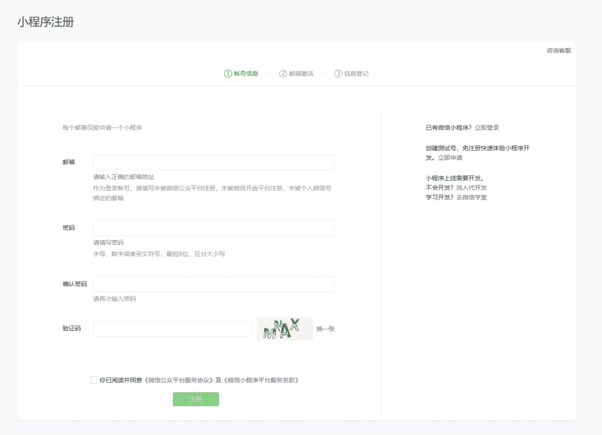
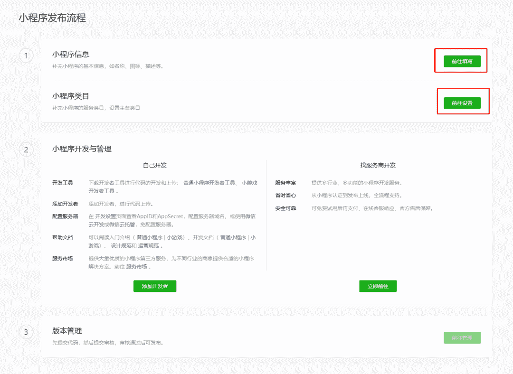
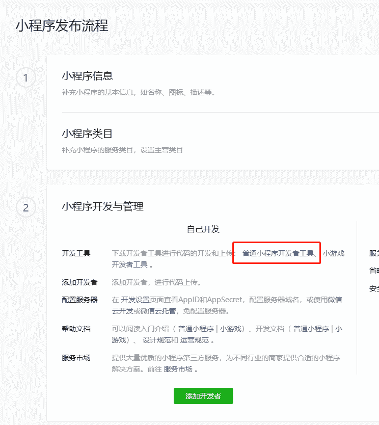
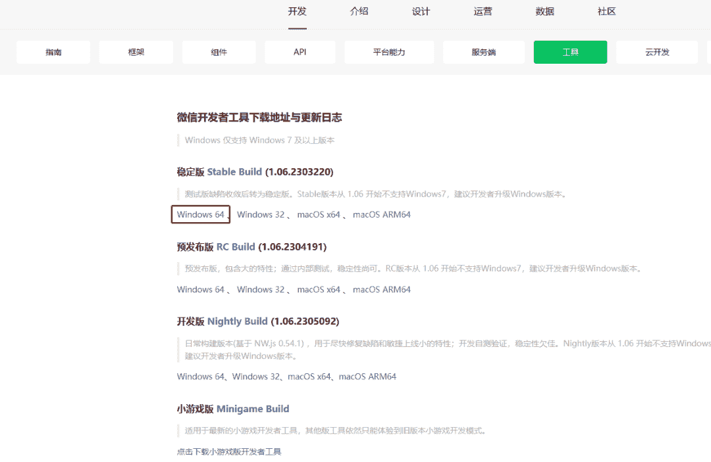
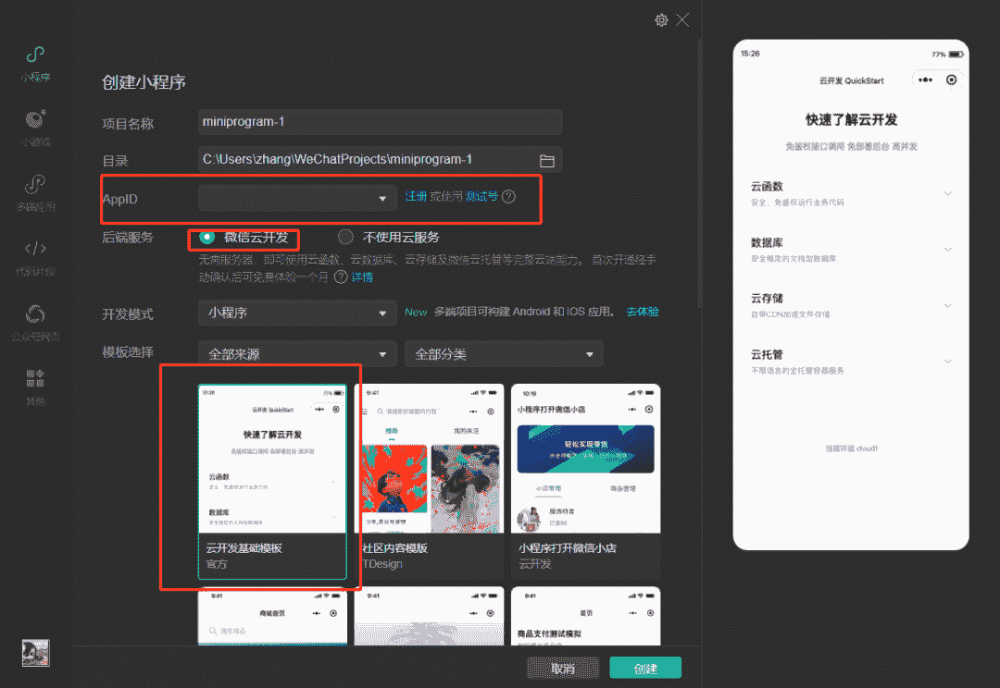
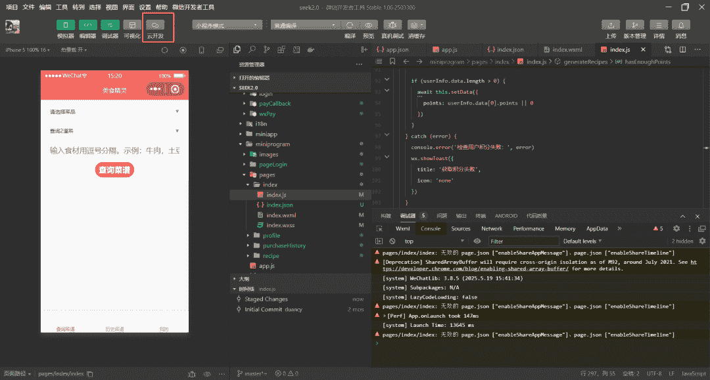
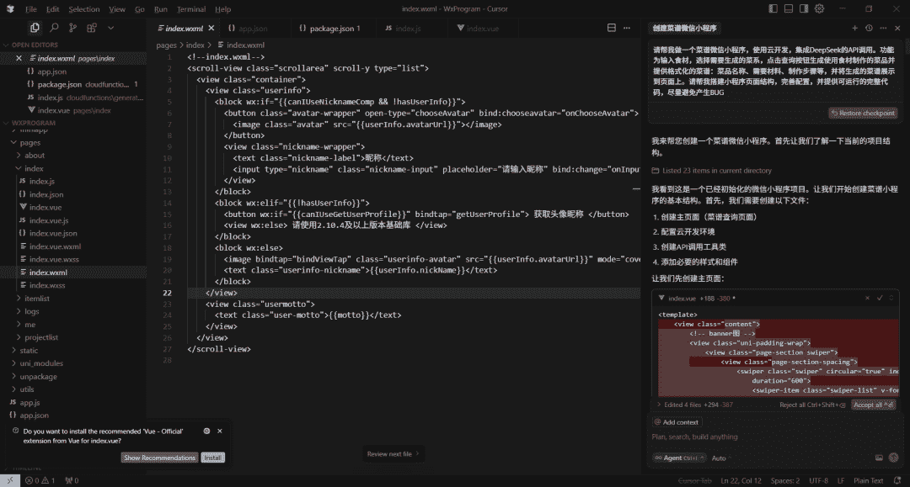
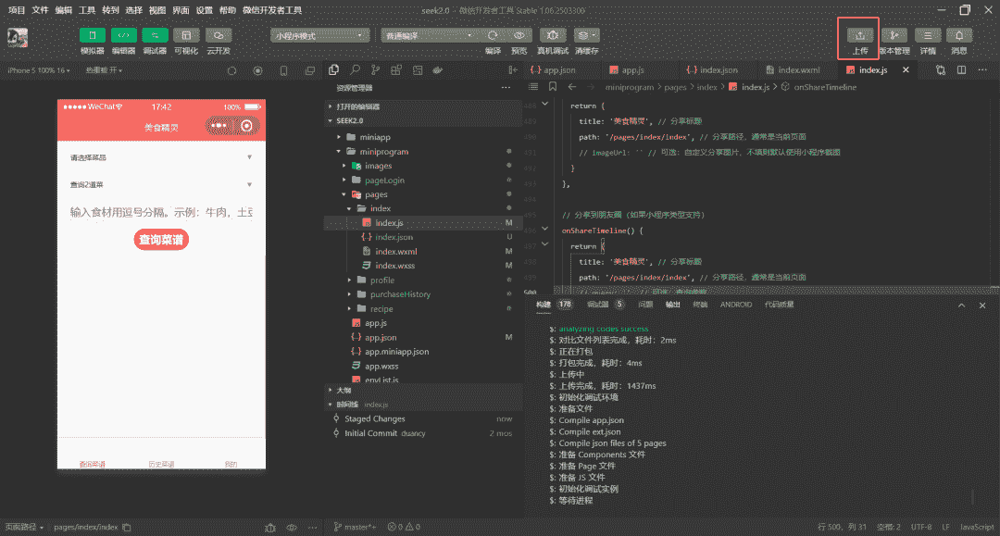
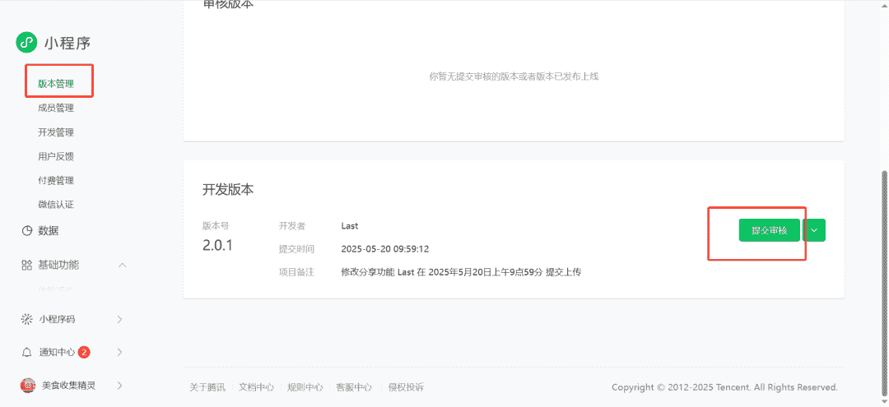

# 从0到1，Cursor8小时做一个小项目

> 来源：[https://qqs7y1hozd1.feishu.cn/docx/SvSCdz5EwoD3mnxszKpcPO2hnCc](https://qqs7y1hozd1.feishu.cn/docx/SvSCdz5EwoD3mnxszKpcPO2hnCc)

## ·小程序介绍·

**先来给大家介**绍一下我开发的这个“美食收集精灵”小chengxu。

> 用户可以在小程序中输入厨房里现有**的食材，选择喜欢的菜系，点击查询按钮后，小程序会根据**输入的食材和菜系生成相应的菜品菜谱，包括菜品名称、所需材料、制作步骤等详细内容。

> 虽然目前小程序的界面美观度还有待提升，功能也相对简单，但已经能够满足基本的使用需求。

> 小程序在下方，**cursor写的小程序原生页面，**没有调用前端组件些组件，看上去美观度一般

> **我写的逻辑也比较简单，太复杂的容易报错，因为我**用了deepseek的API所以使用了🛰️云开发(不涉及调用API功能逻辑不需要云开发)。

功能的名字叫美食收集精灵，输入你能想到的或者厨房里有的食材，选择菜系生成可以制作的菜品菜谱。

## ·搭建教程·

话不多说，我将手把手教下大家如何利用cursor来实现最终的搭建。

前半部分我们先简单介绍怎么注册小程序，后半部分介绍怎么进行开发上线。

1、注册小程序

登录👸号首页，选取小程序，用一个新的邮箱绑定注册即可。

2、小程序信息填写

注册验证通过后，将会看到小程序发布流程，首先填写小程序信息和类目。

这里不做太多介绍，小程序名称可以填写你想做的功能名称即可，小程序头像可以网上找个，因为我要做菜谱的功能，因此我是利用豆包生成的厨台图标。

3、开发者工具

最重要的开发者工具环节。回到发布流程页面，点击“普通小程序开发者工具”，在新的页面中点击“开发者工具”，选择windows 64位下载即可。

4、创建小程序项目

打开下载好的**开发者工具，选择创建小程序**。需要注意的是，id是在开发者网页平台最下方的设置里面，有个账号信息获取，获取后，选择使用云服务，并选择基础模板。

5、开通云开发，免费使用一月

6、下载安装cursor

下载地址 https://www.cursor.com/cn

打开创建好的小程序文件夹，按Ctrl+L键打开AI对话框

记得选择Agent模式，选择了Agent模式 ，Cursor就可以自动提取我们项目的上下文了。

这里使用了免费的cursor，想要无限用cursor次数的可以在📕或b站自己找找无限教程，简单小程序使用免费版完全足够。

7.输入提示词

在对话框中输入提示词，如

> “请帮我做一个菜谱🛰️小程序，使用云开发，集成DeepSeek的API调用。功能为输入食材，选择需要生成的菜系，点击查询按钮生成使用食材制作的菜品，提供格式化的菜谱：菜品名称、需要材料、制作步骤等，并将生成好的菜谱展示到页面上。请帮我搭建小程序页面结构，完善配置，并提供可运行的完整代码，尽量避免产生BUG”，

cursor会自动搭建好页面目录并填入代码。

8.在开发者工具中进行编译运行

> **在开**发者工具中点击编译，小程序会展示在左边模拟器中，如在右下角调试器中提示了红色错误，可以截图后直接粘贴到cursor的对话框中并输入帮我解决错误，cursor会自动识别错误并进行修改，然后按照提示接受修改。

点击真机调试可以使用🛰️扫码在手机上运行小程序

9.上传代码

开发者工具中点上传，根据提示进行修改

10.上传代码发布小程序

上传成功后，在开发者平台-版本管理可以进行发布。一般审核时间是1-7个工作日，你可以选择加急2h内，但是一年只有一次，审核通过后点击发布。

03.·踩坑经验分享·

> 在开发过程中，我也遇到了不少问题，以下是一些总结的经验教训：

> 一定不要直接盲目给Cursor类的编程工具直接对话开发，让AI整理需求文档和UI样式，将需求文档和UI发给Cursor，这样可以大大提高开发效率。

> 如果一个问题无论如何描述，AI都无法正确修改，可以尝试新开一个对话，有时候可能是AI陷入了当前上下文的错误逻辑。

> 多个AI编程工具可以一起使用，如Trae等，遇到问题时可以相互参考。

> 使用Trae时，记得选择内置智能体Builder，它会自动查找代码的上下文，提高开发效率。

> 如果发现一个程序已经开发得乱七八糟，从样式到功能都不符合预期，不要犹豫，直接删除，按照正确的方法重新让AI写，反而会更快。