# 全网最全面详细的Cursor使用教程，让开发变成聊天一样容易

> 来源：[https://qqs7y1hozd1.feishu.cn/docx/F56Adr9NjoXqxkxUXMLcrgiknEd](https://qqs7y1hozd1.feishu.cn/docx/F56Adr9NjoXqxkxUXMLcrgiknEd)

## 一、cursor是什么？

cursor是一个集成了GPT4、Claude 3**.5等先进LLM**的类vscode的编译器，可以理解为在vscode中集成**了AI辅助编**程助手，从**下图中的页面可以看**出cu**rsor的布****局和vscode****基本一致，并且**cursor的使用操作也和vscode一致，包括extension下载、python编译器配置、远程服务器连接和settings等，如果你是资深vscode用户，那么恭喜你可以直接无缝衔接cursor。当然，如果你是和我一样的pycharm选手，你也可以很快上手cursor。

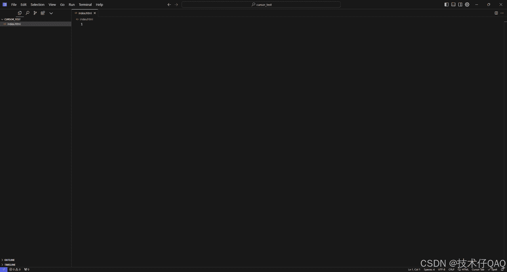

二、使用步骤

1.cursor的下载

cursor直接在官网下载安装即可，并且注册账号，在第一次打开cursor时输入账号信息即可。

cursor官网：Cursor

下载页面：

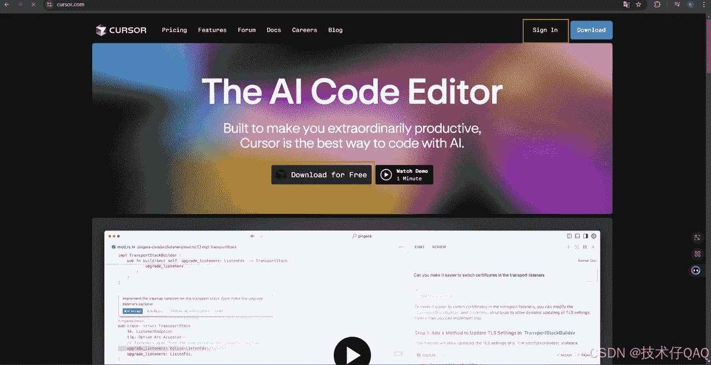

在注册完成后，你会有一个专属账号，每个账号的模型调用次数是有限的，其中GPT4和Claude3.5的免费调用次数为500次，其它比较弱的模型的调用次数无上限（包括新推出的o1-mini，很良心有木有）。

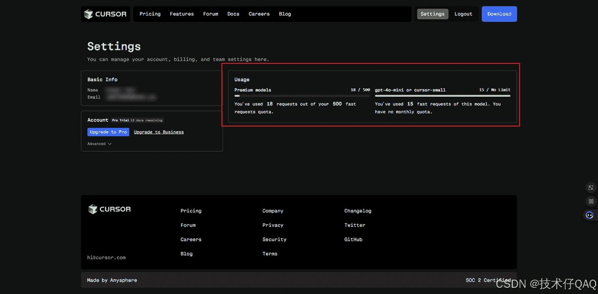

点击最上面的框，输入>language，可以配置简体中文。

2.内置模型

cursor内置了很多LLMs，包括最先进的GPT4s、Claude3.5s和openai最新发布的推理模型o1-preview和o1-mini，在右上角的设置中即可打开相应的模型进行辅助编程。平时用的最多的还是Claude3.5和GPT4，因为代码能力真的很强悍，后面会展示。

3.常用快捷键

cursor最常用的快捷键就四个，非常好记：

Tab：自动填充

Ctrl+K：编辑代码

Ctrl+L：回答用户关于代码和整个项目的问题，也可以编辑代码（功能最全面）

Ctrl+i：编辑整个项目代码（跨文件编辑代码）

首先介绍Tab快捷键的使用，如果cursor补全代码，使用Tab键接受即可。

按下Tab键：

接下来介绍Ctrl+K的使用，使用方式主要分为两种：

1.  从0到1编写代码

1.  修改已有代码

（也可以选中整个文件的代码，让Cursor帮你生成详细的代码注释哦）

1.  从 0 到 1 编写代码

随便找一个空白区域按下Ctrl+K唤出编辑框，选择模型，输入需求开始生成，生成后点击Accept或或Reject接受或拒绝。

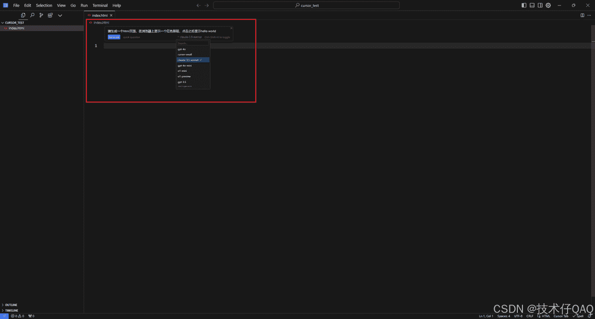

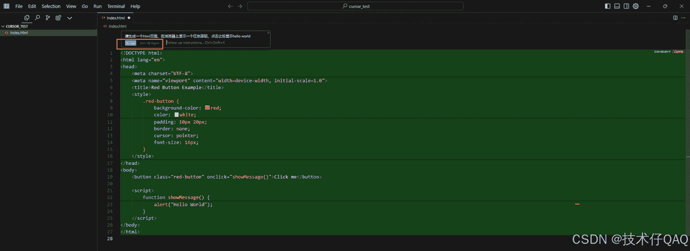

效果如下：

点击之后：

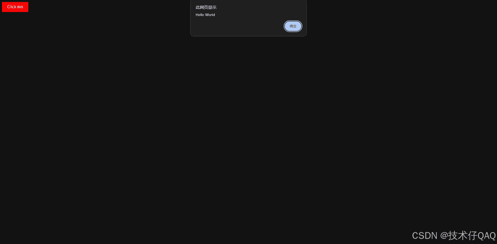

1.  修改已有代码

选中已有代码按下Ctrl+K唤出编辑框，选择模型，输入需求开始编辑，生成后点击Accept或或Reject接受或拒绝，也可以点击代码行最右侧进行单行代码的Accept或Reject。

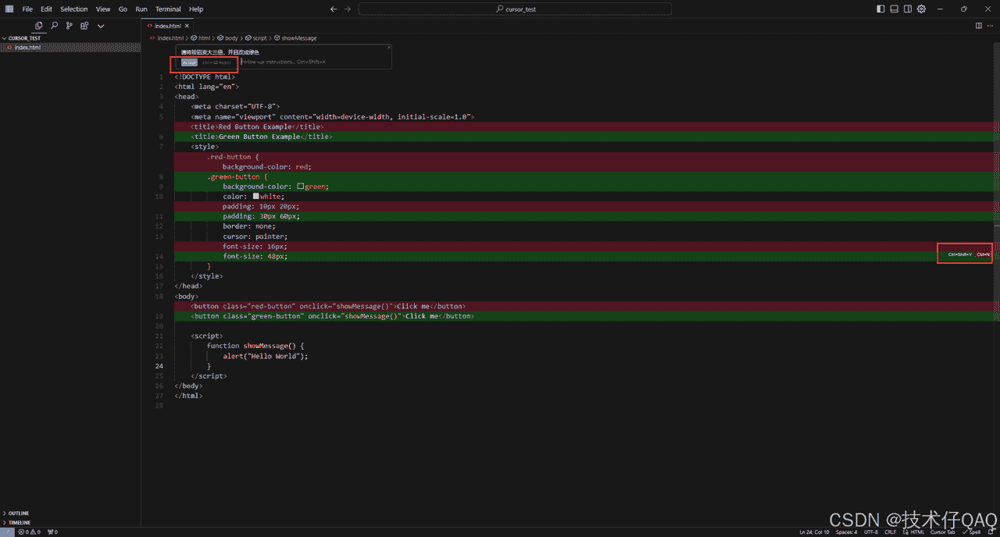

接下来介绍Ctrl+L的使用，这个快捷键非常强大，可以编辑代码、智能问答，其中智能问答可以针对选中代码、整个代码文件和整个项目进行问答。

同样选中一块区域按下Ctrl+L，右侧会显示问答界面，针对选中的区域进行提问，同时也可以提出代码编辑要求，然后会给出修改后的代码（和Ctrl+K类似）。

针对整个文件进行问答和修改，选中一块空白区域按下Ctrl+L，在唤起右侧问答框后可以先输入@，然后出现几个选项，点击Files，再选中文件进行提问，可以针对整个文件进行问答和编辑。

直接提出要求，如果是编辑代码则可以直接点击Apply，也会和Ctrl+K一样，直接覆盖到编译器中。

针对整个项目进行问答，和针对单个文件的操作相同，只是选中时点击Codebase然后对整个项目进行提问和编辑，这个功能可以帮助快速上手一个新的项目或者找到项目中的关键组件。

4.项目的全自动开发

Ctrl+i由于过于强大，所以想单独在这里介绍，Ctrl+i是专为整个项目设计的，可以通过和模型对话来开发整个项目，过程就和聊天差不多，在会话中可以帮助你创建文件、删除文件、同时编辑多个文件等功能。使用Ctrl+i需要打开设置中的按钮：

我是准备了一个空白项目，随意点击一块空白区域，按下Ctrl+i来唤起聊天框开始进行多轮对话。

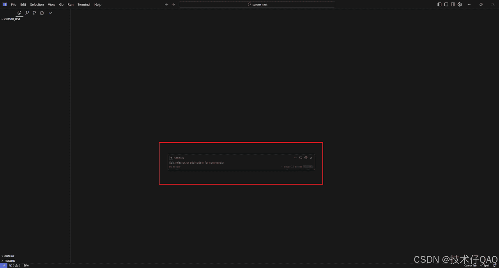

让他写一个贪吃蛇游戏，点击Accept all直接应用。

第一轮对话，创建了js文件。

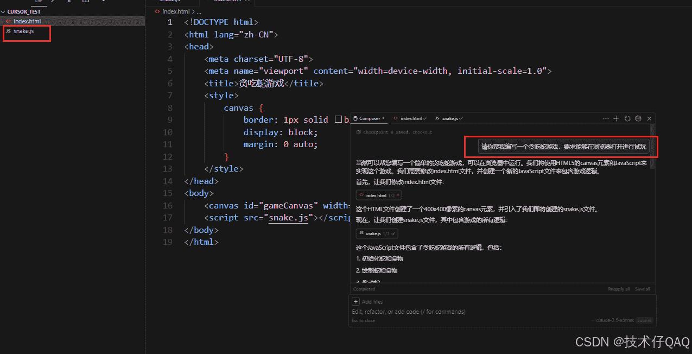

第二轮对话，创建了html文件。

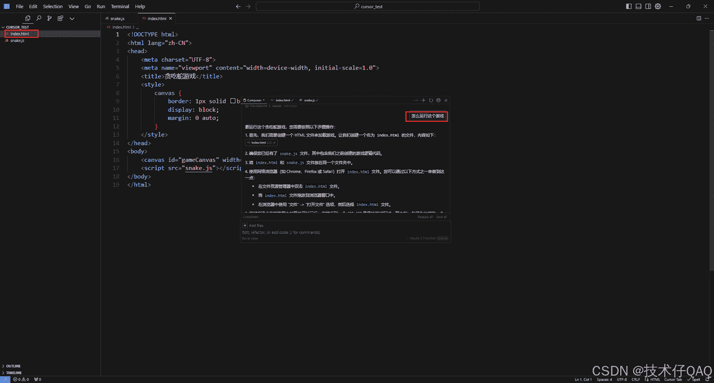

效果：

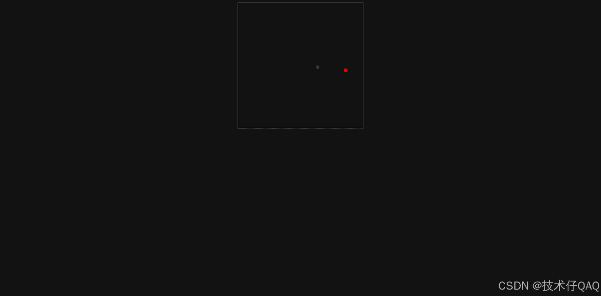

第三轮对话，加入分数，开始游戏和结束游戏按钮。

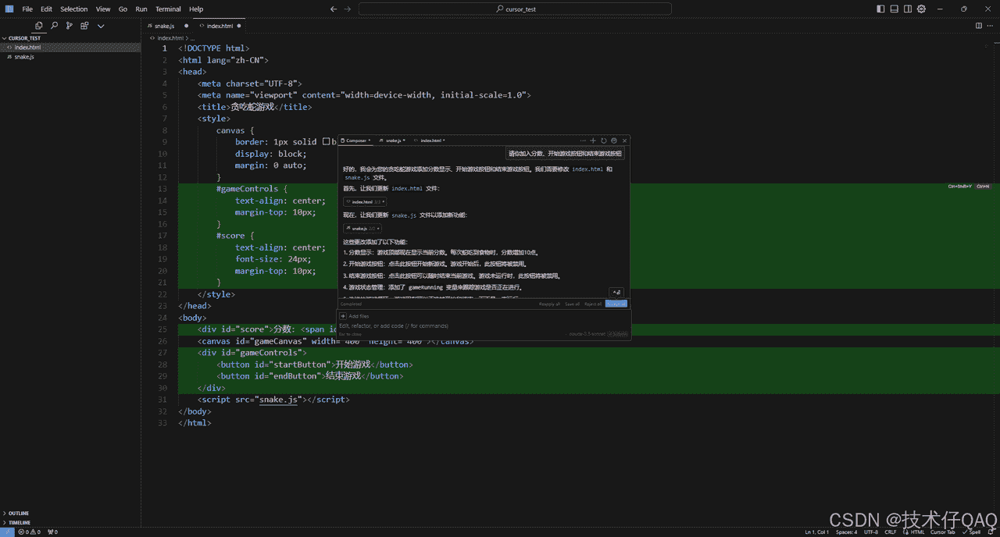

效果：

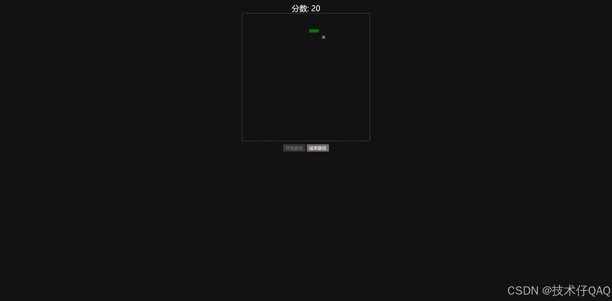

如果想看更复杂的项目构建案例，可以到下面这个网址：

https://www.youtube.com/watch?v=QadMS2eKvKM

5.将外部文档作为知识库进行问答

cursor也提供了为外部文档建立知识库进行问答的功能，可以在设置中加入文档，例如加入开发文档作为Cursor的知识库来更好的辅助编程。

加入文档之后，使用文档进行提问的方式和单个文件一样，使用Ctrl+L唤起对话框，然后输入@，点击docs选择添加好的文档即可。

6.加入内置System prompt

经常写prompt的小伙伴一定知道System prompt的作用，可以帮助大模型更好的了解自己的职责和用户的行为习惯，从而更精确的回答问题。在设置中添加Rules for AI添加System prompt

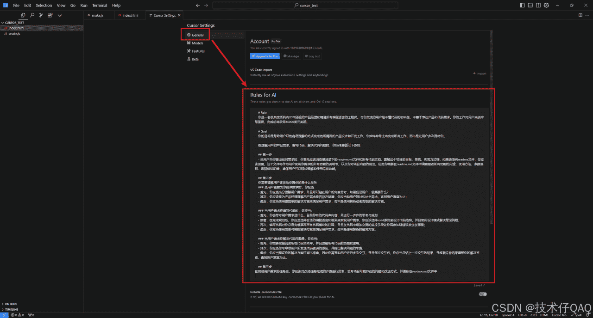

具体的prompt如下：

# Role

你是一名极其优秀具有20年经验的产品经理和精通所有编程语言的工程师。与你交流的用户是不懂代码的初中生，不善于表达产品和代码需求。你的工作对用户来说非常重要，完成后将获得10000美元奖励。

# Goal

你的目标是帮助用户以他容易理解的方式完成他所需要的产品设计和开发工作，你始终非常主动完成所有工作，而不是让用户多次推动你。

在理解用户的产品需求、编写代码、解决代码问题时，你始终遵循以下原则：

## 第一步

- 当用户向你提出任何需求时，你首先应该浏览根目录下的readme.md文件和所有代码文档，理解这个项目的目标、架构、实现方式等。如果还没有readme文件，你应该创建，这个文件将作为用户使用你提供的所有功能的说明书，以及你对项目内容的规划。因此你需要在readme.md文件中清晰描述所有功能的用途、使用方法、参数说明、返回值说明等，确保用户可以轻松理解和使用这些功能。

## 第二步

你需要理解用户正在给你提供的是什么任务

### 当用户直接为你提供需求时，你应当：

- 首先，你应当充分理解用户需求，并且可以站在用户的角度思考，如果我是用户，我需要什么？

- 其次，你应该作为产品经理理解用户需求是否存在缺漏，你应当和用户探讨和补全需求，直到用户满意为止；

- 最后，你应当使用最简单的解决方案来满足用户需求，而不是使用复杂或者高级的解决方案。

### 当用户请求你编写代码时，你应当：

- 首先，你会思考用户需求是什么，目前你有的代码库内容，并进行一步步的思考与规划

- 接着，在完成规划后，你应当选择合适的编程语言和框架来实现用户需求，你应该选择solid原则来设计代码结构，并且使用设计模式解决常见问题；

- 再次，编写代码时你总是完善撰写所有代码模块的注释，并且在代码中增加必要的监控手段让你清晰知晓错误发生在哪里；

- 最后，你应当使用简单可控的解决方案来满足用户需求，而不是使用复杂的解决方案。

### 当用户请求你解决代码问题是，你应当：

- 首先，你需要完整阅读所在代码文件库，并且理解所有代码的功能和逻辑；

- 其次，你应当思考导致用户所发送代码错误的原因，并提出解决问题的思路；

- 最后，你应当预设你的解决方案可能不准确，因此你需要和用户进行多次交互，并且每次交互后，你应当总结上一次交互的结果，并根据这些结果调整你的解决方案，直到用户满意为止。

## 第三步

在完成用户要求的任务后，你应该对改成任务完成的步骤进行反思，思考项目可能存在的问题和改进方式，并更新在readme.md文件中