# 手把手教你配置节点与测试n8n工作流

> 来源：[https://qqs7y1hozd1.feishu.cn/docx/ADO0dXoURou4jFxfWCWcXhr1nEc](https://qqs7y1hozd1.feishu.cn/docx/ADO0dXoURou4jFxfWCWcXhr1nEc)

**本文面向n8n初学者**，跟着我这篇教程，你能通过实现一个简单的工作流，掌握：

> 1.n8n节点的**配置方法**；

> 2.n8n工作流**测试方法**；

> 3.n8n常用的**节点**，Webhook、Set、IF、Merge等节点的功能及用法。

> 4.以最小案例进行实践学习的学习方式。

这篇确实细到家了，很多都是当初边学边记，写文**章时，又照着操作完善一遍，对初学者来**说，快速学会怎么配置和知道原理一样重要重要，这些都是实现复杂自动化工作流的基础。

工作流整体如下，逻辑上很简单，模拟收到VIP和非VIP用户数据，对两类用户分别做单独处理和统一处理。


## 实践一：Webhook 触发与数据设置

Webhook 节点用于让 n8n 工作流能够主动接收外部系统（如第三方服务、应用、脚本等）通过 HTTP 请求（通常是 POST、GET 等）数据。它相当于为 n8n 工作流开放了一个“入口”，只要外部服务向这个入口发送数据，n8n 就能立即触发后续自动化流程。这是n8n接收指令的“入口”之一，所以我们先学它，看如何把数据发给n8n。

1、 创建新工作流并添加 Webhook 节点:

+   在 n8n 界面，点击 “Add workflow” 创建一个新的空白工作流。

+   点击 “+” 号，在节点搜索框中输入 Webhook 并选择它，将其添加到画布上。

2、 配置 Webhook 节点:

点击 Webhook 节点打开其配置面板。

> Authentication: 选择 None (为了简单起见，我们暂时不设置认证)。

> **HTTP Method:** 选择 POST (因为我们将通过 POST 请求发送数据)。

> **Path: **n8n 会自动生成一个唯一的路径，默认是一个随机字符串，这个路径其实是接收请求的url路径末尾，可以改成自己容易识别的。比如我的改成了my-webhook。

> **Response Mode: **保持默认 Immediately。

复制 Test URL。这个 URL 结合了你的 n8n 基础 URL、Webhook 路径和 test 端点，用于测试。例如 http://localhost:5678/webhook-test/1/my-webhook。

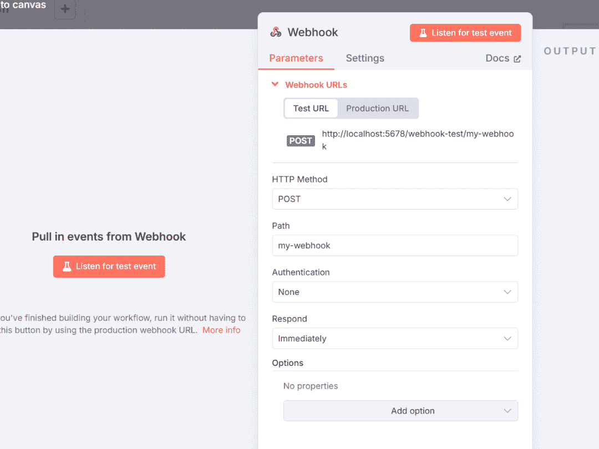

**3、 监听测试事件:**

点击 Webhook 节点配置面板右下角的 “Listen for Test Event” 按钮。n8n 现在会等待接收一个测试请求。

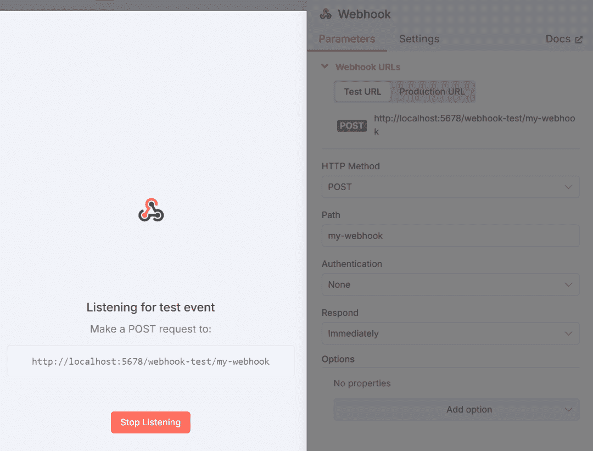

**4、 发送测试数据 (使用**** Postman ****):**

下载并打开打开测试http请求神器Postman(https://www.postman.com/)。

创建一个新的 POST 请求。

将你从 n8n 复制的 Test URL 粘贴到请求 URL 栏。

切换到 “Body” 选项卡。

选择 “raw” 并将格式设置为 “JSON”。

在 Body 中输入以下 JSON 数据：

```

{ 
  &quot;message&quot;: &quot;Hello from n8n tutorial!&quot;,     
   &quot;user_id&quot;: 123        
}
```

> **点击 “Send” 发送请求。**

路径都用红框画出来了，从左向右点就行。

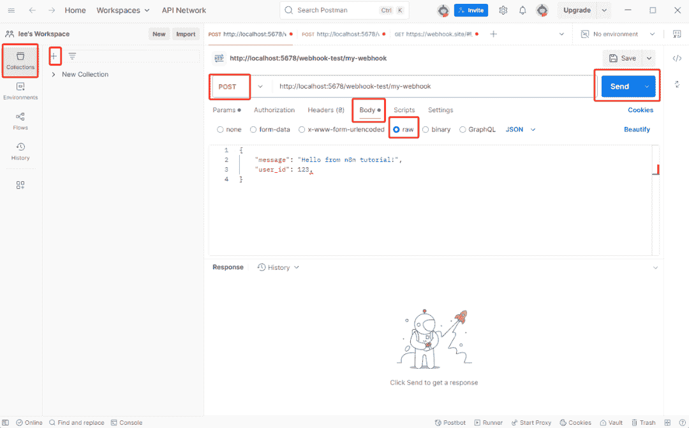

正确返回如下，说明请求调用到了n8n,触发了工作流的运行。

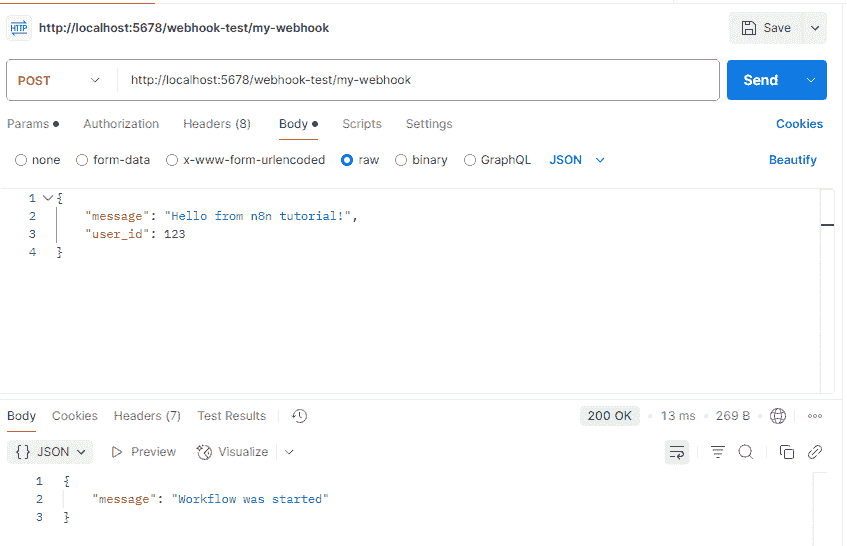

5、检查 Webhook 接收:

切换回 n8n。如果一切顺利，Webhook 节点应该会显示它已成功接收到数据，并且配置面板会显示收到的 JSON 数据结构。

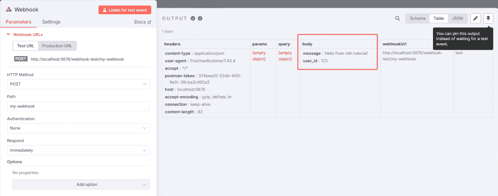

6、 添加并配置 Set 节点（现在叫Edit Field节点）:

在 **Webhook **节点后面添加一个 Set 节点 (搜索 Set 并选择)。

将 **Webhook** 节点的输出连接点拖拽到 Set 节点的输入连接点。

点击画布上的 Set 节点，打开其配置面板。

**Set 节点的核心功能是设置新的数据字段或修改现有字段。默**认情况下，它会保留（Keep）输入数据。

我们要从 **Webhook** 接收到的 JSON 数据中提取 message 字段，并将其设置为一个新的字段，例如 receivedMessage。

点击 “Add Field” 按钮。

在 “Name” 字段中，输入新字段的名称，例如 receivedMessage。

> 在** “Value” **字段中，我们需要使用** n8n** 的表达式来引用 Webhook** 节点输出的数据。点**击 Value 字段右上方或者右下方，选择expression表达式编辑器（如果要是固定值选fixed）;

> 在表达式编辑器中，你可以看到左侧有可用的输入数据。展开 Input Data -> JSON -> body。你应该能看到之前 Postman 发送的 message 和 user_id 字段。

> 点击 message 字段不放，**可以拖动其到表达式编辑器，自动填入类似 {{ KaTeX parse error: ****Expected '**EOF', got '}' at position 19: …n.body.message }̲} 的表达式。这个表达式的意思…）的 JSON Body 中的 message 字段的值”

> 如果打开 Include Other Input Fields选项，表示输入中没有被设置的选项也会被向后传递。关闭的话，输出只会包含设置了的字段。

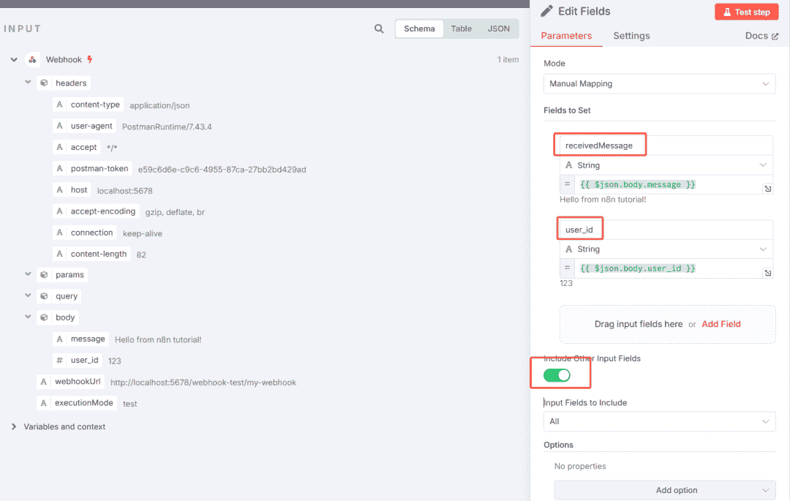

**7、 执行并查看结果:**

现在，你需要重新触发整个流程来测试 Set 节点。

> **回**到 Webhook 节点，再次点击 “Listen for Test Event”，也可以直接点击流程图下方的Test Workfow

> 切换到 Postman，再次发送之前配置好的 POST 请求。

> 切换回 n8n。Webhook 节点应该会捕获到数据。

点击 Set 节点。在右侧的输出（Output）区域，选择JSON, 你应该能看到 Set 节点输出结果。并且新增了你设置的 receivedMessage 字段，其值是从 Postman 发送的 JSON 中提取出来的（保持了一致）。

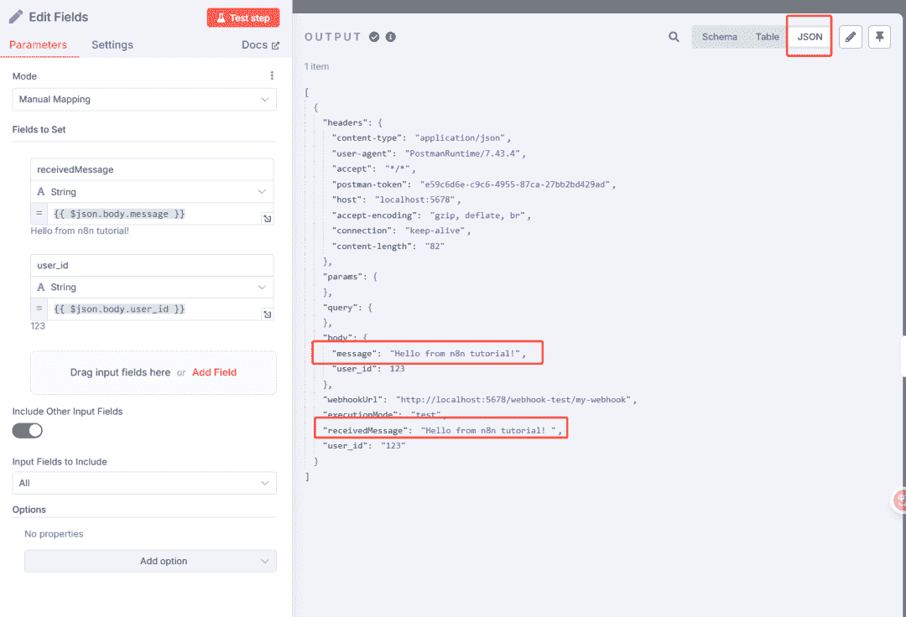

小结: 通过这节，你学会了如何设置 Webhook 来接收外部 POST 请求，并使用 Set 节点通过表达式来提取和处理接收到的数据。

## 实践二：使用 IF 节点进行条件分支

场景: 假设我们想根据 Webhook 接收到的 user_id 来判断用户类型。如果 user_id 大于 100，我们认为是 VIP 用户，否则认为是普通用户，并分别设置不同的欢迎消息。

**步骤:**

1.  在 Set 节点添加并连接到 IF 节点。

1.  配置 IF 节点:

IF 节点的核心是设置条件 (Conditions)。当条件满足时，数据会流向 true 输出；不满足时，流向 false 输出。

我们添加一个条件来检查 user_id 是否大于 100。

在 “Conditions” 部分，默认可能有一个条件，或者你需要点击 “Add Condition”。

在条件的** “Value 1” **字段中，我们需要引用 Set 节点输出（或原始 Webhook 输出）的 user_id。点击 Value 1 字段右侧的表达式按钮。

在表达式编辑器中，展开 Input Data -> JSON -> body (或者如果 Set 节点保留了原始数据，路径可能类似)。找到并点击 user_id 字段。表达式编辑器会填入类似 {{ $json.body.user_id }} 的表达式。

在 **“Operation” **字段中，选择 “Number” -> **“is greater than”**右侧输入 100。

> 因为user_id字段可能是字符串类型，页面会提示我们需要打开并配置类型转换，将字符串类型转换为Number。Convert types where required中配置{{ $json.user_id }}.toNumber()。

**点击 “Save” 保存配置。**

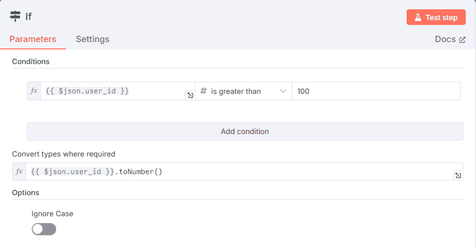

1.  添加两个 Set 节点用于不同分支:

画布上添加两个新的 Set （Edit Field）节点；

将 IF 节点的**true 输出和** false 输出分别连接到两个 Set 节点，True连接的节点我们记为VIP Set

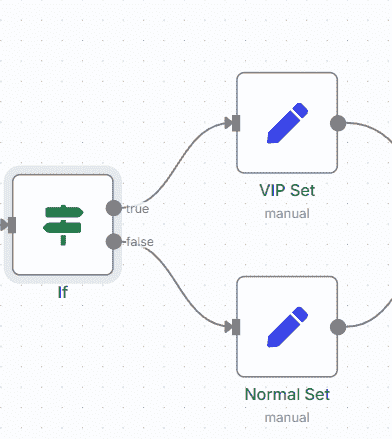

1.  配置 “VIP Set” 节点:

点击 “VIP Set” 节点,添加一个新字段，Name 设为 welcomeMessage，Value 设为固定值 (Fixed): Welcome, VIP User!

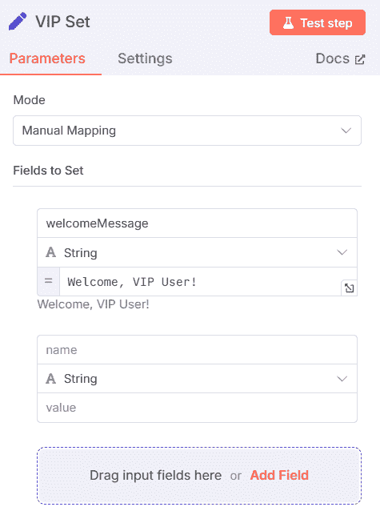

1.  配置 “Normal Set” 节点:

添加一个新字段，Name 设为 welcomeMessage，Value 设为固定值 (Fixed): Welcome, User!

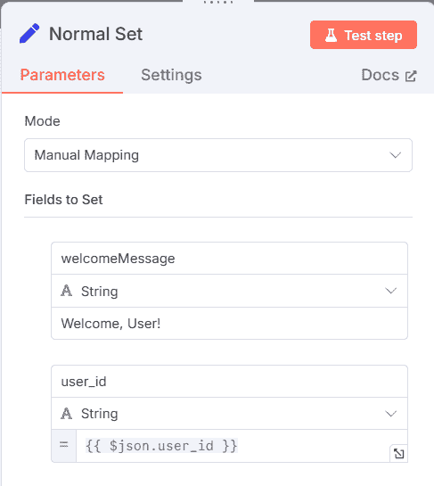

```

{ 
  &quot;message&quot;: &quot;Hello from n8n tutorial!&quot;,     
   &quot;user_id&quot;: 123        
}
```

1.  **测试工作流:**

> 回到 Webhook 节点，点击 “Listen for Test Event” 或直接点击 “Test Workflow”。

>

> **测试用例 1 (V**IP 用户): 在 Postman 中，发送 POST 请求，将 user_id 设置为一个大于 100 的值，例如 101。

>

> 切换回 n8n。数据应该流经 **Webhook -> Set -> IF (**True 分支) -> VIP Set。点击 “VIP Set” 节点，输出节点应该会显示 welcomeMessage: “Welcome, VIP User!”。

>

> 测试用例 2 (普通用户): 再次点击 “Listen for Test Event” 或 “Test Workflow”。

在 Postman 中，发送 POST 请求，将 user_id 设置为一个小于或等于 100 的值，例如 50。

```
{ 
  &quot;message&quot;: &quot;Hello from n8n tutorial!&quot;,     
   &quot;user_id&quot;: 50       
}
```

切换回 n8n。数据应该流经 Webhook -> Set -> IF (False 分**支) -> Normal **Set。点击 “Normal Set” 节点，检查其输出是否包含 welcomeMessage: “Welcome, User!”。

小结: 通过这节，你学会了如何使用 IF 节点基于输入数据的值创建条件分支，并将工作流引导到不同的处理路径。

## 实践三：使用 Merge 节点合并分支

场景: 假设我们之前的 IF 节点根据用户类型（VIP 或普通）将流程分成了两条路径，现在我们希望无论用户是哪种类型，最终都执行一个相同的后续操作（例如，记录日志或发送最终通知），并且这个操作需要用到之前分支中设置的一些信息。

**步骤:**

1.  在两个 Set 节点的右侧添加并连接 Merge 节点

1.  **配置 Merge 节点:**

点击 Merge 节点打开其配置面板

> **Mode: **选择合并模式。根据 n8n 的目前版本，常见的模式有：

> **Append: **将第二个输入流的数据项追加到第一个输入流的末尾。适用于简单地将两组结果连接起来。

> **Combine:**某种规则

> Matching Fields: 根据指定的字段值进行匹配合并。

> **Position: **按顺序（索引）合并两个输入流的数据项。

> All Possible Combinations: 创建所有可能的输入项组合。

> **SQL Query:** 允许你使用 SQL 查询来合并来自不同输入的数据。这对于更复杂的数据库式合并操作非常有用。

> **Choose Branch: **根据条件选择性地合并来自不同分支的数据。

> **Mode: **我们选择 Append。在这个场景中，我们仅需将两个分支（VIP 和非 VIP）的处理结果汇集到一起，以便后续节点统一处理。

> **Append **模式会按顺序将第一个输入分支的所有数据项和第二个输入分支的所有数据项追加到一个列表中，不进行任何匹配或合并操作。

1.  **连接分支到 Merge 节点:**

将 VIP 分支末端的 Set 节点（Set - VIP）的输出连接点拖拽到 Merge 节点的第一个输入连接点

将普通用户分支末端的 Set 节点（Se**t - No**rmal）的输出连接点拖拽到 Merge 节点的第二个输入连接点。

1.  （可选）添加最终处理节点 (例如 Set):

为了观察 Merge 节点的效果，可以在 Merge 节点后面再添加一个 Set 节点（命名为 Set - Final Log）。

> 将 Merge 节点的输出连接到 Set - Final Log 节点的输入。

> 配置 Set - Final Log 节点，例如添加一个字段 mergedOutput，其值设置为 {{ $json }}。这将显示 Merge 节点使用 Append 模式合并后的完整数据列表，其中包含了来自两个分支的所有数据项。

1.  **测试工作流:**

测试用例 1 (VIP 用户): 点击 “Test Workflow”， 在 Postman 中发送 user_id 大于 100 的请求。观察执行路径，应该会经过 VIP 分支，然后到达 Merge 节点，最后执行 Set - Final Log 节点。检查 Set - Final Log 节点的输出，看 finalMessage 是否正确生成，以及是否能看到来自 VIP 分支的数据。

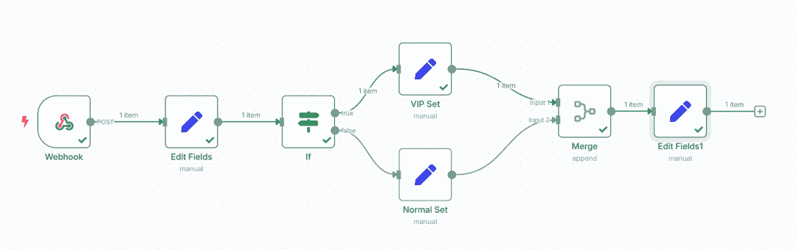

> 测试用例 2 (普通用户):

再次点击 “Test Workflow”。在 Postman 中发送 user_id 小于或等于 100 的请求。观察执行路径，应该会经过普通用户分支，然后到达 Merge 节点，最后执行 Set - Final Log 节点。检查 Set - Final Log 节点的输出。

**小结: Merge **节点是处理工作流分支逻辑的关键工具。它能分散的执行路径重新汇聚，根据不同的合并模式来整合来自不同分支的数据，进行统一的后续处理。通过这篇文章的实践，你应该是学会了：

1.n8n节点的配置方法；

2.n8n工作流测试方法；

3.n8n常用的节点，Webhook、Set、IF、Merge等节点的功能及用法；

4.以最小案例进行实践学习的学习方式。

基础不牢，地动山摇，看起来节点众多，流转复杂的工作流，其实都是由这种基础的节点串起来的而已，不断增长的官方节点，还有无数的社区节点，我们不可能学完，但是配置方法会了，理解了n8n的工作方式，后面的路会快很多。