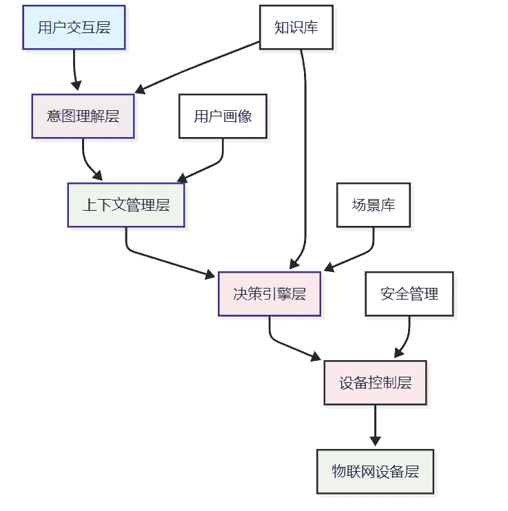
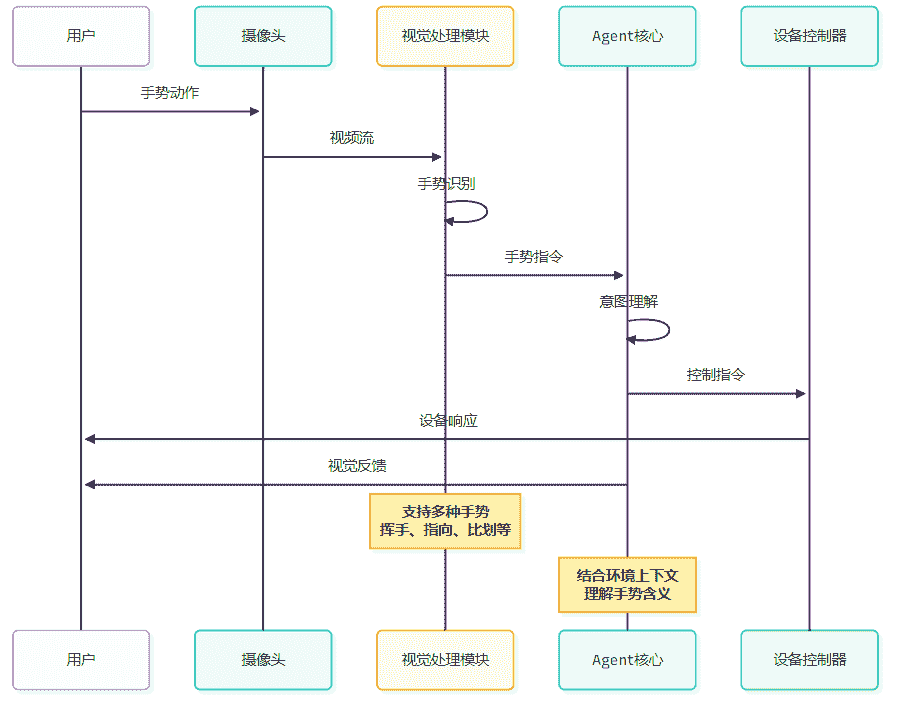
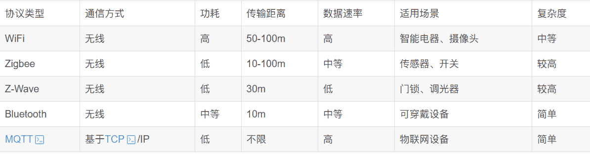
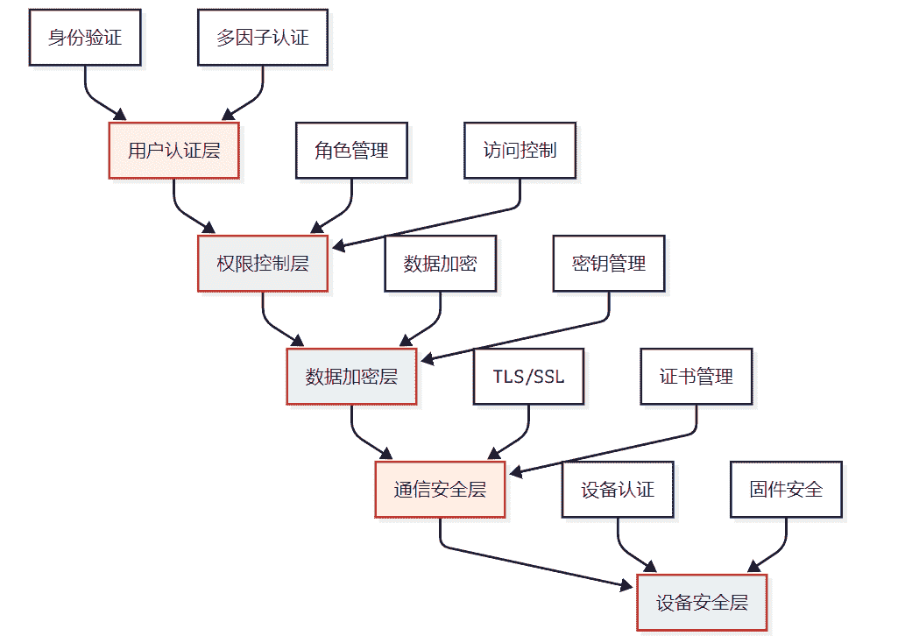
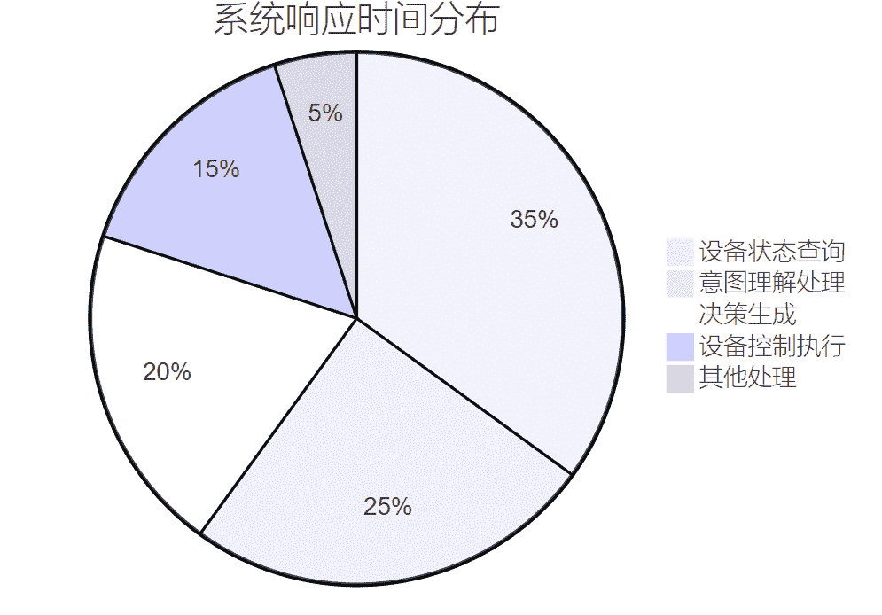
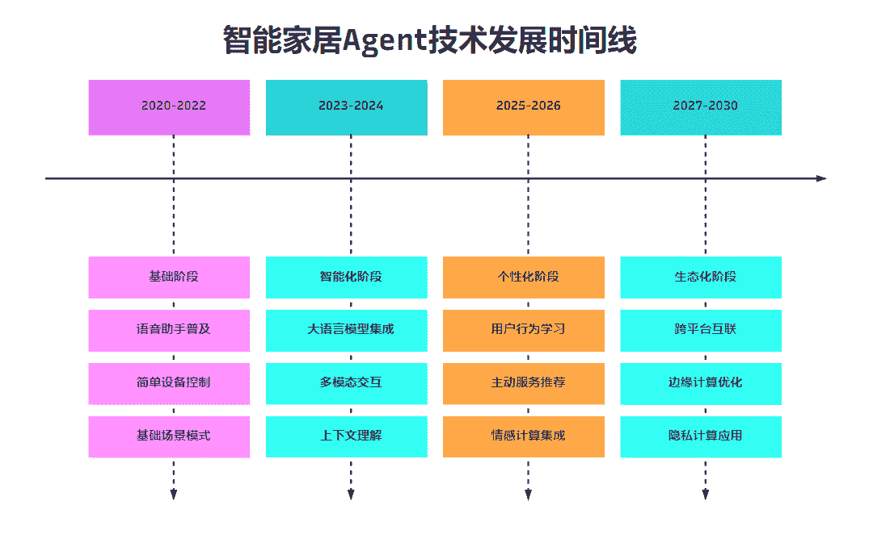
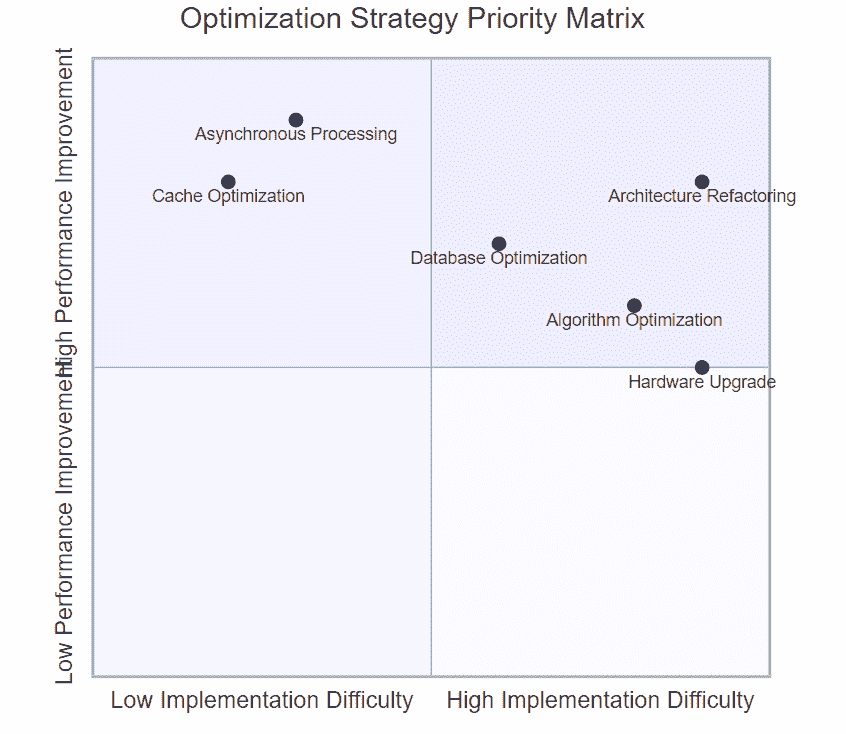

# 智能家居Agent：物联网设备的统一控制与管理

> 来源：[https://qqs7y1hozd1.feishu.cn/docx/YyRddyVl4o7XIwxlZxkcvKd4nCz](https://qqs7y1hozd1.feishu.cn/docx/YyRddyVl4o7XIwxlZxkcvKd4nCz)

## 摘要

传统的智能家居系统往往面临着设备协议不统一、交互方式单一、智能化程度不足等痛点。用户需要在手机上安装多个APP来控制不同品牌的设备，语音助手的理解能力有限，设备间的联动逻辑复杂且难以维护。这些问题不仅影响了用户体验，也制约了智能家居行业的进一步发展。

> 智能家居Agent作为一种新兴的技术架构，通过引入大语言模型的理解能力、多模态交互技术、以及先进的设备管理框架，为解决这些问题提供了全新的思路。它不仅能够理解用户的自然语言指令，还能根据环境上下文做出智能决策，实现真正意义上的"智能"家居体验。

> **在本文中，将结合自己在**智能家居Agent开发中的实际经验，从技术架构设计、核心功能实现、设备协议适配、到实际部署运维等多个维度，为大家详细解析智能家居Agent的构建方法。我们将探讨如何设计一个可扩展的Agent架构，如何实现设备的统一管理，如何构建智能的决策引擎，以及如何保障系统的安全性和稳定性。

## 智能家居Agent概述

1.1 什么是智能家居Agent

**智**能家居Agent是一种基于人工智能技术的智能代理系统，它能够理解用户的自然语言指令，感知家居环境状态，并自主决策控制各种物联网设备。与传统的智能家居控制系统相比，Agent具备更强的理解能力、推理能力和学习能力。

```
class SmartHomeAgent:
    &quot;&quot;&quot;智能家居Agent核心类&quot;&quot;&quot;
    
    def __init__(self, config):
        self.llm_client = LLMClient(config.llm_config)
        self.device_manager = DeviceManager()
        self.scene_manager = SceneManager()
        self.context_manager = ContextManager()
        self.security_manager = SecurityManager()
        
    async def process_command(self, user_input, context=None):
        &quot;&quot;&quot;处理用户指令的核心方法&quot;&quot;&quot;
        # 1. 意图识别与参数提取
        intent_result = await self.understand_intent(user_input, context)
        
        # 2. 设备状态查询
        device_states = await self.device_manager.get_all_states()
        
        # 3. 决策生成
        action_plan = await self.generate_action_plan(
            intent_result, device_states, context
        )
        
        # 4. 执行控制指令
        execution_result = await self.execute_actions(action_plan)
        
        # 5. 反馈生成
        response = await self.generate_response(execution_result)
        
        return response
```

**这个核心类展示了Agent的基本工作流程：理解用户意图、查询设**备状态、生成执行计划、控制设备、生成反馈。每个步骤都体现了Agent的智能化特征。

## 1.2 技术架构设计

智能家居Agent的技术架构需要考虑多个层面的设计，包括感知层、理解层、决策层和执行层。



**这个架构图清晰地展示了Agent系统的分层设计思路。用户交互层负责多模态**输入处理，意图理解层基于大语言模型进行语义解析，上下文管理层维护对话状态和环境信息，决策引擎层生成控制策略，设备控制层执行具体操作。

## 核心功能模块实现

**2.1 意图理解与参数提取**

```
class IntentUnderstanding:
    &quot;&quot;&quot;意图理解模块&quot;&quot;&quot;
    
    def __init__(self, llm_client):
        self.llm_client = llm_client
        self.intent_templates = self._load_intent_templates()
        
    async def understand_intent(self, user_input, context=None):
        &quot;&quot;&quot;理解用户意图&quot;&quot;&quot;
        # 构建提示词模板
        prompt = self._build_intent_prompt(user_input, context)
        
        # 调用大语言模型
        response = await self.llm_client.chat_completion(
            messages=[{&quot;role&quot;: &quot;user&quot;, &quot;content&quot;: prompt}],
            temperature=0.1,
            response_format={&quot;type&quot;: &quot;json_object&quot;}
        )
        
        # 解析结果
        intent_result = json.loads(response.choices[0].message.content)
        
        # 验证和标准化
        validated_result = self._validate_intent(intent_result)
        
        return validated_result
    
    def _build_intent_prompt(self, user_input, context):
        &quot;&quot;&quot;构建意图识别提示词&quot;&quot;&quot;
        context_info = &quot;&quot;
        if context:
            context_info = f&quot;&quot;&quot;
            当前环境信息：
            - 时间：{context.get(&#x27;current_time&#x27;)}
            - 天气：{context.get(&#x27;weather&#x27;)}
            - 在家人员：{context.get(&#x27;people_at_home&#x27;)}
            - 当前场景：{context.get(&#x27;current_scene&#x27;)}
            &quot;&quot;&quot;
        
        prompt = f&quot;&quot;&quot;
        你是一个智能家居助手，需要理解用户的控制指令。
        
        用户输入：{user_input}
        {context_info}
        
        请分析用户意图，返回JSON格式结果：
        {{
            &quot;intent&quot;: &quot;控制意图类型&quot;,
            &quot;device_type&quot;: &quot;设备类型&quot;,
            &quot;device_location&quot;: &quot;设备位置&quot;,
            &quot;action&quot;: &quot;具体动作&quot;,
            &quot;parameters&quot;: {{&quot;参数名&quot;: &quot;参数值&quot;}},
            &quot;confidence&quot;: 0.95
        }}
        
        支持的意图类型：device_control, scene_switch, query_status, automation_setup
        &quot;&quot;&quot;
        
        return prompt
```

这个意图理解模块通过精心设计的提示词模板，能够准确识别用户的各种控制需求。关键在于结合上下文信息和标准化的输出格式，确保后续处理的准确性。

**2.2 设备管理与协议适配**

智能家居环境中存在多种设备协议，Agent需要提供统一的设备管理接口。

```
class DeviceManager:
    &quot;&quot;&quot;设备管理器&quot;&quot;&quot;
    
    def __init__(self):
        self.protocol_adapters = {}
        self.device_registry = {}
        self.device_states = {}
        
    def register_protocol_adapter(self, protocol_name, adapter):
        &quot;&quot;&quot;注册协议适配器&quot;&quot;&quot;
        self.protocol_adapters[protocol_name] = adapter
        
    async def discover_devices(self):
        &quot;&quot;&quot;设备发现&quot;&quot;&quot;
        discovered_devices = []
        
        for protocol_name, adapter in self.protocol_adapters.items():
            try:
                devices = await adapter.discover()
                for device in devices:
                    device_info = {
                        &#x27;id&#x27;: device.id,
                        &#x27;name&#x27;: device.name,
                        &#x27;type&#x27;: device.type,
                        &#x27;protocol&#x27;: protocol_name,
                        &#x27;capabilities&#x27;: device.capabilities,
                        &#x27;location&#x27;: device.location
                    }
                    discovered_devices.append(device_info)
                    self.device_registry[device.id] = device_info
            except Exception as e:
                logger.error(f&quot;设备发现失败 {protocol_name}: {e}&quot;)
                
        return discovered_devices
    
    async def control_device(self, device_id, action, parameters=None):
        &quot;&quot;&quot;控制设备&quot;&quot;&quot;
        if device_id not in self.device_registry:
            raise DeviceNotFoundError(f&quot;设备不存在: {device_id}&quot;)
            
        device_info = self.device_registry[device_id]
        protocol = device_info[&#x27;protocol&#x27;]
        adapter = self.protocol_adapters[protocol]
        
        # 执行控制指令
        result = await adapter.control_device(device_id, action, parameters)
        
        # 更新设备状态
        if result.success:
            self.device_states[device_id] = result.new_state
            
        return result
```

设备管理器采用适配器模式，支持多种物联网协议的统一管理。每个协议适配器负责具体的通信实现，而设备管理器提供统一的控制接口。

**2.3 智能决策引擎**

决策引擎是Agent的"大脑"，负责根据用户意图和环境状态生成最优的控制策略。

```
class DecisionEngine:
    &quot;&quot;&quot;智能决策引擎&quot;&quot;&quot;
    
    def __init__(self, llm_client, rule_engine):
        self.llm_client = llm_client
        self.rule_engine = rule_engine
        self.scene_templates = self._load_scene_templates()
        
    async def generate_action_plan(self, intent, device_states, context):
        &quot;&quot;&quot;生成执行计划&quot;&quot;&quot;
        # 1. 基于规则的快速决策
        rule_result = await self.rule_engine.evaluate(intent, device_states)
        
        if rule_result.confidence &gt; 0.8:
            return rule_result.action_plan
            
        # 2. 基于LLM的智能决策
        llm_result = await self._llm_decision(intent, device_states, context)
        
        # 3. 结果融合与优化
        final_plan = self._merge_decisions(rule_result, llm_result)
        
        return final_plan
    
    async def _llm_decision(self, intent, device_states, context):
        &quot;&quot;&quot;基于大语言模型的决策&quot;&quot;&quot;
        prompt = f&quot;&quot;&quot;
        作为智能家居决策引擎，请根据以下信息生成控制计划：
        
        用户意图：{json.dumps(intent, ensure_ascii=False)}
        
        当前设备状态：
        {self._format_device_states(device_states)}
        
        环境上下文：
        {json.dumps(context, ensure_ascii=False)}
        
        请生成详细的执行计划，考虑以下因素：
        1. 设备间的依赖关系
        2. 执行顺序的优化
        3. 安全性检查
        4. 用户体验优化
        
        返回JSON格式：
        {{
            &quot;actions&quot;: [
                {{
                    &quot;device_id&quot;: &quot;设备ID&quot;,
                    &quot;action&quot;: &quot;动作&quot;,
                    &quot;parameters&quot;: {{}},
                    &quot;delay&quot;: 0,
                    &quot;priority&quot;: 1
                }}
            ],
            &quot;explanation&quot;: &quot;执行计划说明&quot;,
            &quot;estimated_duration&quot;: 5
        }}
        &quot;&quot;&quot;
        
        response = await self.llm_client.chat_completion(
            messages=[{&quot;role&quot;: &quot;user&quot;, &quot;content&quot;: prompt}],
            temperature=0.3
        )
        
        return json.loads(response.choices[0].message.content)
```

**决策引擎结合了基于规则的快速决策和基于LLM的智能决策，既保证**了响应速度，又具备了处理复杂场景的能力。

## 多模态交互实现

3.1 语音交互处理

语音交互是智能家居Agent的重要交互方式，需要集成语音识别、语音合成等技术。

```
class VoiceInteractionManager:
    &quot;&quot;&quot;语音交互管理器&quot;&quot;&quot;
    
    def __init__(self, asr_client, tts_client):
        self.asr_client = asr_client  # 语音识别客户端
        self.tts_client = tts_client  # 语音合成客户端
        self.wake_word_detector = WakeWordDetector()
        self.audio_processor = AudioProcessor()
        
    async def start_voice_interaction(self):
        &quot;&quot;&quot;启动语音交互&quot;&quot;&quot;
        while True:
            # 1. 唤醒词检测
            if await self.wake_word_detector.detect():
                logger.info(&quot;检测到唤醒词&quot;)
                
                # 2. 录音并识别
                audio_data = await self.audio_processor.record_audio(
                    duration=5, 
                    sample_rate=16000
                )
                
                # 3. 语音转文字
                text = await self.asr_client.recognize(audio_data)
                
                if text:
                    # 4. 处理用户指令
                    response = await self.agent.process_command(text)
                    
                    # 5. 语音反馈
                    await self.speak_response(response)
                    
            await asyncio.sleep(0.1)
    
    async def speak_response(self, response_text):
        &quot;&quot;&quot;语音反馈&quot;&quot;&quot;
        # 生成语音
        audio_data = await self.tts_client.synthesize(
            text=response_text,
            voice=&quot;xiaoxiao&quot;,  # 选择合适的语音
            speed=1.0
        )
        
        # 播放语音
        await self.audio_processor.play_audio(audio_data)
```

**语**音交互管理器实现了完整的语音交互流程，包括唤醒词检测、语音识别、指令处理和语音反馈。关键是要处理好音频的采集、处理和播放，确保交互的流畅性。

## 3.2 视觉交互与手势识别



视觉交互为用户提供了更加自然的控制方式，特别适合在不方便语音交互的场景下使用。

## 设备协议统一管理

4.1 主流协议支持对比

智能家居领域存在多种设备协议，Agent需要支持主流协议以实现设备的统一管理。



从表格可以看出，不同协议各有优势，WiFi适合高带宽应用，Zigbee和Z-Wave适合低功耗场景，MQTT则提供了灵活的消息传递机制。Agent需要根据设备特性选择合适的协议。

**4.2 协议适配器实现**

```
from abc import ABC, abstractmethod
 
class ProtocolAdapter(ABC):
    &quot;&quot;&quot;协议适配器基类&quot;&quot;&quot;
    
    @abstractmethod
    async def discover_devices(self):
        &quot;&quot;&quot;设备发现&quot;&quot;&quot;
        pass
    
    @abstractmethod
    async def control_device(self, device_id, action, parameters):
        &quot;&quot;&quot;设备控制&quot;&quot;&quot;
        pass
    
    @abstractmethod
    async def get_device_state(self, device_id):
        &quot;&quot;&quot;获取设备状态&quot;&quot;&quot;
        pass
 
class ZigbeeAdapter(ProtocolAdapter):
    &quot;&quot;&quot;Zigbee协议适配器&quot;&quot;&quot;
    
    def __init__(self, coordinator_port=&quot;/dev/ttyUSB0&quot;):
        self.coordinator_port = coordinator_port
        self.network = None
        
    async def initialize(self):
        &quot;&quot;&quot;初始化Zigbee网络&quot;&quot;&quot;
        from zigpy import application
        
        self.network = await application.ControllerApplication.new(
            config={
                &quot;device&quot;: {&quot;path&quot;: self.coordinator_port},
                &quot;database_path&quot;: &quot;zigbee.db&quot;
            }
        )
        await self.network.startup()
        
    async def discover_devices(self):
        &quot;&quot;&quot;发现Zigbee设备&quot;&quot;&quot;
        devices = []
        
        for ieee, device in self.network.devices.items():
            if device.status == device.Status.ENDPOINTS_INIT:
                device_info = {
                    &quot;id&quot;: str(ieee),
                    &quot;name&quot;: device.model or f&quot;Zigbee_{ieee}&quot;,
                    &quot;type&quot;: self._determine_device_type(device),
                    &quot;manufacturer&quot;: device.manufacturer,
                    &quot;model&quot;: device.model,
                    &quot;capabilities&quot;: self._extract_capabilities(device)
                }
                devices.append(device_info)
                
        return devices
    
    async def control_device(self, device_id, action, parameters):
        &quot;&quot;&quot;控制Zigbee设备&quot;&quot;&quot;
        ieee = int(device_id, 16)
        device = self.network.devices.get(ieee)
        
        if not device:
            raise DeviceNotFoundError(f&quot;Zigbee设备不存在: {device_id}&quot;)
            
        # 根据设备类型和动作执行控制
        if action == &quot;turn_on&quot;:
            await device.endpoints[1].on_off.on()
        elif action == &quot;turn_off&quot;:
            await device.endpoints[1].on_off.off()
        elif action == &quot;set_brightness&quot;:
            level = parameters.get(&quot;brightness&quot;, 100)
            await device.endpoints[1].level.move_to_level(level)
            
        return ControlResult(success=True, message=&quot;控制成功&quot;)
```

协议适配器采用统一的接口设计，每个具体的适配器实现特定协议的通信逻辑。这种设计使得Agent能够轻松支持新的设备协议，只需要实现对应的适配器即可。

## 场景化智能控制

5.1 场景定义与管理

场景化控制是智能家居的重要特性，Agent需要支持灵活的场景定义和智能切换。

```
class SceneManager:
    &quot;&quot;&quot;场景管理器&quot;&quot;&quot;
    
    def __init__(self, device_manager):
        self.device_manager = device_manager
        self.scenes = {}
        self.current_scene = None
        
    def define_scene(self, scene_name, scene_config):
        &quot;&quot;&quot;定义场景&quot;&quot;&quot;
        scene = Scene(
            name=scene_name,
            config=scene_config,
            device_manager=self.device_manager
        )
        self.scenes[scene_name] = scene
        
    async def activate_scene(self, scene_name, context=None):
        &quot;&quot;&quot;激活场景&quot;&quot;&quot;
        if scene_name not in self.scenes:
            raise SceneNotFoundError(f&quot;场景不存在: {scene_name}&quot;)
            
        scene = self.scenes[scene_name]
        
        # 检查场景激活条件
        if not await scene.check_conditions(context):
            return ActivationResult(
                success=False, 
                message=&quot;场景激活条件不满足&quot;
            )
            
        # 执行场景动作
        result = await scene.execute()
        
        if result.success:
            self.current_scene = scene_name
            
        return result
```

场景管理器提供了灵活的场景定义和执行机制，支持条件判断、优先级控制和延迟执行，能够满足各种复杂的智能家居场景需求。

## 5.2 智能场景推荐

基于用户行为数据和环境信息，Agent可以智能推荐合适的场景。

```
class SceneRecommendationEngine:
    &quot;&quot;&quot;场景推荐引擎&quot;&quot;&quot;
    
    def __init__(self, user_behavior_analyzer, context_manager):
        self.behavior_analyzer = user_behavior_analyzer
        self.context_manager = context_manager
        self.recommendation_model = self._load_recommendation_model()
        
    async def recommend_scenes(self, current_context):
        &quot;&quot;&quot;推荐场景&quot;&quot;&quot;
        # 1. 分析用户行为模式
        behavior_patterns = await self.behavior_analyzer.analyze_patterns()
        
        # 2. 获取环境上下文
        context_features = self.context_manager.extract_features(current_context)
        
        # 3. 生成推荐
        recommendations = await self._generate_recommendations(
            behavior_patterns, context_features
        )
        
        # 4. 排序和过滤
        filtered_recommendations = self._filter_and_rank(recommendations)
        
        return filtered_recommendations
```

场景推荐引擎结合了多种推荐算法，能够根据用户习惯和当前环境智能推荐最合适的场景，提升用户体验。

## 安全性与隐私保护

6.1 安全架构设计

智能家居Agent处理敏感的家庭数据，必须建立完善的安全防护体系。



安全架构采用分层防护的设计思路，每一层都有特定的安全职责，形成完整的安全防护链。

## 6.2 数据加密与隐私保护

```
class SecurityManager:
    &quot;&quot;&quot;安全管理器&quot;&quot;&quot;
    
    def __init__(self, config):
        self.encryption_key = self._load_encryption_key()
        self.jwt_secret = config.jwt_secret
        self.privacy_config = config.privacy_config
        
    def encrypt_sensitive_data(self, data):
        &quot;&quot;&quot;加密敏感数据&quot;&quot;&quot;
        from cryptography.fernet import Fernet
        
        cipher_suite = Fernet(self.encryption_key)
        encrypted_data = cipher_suite.encrypt(json.dumps(data).encode())
        
        return encrypted_data
    
    def decrypt_sensitive_data(self, encrypted_data):
        &quot;&quot;&quot;解密敏感数据&quot;&quot;&quot;
        from cryptography.fernet import Fernet
        
        cipher_suite = Fernet(self.encryption_key)
        decrypted_data = cipher_suite.decrypt(encrypted_data)
        
        return json.loads(decrypted_data.decode())
    
    def generate_access_token(self, user_id, permissions):
        &quot;&quot;&quot;生成访问令牌&quot;&quot;&quot;
        import jwt
        from datetime import datetime, timedelta
        
        payload = {
            &#x27;user_id&#x27;: user_id,
            &#x27;permissions&#x27;: permissions,
            &#x27;exp&#x27;: datetime.utcnow() + timedelta(hours=24),
            &#x27;iat&#x27;: datetime.utcnow()
        }
        
        token = jwt.encode(payload, self.jwt_secret, algorithm=&#x27;HS256&#x27;)
        return token
```

安全管理器实现了数据加密、令牌管理和隐私保护等核心安全功能，确保用户数据的安全性和隐私性。

## 性能优化与监控

7.1 系统性能监控

```
class PerformanceMonitor:
    &quot;&quot;&quot;性能监控器&quot;&quot;&quot;
    
    def __init__(self):
        self.metrics_collector = MetricsCollector()
        self.alert_manager = AlertManager()
        
    async def start_monitoring(self):
        &quot;&quot;&quot;启动性能监控&quot;&quot;&quot;
        while True:
            # 收集系统指标
            metrics = await self.collect_system_metrics()
            
            # 检查性能阈值
            alerts = self.check_performance_thresholds(metrics)
            
            # 发送告警
            if alerts:
                await self.alert_manager.send_alerts(alerts)
            
            # 存储监控数据
            await self.store_metrics(metrics)
            
            await asyncio.sleep(30)  # 30秒监控间隔
    
    async def collect_system_metrics(self):
        &quot;&quot;&quot;收集系统指标&quot;&quot;&quot;
        import psutil
        
        metrics = {
            &#x27;timestamp&#x27;: time.time(),
            &#x27;cpu_usage&#x27;: psutil.cpu_percent(),
            &#x27;memory_usage&#x27;: psutil.virtual_memory().percent,
            &#x27;disk_usage&#x27;: psutil.disk_usage(&#x27;/&#x27;).percent,
            &#x27;network_io&#x27;: psutil.net_io_counters()._asdict(),
            &#x27;process_count&#x27;: len(psutil.pids()),
            &#x27;agent_metrics&#x27;: await self.collect_agent_metrics()
        }
        
        return metrics
```

性能监控器持续跟踪系统运行状态，及时发现性能瓶颈和异常情况，为系统优化提供数据支持。

7.2 缓存与优化策略



从饼图可以看出，设备状态查询和意图理解是主要的时间消耗点，需要重点优化。

```
class CacheManager:
    &quot;&quot;&quot;缓存管理器&quot;&quot;&quot;
    
    def __init__(self, redis_client):
        self.redis_client = redis_client
        self.local_cache = {}
        self.cache_config = {
            &#x27;device_states&#x27;: {&#x27;ttl&#x27;: 30, &#x27;type&#x27;: &#x27;redis&#x27;},
            &#x27;user_preferences&#x27;: {&#x27;ttl&#x27;: 3600, &#x27;type&#x27;: &#x27;local&#x27;},
            &#x27;scene_configs&#x27;: {&#x27;ttl&#x27;: 1800, &#x27;type&#x27;: &#x27;redis&#x27;},
            &#x27;intent_results&#x27;: {&#x27;ttl&#x27;: 300, &#x27;type&#x27;: &#x27;local&#x27;}
        }
    
    async def get_cached_data(self, cache_key, cache_type):
        &quot;&quot;&quot;获取缓存数据&quot;&quot;&quot;
        config = self.cache_config.get(cache_type, {})
        
        if config.get(&#x27;type&#x27;) == &#x27;redis&#x27;:
            data = await self.redis_client.get(cache_key)
            if data:
                return json.loads(data)
        else:
            # 本地缓存
            cache_entry = self.local_cache.get(cache_key)
            if cache_entry and not self._is_expired(cache_entry):
                return cache_entry[&#x27;data&#x27;]
        
        return None
    
    async def set_cached_data(self, cache_key, data, cache_type):
        &quot;&quot;&quot;设置缓存数据&quot;&quot;&quot;
        config = self.cache_config.get(cache_type, {})
        ttl = config.get(&#x27;ttl&#x27;, 300)
        
        if config.get(&#x27;type&#x27;) == &#x27;redis&#x27;:
            await self.redis_client.setex(
                cache_key, ttl, json.dumps(data)
            )
        else:
            # 本地缓存
            self.local_cache[cache_key] = {
                &#x27;data&#x27;: data,
                &#x27;timestamp&#x27;: time.time(),
                &#x27;ttl&#x27;: ttl
            }
```

缓存管理器采用多级缓存策略，根据数据特性选择合适的缓存方式，有效提升系统响应速度。

## 实际部署与运维

8.1 容器化部署

```
# Dockerfile
FROM python:3.9-slim
 
WORKDIR /app
 
# 安装系统依赖
RUN apt-get update &amp;&amp; apt-get install -y \
    gcc \
    libasound2-dev \
    portaudio19-dev \
    &amp;&amp; rm -rf /var/lib/apt/lists/*
 
# 复制依赖文件
COPY requirements.txt .
RUN pip install --no-cache-dir -r requirements.txt
 
# 复制应用代码
COPY . .
 
# 暴露端口
EXPOSE 8000
 
# 启动命令
CMD [&quot;python&quot;, &quot;main.py&quot;]
```

```
# docker-compose.yml
version: &#x27;3.8&#x27;
 
services:
  smart-home-agent:
    build: .
    ports:
      - &quot;8000:8000&quot;
    environment:
      - REDIS_URL=redis://redis:6379
      - MQTT_BROKER=mqtt://mqtt:1883
      - LLM_API_KEY=${LLM_API_KEY}
    volumes:
      - ./config:/app/config
      - ./logs:/app/logs
    depends_on:
      - redis
      - mqtt
      - postgres
    restart: unless-stopped
 
  redis:
    image: redis:7-alpine
    ports:
      - &quot;6379:6379&quot;
    volumes:
      - redis_data:/data
    restart: unless-stopped
 
  mqtt:
    image: eclipse-mosquitto:2
    ports:
      - &quot;1883:1883&quot;
      - &quot;9001:9001&quot;
    volumes:
      - ./mqtt/config:/mosquitto/config
      - mqtt_data:/mosquitto/data
    restart: unless-stopped
 
  postgres:
    image: postgres:15
    environment:
      - POSTGRES_DB=smarthome
      - POSTGRES_USER=agent
      - POSTGRES_PASSWORD=${DB_PASSWORD}
    volumes:
      - postgres_data:/var/lib/postgresql/data
    restart: unless-stopped
 
volumes:
  redis_data:
  mqtt_data:
  postgres_data:
```

容器化部署提供了标准化的运行环境，简化了部署和运维工作，支持快速扩展和故障恢复。

## 8.2 监控与日志管理

```
class LoggingManager:
    &quot;&quot;&quot;日志管理器&quot;&quot;&quot;
    
    def __init__(self, config):
        self.config = config
        self.setup_logging()
        
    def setup_logging(self):
        &quot;&quot;&quot;配置日志系统&quot;&quot;&quot;
        import logging
        from logging.handlers import RotatingFileHandler
        
        # 创建日志格式
        formatter = logging.Formatter(
            &#x27;%(asctime)s - %(name)s - %(levelname)s - %(message)s&#x27;
        )
        
        # 配置根日志器
        root_logger = logging.getLogger()
        root_logger.setLevel(logging.INFO)
        
        # 文件处理器
        file_handler = RotatingFileHandler(
            &#x27;logs/agent.log&#x27;,
            maxBytes=10*1024*1024,  # 10MB
            backupCount=5
        )
        file_handler.setFormatter(formatter)
        root_logger.addHandler(file_handler)
        
        # 控制台处理器
        console_handler = logging.StreamHandler()
        console_handler.setFormatter(formatter)
        root_logger.addHandler(console_handler)
```

完善的日志管理系统有助于问题诊断和系统优化，支持日志轮转和分级存储。

## 发展趋势与技术展望

9.1 技术发展趋势



9.2 未来技术方向

智能家居Agent的未来发展将聚焦于以下几个关键方向：

**边缘计算集成：**将更多的AI计算能力部署到边缘设备，减少云端依赖，提升响应速度和隐私保护。

**情感计算应用：**通过分析用户的语音语调、面部表情等信息，理解用户的情感状态，提供更加贴心的服务。

**跨平台生态：**打破品牌和协议壁垒，实现不同厂商设备的无缝协同工作。

**隐私计算技术：**采用联邦学习、同态加密等技术，在保护用户隐私的前提下实现智能化服务。

## 最佳实践与经验总结

10.1 开发最佳实践

基于我在智能家居Agent开发中的实际经验，总结出以下最佳实践：

"在智能家居Agent的开发过程中，用户体验始终是第一位的。技术再先进，如果不能解决用户的实际问题，就失去了存在的意义。"

**模块化设计：**采用松耦合的模块化架构，便于功能扩展和维护。每个模块都应该有清晰的职责边界和标准的接口定义。

**异步处理：**大量使用异步编程模式，提升系统并发处理能力。特别是在设备控制和网络通信方面，异步处理能够显著提升用户体验。

**错误处理：**建立完善的错误处理机制，对各种异常情况都要有相应的处理策略。用户不应该因为单个设备的故障而影响整个系统的使用。

## 10.2 性能优化经验



从象限图可以看出，缓存优化和异步处理是性价比最高的优化策略，应该优先实施。

## 总结

作为一名在智能家居领域深耕多年的技术从业者，我深刻体会到智能家居Agent技术正在重新定义人与家居环境的交互方式。通过本文的详细阐述，我们可以看到，构建一个优秀的智能家居Agent需要综合运用多种前沿技术，包括大语言模型、多模态交互、物联网协议、边缘计算等。

在我的实践过程中，最大的感悟是技术服务于用户需求的重要性。无论是意图理解的准确性、设备控制的可靠性，还是场景切换的智能性，都必须以提升用户体验为核心目标。我们不能为了技术而技术，而应该深入理解用户的真实需求，用技术去解决实际问题。

> 智能家居Agent的发展还面临着诸多挑战，包括设备协议的标准化、隐私安全的保障、跨平台的互操作性等。但我相信，随着技术的不断进步和行业的共同努力，这些问题都将得到逐步解决。特别是大语言模型技术的快速发展，为智能家居Agent带来了前所未有的理解和推理能力，使得真正的"智能"家居成为可能。

> 从技术架构的角度来看，模块化、可扩展的设计思路是构建成功Agent系统的关键。我们需要在系统的灵活性和性能之间找到平衡点，既要支持快速的功能迭代，又要保证系统的稳定性和可靠性。缓存策略、异步处理、错误恢复等技术细节，虽然看似微小，但往往决定了系统的整体表现。

>

展望未来，我认为智能家居Agent将朝着更加个性化、主动化的方向发展。系统不仅能够响应用户的明确指令，还能够基于用户的行为模式和环境变化主动提供服务。边缘计算的普及将使得Agent具备更强的实时处理能力，而隐私计算技术的应用将在保护用户隐私的前提下实现更好的个性化服务。

最后，我想强调的是，智能家居Agent的成功不仅仅取决于技术的先进性，更重要的是要建立完整的生态系统。这需要设备厂商、平台提供商、服务开发者等各方的协同合作，共同推动行业标准的建立和技术的普及。只有这样，我们才能真正实现智能家居的美好愿景，让每个家庭都能享受到智能化带来的便利和舒适。

## 参考链接

> Matter协议官方文档

> OpenAI API开发指南

> Zigbee联盟技术规范

> Home Assistant开发者文档

> MQTT协议规范v5.0