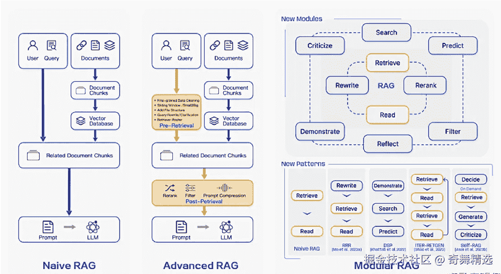

# 深入浅出 RAG：原理、流程与代码实战

> 来源：[https://qqs7y1hozd1.feishu.cn/docx/W12edI7MpovxEMx8POHcMBgfnIc](https://qqs7y1hozd1.feishu.cn/docx/W12edI7MpovxEMx8POHcMBgfnIc)

## 引言：为什么需要 RAG？

在**当今人工智能浪潮中，大型语**言模型（LLM）如 GPT**、LLaMA、Chat**GLM 等已经展现了令人惊叹的能力，无论是在对话、创作还是代码生成方面。然而，当我们真正将它们应用于企业级或专业化场景时，会发现它们存在几个致命的“硬伤”：



+   **知识滞后与静态性：**LLM 的参数化知识来自于其训练时的数据快照。对于训练截止日期之后的事件、新闻、研究进展或公司内部的最新文档，模型一无所知，甚至会“一本正经地胡说八道”（幻觉现象）。

+   **缺乏领域特异性：****一个通用的 LLM 可能对**医学、法律或金融等专业领域的深度知识掌握不足，难以给出高度精准和可靠的答案。

+   **透明性与可追溯性缺失：****LLM 的回答像一个“黑**箱”，我们无法得知其生成答案的具体依据来源，这在严肃的应用场景中是不可接受的。

那么，如何让强大的 LLM 具备获取最新、特定知识的能力，同时还能提供可靠的依据呢？

答案就是 RAG (Retrieval-Augmented Generation，检索增强生成)。

RAG 巧妙地将信息检索（IR） 技术与大语言模型（LL**M） 相结合，就像是给一位博学但记忆停留在过去的学者（LLM）配备了一位高**效、实时的图书管理员（检索系统）。在回答问题时，图书管理员会迅速从最新的知识库（如公司文档、数据库、网页）中查找相关资料，交给学者。学者基于这些最新的、准确的资料，组织语言，生成最终答案。

这种方法不仅解决了知识更新问题，还通过提供引用来源极大地增强了答案的可信度和可解释性。

**本文将深入剖析 RAG 的核心原理、主要流程，并通过代**码示例带你实战一个简单的 RAG 系统。

## RAG 是什么？

RAG 的概念最早由 Meta (Facebook) 的研究团队在 2020 年的论文《Retrieval-Augmented Generation for Knowledge-Intensive NLP Tasks》中提出。

> 其核心思想可以概括为：“先检索，再生成”。

它不是通过重新训练或微调（Fine-tuning）LLM 来更新其知识，而是在模型外部挂载一个知识库。在收到用户查询（Query）时，RAG 系统会首先从这个外部知识库中检索出与问题最相关的信息片段（Context），然后将原始问题和检索到的上下文一并打包，发送给 LLM，指令 LLM 基于给定的上下文来回答问题。

这样做的好处是：

> 成本低：无需重新训练昂贵的 LLM。

> 更新快：只需更新外部知识库（如插入新的文档），LLM 立即就能获取到新知识。

> 可信度高：答案来源于提供的上下文，减少幻觉，且可溯源。

## RAG 的主要流程

一个典型的 RAG 流程可以分解为两个核心阶段：索引（Indexing） 和推理（Inference）。

**3.1 索引阶段（Indexing** / Data Preparation）

**索引**阶段是“备课”的过程，目的是将原始的非结构化文档（如 PDF、Word、TXT、网页）处理成便于快速检索的结构化格式。这个过程是离线的，通常只需执行一次或在数据更新时重复。

其主要步骤如下：

1.  **加载（Loading）：**

使用文档加载器（Document Loader）从各种数据源读取原始数据，并将其转换成统一的文档对象（Document）。每个文档对象通常包含文本内容及其元数据（如来源、创建日期等）。

```
# 示例：使用 LangChain 的 PyPDFLoader 加载 PDF
from langchain.document_loaders import PyPDFLoader

loader = PyPDFLoader(&quot;path/to/your/document.pdf&quot;)
documents = loader.load()
```

1.  **分割（Splitting）：****
LLM 有上下文长度限制，因此需要将长文档切分成更小的、语义完整的文**本块（Chunks）。这一步至关重要， chunk 的大小和质量直接影响检索效果。

```
# 示例：使用 LangChain 的 RecursiveCharacterTextSplitter 进行文本分割
from langchain.text_splitter import RecursiveCharacterTextSplitter

text_splitter = RecursiveCharacterTextSplitter(
    chunk_size=500,  # 每个 chunk 的大小
    chunk_overlap=50 # chunk 之间的重叠部分，避免语义断裂
)
docs = text_splitter.split_documents(documents)
```

1.  **嵌入（Embedding）**：
使用嵌入模型（Embedding Model） 将每个文本块转换成一个高维向量（Vector）。这个向量就像是文本的“数学指纹”，语义相近的文本块其向量在向量空间中的距离也更近。

```
# 示例：使用 OpenAI 的 text-embedding-ada-002 模型生成嵌入向量
from langchain.embeddings import OpenAIEmbeddings

embeddings_model = OpenAIEmbeddings(model=&quot;text-embedding-ada-002&quot;)
```

1.  **存储（Storing）****：
将上一步生成的文本块（原始文本）和其对应的向量索引（Index） 起来，存入向量数据库（V**ector Database） 中。向量数据库专门为高效的海量向量相似性搜索而设计。

```
# 示例：使用 Chroma 向量数据库并存储向量
from langchain.vectorstores import Chroma

vectorstore = Chroma.from_documents(
    documents=docs,
    embedding=embeddings_model,
    persist_directory=&quot;./chroma_db&quot;  # 指定持久化目录
)
vectorstore.persist() # 持久化到磁盘
```

**3.2 推理阶段（Inference / Ret**rieval & Generation）

推理阶段是“答题”的过程，在线处理用户的查询。

1.  检索（Retrieval）：

用户输入一个查询（Query）。

系统使用与索引阶段相同的嵌入模型，将用户的查询也转换为一个查询向量（Query Vector）。

**系统**在向量数据库中进行相似性搜索（Similarity Search），找出与查询向量最相似的 K 个文本块（K 是可设定的参数）。这些被检索到的文本块就是与问题最相关的上下文（Context）。

```
# 用户查询
query = &quot;什么是机器学习？&quot;

# 将查询转换为向量并进行相似性检索
retrieved_docs = vectorstore.similarity_search(query, k=3) # 检索最相似的 3 个片段

# 打印检索结果
for doc in retrieved_docs:
    print(doc.page_content)
    print(&quot;---&quot;)
```

1.  增强（Augmentation）：
将检索到的多个文本块（Context）和用户的原始查询（Query）按照预设的提示模板（Prompt Template） 组合成一个新的、增强后的提示（Augmented Prompt）。

```
from langchain.prompts import PromptTemplate

# 定义一个提示模板
template = &quot;&quot;&quot;请根据以下上下文信息回答问题。如果你不知道答案，就说不知道，不要编造答案。
上下文：
{context}

问题：{question}
请给出答案：&quot;&quot;&quot;
prompt = PromptTemplate.from_template(template)

# 组合提示
context = &quot;\n\n&quot;.join([doc.page_content for doc in retrieved_docs])
augmented_prompt = prompt.format(context=context, question=query)

print(augmented_prompt)
```

1.  **生成（Generation）**：
将组合好的增强提示（Augmented Prompt）发送给 LLM。LLM 会严格基于提供的上下文来生成最终答案，而不是依赖其内部可能过时或不准确的知识。

```
# 示例：使用 OpenAI 的 GPT 模型进行生成
from langchain.llms import OpenAI

llm = OpenAI(model_name=&quot;gpt-3.5-turbo-instruct&quot;)
answer = llm(augmented_prompt)
print(f&quot;最终答案：\n{answer}&quot;)
```

1.  流程图

下图清晰地展示了 RAG 两个阶段的数据流与核心组件：

```
graph TD
    A[RAG 流程]

    subgraph S1 [第一阶段：索引（离线）]
        direction LR
        A1[原始文档] --&gt;|加载| B1[文档加载器]
        B1 --&gt; C1[长文本]
        C1 --&gt;|分割| D1[文本块 Chunks]
        D1 --&gt;|嵌入| E1[向量 Vector]
        E1 --&gt;|存储| F1[向量数据库]
    end

    subgraph S2 [第二阶段：推理（在线）]
        direction TB
        G[用户查询] --&gt;|嵌入| H[查询向量]
        H --&gt;|相似性检索| F1
        F1 --&gt; I[Top-K 相关文本块]
        I --&gt; J[提示工程： 组合查询与上下文]
        J --&gt; K[增强的提示]
        K --&gt; L[大语言模型 LLM]
        L --&gt; M[最终答案]
    end

    S1 --&gt; S2
```

1.  代码实战：构建一个简单的 RAG 问答系统

下面我们使用 LangChain（一个流行的 LLM 应用开发框架）和 Chroma（轻量级向量数据库）来快速搭建一个 RAG 系统。

**环境准备：**

```
pip install langchain openai chromadb tiktoken pypdf
```

**完整代码：**

```
import os
from langchain.document_loaders import PyPDFLoader
from langchain.text_splitter import RecursiveCharacterTextSplitter
from langchain.embeddings import OpenAIEmbeddings
from langchain.vectorstores import Chroma
from langchain.llms import OpenAI
from langchain.prompts import PromptTemplate

# 设置 OpenAI API Key
os.environ[&quot;OPENAI_API_KEY&quot;] = &quot;你的-OpenAI-API-Key&quot;

# 1. 索引阶段（假设我们有一个叫做 &#x27;ml_book.pdf&#x27; 的文档）
loader = PyPDFLoader(&quot;ml_book.pdf&quot;)
documents = loader.load()

text_splitter = RecursiveCharacterTextSplitter(chunk_size=1000, chunk_overlap=100)
docs = text_splitter.split_documents(documents)

embeddings = OpenAIEmbeddings()
vectorstore = Chroma.from_documents(documents=docs, embedding=embeddings, persist_directory=&quot;./rag_chroma_db&quot;)
vectorstore.persist() # 持久化，之后只需加载即可，无需重复索引

# 2. 推理阶段
query = &quot;机器学习的定义是什么？&quot;

# 从磁盘加载已存在的向量数据库
# db = Chroma(persist_directory=&quot;./rag_chroma_db&quot;, embedding_function=embeddings)

# 检索
retriever = vectorstore.as_retriever(search_kwargs={&quot;k&quot;: 3})
relevant_docs = retriever.get_relevant_documents(query)
context = &quot;\n\n&quot;.join([doc.page_content for doc in relevant_docs])

# 构建提示
prompt_template = &quot;&quot;&quot;你是一个专业的AI助手。请严格仅根据以下提供的上下文信息来回答问题。
如果上下文中的信息不足以回答这个问题，请直接回答&quot;根据提供的资料，我无法回答这个问题。&quot;。

上下文：
{context}

问题：{question}
请给出答案：&quot;&quot;&quot;

prompt = PromptTemplate(
    template=prompt_template, input_variables=[&quot;context&quot;, &quot;question&quot;]
)
formatted_prompt = prompt.format(context=context, question=query)

# 生成
llm = OpenAI(temperature=0) # temperature=0 使输出更确定
answer = llm(formatted_prompt)

print(f&quot;用户问题: {query}&quot;)
print(f&quot;\n检索到并送入LLM的上下文: \n{context}&quot;)
print(f&quot;\nLLM生成的最终答案: \n{answer}&quot;)
```

1.  **总结与展望**

RAG 通过将其强大的生成能力与外部知识源的可信性、实时性相结合，成功地解决了纯 LLM 应用的诸多痛点。它已成为构建企业级知识库问答、智能客服、代码辅助等应用的首选架构。

## RAG 的优势：

> 知识实时性：轻松接入最新信息。

> 成本效益：避免重复训练大模型。

> 可信可控：答案有据可依，来源可追溯，风险可控。

> 灵活性：可以为不同领域快速构建专属问答系统。

RAG 的挑战与进阶方向：

**检索质量：**如何提升 chunk 的质量、优化检索器（如使用重排序 Re-Ranking）以找到最相关的上下文。

**上下文长度：**如何应对检索到的上下文过长，超出 LLM 窗口限制的问题（如通过 Map-Reduce 等摘要技巧）。

**多模态 RAG：**未来不仅检索文本，还能检索图片、表格等多模态信息来生成答案。