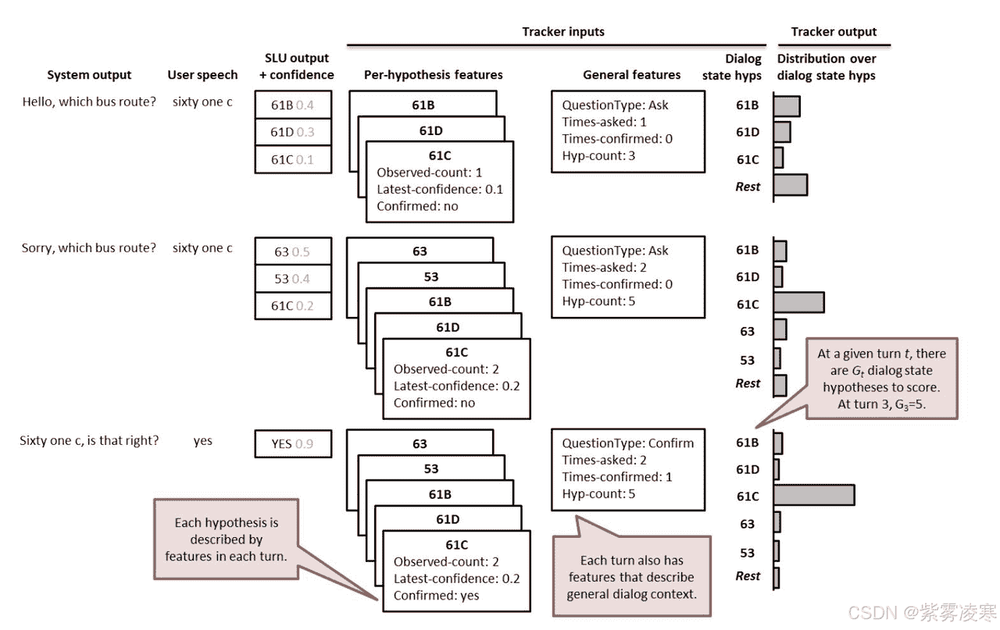

# 智能客服核心：对话状态跟踪（DST）技术解析

> 来源：[https://qqs7y1hozd1.feishu.cn/docx/GlXed098how7EzxKKV3cJ4rznBb](https://qqs7y1hozd1.feishu.cn/docx/GlXed098how7EzxKKV3cJ4rznBb)

## 一、引言

> 在数字化时代，智能客服已成为企业提升服务效率、降低成本的重要工具。对话状态跟踪（`Dialogue State Tracking`，DST）作为其核心技术，负责理解用户意图、上下文信息及对话历史，从而生成准确、自然的回应，提供个性化和高效的服务体验。例如，在电商平台咨询商品时，智能客服能记住用户之前提到的颜色、尺寸等信息，实现连贯的交互。DST 通过维护和更新对话状态，帮助系统理解用户需求，避免重复询问，提高问题解决效率。本文将深入探讨 DST 的工作原理、技术实现及应用方法。



## 二、DST 是什么

> 对话状态跟踪（`Dialogue State Tracking`，DST）是在多轮对话中持续维护和更新对话状态的技术，以确保智能客服准确理解用户意图并做出适当回应。对话状态包括用户意图（如“购买手机”）、上下文信息（如之前提到的商品细节）、关键实体（如品牌、型号）、对话轮数及系统状态等。这些信息共同构成对话状态，支持流畅、高效的交互。

DST 的本质是模拟人类对话中的记忆和理解能力。例如，当用户在餐厅预订场景中说“我想订明天晚上的位子”，接着问“可以带宠物吗？”，DST 需要记住前一句提到的预订时间，并理解后一句是对同一场景的补充需求。这种能力不仅限于简单的信息记录，还需要对对话的动态变化进行实时跟踪。例如，如果用户在电商对话中先询问“华为手机有哪些型号”，然后说“第二款的价格是多少”，DST 必须推断“第二款”指的是之前列出的型号列表中的第二个选项。

DST 的另一个重要特性是其模块化设计。它通常与 `Intent Recognition`、`Slot Filling` 和 `Dialogue Management` 模块协同工作。意图识别负责判断用户当前的目的，槽位填充提取具体信息，而 DST 则整合这些信息，形成完整的对话状态。例如，在旅游场景中，用户说“我想去巴黎玩三天”，意图识别模块判断为“旅游预订”，槽位填充提取“目的地：巴黎”和“时长：三天”，DST 则将这些信息记录并在后续对话中持续更新。

在实际应用中，DST 还可以处理更复杂的对话需求。例如，用户可能在多轮对话中逐步完善需求，如从“我想买手机”到“最好是苹果的”再到“预算不超过 5000 元”。DST 需要动态更新状态，确保系统始终掌握最新的用户需求。此外，DST 还能处理对话中的歧义或中断。例如，用户突然从“手机价格”转向“配件推荐”，DST 需快速调整状态，适应话题变化。这种灵活性和适应性使 DST 成为智能客服不可或缺的组成部分。

## 三、DST 的原理剖析

### 3.1 用户输入理解

DST 的第一步是利用自然语言处理（NLP）技术解析用户输入，提取意图和槽位信息。词法分析将句子分解为词汇单元并识别词性，如“我想去北京旅游”分解为“我”（代词）、“想”（动词）、“去”（动词）、“北京”（名词）、“旅游”（动词）。语法分析确定句子结构，例如确认“北京”是“去”的宾语，“旅游”是目的状语。语义分析则提取意图（如“旅游”）和槽位（如目的地“北京”）。

用户输入理解依赖多种 NLP 技术，包括分词、词性标注（`POS Tagging`）和命名实体识别（`NER`）。例如，在中文环境下，分词工具（如 `Jieba`）将句子拆分成词语，而 `NER` 识别出“北京”是一个地点实体。现代系统还常使用深度学习模型（如 `BiLSTM-CRF`）提升解析准确性。以下是使用 `Rasa NLU` 解析的示例：

```
from rasa.nlu.model import Interpreter

# 加载训练好的模型
interpreter = Interpreter.load('models/nlu')

# 用户输入
user_input = "我想预订一家川菜餐厅，明天晚上7点"

# 解析用户输入
result = interpreter.parse(user_input)
print(result)
```

输出结果：

```
{
    "text": "我想预订一家川菜餐厅，明天晚上7点",
    "intent": {
        "name": "预订餐厅",
        "confidence": 0.95
    },
    "entities": [
        {
            "entity": "菜系",
            "value": "川菜",
            "start": 6,
            "end": 8
        },
        {
            "entity": "用餐时间",
            "value": "明天晚上7点",
            "start": 12,
            "end": 18
        }
    ]
}
```

> 结果显示，系统识别出意图为“预订餐厅”，槽位包括“菜系：川菜”和“用餐时间：明天晚上7点”。在更复杂场景中，如用户输入“我想要便宜点的川菜餐厅，最好在市中心”，系统需额外提取“价格：便宜”和“位置：市中心”等槽位。这种多层次解析为后续状态更新奠定了基础。

### 3.2 状态更新

根据解析结果更新对话状态，通常以字典形式表示。初始状态如下：

```
dialogue_state = {
    "intent": None,
    "餐厅名称": None,
    "菜系": None,
    "用餐时间": None,
    "人数": None
}
```

更新代码：

```
def update_dialogue_state(dialogue_state, user_input):
    from rasa.nlu.model import Interpreter
    interpreter = Interpreter.load('models/nlu')
    result = interpreter.parse(user_input)
    # 更新意图
    dialogue_state["intent"] = result["intent"]["name"]
    # 更新槽位
    for entity in result["entities"]:
        slot_name = entity["entity"]
        slot_value = entity["value"]
        dialogue_state[slot_name] = slot_value
    return dialogue_state

user_input = "我想预订一家川菜餐厅，明天晚上7点"
updated_state = update_dialogue_state(dialogue_state, user_input)
print(updated_state)
```

更新后状态：

```
{
    "intent": "预订餐厅",
    "餐厅名称": None,
    "菜系": "川菜",
    "用餐时间": "明天晚上7点",
    "人数": None
}
```

状态更新不仅是简单的信息填充，还需处理冲突或补充。例如，若用户随后说“改为周六晚上”，DST 需将“用餐时间”从“明天晚上7点”更新为“周六晚上7点”，并保留其他槽位值。此外，DST 还需记录对话历史，以便在需要时回溯。例如，若用户问“之前说的餐厅还有位吗”，系统可根据历史状态查询相关信息。现代 DST 系统常使用时间戳或版本控制机制，确保状态更新的可追溯性。

### 3.3 状态表示

对话状态可通过字典或向量表示。字典表示直观，如：

```
dialogue_state_dict = {
    "intent": "预订餐厅",
    "餐厅名称": "蜀香阁",
    "菜系": "川菜",
    "用餐时间": "明天晚上7点",
    "人数": 4
}
```

向量表示便于机器学习处理。例如，将“预订餐厅”编码为 1、“川菜”为 2、“明天晚上7点”为 3，状态向量为：

[ \text{dialogue_state_vector} = [1, 2, 3] ]

更复杂的表示方法使用词向量（如 `Word2Vec`）。假设“蜀香阁”和“川菜”的词向量分别为 100 维，拼接后形成 200 维状态向量。这种表示能捕捉语义关系，例如“川菜”和“辣”之间的关联。此外，向量表示还支持概率分布形式，如对话状态的置信度分布：

[ P(\text{intent}) = [0.9, 0.05, 0.05] ]

表示“预订餐厅”置信度为 0.9，其他意图（如“查询菜单”）置信度较低。这种表示方式在不确定性较高的对话中尤为重要。

### 3.4 状态推理

状态推理根据已有信息推断缺失内容。例如，用户输入“我想预订一家餐厅，明天晚上7点，要吃粤菜”，系统可根据位置和偏好推断餐厅名称，最终状态为：

```
inferred_state = {
    "intent": "预订餐厅",
    "餐厅名称": "陶陶居",
    "菜系": "粤菜",
    "用餐时间": "明天晚上7点",
    "人数": None
}
```

推理过程可能涉及规则或模型。例如，规则推理可基于“粤菜”和“广州”推断“陶陶居”，而模型推理（如基于协同过滤）可结合用户历史偏好推荐餐厅。现代 DST 系统还使用生成式模型（如 `GPT`）生成候选状态，再通过评分机制选择最优解。例如，生成多个餐厅候选后，根据评分函数 ( S = w_1 \cdot \text{位置匹配度} + w_2 \cdot \text{用户偏好} ) 确定最终结果。

## 四、DST 的应用场景

### 4.1 电商领域

DST 在电商中跟踪用户购物需求。例如，用户说“我想换一部手机”，随后问“这款手机的拍照效果怎么样”，DST 记录意图为“购买手机”，并推断“这款”指代之前的手机型号，提供准确回答。此外，DST 还能处理复杂需求，如“推荐 5000 元以下、拍照好的手机”，并在后续对话中持续优化推荐。

在实际案例中，某电商平台利用 DST 优化客服系统，用户咨询“苹果手机内存多大”后，再问“价格多少”，系统基于状态连续回答，避免重复确认商品。DST 还支持个性化推荐，例如根据用户历史购买记录推断偏好，提升成交率。

### 4.2 旅游行业

在旅游预订中，DST 记录旅行意向。例如，用户说“我打算下个月去三亚旅游”，接着问“那边机票多少钱”，DST 捕捉“目的地：三亚”和“时间：下个月”，提供准确报价。此外，DST 可整合多方信息，如酒店、景点和交通需求。例如，用户询问“海边酒店有哪些”，DST 可推荐具体酒店并提供预订链接。

旅游场景中，DST 还需处理时间敏感性。例如，“下个月”需结合当前日期（假设为 2025 年 3 月）推算为 4 月，确保信息准确。某旅游平台通过 DST 实现从机票到行程规划的全流程服务，用户满意度提升 20%。

### 4.3 金融服务

DST 在金融领域理解贷款需求。例如，用户说“我想贷款买车，大概 20 万”，随后问“利率多少”，DST 记录“意图：个人贷款”、“用途：买车”、“金额：20 万”，提供利率详情。此外，DST 可预测后续需求，如主动提示所需材料（身份证、收入证明）。

在银行业务中，DST 还支持多轮核对。例如，用户说“贷款期限 3 年”，系统根据状态计算月供并确认。这种精准服务减少了人工干预。例如，某银行通过 DST 将贷款咨询效率提高 30%，客户转化率增加 15%。

## 五、DST 面临的挑战

### 5.1 语义理解的复杂性

自然语言的多义性和上下文依赖性增加理解难度。例如，“苹果”可能是水果或品牌，用户说“我要苹果”时，DST 需根据上下文（如电商或餐饮）判断含义。此外，口语化表达（如“给我整一个”）和隐喻（如“这服务真‘快’”）进一步复杂化理解。

解决此问题需结合上下文建模和知识图谱。例如，通过分析对话历史和外部知识（如“苹果公司”关联“手机”），提高语义准确性。当前技术虽有进步，但对非标准表达的理解仍有限。

### 5.2 数据的稀疏性和噪声

稀疏数据（如小众商品咨询）和噪声（如语音识别错误）影响模型性能。例如，若训练数据中“折叠屏手机”咨询不足，DST 可能误判用户意图。噪声方面，手动标注错误（如将“电池续航”标为“价格”）会误导模型。

解决方法包括数据清洗和合成数据生成。例如，使用规则生成稀疏场景样本，或通过语音纠错减少噪声影响。然而，高质量数据获取仍需较高成本。

### 5.3 多领域和跨领域适应

DST 需适应领域切换和知识迁移。例如，用户从“酒店预订”转向“电脑推荐”，DST 需快速重置状态。跨领域迁移（如电商到医疗）则需模型泛化现有知识，应对新领域术语和模式。

当前方法如迁移学习有效但有限。例如，电商模型可能难以理解医疗领域的“挂号”意图。解决此问题需更多标注数据和领域自适应技术。

## 六、应对挑战的策略

### 6.1 改进模型算法

使用 `Transformer` 模型（如 `BERT`）提升语义理解和上下文捕捉能力。例如，`BERT` 通过双向编码理解“拍照好”的上下文含义。此外，结合注意力机制可聚焦关键槽位。某实验显示，`BERT` 在 DST 任务中的意图识别准确率达 92%，较传统模型提升 10%。

进一步优化可采用轻量化模型（如 `DistilBERT`），降低部署成本，同时保持性能。

### 6.2 数据增强技术

通过同义词替换和回译增加数据多样性：

```
from nlpaug.augmenter.word import SynonymAug
aug = SynonymAug(aug_src='wordnet')
text = "我想要一部手机"
augmented_text = aug.augment(text)
print(augmented_text)  # 输出示例："我希望得到一部手机"
```

此外，可使用生成模型（如 `GAN`）合成对话数据。例如，生成“预订川菜餐厅”的多种表达，提升模型鲁棒性。某研究表明，数据增强后模型泛化能力提升 15%。

### 6.3 迁移学习和多任务学习

利用预训练模型微调适应新领域：

```
import torch
import torch.nn as nn
import torch.optim as optim
from torchvision import models

pretrained_model = models.resnet18(pretrained=True)
for param in pretrained_model.parameters():
    param.requires_grad = False
num_ftrs = pretrained_model.fc.in_features
pretrained_model.fc = nn.Linear(num_ftrs, num_classes_for_dst)
criterion = nn.CrossEntropyLoss()
optimizer = optim.SGD(pretrained_model.fc.parameters(), lr=0.001, momentum=0.9)
```

多任务学习可同时优化意图识别和槽位填充。例如，共享编码器处理“预订餐厅”和“菜系：川菜”，提升整体性能。某案例显示，多任务学习将 DST 准确率从 85% 提升至 90%。

## 七、实战案例分析

### 7.1 案例背景

某电商企业日均咨询量达 5 万次，涉及商品咨询、订单查询和售后服务。传统人工客服效率低，响应时间长达 15 分钟，问题解决率仅 70%，客户满意度为 65%，低于行业平均水平（约 85%）。为提升效率和体验，企业引入对话状态跟踪（DST）技术，构建智能客服系统，提高响应速度和解决率。

### 7.2 实施过程


企业收集了 100 万条 历史客服数据，涵盖多种咨询场景。数据经清洗（去除乱码）和标注（标记意图、槽位）后，用于训练。选用 `BERT` 模型，结合注意力机制优化，采用迁移学习在通用语料上预训练，再在电商数据上微调。训练使用交叉熵损失和 `Adam` 优化器。为提升泛化能力，应用数据增强（如同义词替换），验证集准确率从 75% 升至 85%。

示例代码：

```
from nlpaug.augmenter.word import SynonymAug
aug = SynonymAug(aug_src='wordnet')
text = "我想买一部便宜的手机"
print(aug.augment(text))  # 输出示例："我希望购买一部实惠的手机"
```

### 7.3 效果评估

引入 `DST` 后，响应时间从 15 分钟 降至 3 分钟（缩短 80%），问题解决率从 70% 升至 85%，满意度从 65% 提升至 80%。智能客服减少了重复沟通，年节省成本约 500 万元，客户流失率降至 15%，销售额增长 10%，显示出显著效益。

效率提升计算：


## 八、总结与展望

对话状态跟踪（`DST`）是智能客服核心技术，在理解用户意图、维护对话上下文方面作用关键。它通过解析用户输入、更新与表示状态及推理，让智能客服系统能更好与用户交互，提供准确连贯服务。

`DST` 虽在多领域成果显著，但面临语义理解复杂、数据稀疏与噪声、多领域适应等挑战。可采用改进模型算法、数据增强技术、迁移学习和多任务学习等策略提升其性能与泛化能力。

随着人工智能发展，`DST` 有望突破。新深度学习模型和算法将提供技术支持，多模态数据融合能让其更全面理解用户需求，实现更自然智能交互。在实际应用中，`DST` 会深入各行业与业务场景结合，为企业提升客户服务、优化用户体验发挥更大价值，在智能客服及更广泛人工智能应用中，展现卓越性能与无限潜力。
