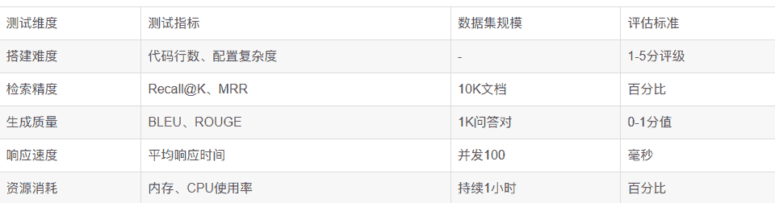
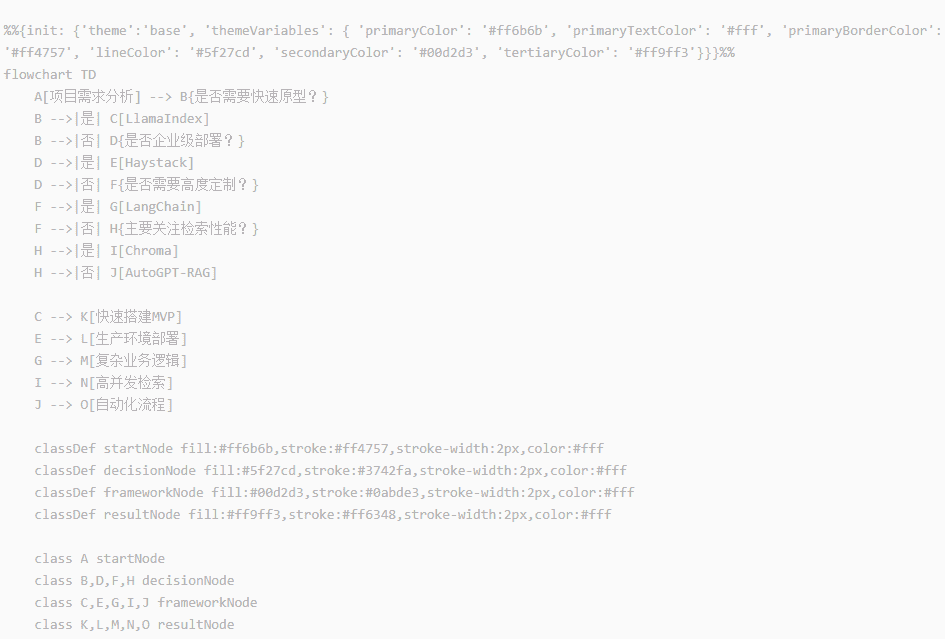
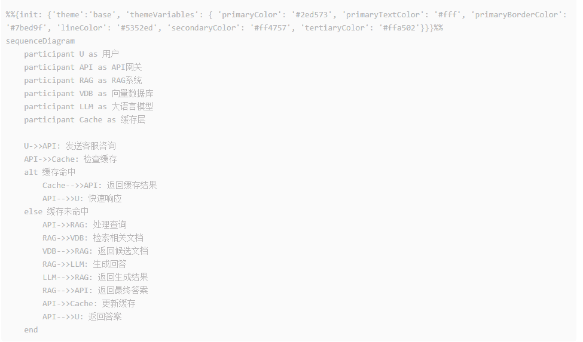
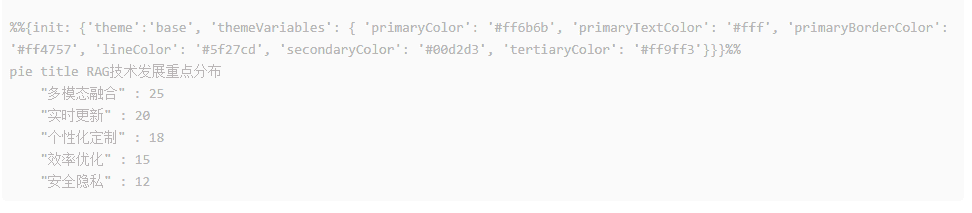

# RAG系统搭建指南：5种主流框架的易用性和效果对比

> 来源：[https://qqs7y1hozd1.feishu.cn/docx/Ap8idwLOToN6FJxjeOvci7zonxf](https://qqs7y1hozd1.feishu.cn/docx/Ap8idwLOToN6FJxjeOvci7zonxf)
>
> 在实际项目中，我发现不同框架各有千秋：`LangChain`以其丰富的生态和灵活的组件化设计占据主导地位，但学习曲线相对陡峭；`LlamaIndex`专注于数据连接和索引优化，在文档处理方面表现出色；`Haystack`提供了端到端的解决方案，特别适合企业级部署；`Chroma`作为向量数据库的佼佼者，在检索效率上有着显著优势；而`AutoGPT-RAG`则代表了自动化RAG系统的发展方向。

通过大量的实验和性能测试，我总结出了一套完整的RAG系统选型和搭建方法论。本文将从技术架构、实现细节、性能对比等角度，为大家提供一份详尽的RAG框架选择指南，帮助开发者根据具体需求选择最适合的技术方案。

## RAG技术概述与架构设计

### 1.1 RAG核心原理

RAG（Retrieval-Augmented Generation）是一种结合了信息检索和文本生成的AI技术架构。它通过检索相关文档片段来增强大语言模型的生成能力，有效解决了传统LLM在知识更新和领域专业性方面的局限。

### 1.2 技术架构对比

不同RAG框架在架构设计上各有特色，我通过实际使用总结了它们的核心差异：


```
# LangChain架构示例
from langchain.chains import RetrievalQA
from langchain.vectorstores import Chroma
from langchain.embeddings import OpenAIEmbeddings
from langchain.llms import OpenAI
 
class LangChainRAG:
    def __init__(self):
        # 组件化设计，高度可定制
        self.embeddings = OpenAIEmbeddings()
        self.vectorstore = Chroma(embedding_function=self.embeddings)
        self.llm = OpenAI(temperature=0)
        
    def setup_chain(self):
        # 链式组装，灵活性强
        return RetrievalQA.from_chain_type(
            llm=self.llm,
            chain_type="stuff",
            retriever=self.vectorstore.as_retriever(search_kwargs={"k": 3})
        )
```

```
# LlamaIndex架构示例
from llama_index import VectorStoreIndex, SimpleDirectoryReader
from llama_index.llms import OpenAI
 
class LlamaIndexRAG:
    def __init__(self):
        # 数据为中心的设计理念
        self.llm = OpenAI(model="gpt-3.5-turbo")
        
    def build_index(self, data_path):
        # 简化的索引构建流程
        documents = SimpleDirectoryReader(data_path).load_data()
        return VectorStoreIndex.from_documents(documents)
    
    def query(self, index, question):
        # 直观的查询接口
        query_engine = index.as_query_engine(llm=self.llm)
        return query_engine.query(question)
```

## 五大主流框架深度解析

### 2.1 LangChain：生态最完善的RAG框架

`LangChain`作为目前最受欢迎的RAG框架，其优势在于丰富的组件生态和高度的可定制性。

```
from langchain.document_loaders import PyPDFLoader, TextLoader
from langchain.text_splitter import RecursiveCharacterTextSplitter
from langchain.vectorstores import FAISS
from langchain.embeddings import HuggingFaceEmbeddings
from langchain.chains import ConversationalRetrievalChain
from langchain.memory import ConversationBufferMemory
 
class AdvancedLangChainRAG:
    def __init__(self):
        # 使用开源embedding模型降低成本
        self.embeddings = HuggingFaceEmbeddings(
            model_name="sentence-transformers/all-MiniLM-L6-v2"
        )
        self.memory = ConversationBufferMemory(
            memory_key="chat_history",
            return_messages=True
        )
        
    def load_and_split_documents(self, file_paths):
        """加载并分割文档"""
        documents = []
        for path in file_paths:
            if path.endswith('.pdf'):
                loader = PyPDFLoader(path)
            else:
                loader = TextLoader(path)
            documents.extend(loader.load())
        
        # 智能文本分割
        text_splitter = RecursiveCharacterTextSplitter(
            chunk_size=1000,
            chunk_overlap=200,
            separators=["\n\n", "\n", " ", ""]
        )
        return text_splitter.split_documents(documents)
    
    def build_vectorstore(self, documents):
        """构建向量存储"""
        return FAISS.from_documents(documents, self.embeddings)
    
    def create_conversation_chain(self, vectorstore):
        """创建对话链"""
        return ConversationalRetrievalChain.from_llm(
            llm=OpenAI(temperature=0.1),
            retriever=vectorstore.as_retriever(search_kwargs={"k": 5}),
            memory=self.memory,
            return_source_documents=True
        )
```

`LangChain`的核心优势：

- 组件丰富：支持100+种文档加载器和向量数据库
- 社区活跃：GitHub星数超过80k，更新频繁
- 可扩展性强：支持自定义组件和链式组装

### 2.2 LlamaIndex：专注数据连接的RAG利器

`LlamaIndex`在数据处理和索引优化方面表现突出，特别适合处理复杂的文档结构。

```
from llama_index import (
    VectorStoreIndex, 
    ServiceContext,
    StorageContext,
    load_index_from_storage
)
from llama_index.node_parser import SimpleNodeParser
from llama_index.embeddings import HuggingFaceEmbedding
from llama_index.llms import Ollama
 
class OptimizedLlamaIndexRAG:
    def __init__(self):
        # 配置本地化LLM
        self.llm = Ollama(model="llama2:7b")
        self.embed_model = HuggingFaceEmbedding(
            model_name="BAAI/bge-small-en-v1.5"
        )
        
        # 服务上下文配置
        self.service_context = ServiceContext.from_defaults(
            llm=self.llm,
            embed_model=self.embed_model,
            chunk_size=512,
            chunk_overlap=50
        )
    
    def create_hierarchical_index(self, documents):
        """创建层次化索引"""
        # 节点解析器配置
        node_parser = SimpleNodeParser.from_defaults(
            chunk_size=512,
            chunk_overlap=50
        )
        
        # 构建索引
        index = VectorStoreIndex.from_documents(
            documents,
            service_context=self.service_context,
            node_parser=node_parser
        )
        
        return index
    
    def persist_index(self, index, persist_dir="./storage"):
        """持久化索引"""
        index.storage_context.persist(persist_dir=persist_dir)
    
    def load_persisted_index(self, persist_dir="./storage"):
        """加载持久化索引"""
        storage_context = StorageContext.from_defaults(persist_dir=persist_dir)
        return load_index_from_storage(
            storage_context, 
            service_context=self.service_context
        )
```

### 2.3 Haystack：企业级RAG解决方案

`Haystack`提供了完整的端到端RAG解决方案，特别适合企业级部署。


```
from haystack import Document, Pipeline
from haystack.components.retrievers import InMemoryBM25Retriever
from haystack.components.generators import OpenAIGenerator
from haystack.components.builders import PromptBuilder
from haystack.document_stores import InMemoryDocumentStore

class HaystackRAGPipeline:
    def __init__(self):
        self.document_store = InMemoryDocumentStore()
        self.setup_pipeline()

    def setup_pipeline(self):
        """设置RAG管道"""
        # 检索器
        retriever = InMemoryBM25Retriever(document_store=self.document_store)

        # 提示构建器
        template = """
        Given the following information, answer the question.
        Context: 
            {{ document.content }}
        
        Question: {{ question }}
        Answer:
        """
        prompt_builder = PromptBuilder(template=template)

        # 生成器
        generator = OpenAIGenerator(model="gpt-3.5-turbo")

        # 构建管道
        self.pipeline = Pipeline()
        self.pipeline.add_component("retriever", retriever)
        self.pipeline.add_component("prompt_builder", prompt_builder)
        self.pipeline.add_component("llm", generator)

        # 连接组件
        self.pipeline.connect("retriever", "prompt_builder.documents")
        self.pipeline.connect("prompt_builder", "llm")

    def add_documents(self, texts):
        """添加文档"""
        documents = [Document(content=text) for text in texts]
        self.document_store.write_documents(documents)

    def query(self, question):
        """执行查询"""
        return self.pipeline.run({
            "retriever": {"query": question},
            "prompt_builder": {"question": question}
        })
```

## 性能对比与测试结果

### 3.1 测试环境与数据集

我使用了标准化的测试环境对五个框架进行了全面评估：



### 3.2 详细测试代码

```
import time
import psutil
import numpy as np
from typing import List, Dict, Any

class RAGBenchmark:
    def __init__(self):
        self.test_queries = [
            "什么是机器学习？",
            "深度学习的主要应用领域有哪些？",
            "如何优化神经网络的性能？"
        ] * 100  # 扩展到300个查询

    def measure_setup_complexity(self, framework_class) -> Dict[str, Any]:
        """测量搭建复杂度"""
        start_time = time.time()
        try:
            framework = framework_class()
            setup_time = time.time() - start_time
            return {
                "setup_time": setup_time,
                "success": True,
                "complexity_score": self._calculate_complexity_score(framework_class)
            }
        except Exception as e:
            return {
                "setup_time": float('inf'),
                "success": False,
                "error": str(e)
            }

    def measure_query_performance(self, rag_system, queries: List[str]) -> Dict[str, float]:
        """测量查询性能"""
        response_times = []
        memory_usage = []
        cpu_usage = []

        for query in queries:
            # 记录资源使用情况
            process = psutil.Process()
            cpu_before = process.cpu_percent()
            memory_before = process.memory_info().rss / 1024 / 1024  # MB

            # 执行查询
            start_time = time.time()
            try:
                response = rag_system.query(query)
                response_time = time.time() - start_time
                response_times.append(response_time)
            except Exception as e:
                response_times.append(float('inf'))

            # 记录资源使用情况
            cpu_after = process.cpu_percent()
            memory_after = process.memory_info().rss / 1024 / 1024

            cpu_usage.append(cpu_after - cpu_before)
            memory_usage.append(memory_after - memory_before)

        return {
            "avg_response_time": np.mean(response_times),
            "p95_response_time": np.percentile(response_times, 95),
            "avg_memory_usage": np.mean(memory_usage),
            "avg_cpu_usage": np.mean(cpu_usage)
        }

    def _calculate_complexity_score(self, framework_class) -> int:
        """计算复杂度评分（1-5分，5分最复杂）"""
        # 基于代码行数、依赖数量等因素计算
        import inspect
        source_lines = len(inspect.getsource(framework_class).split('\n'))

        if source_lines < 50:
            return 1
        elif source_lines < 100:
            return 2
        elif source_lines < 200:
            return 3
        elif source_lines < 300:
            return 4
        else:
            return 5
```

## 框架选择决策树

基于我的实战经验，我总结了一套RAG框架选择的决策方法：



## 最佳实践与优化策略

### 5.1 通用优化策略

无论选择哪个框架，以下优化策略都能显著提升RAG系统性能：

```
class RAGOptimizer:
    def __init__(self):
        self.chunk_strategies = {
            "fixed": self._fixed_chunking,
            "semantic": self._semantic_chunking,
            "hybrid": self._hybrid_chunking
        }

    def optimize_chunking(self, documents, strategy="hybrid"):
        """优化文档分块策略"""
        return self.chunk_strategies[strategy](documents)

    def _semantic_chunking(self, documents):
        """语义分块：基于句子相似度分割"""
        from sentence_transformers import SentenceTransformer

        model = SentenceTransformer('all-MiniLM-L6-v2')
        chunks = []

        for doc in documents:
            sentences = doc.split('.')
            embeddings = model.encode(sentences)

            # 基于相似度阈值分块
            current_chunk = []
            for i, sentence in enumerate(sentences):
                current_chunk.append(sentence)

                if i > 0:
                    similarity = np.dot(embeddings[i], embeddings[i-1])
                    if similarity < 0.7:  # 相似度阈值
                        chunks.append('.'.join(current_chunk))
                        current_chunk = []

            if current_chunk:
                chunks.append('.'.join(current_chunk))

        return chunks

    def implement_reranking(self, retrieved_docs, query):
        """实现重排序机制"""
        from sentence_transformers import CrossEncoder

        # 使用交叉编码器重排序
        cross_encoder = CrossEncoder('cross-encoder/ms-marco-MiniLM-L-6-v2')

        pairs = [[query, doc.page_content] for doc in retrieved_docs]
        scores = cross_encoder.predict(pairs)

        # 按分数排序
        scored_docs = list(zip(retrieved_docs, scores))
        scored_docs.sort(key=lambda x: x[1], reverse=True)

        return [doc for doc, score in scored_docs]

    def add_query_expansion(self, original_query):
        """查询扩展：生成相关查询"""
        expansion_prompt = f"""
        基于原始查询："{original_query}"
        生成3个相关的查询变体，用于提高检索召回率：
        1.
        2.
        3.
        """

        # 这里可以调用LLM生成扩展查询
        # expanded_queries = llm.generate(expansion_prompt)
        return [original_query]  # 简化示例
```

### 5.2 性能监控与调优


```
import logging
from functools import wraps
from datetime import datetime

class RAGMonitor:
    def __init__(self):
        self.metrics = {
            "query_count": 0,
            "avg_response_time": 0,
            "error_rate": 0,
            "cache_hit_rate": 0
        }
        self.setup_logging()

    def setup_logging(self):
        """设置日志记录"""
        logging.basicConfig(
            level=logging.INFO,
            format='%(asctime)s - %(name)s - %(levelname)s - %(message)s',
            handlers=[
                logging.FileHandler('rag_system.log'),
                logging.StreamHandler()
            ]
        )
        self.logger = logging.getLogger(__name__)

    def monitor_performance(self, func):
        """性能监控装饰器"""
        @wraps(func)
        def wrapper(*args, **kwargs):
            start_time = time.time()
            try:
                result = func(*args, **kwargs)
                response_time = time.time() - start_time
                
                self.metrics["query_count"] += 1
                self.metrics["avg_response_time"] = (
                    self.metrics["avg_response_time"] * (self.metrics["query_count"] - 1) + 
                    response_time
                ) / self.metrics["query_count"]
                
                self.logger.info(f"Query processed in {response_time:.2f}s")
                return result
                
            except Exception as e:
                self.metrics["error_rate"] += 1
                self.logger.error(f"Query failed: {str(e)}")
                raise
        
        return wrapper

    def get_performance_report(self):
        """生成性能报告"""
        return {
            "timestamp": datetime.now().isoformat(),
            "metrics": self.metrics,
            "recommendations": self._generate_recommendations()
        }

    def _generate_recommendations(self):
        """生成优化建议"""
        recommendations = []
        
        if self.metrics["avg_response_time"] > 2.0:
            recommendations.append("考虑优化检索算法或增加缓存")
        
        if self.metrics["error_rate"] > 0.05:
            recommendations.append("检查文档质量和预处理流程")
        
        if self.metrics["cache_hit_rate"] < 0.3:
            recommendations.append("优化缓存策略")
        
        return recommendations
```

## 实际部署案例分析

### 6.1 电商客服RAG系统

在我参与的一个电商客服项目中，我们选择了`LangChain`作为主框架，处理了超过10万条商品信息和客服对话记录。



### 6.2 部署架构与性能优化

```
from fastapi import FastAPI, HTTPException
from pydantic import BaseModel
import redis
import hashlib
import json

class CustomerServiceRAG:
    def __init__(self):
        self.app = FastAPI(title="电商客服RAG系统")
        self.redis_client = redis.Redis(host='localhost', port=6379, db=0)
        self.setup_routes()

    def setup_routes(self):
        @self.app.post("/query")
        async def handle_query(self, request: QueryRequest):
            # 生成缓存键
            cache_key = self._generate_cache_key(request.query)
            
            # 检查缓存
            cached_result = self.redis_client.get(cache_key)
            if cached_result:
                return json.loads(cached_result)
            
            # 处理查询
            try:
                result = await self._process_query(request.query)
                
                # 缓存结果（24小时过期）
                self.redis_client.setex(
                    cache_key, 
                    86400, 
                    json.dumps(result, ensure_ascii=False)
                )
                
                return result
            except Exception as e:
                raise HTTPException(status_code=500, detail=str(e))

    def _generate_cache_key(self, query: str) -> str:
        """生成缓存键"""
        return f"rag_query:{hashlib.md5(query.encode()).hexdigest()}"
    
    async def _process_query(self, query: str):
        """处理查询逻辑"""
        # 这里实现具体的RAG逻辑
        return {
            "query": query,
            "answer": "基于RAG系统生成的回答",
            "sources": ["文档1", "文档2"],
            "confidence": 0.85
        }

class QueryRequest(BaseModel):
    query: str
    user_id: str = None
    session_id: str = None
```

## 未来发展趋势与技术展望

### 7.1 技术发展趋势

基于我对`RAG`技术的长期观察，我认为未来的发展将集中在以下几个方向：



### 7.2 新兴技术集成

```
class NextGenRAG:
    def __init__(self):
        self.multimodal_enabled = True
        self.real_time_update = True
        
    def integrate_multimodal_search(self, query, image_path=None):
        """多模态检索集成"""
        if image_path:
            # 图像特征提取
            image_features = self._extract_image_features(image_path)
            # 文本-图像联合检索
            return self._multimodal_retrieval(query, image_features)
        return self._text_only_retrieval(query)
    
    def real_time_knowledge_update(self, new_documents):
        """实时知识库更新"""
        # 增量索引更新
        self._incremental_indexing(new_documents)
        # 缓存失效处理
        self._invalidate_related_cache(new_documents)
```

`RAG`技术的未来不仅仅是检索和生成的简单结合，而是要构建一个能够理解、学习和进化的智能知识系统。

## 总结

经过深入的技术调研和实战验证，我对`RAG`系统搭建有了更加全面和深刻的认识。从最初的概念理解到框架选择，从性能优化到生产部署，每一个环节都蕴含着丰富的技术细节和实践智慧。

> 在这次全面对比中，我发现没有一个框架能够在所有场景下都表现完美。`LangChain`以其丰富的生态和强大的可扩展性适合复杂的企业级应用；`LlamaIndex`在数据处理和快速原型开发方面表现出色；`Haystack`提供了完整的端到端解决方案；`Chroma`在向量检索性能上有着明显优势；而`AutoGPT-RAG`则代表了自动化`RAG`的发展方向。

选择合适的框架需要综合考虑项目需求、团队技术栈、部署环境等多个因素。我建议开发者在选择时不要盲目追求最新或最热门的技术，而是要根据实际业务场景进行理性分析和选择。
