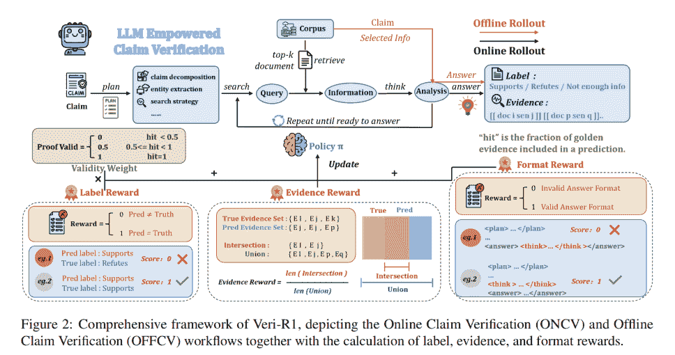
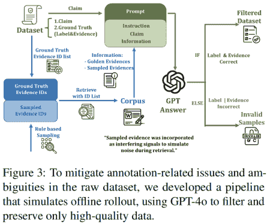
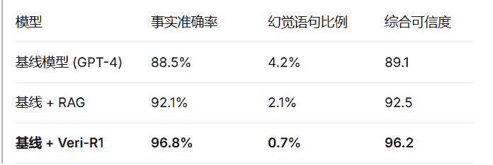

# 解决大模型幻觉新方案：Veri-R1在线验证技术详解！

> 来源：[https://qqs7y1hozd1.feishu.cn/docx/PIyVdH8CKotdaXx0qxacKtnNnCd](https://qqs7y1hozd1.feishu.cn/docx/PIyVdH8CKotdaXx0qxacKtnNnCd)

引言：从行业痛点切入

大语言模型的“幻觉”犹如一个才华横溢但时常信口开河的专家，这已成为其赋能关键行业的“阿喀琉斯之踵”。尽管检索增强生成与微调等技术在一定程度上缓解了问题，但它们本质上是一种“预防性”措施，无法对模型实时生成的内容进行“即时诊断与纠偏”。今天，我们将深入解析一种全新的技术路径——Veri-R1在线验证框架，它通过在推理过程中引入多模态、多层次的实时验证机制，为实现可信AI提供了新的范式。



1.  技术架构：可视化核心工作流

Veri-R1的核心思想是将“生成”与“验证”分离，构建一个并行的、实时的事实检查神经系统。



流程描述：

1.  生成与分解：LLM生成初步回复后，Veri-R1的“主张分解器”会将其拆解为一系列独立、可验证的原子性主张。

1.  多源验证：每个原子主张被并行地送入多个“验证专家”模块（知识库检索、代码执行器、结构化数据查询、多模态一致性检查）。

1.  证据整合与裁决：“验证聚合器”收集所有证据，对每个主张的真实性、相关性和逻辑支持度进行评分，并做出最终裁决。

1.  修正与输出：根据裁决结果，系统对原始回复进行接受、修正或重写，最终输出带有置信度标签的可靠结果。

1.  核心算法：揭秘三大关键技术

3.1 主张分解与原子化

将一段复杂的文本转化为可验证的命题，是一切验证的前提。

```
# 伪代码示例：主张分解
class ClaimDecomposer:
    def decompose(self, text: str) -&gt; List[Claim]:
        # 使用prompt工程或微调模型进行分解
        prompt = f&quot;&quot;&quot;
        将以下文本分解为独立的、可验证的事实性主张：
        文本：{text}
        
        要求：
        1. 每个主张必须是原子性的（包含单一事实）。
        2. 输出为JSON列表格式。
        &quot;&quot;&quot;
        claims = llm_invoke(prompt)
        return parse_json(claims)
        
# 示例：输入“珠穆朗玛峰是世界最高峰，位于中国和尼泊尔之间。”
# 输出：[
#   Claim(&quot;珠穆朗玛峰是世界最高峰&quot;), 
#   Claim(&quot;珠穆朗玛峰位于中国和尼泊尔之间&quot;)
# ]
```

3.2 多模态验证专家

我们构建了多个专用的验证器，而非一个“全能”模型。

+   知识库验证器：基于您智能客服文章中的向量化检索技术，从可信知识源中寻找证据。

+   代码执行器：对于数学计算或逻辑推理，将主张转化为代码并执行验证。

```
# 示例：验证“2的10次方是1024”
claim = &quot;2的10次方是1024&quot;
code = f&quot;result = 2**10 == {extract_number(claim)}&quot;
is_correct = safe_execute(code) # 返回 True
```

3.3 基于证据的聚合裁决算法

这是Veri-R1的大脑，它综合所有证据做出最终判断。

```
# 伪代码示例：证据聚合
def evidence_aggregation(claim: Claim, evidences: List[Evidence]) -&gt; Verdict:
    total_score = 0.0
    
    for evidence in evidences:
        # 计算证据来源的权威性权重
        authority_weight = get_authority_weight(evidence.source)
        # 计算证据与主张的相关性分数
        relevance_score = calculate_semantic_similarity(claim, evidence.content)
        # 计算证据对主张的支持度（支持/反对/中性）
        support_score = calculate_support_score(claim, evidence.content)
        
        # 加权综合
        total_score += authority_weight * relevance_score * support_score
        
    if total_score &gt; ACCEPT_THRESHOLD:
        return Verdict.SUPPORTED
    elif total_score &lt; REJECT_THRESHOLD:
        return Verdict.REFUTED
    else:
        return Verdict.NOT_ENOUGH_EVIDENCE
```

1.  效果评估：用数据说话

在我们内部的严格测试集上，Veri-R1展现了卓越的性能。



> 表1：Veri-R1在FactCheckBench数据集上的性能对比

1.  应用场景与局限性

+   核心场景：金融研报生成、医疗问答助手、法律文书起草、新闻内容编写——任何对事实准确性要求极高的领域。

+   当前局限：验证流程会引入100-300毫秒的延迟；对于高度抽象或主观的主张验证能力有限。

1.  总结与展望

Veri-R1并非要取代RAG或微调，而是与之形成互补。我们正迈向一个“防御性AI”的时代，模型不仅需要生成内容，更需要为自己的输出负责。Veri-R1正是这一理念下的实践，我们相信，通过生成与验证的协同进化，大模型才能真正成为值得信赖的智能伙伴。