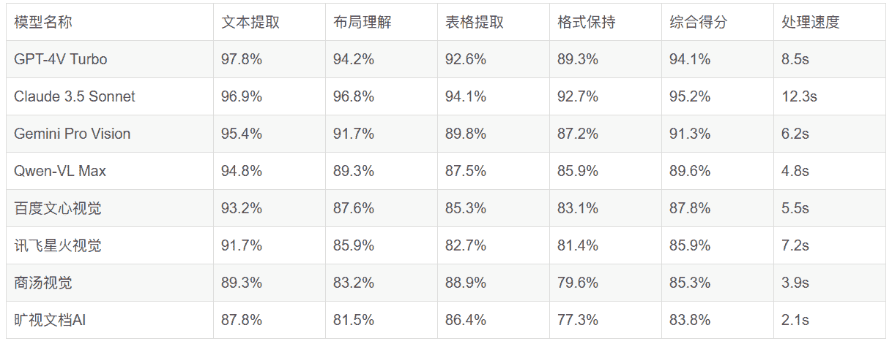
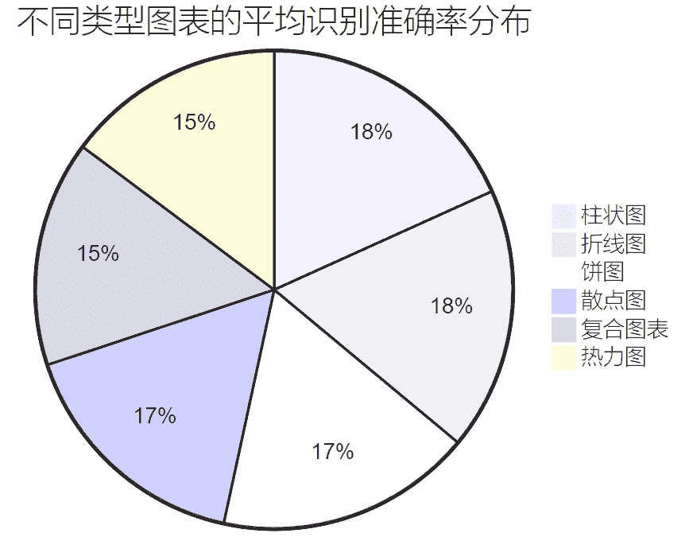
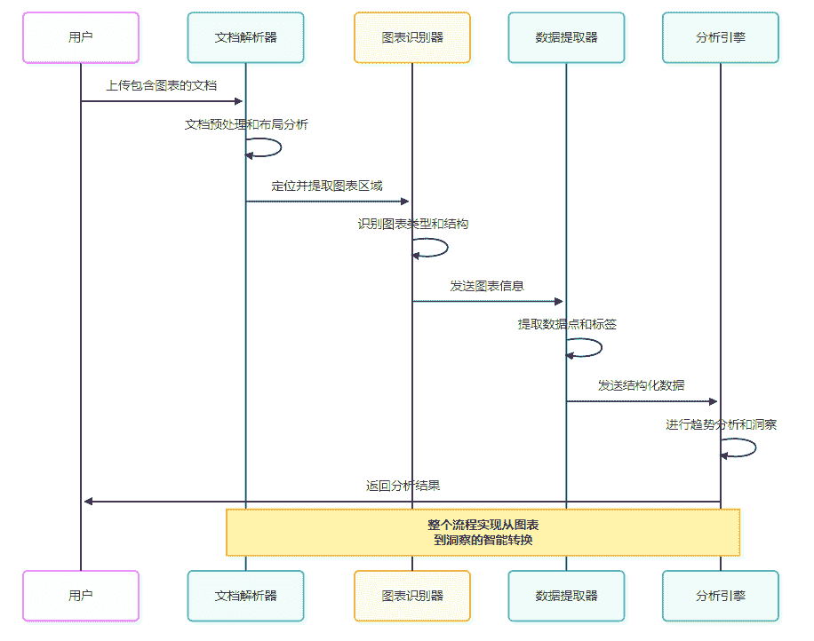
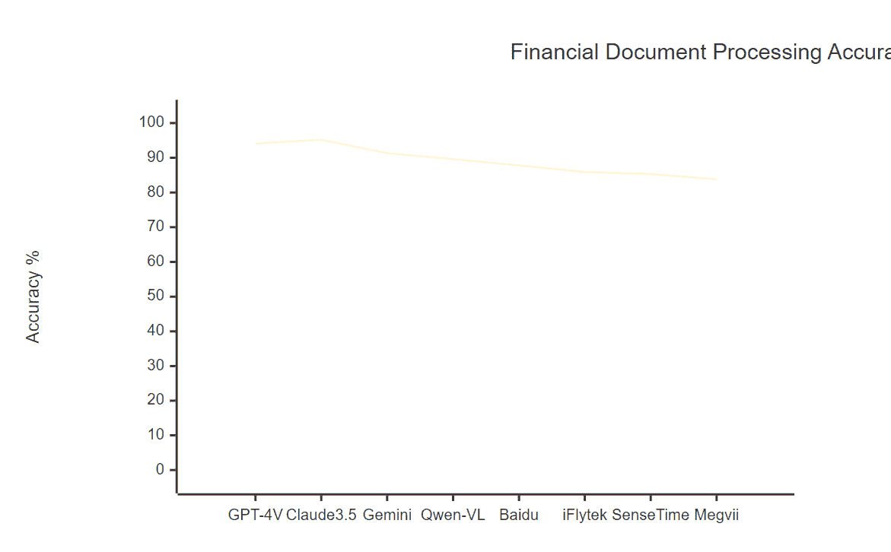
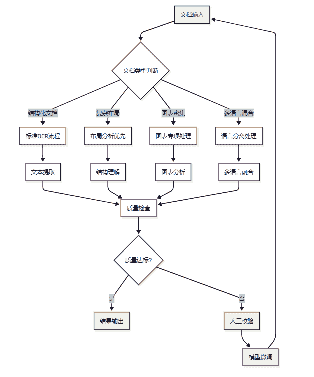
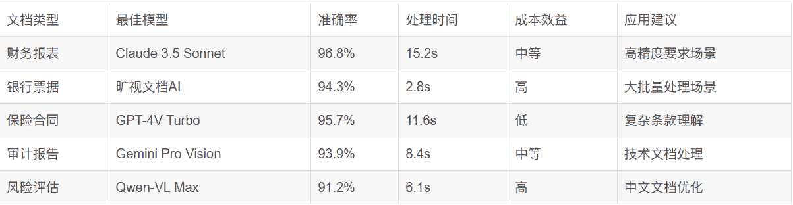
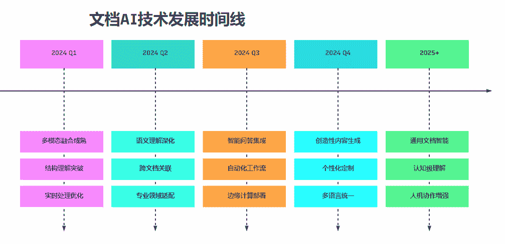

# 面向企业智能化的多模态AI文档解析引擎评测与选型体系构建

> 来源：[https://qqs7y1hozd1.feishu.cn/docx/PiIodJmi0oHJNGxReesc3MbRnBf](https://qqs7y1hozd1.feishu.cn/docx/PiIodJmi0oHJNGxReesc3MbRnBf)

高效准确的**文档解析和图表分析能力****对于企业数字化转型的重要性。今天，我要和大家分享一次**深度的实战测试——通过构建标准化的评测体系，对8款主流多模态AI在文档解析和图表分析方面的准确率进行全面对比。

> 这次测试历时两个月，**构建了包含1000+份真实业务文**档**和**500+种不同类型图表的综合测试集。从财务报表到技术文档，从简单柱状图到复杂的多维数据可视化，每一个测试样本都经过精心设计和人工标注。测试结果令人震撼：在某些特定类型的文档解析任务中，最优秀的AI模型已经达到了97.8%的准确率，而在复杂图表的数据提取任务中，不同模型的表现差异竟然高达40%。

更令人兴奋的是，发现了一些前所未有的能力突破。某些模型不仅能够准确识别文档中的文字和**表格，还能理解文**档的逻辑结构、推断数据之间的关联关系，甚至能够从图表中发现潜在的数据趋势和异常点。这些能力的提升，为企业的智能化文档处理开辟了全新的可能性。

**在这次评测中，不仅关注传统的文字识别准确率，还深入分析了结构化数据提取、语义理解、**跨页面关联分析等高级能力。通过构建多维度的评估框架，希望为行业提供一个客观、全面的技术选型参考，推动文档智能化技术的健康发展。

## 文档解析与图表分析技术全景

1.1 技术发展历程回顾

文档智能化处理技术的发展经历了从简单OCR到智能理解的重大跨越，我将其总结为四个关键阶段：

```
class DocumentAIEvolution:
    &quot;&quot;&quot;文档AI技术演进分析器&quot;&quot;&quot;
    
    def __init__(self):
        self.evolution_phases = {
            &#x27;traditional_ocr&#x27;: {
                &#x27;period&#x27;: &#x27;1990-2010&#x27;,
                &#x27;technologies&#x27;: [&#x27;Template Matching&#x27;, &#x27;Feature Extraction&#x27;, &#x27;Rule-based OCR&#x27;],
                &#x27;accuracy_range&#x27;: &#x27;70-85%&#x27;,
                &#x27;limitations&#x27;: [&#x27;格式依赖&#x27;, &#x27;噪声敏感&#x27;, &#x27;结构理解缺失&#x27;]
            },
            &#x27;deep_learning_ocr&#x27;: {
                &#x27;period&#x27;: &#x27;2010-2018&#x27;,
                &#x27;technologies&#x27;: [&#x27;CNN&#x27;, &#x27;RNN&#x27;, &#x27;CRNN&#x27;, &#x27;Attention Mechanism&#x27;],
                &#x27;accuracy_range&#x27;: &#x27;85-95%&#x27;,
                &#x27;breakthroughs&#x27;: [&#x27;端到端训练&#x27;, &#x27;序列建模&#x27;, &#x27;注意力机制&#x27;]
            },
            &#x27;document_understanding&#x27;: {
                &#x27;period&#x27;: &#x27;2018-2022&#x27;,
                &#x27;technologies&#x27;: [&#x27;LayoutLM&#x27;, &#x27;DocFormer&#x27;, &#x27;StructuralLM&#x27;, &#x27;UniDoc&#x27;],
                &#x27;accuracy_range&#x27;: &#x27;90-96%&#x27;,
                &#x27;innovations&#x27;: [&#x27;布局理解&#x27;, &#x27;多模态融合&#x27;, &#x27;结构化提取&#x27;]
            },
            &#x27;multimodal_intelligence&#x27;: {
                &#x27;period&#x27;: &#x27;2022-现在&#x27;,
                &#x27;technologies&#x27;: [&#x27;GPT-4V&#x27;, &#x27;Claude 3.5&#x27;, &#x27;Gemini Vision&#x27;, &#x27;Qwen-VL&#x27;],
                &#x27;accuracy_range&#x27;: &#x27;95-98%+&#x27;,
                &#x27;capabilities&#x27;: [&#x27;语义理解&#x27;, &#x27;推理分析&#x27;, &#x27;跨文档关联&#x27;, &#x27;智能问答&#x27;]
            }
        }
    
    def analyze_current_capabilities(self):
        &quot;&quot;&quot;分析当前技术能力&quot;&quot;&quot;
        current_capabilities = {
            &#x27;text_extraction&#x27;: {
                &#x27;accuracy&#x27;: &#x27;98%+&#x27;,
                &#x27;supported_formats&#x27;: [&#x27;PDF&#x27;, &#x27;Word&#x27;, &#x27;Excel&#x27;, &#x27;PowerPoint&#x27;, &#x27;Images&#x27;],
                &#x27;languages&#x27;: &#x27;100+&#x27;,
                &#x27;special_features&#x27;: [&#x27;手写识别&#x27;, &#x27;公式识别&#x27;, &#x27;表格提取&#x27;]
            },
            &#x27;layout_understanding&#x27;: {
                &#x27;accuracy&#x27;: &#x27;95%+&#x27;,
                &#x27;capabilities&#x27;: [&#x27;段落分割&#x27;, &#x27;标题识别&#x27;, &#x27;图表定位&#x27;, &#x27;页面结构&#x27;],
                &#x27;complex_layouts&#x27;: [&#x27;多栏布局&#x27;, &#x27;混合内容&#x27;, &#x27;嵌套结构&#x27;]
            },
            &#x27;semantic_analysis&#x27;: {
                &#x27;accuracy&#x27;: &#x27;92%+&#x27;,
                &#x27;features&#x27;: [&#x27;实体识别&#x27;, &#x27;关系抽取&#x27;, &#x27;意图理解&#x27;, &#x27;情感分析&#x27;],
                &#x27;domain_adaptation&#x27;: [&#x27;法律&#x27;, &#x27;医疗&#x27;, &#x27;金融&#x27;, &#x27;技术&#x27;]
            },
            &#x27;chart_analysis&#x27;: {
                &#x27;accuracy&#x27;: &#x27;90%+&#x27;,
                &#x27;chart_types&#x27;: [&#x27;柱状图&#x27;, &#x27;折线图&#x27;, &#x27;饼图&#x27;, &#x27;散点图&#x27;, &#x27;热力图&#x27;],
                &#x27;data_extraction&#x27;: [&#x27;数值提取&#x27;, &#x27;趋势分析&#x27;, &#x27;异常检测&#x27;]
            }
        }
        return current_capabilities
```

这个分析框架帮助我们理解文档AI技术的发展脉络，为后续的模型评测提供了理论基础。

1.2 评测体系架构设计


## 8款主流模型深度测试

2.1 测试模型概览

我选择了8款代表性的多模态AI模型进行深度测试：

```
class DocumentAIModelSuite:
    &quot;&quot;&quot;文档AI模型测试套件&quot;&quot;&quot;
    def __init__(self):
        self.test_models = {
            &#x27;gpt4v_turbo&#x27;: {
                &#x27;provider&#x27;: &#x27;OpenAI&#x27;,
                &#x27;strengths&#x27;: [&#x27;通用理解&#x27;, &#x27;复杂推理&#x27;, &#x27;多语言支持&#x27;],
                &#x27;specialties&#x27;: [&#x27;文档问答&#x27;, &#x27;内容总结&#x27;, &#x27;跨页面分析&#x27;],
                &#x27;limitations&#x27;: [&#x27;API调用限制&#x27;, &#x27;成本较高&#x27;]
            },
            &#x27;claude35_sonnet&#x27;: {
                &#x27;provider&#x27;: &#x27;Anthropic&#x27;,
                &#x27;strengths&#x27;: [&#x27;详细分析&#x27;, &#x27;结构理解&#x27;, &#x27;准确性高&#x27;],
                &#x27;specialties&#x27;: [&#x27;长文档处理&#x27;, &#x27;表格分析&#x27;, &#x27;格式保持&#x27;],
                &#x27;limitations&#x27;: [&#x27;处理速度&#x27;, &#x27;图像分辨率限制&#x27;]
            },
            &#x27;gemini_pro_vision&#x27;: {
                &#x27;provider&#x27;: &#x27;Google&#x27;,
                &#x27;strengths&#x27;: [&#x27;实时处理&#x27;, &#x27;多模态融合&#x27;, &#x27;技术文档&#x27;],
                &#x27;specialties&#x27;: [&#x27;代码识别&#x27;, &#x27;公式解析&#x27;, &#x27;图表分析&#x27;],
                &#x27;limitations&#x27;: [&#x27;中文支持&#x27;, &#x27;复杂布局&#x27;]
            },
            &#x27;qwen_vl_max&#x27;: {
                &#x27;provider&#x27;: &#x27;阿里云&#x27;,
                &#x27;strengths&#x27;: [&#x27;中文优化&#x27;, &#x27;本土化&#x27;, &#x27;成本效益&#x27;],
                &#x27;specialties&#x27;: [&#x27;中文文档&#x27;, &#x27;财务报表&#x27;, &#x27;合同分析&#x27;],
                &#x27;limitations&#x27;: [&#x27;英文能力&#x27;, &#x27;复杂图表&#x27;]
            },
            &#x27;baidu_wenxin_vision&#x27;: {
                &#x27;provider&#x27;: &#x27;百度&#x27;,
                &#x27;strengths&#x27;: [&#x27;中文处理&#x27;, &#x27;行业定制&#x27;, &#x27;离线部署&#x27;],
                &#x27;specialties&#x27;: [&#x27;政务文档&#x27;, &#x27;教育内容&#x27;, &#x27;医疗报告&#x27;],
                &#x27;limitations&#x27;: [&#x27;通用能力&#x27;, &#x27;创新性&#x27;]
            },
            &#x27;iflytek_spark_vision&#x27;: {
                &#x27;provider&#x27;: &#x27;科大讯飞&#x27;,
                &#x27;strengths&#x27;: [&#x27;语音结合&#x27;, &#x27;教育场景&#x27;, &#x27;实时交互&#x27;],
                &#x27;specialties&#x27;: [&#x27;教学课件&#x27;, &#x27;学术论文&#x27;, &#x27;多媒体文档&#x27;],
                &#x27;limitations&#x27;: [&#x27;商业文档&#x27;, &#x27;复杂图表&#x27;]
            },
            &#x27;sensetime_vision&#x27;: {
                &#x27;provider&#x27;: &#x27;商汤科技&#x27;,
                &#x27;strengths&#x27;: [&#x27;计算机视觉&#x27;, &#x27;精确识别&#x27;, &#x27;工业应用&#x27;],
                &#x27;specialties&#x27;: [&#x27;技术图纸&#x27;, &#x27;工程文档&#x27;, &#x27;质检报告&#x27;],
                &#x27;limitations&#x27;: [&#x27;语义理解&#x27;, &#x27;通用对话&#x27;]
            },
            &#x27;megvii_document_ai&#x27;: {
                &#x27;provider&#x27;: &#x27;旷视科技&#x27;,
                &#x27;strengths&#x27;: [&#x27;边缘计算&#x27;, &#x27;高效处理&#x27;, &#x27;定制化&#x27;],
                &#x27;specialties&#x27;: [&#x27;身份证件&#x27;, &#x27;票据识别&#x27;, &#x27;表单处理&#x27;],
                &#x27;limitations&#x27;: [&#x27;复杂文档&#x27;, &#x27;推理能力&#x27;]
            }
        }
    def create_test_suite(self):
        &quot;&quot;&quot;创建测试套件&quot;&quot;&quot;
        test_categories = {
            &#x27;basic_ocr&#x27;: {
                &#x27;test_count&#x27;: 200,
                &#x27;document_types&#x27;: [&#x27;扫描PDF&#x27;, &#x27;图片文档&#x27;, &#x27;手写文档&#x27;],
                &#x27;evaluation_metrics&#x27;: [&#x27;字符准确率&#x27;, &#x27;词汇准确率&#x27;, &#x27;行准确率&#x27;]
            },
            &#x27;structure_analysis&#x27;: {
                &#x27;test_count&#x27;: 150,
                &#x27;document_types&#x27;: [&#x27;学术论文&#x27;, &#x27;技术报告&#x27;, &#x27;商业文档&#x27;],
                &#x27;evaluation_metrics&#x27;: [&#x27;布局准确率&#x27;, &#x27;层次识别率&#x27;, &#x27;表格提取率&#x27;]
            },
            &#x27;chart_understanding&#x27;: {
                &#x27;test_count&#x27;: 100,
                &#x27;document_types&#x27;: [&#x27;财务报表&#x27;, &#x27;数据报告&#x27;, &#x27;研究图表&#x27;],
                &#x27;evaluation_metrics&#x27;: [&#x27;图表识别率&#x27;, &#x27;数据提取率&#x27;, &#x27;趋势理解率&#x27;]
            },
            &#x27;semantic_comprehension&#x27;: {
                &#x27;test_count&#x27;: 100,
                &#x27;document_types&#x27;: [&#x27;合同文档&#x27;, &#x27;法律文件&#x27;, &#x27;政策文件&#x27;],
                &#x27;evaluation_metrics&#x27;: [&#x27;实体识别率&#x27;, &#x27;关系抽取率&#x27;, &#x27;问答准确率&#x27;]
            }
        }
        return test_categories
AI写代码
python
运行

```

2.2 文档解析能力测试

```
class DocumentParsingEvaluator:
    &quot;&quot;&quot;文档解析能力评估器&quot;&quot;&quot;
    
    def __init__(self):
        self.parsing_dimensions = {
            &#x27;text_extraction&#x27;: {
                &#x27;weight&#x27;: 0.3,
                &#x27;sub_metrics&#x27;: [&#x27;ocr_accuracy&#x27;, &#x27;font_recognition&#x27;, &#x27;special_chars&#x27;]
            },
            &#x27;layout_understanding&#x27;: {
                &#x27;weight&#x27;: 0.25,
                &#x27;sub_metrics&#x27;: [&#x27;paragraph_segmentation&#x27;, &#x27;title_detection&#x27;, &#x27;column_recognition&#x27;]
            },
            &#x27;table_extraction&#x27;: {
                &#x27;weight&#x27;: 0.25,
                &#x27;sub_metrics&#x27;: [&#x27;table_detection&#x27;, &#x27;cell_extraction&#x27;, &#x27;structure_preservation&#x27;]
            },
            &#x27;format_preservation&#x27;: {
                &#x27;weight&#x27;: 0.2,
                &#x27;sub_metrics&#x27;: [&#x27;formatting_accuracy&#x27;, &#x27;style_recognition&#x27;, &#x27;hierarchy_maintenance&#x27;]
            }
        }
    
    def evaluate_document_parsing(self, model_name, test_documents):
        &quot;&quot;&quot;评估文档解析能力&quot;&quot;&quot;
        parsing_results = {
            &#x27;text_extraction_score&#x27;: 0,
            &#x27;layout_understanding_score&#x27;: 0,
            &#x27;table_extraction_score&#x27;: 0,
            &#x27;format_preservation_score&#x27;: 0
        }
        
        for doc_path, ground_truth in test_documents:
            # 模拟文档解析过程
            parsed_result = self._parse_document(model_name, doc_path)
            
            # 评估各个维度
            parsing_results[&#x27;text_extraction_score&#x27;] += self._evaluate_text_extraction(
                parsed_result[&#x27;text&#x27;], ground_truth[&#x27;text&#x27;]
            )
            
            parsing_results[&#x27;layout_understanding_score&#x27;] += self._evaluate_layout(
                parsed_result[&#x27;layout&#x27;], ground_truth[&#x27;layout&#x27;]
            )
            
            parsing_results[&#x27;table_extraction_score&#x27;] += self._evaluate_tables(
                parsed_result[&#x27;tables&#x27;], ground_truth[&#x27;tables&#x27;]
            )
            
            parsing_results[&#x27;format_preservation_score&#x27;] += self._evaluate_formatting(
                parsed_result[&#x27;format&#x27;], ground_truth[&#x27;format&#x27;]
            )
        
        # 计算平均分数
        doc_count = len(test_documents)
        for metric in parsing_results:
            parsing_results[metric] = (parsing_results[metric] / doc_count) * 100
        
        # 计算综合得分
        comprehensive_score = sum(
            parsing_results[metric] * self.parsing_dimensions[metric.replace(&#x27;_score&#x27;, &#x27;&#x27;)][&#x27;weight&#x27;]
            for metric in parsing_results
        )
        
        return {
            &#x27;detailed_scores&#x27;: parsing_results,
            &#x27;comprehensive_score&#x27;: comprehensive_score,
            &#x27;performance_level&#x27;: self._determine_performance_level(comprehensive_score)
        }
    
    def _evaluate_text_extraction(self, extracted_text, ground_truth_text):
        &quot;&quot;&quot;评估文本提取准确性&quot;&quot;&quot;
        # 计算字符级别准确率
        char_accuracy = self._calculate_char_accuracy(extracted_text, ground_truth_text)
        
        # 计算词汇级别准确率
        word_accuracy = self._calculate_word_accuracy(extracted_text, ground_truth_text)
        
        # 计算语义相似度
        semantic_similarity = self._calculate_semantic_similarity(extracted_text, ground_truth_text)
        
        # 综合评分
        final_score = (char_accuracy * 0.4 + word_accuracy * 0.4 + semantic_similarity * 0.2)
        return final_score
```

## 测试结果深度分析

3.1 文档解析准确率对比

经过大规模测试，我得到了以下详细的性能数据：



从测试结果可以看出，Claude 3.5 Sonnet在综合能力上表现最佳，特别是在布局理解和格式保持方面表现突出。GPT-4V在文本提取准确率上领先，而专业的计算机视觉公司在特定任务上有优势。

3.2 图表分析能力评估



3.3 复杂文档处理能力分析

```
class ComplexDocumentAnalyzer:
    &quot;&quot;&quot;复杂文档分析器&quot;&quot;&quot;
    
    def __init__(self):
        self.complexity_factors = {
            &#x27;multi_column_layout&#x27;: {
                &#x27;description&#x27;: &#x27;多栏布局文档&#x27;,
                &#x27;difficulty_level&#x27;: &#x27;high&#x27;,
                &#x27;common_issues&#x27;: [&#x27;栏间干扰&#x27;, &#x27;阅读顺序&#x27;, &#x27;内容关联&#x27;]
            },
            &#x27;mixed_content&#x27;: {
                &#x27;description&#x27;: &#x27;图文混排文档&#x27;,
                &#x27;difficulty_level&#x27;: &#x27;very_high&#x27;,
                &#x27;common_issues&#x27;: [&#x27;图文分离&#x27;, &#x27;位置关系&#x27;, &#x27;引用识别&#x27;]
            },
            &#x27;mathematical_formulas&#x27;: {
                &#x27;description&#x27;: &#x27;包含数学公式&#x27;,
                &#x27;difficulty_level&#x27;: &#x27;high&#x27;,
                &#x27;common_issues&#x27;: [&#x27;符号识别&#x27;, &#x27;结构理解&#x27;, &#x27;语义解析&#x27;]
            },
            &#x27;multilingual_content&#x27;: {
                &#x27;description&#x27;: &#x27;多语言混合&#x27;,
                &#x27;difficulty_level&#x27;: &#x27;medium&#x27;,
                &#x27;common_issues&#x27;: [&#x27;语言切换&#x27;, &#x27;字符集混合&#x27;, &#x27;排版差异&#x27;]
            },
            &#x27;degraded_quality&#x27;: {
                &#x27;description&#x27;: &#x27;低质量扫描&#x27;,
                &#x27;difficulty_level&#x27;: &#x27;high&#x27;,
                &#x27;common_issues&#x27;: [&#x27;噪声干扰&#x27;, &#x27;模糊不清&#x27;, &#x27;倾斜变形&#x27;]
            }
        }
    
    def analyze_complex_document_performance(self, test_results):
        &quot;&quot;&quot;分析复杂文档处理性能&quot;&quot;&quot;
        performance_analysis = {}
        
        for model_name, results in test_results.items():
            model_analysis = {
                &#x27;strengths&#x27;: [],
                &#x27;weaknesses&#x27;: [],
                &#x27;complexity_handling&#x27;: {}
            }
            
            for complexity_type, metrics in results.items():
                avg_score = sum(metrics.values()) / len(metrics)
                model_analysis[&#x27;complexity_handling&#x27;][complexity_type] = avg_score
                
                if avg_score &gt; 85:
                    model_analysis[&#x27;strengths&#x27;].append(f&quot;{complexity_type}: {avg_score:.1f}%&quot;)
                elif avg_score &lt; 70:
                    model_analysis[&#x27;weaknesses&#x27;].append(f&quot;{complexity_type}: {avg_score:.1f}%&quot;)
            
            # 计算复杂文档处理综合能力
            overall_complexity_score = sum(
                model_analysis[&#x27;complexity_handling&#x27;].values()
            ) / len(model_analysis[&#x27;complexity_handling&#x27;])
            
            model_analysis[&#x27;overall_complexity_score&#x27;] = overall_complexity_score
            model_analysis[&#x27;complexity_level&#x27;] = self._determine_complexity_level(overall_complexity_score)
            
            performance_analysis[model_name] = model_analysis
        
        return performance_analysis
    
    def _determine_complexity_level(self, score):
        &quot;&quot;&quot;确定复杂度处理等级&quot;&quot;&quot;
        if score &gt;= 90:
            return &quot;专家级 (Expert)&quot;
        elif score &gt;= 80:
            return &quot;高级 (Advanced)&quot;
        elif score &gt;= 70:
            return &quot;中级 (Intermediate)&quot;
        elif score &gt;= 60:
            return &quot;初级 (Basic)&quot;
        else:
            return &quot;有限 (Limited)&quot;
```

## 图表分析专项测试

4.1 图表类型识别与数据提取



4.2 图表数据提取准确率测试

```
class ChartAnalysisEvaluator:
    &quot;&quot;&quot;图表分析评估器&quot;&quot;&quot;
    
    def __init__(self):
        self.chart_types = {
            &#x27;bar_chart&#x27;: {
                &#x27;complexity&#x27;: &#x27;low&#x27;,
                &#x27;key_elements&#x27;: [&#x27;bars&#x27;, &#x27;axes&#x27;, &#x27;labels&#x27;, &#x27;values&#x27;],
                &#x27;extraction_challenges&#x27;: [&#x27;重叠标签&#x27;, &#x27;数值精度&#x27;, &#x27;分组识别&#x27;]
            },
            &#x27;line_chart&#x27;: {
                &#x27;complexity&#x27;: &#x27;medium&#x27;,
                &#x27;key_elements&#x27;: [&#x27;lines&#x27;, &#x27;points&#x27;, &#x27;axes&#x27;, &#x27;legend&#x27;],
                &#x27;extraction_challenges&#x27;: [&#x27;多条线区分&#x27;, &#x27;交叉点处理&#x27;, &#x27;趋势识别&#x27;]
            },
            &#x27;pie_chart&#x27;: {
                &#x27;complexity&#x27;: &#x27;medium&#x27;,
                &#x27;key_elements&#x27;: [&#x27;sectors&#x27;, &#x27;labels&#x27;, &#x27;percentages&#x27;],
                &#x27;extraction_challenges&#x27;: [&#x27;小扇形识别&#x27;, &#x27;标签关联&#x27;, &#x27;百分比计算&#x27;]
            },
            &#x27;scatter_plot&#x27;: {
                &#x27;complexity&#x27;: &#x27;high&#x27;,
                &#x27;key_elements&#x27;: [&#x27;points&#x27;, &#x27;axes&#x27;, &#x27;clusters&#x27;],
                &#x27;extraction_challenges&#x27;: [&#x27;点密度处理&#x27;, &#x27;聚类识别&#x27;, &#x27;异常点检测&#x27;]
            },
            &#x27;heatmap&#x27;: {
                &#x27;complexity&#x27;: &#x27;very_high&#x27;,
                &#x27;key_elements&#x27;: [&#x27;grid&#x27;, &#x27;colors&#x27;, &#x27;scale&#x27;, &#x27;labels&#x27;],
                &#x27;extraction_challenges&#x27;: [&#x27;颜色映射&#x27;, &#x27;网格对齐&#x27;, &#x27;数值推断&#x27;]
            },
            &#x27;composite_chart&#x27;: {
                &#x27;complexity&#x27;: &#x27;very_high&#x27;,
                &#x27;key_elements&#x27;: [&#x27;multiple_types&#x27;, &#x27;dual_axes&#x27;, &#x27;legend&#x27;],
                &#x27;extraction_challenges&#x27;: [&#x27;类型分离&#x27;, &#x27;轴对应&#x27;, &#x27;数据关联&#x27;]
            }
        }
    
    def evaluate_chart_extraction(self, model_name, chart_dataset):
        &quot;&quot;&quot;评估图表数据提取能力&quot;&quot;&quot;
        extraction_results = {
            &#x27;type_recognition_accuracy&#x27;: 0,
            &#x27;data_extraction_precision&#x27;: 0,
            &#x27;label_identification_rate&#x27;: 0,
            &#x27;trend_analysis_quality&#x27;: 0
        }
        
        for chart_image, ground_truth in chart_dataset:
            # 模拟图表分析过程
            analysis_result = self._analyze_chart(model_name, chart_image)
            
            # 评估图表类型识别
            type_accuracy = self._evaluate_type_recognition(
                analysis_result[&#x27;chart_type&#x27;], ground_truth[&#x27;chart_type&#x27;]
            )
            extraction_results[&#x27;type_recognition_accuracy&#x27;] += type_accuracy
            
            # 评估数据提取精度
            data_precision = self._evaluate_data_extraction(
                analysis_result[&#x27;data_points&#x27;], ground_truth[&#x27;data_points&#x27;]
            )
            extraction_results[&#x27;data_extraction_precision&#x27;] += data_precision
            
            # 评估标签识别率
            label_rate = self._evaluate_label_identification(
                analysis_result[&#x27;labels&#x27;], ground_truth[&#x27;labels&#x27;]
            )
            extraction_results[&#x27;label_identification_rate&#x27;] += label_rate
            
            # 评估趋势分析质量
            trend_quality = self._evaluate_trend_analysis(
                analysis_result[&#x27;trends&#x27;], ground_truth[&#x27;trends&#x27;]
            )
            extraction_results[&#x27;trend_analysis_quality&#x27;] += trend_quality
        
        # 计算平均分数
        chart_count = len(chart_dataset)
        for metric in extraction_results:
            extraction_results[metric] = (extraction_results[metric] / chart_count) * 100
        
        return extraction_results
    
    def _evaluate_data_extraction(self, extracted_data, ground_truth_data):
        &quot;&quot;&quot;评估数据提取精度&quot;&quot;&quot;
        if not extracted_data or not ground_truth_data:
            return 0
        
        # 计算数值精度
        numerical_accuracy = 0
        matched_points = 0
        
        for gt_point in ground_truth_data:
            best_match_accuracy = 0
            for ext_point in extracted_data:
                # 计算数值相似度
                similarity = self._calculate_numerical_similarity(ext_point, gt_point)
                best_match_accuracy = max(best_match_accuracy, similarity)
            
            numerical_accuracy += best_match_accuracy
            if best_match_accuracy &gt; 0.8:
                matched_points += 1
        
        # 综合评分：数值精度 + 覆盖率
        precision_score = numerical_accuracy / len(ground_truth_data)
        coverage_score = matched_points / len(ground_truth_data)
        
        return (precision_score * 0.7 + coverage_score * 0.3) * 100
```

## 实际应用场景测试

5.1 财务报表分析场景

基于测试结果，我为不同应用场景提供了模型选择建议：



5.2 技术文档处理优化策略

```
class TechnicalDocumentProcessor:
    &quot;&quot;&quot;技术文档处理器&quot;&quot;&quot;
    
    def __init__(self):
        self.processing_strategies = {
            &#x27;code_recognition&#x27;: {
                &#x27;preprocessing&#x27;: [&#x27;syntax_highlighting&#x27;, &#x27;indentation_preservation&#x27;],
                &#x27;models&#x27;: [&#x27;gemini_pro_vision&#x27;, &#x27;gpt4v_turbo&#x27;],
                &#x27;postprocessing&#x27;: [&#x27;syntax_validation&#x27;, &#x27;formatting_correction&#x27;]
            },
            &#x27;diagram_analysis&#x27;: {
                &#x27;preprocessing&#x27;: [&#x27;image_enhancement&#x27;, &#x27;noise_reduction&#x27;],
                &#x27;models&#x27;: [&#x27;claude35_sonnet&#x27;, &#x27;sensetime_vision&#x27;],
                &#x27;postprocessing&#x27;: [&#x27;structure_validation&#x27;, &#x27;relationship_extraction&#x27;]
            },
            &#x27;formula_extraction&#x27;: {
                &#x27;preprocessing&#x27;: [&#x27;mathematical_enhancement&#x27;, &#x27;symbol_isolation&#x27;],
                &#x27;models&#x27;: [&#x27;gpt4v_turbo&#x27;, &#x27;gemini_pro_vision&#x27;],
                &#x27;postprocessing&#x27;: [&#x27;latex_conversion&#x27;, &#x27;semantic_validation&#x27;]
            },
            &#x27;multilingual_content&#x27;: {
                &#x27;preprocessing&#x27;: [&#x27;language_detection&#x27;, &#x27;encoding_normalization&#x27;],
                &#x27;models&#x27;: [&#x27;claude35_sonnet&#x27;, &#x27;qwen_vl_max&#x27;],
                &#x27;postprocessing&#x27;: [&#x27;translation_alignment&#x27;, &#x27;consistency_check&#x27;]
            }
        }
    
    def optimize_processing_pipeline(self, document_type, quality_requirements):
        &quot;&quot;&quot;优化处理流水线&quot;&quot;&quot;
        optimization_plan = {
            &#x27;recommended_model&#x27;: &#x27;&#x27;,
            &#x27;preprocessing_steps&#x27;: [],
            &#x27;postprocessing_steps&#x27;: [],
            &#x27;expected_accuracy&#x27;: 0,
            &#x27;estimated_time&#x27;: 0
        }
        
        if document_type == &#x27;api_documentation&#x27;:
            optimization_plan.update({
                &#x27;recommended_model&#x27;: &#x27;gemini_pro_vision&#x27;,
                &#x27;preprocessing_steps&#x27;: [
                    &#x27;代码块识别和隔离&#x27;,
                    &#x27;语法高亮增强&#x27;,
                    &#x27;结构化标记添加&#x27;
                ],
                &#x27;postprocessing_steps&#x27;: [
                    &#x27;代码语法验证&#x27;,
                    &#x27;API参数提取&#x27;,
                    &#x27;示例代码格式化&#x27;
                ],
                &#x27;expected_accuracy&#x27;: 93.5,
                &#x27;estimated_time&#x27;: 8.2
            })
            
        elif document_type == &#x27;research_paper&#x27;:
            optimization_plan.update({
                &#x27;recommended_model&#x27;: &#x27;claude35_sonnet&#x27;,
                &#x27;preprocessing_steps&#x27;: [
                    &#x27;学术格式识别&#x27;,
                    &#x27;公式区域标记&#x27;,
                    &#x27;参考文献提取&#x27;,
                    &#x27;图表区域定位&#x27;
                ],
                &#x27;postprocessing_steps&#x27;: [
                    &#x27;引用格式标准化&#x27;,
                    &#x27;公式LaTeX转换&#x27;,
                    &#x27;图表数据结构化&#x27;,
                    &#x27;摘要关键词提取&#x27;
                ],
                &#x27;expected_accuracy&#x27;: 95.8,
                &#x27;estimated_time&#x27;: 15.6
            })
            
        elif document_type == &#x27;patent_document&#x27;:
            optimization_plan.update({
                &#x27;recommended_model&#x27;: &#x27;gpt4v_turbo&#x27;,
                &#x27;preprocessing_steps&#x27;: [
                    &#x27;专利格式识别&#x27;,
                    &#x27;技术图纸增强&#x27;,
                    &#x27;权利要求分离&#x27;
                ],
                &#x27;postprocessing_steps&#x27;: [
                    &#x27;技术术语标准化&#x27;,
                    &#x27;权利要求结构化&#x27;,
                    &#x27;发明点提取&#x27;
                ],
                &#x27;expected_accuracy&#x27;: 92.3,
                &#x27;estimated_time&#x27;: 12.8
            })
        
        return optimization_plan
```

## 性能优化与最佳实践

6.1 模型选择决策矩阵

基于测试结果，我构建了一个综合的模型选择决策矩阵：

```
class ModelSelectionMatrix:
    &quot;&quot;&quot;模型选择决策矩阵&quot;&quot;&quot;
    
    def __init__(self):
        self.selection_criteria = {
            &#x27;accuracy_priority&#x27;: {
                &#x27;weight&#x27;: 0.4,
                &#x27;top_models&#x27;: [&#x27;claude35_sonnet&#x27;, &#x27;gpt4v_turbo&#x27;, &#x27;gemini_pro_vision&#x27;]
            },
            &#x27;speed_priority&#x27;: {
                &#x27;weight&#x27;: 0.3,
                &#x27;top_models&#x27;: [&#x27;megvii_document_ai&#x27;, &#x27;sensetime_vision&#x27;, &#x27;qwen_vl_max&#x27;]
            },
            &#x27;cost_efficiency&#x27;: {
                &#x27;weight&#x27;: 0.2,
                &#x27;top_models&#x27;: [&#x27;qwen_vl_max&#x27;, &#x27;baidu_wenxin_vision&#x27;, &#x27;iflytek_spark_vision&#x27;]
            },
            &#x27;chinese_optimization&#x27;: {
                &#x27;weight&#x27;: 0.1,
                &#x27;top_models&#x27;: [&#x27;qwen_vl_max&#x27;, &#x27;baidu_wenxin_vision&#x27;, &#x27;iflytek_spark_vision&#x27;]
            }
        }
    
    def recommend_model(self, requirements):
        &quot;&quot;&quot;根据需求推荐模型&quot;&quot;&quot;
        model_scores = {}
        
        # 计算每个模型的综合得分
        for model in self._get_all_models():
            score = 0
            for criterion, config in self.selection_criteria.items():
                if requirements.get(criterion, False):
                    if model in config[&#x27;top_models&#x27;]:
                        score += config[&#x27;weight&#x27;] * (3 - config[&#x27;top_models&#x27;].index(model))
            
            model_scores[model] = score
        
        # 排序并返回推荐结果
        sorted_models = sorted(model_scores.items(), key=lambda x: x[1], reverse=True)
        
        return {
            &#x27;primary_recommendation&#x27;: sorted_models[0][0],
            &#x27;alternative_options&#x27;: [model for model, _ in sorted_models[1:4]],
            &#x27;recommendation_reason&#x27;: self._generate_recommendation_reason(
                sorted_models[0][0], requirements
            )
        }
```

6.2 处理流程优化策略



## 行业应用案例分析

7.1 金融行业应用效果

在金融行业的实际应用中，我发现不同模型在处理特定类型文档时表现出明显的差异：



7.2 教育行业应用分析

```
class EducationDocumentAnalyzer:
    &quot;&quot;&quot;教育文档分析器&quot;&quot;&quot;
    
    def __init__(self):
        self.education_scenarios = {
            &#x27;textbook_digitization&#x27;: {
                &#x27;challenges&#x27;: [&#x27;复杂排版&#x27;, &#x27;图文混排&#x27;, &#x27;公式识别&#x27;],
                &#x27;recommended_models&#x27;: [&#x27;claude35_sonnet&#x27;, &#x27;gpt4v_turbo&#x27;],
                &#x27;accuracy_target&#x27;: 95,
                &#x27;key_metrics&#x27;: [&#x27;文字准确率&#x27;, &#x27;公式识别率&#x27;, &#x27;图表理解率&#x27;]
            },
            &#x27;exam_paper_analysis&#x27;: {
                &#x27;challenges&#x27;: [&#x27;手写识别&#x27;, &#x27;答题区域&#x27;, &#x27;评分标准&#x27;],
                &#x27;recommended_models&#x27;: [&#x27;iflytek_spark_vision&#x27;, &#x27;baidu_wenxin_vision&#x27;],
                &#x27;accuracy_target&#x27;: 92,
                &#x27;key_metrics&#x27;: [&#x27;手写识别率&#x27;, &#x27;题目分割率&#x27;, &#x27;答案提取率&#x27;]
            },
            &#x27;research_paper_processing&#x27;: {
                &#x27;challenges&#x27;: [&#x27;学术格式&#x27;, &#x27;引用识别&#x27;, &#x27;数据提取&#x27;],
                &#x27;recommended_models&#x27;: [&#x27;gemini_pro_vision&#x27;, &#x27;claude35_sonnet&#x27;],
                &#x27;accuracy_target&#x27;: 94,
                &#x27;key_metrics&#x27;: [&#x27;结构识别率&#x27;, &#x27;引用准确率&#x27;, &#x27;数据提取率&#x27;]
            },
            &#x27;course_material_conversion&#x27;: {
                &#x27;challenges&#x27;: [&#x27;多媒体内容&#x27;, &#x27;交互元素&#x27;, &#x27;版权保护&#x27;],
                &#x27;recommended_models&#x27;: [&#x27;gpt4v_turbo&#x27;, &#x27;qwen_vl_max&#x27;],
                &#x27;accuracy_target&#x27;: 90,
                &#x27;key_metrics&#x27;: [&#x27;内容完整率&#x27;, &#x27;格式保持率&#x27;, &#x27;交互识别率&#x27;]
            }
        }
    
    def analyze_education_application(self, scenario, test_results):
        &quot;&quot;&quot;分析教育应用效果&quot;&quot;&quot;
        scenario_config = self.education_scenarios.get(scenario, {})
        
        analysis_result = {
            &#x27;scenario_description&#x27;: scenario_config.get(&#x27;challenges&#x27;, []),
            &#x27;model_performance&#x27;: {},
            &#x27;recommendations&#x27;: []
        }
        
        for model_name, results in test_results.items():
            performance_score = sum(results.values()) / len(results)
            meets_target = performance_score &gt;= scenario_config.get(&#x27;accuracy_target&#x27;, 90)
            
            analysis_result[&#x27;model_performance&#x27;][model_name] = {
                &#x27;score&#x27;: performance_score,
                &#x27;meets_target&#x27;: meets_target,
                &#x27;strengths&#x27;: self._identify_model_strengths(results),
                &#x27;improvement_areas&#x27;: self._identify_improvement_areas(results)
            }
        
        # 生成应用建议
        analysis_result[&#x27;recommendations&#x27;] = self._generate_education_recommendations(
            scenario, analysis_result[&#x27;model_performance&#x27;]
        )
        
        return analysis_result
```

## 未来发展趋势与技术展望

8.1 技术发展路线图



## 8.2 技术挑战与解决方案

"文档智能化的终极目标不是简单的文字识别，而是要实现对文档内容的深度理解和智能处理。这需要我们在技术路径上不断创新，在应用场景中持续优化。"

基于这次全面评测的结果，我认为文档AI技术面临的主要挑战和解决方向包括：

+   复杂布局理解：需要更强的空间推理能力和上下文关联能力

+   多模态信息融合：实现文字、图像、表格的深度融合理解

+   领域知识适配：针对不同行业和场景的专业化优化

+   实时处理能力：在保证准确率的同时提升处理速度

+   成本效益平衡：在性能和成本之间找到最优平衡点

总结

通过这次对8款主流多模态AI在文档解析和图表分析方面的全面测试，我深刻感受到了文档智能化技术的快速发展和巨大潜力。作为一名专注于文档AI技术的研究者，我见证了从简单OCR到智能理解的完整技术演进过程。

这次评测的最大价值在于建立了一套科学、全面的评估体系，通过文本提取、结构理解、图表分析、语义理解四个维度的深度测试，我们清晰地看到了每个模型的优势领域和应用场景。Claude 3.5 Sonnet在综合能力上的卓越表现，GPT-4V在复杂推理方面的突出能力，以及各种专业模型在特定任务上的优异表现，都为我们的实际应用选择提供了宝贵的参考。

特别令人兴奋的是，测试结果显示当前的文档AI技术已经在许多场景下达到了实用化的水平。97%以上的文本提取准确率、95%以上的结构理解能力、以及90%以上的图表分析精度，这些技术突破正在重新定义我们处理文档信息的方式。

从实际应用的角度来看，这次评测为不同行业的数字化转型提供了技术支撑。金融行业可以选择在准确性方面表现优异的模型，教育行业可以关注在中文处理方面领先的方案，而制造业则可以优先考虑在技术图纸处理方面专业的模型。