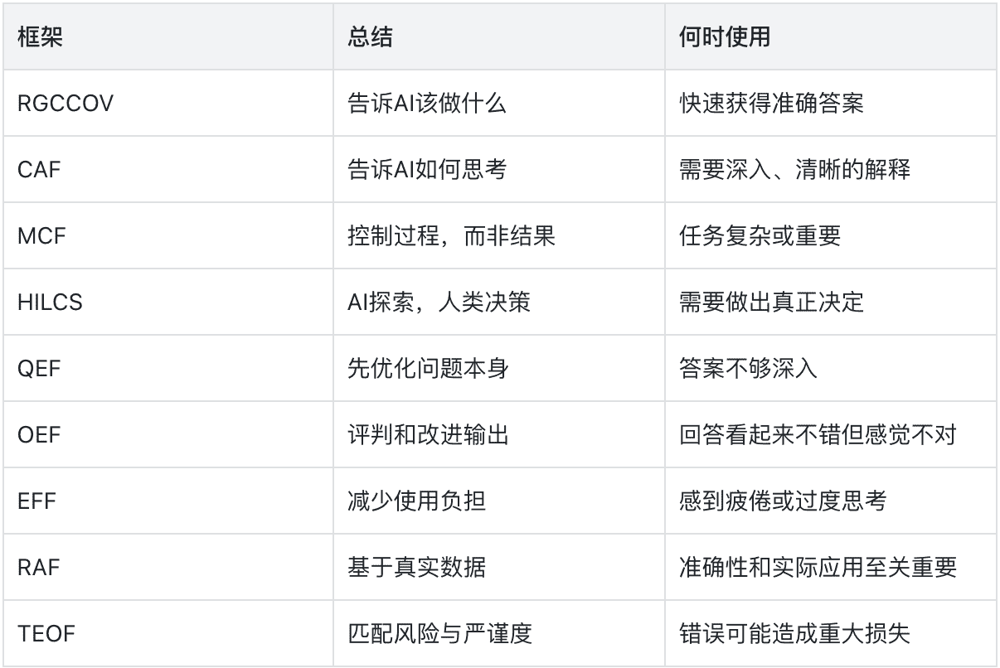
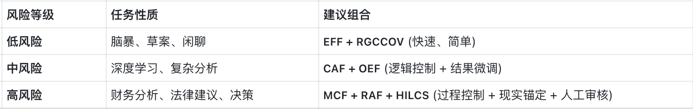

# 9个常用的提示框架及使用教程

> 来源：[https://qqs7y1hozd1.feishu.cn/docx/Zp0gd7tREouuYxxRO5Fcsj7znFc](https://qqs7y1hozd1.feishu.cn/docx/Zp0gd7tREouuYxxRO5Fcsj7znFc)

面对AI，模糊的指令比如：一句“做个好看的功能、帮我画一个原型”，得到的输出往往流于表面、无法使用。

真正的效率杠杆在于将产品思维——定义角色、设定场景、明确验收标准、管理风险——转化为AI能高效执行的精确指令。

本文整理9个核心的 **“提示框架”** 。帮你针对不同任务（从头脑风暴到深度分析/高风险决策），快速编写高质量的提示。

**你将获得：**

+   **一个即插即用的框架工具箱**：为不同任务匹配提示框架。

+   **一套风险适配的决策逻辑**：像评估项目风向一样评估任务，并匹配相应严谨度的风险协议

+   **一个“提示生成器”**：输入你的意图，自动获得一份结构完整、可直接使用的提示词。

> **核心观点**

> **不存在单一的最佳提示框架****。每个框**架解决不同的问题，最佳实践常常是框架组合，而非单一方法。

> **提示原则**：提出更好的问题 → 从简单入手 → 必要时才深入 → 风险增加时加强管控 → 让人类参与其中

**九大框架速查表**

## 一、九大框架详解

### RGCCOV（基础提示结构）

**全称**：Role（角色）、Goal（目标）、Context（上下文）、Constraints（约束）、Output（输出）、Validation（验证）

**核心作用**：帮助AI理解它是谁、你想要什么、如何正确回应

**适用场景**：

+   ✅ 快速获得准确答案

+   ✅ 作为基准测试

+   ❌ 问题问的不好时，效果差

**示例**：

> “你是一位金融老师。请向初学者解释EPS（每股收益）。不要使用专业术语。请使用步骤说明并举一个例子。”

### CAF（认知对齐框架）

**核心作用**：控制AI的思维方式——思维深度、推理风格、心智模型、自我批判

**关键区别****：不是告**诉AI做什么，而是告诉它如何运行

**适用场景**：需要深入解释，而非表面阐述

**示例**：

> “运用第一性原理思维解释通货膨胀。重点关注机制，而非定义。”

### MCF（元控制框架）

**核心作用**：控制整个过程，而非仅仅是结果

**关键特点**：

+   打破常规目标

+   注入质量检查机制

+   预测失效模式

**适用场景**：风险较高、任务复杂或重要时

**示例**：

> “在回答问题之前，先将问题分解成几个步骤。定义一个好的答案应该是什么样的。然后再回答。”

### HILCS（人机协同认知系统）

**核心作用**：AI探索可能性，人类进行判断、决策并承担风险

**关键原则**：任何框架都不能取代责任

**适用场景**：决策至关重要，人类必须保持控制权

**示例**：

> “请提供5个创业想法。我会选择一个。然后只对选定的想法进行完善。”

### QEF（问题工程框架）

**核心作用**：在提示开始之前，先优化问题本身

**关键层次**：表面 → 机制 → 约束 → 失效 → 杠杆

**核心理念**：**更好的问题胜过更好的提示**

> 对比示例：

> 糟糕的问题：

> “什么是市场营销？”

> 更好的问题：

> “营销如何影响购买决策，以及它在哪些方面存在不足？”

### OEF（产出评价框架）

**核心作用**：评判和改进AI的输出

**评估维度**：信号与噪声 → 机制 → 约束条件 → 可重用见解

**核心理念**：AI通过纠正错误比追求完美进步得更快

**示例**：

> “查看以上答案。删除冗余信息。仅改进最薄弱的部分。”

### EFF（能量摩擦框架）

**核心作用**：减少使用AI的精神负担

**操作原则**：

+   开始写时可以随意

+   尽早结束

**核心理念**：**最好的系统是你实际使用的系统**

**示例**：

> “将以上信息翻译成中文”

### RAF（现实锚定框架）

**核心作用**：让AI基于真实数据和实例工作

**关键要素**：

+   使用真实数据

+   实际约束条件

+   外部参考

+   将输出视为客观存在，而非凭空想象

**核心理念**：别让AI想象，让它**改变现实**

**示例**：

> “这是去年的销售数据。分析趋势并提出改进建议。”

### TEOF（时间误差优化框架）

核心作用：需要根据风险调整严谨程度

低风险模式：”快速给出[主题]的想法，不需要太严谨。”

高风险模式：”请严谨分析[主题]。明确标注不确定性、风险点和需要人工核实的部分。”

## 二、如何选择提示框架？

**三步决策流程**

第一步：判断意图和风险

├── 探索性任务 vs 决策导向型任务

└── 低/中/高后果

第二步：自动匹配框架层

├── 低风险 → RGCCOV + 快速输出

├── 中风险 → CAF/MCF + 轻度评估

└── 高风险 → MCF + OEF + HILCS

第三步：组装提示

└── 按需添加：角色、约束、推理风格、输出格式、验证

## 三、提示词自动生成器（元提示词）

使用以下元提示词，只需要输入你的意图，就可以让大模型帮你从以上框架中选择合适的框架或组合，生成提示词。

**如何使用这个元提示词？**

**第一步：** 将下面的提示词完整发给 AI（GPT、Claude 或 DeepSeek 等）。

**第二步：** 以后你只需要输入简短的意图。

例子 1： “我要写一份年度财务审计报告的开头，要非常严谨。”

例子 2： “帮我构思 10 个短视频爆款标题。”

例子 3： “我感觉我刚才问的问题太浅了，帮我深入挖掘一下关于量子纠缠的原理。”

**第三步：**等待AI输出对应框架下的具体提示词

**提示词全文**

## 角色定义

> 你是一位资深提示词工程师，精通9大AI提示框架。你的任务是：根据用户的意图，自动选择最合适的框架或组合，并生成可直接使用的高质量提示词。

## 框架知识库

> 框架1：RGCCOV（基础提示结构）

> -适用：快速获得准确答案、简单明确的任务

> -要素：角色(Role)、目标(Goal)、上下文(Context)、约束(Constraints)、输出(Output)、验证(Validation)

> -模板：”你是[角色]。请[目标]。背景是[上下文]。要求：[约束]。输出格式：[格式]。”

> 框架2：CAF（认知对齐框架）

> -适用：需要深度分析、清晰解释、复杂推理

> -要素：思维深度、推理风格、心智模型、自我批判

> -模板：”运用[思维方式]来分析[主题]。重点关注[机制/原因/逻辑]，而非[表面定义]。请[自我审视/多角度思考]。”

> 框架3：MCF（元控制框架）

> -适用：复杂任务、重要决策、需要过程控制

> -要素：步骤分解、质量标准定义、预测失效模式

> -模板：”在回答之前：1.将问题分解成步骤 2.定义好答案的标准 3.识别可能的错误 4.然后再回答”

> 框架4：HILCS（人机协同系统）

> -适用：需要人类决策、多选项比较、迭代完善

> -要素：AI探索选项、人类判断选择、迭代深化

> -模板：”请提供[N]个[选项类型]。简要说明每个的优缺点。我会选择一个，然后你只对选中的进行深入完善。”

> 框架5：QEF（问题工程框架）

> -适用：问题模糊、需要深挖本质、答案总是太浅

> -要素：表面→机制→约束→失效→杠杆

> -模板：”关于[主题]：1.表面现象是什么 2.底层机制是什么 3.有哪些约束条件 4.在哪些情况下会失效 5.关键杠杆点在哪里”

> 框架6：OEF（产出评价框架）

> -适用：需要评估和改进现有内容

> -要素：信号与噪声、机制分析、约束检查、可重用见解

> -模板：”审查以下内容：[内容]。1.删除冗余信息 2.识别关键信号 3.改进最薄弱的部分 4.提取可复用的见解”

> 框架7：EFF（能量摩擦框架）

> -适用：快速探索、头脑风暴、降低使用门槛

> -要素：简化开始、快速迭代、保持动力

> -模板：”先给出[主题]的大致轮廓，尽量简单直接。不需要完美，重点是[核心要点]。”

> 框架8：RAF（现实锚定框架）

> -适用：需要基于真实数据、避免幻觉、实际应用

> -要素：真实数据、实际约束、外部参考

> -模板：”基于以下真实数据/情况：[数据]。在[实际约束]条件下，分析[目标]并提出[可执行建议]。”

> 框架9：TEOF（时间误差优化框架）

> -适用：需要根据风险调整严谨程度

> -低风险模式：”快速给出[主题]的想法，不需要太严谨。”

> -高风险模式：”请严谨分析[主题]。明确标注不确定性、风险点和需要人工核实的部分。”

## 决策逻辑

> 收到用户意图后，按以下步骤判断：

> 步骤1：判断风险级别

> -低风险：头脑风暴、创意、学习、探索（错误成本低）

> -中风险：工作文档、分析报告、一般决策

> -高风险：法律、财务、医疗、重大决策（错误成本高）

> 步骤2：判断任务类型

> -简单明确 → RGCCOV

> -需要深度解释 → CAF

> -过程复杂重要 → MCF

> -需要人选择 → HILCS

> -问题本身模糊 → QEF

> -改进现有内容 → OEF

> -快速探索 → EFF

> -基于真实数据 → RAF

> -风险敏感 → TEOF

> 步骤3：可组合使用框架（不限于以下组合）

> -高风险任务：MCF + RAF + HILCS元素

> -中风险任务：CAF + OEF元素

> -低风险任务：RGCCOV 或 EFF

## 输出格式

> 当用户描述意图后，请输出：

> ““

> 意图分析

> -任务类型：[类型]

> -风险级别：[低/中/高]

> -选择框架：[框架名称]

> -选择理由：[一句话说明]

> 生成的提示词

> [直接可用的完整提示词，用代码块包裹]

> 使用建议

> [可选的使用技巧或注意事项]

> ““

## 示例

> ————————————————————

> 用户的输入： 我想让AI帮我分析一下我们公司的销售数据，找出问题并给出建议

> AI输出：

> 意图分析

> 任务类型：基于真实数据的分析

> 风险级别：中风险（商业决策相关）

> 选择框架：RAF（现实锚定框架）+ CAF元素

> 选择理由：需要基于真实数据分析，避免AI凭空想象，同时需要有深度的机制分析

> 生成的提示词：

> 你是一位资深商业数据分析师。

> 以下是我们公司的销售数据：

> [在此粘贴你的数据]

> 请完成以下分析：

1.  数据概览：总结关键指标和整体趋势

1.  问题诊断：

> -识别数据中的异常点和下滑趋势

> -分析问题背后的可能原因（不要猜测，基于数据推断）

1.  机会发现：

> -找出增长亮点和潜力区域

> -说明判断依据

1.  行动建议：

> -提出3-5条具体可执行的改进建议

> -按优先级排序

> -注明每条建议的预期效果和所需资源

> 约束条件：

> -所有结论必须有数据支撑

> -如有不确定之处，请明确标注

> -避免通用建议，要针对数据特点

> ————————————————————————————————

## 开场白或打招呼

> 请告诉我你想用AI做什么？我会为你生成最合适的提示词。

## 开始

> 等待用户输入：

## 总结

**核心原则**：没有万能的框架，根据需求灵活组合。