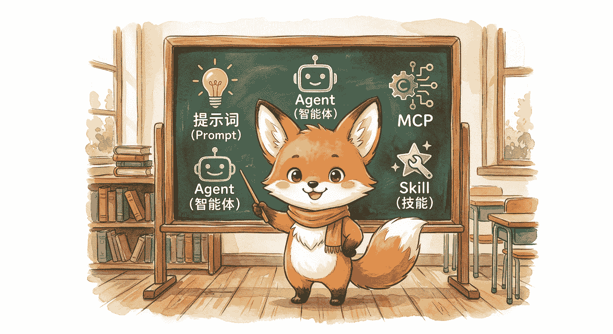
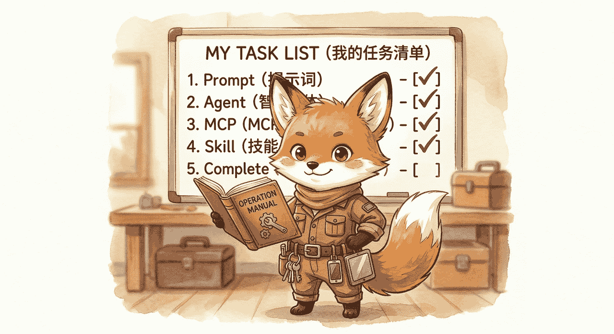
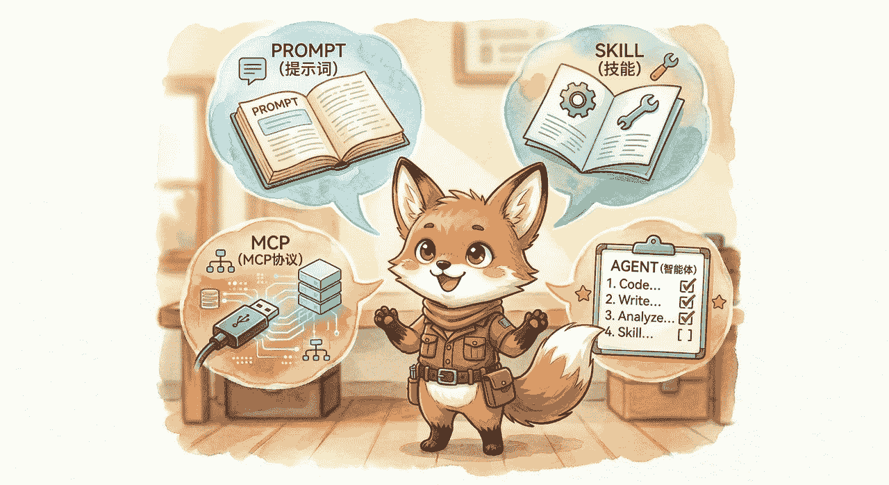

# 提示词、Agent、MCP、Skill 到底是什么？一文搞懂 AI 圈最火的四个概念

> 来源：[https://qqs7y1hozd1.feishu.cn/docx/AuArdeK6xoN8oaxGnZJccSffnyd](https://qqs7y1hozd1.feishu.cn/docx/AuArdeK6xoN8oaxGnZJccSffnyd)

> **本文通过外卖店的比喻，清晰解释了AI**领域的四个核心概念：提示词（Prompt）是给AI的即时指令，如同对员工的口头交代；技能（Skill）是AI的操作手册，提供可复用的任务处理流程；模型上下文协议（MCP）是连接外部工具的标准接口，相当于员工可用的各种设备；智能体（Agent）则是能自主决策的AI本身。文章强调这四个概念并非竞争关系，而是构成AI系统的不同层次，共同协作完成任务。

> 最近 AI 圈有几个词被反复提起：提示词、Agent、MCP、Skill。很多人听了半天还是一头雾水——它们到底是什么？有什么区别？什么时候用哪个？这篇文章用一个贯穿始终的比喻，把这四个概念讲清楚。

### 先建立一个统一的比喻

想象你开了一家**外卖店**，雇了一个聪明的员工来处理订单。

+   **提示词** = 你给员工的工作指令

+   **Skill** = 员工手边的操作手册

+   **MCP** = 员工能用的各种工具和设备（电话、收银机、外卖平台）

+   **Agent** = 员工本人——能自主思考、决策、行动的那个人

这四个东西不是竞争关系，而是**同一个系统里的不同层次**。

---

### 一、提示词（Prompt）：你说的每一句话

#### 是什么

提示词就是你输入给 AI 的文字。最简单的形式：

帮我写一封请假邮件

复杂一点的，叫系统提示词（System Prompt），在对话开始前就告诉 AI 它的角色和规则：

你是一个专业的客服助手，只回答关于我们产品的问题，

语气要友好，回答要简洁，不超过 100 字。

#### 类比

提示词就是你对员工说的话。"今天重点处理退款投诉"、"回复客户要有礼貌"——这些都是提示词。

#### 局限性

提示词有个根本问题：**每次对话都要重新说**。

你今天告诉员工"要有礼貌"，明天他忘了，你还得再说一遍。而且提示词越长，AI 的注意力越分散，效果越差。

这就是为什么需要 Skill。

### 二、Skill：员工手边的操作手册

#### 是什么

Skill 是一个 Markdown 文件（SKILL.md），开头用 YAML 格式标注名称和描述，正文写操作指南：

---name: **refund-handler**        # 技能名称description: **处理退款申请**   # 简短描述---

# 退款处理流程

当用户申请退款时：

1.  核实订单号和购买时间

1.  如果在 7 天内，直接批准

1.  如果超过 7 天，转人工审核

1.  回复用户预计到账时间

#### 类比

Skill 是员工桌上的**操作手册**。不用每次都口头交代，员工遇到退款问题，自己翻手册就知道怎么做。

#### 和提示词的区别

**一句话**：提示词是你说的话，Skill 是写下来的规范。

---

### 三、MCP：员工能用的工具和设备

#### 是什么

MCP（Model Context Protocol，模型上下文协议）是 Anthropic 在 2024 年 11 月发布的开放标准。2025 年 12 月，MCP 已捐赠给 Linux 基金会下的 Agentic AI Foundation，由 Anthropic、Block、OpenAI 共同创立，AWS、Google、Microsoft 等为白金支持方，成为行业事实标准。

它解决的问题是：**AI 怎么连接外部世界？**

在 MCP 出现之前，每个 AI 应用想接入一个外部工具（数据库、GitHub、飞书……），都要单独写一套对接代码。10 个工具，10 套代码，维护噩梦。

MCP 的做法是：**定义一套统一的通信协议**。工具方按这个协议暴露能力，AI 按这个协议调用工具。一次对接，到处可用。

> 🔌 MCP 之于 AI，就像 USB-C 之于电子设备——不管是手机、平板还是笔记本，一个接口全搞定。

#### 类比

MCP 是员工能用的**工具和设备**：电话（打给供应商）、收银机（处理支付）、外卖平台后台（查看订单）。

这些工具不是员工自带的，是店里配备的。员工（AI）通过标准接口使用它们，不需要关心每个设备内部怎么工作。

#### 工作原理

MCP 采用客户端-服务器架构：

+   **MCP 服务器**：包装外部工具（数据库、API、文件系统等），暴露标准接口

+   **MCP 客户端**：AI 应用通过客户端连接服务器，调用工具能力

+   **通信协议**：双方通过 JSON-RPC 2.0 协议通信

一次配置，到处可用——这就是 MCP 的核心价值。

#### MCP 能做什么

MCP 服务器可以向 AI 暴露三类能力：

#### 目前有哪些 MCP 服务器

**截至 2026 **年初，GitHub 上已有超过 13,000 个 MCP 服务器（数据来源：tolearn.blog），覆盖：

+   数据库：PostgreSQL、MySQL、MongoDB、Redis

+   协作工具：飞书/Lark、Slack、Notion、GitHub

+   云服务：AWS、阿里云、腾讯云

+   本地文件系统、浏览器控制等

#### Skill 和 MCP 的区别

这是最容易混淆的地方。

> TL;DR：MCP 连接工具，Skill 告诉 AI 怎么用工具。

两者经常配合使用：MCP 提供能力，Skill 告诉 AI 如何运用这个能力。

---

### 四、Agent：能自主干活的员工

#### 是什么

Agent（智能体）是能**自主观察、思考、决策、行动**的 AI 助手。

普通 AI 对话是这样的：

你说一句 → AI 回一句 → 结束

Agent 是这样的：

你说一句 → AI 思考 → AI 行动 → AI 观察结果 **→ A**I 再思考 → AI 再行动 → ... → 完成任务

Agent 可以：

+   调用工具（通过 MCP）

+   执行代码

+   浏览网页

+   存储记忆

+   把任务拆分给其他 Agent

#### 类比

Agent 就是**员工本人**。他不只是被动执行指令，而是能主动思考：

> "客户说退款没到账，我先查一下订单状态（调用 MCP 工具），发现是银行处理延迟，然后给客户发一条解释消息（再次调用工具），最后在系统里记录这个问题（又一次调用工具）。"

整个过程，你只说了一句"处理一下这个退款投诉"，Agent 自己完成了后续所有步骤。

#### Agent 和其他概念的关系

你的指令（提示词）

↓Agent（员工）

├── 加载 Skill（查操作手册）

└── 调用 MCP（使用工具）

├── 查询数据库

├── 发送飞书消息

└── 操作 GitHub

Agent 是执行主体，其他三个都是它的"装备"。

### 五、四个概念的完整对比

---

### 六、什么时候用哪个？

#### 场景一：临时问一个问题

> "帮我把这段英文翻译成中文"

→ **只需要提示词**，不需要其他任何东西。

#### 场景二：重复性的标准化任务

> 每次有用户投诉，都按同一套流程处理

→ **写一个 Skill**，把流程固化下来，AI 每次遇到投诉自动加载。

#### 场景三：AI 需要访问你的系统

> "帮我查一下今天的销售数据"、"在飞书上发一条通知"

→ **需要 MCP**，把你的数据库、飞书等系统通过 MCP 协议暴露给 AI。

#### 场景四：复杂的多步骤任务

> "分析本周的用户反馈，整理出 Top 10 问题，生成报告，发给产品团队"

→ **需要 Agent**，它会自主拆解任务、调用工具、完成整个流程，你只需要说一句话。

和场景三的区别：场景三是"你告诉 AI 每一步做什么"，场景四是"你只说目标，AI 自己规划步骤"。

### 七、一个真实的例子串起来

假设你要搭建一个**智能客服系统**：

1.  **提示词**：设定 AI 的角色——"你是XX公司的客服助手，语气友好，只回答产品相关问题"

1.  **Skill**：写几个操作手册——退款处理流程、投诉升级流程、常见问题解答

1.  **MCP**：接入公司系统——订单数据库（查询订单）、飞书（通知人工客服）、工单系统（创建工单）

1.  **Agent**：把以上三者组合起来，让 AI 自主处理用户咨询，遇到复杂问题自动升级，全程不需要人工干预

这四个东西，缺一不可。

---

### 总结

它们不是竞争关系，而是**同一个 AI 系统的不同层次**：

> 你用**提示词**告诉 **Agent** 做什么，Agent 查阅 **Skill** 知道怎么做，通过 **MCP** 调用工具完成任务。

AI 的能力边界，正在从"回答问题"扩展到"完成任务"。提示词、Skill、MCP、Agent——这四样东西，就是这场扩展的基础设施。下次再看到这些词，你应该不会一头雾水了。