# Images 2.0实测：中文稳、细节炸

> 来源：[https://qqs7y1hozd1.feishu.cn/docx/ItnwdmXYaoAAu5x8L9QcPa2JnBk](https://qqs7y1hozd1.feishu.cn/docx/ItnwdmXYaoAAu5x8L9QcPa2JnBk)

> 来源:雷科技

还在熬夜做图的设计师们，这下真的有些尴尬了：在几乎没有预告的情况下，OpenAI 于北京时间 2026 年 4 月 22 日凌晨发布了 ChatGPT Images 2.0 模型（下文简称 Images 2.0）。

**和 ChatGPT ****原本**的生图模型相比，Images 2.0() 在图片精度、语言支持、分辨率支持和交互方式上都有着相当显著的提升。值得一提的是，这次发布的 Images 2.0 甚至还拥有了思考的能力。

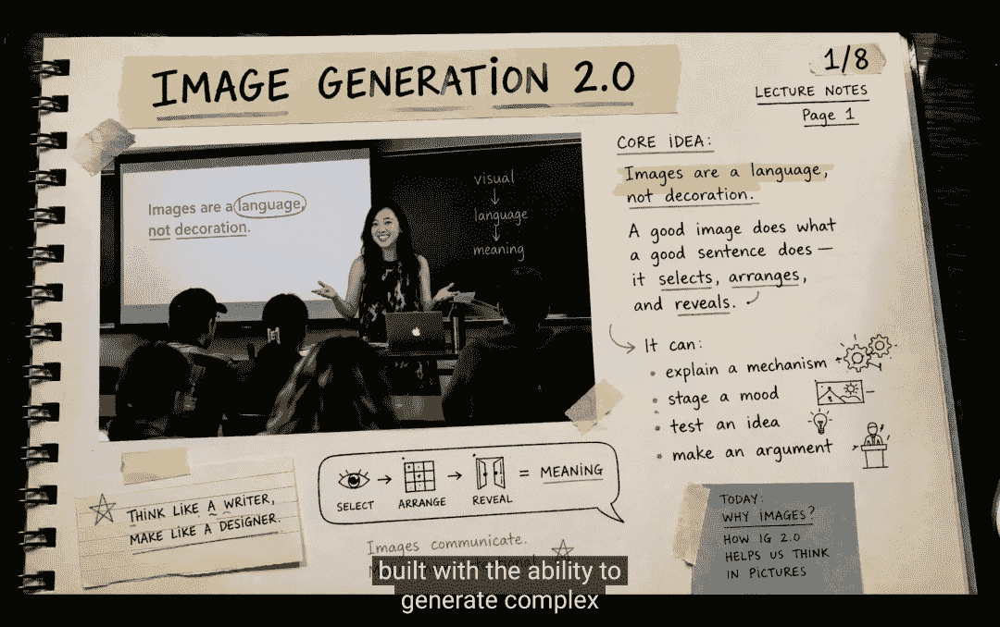

图片来源：OpenAI

简单来说，Images 2.0（现已在 ChatGPT、API 中使用）其实包含两个模型（分支）：

1.  快速模型（Instant Model）可以处理绝大多数日常任务，比如制作 Logo、多语言海报甚至是文章配图；

1.  思考模型（Thinking Model、需手动切换）可以通过网络查找相关信息，并在生图前先对内容进行推理，并在一组输出中保证画面内容连贯。

接下来我们直接用图片来举例。

下面这张照片是雷科技 AWE26 报道团出发前拍的合照，我们直接把这张图丢给 ChatGPT、输出我们的需求：

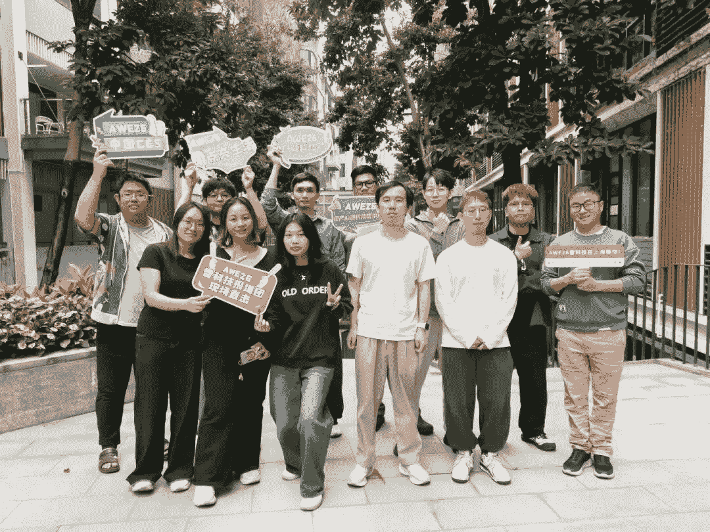

图片来源：雷科技

> 做一本《雷科技》科技杂志的封面，封面是图片里这几个人。

不**到一分钟，ChatGPT 就把**封面做好了。可以看到全新的 Images 2.0，不仅不会把基础图片重绘（这是大多数生图 AI 的通病），甚至连中文的部分都能正确绘制。

图片来源：雷科技

但这还没完，在提出「日期改成 2026 年 3月」「人的姿势可以变一下，这样太死板了」等模糊的提示词后，ChatGPT 依旧能顺利完成任务。

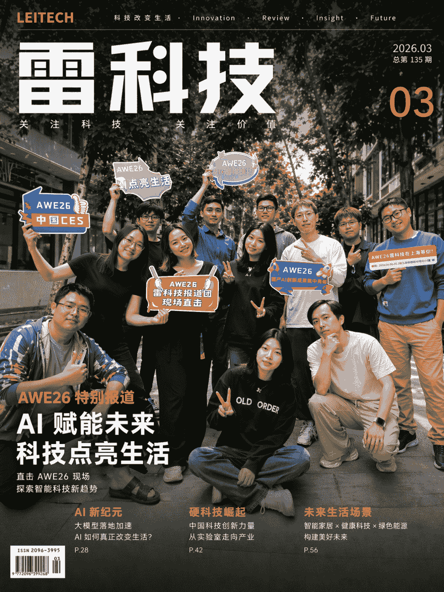

图片来源：雷科技

同样的，只要「喂」给 Images 2.0 一张手机外观，ChatGPt 也能直接完成手机使用场景照。

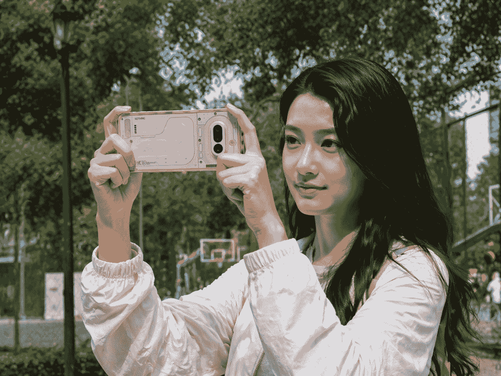

图片来源：雷科技

**而**在全新的图片查看界面，ChatGPT 还加入了两项全新的功能——我们可以直接选择图片需要修改的区域，要求 ChatGPT 做出修改，还可以直接在长宽比选单中选择需要输出的图片比例，自媒体配图变得更方便了。

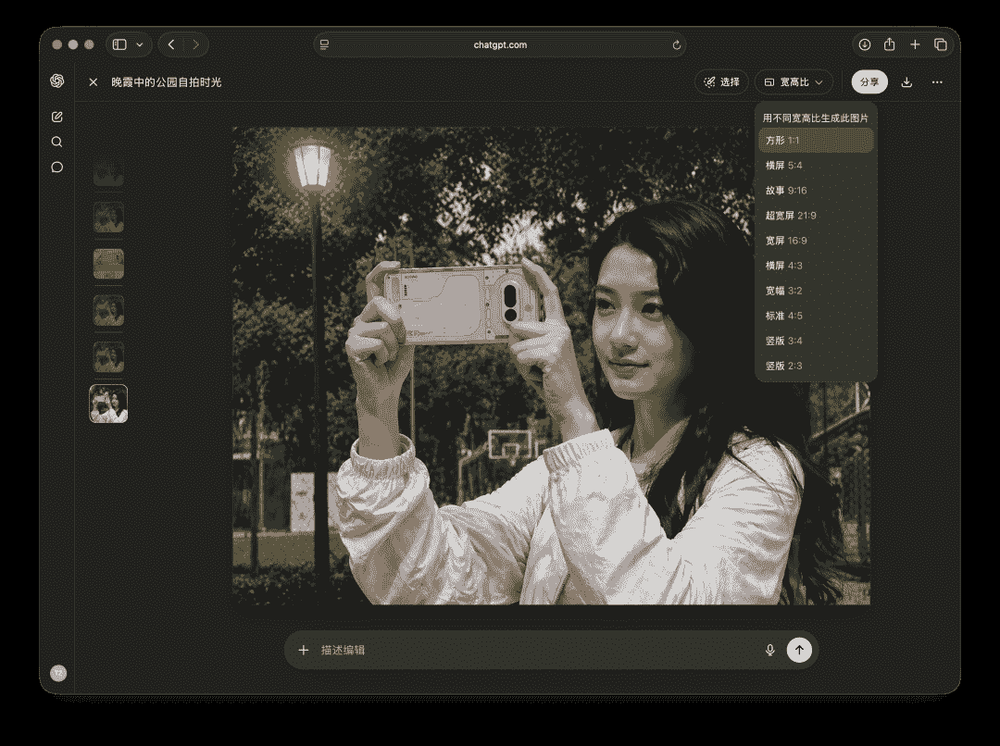

除了基于图片生成新的图片，Images 2.0 基于文字做图的能力也有所提升。雷科技只给出了「电车通马上要出发报道 2026 北京车展」的信息，Images 2.0 就能自己找齐相关信息，并正确输出海报。

图片来源：雷科技

较为可惜的是，尽管在 OpenAI 的直播中，Images 2.0 可以正确处理二维码信息，但雷科技经过多次尝试，仍无法在图片中嵌入可以被识别的二维码。

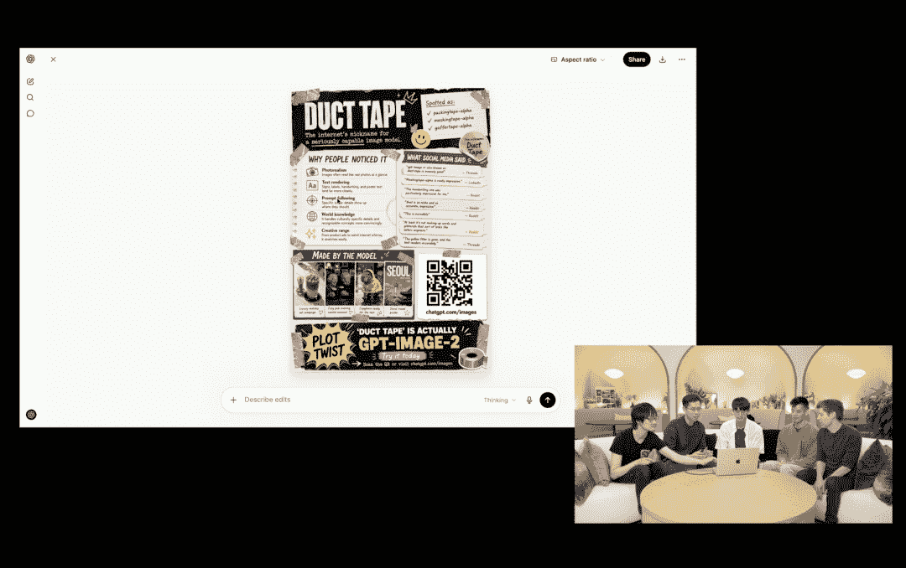

图片来源：雷科技

其实从效果来看，Images 2.0 的多语言支持已经非常出色了。但为了拉开能力差距，雷科技决定给 Images 2.0 上点强度：

> 生成一个照片风格图片：一幅毛笔书法作品在博物馆展出，上书： 北国风光，千里冰封，万里雪飘。望长城内外，惟余莽莽；大河上下，顿失滔滔。山舞银蛇，原驰蜡象，欲与天公试比高。须晴日，看红装素裹，分外妖娆。 江山如此多娇，引无数英雄竞折腰。惜秦皇汉武，略输文采；唐宗宋祖，稍逊风骚。一代天骄，成吉思汗，只识弯弓射大雕。俱往矣，数风流人物，还看今朝。

尽管文本内容更长，不过 ChatGPT 仍在一分钟之内就输出了结果。可以看出，Images 2.0 的中文支持确实不错，字体字形基本没有问题，但书法的「质感」仍有欠缺，怎么看都像是「印刷品」。

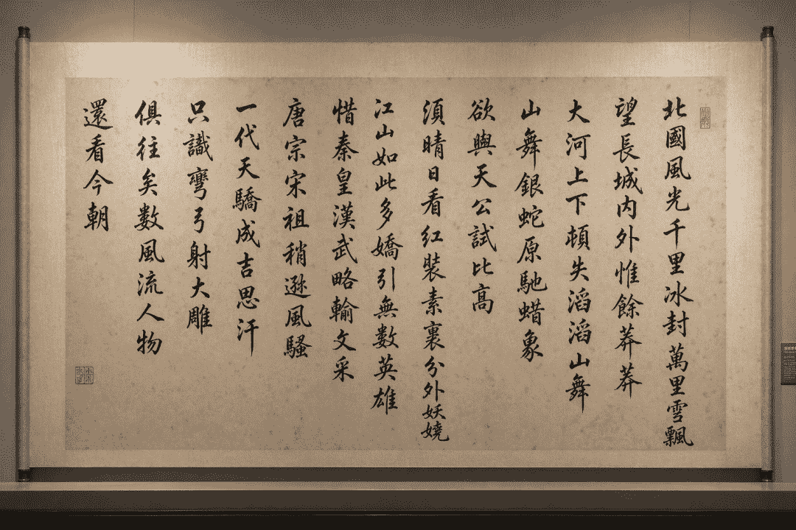

图片来源：雷科技

说完 Instant Model，我们再来看看思考模式的能力。这次雷科技直接给 Images 2.0 准备了一道大题：

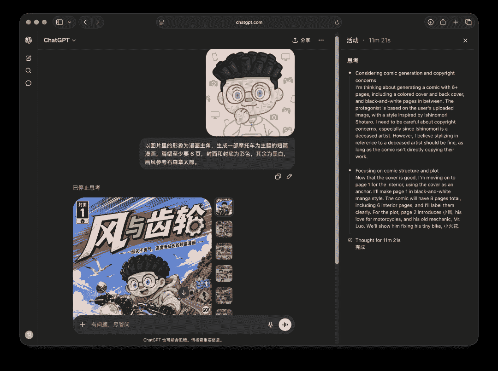

> 以上图里的形象为漫画主角，生成一部摩托车为主题的短篇漫画，篇幅至少要 8 页，封面和封底为彩色，其余为黑白，画风参考石森章太郎。

接到需求后，Images 2.0 会有一个明显的思考推理步骤；点开推理详情，我们甚至能看到 Images 2.0 编写对话的过程。这其实越正常，毕竟我并没有给出任何关于剧情的提示词，全权交给 Images 2.0 自由发布。

<https://wxa.wxs.qq.com/tmpl/pn/base_tmpl.html>

在耗时 11 分钟后，Images 2.0 **成**功输出了一组 8 张图。值得注意的是，Images 2.0 不仅在 8 张图中做到了画风和细节的统一（除了时有时无的头盔），甚至连剧情都能保持上下文连贯。这种超长连续推理能力，即使是 Nano Banana 也难以做到。

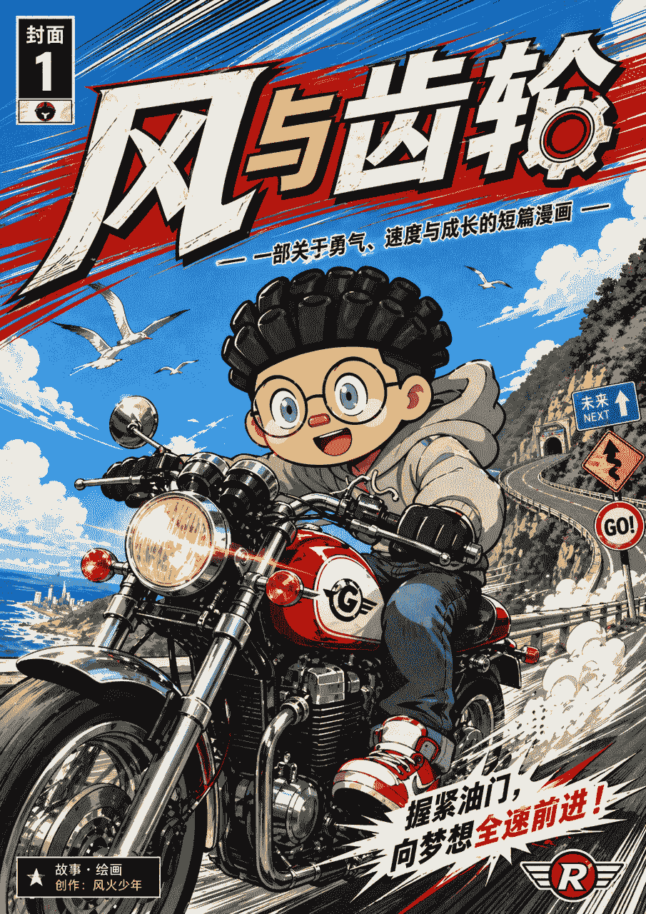

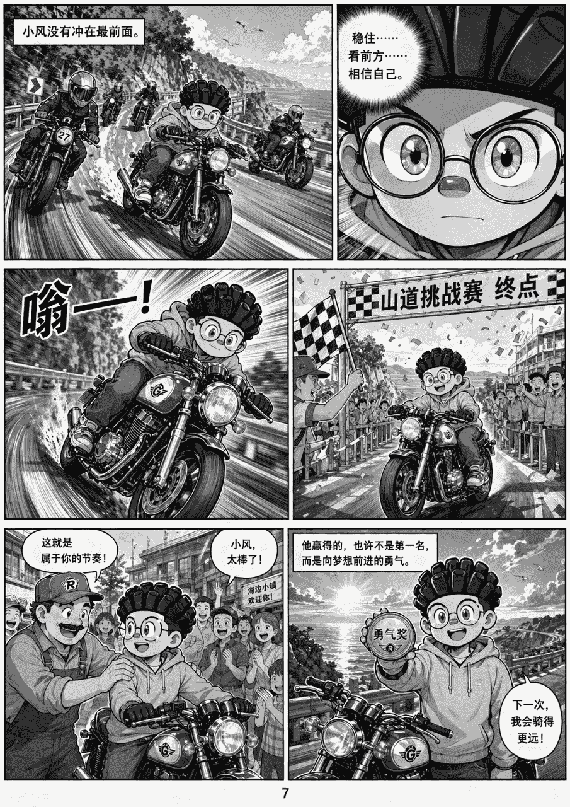

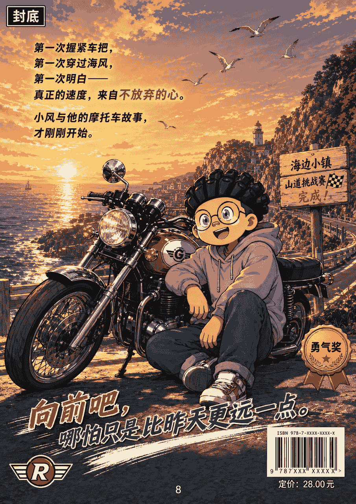

也正因如此，雷科技认为，Images 2.0 的表现，完全可以用一骑绝尘来形容。

因为触发了 ChatGPT Plus 用户的公平使用限额机制，雷科技的 Images 2.0 体验到这里就暂告一段落了。但就雷科技的体验来说，Images 2.0 的能力上限远不仅如此：

除了支持中文（及印地语、日语等多种亚洲语言）、连续推理等能力外，在直播中，OpenAI 还提到了 Images 2.0 能在米粒上写字的超精细制图能力，以及生成 360 度全景照片的能力。

图片来源：OpenAI

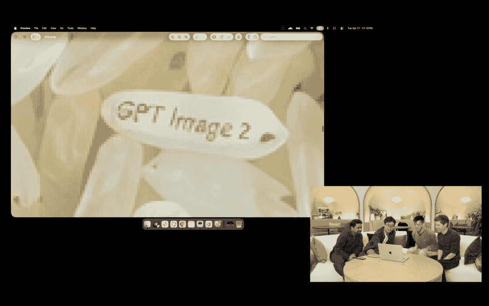

图片来源：OpenAI

也正因 Images 2.0 制图效果如此出色，雷科技认为 Images 2.0 的登场，也标志着 AI 生图正式告别了那个靠玄学提示词「抽卡」的蛮荒时代。

如果**大家有玩过 **Stab**le Diffusion() 等早期文生图 AI，应该对文生**图的「蛮荒时代」有印象：你可能第一次尝试就做出了自己想要的图片，也可能来来回回调整提示词，用两个小时生成了几百 GB 的废片，体验甚至比二次元「抽卡手游」还要差——二游至少有保底机制。

<https://wxa.wxs.qq.com/tmpl/pn/base_tmpl.html>

在当时，我们如果想要保证图片「有较大概**率符合要求」，就必须用 ComfyUI；而** ComfyUI 复杂的节点设计，从某种意义上也违背了 AI 生图「偷懒」的目标。

但 Images 2.0 引入「思考模型」后，AI 第一次具备了长文本逻辑解析与时空一致性的推理能力。

以**刚刚提到的画漫画工作流为例，Images 2.0 可以先理**解场景、构思剧情、布局文字，最后再落笔。这种从底层逻辑出发的进化，直接解决了 AI 绘画中「文字崩坏」与「画风不统一」这两大问题，极大地拓宽了 AI 的生产力边界。

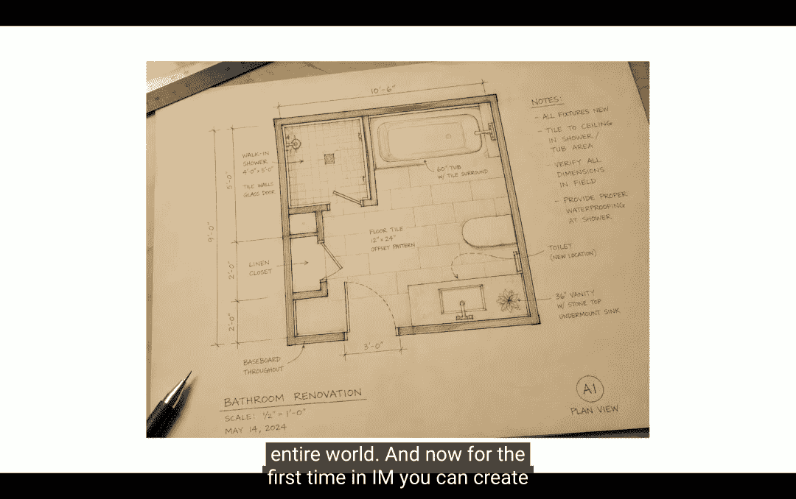

图片来源：OpenAI

可以肯定的是，Images 2.0 的出现，对于绘画、摄影行业的冲击极为「惨烈」；而从 AI 发展的角度看，OpenAI 也再次证明了单纯的分辨率并不能从根本提升 AI 的工作效率，推理能力才是 AI 图像的核心竞争力领域。

在 AI 图像时代，OpenAI 已经为我们开了一个好头。接下来，就得看 Google 和国内 AI 巨头们该如何应对了。