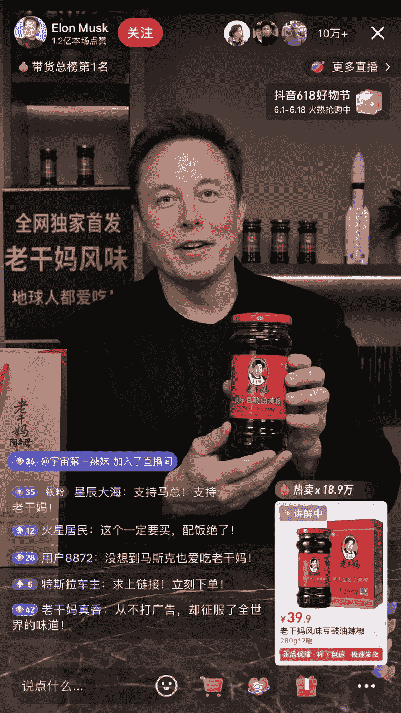
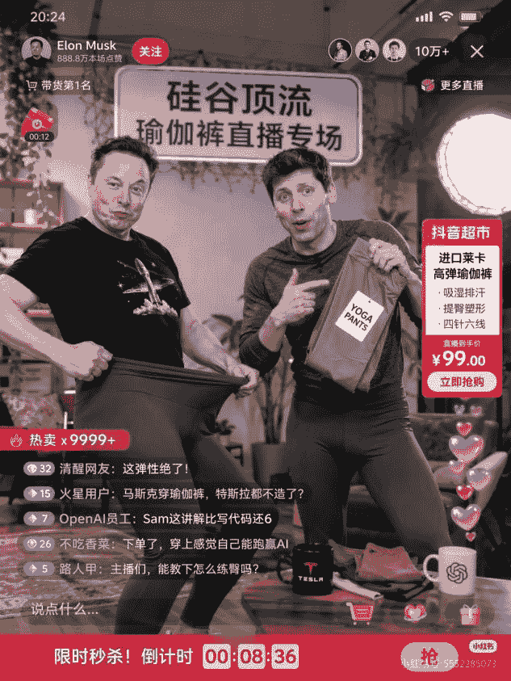
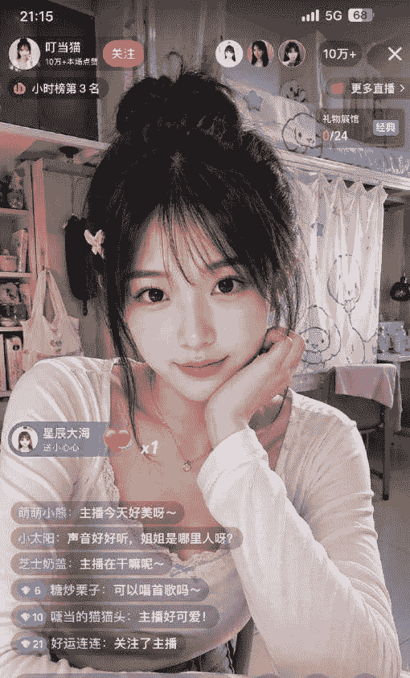
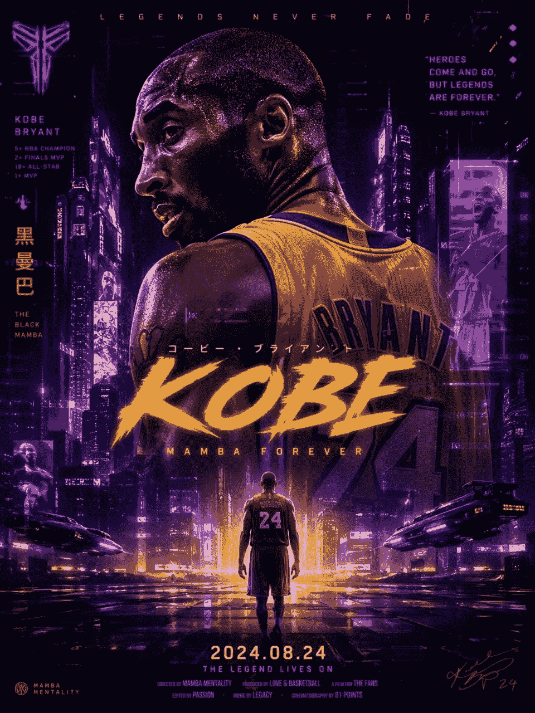
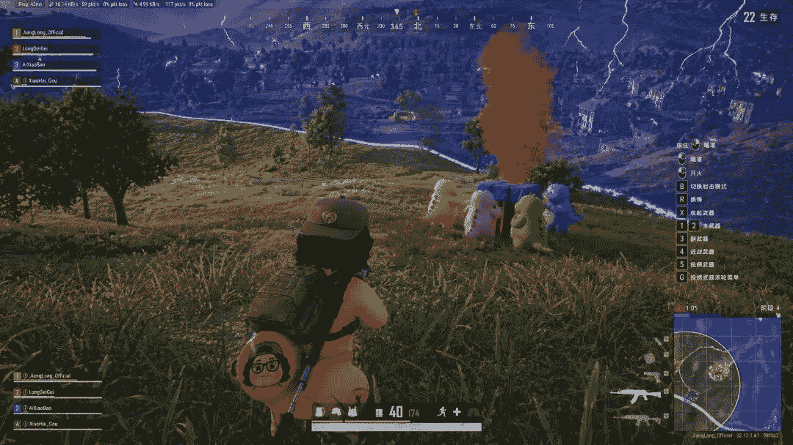
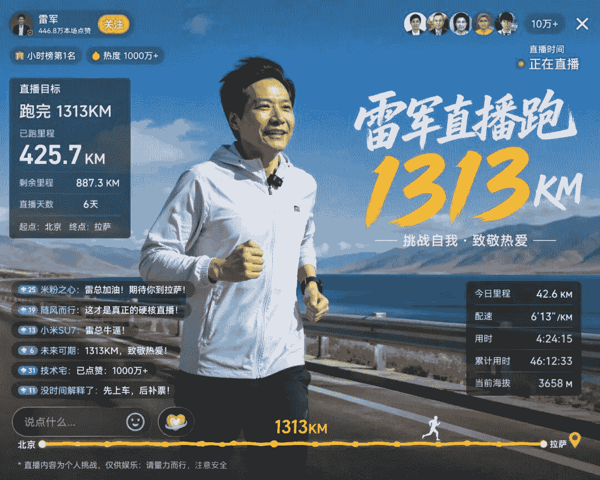
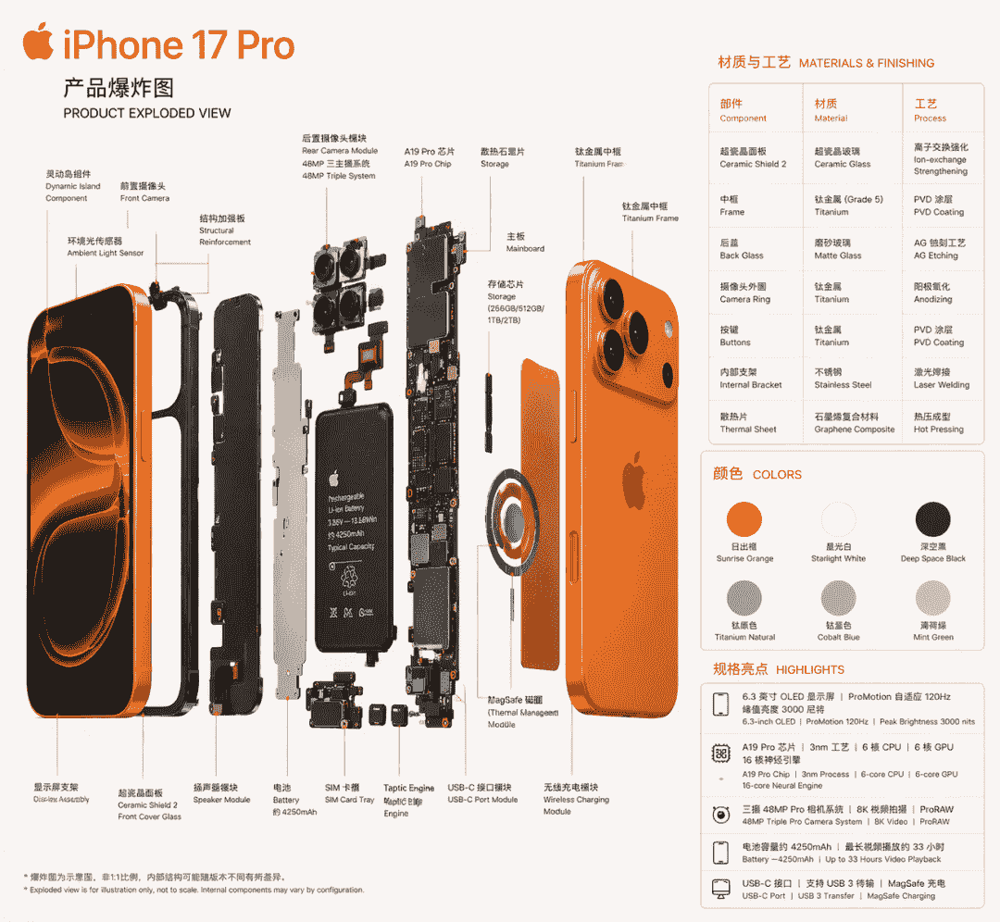
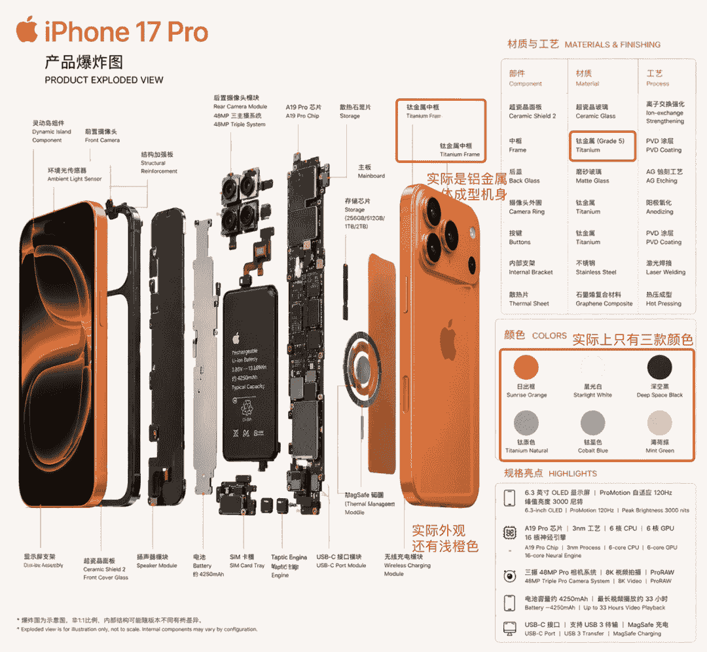
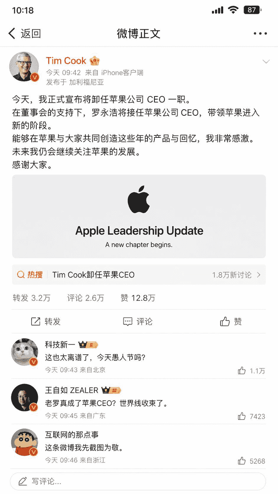
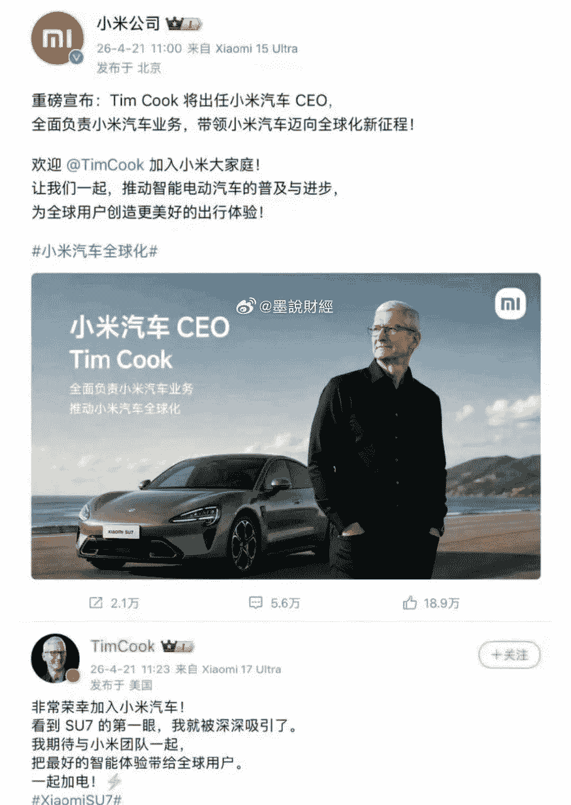

# 这两天，我被GPT Image2吓坏了

> 来源：[https://qqs7y1hozd1.feishu.cn/docx/ThdXd5adioMmtVxi9HRcAaX4nuc](https://qqs7y1hozd1.feishu.cn/docx/ThdXd5adioMmtVxi9HRcAaX4nuc)

> 本文来源：科技头版 刘峰

人类被AI吓到的瞬间，这些年越来越多。

但这次不太一样。

以前是“哇，这都能生成”，惊叹中带着点难以置信；而GPT Image2一出，很多人下意识的反应却是沉默——因为你发现自己竟然真的分不清是AI还是事实。

（注：以下文中图片均由网友生成，非真实图片）

GPT Image2到底变态在哪？

4月21日深夜，OpenAI几乎毫无预告地发布了ChatGPT Images 2.0，即GPT-Image-2。

一夜之间，社交媒体被各种神图刷屏——马斯克在抖音直播间带货老干妈、库克在苹果园区发布iPhone 20、奥特曼卖课、学术论文截图、伪造的转账记录……一大堆图片让无数网友直呼“根本分不出真假”。

图源：小红书、抖音、微博评论区

过去两年，AI图像生成领域其实已经卷到了天花板。

<https://wxa.wxs.qq.com/tmpl/pn/base_tmpl.html>

Midjourney画风景一绝，DALL-E 3**创意**十足，但绝大部分模型都有一个死穴——文字。招牌上的字是乱码、海报上的标题扭曲变形、中文直接变鬼画符。

扩散模型把文字当作纹理来处理，它“看到”HELLO，学到的只是几种常见的笔画组合，至于字母顺序、拼写规则这些约束，根本不在它的表达体系里。

但GPT-Image-2在技术路径上做了一次根本性的切换。它不再依赖传统的扩散模型，而是将图像生成整合进了自回归架构，文本和图像共享同一套表征空间。

通俗点说，过去的模型是“先听懂你说什么，再动手画”，中间有一次信息压缩；GPT-Image-2是“边理解边画”，语言理解和图像生成在同一个过程中完成。

这项技术让它做到了一件事——文字渲染准确率从前代的90-95%跃升至约99%。

所以这意味着什么？**以**往AI生成的菜单、海报、UI截图，需要设计师逐字逐句检查修正；现在，它生成的东西可以跳过人工修正，直接交付使用。

图源：抖音评论区

图源：差评

但这还不是最关键的突破。

GPT-Image-2最恐怖的地方，在于它具备了推理能力。

用户输入提示词之后，模型不再简单地去噪、拼接像素，而是先在后台完成一次思维建模，再动笔。

不信你看这张来自Linux.do社区的实测图——有人用模型生成了雷军直播跑步的画面，不仅直播间细节高度还原，还准确显示了“直播目标1313km、已跑里程425.7km、剩余里程887.3km”，甚至连海拔3658米这个数字都恰好对应北京到拉萨进藏区的典型海拔。

图源：36Kr

也许你觉得这有什么？但请想想，这些在人类眼里不过是简单的数学加减法和地理常识，对于一个图像模型来说究竟意味着什么？

意味着在生成第一个像素之前，GPT-Image-2已经完成了一轮推理。它理解了“里程”的含义，理解了加减法的逻辑关系，也理解了高海拔地区的视觉特征。

**这哪里是画图，这是思考。**

**“有图有真相”的时代，结束了**

如果说网友玩些烂梗还在预料之中，那么GPT-Image-2上线之后发生的一些事，让很多人开始感到不安。

例如，澎湃新闻对齐Lab仅用83个字的提示词，就让模型一键生成了iPhone 17 Pro的拆解信息图——每个零件都有引线指向中英文标注，旁边还有材质与颜色表格。

测试结果显示，它在文字、图片、可视化和排版等效果上，已经到了真假难辨的阶段。

图源：澎湃新闻

但经仔细核查，模型生成的信息存在明显错误：手机外观颜色从官方的三种加到了六种，将铝金属一体成型机身拆分成若干零件，并把材质写成了钛金属。

换言之，画面即使再逼真，内容却可以是捏造的。

图源：澎湃新闻

更让人脊背发凉的是，当下的互联网上已经出现了大量伪造截图。

有人生成了“库克官宣卸任苹果CEO，由罗永浩接任”的微博截图，底下还自动生成王自如的评论；

图源：微博评论区

有人生成了**“小米任命库克为汽车CEO”**的热搜图，上百万人看过，一度导致官方下场辟谣；

图源：微信评论区

4月22日，小米集团董事长特别助理徐洁云在微博上直斥P图乱搞现象，但评论区里依旧有网友在传播同类的高仿图。

可以说，当前互联网已经被大家玩成了一个巨大的狼人杀游戏。有博主大胆断言：“图片的公信力崩塌了，人与人之间的信任也崩塌了。”

过去很长一段时间，虽然我们每天都会接收大量信息时，但有一个默认的底层假设——截图应该是真的，照片应该是真的，聊天记录应该是真的。

**“有图有真相”**这句话被流传了很久。这个默认信任，是整个互联网信息生态运转的基石。

如今这块基石正在松动。因为这张图可能是AI一秒生成的，那张可能是十秒后伪造的。没有破绽，没有水印，没有任何肉眼可见的线索。

AI第一次真正做到了“以假乱真”，而代价是——我们再也无法相信自己看到的东西了。

当证据不再是证据，谁在为我们证明真相？

当然，凡事都有好的一面：GPT-Image-2的出现，成功把几个长期悬而未决的问题推到了必须面对的地步。

**第一个问题是版权**。当AI能一键生成商业级海报时，谁来为这张图片的知识产权负责？中国的司法实践正在给出初步答案。

2025年，鹰潭市月湖区人民法院审理了全国首例AI生成图片侵权案——用户用AI“一键生成”图片后被他人擅自使用，法院最终认定这张图片不构成著作权法意义上的“作品”，因为生成机制具有“不可控的随机性”，用户没有付出与传统创作相称的智力性劳动。

这意味着，当你的设计被AI复刻的时候，你可能无法维权。最高人民法院正在起草相关司法政策文件，但距离形成完整法律框架还有很长的路要走。

**第二个问题是检测**。如果肉眼无法分辨AI生成的图像，我们能否依靠技术手段来甄别？答案并不乐观。

据了解，OpenAI在Images 2.0中延续了C2PA数字水印技术，每张生成的图片都携带不可见的元数据标识，可通过专业工具溯源验证。

但这种机制很容易被截图、压缩破坏，官方也承认这不是万能的解决办法。

更严重的是，最前沿的深度伪造检测方法在面对语义保持的图像优化时，已经出现失效。检测技术永远在追赶生成技术，而这条差距正在拉大。

有消息称，专业医生在未被告知的情况下，只有41%能主动识别出AI生成的医学影像。

第三个问题，也是最根本的问题，即前面提到的信任机制崩塌。

技术发展至今，我们已经习惯了一系列验证机制：微信聊天记录可以作为法庭证据，社交媒体截图可以佐证新闻事实，转账记录可以证明交易存在。

但当这些都可以被AI一键伪造时，整个社会的信息验证体系将面临重建。

有观点认为，应对之策应该是**严惩造成实际危害的使用者**，而非限制工具本身的发展**。**

但“造成实际危害”的认定本身就充满挑战——一张伪造的舆论截图可能在几分钟内引发股市波动，而始作俑者可能只是一个随手尝试的普通用户。

当造假成本趋近于零，追责成本却居高不下时，这种威慑机制能发挥多大作用，是一个巨大的问号。

或许，GPT-Image-2真正让人恐惧的，不是它有多聪明，而是我们还没有准备好迎接它的聪明。

每一次技术跃迁都伴随着阵痛，但这一次，疼痛来得比预想中更早、更直接。

**我们正在失去一**个最基础的能力——相信自己的眼睛