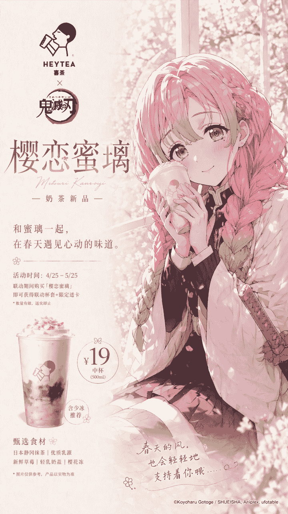
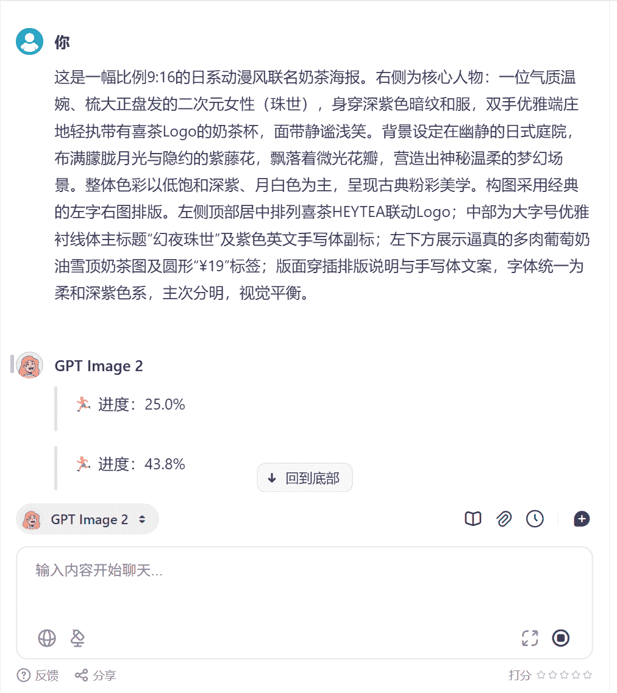
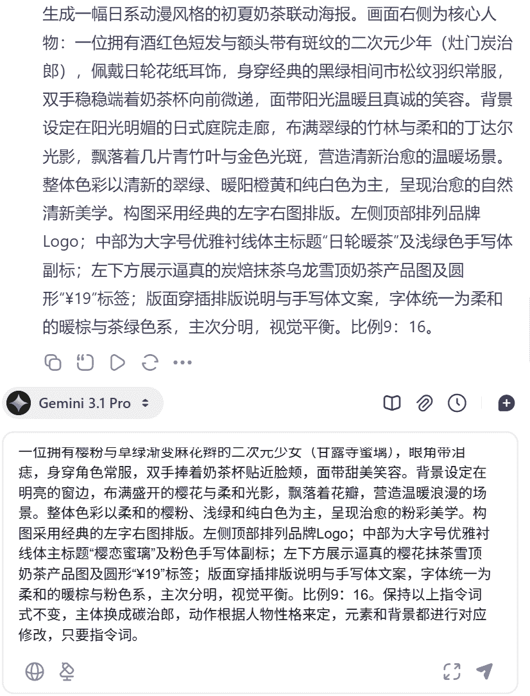
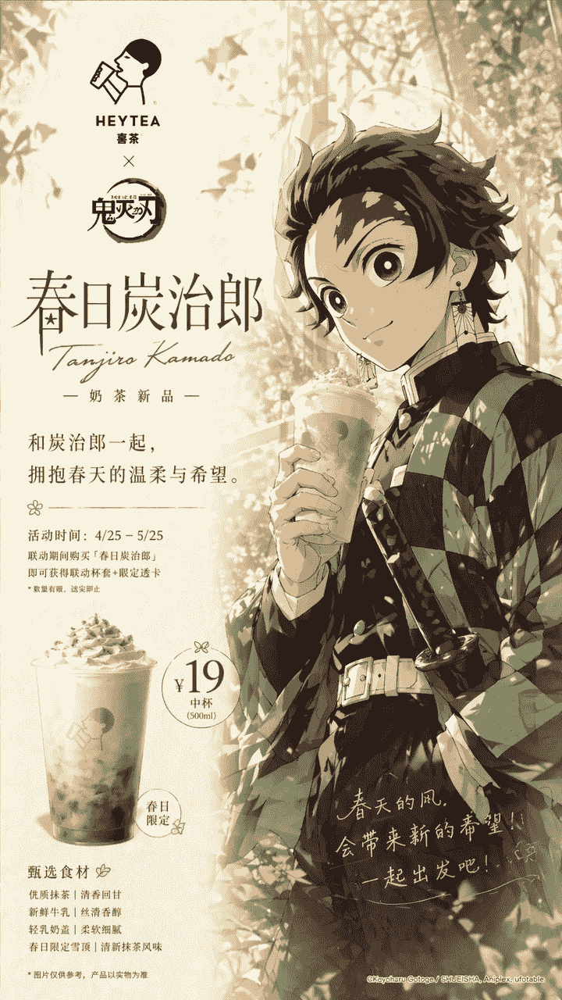
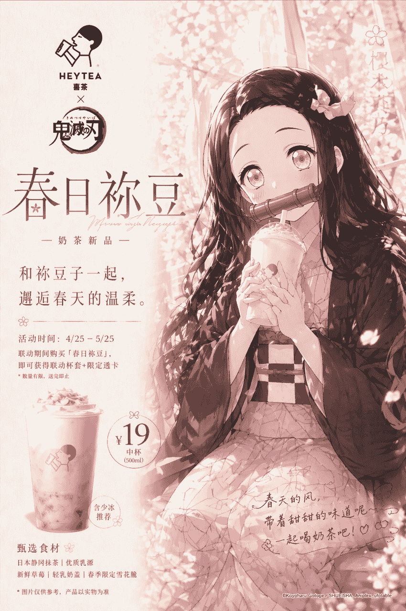
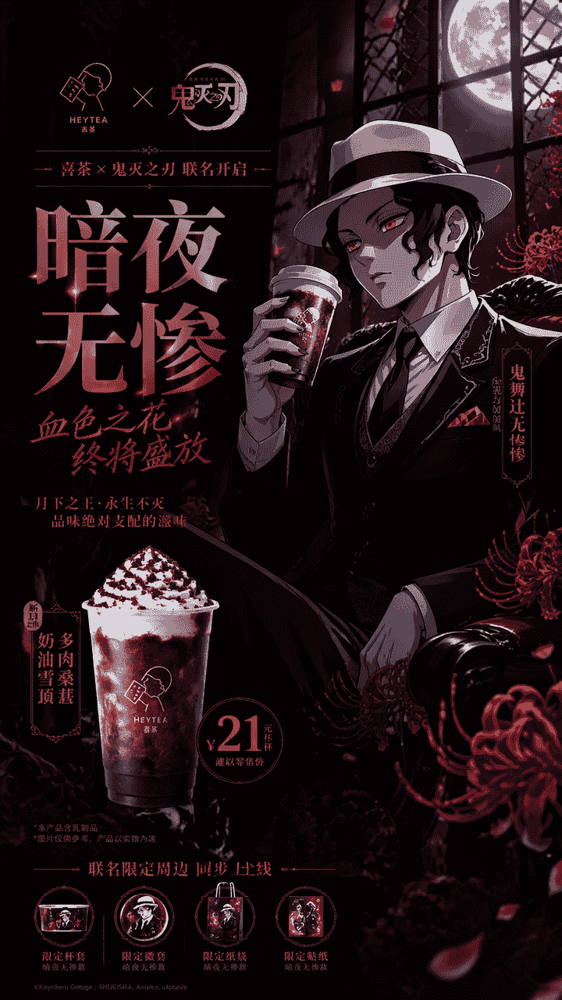
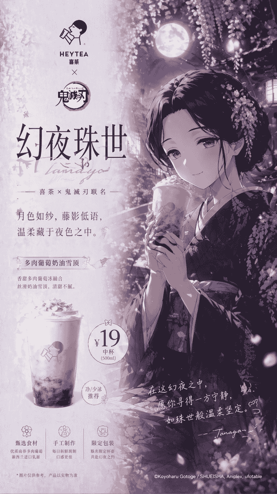

# Image2杀死了生图比赛

> 来源：[https://qqs7y1hozd1.feishu.cn/docx/OTLXdINwzomzH6xoGOUcOzAcnke](https://qqs7y1hozd1.feishu.cn/docx/OTLXdINwzomzH6xoGOUcOzAcnke)

美工人天塌了！！Image2测试 联名篇 已吓晕

**Prompt:**

> 根据参考图生成一幅日系动漫风格的春日奶茶联动海报。画面右侧为核心人物：一位拥有樱粉与草绿渐变麻花辫的二次元少女（甘露寺蜜璃），眼角带泪痣，身穿角色常服，双手捧着奶茶杯贴近脸颊，面带甜美笑容。背景设定在明亮的窗边，布满盛开的樱花与柔和光影，飘落着花瓣，营造温暖浪漫的场景。整体色彩以柔和的樱粉、浅绿和纯白色为主，呈现治愈的粉彩美学。构图采用经典的左字右图排版。左侧顶部排列品牌Logo；中部为大字号优雅衬线体主标题“樱恋蜜璃”及粉色手写体副标；左下方展示逼真的樱花抹茶雪顶奶茶产品图及圆形“¥19”标签；版面穿插排版说明与手写体文案，字体统一为柔和的暖棕与粉色系，主次分明，视觉平衡。比例9：16。

需要改人物可以用ai反推“保持以上指令词式不变，主体换成xx，动作根据人物性格来定，元素和背景都进行对应修改，只要指令词，比例9：16。”

最开始我加了比例限定词结果生成的图还是1：1的，悄悄说一下有个小邪修：加上一张参考图会好很多

效果如下，祢豆子👇

虽然手部有时候还是会出问题，但是微调一下就好了

无惨👆

珠世👆

内容均为AI生成 不构成任何活动真实性 请注意辨别