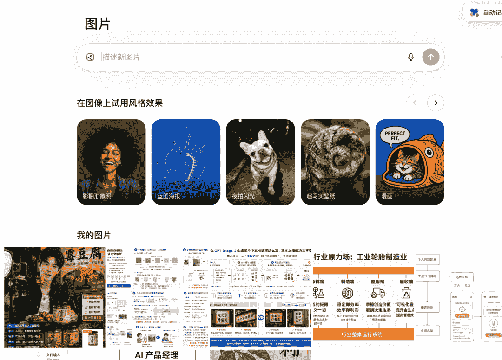
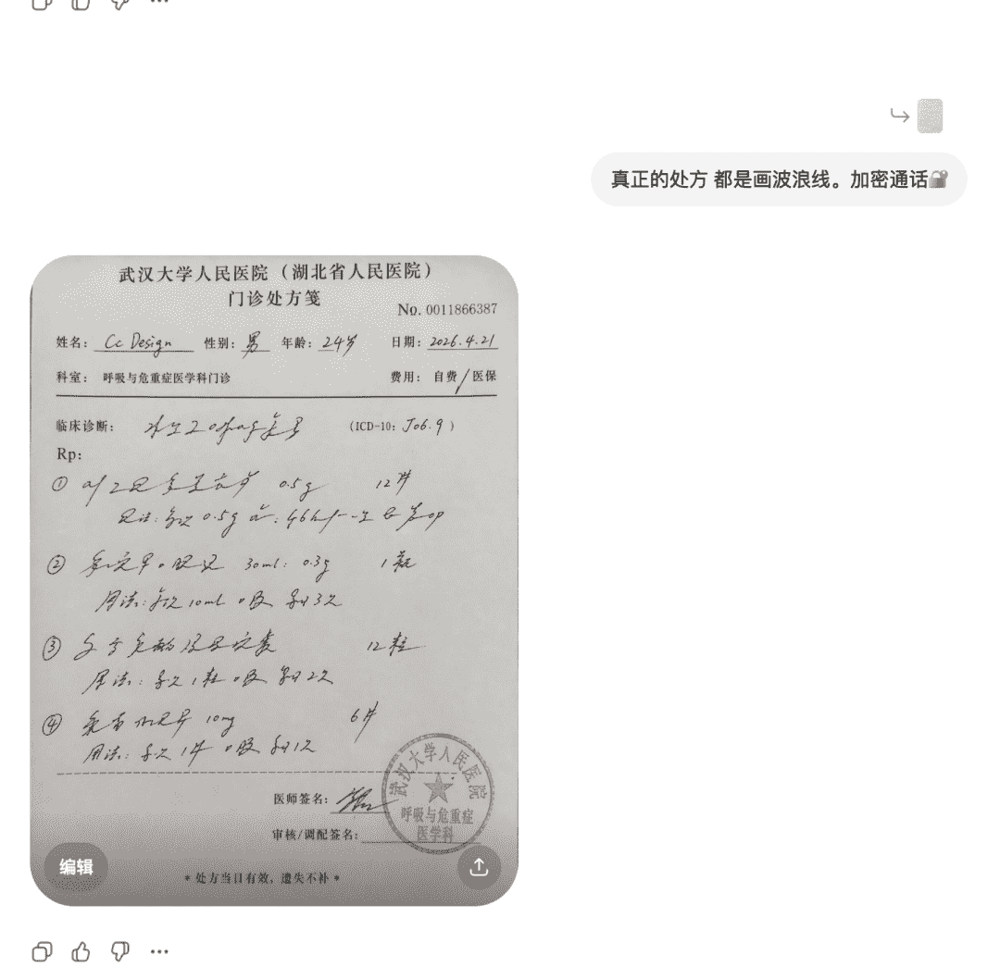
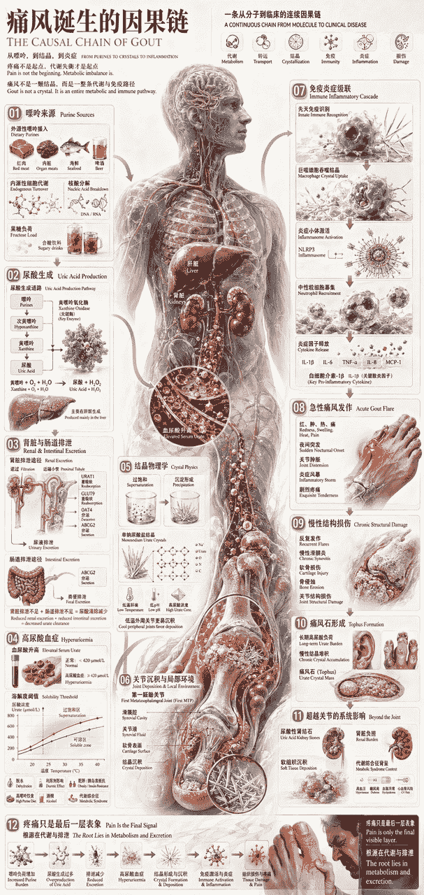
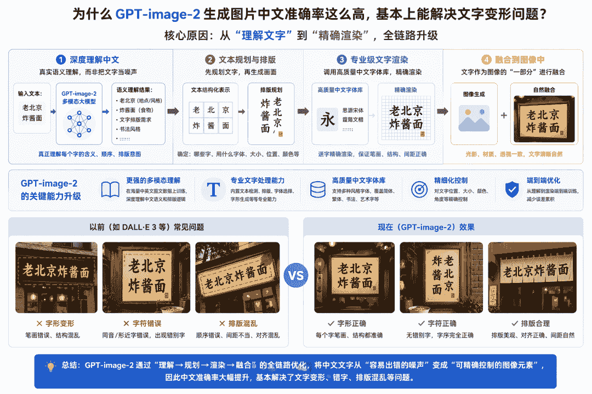
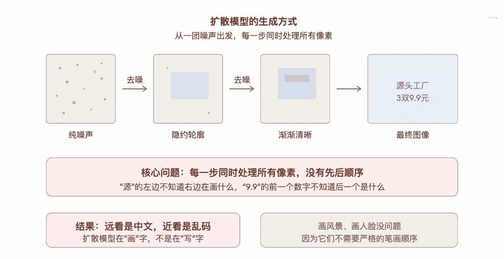
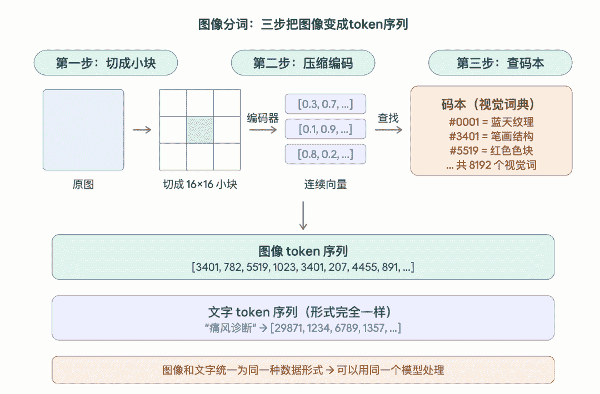
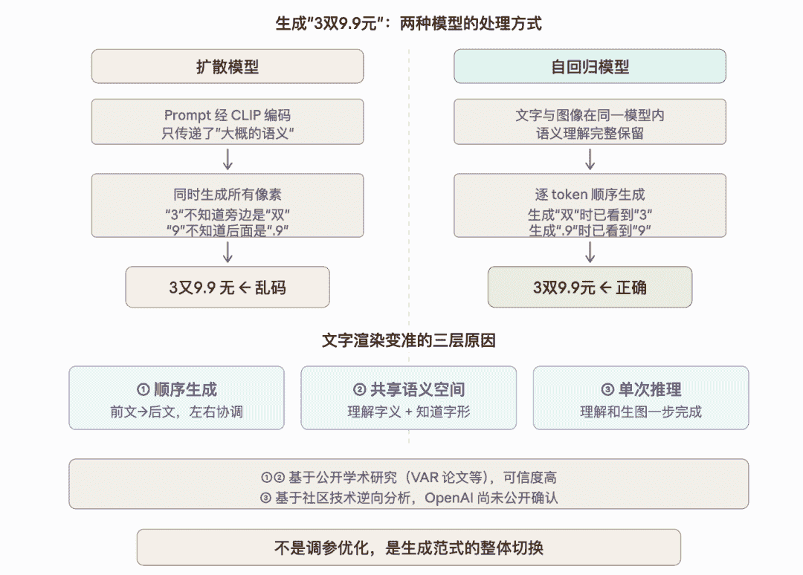

# 从GPT Image 2拆解AI生图技术路径

> 来源：[https://qqs7y1hozd1.feishu.cn/docx/JhNHdXRDIo6Emaxl3fpcSpcSnHY](https://qqs7y1hozd1.feishu.cn/docx/JhNHdXRDIo6Emaxl3fpcSpcSnHY)

> GPT Image 2的横空出世彻底颠覆了AI生图领域，从连中文字都写不对到精准生成处方笺、医学信息图等高难度内容，究竟发生了什么？本文深度拆解自回归模型如何突破扩散模型的先天缺陷，通过图像分词、语义共享和单次推理三大技术革新，让AI从「画字」真正进化到「写字」，并揭示这将如何重塑电商、UI设计、科普内容等核心场景的生产方式。

大晚上突然被GPT Image 2刷屏了，生图效果太牛逼了。

我也简单测试了几个案例：

一句话直出，如果不说，你会觉得这就是某个工厂直播间随手截的屏。

但这整张图是 GPT Image 2 生成的。每一个中文字符、每一个数字、每一个UI元素，全部是AI从零画出来的，完全没有任何文字上的错位。

还有一张更离谱。武汉大学人民医院的门诊处方笺，抬头、科室、日期、ICD编码、四条处方的手写体药名和用法用量，甚至右下角的红色公章，全是AI生成的。

还有一张痛风因果链的医学信息图，12个模块，从嘌呤来源到尿酸生成到结晶物理学到急性发作，每个模块里的中英文专业术语、化学式、箭头标注，零错误。这种复杂度的中文信息图，放在半年前，没有任何AI生图工具做得到。

还有各种试卷、报纸、游戏截图……非常非常逼真

作为AI产品经理，我看完以后只想搞清楚一个问题：为什么？

为什么半年前AI连**老北京炸酱面**五个字都写不对，现在突然能生成这种级别的中文内容？

这篇文章就来拆解这个问题。

## 扩散模型为什么写不对字

要理解为什么现在能写对，先得搞明白为什么以前写不对。

过**去几年你**用过的AI生图工具，Midjourney、DALL·E、Stable Diffusion，底层都是同一种技术路线，叫扩散模型。

扩散模型画图的原理，一句话概括：从一团纯噪声开始，一步一步去掉噪点，最终还原出一张清晰的图。

想象这样一个场景。你面前有一张清晰的照片，你往上面不停地撒沙子，撒了1000次之后，照片被完全盖住，变成一片灰蒙蒙的噪点。扩散模型学的就是这个过程的逆操作：从一片纯噪点出发，一步一步扫掉沙子，扫1000步，底下的图就露出来了。

这个过程有一个关键特征：每一步去噪，模型是同时处理整张图所有像素的。

不存在先画左边再画右边，也不存在先画人脸再画背景。每一步，所有像素一起动，一起变清晰。

画风景、画人物、画产品图，这套方式没问题。山、云、树这些东西不需要严格的空间结构，像素之间的关系是大概对就行。

但文字完全不同。

开头的图上面的霉豆腐这几个字，每个字都有严格的笔画结构和部件关系。之前生图很容易就生成像霉豆腐但其实不是这三个字的文字，甚至都不是文字。

为什么？

因为扩散模型就像是不懂中文的人在画中文，而不是写中文，它同时生成所有像素，让它们看起来像中文就行。但文字左半边的像素不知道右半边在画什么，右半边也不知道左半边进展到了哪一步。

所以结果就是：每个局部单看还算合理，合在一起就不是一个字了。

**扩散模型的问题不是画得不够好，是它的生**成方式和文字的本质需求之间存在根本矛盾。文字需要笔画顺序和空间结构，扩散模型没有顺序的概念。

所以：扩散模型是在画字，不是在写字。

## 让AI学会读图的关键一步：图像分词

理解了扩散模型为什么搞不定文字，接下来的问题就是：那什么方式能搞定？

答案是**自回归模型**。也就是GPT系列用来生成文字的那套方式。

但在解释自回归模型怎么画图之前，有一个前置问题必须先讲清楚：图像怎么才能变得和文字一样，被模型当作一串序列来处理？

GPT生成文字的逻辑大家都熟悉了。它把一句话拆成一个个token，然后逐个预测下一个：

> **我**→**今天**→**很**→**开心**

每生成一个新词，都基于前面已经生成的所有词来决定。这就是自回归的核心：永远看前文，预测下一个。

但图像不是文字，它是一堆像素。怎么把一张图变成像文字一样的一串token？

这里有一个专门的技术组件，叫**图像分词器**，学术名称是VQ-VAE。它做的事情分三步。

**第一步，把图像切成小块。**一张256×256像素的图，按16×16像素一块来切，就变成了256个小方块。每个方块记录了原图中一个小区域的视觉信息。

第二步，每个小块压缩成一个向量。通过一个编码器网络，每个16×16的小方块被压缩成一个高维向量，包含了这个小块的核心视觉特征：颜色、纹理、边缘走向。

第三步，把向量转换成离散的整数编号。

模型预先学习好了一本**码本**，你可以理解为一本视觉词典。这本词典里存了大约8192个视觉词条，每个词条代表一种常见的视觉模式。有的词条代表蓝天的纹理，有的代表皮肤的质感，有的代表文字笔画的走向。

编码器输出的向量去这本词典里找最像的那一条，记下它的编号。**于是一个**小方块就被表示成了一个整数，比如3401。

256个小方块都做完这个操作之后，一张图就变成了一串整数序列：

> [3401, 782, 5519, 1023, 3401, 207, 4455, 891, …]

和文字的token序列形式完全一样：

> “痛风诊断” → [29871, 1234, 6789, 1357, …]

到这一步，图像和文字在数据形式上统一了。都是一串数字，都可以用同一种模型来处理。

但这里要特别强调一点：图像变成token序列这**件事**本身，并不直接让文字渲染变准。它做的事情是给图像赋予了顺序。

256个图像token不是随意排列的。它们按照从左到右、从上到下的空间位置排成一条序列。这意味着，如果模型按照这个顺序逐个生成token，那当它生成某个位置的内容时，它已经看过了这个位置左边和上面的所有内容。

拿开头那张直播截图来说。如果**源头工厂****四**个字分布在连续的几个t**ok**en位置上，那模型写到工字的时候，它已经看到了源头两个字的token。它知道前面写的是什么，所以后面写出来的内容会和前面保持一致。

这就为下一步创造了条件。但光有顺序还不够。真正让文字从猜像素变成写字的，是自回归模型的生成方式，以及文字与图像共享同一个语义空间。这是下一部分要拆解的。

## 自回归模型为什么能写对字

上一部分解决了一个前提问题：通过图像分词器，图像可以变成一串有空间顺序的token序列。

这一部分拆解核心问题：**在这个基础上，自回归模型到底做对了什么，让文字渲**染的准确率从不到90%跳到了99%以上？

三层原因，逐层递进。

第一层：逐token生成，前后可以对齐

自回归模型生成图像的方式，和GPT生成文字完全一样：从第一个token开始，一个一个往后预测。每预测一个新token，都会参考前面所有已经生成的token。

回到那张直播截图上的**3双9.9元****。**假设这几个字占了图像序列里**连**续的几个token位置。模**型**先生成了3**对应的**token，接着生**成双**的时候它**能****看**到前面已经有了3，然后生成9.9的时候它知道前面是3双，最后写元的时候整个上下文都在。每一步都基于前文，不会出现9和**.9**互相不知道对方存在的情况。

**这**和**扩**散**模型形**成**了**根本对比。扩散模型同时生成所有像素，3和双和9.9和元互相不知道对方在画什么。自回归模型有先后顺序，先画的部分会影响后画的部分，天然保持了一致性。

但光有顺序还不够。如果模型只是按顺序生成像素块，但不理解这些像素块组成的是一个中文字，那顺序再对，也只是碰巧画对了而已。

第二层：文字和图像共享同一个语义空间

这是GPT Image 2最关键的架构变化。

在GPT Image 1 和 1.5 的时代，图像生成是挂在GPT-4o上的一个附属模块。工作方式类似于你跟一个翻译说需求，翻译理解之后转述给画师，画师按翻译的描述来画。中间有一次信息转换，翻译可能会漏掉细节，画师也可能理解偏了。

具体**来**说，prompt里的文字信息要经过一层中间编码（类似CLIP embedding）才能传给图像生成模块。这层编码能传递大概的语义，比如这里需要一些中文字，但传不了精确的字形结构，比如痛字的左边是病字头、右边是甬、甬的第一笔是竖。

GPT Image 2 的做法完全**不同。据多个独**立来源的技术分析，它是一个原生多模态模型，文字token和图像token在同一个模型内部被处理，共享同一套语义表征。

**还记得开头那张痛风因果链的信息****图吗**？12个模块里嘌呤来源、尿酸生成、结晶物理学这些专业术语全部准确。这在以前是不可想象的。因为在新的架构下，模型对嘌呤这个词的理解，和它在医学对话里理解嘌呤时用的是同一套知识。它知道这是两个字、每个字怎么写、它的含义是什么。所以生成图像token到了该放这个词的位置时，它不是在猜像素，而是在写一个它认识的词。

扩散模型做不到这一点。扩散模型的文字理解和图像生成是两个分开的模块，中间隔着一层编码，信息必然有损耗。自回归模型把理解和生成合成了一件事，没有中间商。

**第三层：从两阶段变成单次推理**

还有一个架构层面的变化值得拆解。

GPT Image 1.5 的生成流程是两阶段的：先用语言模型理解prompt，生成一个中间表示，然后把这个中间表示传给图像生成模块去渲染。两个阶段、两个模块、一次交接。

**GPT **Image 2 据分析采用的是单次推理。理解prompt和生成图像在同一次前向计算中完成，不需要中间交接。

打个比方：1.5 的方式像是先看一遍菜谱记住步骤，然后合上菜谱凭记忆做菜，中间可能忘了某个调料的用量。2.0 的方式像是一边看菜谱一边做菜，每一步都能回看原文，不会遗漏任何细节。

这也是为什么GPT Image 2不仅文字准了，对复杂prompt的执行力也提升了一个量级。开头那张直播截图的prompt可能只有一句话，但最终画面里的直播间布局、促销牌文案、弹幕内容、购物车样式、价格标签，每一个元素都被精确执行了。因为理解和生图是一体的，不存在信息在传递过程中被打折。

**三层叠在一起，才是完整的答案。**

token化让图像有了空间顺序。自回归生成让每一步都能参考前文。文字和图像共享同一个模型让语义理解精确到了每一个字。再加上单次推理消除了信息传递的损耗。

这不是某个参数调优的结果，是**生成范式的整体切换**。类似NLP领域从RNN到Transformer的那种级别的换代。

> 补充说明：GPT Image 2的完整架构细节OpenAI尚未公开。以上分析基于多个独立来源的技术逆向分析（PNG元数据比对、API响应版本号追踪、LM Arena泄露样本交叉验证）以及自回归图像生成方向的公开学术研究（如NeurIPS 2024最佳论文VAR）。大方向可信度高，具体内部实现可能有出入。

## 电商主图、绘本、UI截图：哪些场景马上会变

技术拆解完了，回到一个更实际的问题：这件事对我们的工作到底有什么影响？

我把影响拆成两个层面。第一个是**哪些具体场景马上会变**，第二个是AI PM看产品的方式该怎么更新。

**先说场景。**

过去AI生图有一个隐性的限制条件：只要图上需要出现中文，就没法直接用AI的输出。必须先用AI生成背景图，再手动用Canva或Photoshop叠一层文字。这个操作看起来简单，但它阻断了很多场景的自动化。

现在这个限制条件被拆掉了。以下几个场景会最先受到冲击：

+   **电商主图和促销素材。****开头那张直播截图就是最好的例子**，3双9.9元、10双19.9元每个字都准确。电商团队以前做一张主图或促销海报，需要设计师切图、排文字、调间距，一张图少说30分钟。现在一句prompt可以直出带完整中文标题和价格标签的成品图。不是出一个需要修改的半成品，是可以直接上架的成品。

+   **社交媒体封面和信息图。**📕、👸号、抖音封面图，每张都需要大字标题。以前AI能帮你生成好看的背景，但标题文字还是得手动加。现在标题可以和背景一起生成，风格统一，不存在文字层和背景层割裂的问题。

+   **产品UI截图和原型演示。**需要做一个App界面的效果图给领导看？以前得打开Figma认真画。现在一句话描述就能生成带中文按钮、中文标签、中文导航栏的高保真界面截图。那张直播截图的UI元素准确到什么程度？关注按钮、弹幕区、购物车、价格标签，每一个组件的位置和样式都符合真实抖音的界面规范。

+   **儿童绘本和科普内容。**开头那张痛风信息图就是例子。以前做这种图需要专业的医学插画师加上排版设计师配合，周期按天算。现在一个懂内容的人就能直接用AI产出带准确中文标注的复杂信息图。

**这些场景的共同点是：中文文字曾经是AI生图投入生产的最后一道**障碍，现在这道障碍没了。 再说判断框架。

作为AI PM，以后评估任何AI生图产品或者方案时，有一个问题应该变成你的第一反应：这个产品底层是扩散模型还是自回归模型？

如果是扩散模型，那文字渲染大概率还是靠后处理修补，本质问题没解决，中文场景要谨慎。

如果是自回归模型，那要进一步问：文字token和图像token是在同一个模型里联合训练的，还是两个模块拼接的？前者的文字能力是内生的，后者还是会有信息损耗。

这不是一个模型好坏的问题，是**架构选择决定了能力边界**。就像你不会期待一个基于关键词匹配的搜索引擎做语义理解一样，你也不应该期待一个扩散模型精准渲染中文。不是它不够努力，是路线不对。

理解这个区别之后，你看到市面上任何AI生图产品打出支持中文的卖点时，就知道该追问什么了。

## 结尾

回到开头那张处方笺。

一张AI生成的门诊处方，抬头准确、科室准确、手写药名准确、红色公章准确。而真正的医生处方，反而全是波浪线。

半年前，我们判断一张图是不是AI生成的，最快的方法就是看图里有没有中文。只要有中文，放大一看，一定露馅。

现在这个方法失效了。

这件事的意义不只是AI又进步了这么简单。它标志着AI生图从”能用来做创意参考”跨进了”能直接投入生产”的阶段。而跨过这条线的关键，不是图画得更好看了，是底层的生成范式从扩散切换到了自回归。

对AI PM来说，看懂这个技术变迁不是为了跟人聊天时多一个谈资。是为了在下一波产品机会出现的时候，你能判断什么是真正的能力跃升，什么只是换了层皮的营销包装。