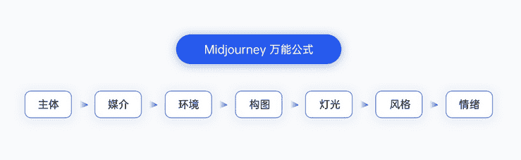
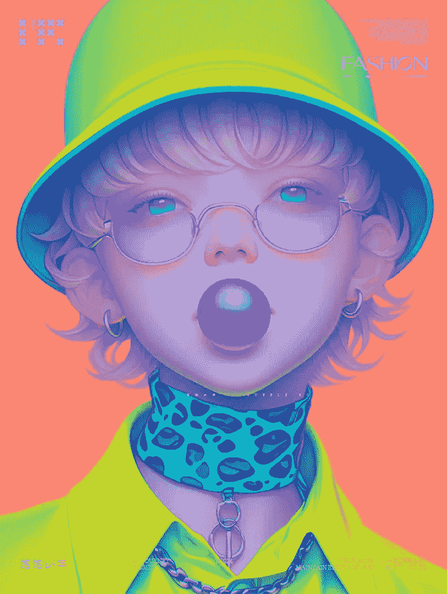
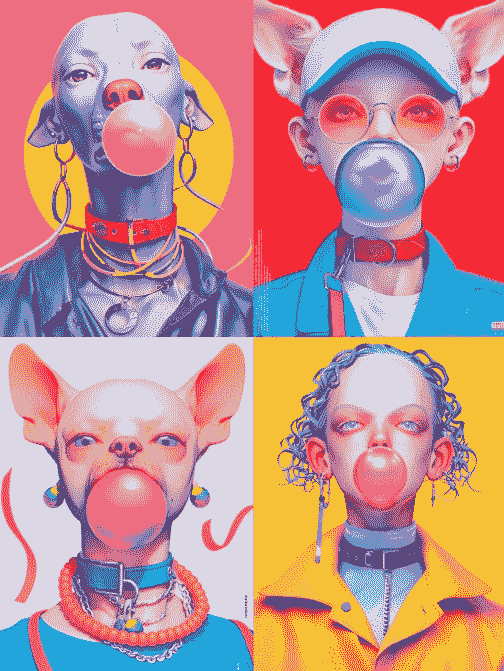
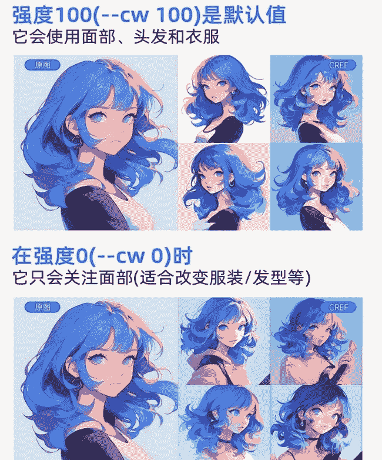
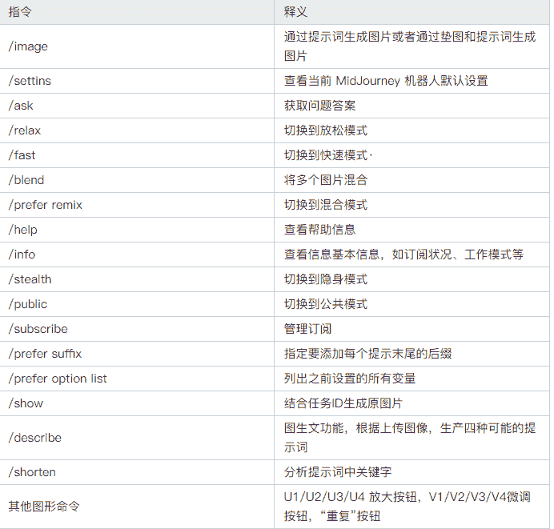
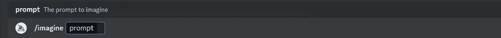
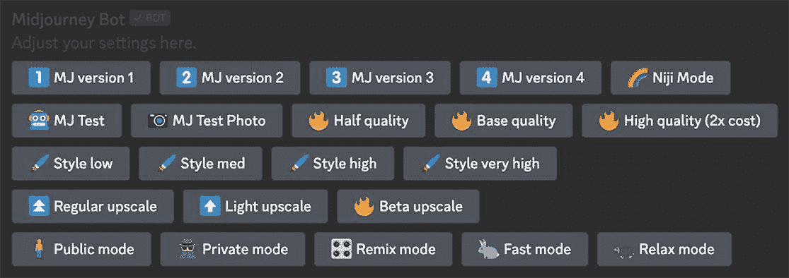
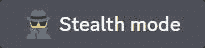
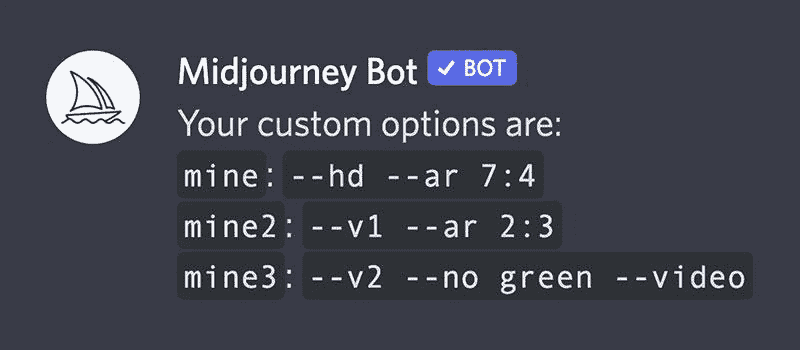
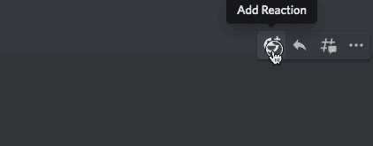

# MJ绘画的基础学习

> 来源：[https://qqs7y1hozd1.feishu.cn/docx/RuiEdAoRPorwBAxZc2wc9BEbn2f](https://qqs7y1hozd1.feishu.cn/docx/RuiEdAoRPorwBAxZc2wc9BEbn2f)

[Midjourney宝藏库 ](https://qqs7y1hozd1.feishu.cn/wiki/GsPlwXt8qi8RgNkfYRmcLb2InBh?from=from_copylink)，这里是做推文时累计下来的一些提示词，前期出图的时候你自己描述不出来，可以参考这里的内容。还是比较全面的。

## MJ绘画的基础学习（可以去B站找新手入门课）

ok，我知道你们懒得找，所以我汇总了一下：

**链接**:https://pan.baidu.com/s/1d1sVYfPmnQaUBfHHg-tylg?pwd=4757 提取码:4757

上面的这里汇总的有商业实战课，其实我觉得有点鸡肋吧，但是里面有些内容还是不错的，可以保存收藏一下

下面这里是我觉得讲的比较简单明了的mj教程，时间也很短，入门半个小时就够了，点视频内容直接跳转

【【2024最新版】MJ保姆级教程 midjourney小白零基础入门到精通教程 人工智能绘图 AI绘图 AI画图 一键出图教程 （持续更新）】

<https://player.bilibili.com/player.html?bvid=1nG411z7b2&share_source=copy_web&vd_source=a702789e17302e9bbf7af05b4e38e57c>

## 1.MJ绘画教程

官网命令参数：https://docs.midjourney.com/docs/en/character-reference#/

MJ基础指令认识：https://baijiahao.baidu.com/s?id=1766776404865492745&wfr=spider&for=pc

1.https://www.seaart.ai/home 中文素材网站，种类丰富，点开图片即可查看关键词，简洁方便

2. https://lexica.art/有超多风格的的图片可以参考，点开图片即可直接看到关键词，一键复制

### 万能公式

Midjourney，这是一种令人惊叹的 AI 扩散模型，它可以通过我们所提供的书面提示词来创造出惊艳的图像。掌握 Midjourney 的八大方向，可以让你轻松掌控图像创作的核心要素！这些方向包括「主体」、「媒介」、「环境」、「构图」、「灯光」、「风格」、「氛围」和「情绪」。

## 2.MJ常用指令

### --Sref

主要用处：风格参考、风格迁移 使用格式：`--Sref`（空格）图片链接（空格）`--sw`（空格）0-1000 `--sw`参数区间：0:关闭 100:默认 1000:最大值 参数说明：值越小越柔和，值越大细节越多，画面锐度越高 支持模型：V 6、Niji 6或更高

#### 案例一（--Sref风格迁移）

第一步：我们先上传一张自己喜欢的参考图

#### 第二步：输入关键词描述

`A dog, blowing bubble gum, very cute --sref https://s.mj.run/rbYOCYgU3CE --sw 100 --niji 6 --ar 3:4`

结果如下：

可以看到，不需要复杂的关键词描述，就能将目标图的风格复刻到自己的关键词中，非常Nice！

### --Cref

主要用处：角色参考、角色迁移 使用格式：`--Cref`（空格）1或多个图片链接（空格）`--cw`（空格）0-100 `--cw`参数区间：0:关闭 100:默认 1000:最大值 参数说明：0:只有面部迁移（适合修改衣服、发型的情况下使用）100:衣服、面容、发型、服装穿搭全部迁移 支持模型：V 6、Niji 6或更高

## 3.MJ命令列表

### Midjourney命令列表

您可以通过输入命令与Discord上的Midjourney Bot (MJ机器人)进行交互。命令用于创建图像、更改默认设置、监视用户信息以及执行其他有用的任务。

Midjourney命令可以在任何机器人频道中使用，在允许Midjourney Bot运行的个人Discord服务器上使用，或者在与Midjourney Bot的直接消息中使用。

#### 常用的命令：

`/imagine prompt`

只能在这个命令`prompt`里面输入描述语才能生成图像

`/setting`

打开偏好设置，里面可以预设一些命令

`/blend`

轻松地将多个图像混合在一起。

`/show`

输入`/show`在`jobid`框里输入您的图库中所生成图像的作业ID后，你可以再次召唤和恢复自己的任何生成图像

`/fast`

切换快速模式，在快速模式下，您的生成图像将按增量计费。这模式生成图像较快 (订阅会员才能使用的模式)

`/relax`

切换放松模式，在快速模式下，您生成图像可以无限使用，但这模式生成图像较慢。(30天和企业会员可无限使用这个模式)

`/prefer suffix`

重置你的偏好设置（有时生成图片时会出现一些自己明明未添加的指令，却提示错误，可以执行一下这个命令）

`/remix`

切换混音模式 (可以让你在重生成或者变化图片时修改描述语)

`/stealth`

对于专业计划(60美元/月)的用户切换到隐身模式

`/public`

切换公共模式，在公共模式下，你生成的图像在画廊中对任何人都是可见的

`/subscribe`

创建一个指引您当前Discord账户会员订阅页面链接 (无需登录会员)

`/info`

显示有关你的个人资料、生成数量、订阅会员状态和使用情况和当前正在运行的作业信息

`/prefer option`

创建或管理自定义选项。

`/prefer option list`

查看当前自定义选项

`/help`

显示有关Midjourney机器人相关的信息和提示

#### 不常用的命令：

`/ask` 在`question`框里输入你的问题，你会得到一个问题的答案。`/daily_theme`切换#每日主题频道更新的通知`/ping`弃用的命令：

`/private` (替换为`/stealth`)

切换私人模式，在私人模式下，你生成的图像仅你可见，使用私人模式需开通每月60美元的会员

`/pixels`

`/idea`

### 指令和参数列表

指令参数可更改图像的生成方式。指令参数可以更改图像的纵横比、在 Midjourney模型版本之间切换、更改使用的偏好设置等等。

指令参数是添加到描述语后面的末尾。您可以在描述语中添加多个指令参数。

#### 注：

1. 需要指令格式、符号和空格，错了会失效

2. 许多 Apple 设备会自动将双连字符 (`--`) 更改为破折号 (—)。Midjourney 两者都支持！

### 模型切换指令：

Midjourney定期发布新模型版本以提高效率、一致性和质量。不同的模型擅长处理不同类型的图像。

#### 版本切换

`--version`或`--v` 算法：现在默认是新算法`--v 4`，如果你要使用旧算法1、2或3，可以输入`--v 1`或`2`或`3`

#### Niji

`--niji`：把midjourney切换为niji・journey，这是新的专注于动漫风格的图像模型。

#### 测试算法test

`--test`：和`--upbeta`比较类似，Midjourney特殊测试模型，应用`--test`后，生成的图片会由四张变为一张

#### 测试算法testp

`--testp`：和`--upbeta`比较类似，Midjourney 特殊的以摄影为重点的测试模型，应用`--testp`后，生成的图片会由四张变为一张

#### 老版本的HD算法

`--hd`：该算法可能更适合较大的图像，生成更高清的图，四图的构图不一致性。适合用于风景画、抽象画适合用于风景画、抽象画。这也可以生成更高分辨率的图像，而无需放大。

### 基本指令：

#### 纵横比

`-aspect n:m`或`--ar n:m`：`n`是长，`m`是宽，例如`--ar 16:9`，可以输出长宽比为16:9的图片。注意冒号必须使用英文的冒号，中文冒号会不生效，`ar`后面必须空一格再输入，否则可能不生效。

#### V4风格切换

`--style 4a, 4b`或`4c`：在Midjourney模型版本V4风格之间切换

#### 无缝图案

`--tile`：用于生成四方连续无缝图案，结合`--upbeta`一起使用。

#### seed种子

`--seed 种子`：获取了自己生成图像的`seed`种子后，可以参考图像风格和内容生成新的图像 (获取图像的`seed`种子，可在这个图像内容右上角发[信封]图标，就可以收到图像信息的消息)

#### 风格化

`--stylize`或`--s` 数值：让你生成的图像更具风格化和想象力，你设置的数值越高，它就越天马行空。默认值为2500，值范围625-60000

#### 风格各异

`--chaos` 数值：生成四张风格各异的图像，数值必须在0-100之间。较高的值让生成的图像风格更不同

#### 质量

`--quality`或`--q` 数值：生成图片的质量和时间。默认值为1，值越高，生成时间越长，质量越高。只能输入0.25、0.5、1、2、5这五个数值。（如果使用默认值，就无需加入这个指令）

#### 移除对象

`--no 对象`：`--no` 加具体物品，出图将不包含该物品，例如，输入`--no grass` 画面会尝试移除草。这就像给它赋予-0.5的权重

#### 停止生成百分比

`--stop` 数值：按生成完成度百分比停止生成图像。必须在10-100之间。这目前只对四图有效，该模式不适用于升级大图

#### 升级器指令：

Midjourney首先为每个作业生成一个低分辨率图像选项网格。您可以在任何网格图像上使用Midjourney upscaler来增加尺寸并添加更多细节。有多种可用于放大图像的放大模型。

#### beta升级器

`--upbeta`：选择U按钮时，使用替代的 beta 升频器。结果更接近原始网格图像。放大后的图像添加的细节明显更少。不适用于`--hd`和`--stylize`和`--q 5`

#### 轻量升级器

`--uplight`：选择U按钮时，使用"较轻"升级器进行升级。结果更接近原始网格图像，放大后的图像细节更少，更平滑，适用于面部和光滑的表面。

#### 其他指令：

这些参数仅适用于特定的早期Midjourney模型版本

#### 创造力--creative：

修改`test`和`testp`模型更加多样化和创造性。

#### 参考图权重

`--iw` 权重值：对参考图片相似程度，默认值为1，最大值为2。数值越高对参考图的相似度越高，反之相似度越低

#### 生成视频

`--video`：该视频发送[信封]图标会收到图像信息，在信息中可看到视频链接，该模式不适用于升级大图

#### 同种子

`--sameseed 种子`：创建一个大的随机噪声场，应用于初始网格中的所有图像。当指定 `--sameseed` 时，初始网格中的所有图像都使用相同的起始噪声，并将生成非常相似的生成图像。如果不使用，每张图像的效果更多样性

#### 弃用指令：

`--w`或`--h` (替换为`--aspect`)

#### 设置图片分辨率：

分别设置生成图像的分辨率`w`宽度和`n`高度。值应设置在256和2034之间，最大分辨率为3兆像素。这些值作为64或128的倍数效果更好，如`--w 1920 --h 1024`

`--fast` (替换为`--quality`)

更快的图像，更少的一致性，更便宜。你也可以使用`--q 0.5`和`--q 0.25`来获得类似效果

#### --beta

实验算法：该模型需要更长的生成时间，仅同时生成两张图像 (非默认分辨率只生成一张图像)。不适用与`--hd`和`--stylize`和`--q 5`

`--vibe` (现在称为`V1`)

`--hq`--newclip--nostretch--old

### 设置和预设

设置命令为模型版本、样式值、质量值和升级器版本等常用选项提供切换按钮。设置也有`/stealth`和`/public`命令的切换按钮。

使用`/settings`命令，可以打开偏好设置，这指令将为你提供一些按钮来查看和更改你当前的偏好，例如`/prefer suffix`指令，非常直观。每组偏好都可以打开和关闭

#### 设置说明：

添加到描述语末尾的指令参数将覆盖偏好的设置，如你在描述语末尾加上`--v 4`，而你的偏好设置是v3，则按你加上的`--v 4`执行

#### 设置模型版本：

指令`--v 1`使用原始的Midjourney算法 (更抽象)

指令`--v 2`，2022年7月25日之前使用的原始Midjourney算法

指令`--v 3`这是比较很有创意和艺术感的Midjourney算法

指令`--v 4`这是当前默认Midjourney算法

指令`--niji`，专出动漫二次元画风的算法

指令`--test`，使用测试性算法，和`--upbeta`比较类似，可生成质量更高或者风格更奇特的图，应用`--test`后，生成的图片会由四张变为一张。

指令`--testp`，`testp`是整体的生成模式 更偏照片真实风格，应用`--test`后，生成的图片会由四张变为一张

#### 设置质量：

指令`--q 0.5`，不太详细，1/2

指令`--q 1`，默认值

指令`--q 2`，非常详细，贵2倍

#### 设置风格化：

指令`--s 50`，低风格化

指令`--s 100`，默认值

指令`--s 250`，高风格化

指令`--s 750`，非常高风格化

#### 设置升级器：

默认值，常规放大图像

指令`--uplight`，这会导致U按钮放大图像同时保持原始细节

测试版放大图像

### 公共和隐身模式切换

命令`/prublic`，公共模式

命令`/stealth`，私有模式

开启Remix mode，生成图片时可以用V和Make Vriations重新改变关键词再继续生成

Fast和Relaxed模式切换

命令`/fast`，切换快速模式

命令`/relax`，切换放松模式

### 自定义首选项

使用`[/prefer]`命令创建自定义选项，可以将常用的指令参数添加到描述语末尾。

`/prefer auto_dm`：

完成的工作会自动发送到直接消息

`/prefer option`：

创建或管理自定义选项。

`/prefer option list`：

查看您当前的自定义选项。

`/prefer suffix`：

指定要添加到每个提示末尾的后缀。

#### 自定义首选项：

`/prefer option set [name] [value]`

创建可用于将多个参数快速添加到提示末尾的自定义参数。

`/prefer option set mine --hd --ar 7:4`

创建一个名为`mine(我的)`的选项，转换为`--hd --ar 7:4`

使用`/imagine prompt vibrant California poppies --mine`，被解释为`/imagine prompt vibrant California poppies --hd --ar 7:4`

`/prefer option list`

列出使用创建的所有选项`prefer option set`。用户最多可以有20个自定义选项。

要删除自定义选项，请使用`/prefer option set <name to delete>`值字段并将其留空。

## 自定义首选项：

`/prefer suffix`

在所有提示后自动附加指定的后缀。使用不带值的命令进行复位。

### 命令示例：

`/prefer suffix --uplight --video`

a. `Only Parameter`s可以与`/prefer suffix`一起使用

b. 支持：`prefer suffix --no orangeis`

c. 不支持：`prefer suffix orange::-1`

## 表情图标的功能

用指定的表情图标会触发常用功能

`envelop`：信封表情符号可以将带有`seed`种子、生成ID和生成视频的图像发送给你的DM

`star`：星星表情符号可以将图像标记为“收藏”，收藏的图像会显示在画廊中，并将图像发送到`#favorites`频道

`X`：X表情符号可以取消和删除图像，同时也会从画廊中输出
