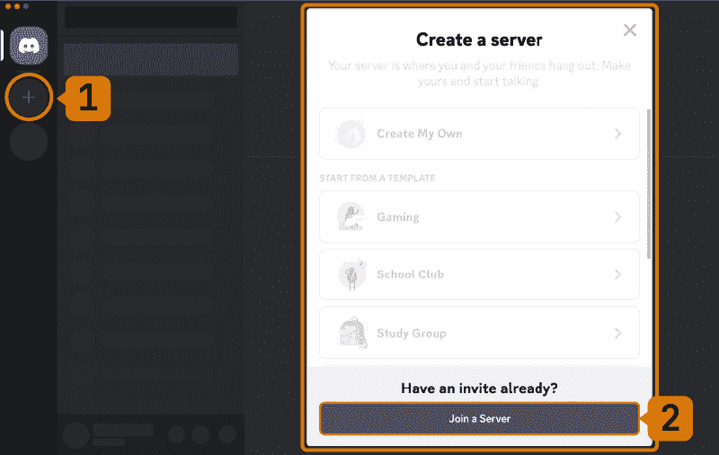
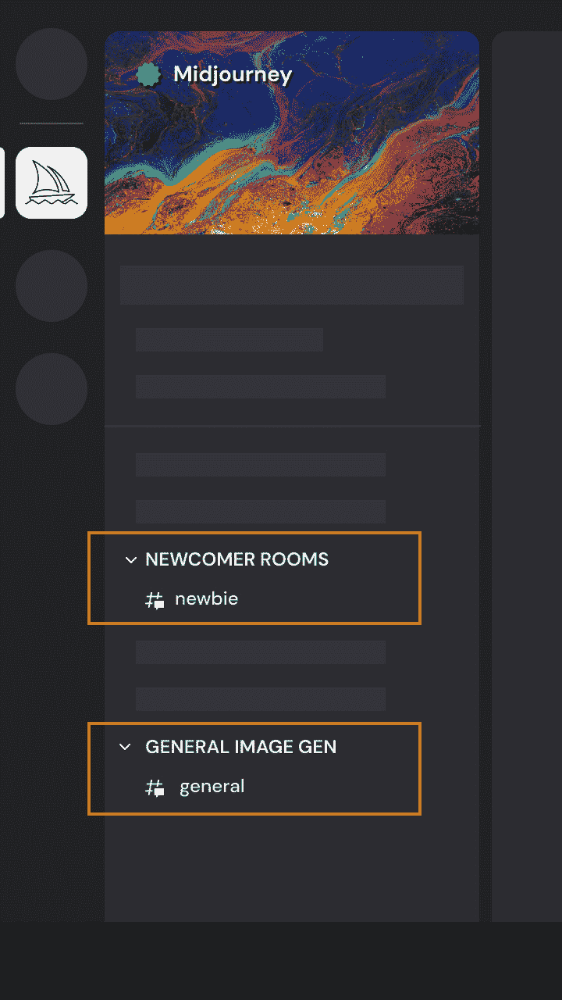
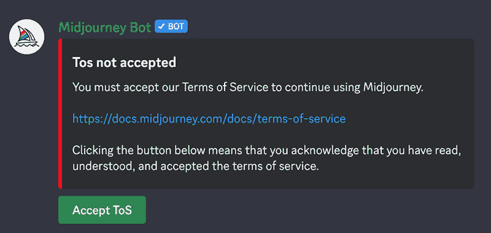
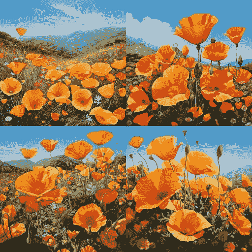
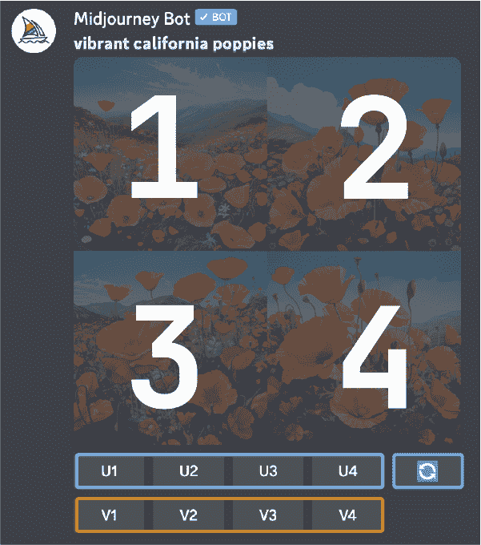
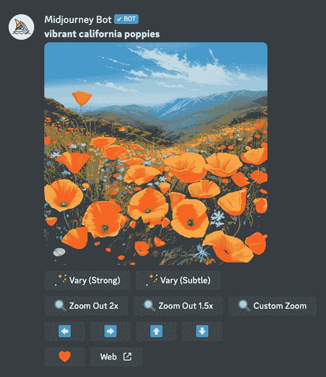

# Midjourney官方指南

> 来源：[https://qqs7y1hozd1.feishu.cn/docx/FKKudpIPao1NRexAjQjcsg44n4d](https://qqs7y1hozd1.feishu.cn/docx/FKKudpIPao1NRexAjQjcsg44n4d)

# Discord 快速入门

---

#### 使用 Midjourney 机器人在几秒钟内从简单的文本提示生成令人惊叹的图像。直接在 Discord 中工作。不需要专门的硬件或软件。

行为准则

+   不要混蛋。

+   请勿使用我们的工具制作可能引发煽动、令人不安或引起戏剧性的图像。这包括血腥和成人内容。

+   尊重他人和团队。

---

## 使用 Midjourney 制作图像

1.  登录 Discord

通过** Disc**ord 通过 Web 浏览器、移动应用程序或桌面应用程序访问 Midjourney Bot。在加入 Midjourney Discord 服务器之前，请确保您拥有经过验证的 Discord 帐户。

[按照以下指南创建或验证您的](https://support.discord.com/hc/en-us/articles/360033931551-Getting-Started)[ Discord 帐户：

](https://support.discord.com/hc/en-us/articles/6181726888215)创建 Discord 帐户

验证 Discord 帐户

1.  订阅 Midjourney 计划

要开始使用 Midjourney 生成图像，您需要订阅一个计划。

+   访问 [Midjourney.com](https://www.midjourney.com/)。

+   使用**您经过验证的** Discord 帐户登录。

+   选择适合您需求的订阅计划。

转到 [订阅计划](https://docs.midjourney.com/plans) 有关定价和每个层级可用功能的信息。

1.  在 Discord 上加入 Midjourney 服务器

要开始与 Midjourney Bot 交互，请加入 Midjourney 服务器

+   打开 Discord 并在左侧边栏上找到服务器列表。

+   按下服务器列表底部的按钮。**+**

+   在弹出窗口中，单击 按钮。**Join a Server**

+   粘贴或键入以下 URL：http:**//di**scord.gg/midjourney 并按 。Join

有关更多信息，请了解有关 Discord 服务器的更多信息。

1.  转到任何 #General 或 #Newbie 频道

在 Discord 上加入 Midjourney 服务器后，您会在侧边栏中看到几个频道。

###

### 在 Midjourney 服务器上

> 找到并选择任何标有 或 的通道。这些频道专为初学者开始使用 Midjourney Bot 而设计。Midjourney Bot 不会在其他渠道中生成图像。general-#newbie-#

>

### 在其他服务器上

>

> 您可以在任何邀请 Midjourney Bot 的 Discord 服务器上使用 Midjourney Bot 生成图像。在您的服务器上查找有关在何处使用 Bot 的说明。

>

1.  使用 /imagine 命令

**关于 Discord 命令**

使**用命令在 Dis**cord 上与 Midjourney 机器人交互。命令用于创建映像、更改默认设置、监控用户信息以及执行其他有用的任务。该命令从简短的文本描述（称为 Prompt）生成唯一图像。了解有关 Prompts 的更多信息/imagine

**如何使用 ****/imagine**

+   在**消息字段中键入 **'/imagine prompt：'。您还可以从键入“/”时弹出的可用斜杠命令列表中选择命令。/imagine

+   **键入要在字段**中创建的图像的描述。prompt

+   发送您的信息。机器人将解释您的文本提示并开始生成图像。

+   尊重[社区准则](https://docs.midjourney.com/community-guidelines)。社区准则适用于使用 Midjourney Bot 的任何地方。

1.  接受服务条款

[在生成任](https://docs.midjourney.com/docs/terms-of-service)何图像之前，Midjourney Bot 会提示您接受服务条款。您必须同意这些条款才能继续创建映像。

1.  图像生成过程

> 提交[文本提示后，](https://docs.midjourney.com/fast-relax)Midjourney Bot 会处理您的请求，并在**一分钟内创**建四个独特的图像选项。此过程利用高级图形处理单元 （GPU），每次图像生成都计入您的 Midjourney 订阅中包含的 GPU 时间。要监控您的可用 GPU 时间 （Fast Time Remaining），请使用该命令。/info

1.  选择图片或创建变体

> 生成初始图像网格后，图像网格下方将有两行按钮可用。

> U1 U2 U3 U4 影像选择

> 在早期版本的 Midjourney 中，这些按钮用于放大图像。使用最新型号，可立即生成 1024 x** **1024 像素大小的图像。现在，“U”按钮可帮助您从网格中分离出所选图像，使其更易于下载并让您访问其他编辑和生成工具。U

> 🔄 重新运行或重新滚动作业

> 该🔄按钮将重新运行 Job。在这种情况下，它将重新运行原始提示，生成新的图像网格。

> V1 V2 V3 V4 图像变化

> V 按钮用于创建所选图像的变体。每个按钮都会生成一个新的图像网格，该网格将保持所选图像的常规样式和构图。

1.  增强或修改您的图像

> 挑选出图像后，一组扩展的选项将变为可用。

> 🪄 变化 （强） 🪄 变化 （微妙）

> 为所选图像创建更强或更细微[的变化](https://docs.midjourney.com/docs/variations)，生成一个包含四个选项的新网格。

> 🔍 缩小 2 倍 🔍 缩小 1.5 倍🔍自定义缩放

> [缩小](https://docs.midjourney.com/docs/zoom-out)图像，扩展画布的原始边界，而不更改原始图像的内容。新展开的画布将使用提示和原始图像中的指导进行填充。

> ⬅️ ➡️ ⬆️ ⬇️

> 的 [平移](https://docs.midjourney.com/docs/pan) 按钮允许您沿所选方向扩展图像的画布，而无需更改原始图像的内容。新展开的画布将使用提示和原始图像中的指导进行填充。

> ❤️ Favorite

> 标记您的最佳图像，以便在 Midjourney 网站上轻松找到它们。

> Web ↗️

> 在 [midjourney.com](https://www.midjourney.com/home/) 上打开图库中的图片

1.  保存您的图像

单击图像以将其打开为全尺寸，然后右键单击并选择 。在移动设备**上，长按图像，然后点**击右上角的下载图标。Save image

所有图像均可立即在 midjourney.com/imagine 上查看

---

## 后续步骤

直接向 Midjourney Bot

发送消息 您在 Midjourney 服务器上与其他用户合作时是否难以找到自己？您可以在私信中与 Midjourney Bot 进行一对一互动。在您的私信中创建的图像仍受内容和审核规则的约束，并在 Midjourney 网站上可见。

**了解有关提示**

的更多信息 了解如何编写有效且富有创意的提示，

探索艺术媒介、位置和时间段的描述如何改变图像。

[**混合您自己的图像**](https://docs.midjourney.com/blend)**

了解如何使**用命令上传和混合您自己的图像。/blend

---

## Midjourney 机器人协助

**需要帮助或有疑问？**尝试以下命令：

显示有关 Midjourney Bot 的有用信息和提示。

提供有关 Midjourney Bot 的问题的解答。/help/ask

[您还可以访问 ](https://discord.com/channels/662267976984297473/958069758211797092)Midjourney Discord 上的 #support 频道以获得更多帮助。