# Mark的AI产品经理知识库

> 来源：[https://qqs7y1hozd1.feishu.cn/docx/D43VdbQedora2cxLmFtceLO5nac](https://qqs7y1hozd1.feishu.cn/docx/D43VdbQedora2cxLmFtceLO5nac)

# ⭕️  一周更新概要

> 每周，我们都会精选一周汇总：

> [AI Agent技术0-1拆解](https://qqs7y1hozd1.feishu.cn/wiki/EzKKwTwdBiQV5Pk5lSFcbvQTnRR)

> [Claude Design](https://qqs7y1hozd1.feishu.cn/wiki/QJDywZoU9iCm5UkhCRwcErPwnp2)

> [从零开始搞定 LLM 搭建全流程](https://qqs7y1hozd1.feishu.cn/wiki/ULcjwKhBCikwrQkxC0wc1zchn2f)

> [产品经理Claude Code工作流](https://qqs7y1hozd1.feishu.cn/wiki/JY5nwpIEdiDf83k900Uc4ZtCn9d)

> 往期更新汇总：

> [大厂面经](https://qqs7y1hozd1.feishu.cn/wiki/C8UgwmN68ihLtUk22x4c9gahnHc)

> [产品常用网站集合](https://qqs7y1hozd1.feishu.cn/wiki/HWZ3wursJiHjCpkzk37ckylnn2e)

> [需求分析及PRD撰写](https://qqs7y1hozd1.feishu.cn/wiki/VisawnVPeiXMgkk1ZKscWO2nnvc)

> [吴恩达skills教程](https://qqs7y1hozd1.feishu.cn/wiki/LCvRwKWRfiJhRdk5lv5cPV30ngd)

### 📑课[程大纲](https://qqs7y1hozd1.feishu.cn/wiki/Yml9w7C08i9617koUZkch8oKnec)

### 📚求[职陪跑](https://qqs7y1hozd1.feishu.cn/wiki/XzcDwajayikEyEkUFMycfY2UnLh)

### [✨领取试看](https://qqs7y1hozd1.feishu.cn/wiki/HWAmwzjN6iPGuIkUWfdcBv3EnEf)

> **致各位读者：**

> 非常感谢您来到「**Mark****的 AI 产品经理知识库**」。本库致力于为 AI 产品经理及相关从业者提供专业、系统的知识体系与实战经验。

+   **资料服务：**[**如需获取**](https://qqs7y1hozd1.feishu.cn/wiki/FLvLw0NvJiKVFTk0AOVc95vYnUd)下载使用完整资料或更多内容，请通过以上渠道👉🏻联系我们

+   **合作共建：**如需商业合作、开源项目推广等需求，我们将为您标注作者信息和联系方式，保障权益。

+   **我们期待与您**一同学习、共同进步，共同学习更多AIGC知识，祝工作顺利，平安喜乐，再次感谢您。

# ⭕️  知识库快速导航

[产品经理知识库 ](https://qqs7y1hozd1.feishu.cn/wiki/DzlJw541diset0kFeYJcTlH3nRh)

[LLM大模型](https://qqs7y1hozd1.feishu.cn/wiki/BN4ewagmkihbWLkJnERcYf3Gnsf)

[AI实战项目与实践](https://qqs7y1hozd1.feishu.cn/wiki/J9QxwpJbXi5I1jk2YDDckpaonie)

[AI产品经理知识库](https://qqs7y1hozd1.feishu.cn/wiki/MLmnwlGd7i3cOYk7cBTccvTonCf)

[AI 核心技术](https://qqs7y1hozd1.feishu.cn/wiki/LAlXwZ74oiG6VXk9CCEcoVZ5n7f)

[大厂面经](https://qqs7y1hozd1.feishu.cn/wiki/C8UgwmN68ihLtUk22x4c9gahnHc)

[AI产品经理知识库 ](https://qqs7y1hozd1.feishu.cn/wiki/MF8gwM3YgiNw6ik8zAgcE74Tnub)

[Skills专栏](https://qqs7y1hozd1.feishu.cn/wiki/SFh4wCP2YiiCGTkLisOcJt8Enzc)

[Axure原型库](https://qqs7y1hozd1.feishu.cn/wiki/Rk5pwkUU6iC2QMkdVYlc1zdQnWc)

---

### 需求分析及PRD撰写

[PRD撰写案例模板](https://qqs7y1hozd1.feishu.cn/wiki/YyXIwIrYfi1pvxki9SrcaAJRn9g)

[产品需求文档（PRD模板）](https://qqs7y1hozd1.feishu.cn/wiki/Z85Fwm57SiyKjNkGURMceNsUnHb)

[产品经理需求自查表](https://qqs7y1hozd1.feishu.cn/wiki/YTQzwLLftixxgvkJ9K1cOqD7nDb)

[产品需求文档-案例（全流程）](https://qqs7y1hozd1.feishu.cn/wiki/C0hMwdSkJiboYYkRfbocTyXjn7e)

[产品PRD需求文档—在线教育CRM系统](https://qqs7y1hozd1.feishu.cn/wiki/C8EywvbXHiNmxWk3fwGceBVJnKc)

[用 Cursor 两步搞定产品原型图](https://qqs7y1hozd1.feishu.cn/wiki/N8Xowj5Q5ifbfVkcfeRc7GSInOb)

---

### 数据埋点

[大厂 | 数据埋点方法](https://qqs7y1hozd1.feishu.cn/wiki/HR8Fws17MirjWvkBbi7cty6bnDc)

[数据埋点流程](https://qqs7y1hozd1.feishu.cn/wiki/RR6GwPrXRivNeNkcT5tc6mpSnLg)

[数据埋点管理](https://qqs7y1hozd1.feishu.cn/wiki/GRYywvtoxiQIgJklnz2cip4VnCb)

[埋点设计逻辑8个要点](https://qqs7y1hozd1.feishu.cn/wiki/PY02wdzYqizS4Mk5Pgzcvq2uniI)

[埋点文档撰写](https://qqs7y1hozd1.feishu.cn/wiki/ZuS7wrpAVi5oHFkB4mmc77lsnTr)

[埋点文档模板](https://qqs7y1hozd1.feishu.cn/wiki/Cazfwe7GMi2yFPkV36NcJsoKn4d)

[大厂数据埋点实践](https://qqs7y1hozd1.feishu.cn/wiki/SzvTwhY7qiJbI7kIpVqcuS5vn2Z)

[数据产品指标](https://qqs7y1hozd1.feishu.cn/wiki/Mo7ewBa4oicDBWk2eygcVD3kn5c)

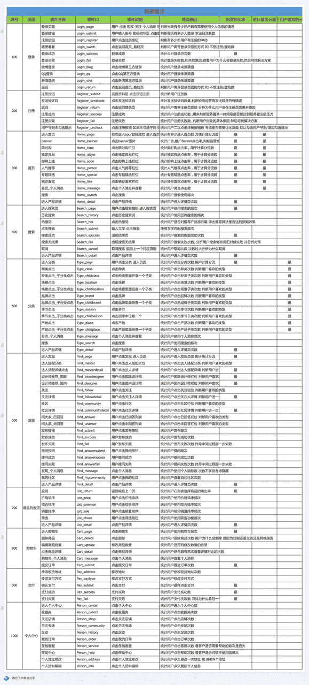

[数据埋点-常用版.pdf](https://internal-api-drive-stream.feishu.cn/space/api/box/stream/download/all/NVEkb2ENWoT6KQxmD2ccbHU0nbd)

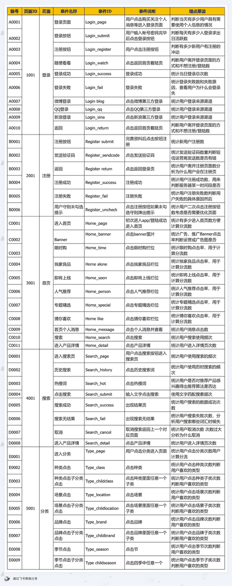

[埋点文档模板.pdf](https://internal-api-drive-stream.feishu.cn/space/api/box/stream/download/all/MfMgbqBIyoCJJTxr7G5cXTw9n87)

---

# 💾 资料合集

## 🔥Skills专栏

[skills入门指南](https://qqs7y1hozd1.feishu.cn/wiki/TgsrwDc4wish39kELc1cPyomnRd)

[skills搭建0-1](https://qqs7y1hozd1.feishu.cn/wiki/XOatwNhyriprrYk0wqucHEDCnbh)

[skills多场景实战](https://qqs7y1hozd1.feishu.cn/wiki/VQuawiS4HiSOsLkWqKHcTLPJnac)

[吴恩达skills教程](https://qqs7y1hozd1.feishu.cn/wiki/LCvRwKWRfiJhRdk5lv5cPV30ngd)

---

## **🔥 C****laude Code专****栏 **

### 入门基础

[第一章：快速上手](https://qqs7y1hozd1.feishu.cn/wiki/UTF0w8yt8iIs2Pks3e6cfazOnYc)

[第二章：接入国内大模型](https://qqs7y1hozd1.feishu.cn/wiki/WK3DwtPRJiSB34k3zURceqmcnAK)

[第三章：入门基础操作](https://qqs7y1hozd1.feishu.cn/wiki/I0ekw6ODHiDrNNkxvJIcPqAgnKf)

[第四章：文本处理与创作](https://qqs7y1hozd1.feishu.cn/wiki/GiigwIdtyiaQeKkzxLvcGFbKnwf)

[第五章：文档管理与处理](https://qqs7y1hozd1.feishu.cn/wiki/Iqdkwxh8zimH8ik8eMfcuiGKnTb)

[第六章：数据处理与分析](https://qqs7y1hozd1.feishu.cn/wiki/LBfbw4J9BiBgUvkdQn3ccF6Mnee)

[第七章：个性化工作流](https://qqs7y1hozd1.feishu.cn/wiki/DlrZwkvbai3puFkOJNNcNz9enGe)

[第八章：提示词优化技巧](https://qqs7y1hozd1.feishu.cn/wiki/UiMJwXRxbiRb8HkjLZKcVNDxnuh)

[第九章：常用快捷键](https://qqs7y1hozd1.feishu.cn/wiki/GQRIwF3GmiHwhPk0axCcGQ7ynoc)

[第十章：用编程的思维解决问题](https://qqs7y1hozd1.feishu.cn/wiki/Wdh3wMuuyiqUaTk13gycb4Ykn3c)

[第十一章：Claude高级功能使用](https://qqs7y1hozd1.feishu.cn/wiki/Iw9KwbfpciGjVEk3Mj9c1kYjnph)

[第十二章：让Claude自动解决问题](https://qqs7y1hozd1.feishu.cn/wiki/Up49w2XcXiz5h2kzZ9Jcfa8NnCh)

---

### skills使用

[skills入门指南](https://qqs7y1hozd1.feishu.cn/wiki/TgsrwDc4wish39kELc1cPyomnRd)

[skills搭建0-1](https://qqs7y1hozd1.feishu.cn/wiki/XOatwNhyriprrYk0wqucHEDCnbh)

[skills多场景实战](https://qqs7y1hozd1.feishu.cn/wiki/VQuawiS4HiSOsLkWqKHcTLPJnac)

[吴恩达skills教程](https://qqs7y1hozd1.feishu.cn/wiki/LCvRwKWRfiJhRdk5lv5cPV30ngd)

[产品经理必备skills](https://qqs7y1hozd1.feishu.cn/wiki/PYIEw4uoSiAoegkd0rlcu9eCnNe)

[LLM-Agent Skills 案例：内部数据分析](https://qqs7y1hozd1.feishu.cn/wiki/SkE5wSRQBiCwFHkGDYZc1cJHnRe)

---

### 产品经理Claude Code工作流

[产品经理Claude Code工作流](https://qqs7y1hozd1.feishu.cn/wiki/JY5nwpIEdiDf83k900Uc4ZtCn9d)

[FigmaMCP实现代码⇄设计稿实时双向同步（实测）](https://qqs7y1hozd1.feishu.cn/wiki/OTqRwpwoUizV8WkN8xmcibLbnZc)

[Claude Code + Figma：AI 画原型完整教程，从 PRD 到设计稿只要 5 分钟](https://qqs7y1hozd1.feishu.cn/wiki/Bvz8wgr5XirdB5kEgGXcSnimnqI)

[Claude+Cursor+Figma/MasterGo四步生成高端的产品原型图（附提示词和步骤）](https://qqs7y1hozd1.feishu.cn/wiki/BYAOwBv16iFI6gkhGE0cCpBonVe)

[用设计和编程 Agent 设计网站](https://qqs7y1hozd1.feishu.cn/wiki/B3Nzw6WeRishy6kWFfvcXlH1ncg)

[AICoding实战：从Prd到代码生成](https://qqs7y1hozd1.feishu.cn/wiki/E1Idw4h9Bi6sbxkxRlBc2CxQnug)

[Claude Code + Mermaid 一键生成架构图、时序图、流程图](https://qqs7y1hozd1.feishu.cn/wiki/RFzFw6OBritAnSkbtO8cNwVOnpc)

[claude code从需求到低保真线框图，再到高保真UI原型，全流程](https://qqs7y1hozd1.feishu.cn/wiki/T13ew7xWLiOFPhkPtBjcdqxinah)

[B 端产业应用场景方向参考](https://qqs7y1hozd1.feishu.cn/wiki/HUTIwcvE5iN6mJkNr9qckCgtntd)

[C 端消费场景灵感参考](https://qqs7y1hozd1.feishu.cn/wiki/XPLwwb45eiOFQykoxzmcC6sUnOc)

---

### Claude Design 工作流

[Claude Design：小白也能做出专业级设计｜附最全玩法+官方实用技巧](https://qqs7y1hozd1.feishu.cn/wiki/QgAxwF9CniF8Xrk8HO9ckeuDnUf)

[Claude Design 系统提示词完整版（中文版）](https://qqs7y1hozd1.feishu.cn/wiki/BfuFwdF2uiXgx8kdBVvcp49VnMb)

[Claude Design 提示词，拿走即用](https://qqs7y1hozd1.feishu.cn/wiki/X6KTwCmEMiEa0UkmNyicdiIrnFb)

[Claude Design：5分钟画完一个 APP](https://qqs7y1hozd1.feishu.cn/wiki/KpizwvgPiiVl0fkUc7LcF13cnlg)

[Claude Design：一句话生成可交互原型](https://qqs7y1hozd1.feishu.cn/wiki/DvuHwwyStivaABk11NXcjwnUnZg)

[实战：拿Claude Design改一版🐧音乐](https://qqs7y1hozd1.feishu.cn/wiki/KHzewdZtGiBrKMk6uHbcSP7onge)

[Claude Design：对话即设计](https://qqs7y1hozd1.feishu.cn/wiki/Lo2OwDxLKiwx42kshjfcpkZ7nUg)

[使用claude design 设计你的网站](https://qqs7y1hozd1.feishu.cn/wiki/J9drwlHeUiZa0ZkFT0Wc6izSnQc)

[一句话搞定整套UI和PPT，不会设计也能Claude Design出高端设计稿](https://qqs7y1hozd1.feishu.cn/wiki/VlyzwxklxiIjJqkh8yzcSTpFnmd)

[通过对话直接完成界面设计，claude design生成原型](https://qqs7y1hozd1.feishu.cn/wiki/ZPaFwfY6DiOksgkiYf3c0d1Mndh)

[做原型不用Figma了？Claude Design 实战，一句话出交互原型](https://qqs7y1hozd1.feishu.cn/wiki/R5uiwaWmtirWtsk6S8ucxlnvn1b)

[不会设计也能做出产品原型，claude code实战](https://qqs7y1hozd1.feishu.cn/wiki/I7gmwsrvuiHviJkRodncd26yn2d)

---

## **🔥** Agent Harness专栏

### 入门基础

[智能体框架（Harness）到底是什么？](https://qqs7y1hozd1.feishu.cn/wiki/SComwaxW1iNmu6kL65ickk5Gnug)

[Harness到底是什么？一篇给你讲透](https://qqs7y1hozd1.feishu.cn/wiki/TnaJwFrCfiXtnTkIFE4ckVQBnId)

[模型不是关键，Harness 才是](https://qqs7y1hozd1.feishu.cn/wiki/GkDSwonTCiOlayketjVcLgcFnjf)

[高效Agents的尽头是，Harness](https://qqs7y1hozd1.feishu.cn/wiki/C3wGwvgIAiqau5kZQaYcW7tTnOd)

[Harness Engineering 深度解析](https://qqs7y1hozd1.feishu.cn/wiki/ErdLw7PElidlnpkHLtRcI2I0nPf)

[Harness驱动的Agent](https://qqs7y1hozd1.feishu.cn/wiki/Hkj4w1vBziJ2IOkGD0Uc0i3mnlz)

---

### Harness Engineering 实践

[模型越来越强，为什么大家却开始重写 Harness](https://qqs7y1hozd1.feishu.cn/wiki/Kcqrwf1XMivRbckmWz0cOLfMn3f)

[长时自主Agent，先解决这8个Harness核心问题](https://qqs7y1hozd1.feishu.cn/wiki/VmJEw1UaGiByC7k6wNacyCBZnCe)

[AI Harness 工程：Agent 能跑起来的那一层到底是什么？](https://qqs7y1hozd1.feishu.cn/wiki/Aimww8yyNiLzo6kkDN8cXijWnJe)

[Harness is the New Dataset：模型智能提升的下一个关键方向](https://qqs7y1hozd1.feishu.cn/wiki/Rhekw1uhMisrJBkPAzJciJ0Pngb)

[我的Harness Engineering实践](https://qqs7y1hozd1.feishu.cn/wiki/VAClwslxvi9Rdzkto11cxkT8n9f)

[Claude Harness Engineering 操作手册](https://qqs7y1hozd1.feishu.cn/wiki/CZQ6wbBaOiN0OukhepzcOmQint6)

[Harness Engineering：同一个模型，从42%到78%——Vibe Coding时代真正的护城河](https://qqs7y1hozd1.feishu.cn/wiki/QHeJwU0rciItH1kmUSxcXGKdnBd)

---

### 可以自行构建复杂 Agent Harness 的模型

[MiniMax M2.7：核心亮点解析 + 真实Agent实战测试](https://qqs7y1hozd1.feishu.cn/wiki/CwHWwnAqhiz67NkhbYWc7eU1ntc)

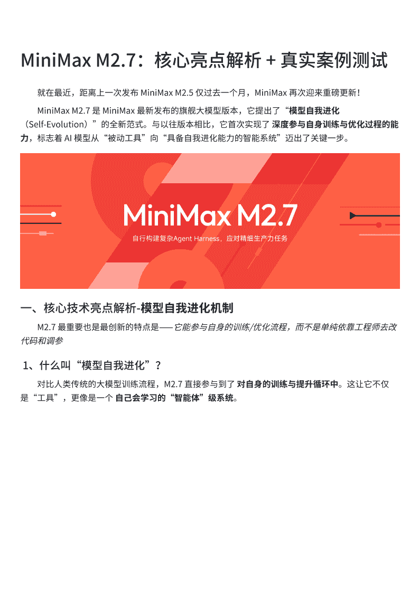

[MiniMax M2.7：核心亮点解析 + 真实案例测试.pdf](https://internal-api-drive-stream.feishu.cn/space/api/box/stream/download/all/KUnobUuwuoemD0xP5WxcKrl7n7g)

> **核心亮点解析-模型自我进化机制**

> 能参与自身的训练/优化流程，而不是单纯依靠工程师去改代码和调参

+   **模型自我进化：****对比人类传统的大模型训练****流程，M2.7 直接参与到了** 对自身的训练与提升循环中。这让它不仅是“工具”，更像是一个 自己会学习的“智能体”级系统。

+   **“自我进化”的**执行循环直观模型：可以把 M2.7 的自我进化想象成一个 持续反馈循环，每一轮循环都会让模型逐步逼近更优结果，⌈执行任务 → 评估结果 → 分析失败点 → 生成反馈 → 更新策略 → 再次执行 → 重复⌋

+   [**以上 ⌈亮点解析&案例测**](https://qqs7y1hozd1.feishu.cn/wiki/CwHWwnAqhiz67NkhbYWc7eU1ntc)[**试⌋ 均**](https://qqs7y1hozd1.feishu.cn/wiki/FLvLw0NvJiKVFTk0AOVc95vYnUd)为两光年原创，如有对MiniMax M2.7想要了解或使用过程中有什么问题，欢迎👉🏻联系我们与我们进行沟通🫱🏻‍🫲🏻🫱🏻‍🫲🏻

---

## 🔥 大语言模型

[第一章：工具使用](https://qqs7y1hozd1.feishu.cn/wiki/XtxPwcayrixEh8kKYO2ceyqpn0g)

[第二章：分词器](https://qqs7y1hozd1.feishu.cn/wiki/T9JZwNPiZiQGSakGavmc7US8nfk)

[第三章：pytorch 与资源核算](https://qqs7y1hozd1.feishu.cn/wiki/AggNwPSHKicSdXkhuzScZjHNnie)

[第四章：语言模型架构和训练的技术细节](https://qqs7y1hozd1.feishu.cn/wiki/T7ltwyDJoinWvak5D6VcAYKrntb)

[第五章：混合专家模型](https://qqs7y1hozd1.feishu.cn/wiki/XIbrwy5yKiAXHqkGqX0cHGfpnah)

[第六章：GPU和GPU相关的优化](https://qqs7y1hozd1.feishu.cn/wiki/DRB2w98RKiiXxxkattHc5tjVnGc)

[第七章：GPU高性能编程](https://qqs7y1hozd1.feishu.cn/wiki/UtzQwZdsZiLJaNkGeAIcfJqTnHf)

[第八章：分布式训练](https://qqs7y1hozd1.feishu.cn/wiki/EswUwzOd4iUlqVkZdvGcrbrgnSg)

[第九章：缩放定律（scaling laws）](https://qqs7y1hozd1.feishu.cn/wiki/WAhYw7FJ3iMTVukv6HXcbHvfnVb)

[第十章：推理](https://qqs7y1hozd1.feishu.cn/wiki/UgOYwBWYOiCqfakt5IhccNg3njb)

[第十一章：数据工程](https://qqs7y1hozd1.feishu.cn/wiki/N1XJwAaw2iaAT2kJ4p1cEio1nPh)

[第十二章：评估与基准测试](https://qqs7y1hozd1.feishu.cn/wiki/VaStwPG4ViMBdvkfOb9cnZnBn9f)

[第十三章：大模型的基本训练流程](https://qqs7y1hozd1.feishu.cn/wiki/Knu8wLzoyinowkkK7cScePnznPe)

[第十四章：可验证奖励的强化学习](https://qqs7y1hozd1.feishu.cn/wiki/ZzTswkqAdi6D2nke1vDcmxTNnRh)

## 🔥 G**P****T-Image2专****栏**

[GPT-Image2的30+场景高级玩法！！](https://qqs7y1hozd1.feishu.cn/wiki/P0GXw1sh8iHjFKkItYfcAwnjn1d)

[GPT image 2的正确打开方式！](https://qqs7y1hozd1.feishu.cn/wiki/FpECwquzFiSNdaktXQpcURGKnMz)

[GPT Image 2多场景实测，没有一张图让人失望](https://qqs7y1hozd1.feishu.cn/wiki/CnWDwjtz9iWq3gkrWygcEyrYnSc)

[GPT Image 2 来了，今天起，你看到的每一张图都不可信](https://qqs7y1hozd1.feishu.cn/wiki/XsCNw8rPwiTOaNkeximclG8Inib)

<https://qqs7y1hozd1.feishu.cn/sync/CLvydGqEesRFKhbekCdcW6wznje>

## 🚀AI Agent

### 从零开始搞定AI Agent

[从零开始构建你的第一个 ReAct Agent](https://qqs7y1hozd1.feishu.cn/wiki/DLRUwXow7iEDTtkN9RqcX6pLn7c)

[从零开始搭建基于 LangGraph 的 AI Agent](https://qqs7y1hozd1.feishu.cn/wiki/CuZnwnLkhijilQkFO8ZcORGTnJc)

[0-1搭建一个决策执行Agent](https://qqs7y1hozd1.feishu.cn/wiki/MvEEwK6INiBJJSkpxDkcbJOjnYV)

[Agent问答助手中多轮对话设计](https://qqs7y1hozd1.feishu.cn/wiki/U0wowFI5DiBhWYkIxuHckCcenag)

[基于Agent，0-1实现用户意图识别](https://qqs7y1hozd1.feishu.cn/wiki/CqDywt3J8i1eCPkPGhec1U92nRc)

[基于Agent智能客服中的意图识别优化](https://qqs7y1hozd1.feishu.cn/wiki/UvabwjyvWi0xF7k8gaPcI0T1nme)

### Agent搭建

[从0到1开发一个商用 Agent（智能体）](https://qqs7y1hozd1.feishu.cn/wiki/CTiCwfaQGi0Bs8kcd24cP4msn0g)

[基于Agent的智能客服项目（已交付）](https://qqs7y1hozd1.feishu.cn/wiki/IxnswZnkYiEXEkkmmhScUbUAndh)

[0-1基于dify搭建智能体（Agent）助手](https://qqs7y1hozd1.feishu.cn/wiki/VURHw95Rliyh67k9jENcNUIVnHb)

[FinRobot：基于LLM的金融分析AI Agent ](https://qqs7y1hozd1.feishu.cn/wiki/QNCFw4GiEidnM4kLaXmcfzVgnhh)

[基于Agent搭建ai论文写作程序](https://qqs7y1hozd1.feishu.cn/wiki/VQfVwS1vkiqxA4kFCH5cCjaYn9e)

[基于Agent的数据分析实战项目](https://qqs7y1hozd1.feishu.cn/wiki/Kiz2wwtvkihukBkQki0cg562nVb)

[0-1基于Agent的智能客服](https://qqs7y1hozd1.feishu.cn/wiki/ZxWZwmwrliZ5eqkIUehcYBWNn1c)

[企业级稳定可部署的AI agent ](https://qqs7y1hozd1.feishu.cn/wiki/C6iZwnKGfiSsMWkaZ4rcIQBKnHe)

### Agent Memory

[Agent Memory入门](https://qqs7y1hozd1.feishu.cn/wiki/DXZ1w3vuOis7Ntk24lLccRHZn5g)

[Agent Memory实现](https://qqs7y1hozd1.feishu.cn/wiki/IQdMw7mutiMLymkYas4ceDpmnTe)

[Agent Memory搭建](https://qqs7y1hozd1.feishu.cn/wiki/JxsRwxjFLilazGkCXG5cFyufnyb)

[Agent Memory项目案例](https://qqs7y1hozd1.feishu.cn/wiki/AL88wgmMFihyf4klhticdevEnwd)

[Agent Memory必读文章](https://qqs7y1hozd1.feishu.cn/wiki/DJJNwUIJBi6JLDkXmkScpGtmnZD)

[Agentic强化学习.pdf](https://qqs7y1hozd1.feishu.cn/wiki/LN2iwQoJTipncqknEatcPowpnWc)

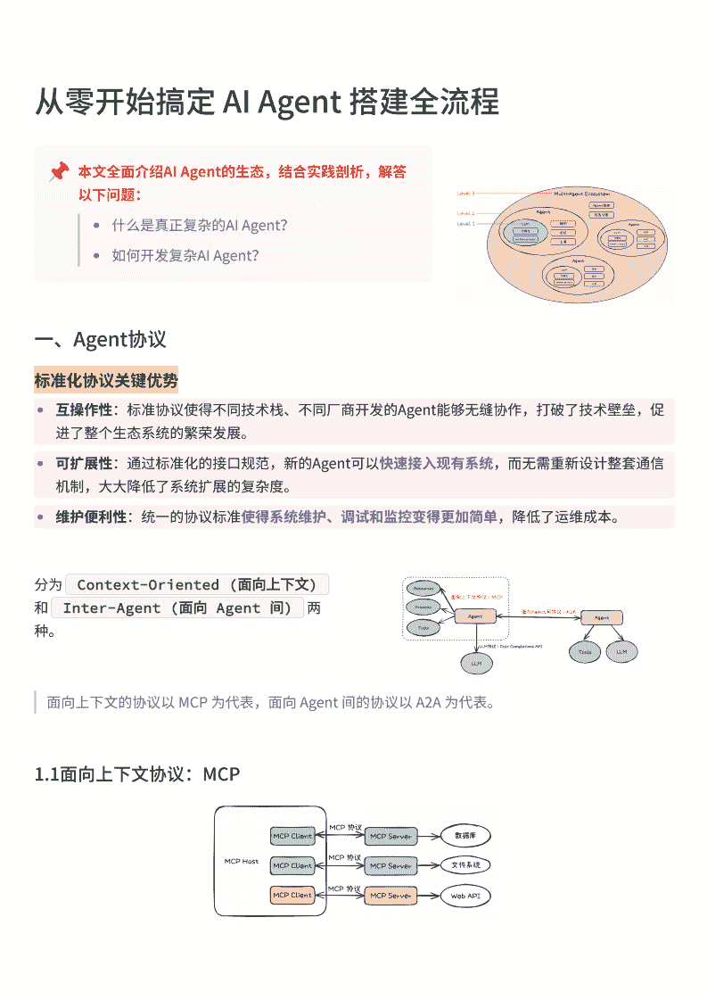

[从零开始搞定 AI Agent 搭建全流程.pdf](https://internal-api-drive-stream.feishu.cn/space/api/box/stream/download/all/UqVXbDBPioX5ZwxJwJMcMdo4ne7)

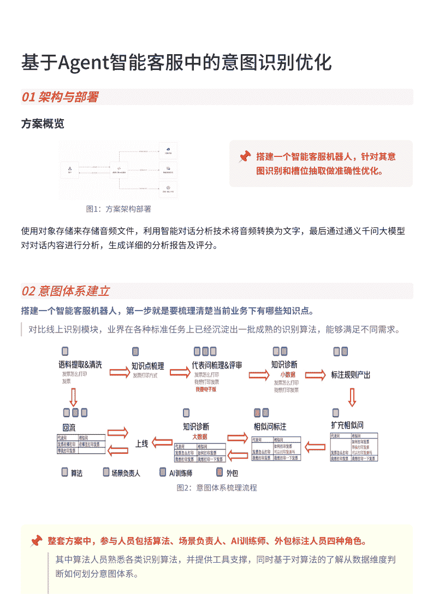

[基于Agent智能客服中的意图识别优化.pdf](https://internal-api-drive-stream.feishu.cn/space/api/box/stream/download/all/DCcdbbH8Gom2Qhxe6FRcJ833neh)

## Agentic LLM

[【LLM】Agentic Workflow的四种常见思路](https://qqs7y1hozd1.feishu.cn/wiki/BYk6wthDSiI5oKkVaoOcw1H9nfh)

[基于dify实践Agentic AI](https://qqs7y1hozd1.feishu.cn/wiki/LmQRww5Dci22IgkgUfYc9TMmnrd)

[动手搭建Agentic RAG工作流](https://qqs7y1hozd1.feishu.cn/wiki/NTu9wUvtgihfhxkiv6IcvnQdnGc)

[Agentic chunking：接近人类水平的RAG分块方法](https://qqs7y1hozd1.feishu.cn/wiki/Z1DYwbwMPih0ORksfJhcjqiWn8T)

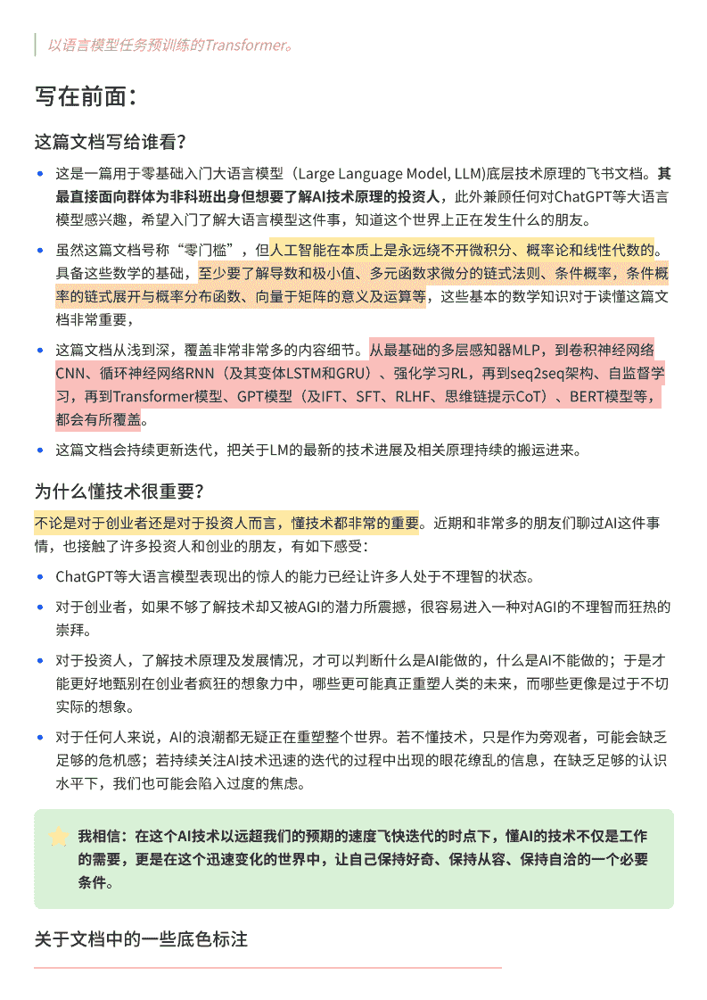

[LLM底层技术原理轻松入门.pdf](https://internal-api-drive-stream.feishu.cn/space/api/box/stream/download/all/BnBObzpbloz339xaQHtcvHi7nVg)

---

## **⚙️ **机器学习

[机器学习入门](https://qqs7y1hozd1.feishu.cn/wiki/V5T3wE17iiLYYwkYZ6pcHHZan4d)

[机器学习算法](https://qqs7y1hozd1.feishu.cn/wiki/VCPCwnVfpiHZSbkzQkOcfD0Dn1b)

[01回归算法（15个）](https://qqs7y1hozd1.feishu.cn/wiki/Z9X0wMVfjiE8agk1SnDcszztnuf)

[02分类算法（12个）](https://qqs7y1hozd1.feishu.cn/wiki/LxldwF9dZiVVShktIbHcvaZAn2d)

[03集成算法（12个）](https://qqs7y1hozd1.feishu.cn/wiki/KsV1wGVTFifObKkIkMJcVqrsnxf)

[04概率分布（13个）](https://qqs7y1hozd1.feishu.cn/wiki/JLqgwhD0ZipUK1k5Nu8cyo6yndg)

[05特征选择方法（10个）](https://qqs7y1hozd1.feishu.cn/wiki/Ar1Ew2n3LiZ3BVkKczzcAE30nif)

[06优化算法（13个）](https://qqs7y1hozd1.feishu.cn/wiki/XYBNwPusLiPbB0kFWckccHFZnXd)

[07聚类算法（10个）](https://qqs7y1hozd1.feishu.cn/wiki/E84OwjRjhilWghkLLblc3Xhwnyd)

[08强化学习（2个）](https://qqs7y1hozd1.feishu.cn/wiki/IwIxwXSAhi77FvkUYLwcF7NZnOg)

[09数据预处理（12个）](https://qqs7y1hozd1.feishu.cn/wiki/MXlXwHPTBiw0XokGuJfcdNB3nle)

[10损失函数（10个）](https://qqs7y1hozd1.feishu.cn/wiki/GgGvwpGbSijpkUkNk5XczbELn8W)

[11正则化方法（2个）](https://qqs7y1hozd1.feishu.cn/wiki/OUUgwloLdiWXfkkEk6Gc2bGDnSg)

[12机器学习模型评估方法（9个）](https://qqs7y1hozd1.feishu.cn/wiki/Zemlw3G7Cih8wUkwD7tcnMzjnzd)

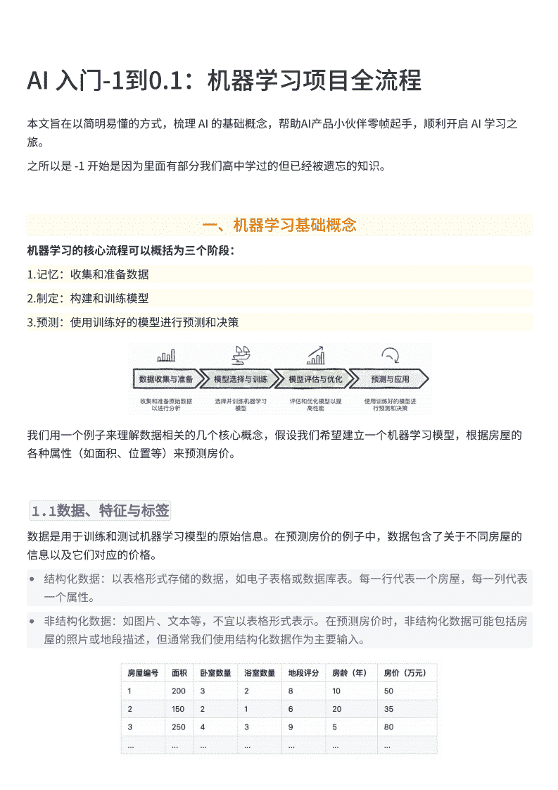

[AI 入门-1到0.1：机器学习项目全流程.pdf](https://internal-api-drive-stream.feishu.cn/space/api/box/stream/download/all/L4oQb7lFLodgAuxWHXicITNknRu)

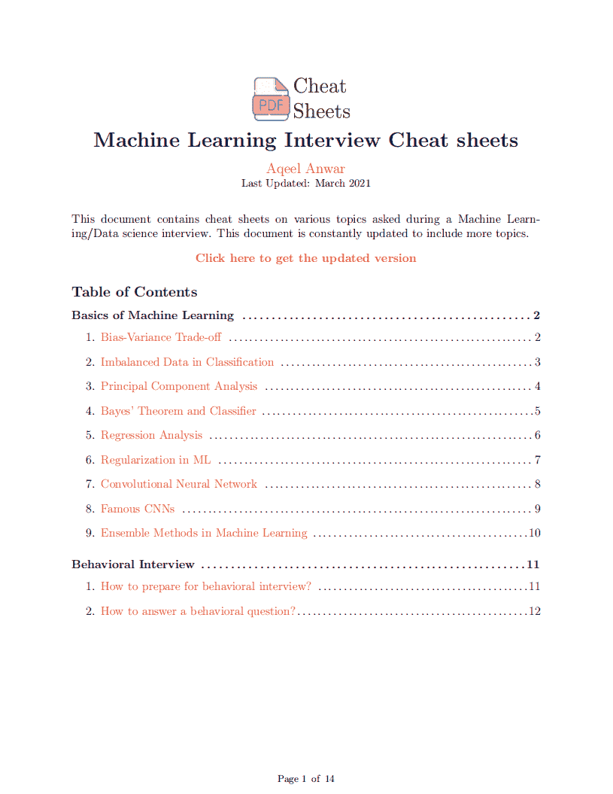

[Machine Learning Interview Cheat sheets (1).pdf](https://internal-api-drive-stream.feishu.cn/space/api/box/stream/download/all/QAf1bvw1Uo9RSPxBRx9c4vNMnKf)

---

## 📑 深**度学习**

[深度学习八大神经网络](https://qqs7y1hozd1.feishu.cn/wiki/Dw36wPvyBivltIkAn5qc09Q0nVf)

[17种常用激活函数汇总](https://qqs7y1hozd1.feishu.cn/wiki/FNu4wVAzBi1JDPkT5wocMalWnbh)

[神经网络损失函数详解](https://qqs7y1hozd1.feishu.cn/wiki/WaJ8w3bwOibbfFkzmvNcS2Z5nWd)

[深度学习应用实操](https://qqs7y1hozd1.feishu.cn/wiki/S97XwMLJPio30DkjfU0cWOMnnVc)

[深度学习100例](https://qqs7y1hozd1.feishu.cn/wiki/TrJGwfjKHiVZx4kBfCMckUQfnue)

[深度学习调参](https://qqs7y1hozd1.feishu.cn/wiki/PVssw592hipXZGkQUS6coZzmnDc)

[深度学习面试题](https://qqs7y1hozd1.feishu.cn/wiki/KctewBjfHiuqgZk4NzXc9FQHnLc)

[深度学习项目落地](https://qqs7y1hozd1.feishu.cn/wiki/ED0rwMXFpi0xcokS0IPc6FWunKd)

[0.PyTorch 入门](https://qqs7y1hozd1.feishu.cn/wiki/YK3jwgscdiCbAykueFgcCVMNnCb)

[1.深度学习入门基础](https://qqs7y1hozd1.feishu.cn/wiki/LB4KwWEYqi3CRBk69t9c8JignCG)

[2.卷积神经网络](https://qqs7y1hozd1.feishu.cn/wiki/TmMzwEGQFitRXMkxJZLchjDOnIs)

[3.循环神经网络](https://qqs7y1hozd1.feishu.cn/wiki/JOyYwLhfoiZcTfkgx2qcira0nfb)

[4.自注意力机制](https://qqs7y1hozd1.feishu.cn/wiki/V7jMwxh7Ai17VvkEz6hcTUSynHc)

[6.扩散模型](https://qqs7y1hozd1.feishu.cn/wiki/OOMbw52zciWNZzk3F28cNpZjnzh)

[7.模型训练与优化](https://qqs7y1hozd1.feishu.cn/wiki/AzaAwjZp6iLfUzkPQN7cLKZWnEf)

[8.深度学习项目实操](https://qqs7y1hozd1.feishu.cn/wiki/ZhvRwn4D8i4NmLkTQ99cCSbvnKd)

[9.深度学习面试一览](https://qqs7y1hozd1.feishu.cn/wiki/XeRLwUhw2id2R2kNrHXc0Gucnpg)

[其他资料](https://qqs7y1hozd1.feishu.cn/wiki/HHZGwO1QKiGDh0kf8fPcmCRkneg)

---

# [AI实战项目与实践](https://qqs7y1hozd1.feishu.cn/wiki/J9QxwpJbXi5I1jk2YDDckpaonie)

[AI Agent典型项目 ](https://qqs7y1hozd1.feishu.cn/wiki/C3LWwKLZ4iR1VgkkR4ncE5Pon8c)

[企业级稳定可部署的AI agent ](https://qqs7y1hozd1.feishu.cn/wiki/C6iZwnKGfiSsMWkaZ4rcIQBKnHe)

[电商智能客服Agent](https://qqs7y1hozd1.feishu.cn/wiki/FnxfwQlULiYrnlk1tK8cyH8tnAb)

[运维智能体Agent](https://qqs7y1hozd1.feishu.cn/wiki/IKlvwDpWoiO8ZKk1SVZcllocnLe)

[物流智能体Agent](https://qqs7y1hozd1.feishu.cn/wiki/P45twg0RZiQGM3kbz6ac9gk4nef)

[数据分析智能体Agent](https://qqs7y1hozd1.feishu.cn/wiki/Vt6GwXHZbiC62hkNYMvc45Qnnrg)

[医疗智能体Agent](https://qqs7y1hozd1.feishu.cn/wiki/WOzXwzPP5iNWITk0iWGcx7eCnee)

[学业辅导智能体Agent](https://qqs7y1hozd1.feishu.cn/wiki/TvYLwF0LQi0WLlknMqzcYaH6nZD)

[AI智能问诊系统（基于LLM大模型）](https://qqs7y1hozd1.feishu.cn/wiki/WEelwBJDBimseXkRumccDUtNnCh)

[TradingAgents：多智能体LLM金融Agent](https://qqs7y1hozd1.feishu.cn/wiki/EHszwTJWBi3BJWk5XJic4Ff2nh2)

[舆情分析Agent：AI 舆情 Agent](https://qqs7y1hozd1.feishu.cn/wiki/Lqn9wHAFHiyqpDkPmYWcTh2Qn3c)

[多Agent智能教育与个性化学习系统](https://qqs7y1hozd1.feishu.cn/wiki/MudwwxPbui30ymkGUyHcXj8Unhb)

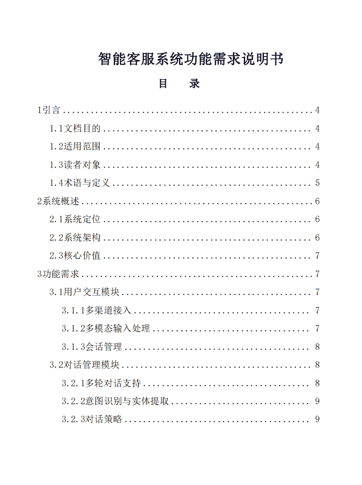

[智能客服系统功能需求说明书.pdf](https://internal-api-drive-stream.feishu.cn/space/api/box/stream/download/all/MaqpbvBUcotbIQxjyeDcCcczn9f)

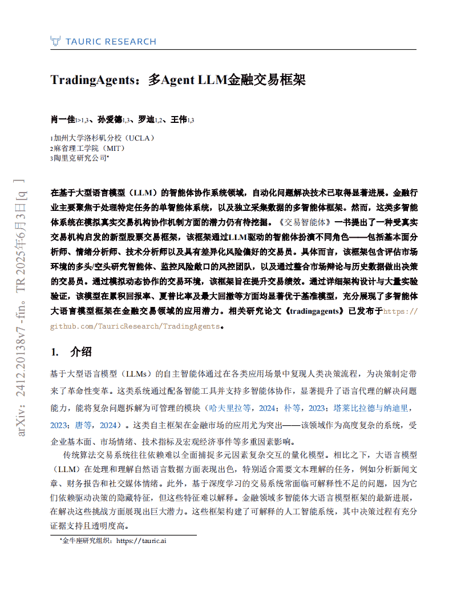

[TradingAgents_translated.pdf](https://internal-api-drive-stream.feishu.cn/space/api/box/stream/download/all/EXuKbBgoZoNiBGxjB4ncKsmen1g)

多维表格（QFQ2bmW5XamvChscvYscpH6KnYd_tblBGr5KONnFMgg0）

多维表格（QFQ2bmW5XamvChscvYscpH6KnYd_tbl0zR4Otkl7VlYO）

多维表格（QFQ2bmW5XamvChscvYscpH6KnYd_tblqpX4oQBGfQGvg）

---

# 📖   年度行业报告

### 👉更**多行业报告： **

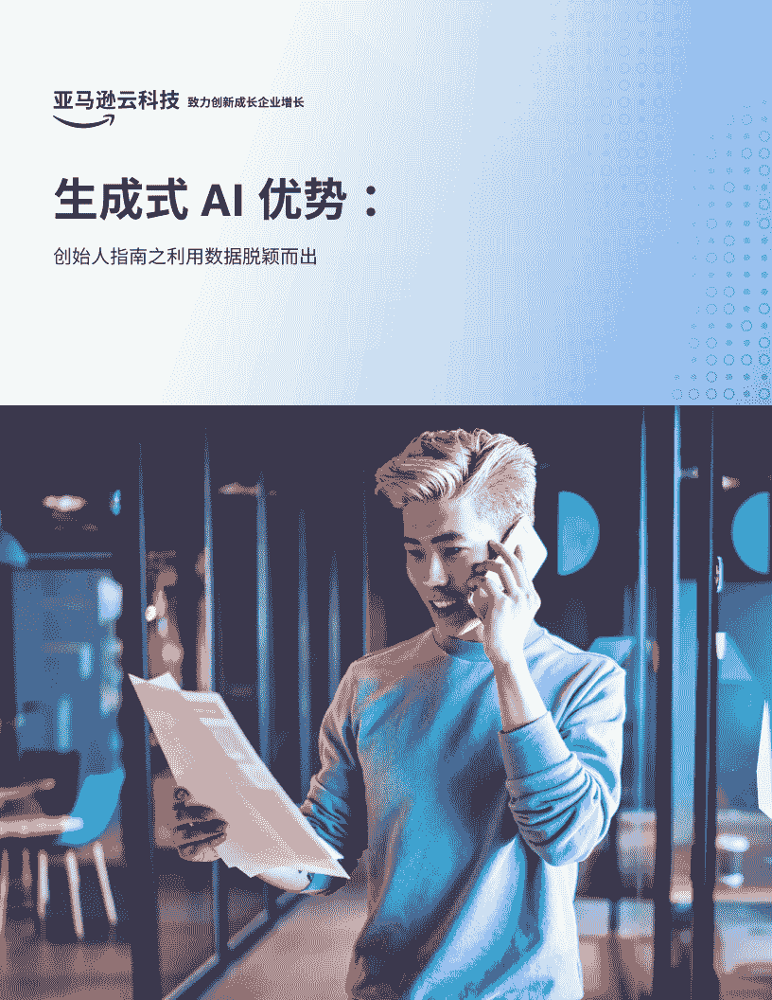

[生成式 AI 优势 ：创始人指南之利用数据脱颖而出.pdf](https://internal-api-drive-stream.feishu.cn/space/api/box/stream/download/all/FKlSbttrSocwNuxUEDtcienAnlh)

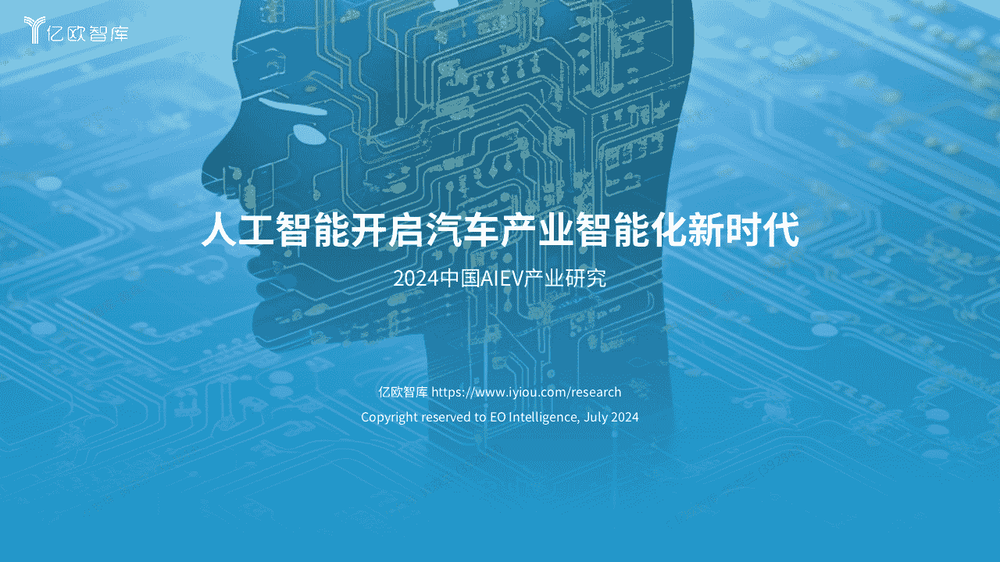

[【亿欧智库】人工智能开启汽车产业智能化新时代—2024AIEV产业研究.pdf](https://internal-api-drive-stream.feishu.cn/space/api/box/stream/download/all/ZsRmb7zMMoFgYmxu9dCcPuoHnwA)

---

# 📄 AI+产品设计

### Gemini 3 产品设计

[用Gemini 3 生成PRD产品需求文档](https://qqs7y1hozd1.feishu.cn/wiki/WAqIw2Xusi63rwkrrJecElpBnBe)

[Gemini 3 Pro 两步生成产品原型图](https://qqs7y1hozd1.feishu.cn/wiki/EQ50wJ9PfiY1PHkpbHac88uTnzg)

[用 Gemini 3 做产品设计](https://qqs7y1hozd1.feishu.cn/wiki/DZxtwEomVivOWXkRRYQcnsS4nK3)

[Gemini3生成的项目简单部署上线](https://qqs7y1hozd1.feishu.cn/wiki/QaeAwtFyBibAKMkrSgGc1818nff)

[从零开始构建一个基于Gemini3的AI Agent](https://qqs7y1hozd1.feishu.cn/wiki/CzRFw7396ieshtkRrA7cWHuxngd)

[Gemini 3 生成PRD产品需求文档](https://qqs7y1hozd1.feishu.cn/wiki/Z33jwLqRNicB8BkApFTciFMan3b)

### Claude Code 产品设计

[从创意到 AI 产品](https://qqs7y1hozd1.feishu.cn/wiki/S8JdwcP4yin8mRkT0hSc72tOn8f)

[动手做出原型](https://qqs7y1hozd1.feishu.cn/wiki/UI0jwyBzai532wk9OphcSNjankg)

[为原型注入 AI 能力](https://qqs7y1hozd1.feishu.cn/wiki/YsM9wt4ifiE5b3kJGAKc8AUonVe)

[完整项目实战](https://qqs7y1hozd1.feishu.cn/wiki/EhABw5gYGibdgsk4lcBcyzitnqc)

[用设计和编程 Agent 设计网站](https://qqs7y1hozd1.feishu.cn/wiki/B3Nzw6WeRishy6kWFfvcXlH1ncg)

[用 Cursor 两步搞定产品原型图](https://qqs7y1hozd1.feishu.cn/wiki/N8Xowj5Q5ifbfVkcfeRc7GSInOb)

### 更多AI+产品设计

[让你的AI变成专业的产品经理](https://qqs7y1hozd1.feishu.cn/wiki/L1c9wpQb7i02kOk2BiZctqpdnSe)

[原型图案例：APP原型素材解析与模版](https://qqs7y1hozd1.feishu.cn/wiki/Dnejwd1iIir84MkU4eOctxtUnhf)

[从原型到交付：3大AI功能助力产品设计高效落地](https://qqs7y1hozd1.feishu.cn/wiki/ST7SwcBPtij9cAkFU3acd7HDnV2)

[小程序原型设计指南：AI生成原型图+标准组件库](https://qqs7y1hozd1.feishu.cn/wiki/LUhvwnygKi9moskUATgci6ionVc)

[如何用变量打造动态交互原型？3大应用场景解析](https://qqs7y1hozd1.feishu.cn/wiki/GmXkwyb3rijYVckeKVucu6elnaf)

[产品经理设计B端系统的8个核心步骤与工具推荐](https://qqs7y1hozd1.feishu.cn/wiki/UYMUwxaWeiD1RUkHbU2cmR9snRh)

[6个值得收藏的医院后台管理系统原型设计案例](https://qqs7y1hozd1.feishu.cn/wiki/DGQDwlEJliI9qCkHxRvcpH4pnlT)

[K12在线教育APP原型设计怎么做？实战案例分享](https://qqs7y1hozd1.feishu.cn/wiki/TqTLwKEKyi4JAikjCOzcKMPrnGe)

# 📄 大厂面经

[AI产品经理面经](https://qqs7y1hozd1.feishu.cn/wiki/AE6IwSoROiHLpvkZaLIcqdeEnFb)

[产品经理面试题100题](https://qqs7y1hozd1.feishu.cn/wiki/CCpSwRIxHiI8iGkny1BccTLnnMf)

[Al智能客服系统面试 ](https://qqs7y1hozd1.feishu.cn/wiki/G150wZ7sxi7TTokqxMScFd0Mnrh)

[AI大模型Agent面试，超详细（➕答案）！](https://qqs7y1hozd1.feishu.cn/wiki/ZXhDwYrwOivEGikTxflcVxyunRg)

[AI产品经理面试100问 ](https://qqs7y1hozd1.feishu.cn/wiki/OxkXwe8FVioYEHkt71rcJjtcnWg)

[智谱AI产品经理笔试真题](https://qqs7y1hozd1.feishu.cn/wiki/JmtMwqKnkiP3ydkWCIgc6TMvnKf)

[大厂产品经理面试题（100题） ](https://qqs7y1hozd1.feishu.cn/wiki/ZW3lw6czYi2ek4kznUxcq6cwnNg)

[大厂高频产品经理面经](https://qqs7y1hozd1.feishu.cn/wiki/SokswvutFiI7JqkGj1jc36Xlnrb)

[大厂AI产品经理面经精选20题](https://qqs7y1hozd1.feishu.cn/wiki/WscRwm5QGiJ5hLkLbZicFtj0nFb)

[大语言模型面试常见问题 .pdf](https://qqs7y1hozd1.feishu.cn/wiki/BT5jwsuwoinMnMkMLa0cTOkInze)

[产品经理面试高频题](https://qqs7y1hozd1.feishu.cn/wiki/MjWUwXfvFih1vykfIJgcmpRLnkb)

[鹅厂产品面经 ( 已offer )](https://qqs7y1hozd1.feishu.cn/wiki/GPwjwBG8ziMYVhkM3L9cstFvnTd)

[推荐系统面试中最常见的问题 ](https://qqs7y1hozd1.feishu.cn/wiki/WZfwwRfeIiz2C7k8UdMcpK53nmg)

[Transformer面试问题汇总 ](https://qqs7y1hozd1.feishu.cn/wiki/B7fCw8YTUizSeOkoGHhcfC8DnYN)

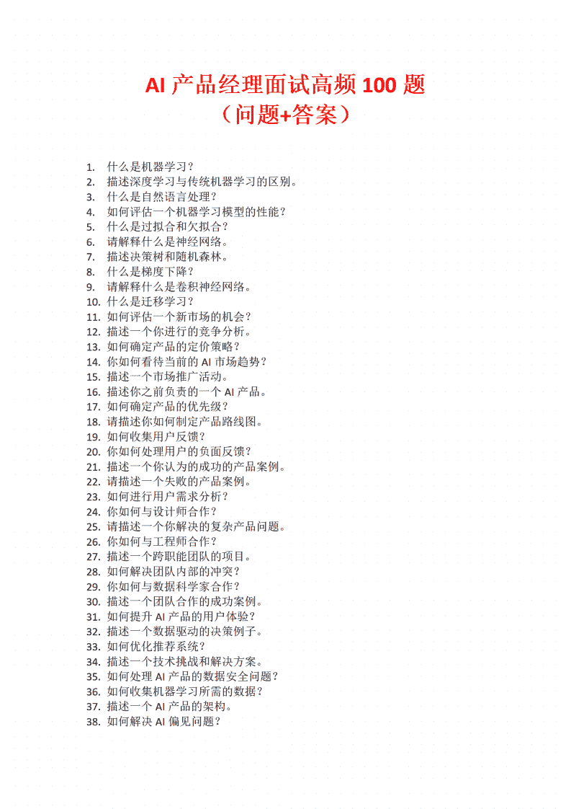

[ai产品经理面试高频100题.pdf](https://internal-api-drive-stream.feishu.cn/space/api/box/stream/download/all/UBp6bTREHowAGPxmepKcCzbInib)

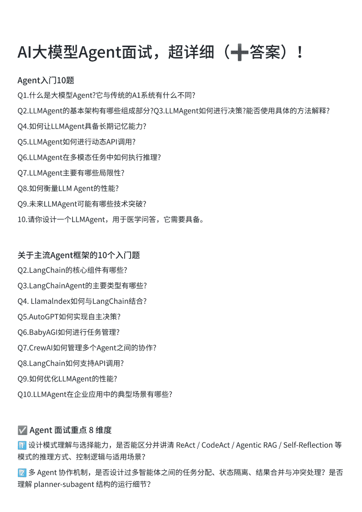

[AI大模型Agent面试，超详细（➕答案）！.pdf](https://internal-api-drive-stream.feishu.cn/space/api/box/stream/download/all/J70ibrfzkopjNWxftC9cQZuAnrb)

---

# 🤝 加入社群

### **知识库地址：**[Mark的AI产品经理知识库「持续更新」](https://qqs7y1hozd1.feishu.cn/wiki/QnPwwpKgKiGpFCkUrs7ciMIbnff?from=from_copylink)

# 🔗 友情链接

> **与我们联系：**[**两光年—Mark**](https://qqs7y1hozd1.feishu.cn/wiki/FLvLw0NvJiKVFTk0AOVc95vYnUd)**   **        🛰️号：AIGC6789