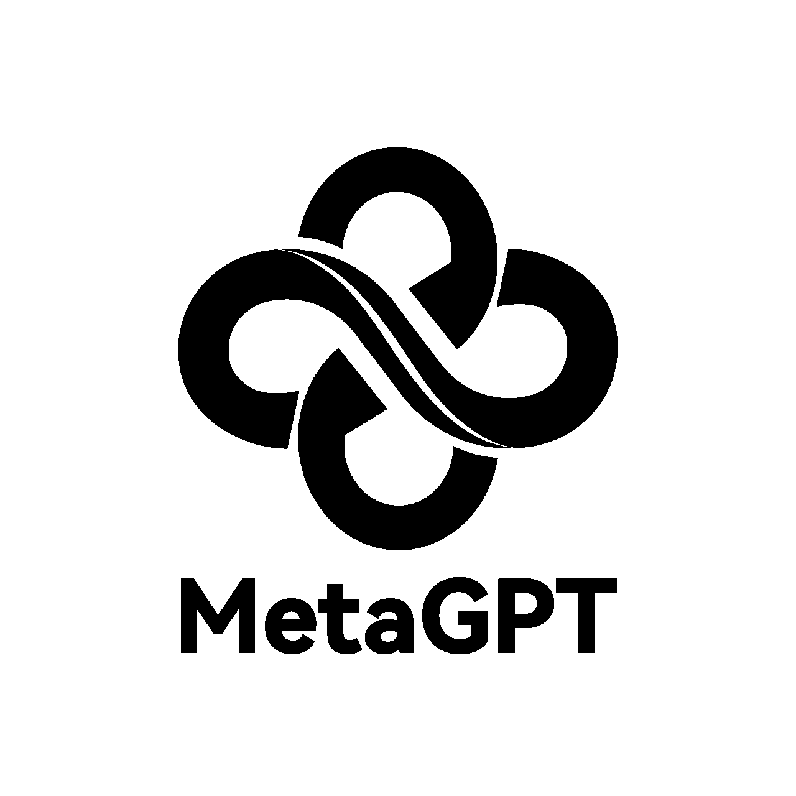
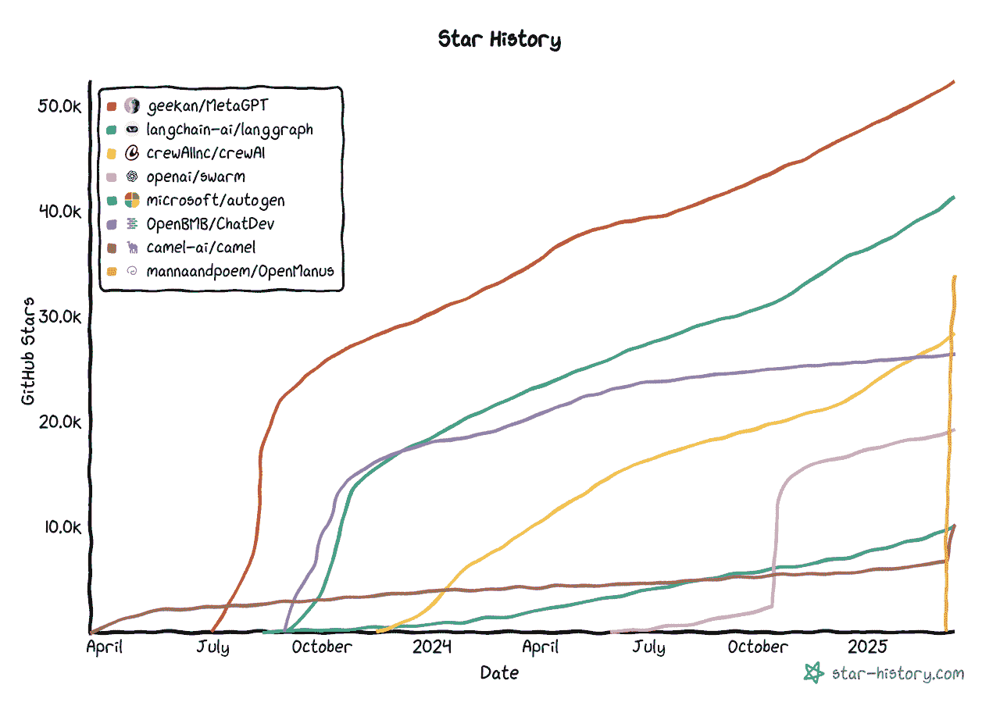

# MetaGPT

> 来源：[https://deepwisdom.feishu.cn/docx/NjnydhUIqoQnnxxG0RwconiSnVe](https://deepwisdom.feishu.cn/docx/NjnydhUIqoQnnxxG0RwconiSnVe)

## **MetaGPT: 多智能体框架**

> 提供第一家人工智能软件公司，朝向自然语言编程的方向

> MetaGPT 中文文档站现已上线飞书社区，欢迎大家阅读：MetaGPT 开源（飞书）社区



1.  MetaGPT 输入**一句话的老板需求**，输出**用户故事 / 竞品分析 / 需求** / 数据结构 / APIs / 文件等

1.  MetaGPT 内部包括产品经理 / **架构师 **/ 项目经理 / 工程师，它提供了一个软件公司的全过程与精心调配的 SOP

1.  Code = SOP(Team) 是核心哲学。我们将 SOP 具象化，并且用于 LLM 构成的团队


1.  代码：https://github.com/geekan/MetaGPT

1.  Roadmap: https://github.com/geekan/MetaGPT/blob/main/docs/ROADMAP.md

## 最新消息

🌟 xxxx 年 x 月 x 日：vx.x 版本正式发布！全球首个 AI 开发团队宣布正式开源，全球用户现在可以直接在自己电脑的命令行中与他们进行对话！

```
metagpt &quot;你好呀，好久不见，没想到能在这里见到你们&quot;

&#x27;你好！很高兴在这里见到你，确实有段时间没见了，真实意外的惊喜能在这个平台上相遇。

我是Mike, 团队负责人。我们团队随时准备为您提供帮助。有什么我可以协助您的吗？无论是产品需求、系统设计、还是数据分析、分析报告，请随时告诉我，我很乐意为您服务&#x27;
```

🌟 2025 年 3 月 8 日：MetaGPT Github 获得 50k+ 星标

🌟 2025 年 3 月 7 日：OpenManus 正式开源

[🚀 ](https://x.com/MetaGPT_/status/1892199535130329356)2025 年 2 月 1[9 日：正式推出我们的自然语言](https://mgx.dev/)编程产品：MGX （MetaGPT X） - 全球首个 AI 多智能体开发团队。

[🚀 2](https://arxiv.org/pdf/2502.06855)025[ 年 ](https://arxiv.org/pdf/2502.12018)2 月 1[7 ](https://github.com/geekan/MetaGPT/blob/main/examples)日：我们发布了两篇论文：SPO 和 AOT，欢迎查看代码！

🚀 2025 年 1 月 22 日：论文《AFlow：自动化智能体工作流生成》被接收为 ICLR 2025 口头报告（前 1.8%），在基于大语言模型的智能体类别中排名第 2。

[🚀 202](https://arxiv.org/abs/2410.10762)4 [年 10](https://arxiv.org/abs/2410.21012) 月 2[9 日：](https://arxiv.org/abs/2410.17238)MetaGPT[ 发布三](https://github.com/geekan/MetaGPT/blob/main/examples)篇工作 AFLOW， FACT， 和 SELA， 代码开源：code！

🌟 2024 年 5 月 20 日[：MetaGP](https://mp.weixin.qq.com/s/3LTOZOxKKsfjyeY5kudGKQ)T Github 获得 40K+ 星标

[🚀 2024](https://github.com/geekan/MetaGPT/releases/tag/v0.8.0) 年 3 月 29 日：v0.8.0 版本正式发布，现在可通过 PyPI 包直接导入并使用数据解析器功能。同时，我们整合了 RAG 模块，并支持对接多种最新的大型语言模型

🚀 2024 年 3 月 14 [日：我们的](https://arxiv.org/abs/2402.18679)“数据解析器”研究论文[已在](https://docs.deepwisdom.ai/main/en/DataInterpreter/) a[rX](https://github.com/geekan/MetaGPT/tree/main/examples/di)iv 上线，欢迎查看其中的实例与源代码

[🚀 2024](https://github.com/geekan/MetaGPT/releases/tag/v0.7.0) 年 2 月 8 日：v0.7.0 版本更新，新[增了为不同](https://github.com/geekan/MetaGPT/blob/main/examples/di/README.md)角色灵活配置不同大型语言模型的功能，并隆重推出了全能型工具 - 数据解析器，它能有效应对各种现实生活中的复杂问题

🚀 2024 年 1 月 16 日：论文《MetaGPT：面向多智能体协作框架的元编程方法》在 ICLR 2024 大会上被选为口头报告（oral），仅占总投稿的前 1.2%，并在基于大型语言模型的智能体类别中拔得头筹

[🚀 2024](https://github.com/geekan/MetaGPT/releases/tag/v0.6.0) 年 1 月 3 日：v0.6.0 版本升级[，增添了序列化功能，更新了](https://github.com/geekan/MetaGPT/blob/main/examples/debate_simple.py) OpenAI 包支持更多大型语言模型，并提供了简洁易懂的辩论场景演示代码

[🚀 2023](https://github.com/geekan/MetaGPT/releases/tag/v0.5.0) 年 12 月 15 日：v0.5.0 版本推出，试验性引入了增量开发、多语种支持及针对多种编程语言的兼容性等功能

[🔥 2023 年 11 月 ](https://www.benchcouncil.org/evaluation/opencs/annual.html)8 日：MetaGPT 荣获“Open100 开源百强成果”殊荣

🔥 2023 年 9 月 1 日：Me**taGPT 在** 2023 年 8 月份连续 17 次登上 GitHub 月度热门榜单

🌟 2023 年 6 月 30 日：MetaGPT 正式开源

🌟 2023 年 4 月 24 日：MetaGPT 项目的首行代码成功提交入库



## 新手须知

MetaGPT 是一个多智能体开源框架，旨在实现自然语言编程。欢迎来到 MetaGPT 中文社区开源文档站，你将在这里找到所有关于 MetaGPT 的信息。并且我们欢迎社区的小伙伴共同参与建设，有任何问题欢迎评论留言。

+   [新手须知](https://deepwisdom.feishu.cn/wiki/MDsZwOsV5iOkJikHRBKcfYiEnNY)果你刚开始接触 M[安装教程](https://deepwisdom.feishu.cn/wiki/C2H3wIluSiVPClkPddqcVDyOnzf)taGPT[快速开始](https://deepwisdom.feishu.cn/wiki/RjugweZ2liBiNokCRSwcztKFnjh)[社区加入](https://deepwisdom.feishu.cn/wiki/DhbBwq4dzirCYOkzdLQc9qeGnug)[第四面墙](https://deepwisdom.feishu.cn/wiki/Oimhwi4M7iJsjQkhD79cv6Ucnqb)你首先阅读 下的内容，你将知道 ，以及通过 来了解如何使用 MetaGPT。并且如果有任何问题可以通过 来找到组织。如果你有很棒的想法，通过  欢迎加入我们，一起提升这个框架，我们的下一个目标是成为 GitHub 上的 50k 星项目！

+   如果你已经安装了 MetaGPT，但是想要进一步了解框架[新手任务](https://deepwisdom.feishu.cn/wiki/Pn0OwFQhoiwgbdkXsT7cD17gn9f)内容，或者进行智能体的学习，欢迎来领取 ！

+   [进阶技能](https://deepwisdom.feishu.cn/wiki/PYtBwAAyqiRTD0kvCvFcWL24nJb)你熟悉上手了 MetaGPT 后， 已准备就绪，你可以更深入地体验 MetaGPT。

+   如果有空闲时间，快来挑战[副本任务](https://deepwisdom.feishu.cn/wiki/WvwIwXUdRim2X9kmWIocCdS7n9c)吧！

+   你还可能对以下内容感兴趣：[创意工坊](https://deepwisdom.feishu.cn/wiki/T0KywjQkXihK2ukLfr5cQBSinqd)、[讨论区](https://deepwisdom.feishu.cn/wiki/ZRrBwUWdXiTDDnkwAZacew5Xnne)、以及[常见疑问](https://deepwisdom.feishu.cn/wiki/Bm5gw20sTit6ook6yRGcC84tnmc)。

+   [创意工坊](https://deepwisdom.feishu.cn/wiki/T0KywjQkXihK2ukLfr5cQBSinqd)内有非常有趣的[数据解释器](https://deepwisdom.feishu.cn/wiki/Praxw5RxEi4NgGkrofJc54QdnXg) 和 [UI 集成 - Chainlit](https://deepwisdom.feishu.cn/wiki/AluWwOlOMim9g3ksEOJcpwMmnEF)，可能会让你感到惊喜！