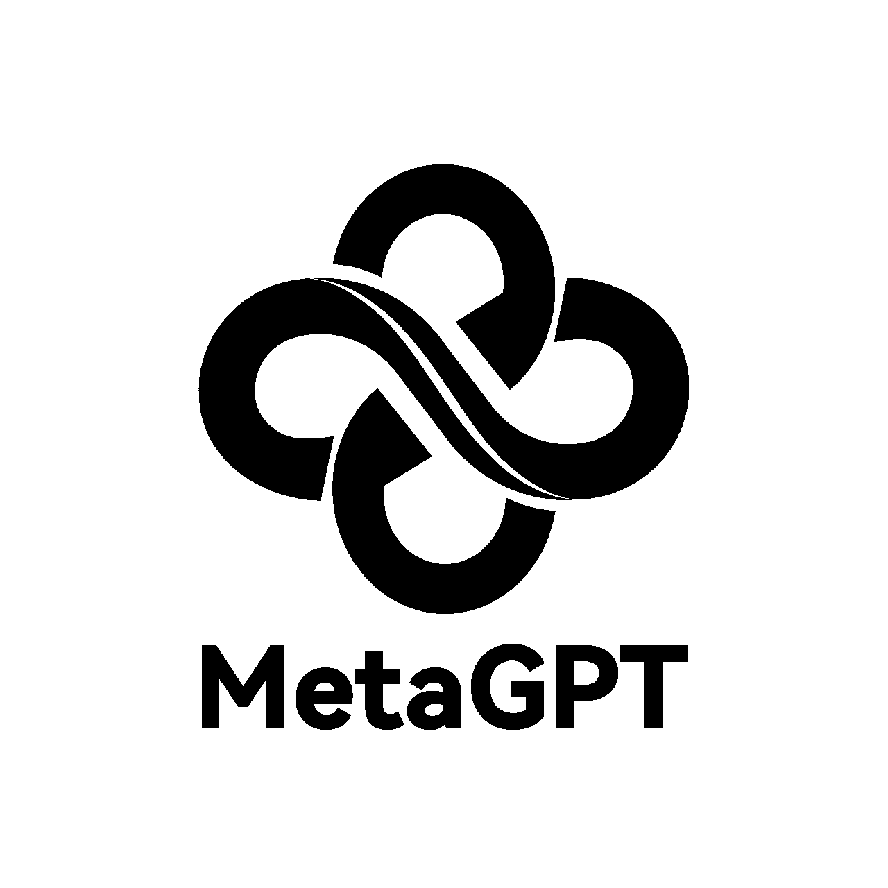
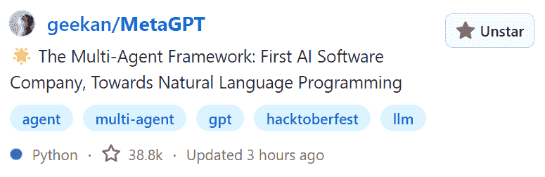

# 新手须知

> 来源：[https://deepwisdom.feishu.cn/docx/JxCPdEvoeotz51xI1uNcowVgnHS](https://deepwisdom.feishu.cn/docx/JxCPdEvoeotz51xI1uNcowVgnHS)

## **MetaGPT: 多智能体框架**

> 通往自然语言编程 - 让每个人都能把想法变为代码

1.  MetaGPT 输入**一句话的老板需求**，输出**用户故事 / 竞品分析 / 需求** / 数据结构 / APIs / 文件等

1.  MetaGPT 内部包括产品经理 / **架构师 **/ 项目经理 / 工程师，它提供了一个软件公司的全过程与精心调配的 SOP

1.  Code = SOP(Team) 是核心哲学。我们将 SOP 具象化，并且用于 LLM 构成的团队

1.  代码：https://github.com/geekan/MetaGPT

1.  Roadmap: https://github.com/geekan/MetaGPT/blob/main/docs/ROADMAP.md

## 常用链接

1.  官网：

1.  GitHub:

1.  官方文档站：

1.  BiliBili:

1.  推特：https://twitter.com/MetaGPT_

1.  Discord: https://discord.gg/NMrp44aahe

1.  Linkedin: [https://www.linkedin](https://www.linkedin.com/company/metagpt).com/company/metagpt

1.  FaceBook: https://www.facebook.com/profile.php?id=61552651744686

## 🗡 进入新手村