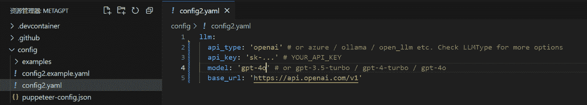

# 大模型 API 配置

> 来源：[https://deepwisdom.feishu.cn/docx/DYk2dpGgfoQkzexE78fcrW1Qn0e](https://deepwisdom.feishu.cn/docx/DYk2dpGgfoQkzexE78fcrW1Qn0e)

> 本节中，我们将学习如何**配置大模型 API**，为智能体注入灵魂

# OpenAI API

我们以 OpenAI API 为例说明配置过程，其他大模型的 API 配置过程是相同的。

## 使用config2.yaml

> **如果您按照**[**安装**](https://deepwisdom.feishu.cn/wiki/C2H3wIluSiVPClkPddqcVDyOnzf)**中的****git clone****方法，****则****config/**config2.yaml 文件已存在。

> **只需编辑它或创建一个名为****~/.metagpt/config2.**yaml的副本进行编辑。这样您就不会意外地使用 git 提交和共享您的 API 密钥。

> MetaGPT 将按照以下优先顺序读取您的配置：

> **~/.metagpt/config2.yaml >** config/config2.yaml

1.  （如果没有）在当前工作目录中创建一个名为config的文件夹，并在其中添加一个名为config2.yaml的新文件。

1.  将示例[ config2.yaml ](https://github.com/geekan/MetaGPT/blob/main/config/config2.yaml)文件的内容复制到您的新文件中。

1.  在 yaml 文件中填入：

```
llm:
  api_type: &#x27;openai&#x27; # or azure / ollama / groq etc. Check LLMType for more options
  model: &#x27;gpt-4-turbo&#x27; # or gpt-3.5-turbo
  base_url: &#x27;https://api.openai.com/v1&#x27; # or forward url / other llm url
  api_key: &#x27;YOUR_API_KEY&#x27;
  # proxy: &#x27;YOUR_LLM_PROXY_IF_NEEDED&#x27; # Optional. If you want to use a proxy, set it here.
  # pricing_plan: &#x27;YOUR_PRICING_PLAN&#x27; # Optional. If your pricing plan uses a different name than the `model`.
```

结果将类似如下：



## OpenAI o1 模型配置

```
llm:
  api_type: &#x27;openai&#x27;
  api_key: &#x27;sk-...&#x27;
  model: &#x27;o1-mini&#x27;
  use_system_prompt: false
  stream: false
```

## 测试效果

可以创建一个文件并运行如下代码，若终端中打印出回复，则说明配置成功：

```
from metagpt.llm import LLM
import asyncio
llm = LLM()
asyncio.run(llm.aask(&quot;你是什么模型&quot;))
```

MetaGPT 还支持各种 LLM 模型，可以根据您的需求配置模型 API 的密钥。

# Anthropic / Claude API

支持模型名列表在 token_counter.py 的claude-*

```
llm:
  api_type: &#x27;claude&#x27; # 或 anthropic
  base_url: &#x27;https://api.anthropic.com&#x27;
  api_key: &#x27;YOUR_API_KEY&#x27;
  model: &#x27;claude-3-opus-20240229&#x27;
```

# 智谱 API

访问 [llm_config.py](https://github.com/geekan/MetaGPT/blob/main/metagpt/configs/llm_config.py) 获得更新详情。

```
llm:
  api_type: &#x27;zhipuai&#x27;
  api_key: &#x27;YOUR_API_KEY&#x27;
  model: &#x27;MODEL_NAME&#x27;
```

# 科大讯飞的大模型 Spark API：

访问 [llm_config.py](https://github.com/geekan/MetaGPT/blob/main/metagpt/configs/llm_config.py) 获得更新详情。星火认知大模型Web API文档 | 讯飞开放平台文档中心

```
llm:
  api_type: &#x27;spark&#x27;
  app_id: &#x27;YOUR_APPID&#x27;
  api_key: &#x27;YOUR_API_KEY&#x27;
  api_secret: &#x27;YOUR_API_SECRET&#x27;
  domain: &#x27;generalv3.5&#x27; 
  base_url: &#x27;ws(s)://spark-api.xf-yun.com/v3.5/chat&#x27;
```

# Azure OpenAI API

访问 [llm_config.py](https://github.com/geekan/MetaGPT/blob/main/metagpt/configs/llm_config.py) 获得更新详情。

```
llm:
  api_type: &#x27;azure&#x27;
  base_url: &#x27;YOUR_AZURE_BASE_URL&#x27;
  api_key: &#x27;YOUR_API_KEY&#x27;
  api_version: &#x27;YOUR_API_VERSION&#x27; # such as &#x27;2024-03-01-preview&#x27;
  model: &#x27;YOUR_MODEL_NAME&#x27; # or YOUR_DEPLOYMENT_NAME
```

# 谷歌 Gemini

默认支持模型gemini-pro

```
llm:
  api_type: &#x27;gemini&#x27;
  api_key: &#x27;YOUR_API_KEY&#x27;
  model: &#x27;gemini-pro&#x27;
```

# 百度 千帆 API

支持ERNIE-*模型和部分主流开源模型，见 token_counter.py

## 使用model进行调用

[如何获取Access Key](https://cloud.baidu.com/doc/Reference/s/9jwvz2egb)

```
llm:
  api_type: &#x27;qianfan&#x27;
  access_key: &#x27;YOUR_ACCESS_KEY&#x27;
  secret_key: &#x27;YOUR_SECRET_KEY&#x27;
  model: &#x27;ERNIE-4.0-8K-0329&#x27;
```

## 使用endpoint进行调用

```
llm:
  api_type: &#x27;qianfan&#x27;
  access_key: &#x27;YOUR_ACCESS_KEY&#x27;
  secret_key: &#x27;YOUR_SECRET_KEY&#x27;
  endpoint: &#x27;YOUR_ENDPOINT_NAME like ernie_speed&#x27;
```

# 阿里云 灵积 DashScope API

支持qwen-*模型和部分主流开源模型，见 token_counter.py

```
llm:
  api_type: &#x27;dashscope&#x27;
  api_key: &#x27;YOUR_API_KEY&#x27;
  model: &#x27;qwen2.5-coder-32b-instruct&#x27;
```

# 月之暗面 Moonshot / Kimi API

支持 moonshot-v1-*模型，见 token_counter.py

```
llm:
  api_type: &#x27;moonshot&#x27;
  base_url: &#x27;https://api.moonshot.cn/v1&#x27;
  api_key: &#x27;YOUR_API_KEY&#x27;
  model: &#x27;moonshot-v1-8k&#x27;
```

# Fireworks API

支持 Fireworksmodels 模型，见 token_counter.py

```
llm:
  api_type: &#x27;fireworks&#x27;
  base_url: &#x27;https://api.fireworks.ai/inference/v1&#x27;
  api_key: &#x27;YOUR_API_KEY&#x27;
  model: &#x27;accounts/fireworks/models/llama-v2-13b-chat&#x27;
```

# Mistral API

支持 Mistralmodels 模型，见 token_counter.py

```
llm:
  api_type: &#x27;mistral&#x27;
  base_url: &#x27;https://api.mistral.ai/v1&#x27;
  api_key: &#x27;YOUR_API_KEY&#x27;
  model: &#x27;open-mixtral-8x7b&#x27;
```

# Yi / 零一万物 API

支持模型名列表，见 token_counter.py

```
llm:
  api_type: &#x27;yi&#x27;
  base_url: &#x27;https://api.lingyiwanwu.com/v1&#x27;
  api_key: &#x27;YOUR_API_KEY&#x27;
  model: &#x27;yi-large&#x27;
  max_token: 4000
```

# ollama API

```
llm:
  api_type: &#x27;ollama&#x27;
  base_url: &#x27;http://127.0.0.1:11434/api&#x27;
  model: &#x27;llama2&#x27;
```

# Openrouter

##  WizardLM-2 8x22B

```
llm:
  api_type: &#x27;openrouter&#x27;
  base_url: &#x27;https://openrouter.ai/api/v1&#x27;
  api_key: &#x27;sk...&#x27;
  model: microsoft/wizardlm-2-8x22b
```

##  Llama 3 70B Instruct

```
llm:
  api_type: &#x27;openrouter&#x27;
  base_url: &#x27;https://openrouter.ai/api/v1&#x27;
  api_key: &#x27;sk...&#x27;
  model: meta-llama/llama-3-70b-instruct:nitro
```

## Claude 3.5 Sonnet

```
llm:
  api_type: &#x27;openrouter&#x27;
  base_url: &#x27;https://openrouter.ai/api/v1&#x27;
  api_key: &#x27;sk...&#x27;
  model: &quot;anthropic/claude-3.5-sonnet&quot;
```

# [groq](https://groq.com/)

## llama3-70b

```
llm:
  # Visit https://console.groq.com/keys to create api key
  base_url: &quot;https://api.groq.com/openai/v1&quot;
  api_key: &quot;YOUR_API_KEY&quot;
  model: &quot;llama3-70b-8192&quot;  # llama3-8b-8192，llama3-70b-8192，llama2-70b-4096 ，mixtral-8x7b-32768，gemma-7b-it
```

# Amazon Bedrock API

```
llm:
  api_type: &#x27;bedrock&#x27;
  model: &#x27;meta.llama3-70b-instruct-v1:0&#x27;
  region_name: &#x27;REGION&#x27; # e.g. us-east-1
  access_key: &#x27;YOUR_ACCESS_KEY&#x27;
  secret_key: &#x27;YOUR_SECRET_KEY&#x27;
```

# [DeepSeek](https://platform.deepseek.com/)

DeepSeek API 使用与 OpenAI 兼容的 API 格式，通过修改配置，您可以使用 OpenAI SDK 来访问 DeepSeek API，或使用与 OpenAI API 兼容的软件。

```
llm:  
  api_type: &#x27;openai&#x27;
  model: &#x27;deepseek-chat&#x27; # or deepseek-chat / deepseek-coder
  base_url: &#x27;https://api.deepseek.com/v1&#x27;
  api_key: &#x27;sk-&#x27; 
```

**注**意：deepseek-chat 后端模型已更新为 DeepSeek-V2，无需修改模型名称即可访问 DeepSeek-V2

# [豆包/讯飞](https://console.volcengine.com/ark/region:ark+cn-beijing/model)

```
 llm:
  api_t[ype: &quot;ark&quot;  
  model](https://ark.cn-beijing.volces.com/api/v3): &quot;ep-&quot;  # your model endpoint like ep-xxx
  base_url: &quot;https://ark.cn-beijing.volces.com/api/v3&quot;  
  api_key: &quot;&quot; # your api-key……
```

# 硅基流动/siliconflow

```
llm:  
  api_type: &quot;openai&quot;
  model: &quot;Model_Name&quot;  # or deepseek-ai/DeepSeek-V2.5
  base_url: &quot;https://api.siliconflow.cn/v1&quot;
  api_key: &quot;YOUR_API_KEY&quot;
```

# What's Next!

+   试试[“多智能体软件公司”](https://deepwisdom.feishu.cn/wiki/RjugweZ2liBiNokCRSwcztKFnjh)，一句话生成项目仓库

+   [体验 Meta](https://deepwisdom.feishu.cn/wiki/Praxw5RxEi4NgGkrofJc54QdnXg)GPT 另一个核心功能 “数据解释器”，让 AI 自动化完成数据科学、网页爬取等任务。

+   如果想体验[ “研究调研员”](https://deepwisdom.feishu.cn/wiki/NTenwMLT0i68X5kEuzjce4K8ncg) 智能体，还需要进行进一步的[工具配置](https://deepwisdom.feishu.cn/wiki/MFXBwkOVmiLrawk36TdchChKnFd)