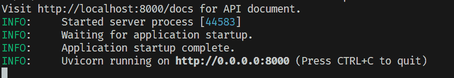
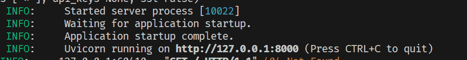

# 使用本地部署的开源大模型

> 来源：[https://deepwisdom.feishu.cn/docx/BJqqdRcRAo8IUqxsupNcUJyZngo](https://deepwisdom.feishu.cn/docx/BJqqdRcRAo8IUqxsupNcUJyZngo)

> 本节中，我们将学习如何使用本地部署的开源模型 API 服务来使用 MetaGPT，并设置修复功能来修正能力较弱模型的输出格式错误。

> 需要注意，由于开源模型效果本身的局限性，并不能保证代码的稳定生成效果。

> 同时，我们也在探索如何在开源模型下得到更稳定、质量更好的输出。如果你对此也感兴趣，可以在 discord 或者微信社区群里联系我们，或者在 MetaGPT 仓库中提交 PR。

注意，推荐使用** openai 兼容接口**进行模型部署。这样，请求和返回处理都可以直接使用 openai sdk 进行处理，将会简化整体的集成流程。

同时，下述几个推理仓库也支持发布为 openai 兼容的接口（除 ollama 外），需要改动的工作量很小。

# LLaMA-Factory

仓库：[https://github.com/h](https://github.com/hiyouga/LLaMA-Factory)iyouga/LLaMA-Factory

支持模型列表：https://github.com/hiyouga/LLaMA-Factory#supported-models

## 安装

```
git clone https://github.com/hiyouga/LLaMA-Factory.git
cd LLaMA-Factory
pip install -e .[torch,metrics]
```

## 部署 API

```
CUDA_VISIBLE_DEVICES=0 API_PORT=8000 llamafactory-cli api \
--model_name_or_path &quot;Qwen/Qwen1.5-0.5B-Chat&quot; \
--template &quot;qwen&quot; \
--infer_backend &quot;vllm&quot; \
--vllm_enforce_eager true
```

成功后应该会在终端显示：



## API 调用

在config2.yaml中设置

```
llm:
  api_type: &quot;openai&quot;
  base_url: &#x27;http://0.0.0.0:8000/v1&#x27; # 根据你显示的api服务地址修改
  model: &#x27;Qwen1.5-0.5B-Chat&#x27; # 修改为你的模型名称
```

# FastChat

仓库：https://github.com/lm-sys/FastChat

## 安装

```
pip install &quot;fschat[model_worker,webui]&quot;
```

## 部署示例

1.  启动 controller：

python -m fastchat.serve.controller --host 127.0.0.1

1.  启动模型（替换为你要用的模型路径）:

python -m fastchat.serve.model_worker --host 127.0.0.1 --controller-address http://127.0.0.1:21001 --model-path Qwen/Qwen1.5-0.5B-Chat

1.  开启 API 服务：

python -m fastchat.serve.openai_api_server --host 127.0.0.1 --controller-address http://127.0.0.1:21001 --port 8000

成功后提示应该如下：



## API 调用

在config2.yaml中设置

```
llm:
  api_type: &quot;openai&quot;
  base_url: &#x27;http://127.0.0.1:8000/v1&#x27; # 根据你显示的api服务地址修改
  model: &#x27;Qwen1.5-0.5B-Chat&#x27; # 修改为你的模型名称
```

# vllm

仓库：[https://github.c](https://github.com/vllm-project/vllm)om/vllm-project/vllm

## 安装

```
pip install vllm
```

## 支持模型

[常见的 ](https://docs.vllm.ai/en/latest/models/supported_models.html)LLaMA、Llama2 和中国的多数开源模型都支持，具体可看模型列表

## 部署示例

```
python -m vllm.entrypoints.openai.api_server \
    --model internlm/internlm2-chat-7b \
    --served-model-name internlm2-chat-7b
```

## API 调用

在config2.yaml中设置

```
llm:
  api_type: &quot;openai&quot;
  base_url: &#x27;http://0.0.0.0:8000/v1&#x27; # 根据你显示的api服务地址修改
  model: &#x27;internlm2-chat-7b&#x27; # 修改为你的模型名称
```

# Ollama

仓库：https://github.com/jmorganca/ollama

## 安装

```
curl https://ollama.ai/install.sh | sh
```

## 支持模型

[olla](https://ollama.com/library)ma 支持基本所有模型，参考模型列表

## 部署启动

ollama 会自动在运行后部署兼容 openai 的 api

```
ollama run llama3
```

## API 调用

```
llm:
  api_type: &#x27;ollama&#x27;
  base_url: &#x27;http://127.0.0.1:11434/api&#x27;
  model: &#x27;llama3&#x27;
```

# （可选）修复 LLM 输出结果

MetaGPT 的 prompt **对输出有较强的结构要求，开**源模型输出时，往往很难按指令跟随完整输出，导致输出的内容会存在缺失遗漏、错误的情况，主要表现为：

+   目标 key 不能按 prompt 约定的大小写进行输出，如{"output":……}变为{"Output":}

+   输出的 json 纯文本存在缺失或多出特殊字符。如，{"a":b"}}，{"a":b"]}，{"a":b" 等等。

**针对上述情况，我们增加了修复开源 LLM **输出的功能，可以在 config 中开启

```
llm:
  api_type: &#x27;openai&#x27;
  …… # 你的模型设置
  
repair_llm_output: true # 增加一行这个
```

开启该功能后，将会对 LLM 的错误输出（MetaGPT 里软件公司里的 ProductManager、Architect 角色）进行修复，日志中会出现repair_的关键词

该开关目前并不能保证完整修复，仍会有些情况我们暂未覆盖（不同的开源模型的情况有所不同），执行过程会中断退出。如果你对此感兴趣，欢迎提 PR，并附上对应的模型说明、测试日志和单测用例。