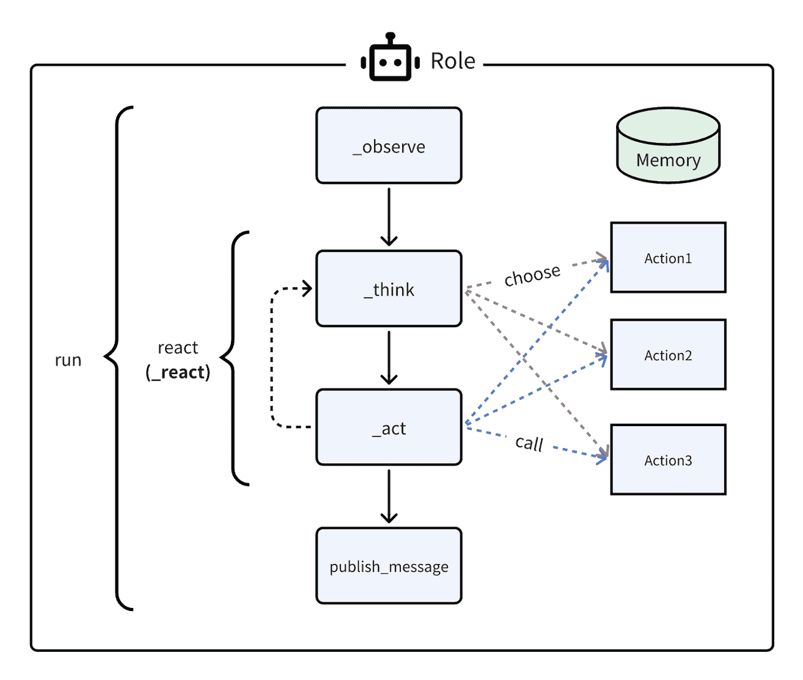
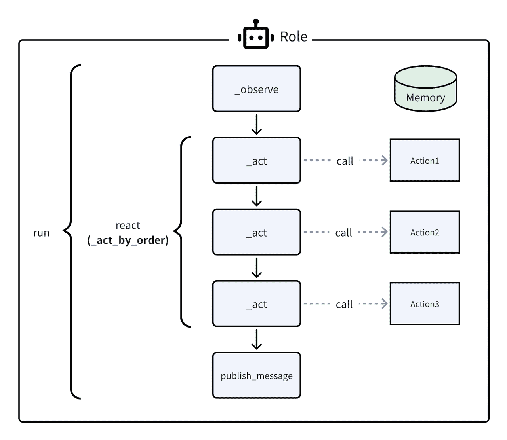
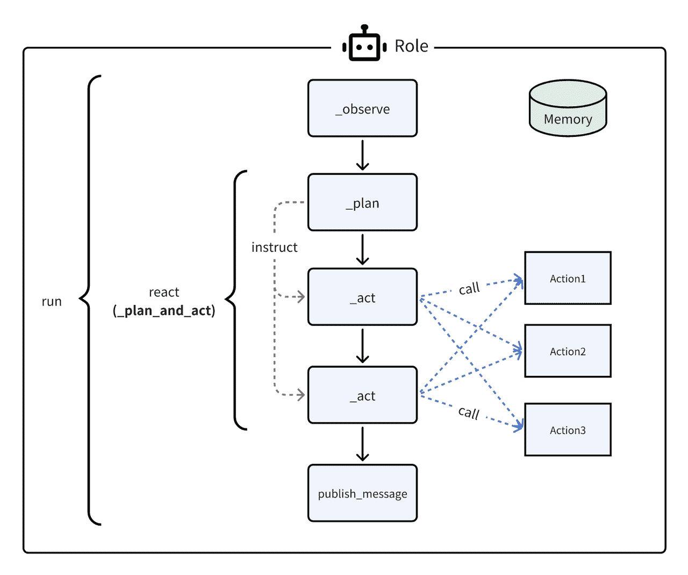

# 思考与行动

> 来源：[https://deepwisdom.feishu.cn/docx/Mh1edByBMoxljwx3bDicuYSonwh](https://deepwisdom.feishu.cn/docx/Mh1edByBMoxljwx3bDicuYSonwh)

在本教程之后，你将能够：

1.  理解智能体在运行中如何思考与行动，以及每个阶段的用途

1.  根据你的场景和需求，使用不同的反应模式

## 三种反应模式

在接收到来自环境的新观察后，智能体开始以恰当的思考和行动以回应这一观察。MetaGPT目前提供了两种定义这种思考和行动过程的方法，并将于近期补充第三种。

### 标准ReAct模式（默认）

[先思考，再行动](https://arxiv.org/abs/2210.03629)，直到角色认为是时候停止。这是ReAct论文中的标准思考-行动循环，即交替进行任务解决中的思考和行动，即 _think -> _act -> _think -> _act -> ...

每次在_think期间，Role将选择一个Action来响应当前的观察，并在_act阶段运行所选的Action。然后，操作输出将成为下一步在_think中再次使用的新观察。我们在_think中动态地使用LLM来选择动作，这使得该模式具有良好的通用性。



在MetaGPT中，Role默认设置为单次思考-行动循环的这种模式，因此你不需要指定任何内容。另一方面，如果你希望Role执行更多的思考-行动循环。在Role初始化时使用_set_react_mode。例如，下面的代码将允许3次思考-行动循环

```
self._set_react_mode(react_mode=&quot;react&quot;, max_react_loop=3)
```

### 按顺序执行

每次按照\set_actions中定义的顺序执行可行的操作，即 _act (Action1) -> _act (Action2) -> _act (Action3) -> ...

这种模式适合于确定性的标准操作程序（SOP），在这种情况下我们确切地知道Role应该采取什么行动以及它们的顺序。使用这种模式，你只需要定义Action，框架将接管管道构建。



回想我们的[智能体入门](https://deepwisdom.feishu.cn/wiki/W6r7wzVQGiFLZekUax6cv0u0nTc)示例，通过指定self._set_react_mode(react_mode="by_order")，Role将首先执行SimpleWriteCode，然后执行SimpleRunCode。

```
class RunnableCoder(Role):
    name: str = &quot;Alice&quot;
    profile: str = &quot;RunnableCoder&quot;

    def __init__(self, **kwargs):
        super().__init__(**kwargs)
        self.set_actions([SimpleWriteCode, SimpleRunCode])
        self._set_react_mode(react_mode=&quot;by_order&quot;)

    async def _act(self) -&gt; Message:
        ...
```

### 规划与行动

提前制定计划，然后使用该计划指导一系列行动，即 _plan -> _act -> _act -> ...

