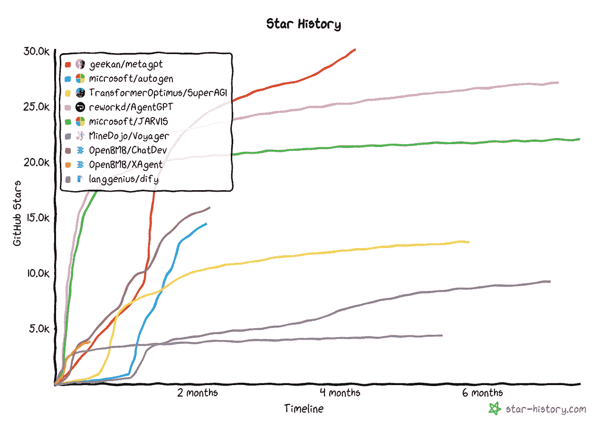
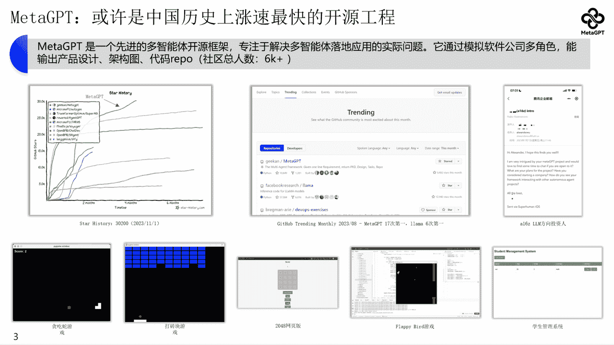
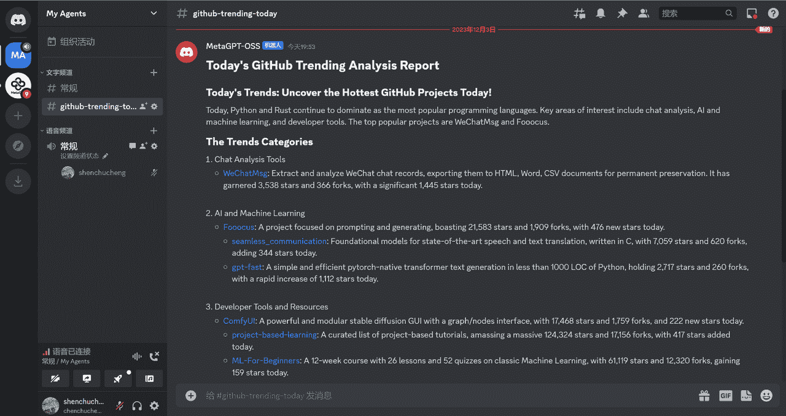
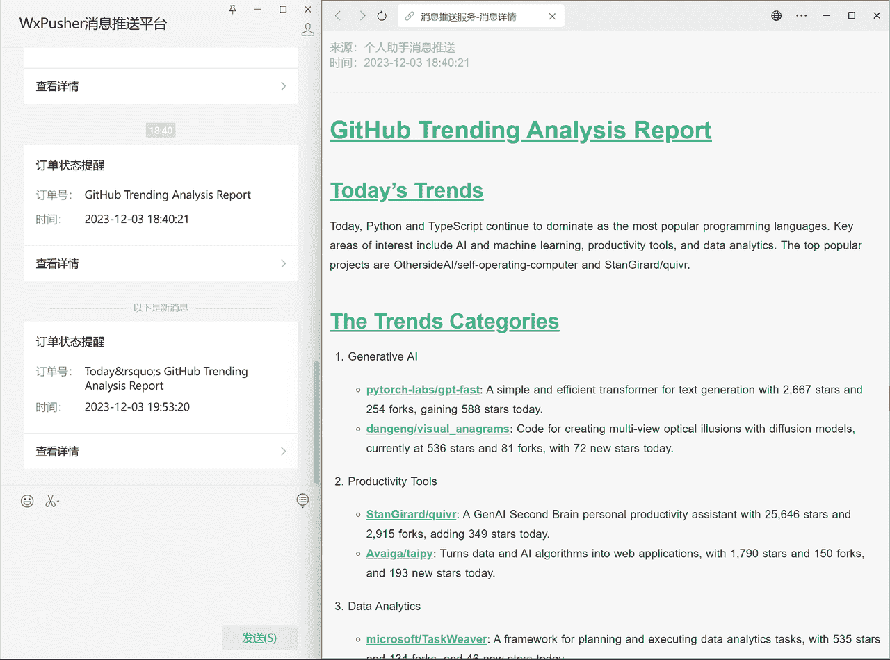
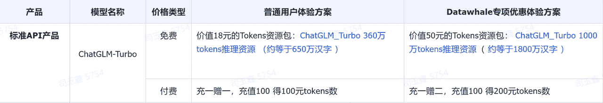
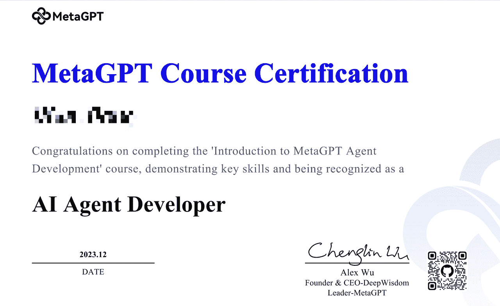

# 《MetaGPT智能体开发入门》学习手册

> 来源：[https://deepwisdom.feishu.cn/docx/UBoydfLRXodYjdxPKeyc9QWhnvW](https://deepwisdom.feishu.cn/docx/UBoydfLRXodYjdxPKeyc9QWhnvW)

# 我们是谁

作为MetaGPT的维护者，这一行业领先的开源多智能体协作框架，我们社区致力于通过高质量的智能体（Agent）开发教程和黑客松（Hackathon）活动，来加速国内外智能体生态的发展，促进智能体开发者在社区中的普及和渗透。

**为什么做MetaGPT：**

作为一个AI Infra的团队，在GPT诞生后，一直在思考LLM时代，新的AI应用形式是什么？新的AI框架是什么？如何提高LLM能力上限？如何降低LLM转变为生产力的门槛？MetaGPT的作者在阅读了60+框架及相关工作后，觉得都无法满足自己的需求，于是动手写了MetaGPT

# MetaGPT: The Multi-Agent Framework

# 学习目标

+   掌握智能体概念以及能够阅读相关智能体源代码

+   理解MetaGPT-智能体开源框架，并能够使用Metagpt实现比GPTs更丰富的tool/action/knowledge的编排

+   可以基于baseline实现一个个性化的订阅资讯的智能体

# 学习内容

> 说明本次项目的背景

### 背景

> MetaGPT提供了Agent的开发能力，Agent可以协助我们解决日常的一些问题，其中一个应用场景就是我们可以让Agent为我们关注某些想关注的信息，当有我们关注的事件发生时，Agent获取信息并进行处理，然后通过一些如邮件、🛰️、discord等通知渠道将处理后的信息发送给我们。我们将这类Agent称为订阅智能体，这类智能体可以结合MetaGPT的PubSub模块运行。本文档通过一个OSS（Open Source Software）订阅智能体实现示例教大家如何使用MetaGPT实现一个订阅智能体

### 目标

1.  学习MetaGPT等模块的使用

1.  实现一个属于自己的订阅智能体

### 系统介绍

> 订阅智能体的实现主要有3个要素，分别是Role、Trigger、Callback，即智能体本身、触发器、数据回调。我们首先按要实现一个OSSWatcher的角色，OSS即Open source software，我们对OSS智能体定位是，帮我们关注并分析热门的开源项目，当有相关信息时将信息推送给我们；然后Trigger是指这个OSSWatcher的角色什么时候触发，我们可以是定时触发或者是某个网站有更新时触发；最后，Callback可以设置OSSWatcher角色运行生成的信息，我们可以将数据发送到🛰️或者discord

### 实现效果

> 教程主要示范了如何用爬取并用MG相关能力将爬取的内容进行分析总结并部署到discord/🛰️上

> 在跑通教程后学习者可以自己选择相关信源 reddit/推特/substack/huggingface 部署到飞书等平台上并考虑如何呈现富文本，并自己使用来获取AI相关资讯或者其他关系的消息，甚至你可以用来做自媒体内容自动发布的生产管线

# 学习规划

按照课程表完成并用一个公开可访问的文档作为本次学习的学习笔记（csdn/知乎/GitHub/飞书/简书等） 每一个task的心得/笔记/作业可以放到文档中 作业完成了丢链接到群里面一起学习

历史学员笔记学习：[订阅智能体内测打卡](https://deepwisdom.feishu.cn/base/WIanb8mbLaJJxCsxwDjcKUImnMg) [《MetaGPT智能体开发入门》教程](https://deepwisdom.feishu.cn/docx/RJmTdvZuPozAxFxEpFxcbiPwnQf)

+   task1：第一章：前期准备

+   task2：第二章：AI Agent知识体系结构

+   task3：第三章：MetaGPT框架组件教程

+   task4：第四章：OSS - 订阅智能体demo

+   task5：第五章：action node

+   task6：第六章：进阶订阅智能体

课程已经结束感兴趣可以在10天内自行完成六章任务的学习

# 反馈渠道：

答疑：

1.  如果是对文档内容有疑问直接在文档中划线评论

1.  如果运行遇到了bug带上清晰的环境描述和bug截图，在群里提问

1.  [《MetaGPT智能体开发入门》FAQ 常见问题](https://deepwisdom.feishu.cn/docx/WFtJdRUsaosTx0x1JgacEK3Znge)于多个社群管理压力如果群内疑问没有被及时解答，将其同步到  全文评论中我们会一一解决

1.  我们会将🛰️群中常见的问题放到[Faq 常见问题](https://deepwisdom.feishu.cn/docx/WFtJdRUsaosTx0x1JgacEK3Znge)

建议：

1.  在教程下方进行全文评论

1.  你的建议会让我们的教程变得更好这也是内测的意义！感谢

# 面向对象

+   适合谁来学？

+   职业发展规划：包含大模型开发工程师，Agent开发工程师，而不是prompt工程师

+   有python代码基础，可以熟练使用大模型阅读源代码，进行自然语言编程

+   对AI agent十分感兴趣，希望从代码层面对智能体进行个性化的能力开发

+   意愿首次参加**AI**** hackathon**，**成为大模型技术开发者的第一站**

+   不适合谁来学？

+   只希望了解更多智能体相关概念，对Agent开发不感兴趣的同学

+   对市面上Agent相关项目十分熟悉，拥有丰富的agent开发的研究人员

+   想要通过本教程深入理解agent相关理论和相关论文观点

# 学习亮点

+   优质的教程和参考资料链接，系统性的了解Agent开发的来龙去脉

+   一个从零到一的订阅智能体的baseline开发方案

+   workshop/网络研讨会，MetaGPT开发者群入群资格

+   感谢Datawhale和智谱AI为本次学习提供的API支持（已逾期）

智谱 AI 专属链接:

1. 注册送 1000W tokens

[2. 充值送双倍](https://open.bigmodel.cn/launch?spreadparam=datawhale&utm_source=datawhale&utm_campaign=%E6%88%98%E7%95%A5%E7%94%9F%E6%80%81%E9%83%A8-%E6%B8%A0%E9%81%93%E5%90%88%E4%BD%9C&_channel_track_key=GRfyviFi)福利，充 1 送 2Datawhale专属链接：智谱AI开放平台

# 学习奖励：

+   完成每一章的章节任务并输出学习笔记进行打卡，结课后将获得对应的结课认证，加入结课群

+   我们将对部分章节优秀的学习笔记进行评选和公示，优秀笔记的获得者可以获赠MG的小礼品一份

+   并有机会优先体验后续课程，参与后续课程的共同设计

+   并将优秀笔记帖至[《MetaGPT智能体开发入门》FAQ 常见问题](https://deepwisdom.feishu.cn/docx/WFtJdRUsaosTx0x1JgacEK3Znge) 中

# 常见问题：

[Faq 常见问题](https://deepwisdom.feishu.cn/docx/WFtJdRUsaosTx0x1JgacEK3Znge)