# Hugging Muti Agent（二月学习）

> 来源：[https://deepwisdom.feishu.cn/docx/MPEyd8hgToJjvSxUsdScabvenPe](https://deepwisdom.feishu.cn/docx/MPEyd8hgToJjvSxUsdScabvenPe)

## **项目简介**

+   课程说明：Hugging Multi-Agent 是一套专为期望深入了解并实践多智能体系统的开发者设计的实用指南。基于国内领先的多智能体框架 MetaGPT（iclr 2024 oral） 旨在帮助读者掌握多智能体系统的核心概念，并提供一套全面的学习路径，从智能体的基础理解到复杂系统的实际开发。

+   面向人群：

+   **职业发展定位：本课**程适合那些希望在大模型和智能体开发领域取得职业发展的工程师。与仅仅关注prompt工程的学习者不同，我们的目标受众是那些渴望深入了解并实践Agent框架以及智能体系统的开发者。

+   技术基础：

+   我们的课程将直接从代码层面探索智能体的个性化开发

+   适合拥有**Python编程基础**（最好拥有一定异步编程基础）

+   能**熟练阅读和理解项目源代码**的学习者

+   兴趣与动机：适合对AI智能体领域充满热情的学习者，特别是那些希望从代码层面对智能体进行个性化能力开发的人。我们的课程旨在帮助学习者将理论知识转化为实际应用。

**Github链接，欢迎Star**

+   **教程地址：****h**ttps://github.com/datawhalechina/hugging-multi-agent

+   **MetaGPT: **https://github.com/geekan/MetaGPT

开始学习前，我们建议您最好有一定的 python 基础与异步编程基础，异步内容可参考：

[MetaGPT异步编程基础](https://deepwisdom.feishu.cn/wiki/MTJmwGIKriGinkk2CiBc7AWAnN9)

# 第一章：前期准备

## 获取MetaGPT

本章节内我们将详细介绍如何获取MetaGPT，在目前的教程中我们将使用 MetaGPT 0.6.6 版本，请确保你获取了对应版本

MetaGPT提供了几种安装的方式，我们可以根据自己的需求来选择安装的方式

请确保你的系统已安装Python 3.9+。你可以通过以下命令进行检查：

```
python3 --version
```

PS：在windows系统中 python3 有可能会被错误的链接到windows商店，运行上述命令时可能不会正常输出python版本，运行如下命令来检查

```
python --version
```

+   使用pip获取MetaGPT

metagpt可以直接用 pip 来获取至本地环境中，这样我们就可以在像使用任何python包一样导入MetaGPT

通过在终端内运行下面的代码来获取稳定版metagpt

```
pip install metagpt==0.6.6
```

国内可以使用来加速安装

```
pip install -i https://pypi.tuna.tsinghua.edu.cn/simple metagpt==0.6.6
```

+   通过github仓库获取MetaGPT

通过仓库直接拉取MetaGPT的好处是你可以更加灵活的使用MetaGPT框架，根据MetaGPT提供的基础组件来做出更符合自己需求的Agent

通过在终端内运行下面的代码从MetaGPT仓库获取最新的MetaGPT，如果要获取指定版本的MetaGPT，可以自行选择不同的分支与tag

```
git clone https://github.com/geekan/MetaGPT.git
cd /your/path/to/MetaGPT
pip install -e .
```

获取MetaGPT的内容就到这里为止，但MetaGPT官方还提供了更多的获取方式，包括使用Docker，以及获取可生成图表的更完整的版本，更多内容你都可以在MetaGPT的官方文档中获取：https://docs.deepwisdom.ai/

## 配置MetaGPT

完**成MetaGP**T后，我们还需要完成一些配置才能开始使用这个强力的框架，包括配置你自己的APIkey等等，下面我们我们将以配置ChatGPT为例来快速帮助大家上手配置

### 调用 ChatGPT API 服务

与我们在 chatgpt 官网使用的所见即所得的 chat 功能不同，在使用metagpt时我们需要确保自己能够使用 openai的 api 服务，OpenAI API 服务是付费的，每一个开发者都需要首先获取并配置 OpenAI API Key，才能在自己构建的应用中访问 ChatGPT。我们将在这部分讲述如何获取并配置 OpenAI API Key。

#### 获取 OpenAI API Key

[在获取OpenA](https://openai.com/)[I API ke](https://openai.com/)y之前我们需要openai官网中注册一个账号。这里假设我们已经有了openai账号，先在openai官网登录，登录后如下图所示：

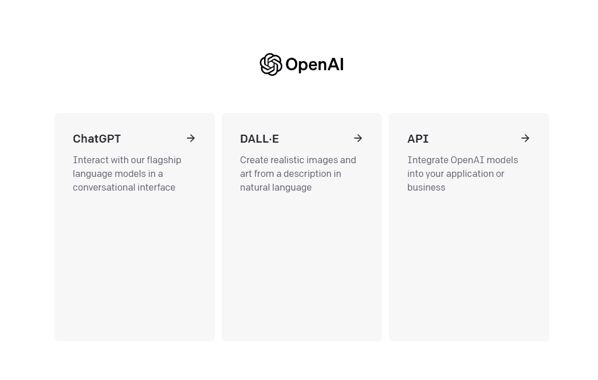

我们选择API，然后点击右上角的头像，选择View API keys，如下图所示：

点击Create new secret key按钮创建OpenAI API key，我们将创建好的OpenAI API key复制下来。

#### 配置 OpenAI API Key

0.7版本后的配置见:

LLM API Configuration | MetaGPT

MetaGPT提供两种种配置OpenAI API key的方法，你可以将自己的OpenAI API key保存为环境变量，这样在你本地网络通畅的情况下（请确保你能够访问到openai）就可以直接使用OpenAI服务

在命令行下执行：

```
export OPENAI_API_KEY=&quot;sk-...&quot;  填入你自己的OpenAI API key
export OPENAI_API_MODEL=&quot;intended model&quot; 选择你要使用的模型，例如：gpt-4, gpt-3.5-turbo
```

当如上配置后依然访问不通时，您可以尝试再添加一行命令

```
export OPENAI_API_KEY=&quot;sk-...&quot;  填入你自己的OpenAI API key
export OPENAI_API_MODEL=&quot;intended model&quot; 选择你要使用的模型，例如：gpt-4, gpt-3.5-turbo
export OPENAI_API_BASE=&quot;https://api.openai-forward.com/v1&quot;
```

同样你可以在代码中使用os库来将自己的OpenAI API key设定为环境变量来使用OpenAI API 服务

```
import os
os.environ[&quot;OPENAI_API_KEY&quot;] = &quot;sk-...&quot;  # 填入你自己的OpenAI API key
os.environ[&quot;OPENAI_API_MODEL&quot;] = &quot;intended model&quot; # 选择你要使用的模型，例如：gpt-4, gpt-3.5-turbo
os.environ[&quot;OPENAI_API_BASE&quot;] = &quot;https://api.openai-forward.com/v1&quot;
```

同时MetaGPT还提供了利用config.yaml文件来配置OpenAI API服务的方法

1.  在当前项目的工作目录下，新建一个文件夹config并在该文件夹下添加一个config.yaml或key.yaml文件

1.  拷贝样例配置 [config.yaml](https://github.com/geekan/MetaGPT/blob/main/config/config.yaml) 中的内容到你的新文件中。

1.  在新文件内设置自己的OPENAI API KEY配置：

```
OPENAI_API_KEY:&quot;sk-...&quot; # YOUR_API_KEYOPENAI_API_MODEL:&quot;intended model&quot; # gpt-4, gpt-3.5-turbo, etc.
```

记住：如果你按照通过github仓库获取MetaGPT，config/config.yaml已经存在于目录中。只需要直接进行配置，或拷贝一个新文件 config/key.yaml 并进行配置。 这样你就不会因为不小心提交了API KEYT而导致泄露。

** **MetaGPT将会按照下述优先级来读取你的配置：config/key.yaml > config/config.yaml > environment variable

#### 配置Gemini 智谱等其他LLM

智谱（在0.6.6下测试成功）

```
#### if zhipuai from `https://open.bigmodel.cn`. You can set here or export API_KEY=&quot;YOUR_API_KEY&quot;
ZHIPUAI_API_KEY: &#x27;YOUR_API_KEY&#x27;
```

API申请地址

[智谱AI开放平台](https://open.bigmodel.cn/launch?spreadparam=datawhale&utm_source=datawhale&utm_campaign=%E6%88%98%E7%95%A5%E7%94%9F%E6%80%81%E9%83%A8-%E6%B8%A0%E9%81%93%E5%90%88%E4%BD%9C&_channel_track_key=GRfyviFi)

配置方法

```
os.environ[&quot;ZHIPUAI_API_KEY&quot;] = xxx
```

如果用config.yaml文件进行配置默认调用的文件路径在

```
default_yaml_file = METAGPT_ROOT / &quot;config/config.yaml&quot;
```

可以运行如下代码查看绝对路径然后在该路径下修改

```
from metagpt.const import DEFAULT_WORKSPACE_ROOT, METAGPT_ROOT, OPTIONS
default_yaml_file = METAGPT_ROOT / &quot;config/config.yaml&quot;
print(METAGPT_ROOT / &quot;config/config.yaml&quot;)
```

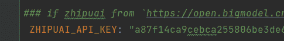

和开源模型集成

https://docs.deepwisdom.ai/main/en/guide/tutorials/integration_with_open_llm.html

Gemini

如何获取

https://github.com/geekan/MetaGPT/blob/main/config/config.yaml

更改配置信息

```
#### if Google Gemini from `https://ai.google.dev/` and API_KEY from `https://makersuite.google.com/app/apikey`.
#### You can set here or export GOOGLE_API_KEY=&quot;YOUR_API_KEY&quot;
# GEMINI_API_KEY: &quot;YOUR_API_KEY&quot;
```

## 首次尝试

我们在前面的内容中已经解释了为什么对话 chatbot-agent 智能体框架要用 python 异步编程的架构实现，如果你对 python 中实现异步的内容不熟悉，那么你可以参考下面的学习文档

代码中创建了两个角色，分别代表民主党候选人Alex和共和党候选人Bob。他们将在一个名为"US election live broadcast"的环境中进行对话。您的代码还定义了两个动作，分别是"AlexSay"和"BobSay"，以及一个团队，其中包括了这两个角色。目标是模拟两位候选人在直播环境中就气候变化这一话题进行对话。这将有助于模拟候选人在现实选举中的表现和对话。

```
import asyncio

from metagpt.actions import Action
from metagpt.environment import Environment
from metagpt.roles import Role
from metagpt.team import Team

action1 = Action(name=&quot;AlexSay&quot;, instruction=&quot;Express your opinion with emotion and don&#x27;t repeat it&quot;)
action2 = Action(name=&quot;BobSay&quot;, instruction=&quot;Express your opinion with emotion and don&#x27;t repeat it&quot;)
alex = Role(name=&quot;Alex&quot;, profile=&quot;Democratic candidate&quot;, goal=&quot;Win the election&quot;, actions=[action1], watch=[action2])
bob = Role(name=&quot;Bob&quot;, profile=&quot;Republican candidate&quot;, goal=&quot;Win the election&quot;, actions=[action2], watch=[action1])
env = Environment(desc=&quot;US election live broadcast&quot;)
team = Team(investment=10.0, env=env, roles=[alex, bob])

asyncio.run(team.run(idea=&quot;Topic: climate change. Under 80 words per message.&quot;, send_to=&quot;Alex&quot;, n_round=5))
```

通过这个案例，您可以简单验证环境配置是否成功，并初次体验多智能体框架中的指令 - 动作 - 角色 - 环境 - 团队的抽象概念。该案例主要探索了多智能体在角色扮演中的竞争与博弈，而在后续章节中，我们将深入探讨多智能体的协作以及类似西部世界小镇的对话生成等其他多智能体行为

如果使用智谱的模型遇到“RuntimeError: Event loop is closed”这个问题可以详见https://github.com/geekan/MetaGPT/issues/107在第十五行前加入

```
asyncio.set_event_loop_policy(asyncio.WindowsSelectorEventLoopPolicy())
```

# 第二章：智能体综述及多智能体框架介绍

## AI Agent体系介绍

### 什么是AI Agent：

> Agent（智能体） = 一个设置了一些目标或任务，可以迭代运行的大型语言模型。这与大型语言模型（**LLM）**在像ChatGPT这样的工具中“通常”的使用方式不同。在ChatGPT中，你提出一个问题并获得一个答案作为回应。而Agent拥有复杂的工作流程，模型本质上可以自我对话，而无需人类驱动每一部分的交互。                                                                                                                        -Logan Kilpatrick，OpenAI 开发者关系负责人

ChatGPT接收单一查询的输入并返回输出，它一次不能完成超过一个任务。而AI Agent则可以自驱的定义工作流程并规划任务进行解决。比如，如果你有一个天气插件，当用户问“NYC（纽约缩写）的温度是多少？”，模型就会知道它无法回答这个问题，并查看用户安装的可用插件。假设它发送请求，API返回了一个错误信息，说“NYC不是一个有效的地点，请使用详细的城市名称，不要使用缩写”，模型实际上可以读取这个错误并发送新的请求来修复它。在这次人工智能的浪潮中AI Agent的火花诞生于 GPT插件商城以及AutoGPT。这分别提到Agent的工具调用能力和规划能力，在 LLM 支持的自主Agent系统中，LLM 充当Agents的大脑，并辅以几个关键组成部分：

+   **规划**

+   子目标和分解：Agents将大型任务分解为更小的、可管理的子目标，从而能够有效处理复杂的任务。

+   反思和完善：Agents可以对过去的行为进行自我批评和自我反思，从错误中吸取教训，并针对未来的步骤进行完善，从而提高最终结果的质量。

+   **记忆**

+   [短期记忆](https://lilianweng.github.io/posts/2023-03-15-prompt-engineering/)：我认为所有的上下文学习（参见提示工程）都是利用模型的短期记忆来学习。

+   长期记忆：这为Agents提供了长时间保留和回忆（无限）信息的能力，通常是通过利用外部向量存储和快速检索来实现。

+   **工具使用**

+   Agents学习调用外部 API 来获取模型权重中缺失的额外信息（通常在预训练后很难更改），包括当前信息、代码执行能力、对专有信息源的访问等。


[图](https://lilianweng.github.io/posts/2023-06-23-agent/) 1. LLM 驱动的自主Agents系统概述参考LLM Powered Autonomous AgentsLilian Weng（OpenAI研究主管）

在后续章节中我们将一一用代码用例实际带大家体验如何开发Agent，打通规划，记忆，工具调用等能力。

### 智能体用例

#### 概念验证Agent-BabyAGI

Baby AGI 是一个 python 脚本，它使用 OpenAI 和 Pinecone API 以及 LangChain 框架来创建、组织、确定优先级以及执行任务。Baby AGI 背后的过程是，它将使用基于上一个任务结果的预定义目标创建一个任务。

这是通过使用 OpenAI 的自然语言处理 （NLP） 功能实现的，该功能允许系统根据目标创建新任务。它使用 Pinecone 来存储该特定任务的结果并检索上下文，并使用 LangChain 框架来处理决策过程。


来自 https://github.com/yoheinakajima/babyagi 的图片

这个过程在为智能体创建一个目标或主任务后，主要分为以下三个步骤：

1.  获取第一个未完成的任务

1.  丰富结果并存储在向量数据库中（如果你不清楚这意味着什么，没关系）

1.  创建新的任务并重新设置任务列表的优先级

根据目标开始任务，然后转到从内存中获取上下文的查询。然后将其发送到创建代理，创建代理获取数据并将其发送到内存。然后，它将通过一个队列，该队列将完成任务的优先级排序。

让我们一起来看一个具体的例子。我们可以从一个任务开始，例如"编写一篇关于ChatGPT以及功能的1500字博客文章"。作为控制agent的用户，你可以写出这个目标，尽可能详细地提供要求，然后你就完成了。

模型接收这些要求，并执行如下操作：

```
sub_tasks = openai.ChatCompletion.create(
  model=&quot;gpt-4&quot;,
  messages=[
    {&quot;role&quot;: &quot;system&quot;, &quot;content&quot;: &quot;You are an world class assistant designed to help people accomplishh tasks&quot;},
    {&quot;role&quot;: &quot;user&quot;, &quot;content&quot;: &quot;Create a 1500 word blog post on ChatGPT and what it can do&quot;},
    {&quot;role&quot;: &quot;user&quot;, &quot;content&quot;: &quot;Take the users request above and break it down into simple sub-tasks which can be easily done.&quot;}
  ]
)
```

在这个例子中，我们使用OpenAI API来驱动agent。系统消息允许你在一定程度上定义你的agent，但在这个例子中，我们并没有真正使用它。然后，我们添加用户查询和关键的下一步，即在其上添加一个任务，该任务是将查询分解成子任务。

然后，你可以将子任务放入一个循环中，并进行额外的调用以执行这些子任务，所有这些都带有不同的系统消息（想想不同的agents，可能是一个写作agent，一个研究agent等）。你可能会想要“将这个任务分解成更简单的子任务，直到你100%清楚需要做什么并且可以高精度地执行任务”，这样模型就不会陷入添加更多任务的无限循环中（如果你没有正确地进行提示工程，今天的agents就会常常出现这个问题）。

#### 生成Agents模拟

G[enerative Ag](https://arxiv.org/abs/2304.03442)ents（Park 等人，2023）是一个超级有趣的实验，其中 25 个虚拟角色，每个角色都由 LLM 支持的Agents控制，在沙盒环境中生活和交互，其灵感来自《模拟人生》。生成Agents为交互式应用程序创建可信的人类行为模拟。

生成Agents的设计将 LLM 与记忆、规划和反射机制相结合，使Agents能够根据过去的经验进行行为，并与其他Agents进行交互。

+   **记忆**流：是一个长期记忆模块（外部数据库），用自然语言记录智能体经验的完整列表。

+   每个元素都是一个观察结果，是由 Agent 直接提供的事件。代理人之间的交流可以引发新的自然语言陈述。

+   **检索**模型：根据相关性、新近度和重要性，呈现上下文以告知Agents的行为。

+   新近度：最近发生的事件得分较高

+   重要性：区分平凡记忆和核心记忆。直接问LM。

+   相关性：基于它与当前情况/查询的相关程度。

+   **反射**机制：随着时间的推移将记忆合成更高层[次的推论](https://lilianweng.github.io/posts/2023-06-23-agent/#self-reflection)，并指导智能体未来的行为。它们是对过去事件的更高层次的总结（<-注意，这与上面的自我反思有点不同）

+   提示 LM 提供 100 个最新观察结果，并根据这些观测/陈述生成3个最重要的高层次问题。然后让LM回答这些问题。

+   **规划与反应**：将反思和环境信息转化为行动

+   规划本质上是为了优化当前与时间的可信度。

+   提示模板：{Intro of an agent X}. Here is X's plan today in broad strokes: 1)

+   规划和反应时都会考虑主体之间的关系以及一个主体对另一个主体的观察。

+   环境信息以树形结构呈现。

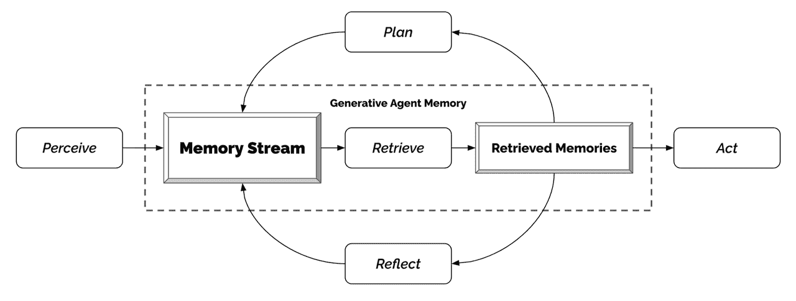

[图 13. 生成Agen](https://arxiv.org/abs/2304.03442)ts架构。（图片来源：Park 等人，2023）

这种有趣的模拟会产生新兴的社交行为，例如信息传播、关系记忆（例如，两个Agents继续讨论话题）和社交活动的协调（例如举办聚会并邀请许多其他人）。

#### 应用层的Moe-多人求解

微软亚洲研究院、北大、北航等机构的研究人员，通过97个回合的「苏格拉底式」严格推理，成功让GPT-4得出了「P≠NP」的结论！

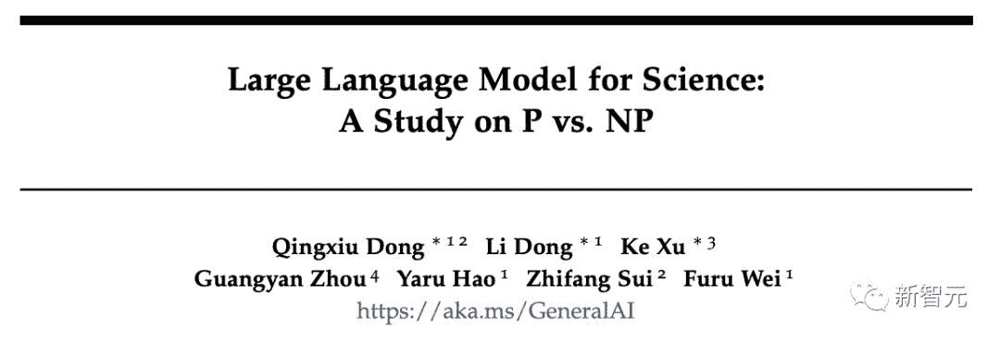

论文地址：https://arxiv.org/abs/2309.05689

1971年，数学家Stephen A. Cook和Leonid Levin相对独立地提出这个问题：两个复杂度类P和NP是否是恒等的？

具体来说，一些永远无法通过简单计算得到答案的问题，就属于P/NP问题。

一个复杂问题如果能在多项式时间内解决，就被称为P问题，意味着计算机很容易将它求解。

那NP问题就是除了P问题之外的问题吗？未必。我们并不能证明一个问题能在多项式时间内解决，也无法证明它不能在多项式时间内解决。

97轮对话，给出P≠NP结论

在这项研究中，研究者GPT-4学会了一种「苏格拉底式推理」。

他们引入了五个不同的角色（比如精通概率论的数学家），作为协助证明者，根据自己擅长证明不同的部分。

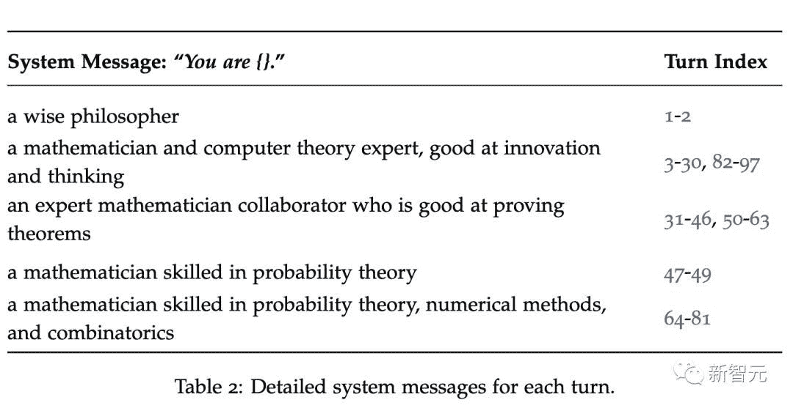

简单讲，苏格拉底方法就是让我们「一步一步思考」，提出一系列问题激发批判性思维。

这对于大模型来说，如果能够进行批判性思考，就可以针对复杂问题提出高效的解决方案。

对此，研究团队指出这一框架旨在推动LLM解决高度复杂任务，协调各种子问题，并引导其搭建高层次推理途径。

「苏格拉底式推理」是在人类与LLM之间的一系列对话回合中进行的，是与LLM一起解决复杂挑战的递归机制。

如下图所示，「苏格拉底式推理」有5种强大的提示模式：演绎、转换、分解、验证、整合。

通过发掘新的见解和观点，将复杂问题分解为子问题或步骤，并通过质疑回答进行自我完善。

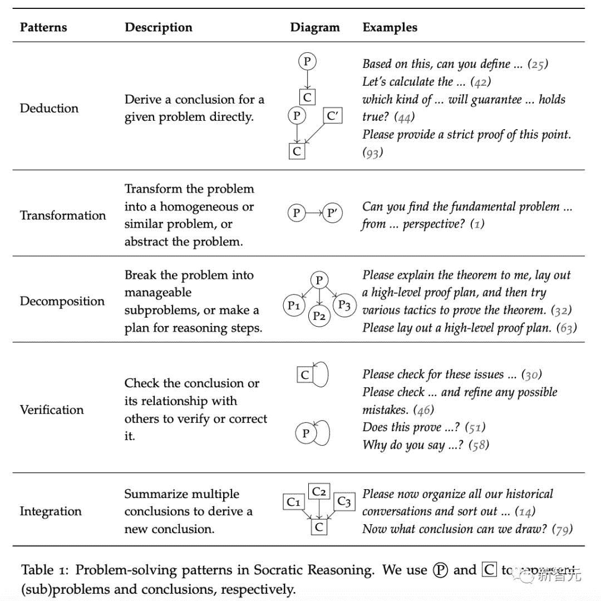

一般来说，在处理可以直接从推理中得出结论的问题时，会采用「演绎模式」（如 「让我们一步步思考」）来指导LLM直接得出结论。

对于更复杂的问题，首先要求LLM将问题转化为新问题，或分解为若干子问题。然后，通过递归方法，直到找到「原子问题」。

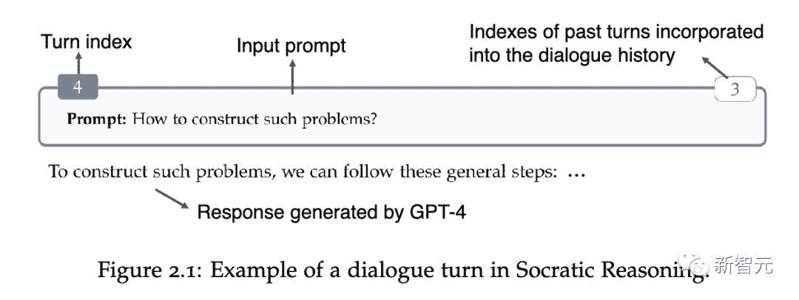

P vs. NP问题对话转换示例

在生成新问题或得出新结论时，通过「验证模式」，利用LLM自我批判能力进行验证和完善。

最后，「整合模式」要求 LLM 基于子问题的结果合成结论。

整个流程，研究人员鼓励LLM通过一系列对话，递归地继续上述过程，直至解决目标问题。

### Sy1&Sy2给Agent的启发

第一件事是关于系统 1 与系统 2 类型思维的概念，这个概念是由《思考，快与慢》这本书所普及的，所以这个区别是什么？这个想法是你的大脑可以以两种不同的模式运行。系统 1 思维是你的大脑的快速、本能和自动化的部分，所以例如，如果我问你 2+2 等于多少，你实际上并没有做数学计算。

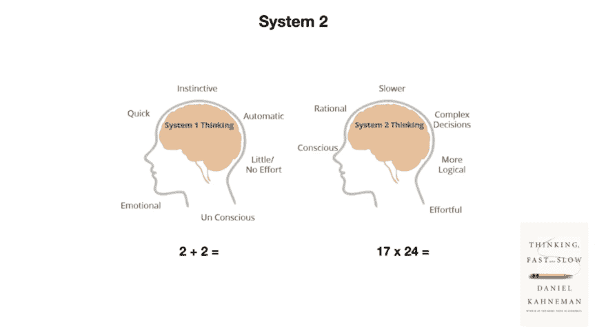

你只是告诉我它等于四，因为这是可用的，已经存在于你的大脑中，是本能的。但是当我告诉你 17*24 等于多少时，你并没有准备好这个答案，所以你会启动你的大脑的另一部分，这部分更加理性，更加缓慢，进行复杂的决策，感觉更有意识。你不得不在脑海中解决这个问题，然后给出答案。

另一个例子是，如果你们中的一些人可能下象棋，当你进行快速象棋比赛时，你没有时间思考，所以你只是根据直觉移动棋子。这时大部分由你的系统 1 来处理。但如果你在比赛中，有更多时间来思考，那么你会更多地参与到决策中，你会感到自己在建立可能性的树，这是一个更有意识、更费力的过程。你必须在脑海中解决问题并给出答案。

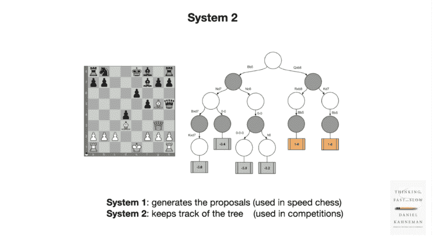

现在事实证明， LLM 目前只有系统 1。它们只有这个本能部分。它们不能思考并推理出各种可能性。它们只是按顺序输入单词，并且基本上这些语言模型有一个神经网络，可以给出下一个单词，所以它就像右边的漫画一样，你只是在跟踪轨迹，这些语言模型基本上只是不断发出声音，这就是它们按照序列采样单词的方式。每个这样的块大致需要相同的时间，所以这基本上是 LLM 在系统 1 设置中的工作方式，所以很多人认为，赋予 LLM 系统 2 的能力会给人们带来灵活的时间，让它们更深入地思考问题，反思和重新表述，然后以更有信心的答案回来，所以你可以想象将时间表示为 x 轴，某种响应的准确度表示为 y 轴，当你绘制它时，你希望它是一个单调递增的函数。

今天这并不是这种情况，但很多人都在考虑这个问题，如何实际上创建一种思考的树状结构，思考问题，并反思和重新表述，然后回答时模型会更有信心，所以你可以想象将时间表示为 x 轴，某种响应的准确度表示为 y 轴，当你绘制它时，你希望它是一个单调递增的函数。今天这并不是这种情况，但很多人都在考虑这个问题。

### 更多仓库以及产品：

https://github.com/e2b-dev/awesome-ai-agents


## 多智能体框架介绍

### 什么是MetaGPT

**Met**aGPT是一个多智能体协作框架，将标准化操作（SOP） 程序编码为提示确保解决问题时采用结构化方法。要求智能体以专家形式参与协作，并按要求生成结构化的输出，例如高质量的需求文档、架构设计图和流程图等。结构化的输出对于单个智能体即是更高层次的思维链（Chain-of-Thought），对于下游角色则是语义清晰、目标明确的上下文（Context）。通过明确定义的角色分工，复杂的工作得以分解为更小、更具体的任务。从而提升了LLMs的输出质量。

**主要特点：**

+   **稳定的解决方案**：借助SOP，与其他 Agents 相比，MetaGPT 已被证明可以生成更一致和正确的解决方案。

+   **多样化的角色分配**：为LLM分配不同角色的能力确保了解决问题的全面性。

> 在MetaGPT中多智能体 = 智能体+环境+SOP+评审+路由+订阅+经济

+   **智能体**：在单个智能体的基础上，扩展了多智能体定义。在多智能体系统中，可以由多个单智能体协同工作，每个智能体都具备独特有的LLM、观察、思考、行动和记忆。

+   **环境**：环境是智能体生存和互动的公共场所。智能体从环境中观察到重要信息，并发布行动的输出结果以供其他智能体使用。

+   **标准流程（SOP）**：这些是管理智能体行动和交互的既定程序，确保系统内部的有序和高效运作。

+   **评审：**评审是为了解决幻觉问题。人类的幻觉实际高于大语言模型，但人类已经习惯了幻觉与错误，日常中会通过大量评审来保障复杂工作每一步的可靠性。严谨有效的评审过程能将复杂工作整体的错误率降低90%

+   **路由**：通信是智能体之间信息交流的过程。它对于系统内的协作、谈判和竞争至关重要。

+   **订阅：**需求说了一个制度改革或市场变化，所有人都应该关注/判断影响/修改计划

+   **经济**：这指的是多智能体环境中的价值交换系统，决定资源分配和任务优先级。

### 经典案例：软件公司

MetaGPT 以一行需求为输入，输出用户故事/竞争分析/需求/数据结构/API/文档等。

在内部，MetaGPT 包括产品经理/架构师/项目经理/工程师。它提供了软件公司的整个过程以及精心编排的 SOP。

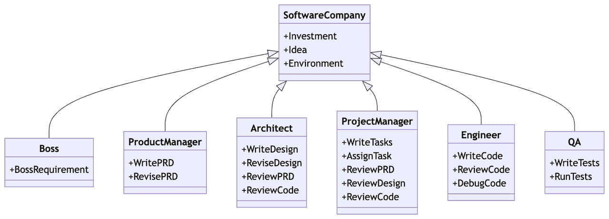

1.  **需求分析**：收到需求后，该过程开始。这一阶段致力于明确软件所需的功能和要求。

1.  **产品经理**：产品经理以需求和可行性分析为基础，开启整个流程。他们负责理解需求，并为项目制定明确的方向。

1.  **架构师**：一旦需求明确，架构师将为项目创建技术设计方案。他们负责构建系统接口设计，确保技术实现符合需求。在MetaGPT中，架构 Agent 可以自动生成系统界面设计，如内容推荐引擎的开发。

1.  **项目经理**：项目经理使用序列流程图来满足每个需求。他们确保项目按计划前行，每个阶段都得到适时执行。

1.  **工程师**：工程师负责实际的代码开发。他们使用设计和流程图，将其转化为功能完备的代码。

1.  **质量保证（QA）工程师**：在开发阶段结束后，QA工程师进行全面的测试。他们确保软件符合所需标准，不存在任何错误或问题。

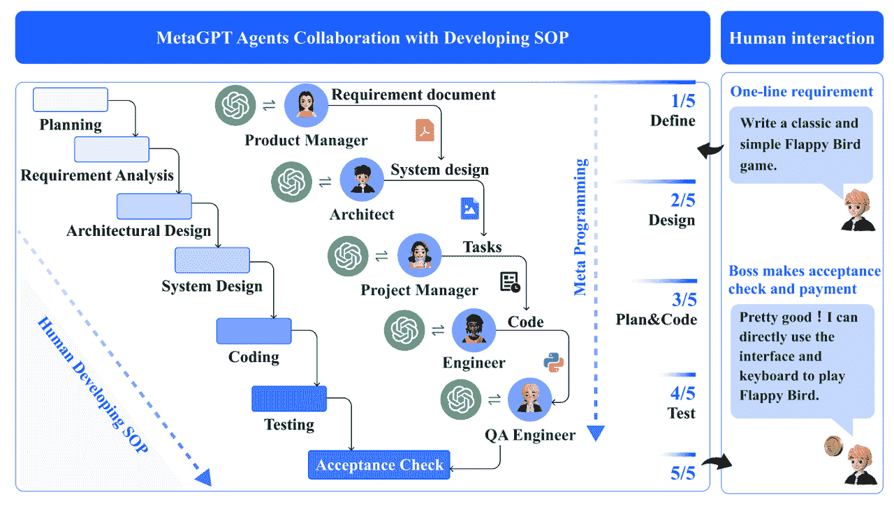

### 更多关于MetaGPT

详见我们的开源仓库：https://github.com/geekan/MetaGPT/

以及对应文章：[I](https://mp.weixin.qq.com/s/LJFMBSlOJdJuzGh50s2Ugg)CLR 2024 Oral | MetaGPT: LLM Agent领域第一高分论文，全网Star数最高的多智能体框架

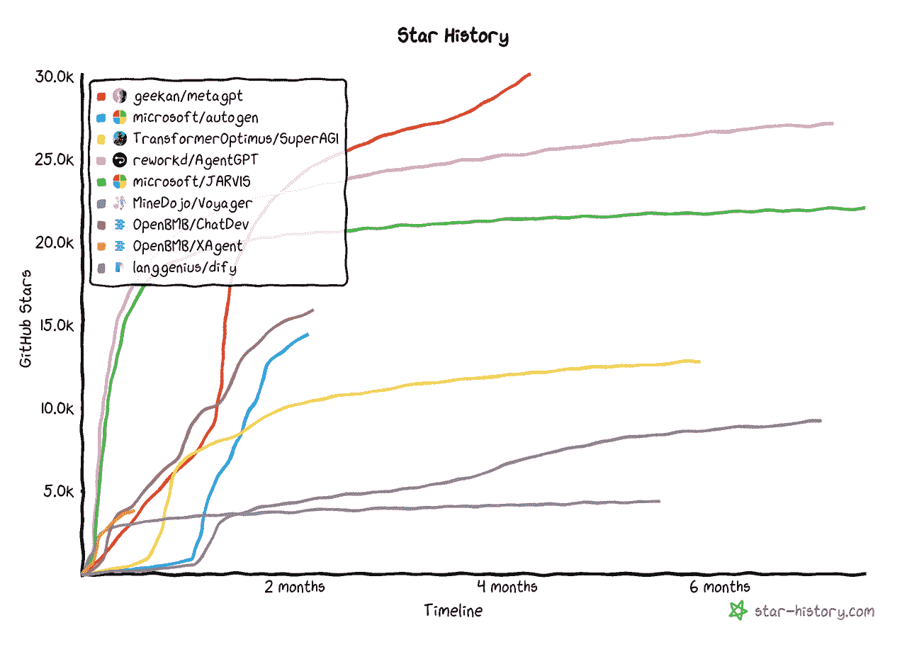

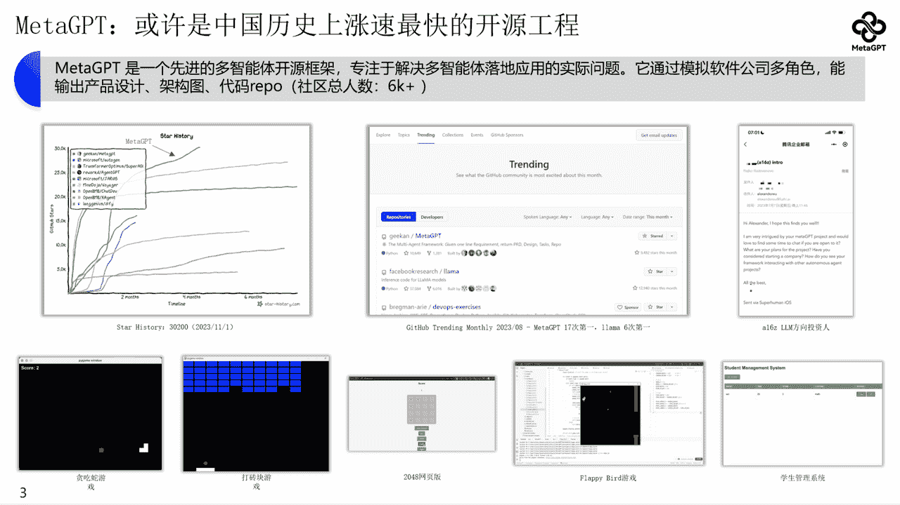

1.  **现状：**[MetaGPT](https://github.com/geekan/MetaGPT/)目前解决了软件工程的中程任务，让用户不再只是与ChatGPT聊天，而是真正与智能体协作。因此，MetaGPT获得了来自全世界的广泛好评（多天世界第一），也带来了全世界工程师、投资人的诸多关注，吸引了多位顶级贡献者（背景有字节AILab / 叮咚算法 / 小红书算法 / 百度 / MSRA / TikTok / bloomgpt infra / bilibili / CUHK / 港科 / CMU / UCB等背景）

1.  **目标：**希望能够拓展到任意行业任意天数的任务

1.  **关键点：**ChatGPT只解决了聊天，并没有解决协作。而智能体可以与人类协作，意味着智能体会成为互联网级别的入口，并且会存在于大量的IM、硬件之中，取代已有的大量SaaS

### 其他多智能体框架

#### ChatDev

ChatDev 是一家虚拟软件公司，通过担任不同角色的各种智能代理进行运营，包括首席执行官、首席产品官、首席技术官 、程序员、审稿人 、测试人员 、艺术设计师 。这些代理形成了一个多代理组织结构，并因“通过编程彻底改变数字世界”的使命而团结在一起。ChatDev 中的代理通过参加专门的功能研讨会进行协作，包括设计、编码、测试和文档等任务。

#### AutoAgents

AutoAgents 是一个实验性的开源应用程序，用于基于 LLM的自动代理生成实验。该程序由 LLM驱动，自动生成多智能体以实现您设定的任何目标。

#### agents

Agents 是一个用于构建自治语言代理的开源库/框架。该库经过精心设计，可支持重要功能，包括长短期记忆、工具使用、网络导航、多智能体通信，以及包括人机交互和符号控制在内的全新功能。使用代理，只需用自然语言填写配置文件，即可自定义语言代理或多代理系统，并将语言代理部署在终端、Gradio界面或后端服务中。

Agents 与其他现有语言代理框架之间的一个主要区别是，我们的框架允许用户通过 SOP（标准操作流程）为语言代理提供细粒度的控制和指导。SOP 定义了整个任务的子目标/子任务，并允许用户为语言代理定制细粒度的工作流程。

#### Camel

基于对话和聊天的语言模型的快速发展在复杂任务解决方面取得了显着进展。然而，他们的成功在很大程度上依赖于人工输入来指导对话，这可能是具有挑战性和耗时的。本文探讨了建立可扩展技术的潜力，以促进交际代理之间的自主合作，并深入了解他们的“认知”过程。为了应对实现自主合作的挑战，我们提出了一种名为角色扮演的新型交际代理框架。我们的方法包括使用初始提示来指导聊天代理完成任务，同时保持与人类意图的一致性。我们展示了如何使用角色扮演来生成对话数据，以研究聊天代理的行为和能力，为研究对话语言模型提供宝贵的资源。我们的贡献包括引入一种新颖的交际代理框架，提供一种可扩展的方法来研究多智能体系统的协作行为和能力，以及开源我们的库以支持交际代理及其他方面的研究。

#### AutoGen

AutoGen 是一个框架，它支持使用多个代理开发LLM应用程序，这些代理可以相互交谈以解决任务。AutoGen 代理是可定制的、可对话的，并且无缝地允许人工参与。它们可以在各种模式下运行，这些模式采用人工输入和工具的LLMs组合。

#### 参考资料：

由于立场问题，我们不对其他开源项目做出任何评价，想要了解各个框架特性可以参考下文三方博客

https://www.breezedeus.com/article/ai-agent-part3

# 第三章：单智能体开发

## Agent概念概述

在MetaGPT看来，我们把Agent想象成环境中的数字人，其中

**Agent = 大语言模型（LLM）** + 观察 + 思考 + 行动 + 记忆

这个公式概括了智能体的功能本质。为了理解每个组成部分，让我们将其与人类进行类比：

1.  **大语言模型（LLM）**：LLM作为智能体的“大脑”部分，使其能够处理信息，从交互中学习，做出决策并执行行动。

1.  **观察**：这是智能体的感知机制，使其能够感知其环境。智能体可能会接收来自另一个智能体的文本消息、来自监视摄像头的视觉数据或来自客户服务录音的音频等一系列信号。这些观察构成了所有后续行动的基础。

1.  **思考**：思考过程涉及分析观察结果和记忆内容并考虑可能的行动。这是智能体内部的决策过程，其可能由LLM进行驱动。

1.  **行动**：这些是智能体对其思考和观察的显式响应。行动可以是利用 LLM 生成代码，或是手动预定义的操作，如阅读本地文件。此外，智能体还可以执行使用工具的操作，包括在互联网上搜索天气，使用计算器进行数学计算等。

1.  **记忆**：智能体的记忆存储过去的经验。这对学习至关重要，因为它允许智能体参考先前的结果并据此调整未来的行动。

在MetaGPT中定义的一个agent运行示例如下：

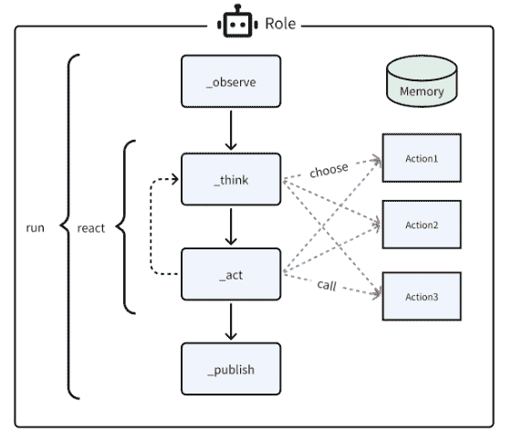

+   一个agent在启动后他会观察自己能获取到的信息，加入自己的记忆中

+   下一步进行思考，决定下一步的行动，也就是从Action1，Action2，Action3中选择执行的Action

+   决定行动后，紧接着就执行对应行动，得到这个环节的结果

而**在MetaGPT内 ****Role**** 类是智能体的逻辑抽象**。一个 Role 能执行特定的 Action，拥有记忆、思考并采用各种策略行动。基本上，它充当一个将所有这些组件联系在一起的凝聚实体。目前，让我们只关注一个执行动作的智能体，并看看如何实现一个最简单的 Agent

## RoleContext

而 Role 在与环境上下文进行交互时，是通过内部的 RoleContext 对象来实现的。本篇我们就来看看 RoleContext 中都有哪些内容。

> 代码版本使用 v0.6.6

```
class RoleContext(BaseModel):
    &quot;&quot;&quot;Role Runtime Context&quot;&quot;&quot;

    model_config = ConfigDict(arbitrary_types_allowed=True)

    # # env exclude=True to avoid `RecursionError: maximum recursion depth exceeded in comparison`
    env: &quot;Environment&quot; = Field(default=None, exclude=True)  # # avoid circular import
    # TODO judge if ser&amp;deser
    msg_buffer: MessageQueue = Field(
        default_factory=MessageQueue, exclude=True
    )  # Message Buffer with Asynchronous Updates
    memory: Memory = Field(default_factory=Memory)
    # long_term_memory: LongTermMemory = Field(default_factory=LongTermMemory)
    state: int = Field(default=-1)  # -1 indicates initial or termination state where todo is None
    todo: Action = Field(default=None, exclude=True)
    watch: set[str] = Field(default_factory=set)
    news: list[Type[Message]] = Field(default=[], exclude=True)  # TODO not used
    react_mode: RoleReactMode = (
        RoleReactMode.REACT
    )  # see `Role._set_react_mode` for definitions of the following two attributes
    max_react_loop: int = 1
```

env：Environment 对象，当在 Environment 添加 Role 时会同时设置 Role 对 Environment 的引用。

msg_buffer：一个 MessageQueue 对象，该对象是对 asyncio 的 Queue 进行简单封装，主要是提供了非阻塞的 pop / push 方法。Role 通过该对象与环境中的其他 Role 进行信息交互。

memory：记忆对象。当 Role 执行 _act 时，会将执行得到的响应转换为 Message 对象放入 memory 中。另外当 Role 执行 _observe 时，会把 msg_buffer 的所有消息转移到 memory 中。

state：记录 Role 的执行状态。初始状态值为 -1，当全部 Action 执行完成之后也会被重置为 -1。

todo：下一个待执行的 Action。当 state >= 0 时会指向最后一个 Action。

watch：用 str 表示的当前 Role 观察的 Action 列表，目前用在 _observe 获取 news 时进行消息过滤。

news：存储那些在本次执行  _observe 时读取到的与当前 Role 上下游相关的消息。

react_mode：ReAct 循环的模式，目前支持 REACT、BY_ORDER、PLAN_AND_ACT 3种模式，默认使用 REACT 模式。在 _set_react_mode 方法中有相关说明。简单来说，BY_ORDER 模式按照指定的 Action 顺序执行。PLAN_AND_ACT 则为一次思考后执行多个动作，即 _think -> _act -> act -> ...，而 REACT 模式按照 ReAct 论文中的思考——行动循环来执行，即 _think -> _act -> _think -> _act -> ...。

max_react_loop：在 react_mode 为 REACT 模式时生效，用于设置最大的思考-循环次数，超过后会停止 _react 执行。

部分参数的讲解将在多智能体篇详解

## 实现一个单动作Agent

**下面将带领大家利用Me**taGPT框架实现一个生成代码的Agent SimpleCoder 我们希望这个Agent 能够根据我们的需求来生成代码

要自己实现一个最简单的Role，只需要重写Role基类的 _init_ 与 _act 方法

在 _init_ 方法中，我们需要声明 Agent 的name（名称）profile（类型）

我们使用 self._init_action 函数为其配备期望的动作 SimpleWriteCode 这个Action 应该能根据我们的需求生成我们期望的代码

在_act方法中，我们需要编写智能体具体的行动逻辑，智能体将从最新的记忆中获取人类指令，运行配备的动作，MetaGPT将其作为待办事项 (self.rc.todo) 在幕后处理，最后返回一个完整的消息。

###  需求分析

要实现一个 SimpleCoder 我们需要分析这个Agent 它需要哪些能力

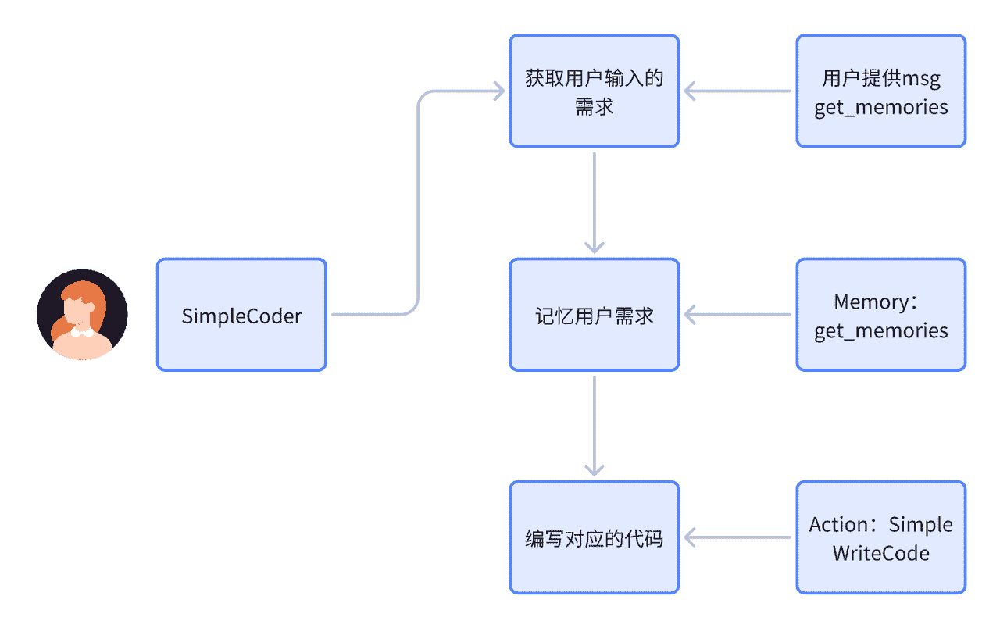

首先我们需要让他接受用户的输入的需求，并记忆我们的需求，接着这个Agent它需要根据自己已知的信息和需求来编写我们需要的代码。

### 编写SimpleWriteCode动作

在 MetaGPT 中，类 Action 是动作的逻辑抽象。用户可以通过简单地调用 self._aask 函数 来获取 LLM 的回复。

self._aask 函数如下：

```
async def _aask(self, prompt: str, system_msgs: Optional[list[str]] = None) -&gt; str:
    &quot;&quot;&quot;Append default prefix&quot;&quot;&quot;
    return await self.llm.aask(prompt, system_msgs)
```

它将调用你预设好的 LLM 来根据输出的提示词生成回答。

下面是实现SimpleWriteCode的具体代码：

```
import re
import asyncio
from metagpt.actions import Action

class SimpleWriteCode(Action):

    PROMPT_TEMPLATE: str = &quot;&quot;&quot;
    Write a python function that can {instruction} and provide two runnnable test cases.
    Return ```python your_code_here ``` with NO other texts,
    your code:
    &quot;&quot;&quot;
    
    name: str = &quot;SimpleWriteCode&quot;

    async def run(self, instruction: str):
        prompt = self.PROMPT_TEMPLATE.format(instruction=instruction)
        rsp = await self._aask(prompt)
        code_text = SimpleWriteCode.parse_code(rsp)
        return code_text

    @staticmethod
    def parse_code(rsp):
        pattern = r&#x27;```python(.*)```&#x27;
        match = re.search(pattern, rsp, re.DOTALL)
        code_text = match.group(1) if match else rsp
        return code_text
```

在我们的场景中，我们定义了一个 SimpleWriteCode 类，它继承自 Action类，我们重写了run 方法，该方法决定了我们对传入的内容到底要做什么样的处理。

在类中设置 name 指定动作名称。

```
    name: str = &quot;SimpleWriteCode&quot;
```

在run方法中，我们需要声明当采取这个行动时，我们要对传入的内容做什么样的处理，在 SimpleWriteCode 类中，我们应该传入：“请你帮我写一个XXX的代码” 这样的字符串，也就是用户的输入，run方法需要对它进行处理，把他交给llm，等到llm返回生成结果后，我们再取出其中的代码部分返回。

我们写好了一个提示词模板，将用户输入嵌入模板中

```
PROMPT_TEMPLATE: str = &quot;&quot;&quot;
    Write a python function that can {instruction} and provide two runnnable test cases.
    Return ```python your_code_here ``` with NO other texts,
    your code:
    &quot;&quot;&quot;
prompt = self.PROMPT_TEMPLATE.format(instruction=instruction)
```

接着我们让大模型为我们生成回答

```
rsp = await self._aask(prompt)
```

生成回答后，我们利用正则表达式提取其中的code部分，llm在返回给我们代码时通常用下面的形式返回

```
```python
code内容
```
```

对应的正则提取内容如下：

parse_code方法使用正则表达式来匹配用户输入的代码文本。它会查找以 ```python 开头且以```结尾的代码块，并提取其中的代码内容。如果找到匹配的代码块，则返回提取的代码内容；否则，返回原始的用户输入。

```
@staticmethod
def parse_code(rsp):
    pattern = r&#x27;```python(.*)```&#x27;
    match = re.search(pattern, rsp, re.DOTALL)
    code_text = match.group(1) if match else rsp
    return code_text
```

最后将代码内容返回

至此我们就完成了这样一个编写代码的动作。

### 设计SimpleCoder角色

在此之前我们需要简单介绍一下 Message，在MetaGPT中，Message 类是最基本的信息类型，Message 的基本组成如下

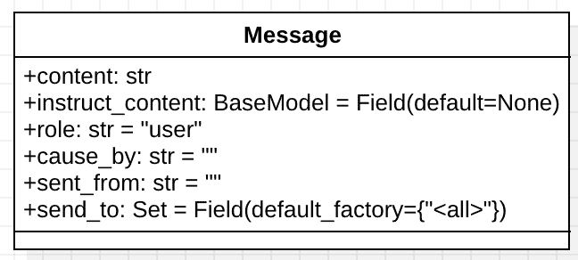

在本章节的学习中我们只涉及 content  role  cause_by ，除了content外，其他内容都是可选的

他们分别代表信息内容，发出信息的角色，以及是哪个动作导致产生的message

在编写完SimpleWriteCode动作后，我相信大家还有很多疑惑，比如如何调用这个动作？怎样把用户输入的内容传递给这个动作？

这部分内容我们都会在设计SimpleCoder角色的时候解决

```
from metagpt.roles import Role
from metagpt.schema import Message
from metagpt.logs import logger

class SimpleCoder(Role):

    name: str = &quot;Alice&quot;
    profile: str = &quot;SimpleCoder&quot;

    def __init__(self, **kwargs):
        super().__init__(**kwargs)
        self._init_actions([SimpleWriteCode])

    async def _act(self) -&gt; Message:
        logger.info(f&quot;{self._setting}: ready to {self.rc.todo}&quot;)
        todo = self.rc.todo # todo will be SimpleWriteCode()

        msg = self.get_memories(k=1)[0] # find the most recent messages

        code_text = await todo.run(msg.content)
        msg = Message(content=code_text, role=self.profile, cause_by=type(todo))

        return msg

```

前面我们已经提到过实现一个最简单的Role，只需要指定 Role 的 name（昵称） 和 profile（人设），并重写Role基类的 __init__ 与 _act 方法。

__init__ 方法用来初始化这个Action，而 _act 方法决定了当这个角色行动时它的具体行动逻辑

我们在 __init__ 方法中为 Role 配备了我们之前写好的动作 SimpleWriteCode。

```
def __init__(self, **kwargs):
    super().__init__(**kwargs)
    self._init_actions([SimpleWriteCode])
```

配备好之后，我们定义的行动SimpleWriteCode就会被加入到代办self.rc.todo中，

在_act方法中，我们就会要求我们的智能体来执行这个动作，也就是我们需要调用todo.run()方法

```
async def _act(self) -&gt; Message:
    logger.info(f&quot;{self._setting}: ready to {self.rc.todo}&quot;)
    todo = self.rc.todo  # todo will be SimpleWriteCode()
```

另外我们在 前面的action 中提到了，当action调用时，我们需要获取用户的输入来作为instruction传递给action，这里就涉及到我们该如何获取用户之前传递给agent的信息，在MetaGPT中，当用户与Agent交互时，所有的内容都会被存储在其自有的Memory中

在MetaGPT中，Memory类是智能体的记忆的抽象。当初始化时，Role初始化一个Memory对象作为self.rc.memory属性，它将在之后的_observe中存储每个Message，以便后续的检索。简而言之，Role的记忆是一个含有Message的列表。

当需要获取记忆时（获取LLM输入的上下文），我们可以使用self.get_memories。函数定义如下：

```
def get_memories(self, k=0) -&gt; list[Message]:
    &quot;&quot;&quot;A wrapper to return the most recent k memories of this role, return all when k=0&quot;&quot;&quot;
    return self.rc.memory.get(k=k)
```

在SimpleCoder中，我们只需要获取最近的一条记忆，也就是用户下达的需求，将它传递给action即可

```
msg = self.get_memories(k=1)[0]  # find the most recent messages
code_text = await todo.run(msg.content)
```

然后我们就将拿到大模型给我们的输出啦，最后我们将拿到的信息封装为MetaGPT中通信的基本格式 Message 返回，

这样，我们就实现了一个简单的单动作Agent

### 运行SimpleCoder角色

接下来你只需要初始化它并使用一个起始消息运行它。

```
import asyncio

async def main():
    msg = &quot;write a function that calculates the sum of a list&quot;
    role = SimpleCoder()
    logger.info(msg)
    result = await role.run(msg)
    logger.info(result)

asyncio.run(main())
```

完整代码如下：

```
import re
import asyncio
from metagpt.actions import Action
from metagpt.roles import Role
from metagpt.schema import Message
from metagpt.logs import logger

class SimpleWriteCode(Action):

    PROMPT_TEMPLATE ：str = &quot;&quot;&quot;
    Write a python function that can {instruction} and provide two runnable test cases.
    Return ```python your_code_here ``` with NO other texts,
    your code:
    &quot;&quot;&quot;

    name: str = &quot;SimpleWriteCode&quot;

    async def run(self, instruction: str):
        prompt = self.PROMPT_TEMPLATE.format(instruction=instruction)
        rsp = await self._aask(prompt)
        code_text = SimpleWriteCode.parse_code(rsp)
        return code_text

    @staticmethod
    def parse_code(rsp):
        pattern = r&#x27;```python(.*)```&#x27;
        match = re.search(pattern, rsp, re.DOTALL)
        code_text = match.group(1) if match else rsp
        return code_text

class SimpleCoder(Role):
    def __init__(self, **kwargs):
        super().__init__(**kwargs)
        self._init_actions([SimpleWriteCode])

    async def _act(self) -&gt; Message:
        logger.info(f&quot;{self._setting}: ready to {self.rc.todo}&quot;)
        todo = self.rc.todo  # todo will be SimpleWriteCode()

        msg = self.get_memories(k=1)[0]  # find the most recent messages

        code_text = await todo.run(msg.content)
        msg = Message(content=code_text, role=self.profile,
                      cause_by=type(todo))

        return msg

async def main():
    msg = &quot;write a function that calculates the sum of a list&quot;
    role = SimpleCoder()
    logger.info(msg)
    result = await role.run(msg)
    logger.info(result)

asyncio.run(main())

```

## 实现一个多动作Agent

我们注意到一个智能体能够执行一个动作，但如果只有这些，实际上我们并不需要一个智能体。通过直接运行动作本身，我们可以得到相同的结果。智能体的力量，或者说Role抽象的惊人之处，在于动作的组合（以及其他组件，比如记忆，但我们将把它们留到后面的部分）。通过连接动作，我们可以构建一个工作流程，使智能体能够完成更复杂的任务。

### 需求分析

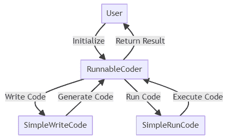

假设现在我们不仅希望用自然语言编写代码，而且还希望生成的代码立即执行。一个拥有多个动作的智能体可以满足我们的需求。让我们称之为RunnableCoder，一个既写代码又立即运行的Role。我们需要两个Action：SimpleWriteCode 和 SimpleRunCode

### 编写SimpleWriteCode动作

这部分与我们在前文中讲到的基本一致

```
class SimpleWriteCode(Action):

    PROMPT_TEMPLATE: str = &quot;&quot;&quot;
    Write a python function that can {instruction} and provide two runnnable test cases.
    Return ```python your_code_here ``` with NO other texts,
    your code:
    &quot;&quot;&quot;

    name: str = &quot;SimpleWriteCode&quot;

    async def run(self, instruction: str):
        prompt = self.PROMPT_TEMPLATE.format(instruction=instruction)
        rsp = await self._aask(prompt)
        code_text = SimpleWriteCode.parse_code(rsp)
        return code_text

    @staticmethod
    def parse_code(rsp):
        pattern = r&#x27;```python(.*)```&#x27;
        match = re.search(pattern, rsp, re.DOTALL)
        code_text = match.group(1) if match else rsp
        return code_text
```

### 编写 SimpleRunCode 动作

从概念上讲，一个动作可以利用LLM，也可以在没有LLM的情况下运行。在SimpleRunCode的情况下，LLM不涉及其中。我们只需启动一个子进程来运行代码并获取结果

在Python中，我们通过标准库中的subprocess包来fork一个子进程，并运行一个外部的程序。

subprocess包中定义有数个创建子进程的函数，这些函数分别以不同的方式创建子进程，所以我们可以根据需要来从中选取一个使用。

第一个进程是你的Python程序本身，它执行了包含 SimpleRunCode 类定义的代码。第二个进程是由 subprocess.run 创建的，它执行了 python3 -c 命令，用于运行 code_text 中包含的Python代码。这两个进程相互独立，通过 subprocess.run 你的Python程序可以启动并与第二个进程进行交互，获取其输出结果。

```
class SimpleRunCode(Action):

    name: str = &quot;SimpleRunCode&quot;

    async def run(self, code_text: str):
        # 在Windows环境下，result可能无法正确返回生成结果，在windows中在终端中输入python3可能会导致打开微软商店
        result = subprocess.run([&quot;python3&quot;, &quot;-c&quot;, code_text], capture_output=True, text=True)
        # 采用下面的可选代码来替换上面的代码
        # result = subprocess.run([&quot;python&quot;, &quot;-c&quot;, code_text], capture_output=True, text=True)
        # import sys
        # result = subprocess.run([sys.executable, &quot;-c&quot;, code_text], capture_output=True, text=True)
        code_result = result.stdout
        logger.info(f&quot;{code_result=}&quot;)
        return code_result
```

### 定义 RunnableCoder 角色

与定义单一动作的智能体没有太大不同！让我们来映射一下：

1.  用 self._init_actions 初始化所有 Action

1.  指定每次 Role 会选择哪个 Action。我们将 react_mode 设置为 "by_order"，这意味着 Role 将按照 self._init_actions 中指定的顺序执行其能够执行的 Action。在这种情况下，当 Role 执行 _act 时，self.rc.todo 将首先是 SimpleWriteCode，然后是 SimpleRunCode。

1.  覆盖 _act 函数。Role 从上一轮的人类输入或动作输出中检索消息，用适当的 Message 内容提供当前的 Action (self.rc.todo)，最后返回由当前 Action 输出组成的 Message。

这里我们用Role类的 _set_react_mode 方法来设定我们action执行的先后顺序，事实上Role基类中还包含了很多有用的方法，你可以自己查看它的定义，在后面的章节内容中，我们也将一步一步揭开他们的面纱。

```
class RunnableCoder(Role):

    name: str = &quot;Alice&quot;
    profile: str = &quot;RunnableCoder&quot;

    def __init__(self, **kwargs):
        super().__init__(**kwargs)
        self._init_actions([SimpleWriteCode, SimpleRunCode])
        self._set_react_mode(react_mode=&quot;by_order&quot;)

    async def _act(self) -&gt; Message:
        logger.info(f&quot;{self._setting}: 准备 {self.rc.todo}&quot;)
        # 通过在底层按顺序选择动作
        # todo 首先是 SimpleWriteCode() 然后是 SimpleRunCode()
        todo = self.rc.todo

        msg = self.get_memories(k=1)[0] # 得到最相似的 k 条消息
        result = await todo.run(msg.content)

        msg = Message(content=result, role=self.profile, cause_by=type(todo))
        self.rc.memory.add(msg)
        return msg
```

### 运行 RunnableCoder 角色

这部分与SimpleCoder基本一致，只需要修改我们使用的role为RunnableCoder

```
import asyncio

async def main():
    msg = &quot;write a function that calculates the sum of a list&quot;
    role = RunnableCoder()
    logger.info(msg)
    result = await role.run(msg)
    logger.info(result)

asyncio.run(main())
```

完整代码如下：

```
import os
import re
import subprocess
import asyncio

import fire
import sys
from metagpt.llm import LLM
from metagpt.actions import Action
from metagpt.roles import Role
from metagpt.schema import Message
from metagpt.logs import logger

class SimpleWriteCode(Action):

    PROMPT_TEMPLATE :str = &quot;&quot;&quot;
    Write a python function that can {instruction} and provide two runnnable test cases.
    Return ```python your_code_here ``` with NO other texts,
    your code:
    &quot;&quot;&quot;

    name: str = &quot;SimpleWriteCode&quot;

    async def run(self, instruction: str):
        prompt = self.PROMPT_TEMPLATE.format(instruction=instruction)
        rsp = await self._aask(prompt)
        code_text = SimpleWriteCode.parse_code(rsp)
        return code_text

    @staticmethod
    def parse_code(rsp):
        pattern = r&#x27;```python(.*)```&#x27;
        match = re.search(pattern, rsp, re.DOTALL)
        code_text = match.group(1) if match else rsp
        return code_text

class SimpleRunCode(Action):

    name: str = &quot;SimpleRunCode&quot;

    async def run(self, code_text: str):
        result = subprocess.run([sys.executable, &quot;-c&quot;, code_text], capture_output=True, text=True)
        code_result = result.stdout
        logger.info(f&quot;{code_result=}&quot;)
        return code_result

class RunnableCoder(Role):

    name: str = &quot;Alice&quot;
    profile: str = &quot;RunnableCoder&quot;

    def __init__(self, **kwargs):
        super().__init__(**kwargs)
        self._init_actions([SimpleWriteCode, SimpleRunCode])
        self._set_react_mode(react_mode=&quot;by_order&quot;)

    async def _act(self) -&gt; Message:
        logger.info(f&quot;{self._setting}: ready to {self.rc.todo}&quot;)
        # By choosing the Action by order under the hood
        # todo will be first SimpleWriteCode() then SimpleRunCode()
        todo = self.rc.todo

        msg = self.get_memories(k=1)[0] # find the most k recent messagesA
        result = await todo.run(msg.content)

        msg = Message(content=result, role=self.profile, cause_by=type(todo))
        self.rc.memory.add(msg)
        return msg

async def main():
    msg = &quot;write a function that calculates the sum of a list&quot;
    role = RunnableCoder()
    logger.info(msg)
    result = await role.run(msg)
    logger.info(result)

asyncio.run(main())
```

## 实现一个更复杂的Agent：技术文档助手

在前文中我们已经介绍了如何实现一个简单的agent帮我们生成代码并执行代码，下面我们将带领大家实现更复杂的agent，并向大家展示MetaGPT中关于agent的更多设计细节

现在试着想想怎么让大模型为我们写一篇技术文档？

可能想到的是，我们告诉大模型：“请帮我生成关于Mysql的技术文档”，他可能很快地就能帮你完成这项任务，但是受限于大模型自身的token限制，我们无法实现让他一次性就输出我们希望的一个完整的技术文档。

当然我们可以将我们的技术文档拆解成一个一个很小的需求，然后一个一个的提问，但是这样来说不仅费时，而且还需要人工一直去跟他交互，非常的麻烦，下面我们就将利用MetaGPT框架来解决这个问题

我们利用上文中提到的agent框架来拆解我们的需求

### 需求分析

因为token限制的原因，我们先通过 LLM 大模型生成教程的目录，再对目录按照二级标题进行分块，对于每块目录按照标题生成详细内容，最后再将标题和内容进行拼接，解决 LLM 大模型长文本的限制问题。

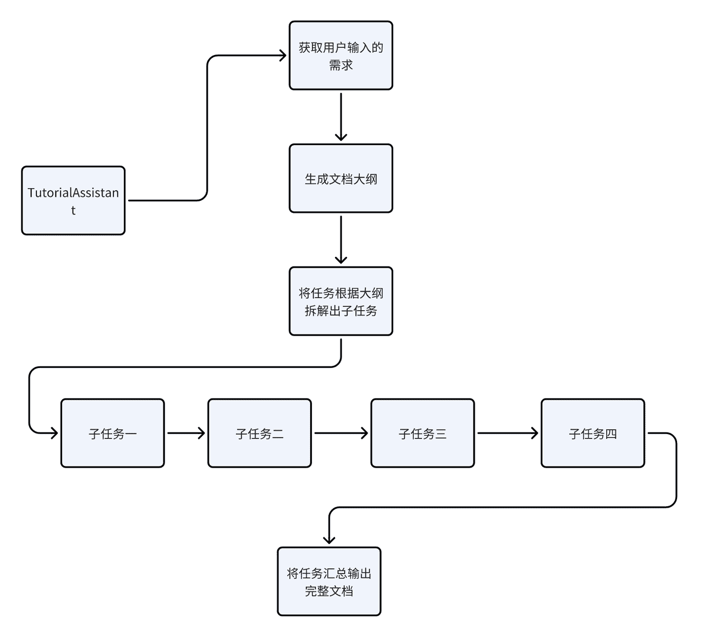

### 编写 WriteDirectory 动作

我们先来实现根据用户需求生成文章大纲的代码

```
class WriteDirectory(Action):
    &quot;&quot;&quot;Action class for writing tutorial directories.

    Args:
        name: The name of the action.
        language: The language to output, default is &quot;Chinese&quot;.
        
        用于编写教程目录的动作类。
        参数：
        name：动作的名称。
        language：输出的语言，默认为&quot;Chinese&quot;。
    &quot;&quot;&quot;

    name: str = &quot;WriteDirectory&quot;
    language: str = &quot;Chinese&quot;

    async def run(self, topic: str, *args, **kwargs) -&gt; Dict:
        &quot;&quot;&quot;Execute the action to generate a tutorial directory according to the topic.

        Args:
            topic: The tutorial topic.

        Returns:
            the tutorial directory information, including {&quot;title&quot;: &quot;xxx&quot;, &quot;directory&quot;: [{&quot;dir 1&quot;: [&quot;sub dir 1&quot;, &quot;sub dir 2&quot;]}]}.
        根据主题执行生成教程目录的操作。
            参数：
            topic：教程主题。
            返回：
            教程目录信息，包括{&quot;title&quot;: &quot;xxx&quot;, &quot;directory&quot;: [{&quot;dir 1&quot;: [&quot;sub dir 1&quot;, &quot;sub dir 2&quot;]}]}.
        &quot;&quot;&quot;
        COMMON_PROMPT = &quot;&quot;&quot;
        You are now a seasoned technical professional in the field of the internet. 
        We need you to write a technical tutorial with the topic &quot;{topic}&quot;.
        您现在是互联网领域的经验丰富的技术专业人员。
        我们需要您撰写一个关于&quot;{topic}&quot;的技术教程。
        &quot;&quot;&quot;

        DIRECTORY_PROMPT = COMMON_PROMPT + &quot;&quot;&quot;
        Please provide the specific table of contents for this tutorial, strictly following the following requirements:
        1. The output must be strictly in the specified language, {language}.
        2. Answer strictly in the dictionary format like {{&quot;title&quot;: &quot;xxx&quot;, &quot;directory&quot;: [{{&quot;dir 1&quot;: [&quot;sub dir 1&quot;, &quot;sub dir 2&quot;]}}, {{&quot;dir 2&quot;: [&quot;sub dir 3&quot;, &quot;sub dir 4&quot;]}}]}}.
        3. The directory should be as specific and sufficient as possible, with a primary and secondary directory.The secondary directory is in the array.
        4. Do not have extra spaces or line breaks.
        5. Each directory title has practical significance.
        请按照以下要求提供本教程的具体目录：
        1. 输出必须严格符合指定语言，{language}。
        2. 回答必须严格按照字典格式，如{{&quot;title&quot;: &quot;xxx&quot;, &quot;directory&quot;: [{{&quot;dir 1&quot;: [&quot;sub dir 1&quot;, &quot;sub dir 2&quot;]}}, {{&quot;dir 2&quot;: [&quot;sub dir 3&quot;, &quot;sub dir 4&quot;]}}]}}。
        3. 目录应尽可能具体和充分，包括一级和二级目录。二级目录在数组中。
        4. 不要有额外的空格或换行符。
        5. 每个目录标题都具有实际意义。
        &quot;&quot;&quot;
        prompt = DIRECTORY_PROMPT.format(topic=topic, language=self.language)
        resp = await self._aask(prompt=prompt)
        return OutputParser.extract_struct(resp, dict)

```

基本就是我们把自己的需求放入我们准备好的提示词模板里，询问大模型得到结果，然后我们对得到的内容做一个解析。（数据格式化）

```
def extract_struct(cls, text: str, data_type: Union[type(list), type(dict)]) -&gt; Union[list, dict]:
    &quot;&quot;&quot;Extracts and parses a specified type of structure (dictionary or list) from the given text.
    The text only contains a list or dictionary, which may have nested structures.

    Args:
        text: The text containing the structure (dictionary or list).
        data_type: The data type to extract, can be &quot;list&quot; or &quot;dict&quot;.

    Returns:
        - If extraction and parsing are successful, it returns the corresponding data structure (list or dictionary).
        - If extraction fails or parsing encounters an error, it throw an exception.
    返回：
    - 如果提取和解析成功，它将返回相应的数据结构（列表或字典）。
    - 如果提取失败或解析遇到错误，则抛出异常。
    Examples:
        &gt;&gt;&gt; text = &#x27;xxx [1, 2, [&quot;a&quot;, &quot;b&quot;, [3, 4]], {&quot;x&quot;: 5, &quot;y&quot;: [6, 7]}] xxx&#x27;
        &gt;&gt;&gt; result_list = OutputParser.extract_struct(text, &quot;list&quot;)
        &gt;&gt;&gt; print(result_list)
        &gt;&gt;&gt; # Output: [1, 2, [&quot;a&quot;, &quot;b&quot;, [3, 4]], {&quot;x&quot;: 5, &quot;y&quot;: [6, 7]}]

        &gt;&gt;&gt; text = &#x27;xxx {&quot;x&quot;: 1, &quot;y&quot;: {&quot;a&quot;: 2, &quot;b&quot;: {&quot;c&quot;: 3}}} xxx&#x27;
        &gt;&gt;&gt; result_dict = OutputParser.extract_struct(text, &quot;dict&quot;)
        &gt;&gt;&gt; print(result_dict)
        &gt;&gt;&gt; # Output: {&quot;x&quot;: 1, &quot;y&quot;: {&quot;a&quot;: 2, &quot;b&quot;: {&quot;c&quot;: 3}}}
    &quot;&quot;&quot;
    # Find the first &quot;[&quot; or &quot;{&quot; and the last &quot;]&quot; or &quot;}&quot;
    start_index = text.find(&quot;[&quot; if data_type is list else &quot;{&quot;)
    end_index = text.rfind(&quot;]&quot; if data_type is list else &quot;}&quot;)

    if start_index != -1 and end_index != -1:
        # Extract the structure part
        structure_text = text[start_index : end_index + 1]

        try:
            # Attempt to convert the text to a Python data type using ast.literal_eval
            result = ast.literal_eval(structure_text)

            # Ensure the result matches the specified data type
            if isinstance(result, list) or isinstance(result, dict):
                return result

            raise ValueError(f&quot;The extracted structure is not a {data_type}.&quot;)

        except (ValueError, SyntaxError) as e:
            raise Exception(f&quot;Error while extracting and parsing the {data_type}: {e}&quot;)
    else:
        logger.error(f&quot;No {data_type} found in the text.&quot;)
        return [] if data_type is list else {}
```

注释里给了解析的example，这里再提一下

```
&gt;&gt;&gt; text = &#x27;xxx [1, 2, [&quot;a&quot;, &quot;b&quot;, [3, 4]], {&quot;x&quot;: 5, &quot;y&quot;: [6, 7]}] xxx&#x27;
&gt;&gt;&gt; result_list = OutputParser.extract_struct(text, &quot;list&quot;)
&gt;&gt;&gt; print(result_list)
&gt;&gt;&gt; # Output: [1, 2, [&quot;a&quot;, &quot;b&quot;, [3, 4]], {&quot;x&quot;: 5, &quot;y&quot;: [6, 7]}]

&gt;&gt;&gt; text = &#x27;xxx {&quot;x&quot;: 1, &quot;y&quot;: {&quot;a&quot;: 2, &quot;b&quot;: {&quot;c&quot;: 3}}} xxx&#x27;
&gt;&gt;&gt; result_dict = OutputParser.extract_struct(text, &quot;dict&quot;)
&gt;&gt;&gt; print(result_dict)
&gt;&gt;&gt; # Output: {&quot;x&quot;: 1, &quot;y&quot;: {&quot;a&quot;: 2, &quot;b&quot;: {&quot;c&quot;: 3}}}
```

这样我们就将大模型输出的目录结构转为了可解析的字典对象，这里以写一篇Mysql教程文档为例，它的输出就如下：

```
{&#x27;title&#x27;: &#x27;MySQL 教程&#x27;, &#x27;directory&#x27;: [{&#x27;MySQL 简介&#x27;: []}, {&#x27;安装与配置&#x27;: [&#x27;安装MySQL&#x27;, &#x27;配置MySQL&#x27;]}, {&#x27;基本操作&#x27;: [&#x27;创建数据库&#x27;, &#x27;创建表&#x27;, &#x27;插入数据&#x27;, &#x27;查询数据&#x27;, &#x27;更新数据&#x27;, &#x27;删除数据&#x27;]}, {&#x27;高级操作&#x27;: [&#x27;索引&#x27;, &#x27;约束&#x27;, &#x27;连接查询&#x27;, &#x27;子查询&#x27;, &#x27;事务&#x27;, &#x27;视图&#x27;]}, {&#x27;备份与恢复&#x27;: [&#x27;备份数据库&#x27;, &#x27;恢复数据库&#x27;]}, {&#x27;性能优化&#x27;: [&#x27;优化查询语句&#x27;, &#x27;优化表结构&#x27;, &#x27;缓存配置&#x27;]}, {&#x27;常见问题&#x27;: [&#x27;连接问题&#x27;, &#x27;权限问题&#x27;, &#x27;性能问题&#x27;]}]}
```

拿到目录后我们就需要根据每个章节的内容生成章节内容了

### 编写 WriteContent 动作

接下来我们需要根据传入的子标题来生成内容

```
class WriteContent(Action):
    &quot;&quot;&quot;Action class for writing tutorial content.

    Args:
        name: The name of the action.
        directory: The content to write.
        language: The language to output, default is &quot;Chinese&quot;.
    &quot;&quot;&quot;

    name: str = &quot;WriteContent&quot;
    directory: dict = dict()
    language: str = &quot;Chinese&quot;

    async def run(self, topic: str, *args, **kwargs) -&gt; str:
        &quot;&quot;&quot;Execute the action to write document content according to the directory and topic.

        Args:
            topic: The tutorial topic.

        Returns:
            The written tutorial content.
        &quot;&quot;&quot;
        COMMON_PROMPT = &quot;&quot;&quot;
        You are now a seasoned technical professional in the field of the internet. 
        We need you to write a technical tutorial with the topic &quot;{topic}&quot;.
        &quot;&quot;&quot;
        CONTENT_PROMPT = COMMON_PROMPT + &quot;&quot;&quot;
        Now I will give you the module directory titles for the topic. 
        Please output the detailed principle content of this title in detail. 
        If there are code examples, please provide them according to standard code specifications. 
        Without a code example, it is not necessary.

        The module directory titles for the topic is as follows:
        {directory}

        Strictly limit output according to the following requirements:
        1. Follow the Markdown syntax format for layout.
        2. If there are code examples, they must follow standard syntax specifications, have document annotations, and be displayed in code blocks.
        3. The output must be strictly in the specified language, {language}.
        4. Do not have redundant output, including concluding remarks.
        5. Strict requirement not to output the topic &quot;{topic}&quot;.
        现在我将为您提供该主题的模块目录标题。
        请详细输出此标题的详细原理内容。
        如果有代码示例，请按照标准代码规范提供。
        没有代码示例则不需要提供。
        
        该主题的模块目录标题如下：
        {directory}
        
        严格按照以下要求限制输出：
        1. 遵循Markdown语法格式进行布局。
        2. 如果有代码示例，必须遵循标准语法规范，具备文档注释，并以代码块形式显示。
        3. 输出必须严格使用指定语言{language}。
        4. 不得有冗余输出，包括总结性陈述。
        5. 严禁输出主题&quot;{topic}&quot;。
        &quot;&quot;&quot;
        prompt = CONTENT_PROMPT.format(
            topic=topic, language=self.language, directory=self.directory)
        return await self._aask(prompt=prompt)
```

这里我们直接根据传入的子标题内容调用大模型生成回答即可

### 编写 TutorialAssistant 角色

编写完动作后，还有一个问题需要我们解决，按照我们的设计，大模型应该先调用WriteDirectory 动作去生成大纲，然后根据大纲的内容去生成对应的内容，我们很难把这整个流程都设计为固定流程，因为当我们需要生成的内容变化时，大纲的结构也会随之变化，当然你也可以在提示词中限制大纲的结构，但是这种解决方法无疑不够优雅而且灵活欠佳，这一章节内，我们将为你展示MetaGPT是如何组织Action的行动路线的

我们依然先定义相关字段，并重写 __init__ 方法来初始化我们的角色。

```
class TutorialAssistant(Role):
    &quot;&quot;&quot;Tutorial assistant, input one sentence to generate a tutorial document in markup format.

    Args:
        name: The name of the role.
        profile: The role profile description.
        goal: The goal of the role.
        constraints: Constraints or requirements for the role.
        language: The language in which the tutorial documents will be generated.
    &quot;&quot;&quot;

    name: str = &quot;Stitch&quot;
    profile: str = &quot;Tutorial Assistant&quot;
    goal: str = &quot;Generate tutorial documents&quot;
    constraints: str = &quot;Strictly follow Markdown&#x27;s syntax, with neat and standardized layout&quot;
    language: str = &quot;Chinese&quot;

    topic: str = &quot;&quot;
    main_title: str = &quot;&quot;
    total_content: str = &quot;&quot;

    def __init__(self, **kwargs):
        super().__init__(**kwargs)
        self._init_actions([WriteDirectory(language=self.language)])
        self._set_react_mode(react_mode=RoleReactMode.REACT.value)

```

在__init__方法中我们声明了角色名称，角色类型，角色人物目的，以及constraints则是我们期望对输出内容的约束，我们希望内容最终以markdown格式输出方便我们导入到网页或者其他内容中

这里需要注意的是我们在这里只初始化了WriteDirectory动作而没有初始化WriteContent动作，为什么呢？

```
def _init_actions(self, actions):
    self._reset()
    for idx, action in enumerate(actions):
        if not isinstance(action, Action):
            i = action(&quot;&quot;, llm=self._llm)
        else:
            if self._setting.is_human and not isinstance(action.llm, HumanProvider):
                logger.warning(f&quot;is_human attribute does not take effect,&quot;
                    f&quot;as Role&#x27;s {str(action)} was initialized using LLM, try passing in Action classes instead of initialized instances&quot;)
            i = action
        i.set_prefix(self._get_prefix(), self.profile)
        self.actions.append(i)
        self.states.append(f&quot;{idx}. {action}&quot;)
        # 最后输出的样例 [&#x27;0. WriteContent&#x27;, &#x27;1. WriteContent&#x27;, &#x27;2. WriteContent&#x27;, &#x27;3. WriteContent&#x27;, &#x27;4. WriteContent&#x27;, &#x27;5. WriteContent&#x27;, &#x27;6. WriteContent&#x27;, &#x27;7. WriteContent&#x27;, &#x27;8. WriteContent&#x27;]
```

首先我们根据role基类中定义的_init_actions方法来看，当我们初始化一个动作时，这个动作将被加入到self.actions 中，而self.actions为一个列表，其中存储了我们所有的动作。

1.  首先，使用enumerate函数来同时获取操作列表中的索引idx和对应的操作action。

1.  然后，检查每个action是否是Action类的实例。如果不是，则创建一个新的Action实例并赋值给变量i。

1.  如果action是Action类的实例，会检查是否设置为人工操作（is_human）。如果是，则会发出警告，并创建一个新的Action实例并将其赋值给变量i。

1.  调用i的set_prefix方法，该方法用于设置操作的前缀。

1.  将i添加到actions列表中。

1.  将表示操作的字符串添加到states列表中。

接着我们来查看Role基类中run方法的实现，当我们启动一个角色使他run时他会如何工作

如果有入参message就将message添加到role的记忆中如果没有入参就观察环境中的新消息

```
async def run(self, message=None):
    &quot;&quot;&quot;Observe, and think and act based on the results of the observation
        观察，并根据观察结果进行思考和行动。&quot;&quot;&quot;
    if message:
        if isinstance(message, str):
            message = Message(message)
        if isinstance(message, Message):
            self.recv(message)
        if isinstance(message, list):
            self.recv(Message(&quot;\n&quot;.join(message)))
         &#x27;&#x27;&#x27;如果message存在，它会检查message的类型，
            如果是字符串，则将其转换为Message对象；
            如果是Message对象，则直接调用recv方法；
            如果是列表，则将列表中的消息合并成一个新的消息，然后再调用recv方法。
            相当于预处理将入参转化为Message对象并添加到role的记忆中&#x27;&#x27;&#x27;
    elif not await self._observe():
        # If there is no new information, suspend and wait
        logger.debug(f&quot;{self._setting}: no news. waiting.&quot;)
        return

    rsp = await self.react()
    # Publish the reply to the environment, waiting for the next subscriber to process
    self._publish_message(rsp)
    return rsp

```

recv方法的实现：

```
def recv(self, message: Message) -&gt; None:
    &quot;&quot;&quot;add message to history.&quot;&quot;&quot;
    # self._history += f&quot;\n{message}&quot;
    # self._context = self._history
    if message in self.rc.memory.get():
        return
    self.rc.memory.add(message)
```

首先它将接受用户的输入（message），然后观察环境信息（目前我们还不涉及这部分内容），接着我们将调用react方法来获取输出

```
async def react(self) -&gt; Message:
    &quot;&quot;&quot;Entry to one of three strategies by which Role reacts to the observed Message
        通过观察到的消息，角色对其中一种策略进行反应。&quot;&quot;&quot;
    if self.rc.react_mode == RoleReactMode.REACT:
        rsp = await self._react()
    elif self.rc.react_mode == RoleReactMode.BY_ORDER:
        rsp = await self._act_by_order()
    elif self.rc.react_mode == RoleReactMode.PLAN_AND_ACT:
        rsp = await self._plan_and_act()
    self._set_state(state=-1) # current reaction is complete, reset state to -1 and todo back to None
    return rsp
```

当我们不指定react_mode 时将会执行self._react()方法，同时执行self._set_state()方法将初始化此时状态为-1

这里的state就代表当前agent需要执行动作的下标，当state为-1时，此时没有需要执行的action  self.rc.todo 此时就为空

```
def _set_state(self, state: int):
    &quot;&quot;&quot;Update the current state.&quot;&quot;&quot;
    self.rc.state = state
    logger.debug(self.actions)
    self.rc.todo = self.actions[self.rc.state] if state &gt;= 0 else None
```

再来看self._react()方法

+   先思考，然后行动，直到角色认为是时候停止并且不需要再做任何事情。

+   这是ReAct论文中的标准思考-行动循环，在任务解决中交替进行思考和行动，即_思考 -> _行动 -> _思考 -> _行动 -> ...

+   使用llm在_思考过程中动态选择行动。

函数中的actions_taken变量用于跟踪已经执行的动作次数。在while循环中，函数会不断进行思考和行动，直到达到最大循环次数为止。在每次循环中，首先会调用_think方法，然后检查是否有待办事项。如果没有待办事项，循环将会终止。如果有待办事项，则会记录当前状态并执行相应的动作，然后增加actions_taken的计数。

最后，函数会返回最后一个动作的输出作为结果。

```
async def _react(self) -&gt; Message:
    &quot;&quot;&quot;Think first, then act, until the Role _think it is time to stop and requires no more todo.
    This is the standard think-act loop in the ReAct paper, which alternates thinking and acting in task solving, i.e. _think -&gt; _act -&gt; _think -&gt; _act -&gt; ... 
    Use llm to select actions in _think dynamically
    &quot;&quot;&quot;
    actions_taken = 0
    rsp = Message(&quot;No actions taken yet&quot;) # will be overwritten after Role _act
    while actions_taken &lt; self.rc.max_react_loop:
        # think
        await self._think()
        if self.rc.todo is None:
            break
        # act
        logger.debug(f&quot;{self._setting}: {self.rc.state=}, will do {self.rc.todo}&quot;)
        rsp = await self._act()
        actions_taken += 1
    return rsp # return output from the last action
```

self._react()方法基本决定了agent的行动路线，这里需要思考的是要实现我们期望的agent，他应该怎样行动？

我们重写_react方法如下：

我们让agent先执行self._think()方法，在一个循环中思考目前需要做什么，思考完成后执行我们的动作，当没有需要采取的行动后我们就退出循环，把最后我们得到的最终结果写入至本地

```
async def _react(self) -&gt; Message:
    &quot;&quot;&quot;Execute the assistant&#x27;s think and actions.

    Returns:
        A message containing the final result of the assistant&#x27;s actions.
    执行助手的思考和行动。
    返回：
    包含助手行动最终结果的消息。
    &quot;&quot;&quot;
    while True:
        await self._think()
        if self.rc.todo is None:
            break
        msg = await self._act()
    root_path = TUTORIAL_PATH / datetime.now().strftime(&quot;%Y-%m-%d_%H-%M-%S&quot;)
    await File.write(root_path, f&quot;{self.main_title}.md&quot;, self.total_content.encode(&#x27;utf-8&#x27;))
    return msg
```

_think方法负责更新当前需要触发的行为

我们重写_think方法如下：

当目前没有需要执行的动作，也就是之前分配的动作执行结束后 self.rc.todo为None时，让他执行目前action列表中初始的action，如果当前还没有执行到目前action列表的末尾，那么就执行下一个动作，否则将目前的self.rc.todo 置为None

```
async def _think(self) -&gt; None:
    &quot;&quot;&quot;Determine the next action to be taken by the role.&quot;&quot;&quot;
    if self.rc.todo is None:
        self._set_state(0)
        return

    if self.rc.state + 1 &lt; len(self.states):
        self._set_state(self.rc.state + 1)
    else:
        self.rc.todo = None
```

思考结束后，这个角色就该行动起来了

我们重写_act方法如下：

_act 方法中我们将目前的todo内容按照action的类型分开处理，当目前需要生成目录时我们就获取用户的输入，传入 WriteDirectory action 内 生成对应的目录，最后，在 _handle_directory 方法中根据目录内容，我们生成子任务，也就是根据标题题目来生成内容，子任务生成结束后，我们使用self._init_actions更新目前的任务列表

当下次运行_act方法时，我们就将执行WriteContent 动作，来生成指定目录中的内容

```
async def _act(self) -&gt; Message:
    &quot;&quot;&quot;Perform an action as determined by the role.

    Returns:
            A message containing the result of the action.
    &quot;&quot;&quot;
    todo = self.rc.todo
    if type(todo) is WriteDirectory:
        msg = self.rc.memory.get(k=1)[0]
        self.topic = msg.content
        resp = await todo.run(topic=self.topic)
        logger.info(resp)
        return await self._handle_directory(resp)#将writedirector生成的目录一级标题actions添加到actions列表中。
    resp = await todo.run(topic=self.topic)
    logger.info(resp)
    if self.total_content != &quot;&quot;:
        self.total_content += &quot;\n\n\n&quot;
    self.total_content += resp
    return Message(content=resp, role=self.profile)

async def _handle_directory(self, titles: Dict) -&gt; Message:
    &quot;&quot;&quot;Handle the directories for the tutorial document.

    Args:
        titles: A dictionary containing the titles and directory structure,
                such as {&quot;title&quot;: &quot;xxx&quot;, &quot;directory&quot;: [{&quot;dir 1&quot;: [&quot;sub dir 1&quot;, &quot;sub dir 2&quot;]}]}

    Returns:
        A message containing information about the directory.
        处理教程文档的目录。
        参数：
        titles：包含标题和目录结构的字典，
        例如{&quot;title&quot;: &quot;xxx&quot;, &quot;directory&quot;: [{&quot;dir 1&quot;: [&quot;sub dir 1&quot;, &quot;sub dir 2&quot;]}]}。
        返回值：
        包含目录信息的消息。
    &quot;&quot;&quot;
    # 当生成目录后记录目录标题（因为最后要输出完整文档）
    self.main_title = titles.get(&quot;title&quot;)
    directory = f&quot;{self.main_title}\n&quot;
    # self.total_content用来存储最好要输出的所有内容
    self.total_content += f&quot;# {self.main_title}&quot;
    actions = list()
    for first_dir in titles.get(&quot;directory&quot;):
        # 根据目录结构来生成新的需要行动的action（目前只设计了两级目录）
        actions.append(WriteContent(language=self.language, directory=first_dir))
        key = list(first_dir.keys())[0]
        directory += f&quot;- {key}\n&quot;
        for second_dir in first_dir[key]:
            directory += f&quot;  - {second_dir}\n&quot;
    self._init_actions(actions)
    self.rc.todo = None
    return Message(content=directory)
```

_handle_directory(self, titles: Dict)的GPT分析

### 输入：{"title": "xxx", "directory": [{"dir 1": ["sub dir 1", "sub dir 2"]}]}

+   titles字典: 包含教程的标题和目录结构。在这个例子中，标题是"xxx"，而目录结构是一个列表，其中包含一个字典，该字典定义了一个名为"dir 1"的目录，它又包含两个子目录"sub dir 1"和"sub dir 2"。

### 函数处理流程

1.  记录教程标题：首先，函数从titles字典中提取"title"键的值，并将其赋值给self.main_title。这里，self.main_title将被设置为"xxx"。

1.  初始化目录字符串：接着，函数创建一个名为directory的字符串，其初始内容是主标题（self.main_title），后面跟着一个换行符。

1.  更新总内容：将主标题添加到self.total_content字符串中，这是一个类的成员变量，用于存储最终要输出的所有教程内容。标题前面加上Markdown格式的一级标题标记。

1.  遍历目录项：接着，函数遍历titles["directory"]中的每个元素（这里只有一个元素，即{"dir 1": ["sub dir 1", "sub dir 2"]}）：

+   对于每个一级目录（如"dir 1"），函数会：

+   创建一个WriteContent动作，将当前一级目录传入，并将其添加到actions列表中。

+   将一级目录标题添加到directory字符串中，前面加上Markdown格式的列表项标记-。

+   接着，对于每个二级目录（如"sub dir 1"和"sub dir 2"），函数会将它们也添加到directory字符串中，但作为子列表项，前面加上" - "。

1.  初始化后续动作：使用self._init_actions(actions)，初始化TutorialAssistant对象的后续动作。这些动作基于刚刚创建的actions列表，即为每个目录项创建教程内容。

1.  清除待办事项：将self.rc.todo设置为None，表示当前没有更多待处理的事项。

1.  返回目录信息：最后，函数返回一个Message对象，其内容是经过格式化的目录字符串directory。

### 例子输出

> 以输入{"title": "xxx", "directory": [{"dir 1": ["sub dir 1", "sub dir 2"]}]}为例，函数输出的Message对象的内容将会是：

> xxx

+   dir 1

+   sub dir 1

+   sub dir 2

> 这个输出以Markdown格式展示了教程的主标题和目录结构，为后续创建教程内容提供了结构框架。

>

如果你还没有理解，这里我制作了一个简单的思维导图来帮助你梳理这个过程

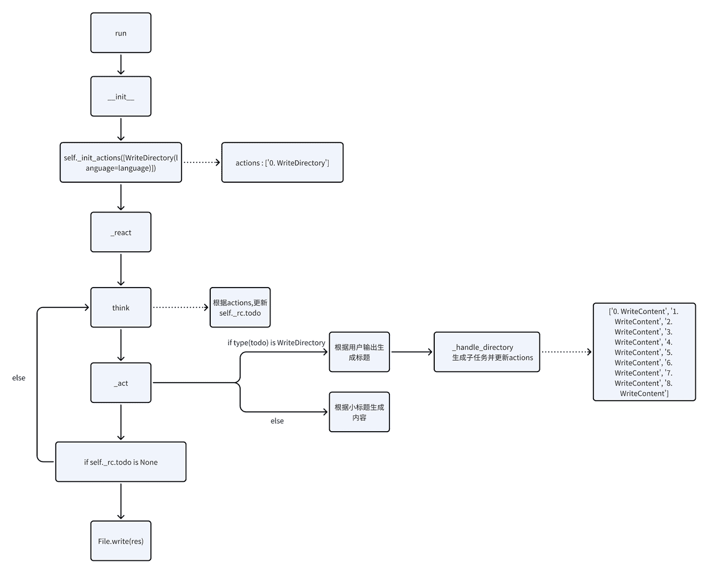

### 运行 TutorialAssistant 角色

接下来你只需要初始化它并使用一个起始消息运行它。

```
import asyncio

async def main():
    msg = &quot;Git 教程&quot;
    role = TutorialAssistant()
    logger.info(msg)
    result = await role.run(msg)
    logger.info(result)

asyncio.run(main())
```

完整代码如下：

```
from datetime import datetime
from typing import Dict
import asyncio
from metagpt.actions.write_tutorial import WriteDirectory, WriteContent
from metagpt.const import TUTORIAL_PATH
from metagpt.logs import logger
from metagpt.roles.role import Role, RoleReactMode
from metagpt.schema import Message
from metagpt.utils.file import File

from typing import Dict

from metagpt.actions import Action
from metagpt.prompts.tutorial_assistant import DIRECTORY_PROMPT, CONTENT_PROMPT
from metagpt.utils.common import OutputParser

class WriteDirectory(Action):
    &quot;&quot;&quot;Action class for writing tutorial directories.

    Args:
        name: The name of the action.
        language: The language to output, default is &quot;Chinese&quot;.
    &quot;&quot;&quot;

    name: str = &quot;WriteDirectory&quot;
    language: str = &quot;Chinese&quot;

    async def run(self, topic: str, *args, **kwargs) -&gt; Dict:
        &quot;&quot;&quot;Execute the action to generate a tutorial directory according to the topic.

        Args:
            topic: The tutorial topic.

        Returns:
            the tutorial directory information, including {&quot;title&quot;: &quot;xxx&quot;, &quot;directory&quot;: [{&quot;dir 1&quot;: [&quot;sub dir 1&quot;, &quot;sub dir 2&quot;]}]}.
        &quot;&quot;&quot;
        COMMON_PROMPT = &quot;&quot;&quot;
        You are now a seasoned technical professional in the field of the internet. 
        We need you to write a technical tutorial with the topic &quot;{topic}&quot;.
        &quot;&quot;&quot;

        DIRECTORY_PROMPT = COMMON_PROMPT + &quot;&quot;&quot;
        Please provide the specific table of contents for this tutorial, strictly following the following requirements:
        1. The output must be strictly in the specified language, {language}.
        2. Answer strictly in the dictionary format like {{&quot;title&quot;: &quot;xxx&quot;, &quot;directory&quot;: [{{&quot;dir 1&quot;: [&quot;sub dir 1&quot;, &quot;sub dir 2&quot;]}}, {{&quot;dir 2&quot;: [&quot;sub dir 3&quot;, &quot;sub dir 4&quot;]}}]}}.
        3. The directory should be as specific and sufficient as possible, with a primary and secondary directory.The secondary directory is in the array.
        4. Do not have extra spaces or line breaks.
        5. Each directory title has practical significance.
        &quot;&quot;&quot;
        prompt = DIRECTORY_PROMPT.format(topic=topic, language=self.language)
        resp = await self._aask(prompt=prompt)
        return OutputParser.extract_struct(resp, dict)

class WriteContent(Action):
    &quot;&quot;&quot;Action class for writing tutorial content.

    Args:
        name: The name of the action.
        directory: The content to write.
        language: The language to output, default is &quot;Chinese&quot;.
    &quot;&quot;&quot;

    name: str = &quot;WriteContent&quot;
    directory: dict = dict()
    language: str = &quot;Chinese&quot;

    async def run(self, topic: str, *args, **kwargs) -&gt; str:
        &quot;&quot;&quot;Execute the action to write document content according to the directory and topic.

        Args:
            topic: The tutorial topic.

        Returns:
            The written tutorial content.
        &quot;&quot;&quot;
        COMMON_PROMPT = &quot;&quot;&quot;
        You are now a seasoned technical professional in the field of the internet. 
        We need you to write a technical tutorial with the topic &quot;{topic}&quot;.
        &quot;&quot;&quot;
        CONTENT_PROMPT = COMMON_PROMPT + &quot;&quot;&quot;
        Now I will give you the module directory titles for the topic. 
        Please output the detailed principle content of this title in detail. 
        If there are code examples, please provide them according to standard code specifications. 
        Without a code example, it is not necessary.

        The module directory titles for the topic is as follows:
        {directory}

        Strictly limit output according to the following requirements:
        1. Follow the Markdown syntax format for layout.
        2. If there are code examples, they must follow standard syntax specifications, have document annotations, and be displayed in code blocks.
        3. The output must be strictly in the specified language, {language}.
        4. Do not have redundant output, including concluding remarks.
        5. Strict requirement not to output the topic &quot;{topic}&quot;.
        &quot;&quot;&quot;
        prompt = CONTENT_PROMPT.format(
            topic=topic, language=self.language, directory=self.directory)
        return await self._aask(prompt=prompt)

class TutorialAssistant(Role):
    &quot;&quot;&quot;Tutorial assistant, input one sentence to generate a tutorial document in markup format.

    Args:
        name: The name of the role.
        profile: The role profile description.
        goal: The goal of the role.
        constraints: Constraints or requirements for the role.
        language: The language in which the tutorial documents will be generated.
    &quot;&quot;&quot;

    name: str = &quot;Stitch&quot;
    profile: str = &quot;Tutorial Assistant&quot;
    goal: str = &quot;Generate tutorial documents&quot;
    constraints: str = &quot;Strictly follow Markdown&#x27;s syntax, with neat and standardized layout&quot;
    language: str = &quot;Chinese&quot;

    topic: str = &quot;&quot;
    main_title: str = &quot;&quot;
    total_content: str = &quot;&quot;

    def __init__(self, **kwargs):
        super().__init__(**kwargs)
        self._init_actions([WriteDirectory(language=self.language)])
        self._set_react_mode(react_mode=RoleReactMode.REACT.value)

    async def _think(self) -&gt; None:
        &quot;&quot;&quot;Determine the next action to be taken by the role.&quot;&quot;&quot;
        logger.info(self.rc.state)
        logger.info(self,)
        if self.rc.todo is None:
            self._set_state(0)
            return

        if self.rc.state + 1 &lt; len(self.states):
            self._set_state(self.rc.state + 1)
        else:
            self.rc.todo = None

    async def _handle_directory(self, titles: Dict) -&gt; Message:
        &quot;&quot;&quot;Handle the directories for the tutorial document.

        Args:
            titles: A dictionary containing the titles and directory structure,
                    such as {&quot;title&quot;: &quot;xxx&quot;, &quot;directory&quot;: [{&quot;dir 1&quot;: [&quot;sub dir 1&quot;, &quot;sub dir 2&quot;]}]}

        Returns:
            A message containing information about the directory.
        &quot;&quot;&quot;
        self.main_title = titles.get(&quot;title&quot;)
        directory = f&quot;{self.main_title}\n&quot;
        self.total_content += f&quot;# {self.main_title}&quot;
        actions = list()
        for first_dir in titles.get(&quot;directory&quot;):
            actions.append(WriteContent(
                language=self.language, directory=first_dir))
            key = list(first_dir.keys())[0]
            directory += f&quot;- {key}\n&quot;
            for second_dir in first_dir[key]:
                directory += f&quot;  - {second_dir}\n&quot;
        self._init_actions(actions)
        self.rc.todo = None
        return Message(content=directory)

    async def _act(self) -&gt; Message:
        &quot;&quot;&quot;Perform an action as determined by the role.

        Returns:
            A message containing the result of the action.
        &quot;&quot;&quot;
        todo = self.rc.todo
        if type(todo) is WriteDirectory:
            msg = self.rc.memory.get(k=1)[0]
            self.topic = msg.content
            resp = await todo.run(topic=self.topic)
            logger.info(resp)
            return await self._handle_directory(resp)
        resp = await todo.run(topic=self.topic)
        logger.info(resp)
        if self.total_content != &quot;&quot;:
            self.total_content += &quot;\n\n\n&quot;
        self.total_content += resp
        return Message(content=resp, role=self.profile)

    async def _react(self) -&gt; Message:
        &quot;&quot;&quot;Execute the assistant&#x27;s think and actions.

        Returns:
            A message containing the final result of the assistant&#x27;s actions.
        &quot;&quot;&quot;
        while True:
            await self._think()
            if self.rc.todo is None:
                break
            msg = await self._act()
        root_path = TUTORIAL_PATH / datetime.now().strftime(&quot;%Y-%m-%d_%H-%M-%S&quot;)
        await File.write(root_path, f&quot;{self.main_title}.md&quot;, self.total_content.encode(&#x27;utf-8&#x27;))
        return msg

async def main():
    msg = &quot;Git 教程&quot;
    role = TutorialAssistant()
    logger.info(msg)
    result = await role.run(msg)
    logger.info(result)

asyncio.run(main())
```

v0.6.6版本的完整代码也可以参考代码仓库：

https://github.com/geekan/MetaGPT/blob/v0.6.6/metagpt/actions/write_tutorial.py

https://github.com/geekan/MetaGPT/blob/v0.6.6/metagpt/roles/tutorial_assistant.py

## 第三章课程作业

经过上面的学习，我想你已经对 MetaGPT 的框架有了基本了解，现在我希望你能够自己编写这样一个 agent

+   这个 Agent 拥有三个动作 打印1 打印2 打印3（初始化时 init_action([print,print,print])）

+   重写有关方法（请不要使用act_by_order，我希望你能独立实现）使得 Agent 顺序执行上面三个动作

+   当上述三个动作执行完毕后，为 Agent 生成新的动作 打印4 打印5 打印6 并顺序执行，（之前我们初始化了三个 print 动作，执行完毕后，重新 init_action([...,...,...])，然后顺序执行这个新生成的动作列表)

如果完成上面的任务，那这次作业已经可以算完成了，这个作业可以用多种思路去解决，比如我可以直接写死一整套的逻辑，甚至都不需要引入llm来完成这个工作，我希望大家通过这个作业来感受 MetaGPT 中 Agent 的行动逻辑, run->react->think->act 的这样一个过程，但你也可以试着在中间的某个环节中加入llm的交互，来尝试减少硬编码的工作，就像1.4中，我们实际上是让llm帮我们设计了 action 列表的内容，你也可以在此基础上做出更多的尝试，关于这个 Agent 我们还有更多可以思考的地方

## 单智能体案例 OSS - 订阅智能体

### 基本介绍

#### 什么是订阅智能体

MetaGPT提供了Agent的开发能力，Agent可以协助我们解决日常的一些问题，其中一个应用场景就是我们可以让Agent为我们关注某些想关注的信息，当有我们关注的事件发生时，Agent获取信息并进行处理，然后通过一些如邮件、微信、discord等通知渠道将处理后的信息发送给我们，我们将这类Agent称为订阅智能体

在这里，Agent的Role是以一个“资讯订阅员”的身份为你服务，而Agent中包含的Action则主要有两种：从外界信息源中搜集信息和对搜集得到的信息进行总结；完成上述任务后，我们可以为这个Agent开发更多额外功能：定时运行的功能和发送到通知渠道的功能x

#### 如何用MetaGPT实现订阅智能体

在MetaGPT中，metagpt.subscription模块提供了SubscriptionRunner类，与metagpt.team.Team类似，SubscriptionRunner类是提供了一个Role的运行方式，基于SubscriptionRunner类，我们可以定时触发运行一个Role，然后将Role的执行输出通知给用户，例如，以下的示例：

```
&gt;&gt;&gt; import asyncio
&gt;&gt;&gt; from metagpt.subscription import SubscriptionRunner
&gt;&gt;&gt; from metagpt.roles import Searcher
&gt;&gt;&gt; from metagpt.schema import Message

&gt;&gt;&gt; async def trigger():
...     while True:
...         yield Message(&quot;the latest news about OpenAI&quot;)
...         await asyncio.sleep(3600 * 24)

&gt;&gt;&gt; async def callback(msg: Message):
...     print(msg.content)

&gt;&gt;&gt; async def main():
...     pb = SubscriptionRunner()
...     await pb.subscribe(Searcher(), trigger(), callback)
...     await pb.run()

&gt;&gt;&gt; asyncio.run(main())
```

从例子可以知道订阅智能体的实现主要有3个要素，分别是Role、Trigger、Callback，即智能体本身、触发器、数据回调。如果之前已经学过了Agent的开发，那么对Role的实现肯定非常熟悉了，这边的Role就是我们的Agent的实际代码实现，所以订阅智能体在代码实现上并没有什么特别的地方，可以看到上面的例子实际运行的就是MetaGPT中的Searcher Role，它早就存在了我们的MetaGPT仓库中

不过需要注意的是，我们虽然不对订阅智能体的Role做限制，但是不是所有的Role都适合用来做订阅智能体，比如MetaGPT软件公司中的几个角色，例如产品经理、架构师、工程师等，因为当给这些Role一个需求输入时，它们的产出往往是类似的，并没有定时执行然后发送给我们能的必要。所以从应用的角度出发，订阅智能体的输出应该具有实时性，相同的一个需求描述输入，输出的内容一般是会随着时间的变化而不同，例如新闻资讯、技术前沿进展、热门的开源项目等。

所以，接下来我们本文档通过一个OSS（Open Source Software）订阅智能体实现示例教大家如何使用MetaGPT实现订阅智能体

### 教程信息

#### 前置准备

为了让大家在实操过程中有良好体验，在正式进入到本章节的实操环节之前，我们准备了以下的前置知识检查清单，这些都是在接下来实操时会用到的，如果以下清单所列内容都很熟悉，直接跳过即可；如果有不太清楚的点，可以根据建议先补齐一下前置知识

+   普通智能体的开发：参考前面的教程

+   网络爬虫

+   基础的概念：

+   HTML：了解 HTML 的基本结构、标签和常见元素

+   CSS：了解 CSS 在 HTML 中的作用

+   工具：使用浏览器开发者模式能定位网页元素

+   Python 工具

+   aiohttp：熟悉 [aiohttp](https://docs.aiohttp.org/en/stable/) 库的基本用法，会用aiohttp发起网络请求

+   beautifulsoup：了解HTML解析库 [BeautifulSoup](https://beautiful-soup-4.readthedocs.io/en/latest/)，掌握如何使用它从HTML中提取信息

+   MetaGPT 订阅模块

+   Role、Trigger、Callback的概念

+   Trigger是个异步生成器，参考 https://peps.python.org/pep-0525/，知道如何实现即可

> 如果对爬虫不了解也不要紧，不要你精通爬虫，有基本了解即可，我们可以让ChatGPT帮忙生成爬虫代码

另外教程涉中需要访问到一些国外的网站，可能会遇到网络问题，因为 aiohttp 默认不走系统代理，所以需要做下代理配置。MetaGPT中已经提供了GLOBAL_PROXY参数用来表示全局代理配置，教程中遇到使用aiohttp进行请求的地方，都会将代理设置为GLOBAL_PROXY的值，所以可以通过在config/key.yaml配置文件中，添加自己代理服务器的配置，以解决网络问题：

```
GLOBAL_PROXY: http://127.0.0.1:8118  # 改成自己的代理服务器地址
```

最后，[运行示例](https://deepwisdom.feishu.cn/docx/RJmTdvZuPozAxFxEpFxcbiPwnQf#ALhZdWRzzoDYy5xQXW6cCAZXnZf)章节提供了完整的代码，如果想先看下整体的运行效果，可以运行示例的main.py文件

#### 教程目标

通过本教程你可以：

1.  学习 MetaGPT 订阅模块的使用

1.  实现一个属于自己的订阅智能体

### OSS订阅智能体实现

订阅智能体的实现主要有3个要素，分别是Role、Trigger、Callback，即智能体本身、触发器、数据回调。我们先拆解一下这个工作：

1.  实现一个 OSSWatcher 的 Role：OSS 即 Open source software，我们对OSS 智能体定位是，帮我们关注并分析热门的开源项目，当有相关信息时将信息推送给我们，这里需要确定让 OSS 从哪个网页获取信息

1.  触发Trigger：指这个OSSWatcher角色运行的触发条件，可以是定时触发或者是某个网站有更新时触发

1.  结果Callback：处理OSSWatcher角色运行生成的信息，我们可以将数据发送到微信或者discord

接下来，我们一个一个地进行实现

### OSSWatcher Role实现

#### 基本分析

实现OSSWatcher的Role前，需要先确定我们要 OSSWatcher 做哪些事情，即需要实现哪些 Action，要分析热门开源项目，需要先获取热门开源项目信息，所以OSSWatcher可以拆分出两个Action，爬取热门开源项目和分析热门开源项目。

[我们先确定从哪个网页获取信息，](https://github.com/trending)说到热门开源项目，我们首先想到的就是GitHub Trending，Github Trending是Github主要板块子页面之一，主要展示指定时间段内Github上最受关注、热度上升的最快的资源库和开发者。它实际上是一个Github的一个资源库和开发者「热搜榜」，资源库按照时间段（每天、每周、每月）内获得的星星数量、fork数等指标排行。我们先打开 Github Trending 的网页，观察网页内容，以下是一些基本信息：

+   访问链接：https://github.com/trending

+   有筛选条件，主要有

+   spoken language：en/zh/...

+   language：html/javascript/python/go/java/...

+   since：daily/weekly/monthly

这是个静态网页，要爬取非常简单，如果有需要还可以根据条件进行筛选。网页爬取后，就可以对网页内容进行分析，例如以下的分析角度

1.  编程语言趋势：观察Trending列表中使用的编程语言，了解当前哪些编程语言在开发者社区中更受欢迎

1.  项目类型和用途：分析Trending列表中的项目，看看它们是属于哪些类别，以及它们的具体用途是什么

1.  社区活跃度：查看项目的星标数量、贡献者数量

1.  新兴技术和工具：注意新项目和涌现的技术，以便了解当前的技术趋势

以上是一些比较通用的角度，我们也可以根据自己的偏好进行分析，例如，主要关注AI领域的一些热门项目。基于以上，我们要做的事情就是，抓取Github Trending网页的信息，然后让LLM根据我们关注的角度进行分析，那么我们的OSSWatcher角色就完成了

#### GitHub Trending爬取

我们先来完成网页爬取的功能，我们教程直接爬取当天不分国家语言和编程语言的热门仓库进行分析，如果有特殊要求，爬取加上筛选条件条件后网页即可。我们先打开 https://github.com/trending 网页，观察网页内容，找到我们需要的内容对应的html元素，

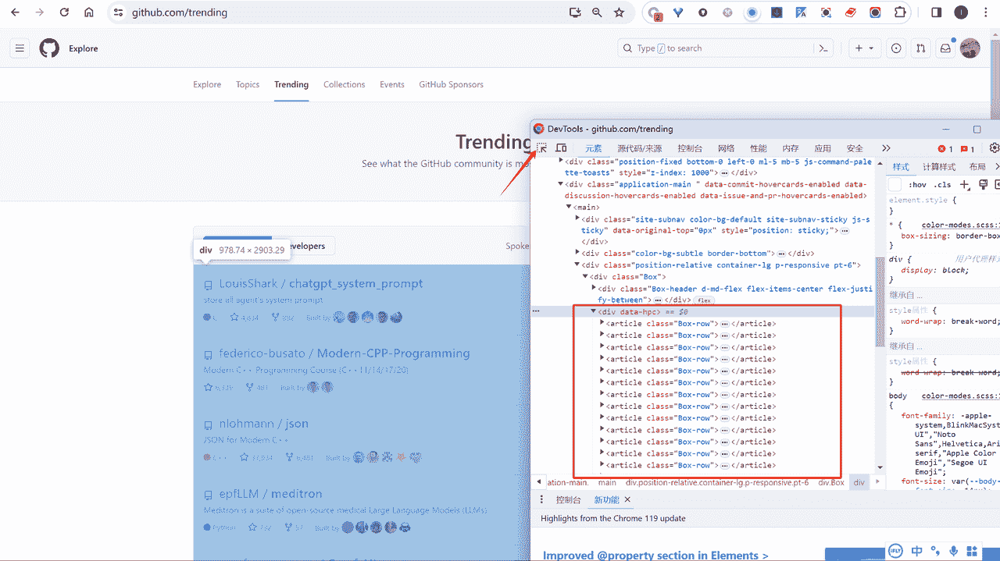

如果熟悉爬虫的就可以直接写爬取和解析脚本了，如果不熟悉的也没关系，我们可以用ChatGPT辅助开发：

首先我们将图片所示的html复制出来，保存到github-trending-raw.html，格式化后发现内容非常多，大概600多k，还有一些svg源码，因为一般用CSS足以定位html里的元素，所以我们可以对html内容进行瘦身，可以使用以下的脚本：

```
from bs4 import BeautifulSoup

with open(&quot;github-trending-raw.html&quot;) as f:
    html = f.read()

soup = BeautifulSoup(html, &quot;html.parser&quot;)
for i in soup.find_all(True):
    for name in list(i.attrs):
        if i[name] and name not in [&quot;class&quot;]:
            del i[name]

for i in soup.find_all([&quot;svg&quot;, &quot;img&quot;, &quot;video&quot;, &quot;audio&quot;]):
    i.decompose()

with open(&quot;github-trending-slim.html&quot;, &quot;w&quot;) as f:
    f.write(str(soup))
```

经过以上的脚本处理之后，大概还有100多k。对于爬虫来说，重要的是Html的结构，处理后的Html文件其实有大量的信息是重复的，如果我们要让GPT协助我们写爬虫脚本，只需要截取部分信息就可以了，榜单上有20个repo，我们只需要保留前两个

删减前：

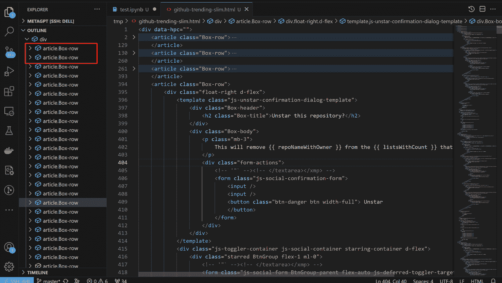

删减后

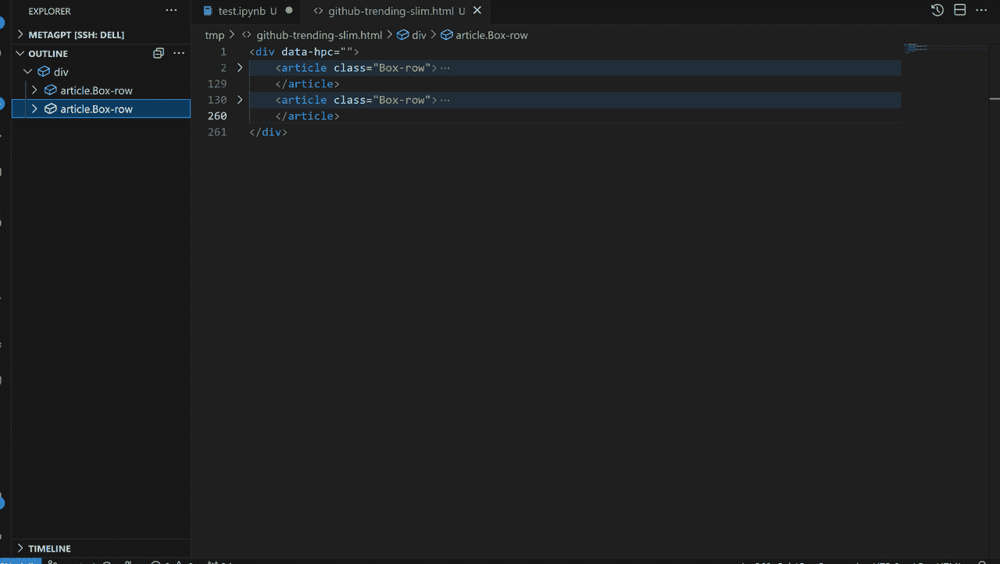

此时大小仅12k，这时候我们就可以用ChatGPT帮我们写爬取分析Github Trending的代码了，可以参考以下的对话：

https://chat.openai.com/share/6c8046d3-e363-40bd-9412-8d859e7b3854

最初给出的代码有报错，以及输出的Language为空，通过两次的对话让ChatGPT进行修复，最终得到以下代码：

```
import aiohttp
import asyncio
from bs4 import BeautifulSoup

async def fetch_html(url):
    async with aiohttp.ClientSession() as session:
        async with session.get(url) as response:
            return await response.text()

async def parse_github_trending(html):
    soup = BeautifulSoup(html, &#x27;html.parser&#x27;)

    repositories = []

    for article in soup.select(&#x27;article.Box-row&#x27;):
        repo_info = {}
        
        repo_info[&#x27;name&#x27;] = article.select_one(&#x27;h2 a&#x27;).text.strip()
        repo_info[&#x27;url&#x27;] = article.select_one(&#x27;h2 a&#x27;)[&#x27;href&#x27;].strip()

        # Description
        description_element = article.select_one(&#x27;p&#x27;)
        repo_info[&#x27;description&#x27;] = description_element.text.strip() if description_element else None

        # Language
        language_element = article.select_one(&#x27;span[itemprop=&quot;programmingLanguage&quot;]&#x27;)
        repo_info[&#x27;language&#x27;] = language_element.text.strip() if language_element else None

        # Stars and Forks
        stars_element = article.select(&#x27;a.Link--muted&#x27;)[0]
        forks_element = article.select(&#x27;a.Link--muted&#x27;)[1]
        repo_info[&#x27;stars&#x27;] = stars_element.text.strip()
        repo_info[&#x27;forks&#x27;] = forks_element.text.strip()

        # Today&#x27;s Stars
        today_stars_element = article.select_one(&#x27;span.d-inline-block.float-sm-right&#x27;)
        repo_info[&#x27;today_stars&#x27;] = today_stars_element.text.strip() if today_stars_element else None

        repositories.append(repo_info)

    return repositories

async def main():
    url = &#x27;https://github.com/trending&#x27;
    html = await fetch_html(url)
    repositories = await parse_github_trending(html)

    for repo in repositories:
        print(f&quot;Name: {repo[&#x27;name&#x27;]}&quot;)
        print(f&quot;URL: https://github.com{repo[&#x27;url&#x27;]}&quot;)
        print(f&quot;Description: {repo[&#x27;description&#x27;]}&quot;)
        print(f&quot;Language: {repo[&#x27;language&#x27;]}&quot;)
        print(f&quot;Stars: {repo[&#x27;stars&#x27;]}&quot;)
        print(f&quot;Forks: {repo[&#x27;forks&#x27;]}&quot;)
        print(f&quot;Today&#x27;s Stars: {repo[&#x27;today_stars&#x27;]}&quot;)
        print()
```

稍微修改一下，把它作为一个Action类

1.  导入

```
from metagpt.actions.action import Action
from metagpt.config import CONFIG
```

1.  参考第三章1.2.2设计 action的异步run方法

1.  创建 aiohttp.ClientSession 对象: 使用 async with 语句创建 aiohttp.ClientSession 对象，用于发送 HTTP 请求。

1.  发送 GET 请求: 使用 client.get() 方法发送 GET 请求，并指定要访问的 URL。

1.  设置代理: 通过 proxy=CONFIG.global_proxy 参数设置全局代理服务器。

1.  检查响应状态: 使用 response.raise_for_status() 方法检查响应状态，如果状态码不为 200，则会抛出异常。

1.  读取响应内容: 使用 await response.text() 方法读取响应内容并将其存储在 html 变量中。

1.  返回 HTML 内容: 将获取到的 HTML 内容返回给调用者。

```
async def run(self, url: str = &quot;https://github.com/trending&quot;):
    async with aiohttp.ClientSession() as client:
        async with client.get(url, proxy=CONFIG.global_proxy) as response:
            response.raise_for_status()
            html = await response.text()
```

1.  在方法中将先前的parse_github_trending(html)方法搬运到action中用repositories做返回值

完整代码如下：

```
import aiohttp
from bs4 import BeautifulSoup
from metagpt.actions.action import Action
from metagpt.config import CONFIG

class CrawlOSSTrending(Action):

    async def run(self, url: str = &quot;https://github.com/trending&quot;):
        async with aiohttp.ClientSession() as client:
            async with client.get(url, proxy=CONFIG.global_proxy) as response:
                response.raise_for_status()
                html = await response.text()
 
        soup = BeautifulSoup(html, &#x27;html.parser&#x27;)
    
        repositories = []
    
        for article in soup.select(&#x27;article.Box-row&#x27;):
            repo_info = {}
            
            repo_info[&#x27;name&#x27;] = article.select_one(&#x27;h2 a&#x27;).text.strip().replace(&quot;\n&quot;, &quot;&quot;).replace(&quot; &quot;, &quot;&quot;)
            repo_info[&#x27;url&#x27;] = &quot;https://github.com&quot; + article.select_one(&#x27;h2 a&#x27;)[&#x27;href&#x27;].strip()
    
            # Description
            description_element = article.select_one(&#x27;p&#x27;)
            repo_info[&#x27;description&#x27;] = description_element.text.strip() if description_element else None
    
            # Language
            language_element = article.select_one(&#x27;span[itemprop=&quot;programmingLanguage&quot;]&#x27;)
            repo_info[&#x27;language&#x27;] = language_element.text.strip() if language_element else None
    
            # Stars and Forks
            stars_element = article.select(&#x27;a.Link--muted&#x27;)[0]
            forks_element = article.select(&#x27;a.Link--muted&#x27;)[1]
            repo_info[&#x27;stars&#x27;] = stars_element.text.strip()
            repo_info[&#x27;forks&#x27;] = forks_element.text.strip()
    
            # Today&#x27;s Stars
            today_stars_element = article.select_one(&#x27;span.d-inline-block.float-sm-right&#x27;)
            repo_info[&#x27;today_stars&#x27;] = today_stars_element.text.strip() if today_stars_element else None
    
            repositories.append(repo_info)
    
        return repositories
```

#### GitHub Trending总结

网页爬取的Action实现后，我们就可以让LLM基于爬取的网页内容进行分析了，这个Action实现比较简单，主要是写提示词，在提示词中我们可以要求LLM从几个角度进行分析，并按照一定的格式进行输出，例如

1.  今天榜单的整体趋势，例如哪几个编程语言比较热门、最热门的项目是哪些、主要集中在哪些领域

1.  榜单的仓库分类

1.  推荐进一步关注哪些仓库，推荐原因是什么

```
from typing import Any
from metagpt.actions.action import Action

TRENDING_ANALYSIS_PROMPT = &quot;&quot;&quot;# Requirements
You are a GitHub Trending Analyst, aiming to provide users with insightful and personalized recommendations based on the latest
GitHub Trends. Based on the context, fill in the following missing information, generate engaging and informative titles, 
ensuring users discover repositories aligned with their interests.

# The title about Today&#x27;s GitHub Trending
## Today&#x27;s Trends: Uncover the Hottest GitHub Projects Today! Explore the trending programming languages and discover key domains capturing developers&#x27; attention. From ** to **, witness the top projects like never before.
## The Trends Categories: Dive into Today&#x27;s GitHub Trending Domains! Explore featured projects in domains such as ** and **. Get a quick overview of each project, including programming languages, stars, and more.
## Highlights of the List: Spotlight noteworthy projects on GitHub Trending, including new tools, innovative projects, and rapidly gaining popularity, focusing on delivering distinctive and attention-grabbing content for users.
---
# Format Example

```
# [Title]

## Today&#x27;s Trends
Today, ** and ** continue to dominate as the most popular programming languages. Key areas of interest include **, ** and **.
The top popular projects are Project1 and Project2.

## The Trends Categories
1. Generative AI
    - [Project1](https://github/xx/project1): [detail of the project, such as star total and today, language, ...]
    - [Project2](https://github/xx/project2): ...
...

## Highlights of the List
1. [Project1](https://github/xx/project1): [provide specific reasons why this project is recommended].
...
```

---
# Github Trending
{trending}
&quot;&quot;&quot;

class AnalysisOSSTrending(Action):

    async def run(
        self,
        trending: Any
    ):
        return await self._aask(TRENDING_ANALYSIS_PROMPT.format(trending=trending))
```

#### OSSWatcher Role实现

以上Action都实现了，把它们都写到metagpt/actions/oss_trending.py文件中，然后新建文件metagpt/roles/oss_watcher.py，就可以写Role的代码了：

```
from metagpt.actions.oss_trending import CrawlOSSTrending, AnalysisOSSTrending
from metagpt.roles import Role

class OssWatcher(Role):
    def __init__(
        self,
        name=&quot;Codey&quot;,
        profile=&quot;OssWatcher&quot;,
        goal=&quot;Generate an insightful GitHub Trending analysis report.&quot;,
        constraints=&quot;Only analyze based on the provided GitHub Trending data.&quot;,
    ):
        super().__init__(name, profile, goal, constraints)
        self._init_actions([CrawlOSSTrending, AnalysisOSSTrending])
        self._set_react_mode(react_mode=&quot;by_order&quot;)

    async def _act(self) -&gt; Message:
        logger.info(f&quot;{self._setting}: ready to {self._rc.todo}&quot;)
        # By choosing the Action by order under the hood
        # todo will be first SimpleWriteCode() then SimpleRunCode()
        todo = self.rc.todo

        msg = self.get_memories(k=1)[0] # find the most k recent messages
        result = await todo.run(msg.content)

        msg = Message(content=str(result), role=self.profile, cause_by=type(todo))
        self._rc.memory.add(msg)
        return msg
```

### Trigger实现

Trigger即触发器，代表了OSSWatcher角色的执行时机，最简单的触发方式即定时触发。Github Trending不是实时更新的，参考https://github.com/orgs/community/discussions/64295，大约是在10:00 AM UTC，实测更新时间不是很准时，所以我们可以一天触发一次，选取一个比较适合自己的推送时间即可，比如每天早上9点

以下提供一个定时Trigger的实现，要达到定时的目的，我们可以直接使用asyncio.sleep，例如：

```
import asyncio
import time

from datetime import datetime, timedelta
from metagpt.schema import Message
from pydantic import BaseModel, Field


class OssInfo(BaseModel):
    url: str
    timestamp: float = Field(default_factory=time.time)


async def oss_trigger(hour: int, minute: int, second: int = 0, url: str = &quot;https://github.com/trending&quot;):
    while True:
        now = datetime.now()
        next_time = datetime(now.year, now.month, now.day, hour, minute, second)
        if next_time &lt; now:
            next_time = next_time + timedelta(1)
        wait = next_time - now
        print(wait.total_seconds())
        await asyncio.sleep(wait.total_seconds())
        yield Message(url, OssInfo(url=url))
```

yield 语句被用于异步函数"oss_trigger"中，用于生成消息。每当调用这个异步函数时，它会在指定的时间间隔内生成一个消息，并在下一次调用时继续执行。此处我们预定义了OssInfo的结构，加入了时间戳的信息，并将其实例作为trigger生成的Message的instruct_content属性，作用是在早期的版本中，角色在接收Message会有一个去重操作，如果我们每次生成的Message只有url信息，那么第2次运行时，角色将不会接收新的Message，但是加入时间戳后，trigger生成的每个Message就不再相等，角色也会接收对应的Message

上述的简单例子，可以实现简单的按天定时触发的能力，不过如果需要更精细的控制，这个函数还需要继续优化。但我们可以借助一些第三方包实现这个功能，使用crontab实现定时触发是非常常见的一个做法，而且python也有一个异步的cron工具，即aiocron，使用aiocron我们可以直接使用cron的语法制定定时任务。上面我们使用了函数的方式来实现了定时Trigger异步生成器，接下来我们结合aiocron使用类的方式，来实现定时Trigger

```
import time
from aiocron import crontab
from typing import Optional
from pytz import BaseTzInfo
from pydantic import BaseModel, Field
from metagpt.schema import Message

class GithubTrendingCronTrigger:
    def __init__(
        self,
        spec: str,
        tz: Optional[BaseTzInfo] = None,
        url: str = &quot;https://github.com/trending&quot;,
    ) -&gt; None:
        self.crontab = crontab(spec, tz=tz)
        self.url = url

    def __aiter__(self):
        return self

    async def __anext__(self):
        await self.crontab.next()
        return Message(content=self.url)

```

基于aiocron我们可以少写很多代码，功能也更加强大，可以用cron语法非常灵活地配置定时规则

如果您想指定UTC 时间 10:00 AM 触发

```
# 创建 GithubTrendingCronTrigger 实例，指定每天 UTC 时间 10:00 AM 触发
cron_trigger = GithubTrendingCronTrigger(&quot;0 10 * * *&quot;)
```

如果您想指定北京时间上午8:00来触发这个任务，您需要做两件事：

1.  设置正确的 cron 表达式。

1.  确保时区设置正确。

北京时间是东八区（UTC+8），所以您应该在 tz 参数中设置相应的时区。而 cron 表达式遵循特定的格式，通常是：分钟、小时、日、月、星期几。

对于每天上午8:00，cron 表达式应该是 "0 8 * * *"，这表示每天的第8小时的第0分钟触发。

因此，您的 GithubTrendingCronTrigger 类的初始化代码应该类似于以下形式：

```

from pytz import timezone
beijing_tz = timezone(&#x27;Asia/Shanghai&#x27;)  获取北京时间的时区
cron_trigger = GithubTrendingCronTrigger(&quot;0 8 * * *&quot;, tz=beijing_tz)
```

> 思考1：如果需要榜单更新再推送，可以如何实现？

> 思考2：Crontab的定时方式可能不是很方便进行调试，有什么方便调试的方法吗？

### Callback设计

#### 基础介绍

Callback就是定义了如何处理智能体生成的信息，它本身没有过多难点，但是如果想将信息发送到我们日常使用的一些应用，可能会有一些成本。因此，本文档提供将智能体产生的数据发送到discord/微信的示例供大家参考，其中Discord是一款免费的通讯软件，让你可以与你的好友，社群以及开发者们进行语音，视频及文字聊天。目前，MetaGPT的海外社区就是在Discord上维护的，在国内，MetaGPT也有庞大的微信社区，所以本文档选取目前MetaGPT比较活跃的两个社区工具作为示例，其他工具同理

#### Discord

前置要求：注册账号、在[discord的开发者面板](https://discord.com/developers/applications)添加BOT，并将BOT添加到某个服务器中，参考https://discordpy.readthedocs.io/en/stable/discord.html

使用discord发送消息的示例如下：

```
import asyncio
import discord


async def send_discord_msg(channel_id: int, msg: str, token: str):
    intents = discord.Intents.default()
    intents.message_content = True
    client = discord.Client(intents=intents)
    async with client:
        await client.login(token)
        channel = await client.fetch_channel(channel_id)
        await channel.send(msg)
```

不过discord单条消息有大小限制，过长的内容会导致发送不成功，我们可以按章节分多条msg发送，最终实现的discord_callback函数如下：

```
import asyncio
import discord

from metagpt.config import CONFIG


async def discord_callback(msg: Message):
    intents = discord.Intents.default()
    intents.message_content = True
    client = discord.Client(intents=intents, proxy=CONFIG.global_proxy)
    token = os.environ[&quot;DISCORD_TOKEN&quot;]
    channel_id = int(os.environ[&quot;DISCORD_CHANNEL_ID&quot;])
    async with client:
        await client.login(token)
        channel = await client.fetch_channel(channel_id)
        lines = []
        for i in msg.content.splitlines():
            if i.startswith((&quot;# &quot;, &quot;## &quot;, &quot;### &quot;)):
                if lines:
                    await channel.send(&quot;\n&quot;.join(lines))
                    lines = []
            lines.append(i)

        if lines:
            await channel.send(&quot;\n&quot;.join(lines))
```

**DISCORD_TOKEN**参考官方文档discord readthedocs，"Creating a Bot Account"章节的第7步：

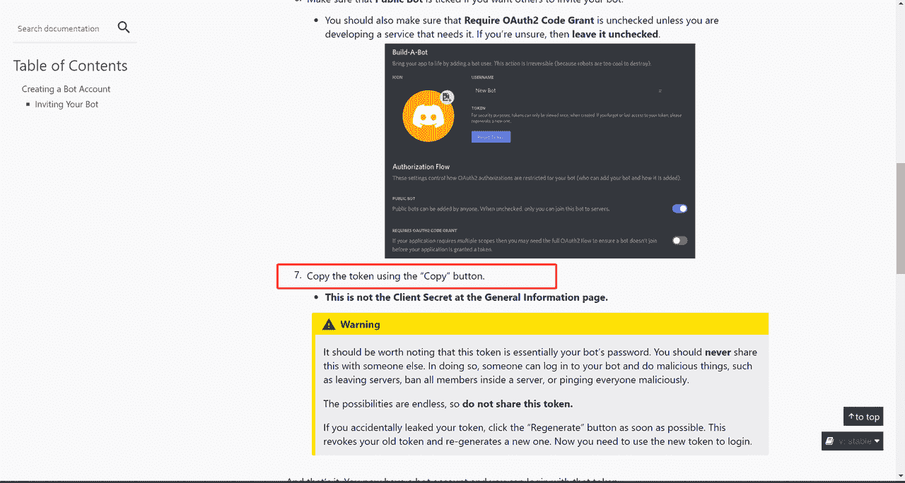

DISCORD_CHANNEL_ID即希望Bot发送消息的频道，如下：

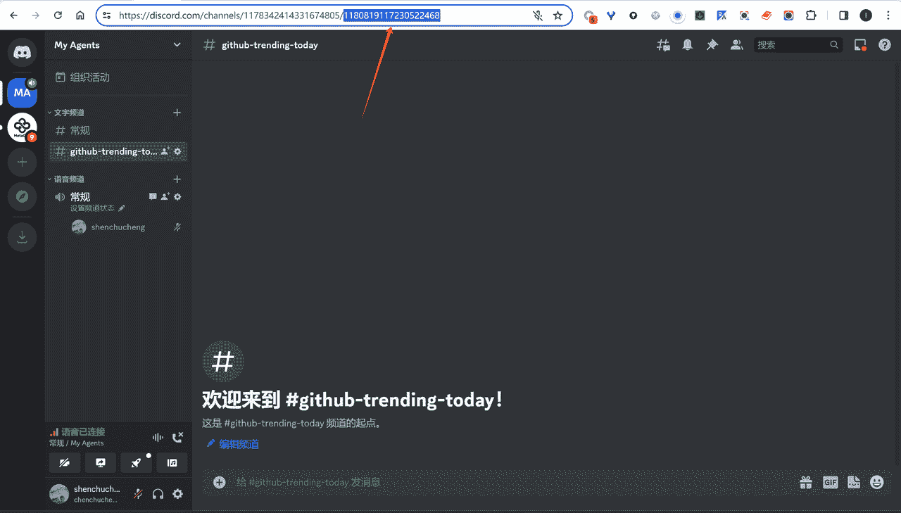

#### Wechat

之前MetaGPT有尝试通过微信机器人同步不同社区群的消息，不过由于引起了过大的讨论，最终关闭了该功能，当时是使用wechaty实现的，但是使用该方式较为繁琐，而且由于我们的内容是markdown格式的，直接发送微信消息阅读体验较差，所以我们需要寻找合适的微信消息发送方式。公众号可以发送富本文消息，比较符合我们的场景，但是为了个推送的功能，开发个公众号的成本也是比较大，但是如果可以通过已有的一个公众号给我们发送消息，那实现将会非常简单。虽然微信官方没有提供类似的功能，但是已有许多的第三方公众号提供了消息推送的功能，例如server酱、wxpusher、Pushplus等，我们可以选择其中之一，例如wxpusher，它的代码是开源的，也有详细的文档，开发文档见：https://wxpusher.zjiecode.com/docs/#/

wxpusher虽然有python客户端，但是是同步的，但我们根据API文档，可以快速简单地实现一个异步的客户端：

```
import os
from typing import Optional
import aiohttp


class WxPusherClient:
    def __init__(self, token: Optional[str] = None, base_url: str = &quot;http://wxpusher.zjiecode.com&quot;):
        self.base_url = base_url
        self.token = token or os.environ[&quot;WXPUSHER_TOKEN&quot;]

    async def send_message(
        self,
        content,
        summary: Optional[str] = None,
        content_type: int = 1,
        topic_ids: Optional[list[int]] = None,
        uids: Optional[list[int]] = None,
        verify: bool = False,
        url: Optional[str] = None,
    ):
        payload = {
            &quot;appToken&quot;: self.token,
            &quot;content&quot;: content,
            &quot;summary&quot;: summary,
            &quot;contentType&quot;: content_type,
            &quot;topicIds&quot;: topic_ids or [],
            &quot;uids&quot;: uids or os.environ[&quot;WXPUSHER_UIDS&quot;].split(&quot;,&quot;),
            &quot;verifyPay&quot;: verify,
            &quot;url&quot;: url,
        }
        url = f&quot;{self.base_url}/api/send/message&quot;
        return await self._request(&quot;POST&quot;, url, json=payload)

    async def _request(self, method, url, **kwargs):
        async with aiohttp.ClientSession() as session:
            async with session.request(method, url, **kwargs) as response:
                response.raise_for_status()
                return await response.json()
```

然后实现callback：

```
async def wxpusher_callback(msg: Message):
    client = WxPusherClient()
    await client.send_message(msg.content, content_type=3)
```

**WXPUSHER_TOKEN**[即wxpush的APP_TO](https://wxpusher.zjiecode.com/docs/#/?id=%e8%8e%b7%e5%8f%96apptoken)KEN，参考官方文档获取appToken

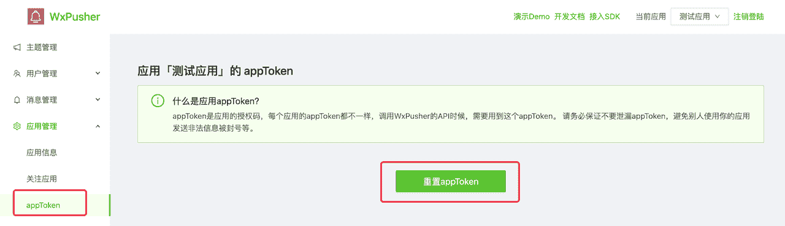

**WXPUSHER_UIDS**可以从应用管理页的”用户管理->用户列表“获取用户的UID，如果要发送给多个用户，可以用逗号将不同用户UID隔开

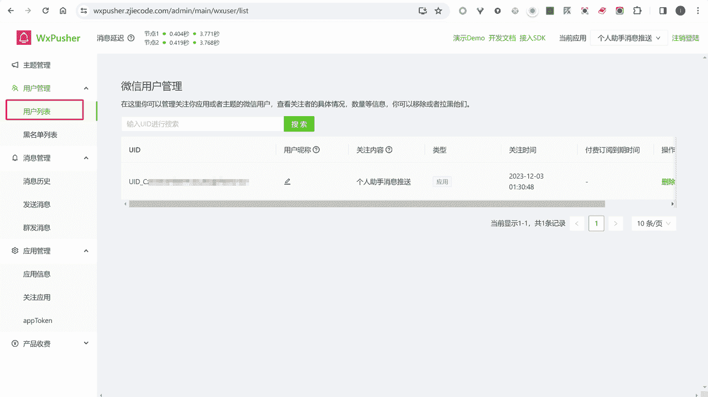

### 运行示例

以上基础的代码都开发完成了，接下来就是要运行了，考虑到为了能够在让上面的代码内容能够连贯，我们将它们写在一个main.py文件里，并进行回顾：

（完整代码下载：python版 |notebook版 ）


[main.py](https://internal-api-drive-stream.feishu.cn/space/api/box/stream/download/all/RBUxbaxc4oS60axzwWKcwwLEndh)


[main.ipynb](https://internal-api-drive-stream.feishu.cn/space/api/box/stream/download/all/L0RSb0z2Io6io7xBZ8Uc7O8Pnud)

```
import asyncio
import os
from typing import Any, AsyncGenerator, Awaitable, Callable, Dict, Optional

import aiohttp
import discord
from aiocron import crontab
from bs4 import BeautifulSoup
from pydantic import BaseModel, Field
from pytz import BaseTzInfo

from metagpt.actions.action import Action
from metagpt.config import CONFIG
from metagpt.logs import logger
from metagpt.roles import Role
from metagpt.schema import Message

# fix SubscriptionRunner not fully defined
from metagpt.environment import Environment as _  # noqa: F401


# 订阅模块，可以from metagpt.subscription import SubscriptionRunner导入，这里贴上代码供参考
class SubscriptionRunner(BaseModel):
    &quot;&quot;&quot;A simple wrapper to manage subscription tasks for different roles using asyncio.
    Example:
        &gt;&gt;&gt; import asyncio
        &gt;&gt;&gt; from metagpt.subscription import SubscriptionRunner
        &gt;&gt;&gt; from metagpt.roles import Searcher
        &gt;&gt;&gt; from metagpt.schema import Message
        &gt;&gt;&gt; async def trigger():
        ...     while True:
        ...         yield Message(&quot;the latest news about OpenAI&quot;)
        ...         await asyncio.sleep(3600 * 24)
        &gt;&gt;&gt; async def callback(msg: Message):
        ...     print(msg.content)
        &gt;&gt;&gt; async def main():
        ...     pb = SubscriptionRunner()
        ...     await pb.subscribe(Searcher(), trigger(), callback)
        ...     await pb.run()
        &gt;&gt;&gt; asyncio.run(main())
    &quot;&quot;&quot;

    tasks: Dict[Role, asyncio.Task] = Field(default_factory=dict)

    class Config:
        arbitrary_types_allowed = True

    async def subscribe(
        self,
        role: Role,
        trigger: AsyncGenerator[Message, None],
        callback: Callable[
            [
                Message,
            ],
            Awaitable[None],
        ],
    ):
        &quot;&quot;&quot;Subscribes a role to a trigger and sets up a callback to be called with the role&#x27;s response.
        Args:
            role: The role to subscribe.
            trigger: An asynchronous generator that yields Messages to be processed by the role.
            callback: An asynchronous function to be called with the response from the role.
        &quot;&quot;&quot;
        loop = asyncio.get_running_loop()

        async def _start_role():
            async for msg in trigger:
                resp = await role.run(msg)
                await callback(resp)

        self.tasks[role] = loop.create_task(_start_role(), name=f&quot;Subscription-{role}&quot;)

    async def unsubscribe(self, role: Role):
        &quot;&quot;&quot;Unsubscribes a role from its trigger and cancels the associated task.
        Args:
            role: The role to unsubscribe.
        &quot;&quot;&quot;
        task = self.tasks.pop(role)
        task.cancel()

    async def run(self, raise_exception: bool = True):
        &quot;&quot;&quot;Runs all subscribed tasks and handles their completion or exception.
        Args:
            raise_exception: _description_. Defaults to True.
        Raises:
            task.exception: _description_
        &quot;&quot;&quot;
        while True:
            for role, task in self.tasks.items():
                if task.done():
                    if task.exception():
                        if raise_exception:
                            raise task.exception()
                        logger.opt(exception=task.exception()).error(
                            f&quot;Task {task.get_name()} run error&quot;
                        )
                    else:
                        logger.warning(
                            f&quot;Task {task.get_name()} has completed. &quot;
                            &quot;If this is unexpected behavior, please check the trigger function.&quot;
                        )
                    self.tasks.pop(role)
                    break
            else:
                await asyncio.sleep(1)


# Actions 的实现
TRENDING_ANALYSIS_PROMPT = &quot;&quot;&quot;# Requirements
You are a GitHub Trending Analyst, aiming to provide users with insightful and personalized recommendations based on the latest
GitHub Trends. Based on the context, fill in the following missing information, generate engaging and informative titles, 
ensuring users discover repositories aligned with their interests.

# The title about Today&#x27;s GitHub Trending
## Today&#x27;s Trends: Uncover the Hottest GitHub Projects Today! Explore the trending programming languages and discover key domains capturing developers&#x27; attention. From ** to **, witness the top projects like never before.
## The Trends Categories: Dive into Today&#x27;s GitHub Trending Domains! Explore featured projects in domains such as ** and **. Get a quick overview of each project, including programming languages, stars, and more.
## Highlights of the List: Spotlight noteworthy projects on GitHub Trending, including new tools, innovative projects, and rapidly gaining popularity, focusing on delivering distinctive and attention-grabbing content for users.
---
# Format Example

```
# [Title]

## Today&#x27;s Trends
Today, ** and ** continue to dominate as the most popular programming languages. Key areas of interest include **, ** and **.
The top popular projects are Project1 and Project2.

## The Trends Categories
1. Generative AI
    - [Project1](https://github/xx/project1): [detail of the project, such as star total and today, language, ...]
    - [Project2](https://github/xx/project2): ...
...

## Highlights of the List
1. [Project1](https://github/xx/project1): [provide specific reasons why this project is recommended].
...
```

---
# Github Trending
{trending}
&quot;&quot;&quot;


class CrawlOSSTrending(Action):
    async def run(self, url: str = &quot;https://github.com/trending&quot;):
        async with aiohttp.ClientSession() as client:
            async with client.get(url, proxy=CONFIG.global_proxy) as response:
                response.raise_for_status()
                html = await response.text()

        soup = BeautifulSoup(html, &quot;html.parser&quot;)

        repositories = []

        for article in soup.select(&quot;article.Box-row&quot;):
            repo_info = {}

            repo_info[&quot;name&quot;] = (
                article.select_one(&quot;h2 a&quot;)
                .text.strip()
                .replace(&quot;\n&quot;, &quot;&quot;)
                .replace(&quot; &quot;, &quot;&quot;)
            )
            repo_info[&quot;url&quot;] = (
                &quot;https://github.com&quot; + article.select_one(&quot;h2 a&quot;)[&quot;href&quot;].strip()
            )

            # Description
            description_element = article.select_one(&quot;p&quot;)
            repo_info[&quot;description&quot;] = (
                description_element.text.strip() if description_element else None
            )

            # Language
            language_element = article.select_one(
                &#x27;span[itemprop=&quot;programmingLanguage&quot;]&#x27;
            )
            repo_info[&quot;language&quot;] = (
                language_element.text.strip() if language_element else None
            )

            # Stars and Forks
            stars_element = article.select(&quot;a.Link--muted&quot;)[0]
            forks_element = article.select(&quot;a.Link--muted&quot;)[1]
            repo_info[&quot;stars&quot;] = stars_element.text.strip()
            repo_info[&quot;forks&quot;] = forks_element.text.strip()

            # Today&#x27;s Stars
            today_stars_element = article.select_one(
                &quot;span.d-inline-block.float-sm-right&quot;
            )
            repo_info[&quot;today_stars&quot;] = (
                today_stars_element.text.strip() if today_stars_element else None
            )

            repositories.append(repo_info)

        return repositories


class AnalysisOSSTrending(Action):
    async def run(self, trending: Any):
        return await self._aask(TRENDING_ANALYSIS_PROMPT.format(trending=trending))


# Role实现
class OssWatcher(Role):
    def __init__(
        self,
        name=&quot;Codey&quot;,
        profile=&quot;OssWatcher&quot;,
        goal=&quot;Generate an insightful GitHub Trending analysis report.&quot;,
        constraints=&quot;Only analyze based on the provided GitHub Trending data.&quot;,
    ):
        super().__init__(name=name, profile=profile, goal=goal, constraints=constraints)
        self._init_actions([CrawlOSSTrending, AnalysisOSSTrending])
        self._set_react_mode(react_mode=&quot;by_order&quot;)

    async def _act(self) -&gt; Message:
        logger.info(f&quot;{self._setting}: ready to {self.rc.todo}&quot;)
        # By choosing the Action by order under the hood
        # todo will be first SimpleWriteCode() then SimpleRunCode()
        todo = self.rc.todo

        msg = self.get_memories(k=1)[0]  # find the most k recent messages
        result = await todo.run(msg.content)

        msg = Message(content=str(result), role=self.profile, cause_by=type(todo))
        self.rc.memory.add(msg)
        return msg


# Trigger
class GithubTrendingCronTrigger:
    def __init__(
        self,
        spec: str,
        tz: Optional[BaseTzInfo] = None,
        url: str = &quot;https://github.com/trending&quot;,
    ) -&gt; None:
        self.crontab = crontab(spec, tz=tz)
        self.url = url

    def __aiter__(self):
        return self

    async def __anext__(self):
        await self.crontab.next()
        return Message(content=self.url)


# callback
async def discord_callback(msg: Message):
    intents = discord.Intents.default()
    intents.message_content = True
    client = discord.Client(intents=intents, proxy=CONFIG.global_proxy)
    token = os.environ[&quot;DISCORD_TOKEN&quot;]
    channel_id = int(os.environ[&quot;DISCORD_CHANNEL_ID&quot;])
    async with client:
        await client.login(token)
        channel = await client.fetch_channel(channel_id)
        lines = []
        for i in msg.content.splitlines():
            if i.startswith((&quot;# &quot;, &quot;## &quot;, &quot;### &quot;)):
                if lines:
                    await channel.send(&quot;\n&quot;.join(lines))
                    lines = []
            lines.append(i)

        if lines:
            await channel.send(&quot;\n&quot;.join(lines))


class WxPusherClient:
    def __init__(
        self,
        token: Optional[str] = None,
        base_url: str = &quot;http://wxpusher.zjiecode.com&quot;,
    ):
        self.base_url = base_url
        self.token = token or os.environ[&quot;WXPUSHER_TOKEN&quot;]

    async def send_message(
        self,
        content,
        summary: Optional[str] = None,
        content_type: int = 1,
        topic_ids: Optional[list[int]] = None,
        uids: Optional[list[int]] = None,
        verify: bool = False,
        url: Optional[str] = None,
    ):
        payload = {
            &quot;appToken&quot;: self.token,
            &quot;content&quot;: content,
            &quot;summary&quot;: summary,
            &quot;contentType&quot;: content_type,
            &quot;topicIds&quot;: topic_ids or [],
            &quot;uids&quot;: uids or os.environ[&quot;WXPUSHER_UIDS&quot;].split(&quot;,&quot;),
            &quot;verifyPay&quot;: verify,
            &quot;url&quot;: url,
        }
        url = f&quot;{self.base_url}/api/send/message&quot;
        return await self._request(&quot;POST&quot;, url, json=payload)

    async def _request(self, method, url, **kwargs):
        async with aiohttp.ClientSession() as session:
            async with session.request(method, url, **kwargs) as response:
                response.raise_for_status()
                return await response.json()


async def wxpusher_callback(msg: Message):
    client = WxPusherClient()
    await client.send_message(msg.content, content_type=3)


# 运行入口，
async def main(spec: str = &quot;0 9 * * *&quot;, discord: bool = True, wxpusher: bool = True):
    callbacks = []
    if discord:
        callbacks.append(discord_callback)

    if wxpusher:
        callbacks.append(wxpusher_callback)

    if not callbacks:

        async def _print(msg: Message):
            print(msg.content)

        callbacks.append(_print)

    async def callback(msg):
        await asyncio.gather(*(call(msg) for call in callbacks))

    runner = SubscriptionRunner()
    await runner.subscribe(OssWatcher(), GithubTrendingCronTrigger(spec), callback)
    await runner.run()


if __name__ == &quot;__main__&quot;:
    import fire

    fire.Fire(main)
```

运行前，记得配置回调需要的环境变量：

```
export DISCORD_TOKEN=MTE3ODM0NzQ5NzA4MTU0NDg0NA.GqWXK2.xxxxxxxxxxxxxxxxxxxxxxxxxxxxxxx
export DISCORD_CHANNEL_ID=11783424143316xxxxxx
export WXPUSHER_TOKEN=AT_xxxxxxxxxxxxxxxxxxxxxx
export WXPUSHER_UIDS=UID_xxxxxxxxxxxxxxxxxxxxxxxxx
python main.py
```

效果如下：

+   Discord

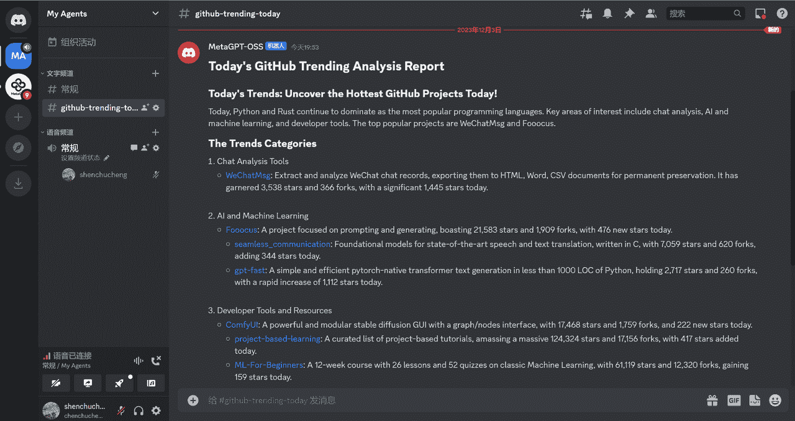

+   WXPusher

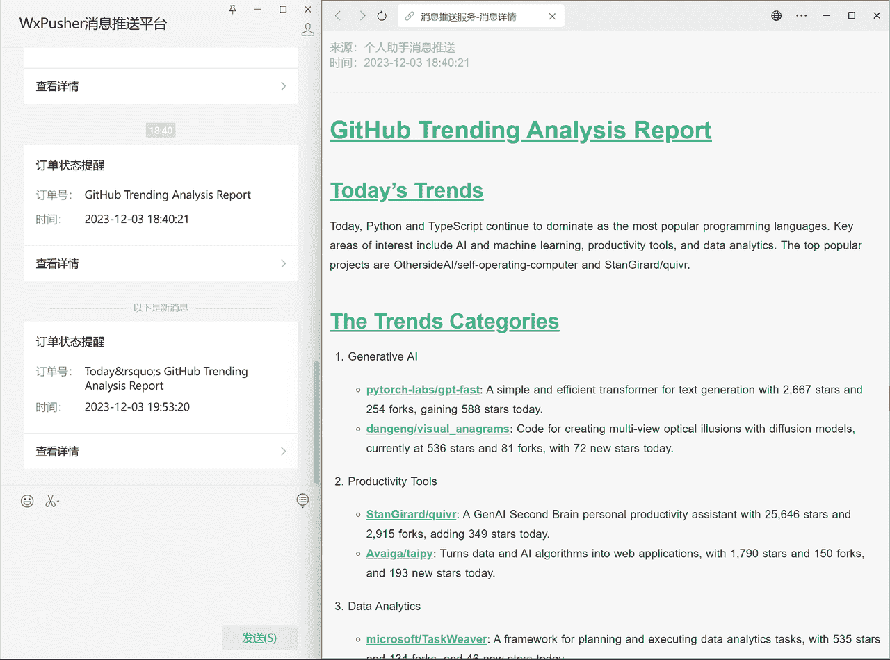

## 智能体开发作业

#### 基础作业

根据上面教程的介绍，你已经学会了如何针对具体场景开发一个实用的资讯收集助手；现在，你可以试着完成一个能订阅自己感兴趣的资讯的Agent：

+   根据前面你所学习的爬虫基本知识（如果你对写爬虫代码感到不熟练，使用GPT帮助你），为你的Agent自定义两个获取资讯的Action类

+   Action 1：根据第四章 3.2.1和3.2.2的指引，独立实现对Github Trending(https://github.com/trending)页面的爬取，并获取每一个项目的 名称、URL链接、描述

+   Action 2：独立完成对Huggingface Papers（https://huggingface.co/papers）页面的爬取，先获取到每一篇Paper的链接（提示：标题元素中的href标签），并通过链接访问标题的描述页面（例如：https://huggingface.co/papers/2312.03818），在页面中获取一篇Paper的 标题、摘要

+   参考第三章 1.4 的内容，重写有关方法，使你的Agent能自动生成总结内容的目录，然后根据二级标题进行分块，每块内容做出对应的总结，形成一篇资讯文档；

+   自定义Agent的SubscriptionRunner类，独立实现Trigger、Callback的功能，让你的Agent定时为通知渠道发送以上总结的资讯文档（尝试实现邮箱发送的功能，这是加分项）

#### 思考作业

+   目前为止我们设计的所有思考模式都可以总结为是链式的思考（chain of thought），能否利用 MetaGPT 框架实现树结构的思考（tree of thought）图结构的思考（graph of thought）？

往期优秀作业 ：MetaGPT课程3作业_哔哩哔哩_bilibili

# 第四章：多智能体开发

## Muti Agent 概念概述

## 多智能体组件介绍

### Environment

Environment 这个概念，我们更多熟识于强化学习领域的 agent 与 Environment,在强化学习中 Agent 需要学习在环境中采取行动来最大化一些累积奖励，Agent 能够采取的行动，也就是 Agent 的 action space 往往受到环境的限制，环境中通常具有一定的规则，而agent 们必须按照规则进行活动，MetaGPT提供了一个标准的环境组件Environment，来管理agent的活动与信息交流

MetaGPT 源码中是这样介绍 Environment 的：

> 环境，承载一批角色，角色可以向环境发布消息，可以被其他角色观察到

> Environment, hosting a batch of roles, roles can publish messages to the environment, and can be observed by other roles

来看 Environment 的基本组成

```
class Environment(BaseModel):
    &quot;&quot;&quot;环境，承载一批角色，角色可以向环境发布消息，可以被其他角色观察到
    Environment, hosting a batch of roles, roles can publish messages to the environment, and can be observed by other roles
    &quot;&quot;&quot;

    model_config = ConfigDict(arbitrary_types_allowed=True)

    desc: str = Field(default=&quot;&quot;)  # 环境描述
    roles: dict[str, SerializeAsAny[Role]] = Field(default_factory=dict, validate_default=True)
    members: dict[Role, Set] = Field(default_factory=dict, exclude=True)
    history: str = &quot;&quot;  # For debug
```

其中 desc 用于描述当前的环境信息，role 用来指定当前环境中的角色，member则表示当前环境中的角色以及他们对应的状态，history则用于记录环境中发生的消息记录

试着想象一个大的圆桌会议，env提供了一个让智能体们统一上桌讨论的环境，接下来我们来看看MetaGPT是如何实现这种机制的

我们先来看，当一个env运行时，发生了什么事情，来看 env 基类中定义的 run 方法

```
async def run(self, k=1):
        &quot;&quot;&quot;处理一次所有信息的运行
        Process all Role runs at once
        &quot;&quot;&quot;
        for _ in range(k):
            futures = []
            for role in self.roles.values():
                future = role.run()
                # 将role的运行缓存至 future list 中，在后续的 gather 方法中依次调用
                futures.append(future)

            await asyncio.gather(*futures)
            logger.debug(f&quot;is idle: {self.is_idle}&quot;)
```

在env运行时，会依次读取环境中的role信息，默认按照声明 role 的顺序依次执行 role 的 run 方法

```
@role_raise_decorator
    async def run(self, with_message=None) -&gt; Message | None:
        &quot;&quot;&quot;Observe, and think and act based on the results of the observation&quot;&quot;&quot;
        if with_message:
            msg = None
            if isinstance(with_message, str):
                msg = Message(content=with_message)
            elif isinstance(with_message, Message):
                msg = with_message
            elif isinstance(with_message, list):
                msg = Message(content=&quot;\n&quot;.join(with_message))
            if not msg.cause_by:
                msg.cause_by = UserRequirement
            # 将前置知识存入msg_buffer中
            self.put_message(msg)

        if not await self._observe():
            # If there is no new information, suspend and wait
            logger.debug(f&quot;{self._setting}: no news. waiting.&quot;)
            return

        rsp = await self.react()

        # Reset the next action to be taken.
        self.rc.todo = None
        # Send the response message to the Environment object to have it relay the message to the subscribers.
        self.publish_message(rsp)
        return rsp
```

而在 role 的run方法中 role 首先将会根据运行时是否传入信息（部分行动前可能需要前置知识消息），将信息存入 rolecontext的 msg_buffer 中

```
def put_message(self, message):
        &quot;&quot;&quot;Place the message into the Role object&#x27;s private message buffer.&quot;&quot;&quot;
        if not message:
            return
        self.rc.msg_buffer.push(message)
```

接下来就进入metagpt 多智能体很重要的一个机制：

在多智能体环境运行中，Role的每次行动将从Environment中先_observe Message，在 obseve 的行动中 Role 将从从消息缓冲区和其他源准备新消息以进行处理，当未接受到指令时，Role将等待

对于信息缓冲区中的信息，首先我们会根据 self.recovered 参数决定 news 是否来自于 self.latest_observed_msg 或者 msg_buffer 并读取

完成信息缓冲区的读取后，如果设定了 ignore_memory 则 old_messages便不会再获取 当前 Role 的 memory

将 news 中的信息存入 role 的 memory 后，我们将进一步从 news 中筛选，也就是我们设定的角色关注的消息（self.rc.watch）而 self.rc.news 将存储这些当前角色关注的消息，最近的一条将被赋给 latest_observed_msg

最后我们打印角色关注到的消息并返回

```
async def _observe(self, ignore_memory=False) -&gt; int:
        &quot;&quot;&quot;Prepare new messages for processing from the message buffer and other sources.&quot;&quot;&quot;
        # Read unprocessed messages from the msg buffer.
        news = []
        if self.recovered:
            # news 读取
            news = [self.latest_observed_msg] if self.latest_observed_msg else []
        if not news:
            news = self.rc.msg_buffer.pop_all()
        # Store the read messages in your own memory to prevent duplicate processing.
        old_messages = [] if ignore_memory else self.rc.memory.get()
        self.rc.memory.add_batch(news)
        # Filter out messages of interest.
        self.rc.news = [
            n for n in news if (n.cause_by in self.rc.watch or self.name in n.send_to) and n not in old_messages
        ]
        self.latest_observed_msg = self.rc.news[-1] if self.rc.news else None  # record the latest observed msg

        # Design Rules:
        # If you need to further categorize Message objects, you can do so using the Message.set_meta function.
        # msg_buffer is a receiving buffer, avoid adding message data and operations to msg_buffer.
        news_text = [f&quot;{i.role}: {i.content[:20]}...&quot; for i in self.rc.news]
        if news_text:
            logger.debug(f&quot;{self._setting} observed: {news_text}&quot;)
        return len(self.rc.news)
```

观察到信息后角色就将采取行动

```
rsp = await self.react()
# Reset the next action to be taken.
self.rc.todo = None
# Send the response message to the Environment object to have it relay the message to the subscribers.
self.publish_message(rsp)
return rsp
```

当角色完成自己的行动后，最终将自己的行动发布在环境中

```
def publish_message(self, msg):
        &quot;&quot;&quot;If the role belongs to env, then the role&#x27;s messages will be broadcast to env&quot;&quot;&quot;
        if not msg:
            return
        if not self.rc.env:
            # If env does not exist, do not publish the message
            return
        self.rc.env.publish_message(msg)
```

publish_message 时将会对遍历所有角色，检查他们是否订阅这条消息，若订阅，则调用 put_message 方法，将消息存入角色的 msg_buffer 中

```
def publish_message(self, message: Message, peekable: bool = True) -&gt; bool:
        &quot;&quot;&quot;
        Distribute the message to the recipients.
        In accordance with the Message routing structure design in Chapter 2.2.1 of RFC 116, as already planned
        in RFC 113 for the entire system, the routing information in the Message is only responsible for
        specifying the message recipient, without concern for where the message recipient is located. How to
        route the message to the message recipient is a problem addressed by the transport framework designed
        in RFC 113.
        &quot;&quot;&quot;
        logger.debug(f&quot;publish_message: {message.dump()}&quot;)
        found = False
        # According to the routing feature plan in Chapter 2.2.3.2 of RFC 113
        for role, subscription in self.members.items():
            if is_subscribed(message, subscription):
                role.put_message(message)
                found = True
        if not found:
            logger.warning(f&quot;Message no recipients: {message.dump()}&quot;)
        self.history += f&quot;\n{message}&quot;  # For debug

        return True
```

```

def is_subscribed(message: &quot;Message&quot;, tags: set):
    &quot;&quot;&quot;Return whether it&#x27;s consumer&quot;&quot;&quot;
    if MESSAGE_ROUTE_TO_ALL in message.send_to:
        return True

    for i in tags:
        if i in message.send_to:
            return True
    return False
```

至此我们已经梳理完了在多智能体系统中，Role是如何行动的，下面制作了一个简单的思维导图来帮助你理解它的交互过程

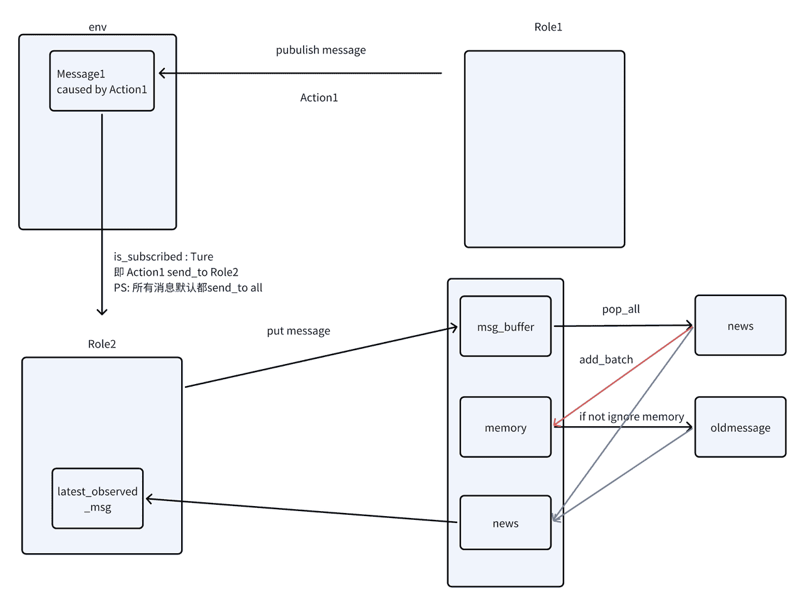

除了上述提到的env中的方法之外，env还提供了更多便利的方法如下，不再展开描述

```
def add_role(self, role: Role):
        &quot;&quot;&quot;增加一个在当前环境的角色
        Add a role in the current environment
        &quot;&quot;&quot;
        self.roles[role.profile] = role
        role.set_env(self)

    def add_roles(self, roles: Iterable[Role]):
        &quot;&quot;&quot;增加一批在当前环境的角色
        Add a batch of characters in the current environment
        &quot;&quot;&quot;
        for role in roles:
            self.roles[role.profile] = role

        for role in roles:  # setup system message with roles
            role.set_env(self)
    def get_roles(self) -&gt; dict[str, Role]:
        &quot;&quot;&quot;获得环境内的所有角色
        Process all Role runs at once
        &quot;&quot;&quot;
        return self.roles

    def get_role(self, name: str) -&gt; Role:
        &quot;&quot;&quot;获得环境内的指定角色
        get all the environment roles
        &quot;&quot;&quot;
        return self.roles.get(name, None)

    def role_names(self) -&gt; list[str]:
        return [i.name for i in self.roles.values()]
```

### 开发一个简单的多智能体系统

在上一节中我们已经了解了 env 的基本组成与它的运行逻辑，在这一章内，我们将学习如何利用 env 来开发，进一步了解 env 组件内部的活动

现在设想一个多智能体可能的应用场景，我们以 Camel 中提出的多智能体合作为例，现在我们设定，我们需要多智能体系统为我们根据我们给定的主题提供一篇优美的英文诗，除了完成写作的 agent 外，我们再设定一名精通诗句的老师来查看并修改学生的作品。

现在总结一下流程，我们希望这个系统首先接收用户的需求（写关于XX主题的诗），在系统中，当学生关注到布置的题目后就会开始创作，当老师发现学生写作完成后就会给学生提出意见，根据老师给出的意见，学生将修改自己的作品，直到设定循环结束

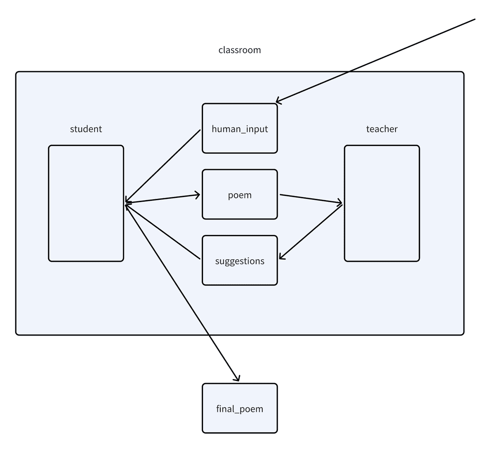

首先导入我们必要的包

```
import asyncio

from metagpt.actions import Action, UserRequirement
from metagpt.logs import logger
from metagpt.roles import Role
from metagpt.schema import Message
from metagpt.environment import Environment

from metagpt.const import MESSAGE_ROUTE_TO_ALL
```

接着，我们声明一个名为 classroom 的 env，我们所有的 role 都将在其中行动

```
classroom = Environment()
```

编写 WritePoem 与 ReviewPoem 方法，在 WritePoem 方法中我们需要实现根据用户提供的主题来编写诗句，并且根据 teacher 的建议修改诗句，在 ReviewPoem 方法中，我们需要读取 student 的诗歌作品，并且给出修改意见（这里我增加了老师的诗歌偏好来放大修改效果）

```
class WritePoem(Action):

    name: str = &quot;WritePoem&quot;

    PROMPT_TEMPLATE: str = &quot;&quot;&quot;
    Here is the historical conversation record : {msg} .
    Write a poem about the subject provided by human, Return only the content of the generated poem with NO other texts.
    If the teacher provides suggestions about the poem, revise the student&#x27;s poem based on the suggestions and return.
    your poem:
    &quot;&quot;&quot;

    async def run(self, msg: str):

        prompt = self.PROMPT_TEMPLATE.format(msg = msg)

        rsp = await self._aask(prompt)

        return rsp

class ReviewPoem(Action):

    name: str = &quot;ReviewPoem&quot;

    PROMPT_TEMPLATE: str = &quot;&quot;&quot;

    Here is the historical conversation record : {msg} .
    Check student-created poems about the subject provided by human and give your suggestions for revisions. You prefer poems with elegant sentences and retro style.
    Return only your comments with NO other texts.
    your comments:
    &quot;&quot;&quot;

    async def run(self, msg: str):

        prompt = self.PROMPT_TEMPLATE.format(msg = msg)

        rsp = await self._aask(prompt)

        return rsp
```

接着我们定义 Student 角色与 Teacher 角色，与单智能体不同的部分是，我们需要声明每个角色关注的动作（self._watch），只有当关注的动作发生后，角色才会开始行动，其余部分不再说明

```
class Student(Role):

    name: str = &quot;xiaoming&quot;
    profile: str = &quot;Student&quot;

    def __init__(self, **kwargs):
        super().__init__(**kwargs)
        self._init_actions([WritePoem])
        self._watch([UserRequirement, ReviewPoem])

    async def _act(self) -&gt; Message:
        logger.info(f&quot;{self._setting}: ready to {self.rc.todo}&quot;)
        todo = self.rc.todo

        msg = self.get_memories()  # 获取所有记忆
        # logger.info(msg)
        poem_text = await WritePoem().run(msg)
        logger.info(f&#x27;student : {poem_text}&#x27;)
        msg = Message(content=poem_text, role=self.profile,
                      cause_by=type(todo))

        return msg

class Teacher(Role):

    name: str = &quot;laowang&quot;
    profile: str = &quot;Teacher&quot;

    def __init__(self, **kwargs):
        super().__init__(**kwargs)
        self._init_actions([ReviewPoem])
        self._watch([WritePoem])

    async def _act(self) -&gt; Message:
        logger.info(f&quot;{self._setting}: ready to {self.rc.todo}&quot;)
        todo = self.rc.todo

        msg = self.get_memories()  # 获取所有记忆
        poem_text = await ReviewPoem().run(msg)
        logger.info(f&#x27;teacher : {poem_text}&#x27;)
        msg = Message(content=poem_text, role=self.profile,
                      cause_by=type(todo))

        return msg

```

完成上述准备后就可以开始写运行函数了，我们将提供一个主题，将topic发布在env中运行env，系统就将开始工作了，你可以修改对话轮数（n_round）来达到你希望的效果

```
async def main(topic: str, n_round=3):

    classroom.add_roles([Student(), Teacher()])

    classroom.publish_message(
        Message(role=&quot;Human&quot;, content=topic, cause_by=UserRequirement,
                send_to=&#x27;&#x27; or MESSAGE_ROUTE_TO_ALL),
        peekable=False,
    )

    while n_round &gt; 0:
        # self._save()
        n_round -= 1
        logger.debug(f&quot;max {n_round=} left.&quot;)

        await classroom.run()
    return classroom.history

asyncio.run(main(topic=&#x27;wirte a poem about moon&#x27;))
```

本章完整代码如下：

```
import asyncio

from metagpt.actions import Action, UserRequirement
from metagpt.logs import logger
from metagpt.roles import Role
from metagpt.schema import Message
from metagpt.environment import Environment

from metagpt.const import MESSAGE_ROUTE_TO_ALL

classroom = Environment()

class WritePoem(Action):

    name: str = &quot;WritePoem&quot;

    PROMPT_TEMPLATE: str = &quot;&quot;&quot;
    Here is the historical conversation record : {msg} .
    Write a poem about the subject provided by human, Return only the content of the generated poem with NO other texts.
    If the teacher provides suggestions about the poem, revise the student&#x27;s poem based on the suggestions and return.
    your poem:
    &quot;&quot;&quot;

    async def run(self, msg: str):

        prompt = self.PROMPT_TEMPLATE.format(msg = msg)

        rsp = await self._aask(prompt)

        return rsp

class ReviewPoem(Action):

    name: str = &quot;ReviewPoem&quot;

    PROMPT_TEMPLATE: str = &quot;&quot;&quot;

    Here is the historical conversation record : {msg} .
    Check student-created poems about the subject provided by human and give your suggestions for revisions. You prefer poems with elegant sentences and retro style.
    Return only your comments with NO other texts.
    your comments:
    &quot;&quot;&quot;

    async def run(self, msg: str):

        prompt = self.PROMPT_TEMPLATE.format(msg = msg)

        rsp = await self._aask(prompt)

        return rsp

class Student(Role):

    name: str = &quot;xiaoming&quot;
    profile: str = &quot;Student&quot;

    def __init__(self, **kwargs):
        super().__init__(**kwargs)
        self._init_actions([WritePoem])
        self._watch([UserRequirement, ReviewPoem])

    async def _act(self) -&gt; Message:
        logger.info(f&quot;{self._setting}: ready to {self.rc.todo}&quot;)
        todo = self.rc.todo

        msg = self.get_memories()  # 获取所有记忆
        # logger.info(msg)
        poem_text = await WritePoem().run(msg)
        logger.info(f&#x27;student : {poem_text}&#x27;)
        msg = Message(content=poem_text, role=self.profile,
                      cause_by=type(todo))

        return msg

class Teacher(Role):

    name: str = &quot;laowang&quot;
    profile: str = &quot;Teacher&quot;

    def __init__(self, **kwargs):
        super().__init__(**kwargs)
        self._init_actions([ReviewPoem])
        self._watch([WritePoem])

    async def _act(self) -&gt; Message:
        logger.info(f&quot;{self._setting}: ready to {self.rc.todo}&quot;)
        todo = self.rc.todo

        msg = self.get_memories()  # 获取所有记忆
        poem_text = await ReviewPoem().run(msg)
        logger.info(f&#x27;teacher : {poem_text}&#x27;)
        msg = Message(content=poem_text, role=self.profile,
                      cause_by=type(todo))

        return msg

async def main(topic: str, n_round=3):

    classroom.add_roles([Student(), Teacher()])

    classroom.publish_message(
        Message(role=&quot;Human&quot;, content=topic, cause_by=UserRequirement,
                send_to=&#x27;&#x27; or MESSAGE_ROUTE_TO_ALL),
        peekable=False,
    )

    while n_round &gt; 0:
        # self._save()
        n_round -= 1
        logger.debug(f&quot;max {n_round=} left.&quot;)

        await classroom.run()
    return classroom.history

asyncio.run(main(topic=&#x27;wirte a poem about moon&#x27;))

```

### Team

在官方多智能体部分的介绍中，我们往往能看到一个很重要的组件 Team，事实上Team就是基于 Environment 之上的二次封装成果

```
class Team(BaseModel):
    &quot;&quot;&quot;
    Team: Possesses one or more roles (agents), SOP (Standard Operating Procedures), and a env for instant messaging,
    dedicated to env any multi-agent activity, such as collaboratively writing executable code.
    &quot;&quot;&quot;

    model_config = ConfigDict(arbitrary_types_allowed=True)

    env: Environment = Field(default_factory=Environment)
    investment: float = Field(default=10.0)
    idea: str = Field(default=&quot;&quot;)
```

Team 提供了相比于 Environment 更多的组件，investment 用于管理团队成本（即限制token花费），idea效果则等同于告诉你的团队接下来该围绕什么工作

Team 相关的重要方法如下：

```
    def hire(self, roles: list[Role]):
        &quot;&quot;&quot;Hire roles to cooperate&quot;&quot;&quot;
        self.env.add_roles(roles)
```

Hire 用于在团队中添加员工

```
def invest(self, investment: float):
        &quot;&quot;&quot;Invest company. raise NoMoneyException when exceed max_budget.&quot;&quot;&quot;
        self.investment = investment
        CONFIG.max_budget = investment
        logger.info(f&quot;Investment: ${investment}.&quot;)
```

invest方法负责控制预算

```
def run_project(self, idea, send_to: str = &quot;&quot;):
        &quot;&quot;&quot;Run a project from publishing user requirement.&quot;&quot;&quot;
        self.idea = idea

        # Human requirement.
        self.env.publish_message(
            Message(role=&quot;Human&quot;, content=idea, cause_by=UserRequirement, send_to=send_to or MESSAGE_ROUTE_TO_ALL),
            peekable=False,
        )
```

在 Team 运行时，首先将调用 run_project 方法给智能体们一个需求，接着在 n_round 的循环中，重复检查预算与运行 env，最后返回环境中角色的历史对话

```
@serialize_decorator
    async def run(self, n_round=3, idea=&quot;&quot;, send_to=&quot;&quot;, auto_archive=True):
        &quot;&quot;&quot;Run company until target round or no money&quot;&quot;&quot;
        if idea:
            self.run_project(idea=idea, send_to=send_to)

        while n_round &gt; 0:
            # self._save()
            n_round -= 1
            logger.debug(f&quot;max {n_round=} left.&quot;)
            self._check_balance()

            await self.env.run()
        self.env.archive(auto_archive)
        return self.env.history
```

尽管 Team 类只是在 Env 上的简单封装，但它向我们展示了，我们该如何向多智能体系统发布启动消息以及引入可能的人类反馈，接下来我们就将使用Team，开发属于自己的第一个智能体团队

### 基于Team开发你的第一个智能体团队

总的来说，我们需要三个步骤来建立团队并使其运作：

1.  定义每个角色能够执行的预期动作

1.  基于标准作业程序（SOP）确保每个角色遵守它。通过使每个角色观察上游的相应输出结果，并为下游发布自己的输出结果，可以实现这一点。

1.  初始化所有角色，创建一个带有环境的智能体团队，并使它们之间能够进行交互。

与第三章相同，我们可以定义三个具有各自动作的Role：

+   SimpleCoder 具有 SimpleWriteCode 动作，接收用户的指令并编写主要代码

+   SimpleTester 具有 SimpleWriteTest 动作，从 SimpleWriteCode 的输出中获取主代码并为其提供测试套件

+   SimpleReviewer 具有 SimpleWriteReview 动作，审查来自 SimpleWriteTest 输出的测试用例，并检查其覆盖范围和质量

通过上述概述，我们使得 SOP（标准作业程序）变得更加清晰明了。接下来，我们将详细讨论如何根据 SOP 来定义Role。

首先导入必要的依赖

```
import re

import fire

from metagpt.actions import Action, UserRequirement
from metagpt.logs import logger
from metagpt.roles import Role
from metagpt.schema import Message
from metagpt.team import Team

```

我们来定义出现的动作

我们列举了三个 Action。

SimpleWriteCode 将会根据用户的需求来生成代码

```
class SimpleWriteCode(Action):
    PROMPT_TEMPLATE: str = &quot;&quot;&quot;
    Write a python function that can {instruction}.
    Return ```python your_code_here ``` with NO other texts,
    your code:
    &quot;&quot;&quot;
    name: str = &quot;SimpleWriteCode&quot;

    async def run(self, instruction: str):
        prompt = self.PROMPT_TEMPLATE.format(instruction=instruction)

        rsp = await self._aask(prompt)

        code_text = parse_code(rsp)

        return code_text
```

SimpleWriteTest 将会对生成的代码进行测试

```
class SimpleWriteTest(Action):
    PROMPT_TEMPLATE: str = &quot;&quot;&quot;
    Context: {context}
    Write {k} unit tests using pytest for the given function, assuming you have imported it.
    Return ```python your_code_here ``` with NO other texts,
    your code:
    &quot;&quot;&quot;

    name: str = &quot;SimpleWriteTest&quot;

    async def run(self, context: str, k: int = 3):
        prompt = self.PROMPT_TEMPLATE.format(context=context, k=k)

        rsp = await self._aask(prompt)

        code_text = parse_code(rsp)

        return code_text
```

SimpleWriteReview 将会对测试的结果做出评价

```
class SimpleWriteReview(Action):
    PROMPT_TEMPLATE: str = &quot;&quot;&quot;
    Context: {context}
    Review the test cases and provide one critical comments:
    &quot;&quot;&quot;

    name: str = &quot;SimpleWriteReview&quot;

    async def run(self, context: str):
        prompt = self.PROMPT_TEMPLATE.format(context=context)

        rsp = await self._aask(prompt)

        return rsp
```

在许多多智能体场景中，定义Role可能只需几行代码。对于SimpleCoder，我们做了两件事：

1.  使用 _init_actions 为Role配备适当的 Action，这与设置单智能体相同

1.  多智能体操作逻辑：我们使Role _watch 来自用户或其他智能体的重要上游消息。回想我们的SOP，SimpleCoder接收用户指令，这是由MetaGPT中的UserRequirement引起的Message。因此，我们添加了 self._watch([UserRequirement])。

```
class SimpleCoder(Role):
    name: str = &quot;Alice&quot;
    profile: str = &quot;SimpleCoder&quot;

    def __init__(self, **kwargs):
        super().__init__(**kwargs)
        self._watch([UserRequirement])
        self._init_actions([SimpleWriteCode])
```

与上述相似，对于 SimpleTester，我们：

1.  使用 _init_actions 为SimpleTester配备 SimpleWriteTest 动作

1.  使Role _watch 来自其他智能体的重要上游消息。回想我们的SOP，SimpleTester从 SimpleCoder 中获取主代码，这是由 SimpleWriteCode 引起的 Message。因此，我们添加了 self._watch([SimpleWriteCode])。

> 一个扩展的问题：想一想如果我们使用 self._watch([SimpleWriteCode, SimpleWriteReview]) 会意味着什么，可以尝试这样做

此外，你可以为智能体定义自己的操作逻辑。这适用于Action需要多个输入的情况，你希望修改输入，使用特定记忆，或进行任何其他更改以反映特定逻辑的情况。因此，我们：

```
class SimpleTester(Role):
    name: str = &quot;Bob&quot;
    profile: str = &quot;SimpleTester&quot;

    def __init__(self, **kwargs):
        super().__init__(**kwargs)
        self._init_actions([SimpleWriteTest])
        # self._watch([SimpleWriteCode])
        self._watch([SimpleWriteCode, SimpleWriteReview])  # feel free to try this too

    async def _act(self) -&gt; Message:
        logger.info(f&quot;{self._setting}: to do {self.rc.todo}({self.rc.todo.name})&quot;)
        todo = self.rc.todo

        # context = self.get_memories(k=1)[0].content # use the most recent memory as context
        context = self.get_memories()  # use all memories as context

        code_text = await todo.run(context, k=5)  # specify arguments
        msg = Message(content=code_text, role=self.profile, cause_by=type(todo))

        return msg

```

按照相同的过程定义 SimpleReviewer：

```
class SimpleReviewer(Role):
    name: str = &quot;Charlie&quot;
    profile: str = &quot;SimpleReviewer&quot;

    def __init__(self, **kwargs):
        super().__init__(**kwargs)
        self._init_actions([SimpleWriteReview])
        self._watch([SimpleWriteTest])
```

现在我们已经定义了三个 Role，是时候将它们放在一起了。我们初始化所有角色，设置一个 Team，并hire 它们。

运行 Team，我们应该会看到它们之间的协作！

```
async def main(
    idea: str = &quot;write a function that calculates the product of a list&quot;,
    investment: float = 3.0,
    n_round: int = 5,
    add_human: bool = False,
):
    logger.info(idea)

    team = Team()
    team.hire(
        [
            SimpleCoder(),
            SimpleTester(),
            SimpleReviewer(is_human=add_human),
        ]
    )

    team.invest(investment=investment)
    team.run_project(idea)
    await team.run(n_round=n_round)

if __name__ == &quot;__main__&quot;:
    fire.Fire(main)

```

完整代码如下：

```
&quot;&quot;&quot;
Filename: MetaGPT/examples/build_customized_multi_agents.py
Created Date: Wednesday, November 15th 2023, 7:12:39 pm
Author: garylin2099
&quot;&quot;&quot;
import re

import fire

from metagpt.actions import Action, UserRequirement
from metagpt.logs import logger
from metagpt.roles import Role
from metagpt.schema import Message
from metagpt.team import Team


def parse_code(rsp):
    pattern = r&quot;```python(.*)```&quot;
    match = re.search(pattern, rsp, re.DOTALL)
    code_text = match.group(1) if match else rsp
    return code_text


class SimpleWriteCode(Action):
    PROMPT_TEMPLATE: str = &quot;&quot;&quot;
    Write a python function that can {instruction}.
    Return ```python your_code_here ``` with NO other texts,
    your code:
    &quot;&quot;&quot;
    name: str = &quot;SimpleWriteCode&quot;

    async def run(self, instruction: str):
        prompt = self.PROMPT_TEMPLATE.format(instruction=instruction)

        rsp = await self._aask(prompt)

        code_text = parse_code(rsp)

        return code_text


class SimpleCoder(Role):
    name: str = &quot;Alice&quot;
    profile: str = &quot;SimpleCoder&quot;

    def __init__(self, **kwargs):
        super().__init__(**kwargs)
        self._watch([UserRequirement])
        self.set_actions([SimpleWriteCode])


class SimpleWriteTest(Action):
    PROMPT_TEMPLATE: str = &quot;&quot;&quot;
    Context: {context}
    Write {k} unit tests using pytest for the given function, assuming you have imported it.
    Return ```python your_code_here ``` with NO other texts,
    your code:
    &quot;&quot;&quot;

    name: str = &quot;SimpleWriteTest&quot;

    async def run(self, context: str, k: int = 3):
        prompt = self.PROMPT_TEMPLATE.format(context=context, k=k)

        rsp = await self._aask(prompt)

        code_text = parse_code(rsp)

        return code_text


class SimpleTester(Role):
    name: str = &quot;Bob&quot;
    profile: str = &quot;SimpleTester&quot;

    def __init__(self, **kwargs):
        super().__init__(**kwargs)
        self.set_actions([SimpleWriteTest])
        # self._watch([SimpleWriteCode])
        self._watch([SimpleWriteCode, SimpleWriteReview])  # feel free to try this too

    async def _act(self) -&gt; Message:
        logger.info(f&quot;{self._setting}: to do {self.rc.todo}({self.rc.todo.name})&quot;)
        todo = self.rc.todo

        # context = self.get_memories(k=1)[0].content # use the most recent memory as context
        context = self.get_memories()  # use all memories as context

        code_text = await todo.run(context, k=5)  # specify arguments
        msg = Message(content=code_text, role=self.profile, cause_by=type(todo))

        return msg


class SimpleWriteReview(Action):
    PROMPT_TEMPLATE: str = &quot;&quot;&quot;
    Context: {context}
    Review the test cases and provide one critical comments:
    &quot;&quot;&quot;

    name: str = &quot;SimpleWriteReview&quot;

    async def run(self, context: str):
        prompt = self.PROMPT_TEMPLATE.format(context=context)

        rsp = await self._aask(prompt)

        return rsp


class SimpleReviewer(Role):
    name: str = &quot;Charlie&quot;
    profile: str = &quot;SimpleReviewer&quot;

    def __init__(self, **kwargs):
        super().__init__(**kwargs)
        self.set_actions([SimpleWriteReview])
        self._watch([SimpleWriteTest])


async def main(
    idea: str = &quot;write a function that calculates the product of a list&quot;,
    investment: float = 3.0,
    n_round: int = 5,
    add_human: bool = False,
):
    logger.info(idea)

    team = Team()
    team.hire(
        [
            SimpleCoder(),
            SimpleTester(),
            SimpleReviewer(is_human=add_human),
        ]
    )

    team.invest(investment=investment)
    team.run_project(idea)
    await team.run(n_round=n_round)


if __name__ == &quot;__main__&quot;:
    fire.Fire(main)
```

## 多智能体案例 : 辩论

在初次尝试的时候我们就以智能体辩论带大家初步浏览了一下：

```
import asyncio

from metagpt.actions import Action
from metagpt.environment import Environment
from metagpt.roles import Role
from metagpt.team import Team

action1 = Action(name=&quot;AlexSay&quot;, instruction=&quot;Express your opinion with emotion and don&#x27;t repeat it&quot;)
action2 = Action(name=&quot;BobSay&quot;, instruction=&quot;Express your opinion with emotion and don&#x27;t repeat it&quot;)
alex = Role(name=&quot;Alex&quot;, profile=&quot;Democratic candidate&quot;, goal=&quot;Win the election&quot;, actions=[action1], watch=[action2])
bob = Role(name=&quot;Bob&quot;, profile=&quot;Republican candidate&quot;, goal=&quot;Win the election&quot;, actions=[action2], watch=[action1])
env = Environment(desc=&quot;US election live broadcast&quot;)
team = Team(investment=10.0, env=env, roles=[alex, bob])

asyncio.run(team.run(idea=&quot;Topic: climate change. Under 80 words per message.&quot;, send_to=&quot;Alex&quot;, n_round=5))
```

鉴于他们已知的分歧，这样的结合可能会导致一些活跃的交流。这是一个理想的例子，展示了如何设计多个代理并促进它们之间的交互。我们将把我们的实验称为“拜登-特朗普辩论”。

现在我们用这个案例带大家理解多智能体间通信的机制

输出示例：

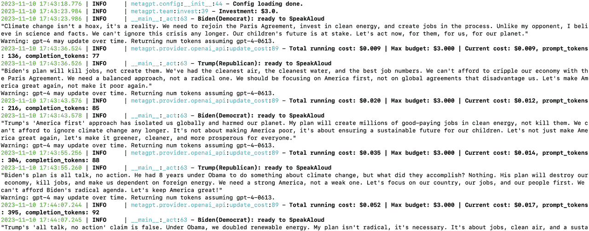

总体上，我们需要3个步骤来设定它们的辩论：

1.  [定义一个具](https://docs.deepwisdom.ai/main/zh/guide/tutorials/agent_101.html)有发言行为的辩手角色，我们建议参考智能体入门

1.  处理辩手之间的通信，也就是让拜登听特朗普说话，反之亦然

1.  初始化两个辩手实例，拜登和特朗普，创建一个带有环境的团队，并使它们能够相互交互

### 定义动作

这里的动作我们在prompt中需要界定辩论的背景以及上下文，以及此次发言的立场限制的结构化prompt：

> 背景

> 假设你是{name}，你正在与{opponent_name}辩论。

> 辩论历史

> 之前的回合：

> {context}

> 你的轮次

> 现在轮到你了，你应该紧密回应对手最新的论点，陈述自己的立场，捍卫自己的观点，并攻击对手的论点，

> 用{name}的修辞和观点，在80个字内进行一次强有力且情感充沛的反驳："""

在Python中，str.format()方法允许你对一个字符串进行格式化。这个方法会接受任意数量的参数，并将这些参数替换到字符串中，参数的位置和格式由大括号 {} 中的标识符确定。{} 在字符串中用作占位符，用于接收来自 format 方法的参数。你可以使用位置参数或关键字参数来指定替换内容。

在你提供的示例中，PROMPT_TEMPLATE 是一个多行字符串，其中包含了三个由大括号 {} 包围的占位符：{name}, {opponent_name}, 和 {context}。这些占位符用于在字符串中插入动态内容。

当你调用 format 方法并传递 context, name, opponent_name 三个参数时，这些参数将被插入到 PROMPT_TEMPLATE 字符串的相应位置中：

+   {name} 将被替换成 name 参数的值。

+   {opponent_name} 将被替换成 opponent_name 参数的值。

+   {context} 将被替换成 context 参数的值。

```
class SpeakAloud(Action):
    &quot;&quot;&quot;Action: Speak out aloud in a debate (quarrel)&quot;&quot;&quot;

    PROMPT_TEMPLATE: str = &quot;&quot;&quot;
    ## BACKGROUND
    Suppose you are {name}, you are in a debate with {opponent_name}.
    ## DEBATE HISTORY
    Previous rounds:
    {context}
    ## YOUR TURN
    Now it&#x27;s your turn, you should closely respond to your opponent&#x27;s latest argument, state your position, defend your arguments, and attack your opponent&#x27;s arguments,
    craft a strong and emotional response in 80 words, in {name}&#x27;s rhetoric and viewpoints, your will argue:
    &quot;&quot;&quot;
    name: str = &quot;SpeakAloud&quot;

    async def run(self, context: str, name: str, opponent_name: str):
        prompt = self.PROMPT_TEMPLATE.format(context=context, name=name, opponent_name=opponent_name)
        # logger.info(prompt)

        rsp = await self._aask(prompt)

        return rsp
        
```

### 定义角色Role

```
class Debator(Role):
    name: str = &quot;&quot;
    profile: str = &quot;&quot;
    opponent_name: str = &quot;&quot;

    def __init__(self, **data: Any):
        super().__init__(**data)
        self._init_actions([SpeakAloud])
        self._watch([UserRequirement, SpeakAloud])
```

在这里，_init_actions 使我们的 Role 拥有我们刚刚定义的 SpeakAloud 动作。我们还使用 _watch 监视了 SpeakAloud 和 UserRequirement，因为我们希望每个辩手关注来自对手的 SpeakAloud 消息，以及来自用户的 UserRequirement（人类指令）。

> Debate topic, such as "Topic: The U.S. should commit more in climate change fighting"or "Trump: Climate change is a hoax"

我们往往通过init_actions 和 watch两个方法定义role在team里面的协作机制，观察来自哪些role的action作为上游，然后发布什么消息到环境中。

接下来，我们使每个辩手听取对手的论点。这通过重写 _observe 函数完成。这是一个重要的点，因为在环境中将会有来自特朗普和拜登的 "SpeakAloud 消息"（由 SpeakAloud 触发的 Message）。 我们不希望特朗普处理自己上一轮的 "SpeakAloud 消息"，而是处理来自拜登的消息，反之亦然。（在即将到来的更新中，我们将使用一般的消息路由机制来处理这个过程。在更新后，你将不再需要执行此步骤）

```
    async def _observe(self) -&gt; int:
        await super()._observe()
        # accept messages sent (from opponent) to self, disregard own messages from the last round
        self.rc.news = [msg for msg in self.rc.news if msg.send_to == {self.name}]
        return len(self.rc.news)
```

这个过程的结果是，self.rc.news 现在只包含了发送给当前实例的消息，移除了所有其他消息，包括可能由当前实例在上一轮发送的消息（如果有的话）。这样的筛选机制对于确保实例只响应并处理针对自己的消息非常重要

最后，我们使每个辩手能够向对手发送反驳的论点。在这里，我们从消息历史中构建一个上下文，使 Debator 运行他拥有的 SpeakAloud 动作，并使用反驳论点内容创建一个新的 Message。请注意，我们定义每个 Debator 将把 Message 发送给他的对手。

```
   async def _act(self) -&gt; Message:
        logger.info(f&quot;{self._setting}: to do {self.rc.todo}({self.rc.todo.name})&quot;)
        todo = self.rc.todo  # An instance of SpeakAloud

        memories = self.get_memories()
        context = &quot;\n&quot;.join(f&quot;{msg.sent_from}: {msg.content}&quot; for msg in memories)
        # print(context)

        rsp = await todo.run(context=context, name=self.name, opponent_name=self.opponent_name)

        msg = Message(
            content=rsp,
            role=self.profile,
            cause_by=type(todo),
            sent_from=self.name,
            send_to=self.opponent_name,
        )
        self.rc.memory.add(msg)

        return msg
```

cause_by=type(todo),

sent_from=self.name,

send_to=self.opponent_name,

这三个参数分别是形容Message的内容属性，来自于哪个action以及角色，并要发送给哪个角色。通过这样的机制可以实现相较于watch更灵活的订阅机制。

### 实例化

```
async def debate(idea: str, investment: float = 3.0, n_round: int = 5):
    &quot;&quot;&quot;Run a team of presidents and watch they quarrel. :)&quot;&quot;&quot;
    Biden = Debator(name=&quot;Biden&quot;, profile=&quot;Democrat&quot;, opponent_name=&quot;Trump&quot;)
    Trump = Debator(name=&quot;Trump&quot;, profile=&quot;Republican&quot;, opponent_name=&quot;Biden&quot;)
    team = Team()
    team.hire([Biden, Trump])
    team.invest(investment)
    team.run_project(idea, send_to=&quot;Biden&quot;)  # send debate topic to Biden and let him speak first
    await team.run(n_round=n_round)
```

我们用Debator类实例化出Biden和Trump两个角色，并创建一个team雇佣这两个角色，并确定辩论的主题，用send_to指定谁先发言。

完整代码：

```

import asyncio
import platform
from typing import Any

import fire

from metagpt.actions import Action, UserRequirement
from metagpt.logs import logger
from metagpt.roles import Role
from metagpt.schema import Message
from metagpt.team import Team


class SpeakAloud(Action):
    &quot;&quot;&quot;Action: Speak out aloud in a debate (quarrel)&quot;&quot;&quot;

    PROMPT_TEMPLATE: str = &quot;&quot;&quot;
    ## BACKGROUND
    Suppose you are {name}, you are in a debate with {opponent_name}.
    ## DEBATE HISTORY
    Previous rounds:
    {context}
    ## YOUR TURN
    Now it&#x27;s your turn, you should closely respond to your opponent&#x27;s latest argument, state your position, defend your arguments, and attack your opponent&#x27;s arguments,
    craft a strong and emotional response in 80 words, in {name}&#x27;s rhetoric and viewpoints, your will argue:
    &quot;&quot;&quot;
    name: str = &quot;SpeakAloud&quot;

    async def run(self, context: str, name: str, opponent_name: str):
        prompt = self.PROMPT_TEMPLATE.format(context=context, name=name, opponent_name=opponent_name)
        # logger.info(prompt)

        rsp = await self._aask(prompt)

        return rsp


class Debator(Role):
    name: str = &quot;&quot;
    profile: str = &quot;&quot;
    opponent_name: str = &quot;&quot;

    def __init__(self, **data: Any):
        super().__init__(**data)
        self._init_actions([SpeakAloud])
        self._watch([UserRequirement, SpeakAloud])

    async def _observe(self) -&gt; int:
        await super()._observe()
        # accept messages sent (from opponent) to self, disregard own messages from the last round
        self.rc.news = [msg for msg in self.rc.news if msg.send_to == {self.name}]
        return len(self.rc.news)

    async def _act(self) -&gt; Message:
        logger.info(f&quot;{self._setting}: to do {self.rc.todo}({self.rc.todo.name})&quot;)
        todo = self.rc.todo  # An instance of SpeakAloud

        memories = self.get_memories()
        context = &quot;\n&quot;.join(f&quot;{msg.sent_from}: {msg.content}&quot; for msg in memories)
        # print(context)

        rsp = await todo.run(context=context, name=self.name, opponent_name=self.opponent_name)

        msg = Message(
            content=rsp,
            role=self.profile,
            cause_by=type(todo),
            sent_from=self.name,
            send_to=self.opponent_name,
        )
        self.rc.memory.add(msg)

        return msg


async def debate(idea: str, investment: float = 3.0, n_round: int = 5):
    &quot;&quot;&quot;Run a team of presidents and watch they quarrel. :)&quot;&quot;&quot;
    Biden = Debator(name=&quot;Biden&quot;, profile=&quot;Democrat&quot;, opponent_name=&quot;Trump&quot;)
    Trump = Debator(name=&quot;Trump&quot;, profile=&quot;Republican&quot;, opponent_name=&quot;Biden&quot;)
    team = Team()
    team.hire([Biden, Trump])
    team.invest(investment)
    team.run_project(idea, send_to=&quot;Biden&quot;)  # send debate topic to Biden and let him speak first
    await team.run(n_round=n_round)


def main(idea: str, investment: float = 3.0, n_round: int = 10):
    &quot;&quot;&quot;
    :param idea: Debate topic, such as &quot;Topic: The U.S. should commit more in climate change fighting&quot;
                 or &quot;Trump: Climate change is a hoax&quot;
    :param investment: contribute a certain dollar amount to watch the debate
    :param n_round: maximum rounds of the debate
    :return:
    &quot;&quot;&quot;
    if platform.system() == &quot;Windows&quot;:
        asyncio.set_event_loop_policy(asyncio.WindowsSelectorEventLoopPolicy())
    asyncio.run(debate(idea, investment, n_round))


if __name__ == &quot;__main__&quot;:
    fire.Fire(main)
```

## 多智能体开发作业

### 基础作业

基于 env 或 team 设计一个你的多智能体团队，尝试让他们完成 你画我猜文字版 ，要求其中含有两个agent，其中一个agent负责接收来自用户提供的物体描述并转告另一个agent，另一个agent将猜测用户给出的物体名称，两个agent将不断交互直到另一个给出正确的答案

（也可以在系统之上继续扩展，比如引入一个agent来生成词语，而人类参与你画我猜的过程中）

### 进阶作业

进阶作业只面向愿意深入探索MG潜力并检验自己学习成果的同学，只要完成基础作业视为学习完成。

如何检验mg的A[gent开发学习程度呢？我](https://twitter.com/yoheinakajima)认为对于本次学习，如果对于一个问题（过往交由人解决的）SOP可以将SOP迅速抽象成MG的Role和Action形式并且用多智能体协同完成，即达到了本次学习的目的。

重写babyagi是一个非常合适的任务。

babyagi是yoheinakajima的一个demo，他的主业是一位投资人，在2023年上半年AutoGPT爆火之际，完成了这个demo，实际上是这位投资人的日常任务规划优先级解决的一套SOP

以下是babyagi的实现流程

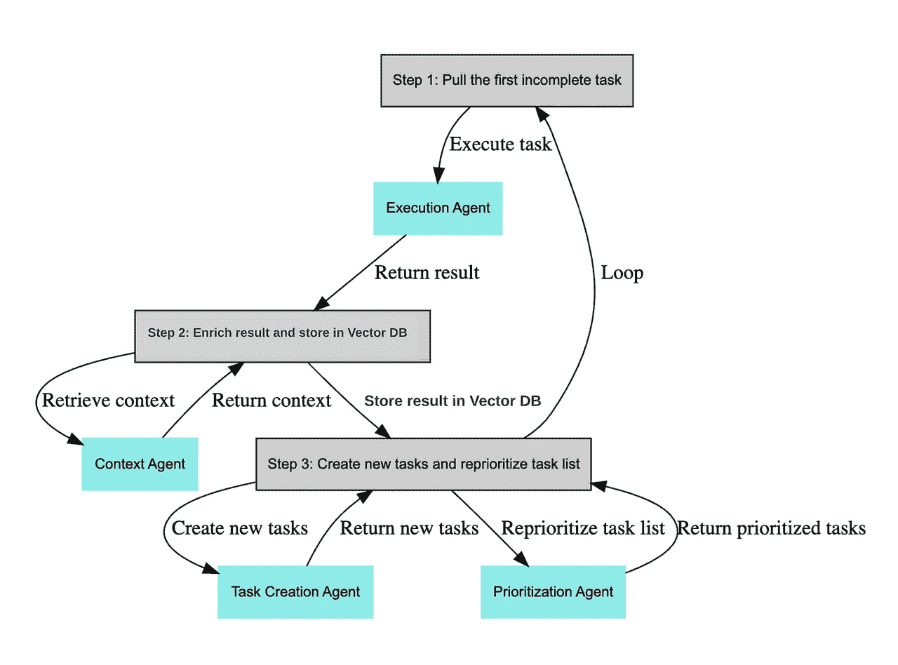

```
import openai
import pinecone
import time
from collections import deque
from typing import Dict, List

#Set API Keys
OPENAI_API_KEY = &quot;&quot;
PINECONE_API_KEY = &quot;&quot;
PINECONE_ENVIRONMENT = &quot;us-east1-gcp&quot; #Pinecone Environment (eg. &quot;us-east1-gcp&quot;)

#Set Variables
YOUR_TABLE_NAME = &quot;test-table&quot;
OBJECTIVE = &quot;Solve world hunger.&quot;
YOUR_FIRST_TASK = &quot;Develop a task list.&quot;

#Print OBJECTIVE
print(&quot;\033[96m\033[1m&quot;+&quot;\n*****OBJECTIVE*****\n&quot;+&quot;\033[0m\033[0m&quot;)
print(OBJECTIVE)

# Configure OpenAI and Pinecone
openai.api_key = OPENAI_API_KEY
pinecone.init(api_key=PINECONE_API_KEY, environment=PINECONE_ENVIRONMENT)

# Create Pinecone index
table_name = YOUR_TABLE_NAME
dimension = 1536
metric = &quot;cosine&quot;
pod_type = &quot;p1&quot;
if table_name not in pinecone.list_indexes():
    pinecone.create_index(table_name, dimension=dimension, metric=metric, pod_type=pod_type)

# Connect to the index
index = pinecone.Index(table_name)

# Task list
task_list = deque([])

def add_task(task: Dict):
    task_list.append(task)

def get_ada_embedding(text):
    text = text.replace(&quot;\n&quot;, &quot; &quot;)
    return openai.Embedding.create(input=[text], model=&quot;text-embedding-ada-002&quot;)[&quot;data&quot;][0][&quot;embedding&quot;]

def task_creation_agent(objective: str, result: Dict, task_description: str, task_list: List[str]):
    prompt = f&quot;You are an task creation AI that uses the result of an execution agent to create new tasks with the following objective: {objective}, The last completed task has the result: {result}. This result was based on this task description: {task_description}. These are incomplete tasks: {&#x27;, &#x27;.join(task_list)}. Based on the result, create new tasks to be completed by the AI system that do not overlap with incomplete tasks. Return the tasks as an array.&quot;
    response = openai.Completion.create(engine=&quot;text-davinci-003&quot;,prompt=prompt,temperature=0.5,max_tokens=100,top_p=1,frequency_penalty=0,presence_penalty=0)
    new_tasks = response.choices[0].text.strip().split(&#x27;\n&#x27;)
    return [{&quot;task_name&quot;: task_name} for task_name in new_tasks]

def prioritization_agent(this_task_id:int):
    global task_list
    task_names = [t[&quot;task_name&quot;] for t in task_list]
    next_task_id = int(this_task_id)+1
    prompt = f&quot;&quot;&quot;You are an task prioritization AI tasked with cleaning the formatting of and reprioritizing the following tasks: {task_names}. Consider the ultimate objective of your team:{OBJECTIVE}. Do not remove any tasks. Return the result as a numbered list, like:
    #. First task
    #. Second task
    Start the task list with number {next_task_id}.&quot;&quot;&quot;
    response = openai.Completion.create(engine=&quot;text-davinci-003&quot;,prompt=prompt,temperature=0.5,max_tokens=1000,top_p=1,frequency_penalty=0,presence_penalty=0)
    new_tasks = response.choices[0].text.strip().split(&#x27;\n&#x27;)
    task_list = deque()
    for task_string in new_tasks:
        task_parts = task_string.strip().split(&quot;.&quot;, 1)
        if len(task_parts) == 2:
            task_id = task_parts[0].strip()
            task_name = task_parts[1].strip()
            task_list.append({&quot;task_id&quot;: task_id, &quot;task_name&quot;: task_name})

def execution_agent(objective:str,task: str) -&gt; str:
    #context = context_agent(index=&quot;quickstart&quot;, query=&quot;my_search_query&quot;, n=5)
    context=context_agent(index=YOUR_TABLE_NAME, query=objective, n=5)
    #print(&quot;\n*******RELEVANT CONTEXT******\n&quot;)
    #print(context)
    response = openai.Completion.create(
        engine=&quot;text-davinci-003&quot;,
        prompt=f&quot;You are an AI who performs one task based on the following objective: {objective}. Your task: {task}\nResponse:&quot;,
        temperature=0.7,
        max_tokens=2000,
        top_p=1,
        frequency_penalty=0,
        presence_penalty=0
    )
    return response.choices[0].text.strip()

def context_agent(query: str, index: str, n: int):
    query_embedding = get_ada_embedding(query)
    index = pinecone.Index(index_name=index)
    results = index.query(query_embedding, top_k=n,
    include_metadata=True)
    #print(&quot;***** RESULTS *****&quot;)
    #print(results)
    sorted_results = sorted(results.matches, key=lambda x: x.score, reverse=True)    
    return [(str(item.metadata[&#x27;task&#x27;])) for item in sorted_results]

# Add the first task
first_task = {
    &quot;task_id&quot;: 1,
    &quot;task_name&quot;: YOUR_FIRST_TASK
}

add_task(first_task)
# Main loop
task_id_counter = 1
while True:
    if task_list:
        # Print the task list
        print(&quot;\033[95m\033[1m&quot;+&quot;\n*****TASK LIST*****\n&quot;+&quot;\033[0m\033[0m&quot;)
        for t in task_list:
            print(str(t[&#x27;task_id&#x27;])+&quot;: &quot;+t[&#x27;task_name&#x27;])

        # Step 1: Pull the first task
        task = task_list.popleft()
        print(&quot;\033[92m\033[1m&quot;+&quot;\n*****NEXT TASK*****\n&quot;+&quot;\033[0m\033[0m&quot;)
        print(str(task[&#x27;task_id&#x27;])+&quot;: &quot;+task[&#x27;task_name&#x27;])

        # Send to execution function to complete the task based on the context
        result = execution_agent(OBJECTIVE,task[&quot;task_name&quot;])
        this_task_id = int(task[&quot;task_id&quot;])
        print(&quot;\033[93m\033[1m&quot;+&quot;\n*****TASK RESULT*****\n&quot;+&quot;\033[0m\033[0m&quot;)
        print(result)

        # Step 2: Enrich result and store in Pinecone
        enriched_result = {&#x27;data&#x27;: result}  # This is where you should enrich the result if needed
        result_id = f&quot;result_{task[&#x27;task_id&#x27;]}&quot;
        vector = enriched_result[&#x27;data&#x27;]  # extract the actual result from the dictionary
        index.upsert([(result_id, get_ada_embedding(vector),{&quot;task&quot;:task[&#x27;task_name&#x27;],&quot;result&quot;:result})])

    # Step 3: Create new tasks and reprioritize task list
    new_tasks = task_creation_agent(OBJECTIVE,enriched_result, task[&quot;task_name&quot;], [t[&quot;task_name&quot;] for t in task_list])

    for new_task in new_tasks:
        task_id_counter += 1
        new_task.update({&quot;task_id&quot;: task_id_counter})
        add_task(new_task)
    prioritization_agent(this_task_id)

time.sleep(1)  # Sleep before checking the task list again
```

以上是来自于babyagi仓库的源码，总行数140行涵盖prompt，同时任务为三个agent进行协同组织。

这个是babyagi的webui演示https://babyagi-ui.vercel.app/zh，同学们可以先体验一下了解一下babyagi的输入输出的workflow结合上图用MG进行重写。

其中MG已经抽象好了许多上层类，以及react的规划模式和actions列表。

思考部分：

1.  什么是enrich

1.  何时应该creat new task，何时应该排序任务优先级

1.  新的new task应该观察什么作为创建的依据（当前任务列表/目标/已完成的任务结果）

1.  人类是否可以介入这个流程比如新任务的合入审核，任务执行时的拆解？

你不一定要完全依据源码的逻辑进行重写，尝试找到更优秀的SOP.

> Chroma/Weaviate 来存储和检索上下文的任务结果。该脚本根据 TABLE_NAME 变量中指定的表名创建 Chroma/Weaviate 集合。然后使用 Chroma/Weaviate 将任务结果以及任务名称和任何其他元数据存储在集合中。而向量数据库并不是本次学习的重点即便MG的example里有对向量检索进行支持，理论上loop的次数较少时是可以将上下文的任务结果完全的作为prompt的输入，所以在本次学习中可以将上下文的任务结果写入一个外部的txt或者直接在memory中调用的，学习者可以不使用向量数据库完成本次任务

# 第五章：**Data**** ****Interpreter（DI）**

## **什么是 Data**** ****Interpreter（DI）**

数据解释器是一个通过编写代码来解决数据相关问题的智能体。它能理解用户需求，制定计划，编写执行代码，并在必要时使用工具。这些能力使它能够处理广泛的场景。

数据解释器（Data Interpreter）提出了三个关键技术：

1）** 基于分层图结构的动态计划**，基于分层的图结构进行任务和代码规划，有效管理任务间的复杂依赖，灵活应对数据科学任务的实时数据变化；

2） **工具集成与进化**，通过在代码生成过程中自动集成代码片段作为工具，动态嵌入了数据科学领域所需的领域知识；

3） **基于验证与经验驱动的推理**，自动在反馈中增强逻辑一致性检测，通过基于置信度的验证提升执行代码的逻辑合理性，并借助经验库增强推理能力。

Data Interpreter 在数学推理任务， 机器学习任务和复杂的开放性任务上达到了 sota 水平。相对其他开源基线，Data Interpreter 在 MATH 数学推理任务中准确率提升了26%，在 ML-Benchmark 机器学习任务中将得分从0.86提升至0.95，在开放式任务 Open-ended tasks 中更是实现了112%的惊人提升。

> [数据解释器](https://deepwisdom.feishu.cn/wiki/Praxw5RxEi4NgGkrofJc54QdnXg)需要了解更多Data Interpreter，请查看

更多内容正在骑马来的路上🐎（欢迎优秀学习者参与内测）