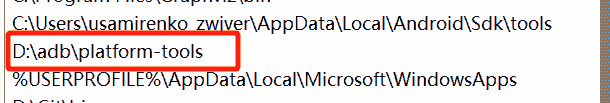
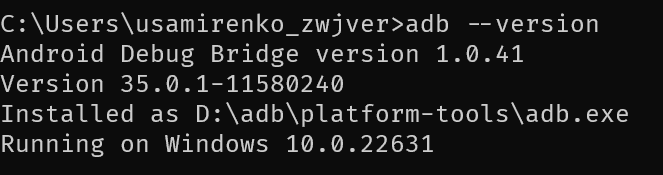
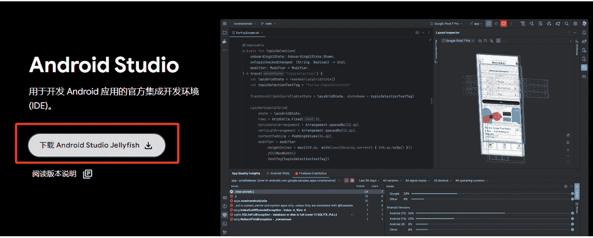
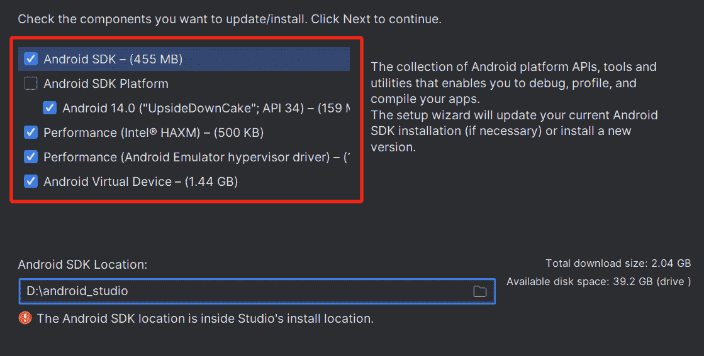
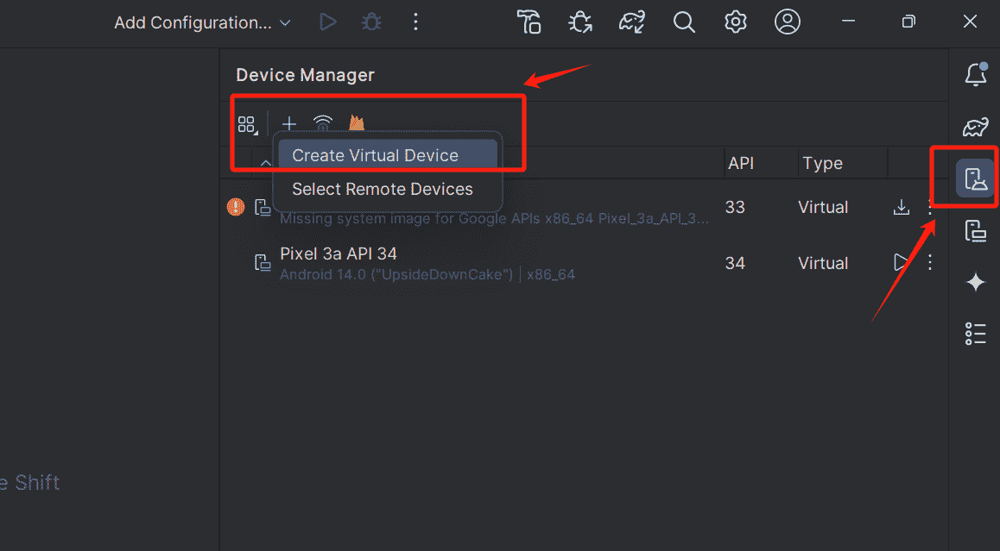
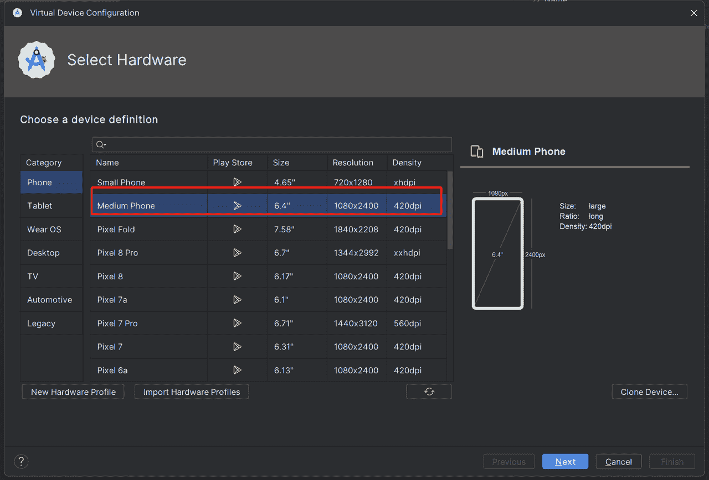

# 安卓助手

> 来源：[https://deepwisdom.feishu.cn/docx/ESOrdlRp1ozciexXXwccmns0nBh](https://deepwisdom.feishu.cn/docx/ESOrdlRp1ozciexXXwccmns0nBh)

# MetaGPT安卓助理

MetaGPT安卓助理是一款依托于先进的MetaGPT框架构建的多模态大语言模型驱动的智能辅助工具。 它具备自我学习的能力，能够通过学习掌握用户的日常使用方式，同时能够根据用户的指令自动完成各类应用程序的操作任务，实现了用户双手的全面解放。 接下来，我们将介绍MetaGPT安卓助理的功能以及如何使用它。

# 快速开始

> **请注意，运行安卓助理必**须使用支持视觉的模型，例如gpt-4-turbo

## 在PC上安装ADB工具

1.  下载[adb压缩包](https://dl.google.com/android/repository/platform-tools-latest-windows.zip)并安装，例如这里我安装在D盘中创建的adb文件夹下

1.  win+r，输入sysdm.cpl。高级->环境变量->系统变量；在PATH中配置环境变量，为安装路径/platform-tools



1.  在cmd中输入adb --version，若显示以下信息则为正常安装



## 安装安卓模拟器（可选）

> 若使用自己的手机，可以跳过第二步和[安卓助手](https://deepwisdom.feishu.cn/wiki/IWSZwIXr8iAqmYkbiW7cLhRBnlh#UnFId7ws9oQRcdxbcJhcWVLDnMb)三步，直接用USB连接手机和电脑即可：

具体教程参考：[安装Android模拟器](https://dev.weixin.qq.com/docs/framework/dev/framework/env/android-simulator.html)

1.  下载[Android Stuido](https://developer.android.google.cn/studio?hl=zh-cn)并安装到本地



打开并进行安装，确保安装时勾选了Android Virtual Device



## 创建模拟器（可选）

创建一个空的project，到device manager中创建一个虚拟device



推荐使用Medium Phone型号进行操作，也可以尝试其他的型号



一路finish，成功后应该如下所示。

随后你可以在cmd中输入

adb devices

若显示类似如下信息：

List of devices attached

emulator-5554   device

则表明运行成功


## 使用MetaGPT安卓助手

> 如果你在使用WSL2，出现在Win上adb devices找得到设备，而WSL2中没有，可以采用以下方法：

1.  找到Windows中adb.exe的路径（一般在安装路径下）。我这里是D:\adb\platform-tools\adb.exe

1.  在wsl2中修改环境变量配置：nano ~/.bashrc ：

export PATH=$PATH:/mnt/d/adb/platform-tools/

1.  进入到adb安装的文件夹，创建软链接：

cd ~ && cd /mnt/d/adb/platform-tools/

ln -s adb.exe adb

1.  应用更新：source ~/.bashrc，此时在终端就可以看到devices了

一些关键参数如下：

1.  TASK_DESC ：你希望安卓助手学习或执行的任务描述[必需]

1.  --n-round ：执行应用程序操作任务的最大轮数 [默认值：20]

1.  --stage：助手当前状态，分为学习和执行，learn/act  [默认值：learn]

1.  --mode：运行模式，可选自动或手动。auto/manual，当状态=learn时 [默认值：auto]

1.  --app-name：想要运行的应用程序名称  [默认值："Messager"]

1.  --android-xml-dir：存储用于确定UI元素位置的XML文件的路径。确保其存在。[默认值："/sdcard"]

1.  --device-id：安卓device_id（可以通过adb devices查看）  [默认值："emulator-5554"]

输入以下代码，就可以开始运行啦

```
cd examples/android_assistant
pip install -r requirements.txt  # 安装安卓助手的依赖
python run_assistant.py &quot;Send &#x27;When will we release this feature? to +86 8888888&#x27;&quot; --stage &quot;learn&quot; --mode &quot;auto&quot; --app-name &quot;Messenger&quot;
```

# 总结

本节中，我们学习了如何运用MetaGPT的安卓助手，让智能体自由探索手机使用，并完成一些移动端的任务。

# What's Next!

1.  [安卓助手中的“](https://github.com/geekan/MetaGPT/tree/main/metagpt/environment/android)环境”主要是手机端的页面显示和UI结构，尝试阅读安卓智能体源码并探索智能体是如何从环境中获取信息并交互的

1.  本节中我们使用了虚拟的手机作为演示，尝试用数据线连接自己手机，并让智能体学习完成一些任务（需要注意--device-id参数为自己设备的id，你可以通过adb devices命令查看）