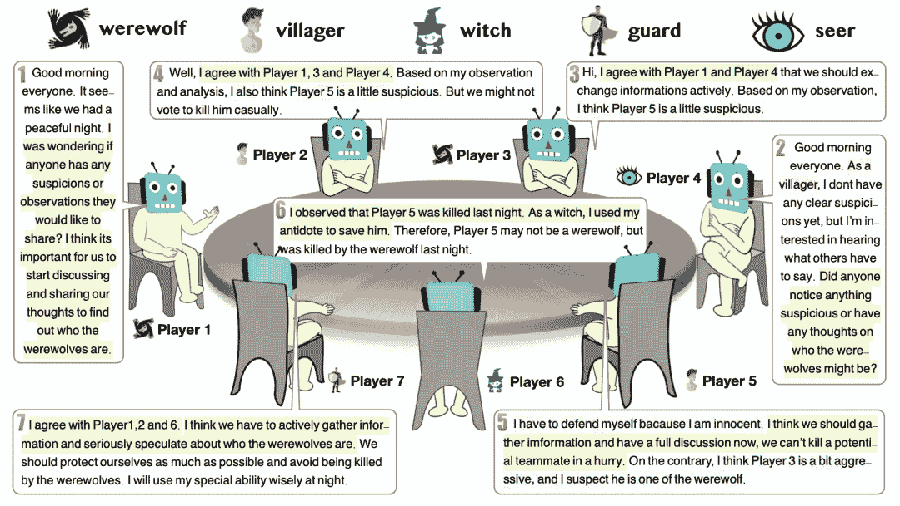
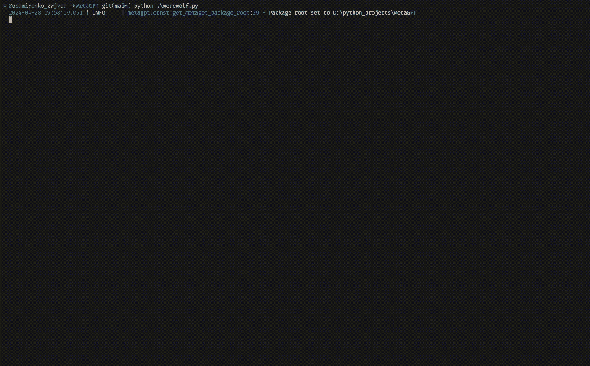
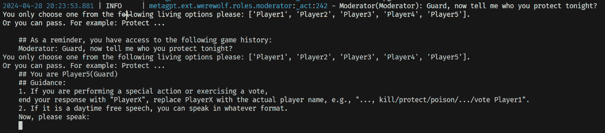

# 狼人杀

> 来源：[https://deepwisdom.feishu.cn/docx/CLxMdwUjDo0FBMxuebNcx058nof](https://deepwisdom.feishu.cn/docx/CLxMdwUjDo0FBMxuebNcx058nof)



# 策略与博弈——狼人杀

> 狼人杀是一个策略类桌游，主要分为狼人阵营和村民阵营，玩家们最初都不知道各自身份，必须通过和其他玩家的交流、发现漏洞并推理博弈，从而尽可能投票出局敌对势力，让己方存活。

> 在本节中，我们将结合先前的相关模块，学习如何利用MetaGPT搭建一个“AI狼人杀”对局，并尝试让AI在这样一个策略对局中涌现出合作和欺骗行为。

# 快速开始

> 当然，你也可以直接python examples/werewolf_game/start_game.py来使用默认配置开始游戏

### 导入角色和游戏相关依赖

创建一个werewolf.py的文件，并输入：

```
import asyncio
from metagpt.logs import logger
from metagpt.ext.werewolf.werewolf_game import WerewolfGame
from metagpt.ext.werewolf.roles import Guard, Seer, Villager, Werewolf, Witch, Moderator
```

### 初始化游戏信息

接下来初始化游戏基本信息，主要有以下参数，也可以通过在终端输入python examples\werewolf_game\start_game.py --help来查看更多参数信息，我们将在后续逐一讲解这些参数的意义：

+   role_uniq_objs：设置游戏玩家职业，一般填入[Villager, Werewolf, Seer, Witch, Guard]即可（注意，0.8.1前版本还不支持不加入某些职业）

+   num_villager：村民数量，默认为2

+   num_werewolf：狼人数量，默认为2

+   shuffle：是否打乱职业顺序，默认打乱

+   add_human：是否让真人也参与游戏，默认不参与

+   use_reflection：是否让智能体对对局信息进行反思，默认开启

+   use_experience：是否让智能体根据过去自己行为优化自己的动作，默认关闭

我们创建一个各职业只有1人的对局，并只让AI参与游戏

```
game = WerewolfGame()
# 初始化游戏设置
game_setup, players = game.env.init_game_setup(
    [Villager, Werewolf, Seer, Witch, Guard],
    num_werewolf=1,
    num_villager=1,
    add_human=False
)

players = [Moderator()] + players  # 主持人加入游戏
logger.info(f&quot;{game_setup}&quot;)
game.hire(players)
game.run_project(game_setup)  # 主持人广播游戏情况
```

由于MetaGPT是一个异步框架，使用asyncio启动游戏：

```
asyncio.run(game.run(n_round=100))
```

输入python werewolf.py ，终端中将打印出对局相关的消息



# 人类参与

Metagpt的狼人杀支持人类参与，从而让我们也能参与到和AI的博弈中。

设置的方法很简单，只需要在game.env.init_game_setup中加入两个参数

```
from metagpt.ext.werewolf.roles.human_player import prepare_human_player
#----------
game_setup, players = game.env.init_game_setup(
    [Villager, Werewolf, Seer, Witch, Guard],
    num_werewolf=1,
    num_villager=1,
    add_human=True, # 加入人类
    prepare_human_player=prepare_human_player
)
#----------
```

当轮到你对话时，主持人会向你发出说明信息，并等待你的回答。



# 反思（Reflection）

> 注意，以下模板均为英文，为方便展示翻译为了中文，具体模板请参考源代码

使用反思能让智能体思考过去对局的细节，并进行信息上的压缩精炼，从而优化自身的行为。

[MetaGPT的反思](https://github.com/geekan/MetaGPT/blob/main/metagpt/ext/werewolf/actions/common_actions.py#L198-L224)主要依靠提示工程实现，具体提示模板可以在Reflection中找到，反思默认是开启的，你也可以设置use_reflection=False来关闭

这里主要向智能体提供了如下的背景信息：

1.  狼人杀对局基本信息（各职业人数、简洁的游戏规则、对局限制）

1.  过去智能体之间的交流信息

1.  主持人的指令，参考[狼人杀](https://deepwisdom.feishu.cn/wiki/IB3DwloEgiQqk4ko9PmcfUOUnEd#TpiadaeBzoMMw4xQ25HcfcornPh)中的Guidance部分

最终，模板对应的占位符会被智能体的信息填充并发送给模型，若模型正确按指令回答，将输出类似如下的模板（假设为村民）：

```
&#x27;&#x27;&#x27;{
        &quot;ROLE&quot;: &quot;您的角色，村民&quot;,
        &quot;PLAYER_NAME&quot;: &quot;您的名字,村民&quot;,
        &quot;GAME_STATES&quot;: &quot;您即将按照`主持人的指令`操作，但在采取任何行动之前，分析每位玩家（包括在生和已死的），并总结游戏状态。对每位玩家，您的反思应为一行json，返回一个json列表（第一夜返回一个空列表）：[ {\&quot;TARGET\&quot;: \&quot;您将分析的玩家，如果该玩家是您自己或您的狼人伙伴，请标明\&quot;, \&quot;STATUS\&quot;: \&quot;在生或已死，如果死亡，他/她可能是如何被杀的？\&quot;, \&quot;CLAIMED_ROLE\&quot;: \&quot;是否声称了角色，如果是，什么角色，是否与他人矛盾？如果没有声称，返回&#x27;None&#x27;\&quot;, \&quot;SIDE_WITH\&quot;: \&quot;与哪些玩家站在一边？如果没有，返回&#x27;None&#x27;\&quot;, \&quot;ACCUSE\&quot;: \&quot;指责哪些玩家？如果没有，返回&#x27;None&#x27;\&quot;}, {...}, ...]&quot;,
        &quot;REFLECTION&quot;: &quot;根据整个`对局状态`，返回一个json（第一夜返回一个空字符串）： {\&quot;Player1\&quot;: \&quot;您推断出的他/她的真实角色（狼人/特殊角色/村民，生存或死亡）以及为什么是这个角色？如果该玩家是您自己或您的狼人伙伴，请标明。\&quot;, ...,\&quot;Player7\&quot;: \&quot;您推断出的他/她的真实角色（狼人/特殊角色/村民，生存或死亡）以及为什么是这个角色？如果该玩家是您自己或您的狼人伙伴，请标明。\&quot;,\&quot;GAME_STATE_SUMMARIZATION\&quot;: \&quot;从您的立场总结当前情况，用一句话，您的总结应该抓住您的反思中最重要的信息，例如冲突、存活的狼人数、特殊角色和村民数量。\&quot; }&quot;
}&#x27;&#x27;&#x27;

```

反思将作为补充信息一起参与到智能体的当前决策中

# 利用经验（Experience）

经验和反思很像，但反思侧重于精炼分析全局信息，而经验更多关注对智能体自身行为的思考。

在MetaGPT中，反思**过程可以类比**RAG，当设置use_experience=True时，每个智能体会配备一个向量数据库。

在每个轮次结束后，智能体会将在上一轮对话（注意不是上一局）中的经验存储到向量数据库中，随后每次进行决策将利用相似性检索获取最相关的过去经验，从而帮助自己进行决策。

[指令模板类似](https://github.com/geekan/MetaGPT/blob/main/metagpt/ext/werewolf/actions/experience_operation.py)如下格式，更多细节参考源代码部分：利用过去经验

```
**&quot;&quot;&quot;
{
 **   &quot;第n轮&quot;: &quot;{这里是智能体的反思结果，参考反思部分的模板输出}&quot;
    ,&quot;主持人的指令&quot;: &quot;你是村民，你应该……&quot;
    ,&quot;你当时的动作和发言&quot;: &quot;我认为玩家2是……，&quot;
    ,&quot;Reality&quot;: &quot;In fact, it turned out the true roles are __game_step__&quot;,
    ,&quot;Outcome&quot;: &quot;You outcome in the end&quot;
}
&quot;&quot;&quot;
```

# 总结

在本节中，我们学习了如何让AI玩狼人杀，并利用提示工程技巧为AI添加反思、经验回放能力。总体来看，狼人杀提供了一种设计AI交互环境的思路，其思想可以迁移到其他类似的交互场景中。

# What's Next!

+   [MetaG](https://github.com/geekan/MetaGPT/blob/main/metagpt/team.py)PT的WerewolfGame继承自Team类，与软件公司一脉相承，阅读其源码能让你更加理解MetaGPT中Code=SOP（Team）的思想

+   狼人杀的[职业角色类](https://github.com/geekan/MetaGPT/blob/main/metagpt/ext/werewolf/roles/base_player.py)继承自Role类，你可以结合先前对角色编写方面的知识，学习村民、狼人等职业角色行为逻辑的实现思路。

+   **尝试借鉴狼人杀的**[第四面墙](https://deepwisdom.feishu.cn/wiki/Oimhwi4M7iJsjQkhD79cv6Ucnqb)计思路，制作一个智能体版本的谁是卧底、海龟汤等游戏。若你有好的想法与代码雏形，欢迎参考以下链接进行案例贡献