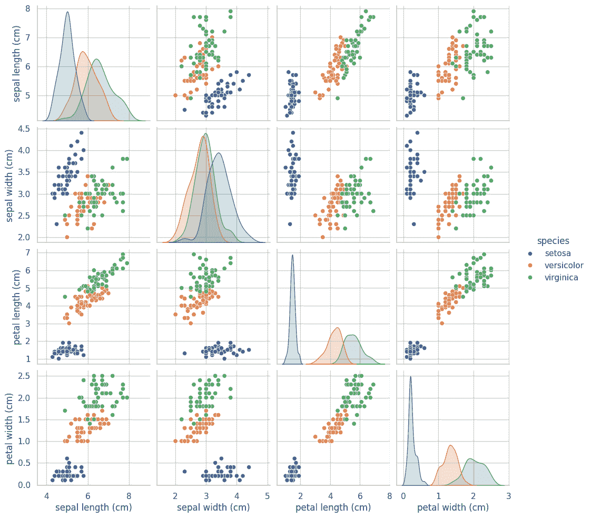

# 数据分析可视化

> 来源：[https://deepwisdom.feishu.cn/docx/DY8Cd9TDfoZlBIxYqQmcQrVpnme](https://deepwisdom.feishu.cn/docx/DY8Cd9TDfoZlBIxYqQmcQrVpnme)

## 概述

数据可视化是通过图表、图形和其他视觉元素将数据转化为可理解和易于分析的形式。它帮助我们发现数据中的模式、趋势和关联，以及提供洞察力和见解。通过数据可视化，我们可以更好地理解数据的含义，传达和解释数据的结果，并支持数据驱动的决策和沟通。

## 示例：Iris数据集可视化

### 任务

使用DataInterpreter对sklearn Iris数据集进行简单的数据分析并绘制可视化图表。

### 代码

```
python examples/di/data_visualization.py
```

examples/di/data_visualization.py文件中的代码具体为：

```
import asyncio
from metagpt.logs import logger
from metagpt.roles.di.data_interpreter import DataInterpreter
from metagpt.utils.recovery_util import save_history

async def main(requirement: str = &quot;&quot;):

    di = DataInterpreter()
    rsp = await di.run(requirement)
    logger.info(rsp)
    save_history(role=di)


if __name__ == &quot;__main__&quot;:

    requirement = &quot;Run data analysis on sklearn Iris dataset, include a plot&quot;
    asyncio.run(main(requirement))
```

执行上面的代码，生成的plan和code会分别保存在 dada/output/当前时间/plan.json和 dada/output/当前时间/code.ipynb中。

### 运行结果

1.  DataInterpreter 提出的task如下:

```
[
  {
    &quot;task_id&quot;: &quot;1&quot;,
    &quot;dependent_task_ids&quot;: [],
    &quot;instruction&quot;: &quot;Load the Iris dataset from sklearn.&quot;
  },
  {
    &quot;task_id&quot;: &quot;2&quot;,
    &quot;dependent_task_ids&quot;: [&quot;1&quot;],
    &quot;instruction&quot;: &quot;Perform exploratory data analysis on the Iris dataset.&quot;
  },
  {
    &quot;task_id&quot;: &quot;3&quot;,
    &quot;dependent_task_ids&quot;: [&quot;2&quot;],
    &quot;instruction&quot;: &quot;Create a plot visualizing the Iris dataset features.&quot;
  }
]
```

DataInterpreter 能够把任务分解为合理的tasks, 并按照加载数据、分析数据和绘制图表的步骤运行。

1.  DataInterpreter输出代码如下:

```
# ----------------------------------task1------------------------------------
from sklearn.datasets import load_iris
iris_data = load_iris()
iris_data.keys()
!pip install scikit-learn
from sklearn.datasets import load_iris
iris_data = load_iris()
iris_data.keys()
# ----------------------------------task2------------------------------------
import pandas as pd

# Create a DataFrame from the iris dataset
iris_df = pd.DataFrame(iris_data[&#x27;data&#x27;], columns=iris_data[&#x27;feature_names&#x27;])
iris_df[&#x27;species&#x27;] = pd.Categorical.from_codes(iris_data[&#x27;target&#x27;], iris_data[&#x27;target_names&#x27;])

# Summary statistics
summary_statistics = iris_df.describe()

# Check for missing values
missing_values = iris_df.isnull().sum()

(summary_statistics, missing_values)
# ----------------------------------task3------------------------------------
import matplotlib.pyplot as plt
import seaborn as sns

# Use seaborn&#x27;s pairplot to visualize the dataset features
sns.set(style=&#x27;whitegrid&#x27;, context=&#x27;notebook&#x27;)
iris_pairplot = sns.pairplot(iris_df, hue=&#x27;species&#x27;, height=2.5)
plt.show()
```

在完成task1时，由于环境中没有安装scikit-learn导致第一次执行报错，但DataInterpreter可以分析并通过安装scikit-learn来解决这个问题。在task3中DataInterpreter使用seaborn的pairplot函数绘制一个散点图矩阵，用于可视化数据集中不同特征之间的关系，并通过颜色区分不同种类的数据点，最后使用plt.show()将图表显示出来。

下面是DataInterpreter运行代码绘制出的图，可以看出代码成功执行并绘制了精美的可视化图表，帮助我们更好地对数据集特征进行分析。

