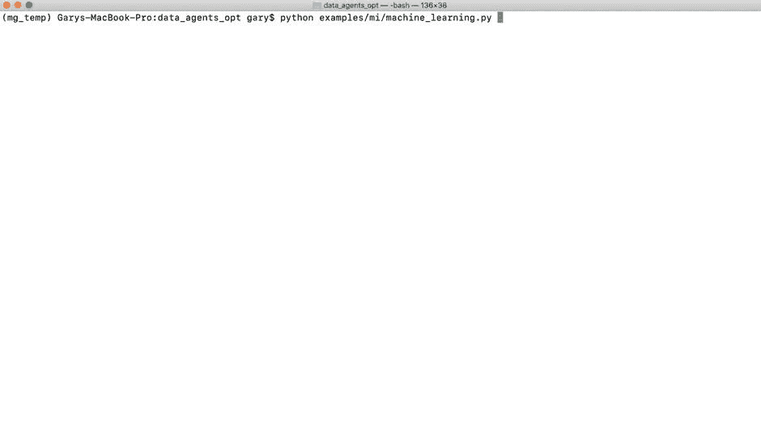
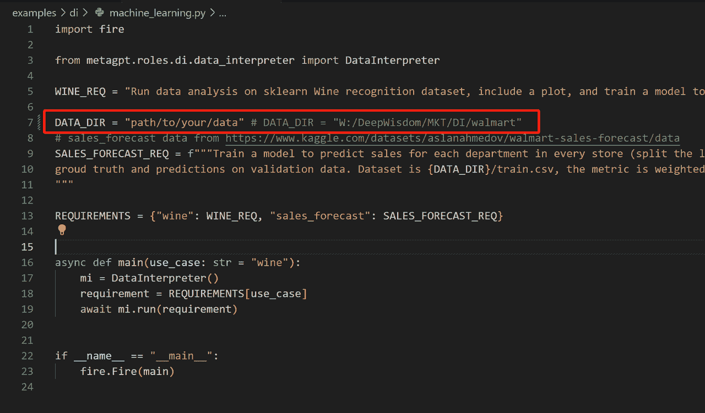
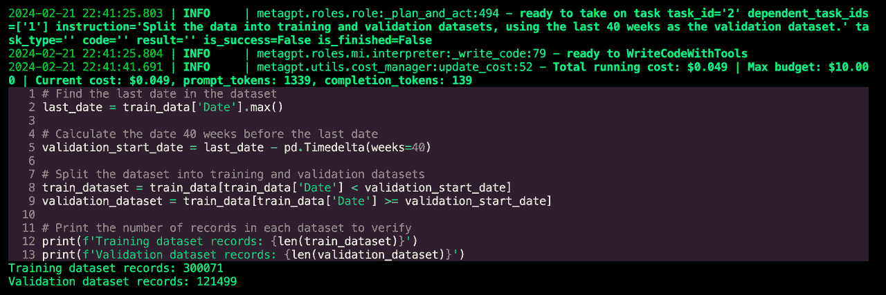
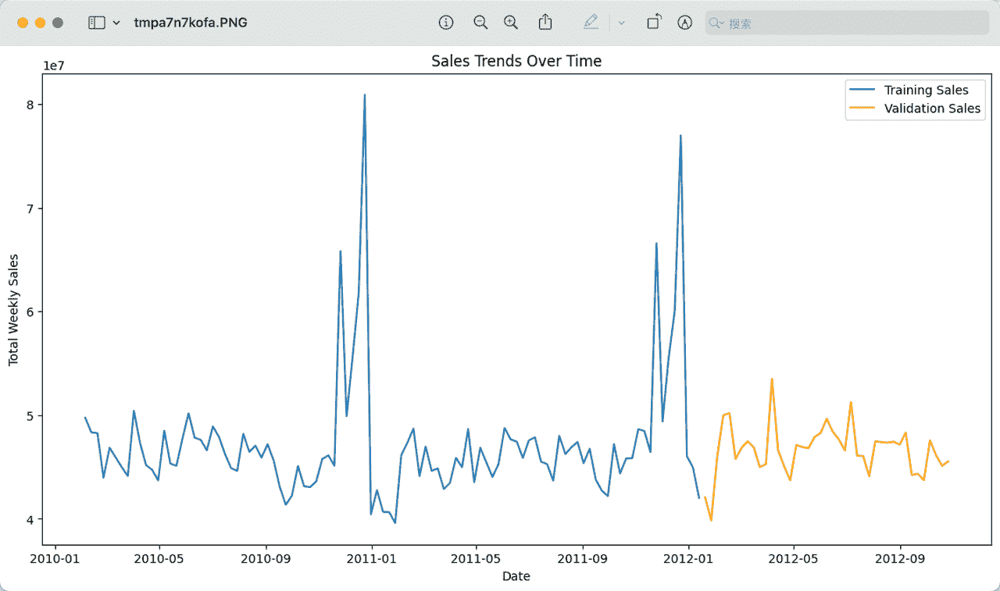
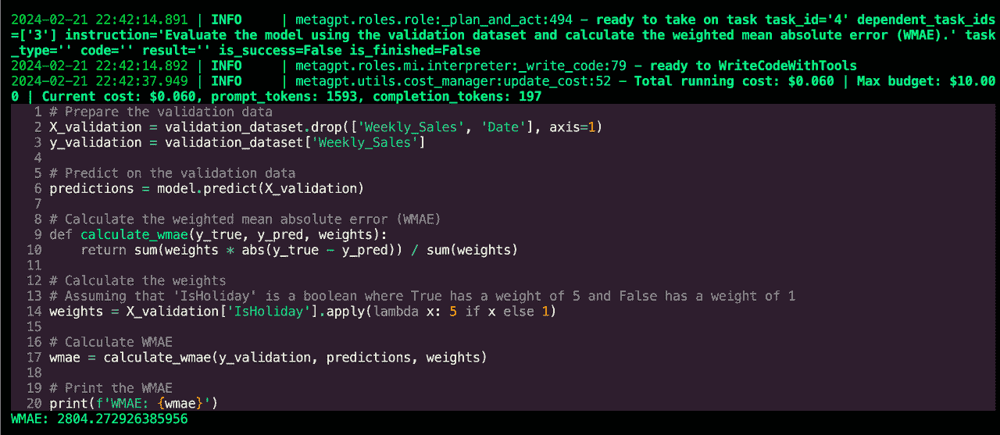

# 机器学习建模

> 来源：[https://deepwisdom.feishu.cn/docx/SAeydzIi6oIh7LxUHGNcpD7Onch](https://deepwisdom.feishu.cn/docx/SAeydzIi6oIh7LxUHGNcpD7Onch)

## 概览

机器学习通过算法分析数据，进行分类和回归预测，例如股价预测、垃圾邮件分类、信用评分、医疗诊断等。我们可使用DataInterpreter生产此类算法代码，对数据进行建模，完成预测任务。

## 示例：红酒分类

### 任务

我们以[sklearn的红酒识别数据集](https://scikit-learn.org/stable/datasets/toy_dataset.html#wine-dataset)为例说明如何使用DataInterpreter进行机器学习建模。这是一个经典的多分类数据集，数据集内有色泽、化学成分等的若干特征，可据此对样本的酒品类别进行预测。我们要求DataInterpreter获取数据，切分训练和验证集，训练模型，并在验证集上进行预测。

### 代码

```
python examples/di/machine_learning.py
```

### 运行结果



[ml_wine_dataset.mp4](https://internal-api-drive-stream.feishu.cn/space/api/box/stream/download/all/HoiYbjaDRod1qoxmkTZcb0sInSc)

## 示例: 销售额预测

### 任务

我们以[沃尔玛销售额预测数据集](https://www.kaggle.com/datasets/aslanahmedov/walmart-sales-forecast/data)为例说明如何使用DataInterpreter进行销售额预测建模。数据集内有train.csv、test.csv、feature.csv、store.csv共计四张表，我们要求DataInterpreter获取数据，拼接数据，切分训练和验证集，训练模型，并在测试集上进行预测。

### 下载数据

下载[沃尔玛销售额预测数据集](https://www.kaggle.com/datasets/aslanahmedov/walmart-sales-forecast/data)中的数据集，解压压缩包，并修改数据集path



### 代码执行

```
python examples/di/machine_learning.py --use_case sales_forecast
```

### 运行结果







## 机制解释

DataInterpreter根据我们的需求做出计划，形成若干任务并依次执行，最终完成需求。DataInterpreter生成的完整代码将存储在data/output路径下

## 延伸

[对更复杂机器学习任务的针](https://deepwisdom.feishu.cn/wiki/WWzcwwK5siy3LCkN0lfcbRtinLV)对性处理，请参考使用工具进行机器学习建模