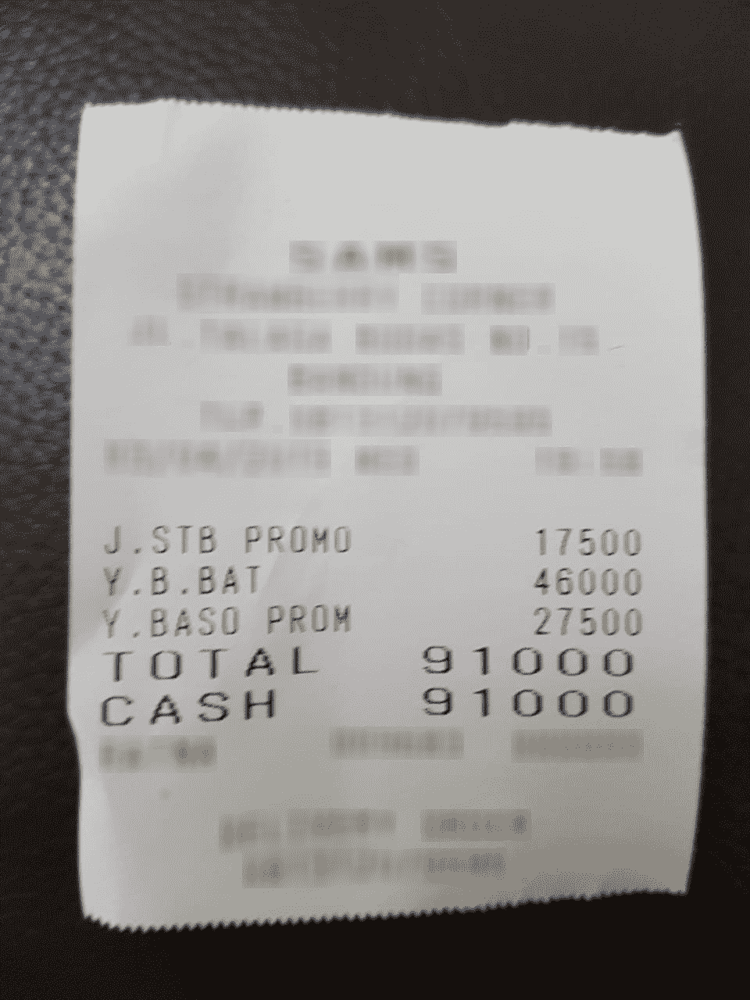
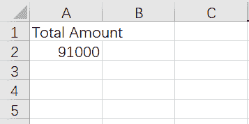

# 小票OCR

> 来源：[https://deepwisdom.feishu.cn/docx/HzxJdlGz2oeSXsxn6lWc1BBCnUc](https://deepwisdom.feishu.cn/docx/HzxJdlGz2oeSXsxn6lWc1BBCnUc)

## 概述

OCR，是一种识别图片中文字，得到结构化文本信息的技术手段。我们将使用DataInterpreter进行各类票据的OCR信息抽取

## 示例：购物小票识别

### 任务

使用DataInterpreter对如下的票据进行OCR识别，提取并保存总金额



### 代码

> 注意：你需要事先安装Paddle相关依赖以运行此示例，可执行 pip install metagpt[ocr]

```
python examples/di/ocr_receipt.py
```

### 运行结果

DataInterpreter会在当前工作路径下保存一个csv文件，内含抽取出的总金额



## 机制解释

使用DataInterpreter先生成规划Plan，再生成基于paddle OCR的工具代码，执行OCR处理以识别餐饮发票图片中的文本信息，提取相关数据，并将这些数据整理成表格文件。