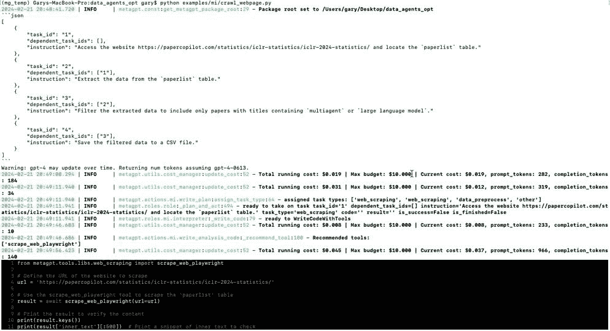
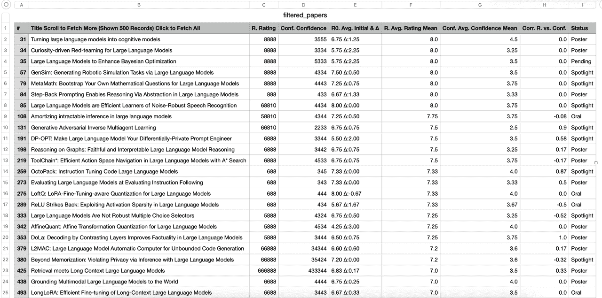

# 网页爬取

> 来源：[https://deepwisdom.feishu.cn/docx/GlvQdu7DpooZRExVBvzcHfw5nKd](https://deepwisdom.feishu.cn/docx/GlvQdu7DpooZRExVBvzcHfw5nKd)

## 概述

网页爬取是对网页内容的抽取和理解，为用户提供更智能、定制化的信息检索和分析功能。 我们将用DataInterpreter实现这一场景需求。

## 示例：使用工具获取静态网页中的表格数据

### 任务

从iclr-2024-statistics中获取标题含有关键词：multiagent和large language model的论文信息

### 代码

```
python examples/di/crawl_webpage.py
```

### 运行结果



[paper_list2.mp4](https://internal-api-drive-stream.feishu.cn/space/api/box/stream/download/all/W65Zb9OIropQsHxSASVcoeYfnNd)



## 机制解释

1.  使用metagpt.tools.libs.web_scraping下的工具函数scrape_web_playwright来获取网页html和inner text。工具函数是对浏览器自动化测试库Playwright的封装。

1.  使用BeautifulSoup获取id为paperlist的表格，并载入为pandas的DataFrame。

1.  获取DataFrame的列名来定位标题列，匹配关键词multiagent ，large language model来过滤数据。并将过滤后的数据保存在filtered_papers.csv中。