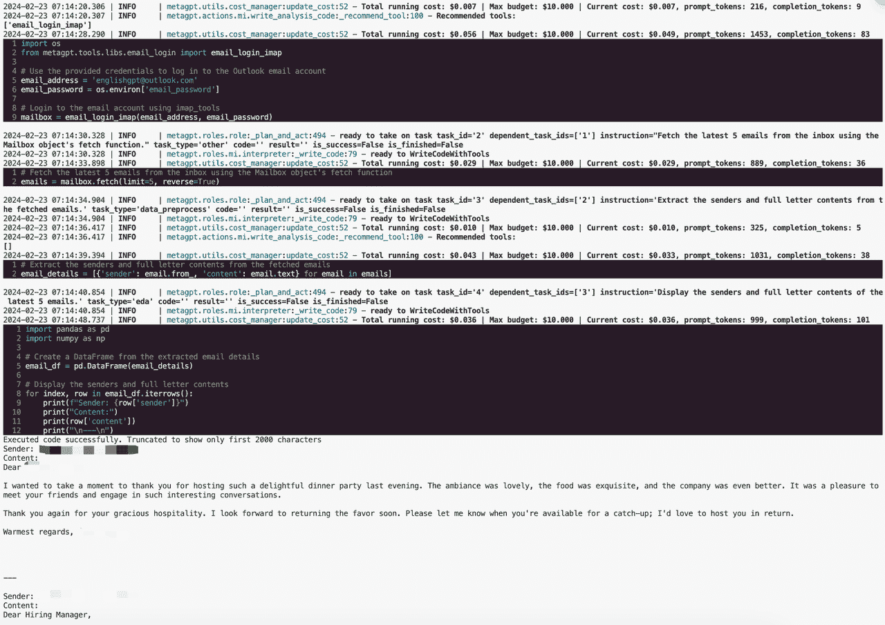

# 邮件助手

> 来源：[https://deepwisdom.feishu.cn/docx/Xm5ZdjA2nowKwAxc256czqtXnmf](https://deepwisdom.feishu.cn/docx/Xm5ZdjA2nowKwAxc256czqtXnmf)

## 概述

使用DataInterpreter对邮箱邮件的查看，快速审阅与自动回复

## 示例：登陆邮箱，查看并总结邮件内容

### 任务

登陆邮箱后将最新5封邮件的发件人与邮件正文进行展示，并将每篇邮件总结成一句话

### 代码

```
python examples/di/email_summary.py
```

### 运行结果



## 机制解释

此场景调用email_login_imap工具来进行邮件场景的账户登陆，此工具利用imap_tools库对账户和密码进行验证与登陆。