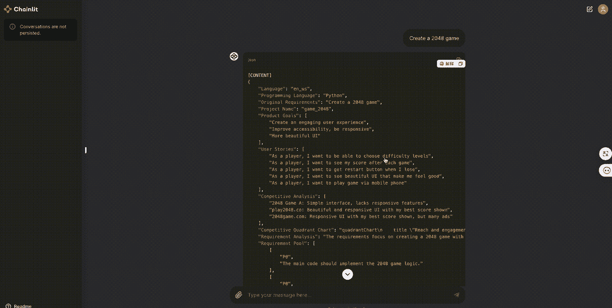

# UI 集成 - Chainlit

> 来源：[https://deepwisdom.feishu.cn/docx/UhpTdPR2dogmVZxoCATcSt0dnYg](https://deepwisdom.feishu.cn/docx/UhpTdPR2dogmVZxoCATcSt0dnYg)

## 概述

[f](https://github.com/geekan/MetaGPT/pull/1358)eat: Integration of MetaGPT with UI framework, Chainlit #1358

来自社区贡献者[ Kaushal Sol](https://github.com/Chainlit/chainlit)anki 的提供。针对 MetaGPT 的可视化集成，本次使用的 Chainlit 框架，因为它为 Python 提供了灵活性。

## 特性

+   流式消息 Streaming 可运行

+   我们可以从界面发送一个“想法”，比如“Create a 2048 Game”

+   增加了两个聊天提示器，便于点击运行想法，也支持运行其他任意给定的想法

+   增加了对 Action Node 输出的支持，可以展示为 JSON 或 Markdown 格式

## 修改文档

+   可以修改Environment.run、Team.run、Role.run、Role._act、Action.run等函数

+   在此次更新中，更改了 Environment.run ，因为它更容易做到

+   我们需要更改 metagpt.logs.set_llm_stream_logfunc 以使用 Chainlit Message 在 UI 中传输消息

+   要在其他地方使用，我们需要使用内容调用 chainlit.Message(content="").send()

## 影响

+   适合初学者

## **用法**

1.  安装 Chainlit：pip install chainlit

1.  运行 Chainlit 应用：chainlit run app.py

1.  cd examples/ui_with_chainlit

1.  访问：http://localhost:8000

1.  选择，

+   Create a 2048 game

+   Write a cli Blackjack Game

+   Type your own message...

1.  将运行 AI 软件公司的多智能体应用

## 其他

+   当前该集成不能直接用于生产环境，因为它使用了全局消息进[行流传输，需要实现用户会](https://docs.chainlit.io/concepts/user-session)话管理，可参考：User Session

+   解决了[ integration with UI ](https://github.com/geekan/MetaGPT/issues/1341)frameworks... #1341 中提出的 MetaGPT 与 UI 框架集成的问题。

## 演示

## 常见问题

+   TypeError: duplicate base class TimeoutError

+   查看下是不是有什么包没有安装，比如：redis