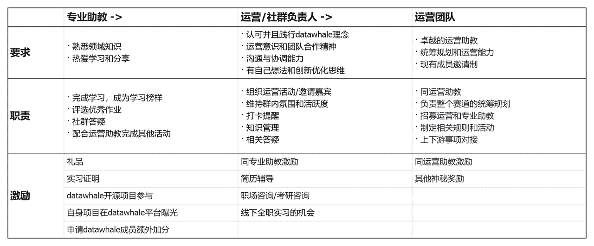
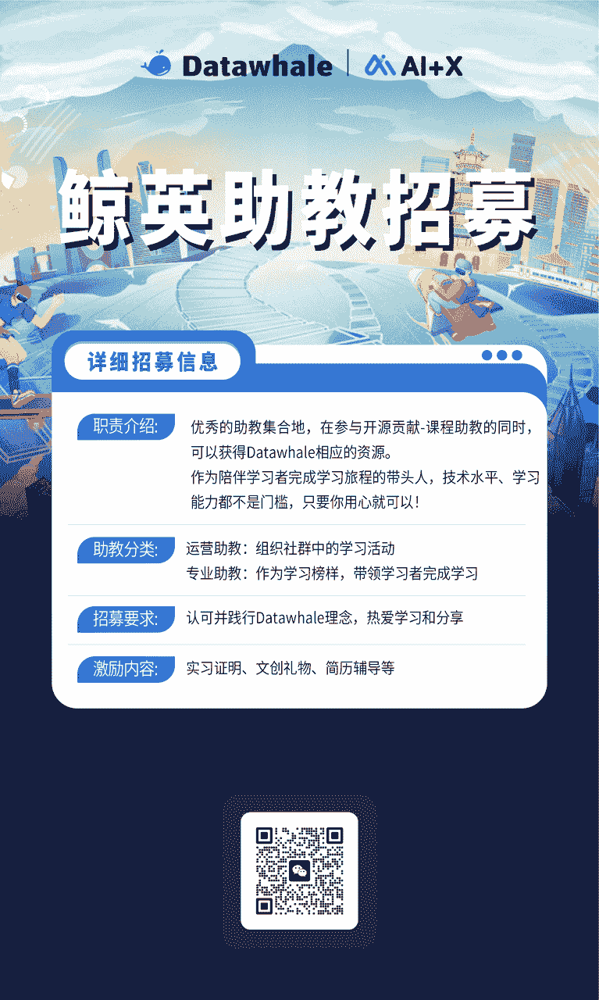
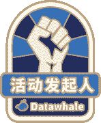
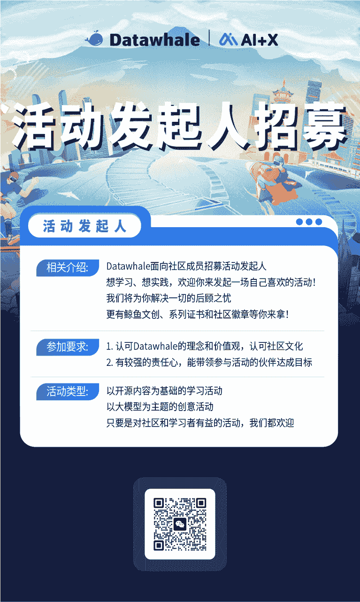
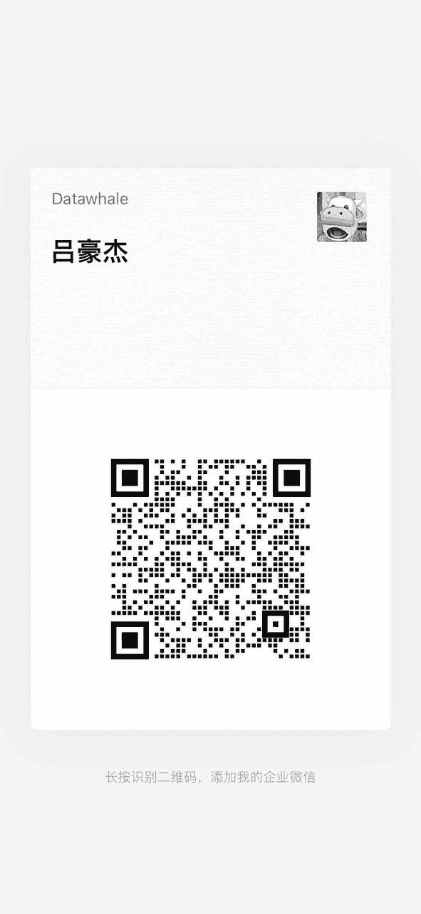
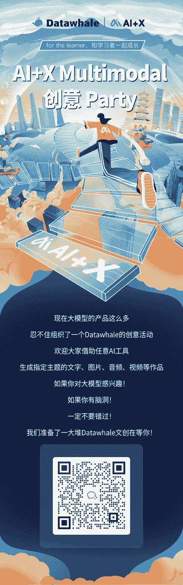
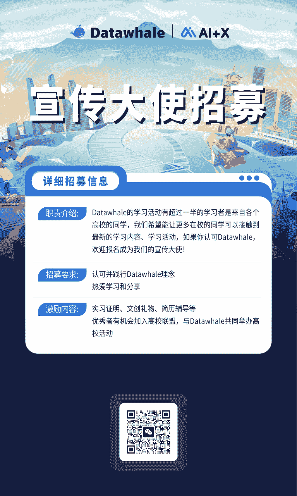
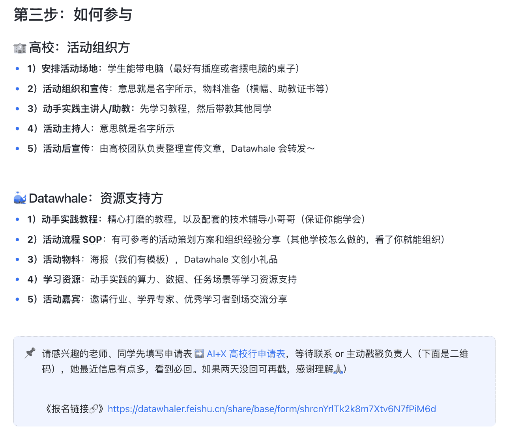
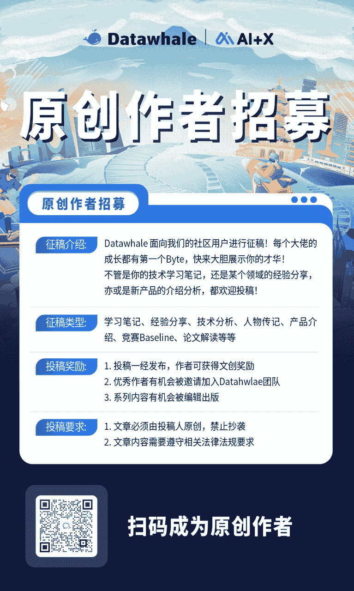

# Datawhale都有啥？

> 来源：[https://datawhaler.feishu.cn/docx/Al3sdRk6uob3Cmxcd3PcuSW9nVc](https://datawhaler.feishu.cn/docx/Al3sdRk6uob3Cmxcd3PcuSW9nVc)

# 我在Datawhale可以做什么

+   参与**开源项目**，[搞一个10K的项目](https://datawhaler.feishu.cn/wiki/N9Eewc07piW7lBk5Yw5crdzrn6f#doxcn8f6LuxpQfFRIU485QDEY1e)

+   成为**鲸英助教**，[成为陪伴学习者共同成长的见证者](https://datawhaler.feishu.cn/wiki/N9Eewc07piW7lBk5Yw5crdzrn6f#doxcnZBfIEavWzpWSMF27b9klQf)

+   参与各种各样的**学习活动**，[拿到我们的系列认证证书](https://datawhaler.feishu.cn/wiki/N9Eewc07piW7lBk5Yw5crdzrn6f#doxcnAtGR85ZqPA6rGwS5k3EqNd)

+   成为**宣传大使**，让Datawhale影响到更多学习者

+   参加**高校行活动**，把Datawhale带到你的校园，建立我们的小部落

+   加入**城市分部**，[参加所在城市的各种线下活动](https://datawhaler.feishu.cn/wiki/N9Eewc07piW7lBk5Yw5crdzrn6f#doxcn7Bp8tYhddzJyWA0qPBZHte)

+   成为**原创作者**，在Datawhale的媒体渠道发表自己的文章

+   参加**学术科研**活动，[分享论文，学习前沿技术](https://datawhaler.feishu.cn/wiki/N9Eewc07piW7lBk5Yw5crdzrn6f#doxcnoHFEufLiCR0926EWjAOBgg)

+   参加**兴趣小组**，单片机、Agent甚至是Game、Music

# 怎样加入Datawhale

# 基础团队

## 开源项目

**相关介绍**

> 开源项目是Datawhale优秀教程的重要来源！

>

> 📒 **了解开源项目查**阅【[**Datawhale项目看板】**](https://github.com/datawhalechina/DOPMC/projects/1)

>

> 💌 任何有关Datawhale开源项目的问题均可在【Datawhale开源项目讨论区】 发帖反馈

>

> 保姆团队若未回复可通过[**【联系方式】**](https://github.com/datawhalechina/DOPMC/blob/main/OP.md)联系

**参与方式**

> 💡 如果你想发起一个开源项目，请查阅【Datawhale开源项目指南】

>

> 📍 想参与开源项目，可查阅【[开源项目进展】 ](https://github.com/datawhalechina/DOPMC/issues)，带【help wanted】标签的项目有招募需求

>

> ✨ 如果你想**参与的开源项目暂无招募需求**，可给相应项目提Pull Request，或者去项目看板中查找项目负责人的联系方式进一步沟通

## 鲸英助教

**相关介绍**

> 优秀助教集合地，以助教身份参与组队学习，

> 参与助教工作可以获得积分，积分可以用于兑换Datawhale文创礼品。

**参与方式**

> 扫码添加负责人🛰️，备注“鲸英助教”

## 活动发起人

**相关介绍**

我们正式面向社区成员招募**“活动发起人”**

只要你想**学习**、想**实践、**想**交流**

👏🏻 ！欢迎你来发起活动！👏🏻

我们希望你是这样的Datawhaler——

认可Datawhale的**理念和价值观**，认可社区文化

**有责任心，不抛弃不放弃**，给参与活动的伙伴带来**良好的活动体验**

我们期待这样的活动：

+        **共学**Datawhale开源内容

+   从零开始共同发起**学习课题**

+       各种兴趣领域的**趣味活动**

Datawhale将为你提供资源支持：

**    **         丰富的学习内容、优秀的助教伙伴

**鲸币支持，**鲸币作用详见：[鲸币商店](https://datawhaler.feishu.cn/docx/VkdqdS6x5oaFKpxrbrQc0sswnle)

更有**“**[**学习活动系列证书**](https://datawhaler.feishu.cn/docx/RINmdBiLlohOGgx5158cPqsxnBh)**”**为你的优秀参与者增加认证

**“活动发起人”**实体徽章等你来拿！

**参与方式**

# 学习活动

## **组队学习**

**相关介绍**

> 组队学习就是一群志同道合的小伙伴，

> 一起学习讨论，一起克服拖延症，

> 一起组队打boss

> 没有老师，没有教学，

>

>

>

>

>

> 有的是一群热爱学习和渴望改变的人，

> **交流学习，互促共进。**

**参与方式**

> 组队学习一般在每个月的第二个周三预告、周六限额报名。

> 学习的内容是Datawhale的开源教程，大部分是文档形式，并配有每阶段学习任务设定。

>

> 近期组队学习活动见上方“**近期活动列表**”

> 感兴趣可添加🛰️，备注**“组队学习”**

## 实践学习

**相关介绍**

> 算法领域的实践项目都有着类似的处理流程，一通百通。

> 想要入门、进阶，需要的只是一份引导。

> 恰好，Datawhale 在以往的学习活动当中，留下了很多优秀的处理方案和高分Baseline。

>

> **所以我们**为大家准备了一个不同于教程学习的全新学习活动——实践学习

>

> **实践学习目标**：希望用“过时”内容为引子，带大家了解实际项目当中的问题处理方法。

> 在这个过程中，大家需要**学会用自己的方法思考、处理问题**，建立起你自己对算法的独特理解，从入门走向进阶。

**参与方式**

> 不定期发布实践学习报名，请关注Datawhale社群当中的报名信息

>

> 近期组队学习活动见上方“**近期活动列表**”

> 感兴趣可添加🛰️，备注**“实践学习”**

## 经典共读

**相关介绍**

> 经典共读以经典的出版书籍和上市课程为学习内容，鼓励大家以共读的方式，交流所学所得

**参与方式**

> 不定期发布学习报名，请关注Datawhale社群当中的报名信息

>

> 近期组队学习活动见上方“**近期活动列表**”

> 感兴趣可添加🛰️，备注**“经典共读”**

## 创意活动

**相关介绍**

世界都在拥抱大模型，我们怎么可以落下！

我们面向全网对生成式AI感兴趣的小伙伴，发起“AI+X Multimodal 创意 Party”！

我们希望提供一个场域

可以让大家尝试、接触、体验到最新的AI技术

可以让大家用新工具自由发挥，创造自己的脑洞

......

**简单来说，就是借助****任意AI工具****，生成****指定主题****的文字、图片、音频、视频等作品**

**参与方式**

# 宣传大使

**相关介绍**

> Datawhale的学习活动有超过一半的学习者来自各个高校

> 我们希望能让更多在校的同学可以接触到最新的学习内容、学习活动

> 如果你认可Datawhale

> 欢迎报名成为我们的宣传大使，加入高校联盟

**参与方式**

> 感兴趣可添加🛰️，备注**“宣传大使”**

# 城市活动

## AI+X高校行

**相关介绍**

> **AI+X：**

> 将人工智能（AI）与各个学科和行业（X）结合

> 激发无限潜力和创造力（X），让年轻人拥有更多可能性（X）

>

> **高校行**：

> 把AI带到10座城市，100所高校，影响10000名高校师生

>

> **AI+X 高校行活动 **融合人工智能企业最新技术与应用场景、Datawhale丰富的学习资源、以及高校创新火种，打造独特的AI学习体验，激发高校学生的学习热情和应用能力，促进AI与各高校专业交融。

>

> 我们倡导学习者追寻兴趣热爱，包容开放，协作学习，动手实践，鼓励探索和创新

**参与方式**

> [参与指南](https://datawhaler.feishu.cn/wiki/UAKTw75P5ixxl4kLF8NcKVZxnZb?from=from_copylink)

> [👉报名链接](https://datawhaler.feishu.cn/share/base/form/shrcnYrlTk2k8m7Xtv6N7fPiM6d)

## 城市活动

生态共建，请备注【合作+企业名+意向城市】

## 城市分部

参与活动，请备注【线下+所在城市名+行业】

| 已有分部 | 下期活动预告：4-19 Un-AI 联办人 |
| --- | --- |
| Datawhale 苏州 分部 |  |
| Datawhale合肥分部 | 浩远 |
| Datawhale 香港 分部 | 苏鹏 |
| Datawhale 武汉 分部 | 牧小熊 |
| Datawhale 沈阳 分部 | 空腹不要吃饭 |
| Datawhale 深圳 分部 | 王淇 |
| Datawhale 上海 分部 | 隆军 |
| Datawhale 南京 分部 | magicyang |
| Datawhale 荷兰 分部 | 伯湘box（探索中） |
| Datawhale 河南 分部 |  |
| Datawhale 杭州 分部 | 思语 |
| Datawhale 甘肃 分部 |  |
| Datawhale 大连 分部 | 晓东 |
| Datawhale 成都 分部 |  |
| Datawhale 长沙 分部 | 国皓 |
| Datawhale 北京 分部 | 文睿 |
| Datawhale 巴黎 分部 | 文轩 |
| 郑州分部建设 探索中 | 瀞丹 |
| 兰州分部建设 探索中 | 辅员 |

# 原创作者

**相关介绍**

> **征稿介绍**

> Datawhale 面向我们的社区用户进行征稿！每个大佬的成长都有第一个Byte，快来大胆展示你的才华！不管是你的技术学习笔记，还是某个领域的经验分享，亦或是新产品的介绍分析，都欢迎投稿！

>

> **征稿类型**

> 学习笔记、经验分享、技术分析、人物传记、产品介绍等等

>

> **投稿奖励**

> 投稿一经发布作者可获得一份文创奖励和稿酬

> 优秀作者有机会被邀请加入Datahwlae原创作者团队，系列内容有机会被编辑出版

>

> **投稿要求**

> 文章必须由投稿人原创，禁止抄袭

> 文章内容需要遵守相关法律法规要求

> 如果文章提前在Datawhale之外渠道发布，需要提供发布许可

> 录取文章需要被允许在Datawhale的👸号、📕、知乎等平台发布

**参与方式**

# 学术科研

Whalepaper

WhaleResearch

# 兴趣小组

**Agent_weekly**

**相关介绍**

> agent_weekly 是Datawhale成员发起的

> 探索 agent 技术最新论文产品理念

> 的前哨分享组织

>

> 每周我们都会安排腾讯会议分享，

> 目前已有多名产业界与学术界朋友加入

>

> 这个活动主要是每周分享关于agent的论文技术产品相关

**参与方式**

>

> 我们希望加入群的小伙伴都必须要准备分享内容（任何内容只要与agent有关）

>

> 入群的小伙伴请确保在[分享安排表](https://datawhale.feishu.cn/base/WgTAbQ10zaf47Ns9vjPc0SNJnJf)中准备自己的分享计划

>

> 分享确定后，将会在此更新**分享链接**

Whale单片机

WhaleHandwriting

**相关介绍**

> whale-Handwriting小组是以写字为兴趣出发点，以锲而不舍努力练习的动力为行动力的DW练写字的兴趣小组，

> 我们的slogan是——

> “写一手好字，品书法景逸，抒万世豪情，修轮回禅意。”

>

> 小组成员为对写字、书法感兴趣的成员，小组活动的形式类似于组队学习，练字作品可获得大佬点评和讨论

>

> 小组内部还有许多有趣的活动：优秀作品分享、作品秀等，期待大家的关注~

**参与方式**

> 小组成员自行准备字帖练习，

> 要求每个月至少交4幅作品，

> 作品数不够可能会被流出群~

>

> 感兴趣的小伙伴可以点击

> [whale-Handwriting兴趣小组手册（试行稿）](https://f0jb8szntbu.feishu.cn/docx/PtJWd3U9nojwitx8xAlcGPlUnEc?from=from_copylink)

> 查看详情~

Whale心理

WhaleMusic

Whale game

# 开发者部落

**相关介绍**

我们希望为来到 Datawhale 的开发者提供一个可以交流技术问题、寻找项目伙伴的场所！

如果你热衷于交流经验技巧、对技术难题感兴趣，或是有些天马行空的想法、缺一个和你一起创作的伙伴，欢迎你加入我们专门为开发者准备的部落！

**参与方式**

[AI+X 开发者部落](https://datawhaler.feishu.cn/docx/JwcBdcR88oU7oFxX8q3cZuVbn3e)

填写申请加入部落