# 接入DeepSeek的"excel"：飞书多维表格超强AI工作流！

> 来源：[https://datawhaler.feishu.cn/docx/HNmPdch10o70haxhFVIc5Gx1nDf](https://datawhaler.feishu.cn/docx/HNmPdch10o70haxhFVIc5Gx1nDf)

> 目录

> 在Excel中，1000行数据批量生成是家常便饭；

> 如果这1000行同时被AI赋能呢？飞书多维表格可以做到！

> 这里用Excel类比，主要是为了让读者更容易理解。实际上，在接入AI功能之前，飞书多维表格就已经具备了许多传统Excel不具备的强大功能，而本文也主要集中于这些新加入的AI功能

>

> **若阅读本文前半部分时感觉图文不够直观，本文第**四部分有讲解视频，可以先跳转到那里去看看

在excel中，如果我们设定了一个公式，比如将A列和B列相加形成C列的结果，公式设定好之后，我们只需要在C列中添加新的数据，Excel就会自动计算出每一行的结果。这样的自动化处理让我们的工作变得更加高效，节省了大量的时间。

同样，飞书多维表格也具备类似的强大自动化能力，而且远远不局限于Excel的传统功能。飞书多维表格已经接入了大量的AI能力，包括DeepSeek。

在excel中我们新建了在A列B列新建了1000行数据，设定好C列的公式，A列B列的1000个数据的和就在C列出来了。在飞书多维表格中，假如我们有1000行内容需要处理，可以想象成也类似于excel，1000个deepseek同时工作，批量产生的1000份结果。

在飞书多维表格中能够便捷地构建各种自动化的AI加持的自动化工作流，并且可以与飞书的群聊、任务管理、日历等工具结合，进一步提升日常工作与协同的效率。

本文选取了一些场景，做了一些简单的尝试，分别从学习工具、自媒体生产力、兴趣爱好赋能工具三个角度各做了一个案例，记录下使用步骤和体会，作为抛砖引玉，大家可以自行迁移应用场景，希望能给大家带来些许帮助。

> 可以点击直接复用[03.考研英语作文批改+作文素材整理](https://z5ewdrqx4l.feishu.cn/base/V9Gqb00EZaS98rs7NIOcU1UTnSg?table=tbl2CSg7yEJF9Tkt&view=vewpFWWHnR)迁移到自己的案例

> 【学习工具案例】

> 【自媒体生产力案例】[01.让老年人也能听懂流行语](https://z5ewdrqx4l.feishu.cn/base/BRdqbjHReaPnb0svZDJcJ7Cbnkc)

> 【兴趣爱好赋能案例】[04.街舞比赛海报识别系统](https://z5ewdrqx4l.feishu.cn/base/PFgzb6aoeafpB6sacFmciRYBn1b)

# 一.飞书多维表格AI工作流的优势

## 1.告别卡顿

就拿deepseek的使用来说，最近一段时间相信大家对下面这个太眼熟了哈哈，有时候甚至重试20次还是依旧服务器繁忙。

但是在飞书多维表格里调用，行云流水，一气呵成！

> 飞书提供了100万的DeepSeek R1免费token，用完时可以绑定火山引擎账号，注册会送50万DeepSeek R1的token

目前飞书多维表格调用deepseek的方式主要有两种，一种是在字段捷径里面搜DeepSeek R1（后文会讲解如何使用字段捷径)

另一种是在字段捷径里面搜自定义AI，可以配置DeepSeek官方，火山方舟，硅基流动提供的deepseek模型服务

多维表格接入的其他AI能力使用起来也非常快速。

## 2.高效的内容生成与批量处理，结构化存储

传统的网页上和AI交互有什么问题呢？

有时候我们会在AI的网页版对话界面中发现一些有效的工作流，希望每次和它交互的时候维持那个效果。然而，随着聊天上下文的增长，这些工作流的效果可能会变得不稳定。此时，我们可能会去新建一个对话，并复制原先的提示词，这其实也是一种重复劳动。

此外，虽然我们也可以在网页中同时让AI生成多个结果，批量处理一些内容，比如我们说"针对以下10个项目生成相应的内容"，但在后续使用中，我们仍然需要对这些结果进行结构化的存储和管理，免不了多次的复制粘贴。

而AI加持的飞书多维表格就可以很好地解决以上两个问题。

+   如果使用过类似于扣子，Dify这类AI agent产品，那么应该了解AI工作流的强大之处。通过设置自动化规则，AI能够根据预设的逻辑快速生成和处理内容，极大地提高工作效率。如果还没有接触过这些工具，也不用担心，阅读完本文后，也可以大概了解并自己做一些尝试。飞书多维表格进一步降低了AI工作流的使用门槛。只需为每一列设置一些规则，就能轻松创建强大的AI工作流。

+   在飞书多维表格中，数据以结构化的方式进行存储和管理，表格清晰明了。相比于网页版的AI对话框，我们常常仍需要复制粘贴那些AI回复的内容并存储到指定位置，而飞书多维表格天然具备结构化存储功能，所有数据都以表格形式呈现，方便管理和操作。

以我后文写的考研英语作文自动批改和素材整理为例，传统对话界面在多次交互后，生成效果可能会变得不稳定。而在飞书多维表格中，所有数据都以表格呈现，并且支持二次编辑。当修改“我的作文”一列时，后续的批改结果、素材整理（如高级词汇、句型句式等）会自动更新，提升工作效率，避免重复操作。这就类似于在Excel中我们设定了公式，当修改某个单元格时，相关单元格会自动更新。

## 3.多种AI能力协同，统一的操作界面

+   **集成多种AI能力**：飞书多维表格不仅支持DeepSeek R1的文字生成能力，还集成了豆包大模型的图片理解、多模态交互等多种AI能力（后面有截图，开放了非常多的AI能力）。所有这些功能都可以在一个统一的界面中调用，无需在不同平台之间切换，极大地简化了操作流程。

+   **灵活的字段管理**：可以根据需要自由添加、删除和调整字段，每个字段都可以是一个独立的AI节点，实现不同的功能。灵活性很高，可以根据具体需求定制系统，满足各种复杂的业务场景。

+   **随处可见的AI交互：**

+   小到连每一个单元格都有润色等AI功能，只需要在将鼠标悬浮在单元格上即可看到。

如果是设定了工作流的单元格，对这一列的生成结果不满意，可以点击“AI更新”

+   excel中能用的公式逻辑这里也能用，而且这里内嵌了AI生成公式，并且一键采纳运用。

+   大到整个多维表格的问答功能、仪表盘统计图生成

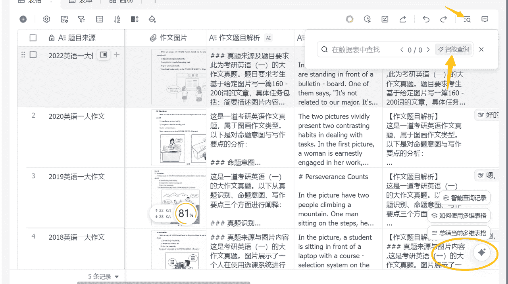

## 4.可封装成产品，开箱即用

可以被封装成一个完整的系统，甚至是一个产品。通过添加AI节点、配置自动化工作流，我们可以将复杂的操作流程封装成一个简单的表单，让其他用户在表单里提交内容，无需了解背后的复杂逻辑，就能得到输出。

## 5.简单易上手且便于复用

对于使用过excel的用户来说，飞书多维表格还是挺容易上手的，不需要编程基础，只需要通过类似Excel的表格操作，就可以快速搭建出复杂的AI应用系统。

还有很重要的一点，利用飞书的共享功能和创建副本的功能，可以很方便地将一些开源模板进行改造，用到很多生活和工作的场景里面去。

比如我后文举的一些例子，稍作修改就可以用到很多场景里面。

# 二.飞书多维表格的一些基础操作

> 若使用过飞书多维表格可以跳过本部分，从第三部分开始阅读

+   首先是在飞书中创建一个多维表格，在飞书的右上角点击"新建",然后选中"多维表格"

+   然后会得到一个默认的多维表格

+   我们可以把不需要的列删除掉，把鼠标移动到对应的列标题上，右键，选择"删除"即可

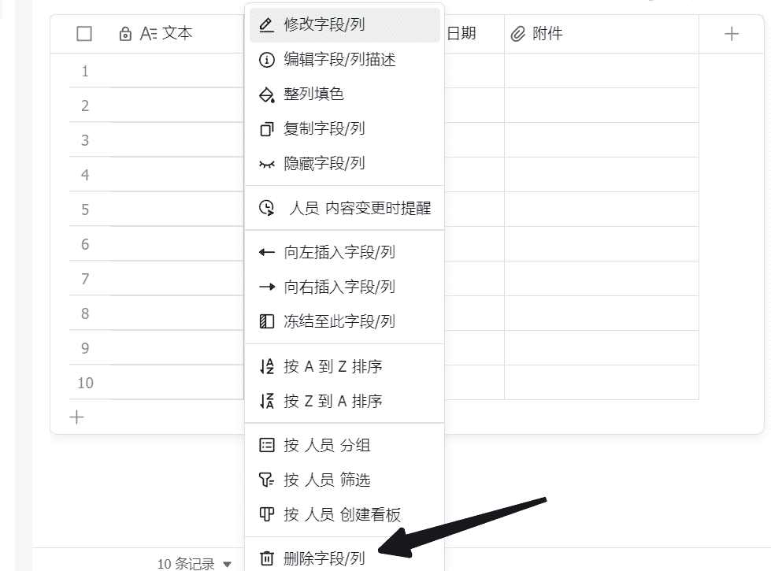

+   然后点击"➕"新增一列

+   我们可以先来看看有哪些AI能力，把鼠标悬停在"探索字段捷径"上，然后把鼠标放到右边"搜索"那里

+   我们在搜索框里面输入deepseek，就可以看到deepseek R1，具体如何使用，我会在后面说明

+   点击"字段捷径中心"可以看到所有内容，非常多，就不全截下来了

+   飞书多维表格其实可以是一个工作空间，还有很多其他功能，比如在左侧边栏，点击新建，可以导入excel，仪表盘，工作流等，这些也都接入了AI功能

+   再补充一个，默认的单元格可能有点窄，可以在箭头处调整行高。图中另一个箭头是点击加号可以生成多种视图（后文会提到）

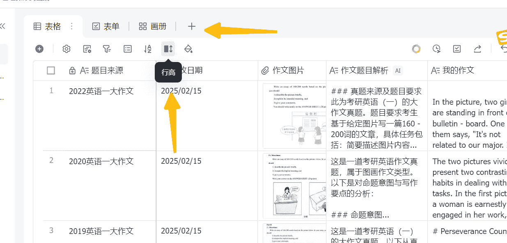

# 三.[概述]我的一些个人尝试

> 这一部分主要是对我做的案例做一些概述，聊聊这个飞书表格对我们的生活有哪些价值、大家读完本文后可以做哪些场景迁移。

> 详细的搭建步骤和思路以及搭建过程中的一些探索在本文的第四部分

## 1.【学习工具案例】考研英语作文批改+AI素材整理+学习计划制定

> 

> 最近和学弟聊到考研，想到可以用飞书多维表格做一些事情，比如考研作文批改工作流。

>

> 这个案例广义上来说就是封装好一个学习工具，可以迁移的场景有很多。

+   比如，作为家长可以帮孩子做一个收集错题的应用，上传照片，批改题目，选定错题后生成学习计划。

+   比如，在这个工作空间里面添加更多的表格和工作流，形成一个完整的AI辅助考研学习系统

+   针对不好理解的专业课知识点，设定一个生成通俗易懂解释+练习题的工作流

+   针对一篇阅读，辅助自己做精读等等

+   **输入：**在表单中上传作文图片，还有自己写的作文

+   **处理：**然后提前设定好的AI工作流就开始工作了

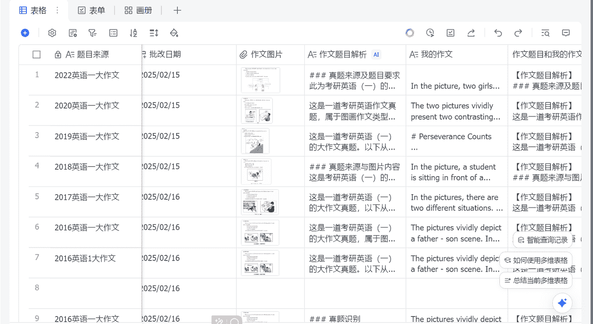

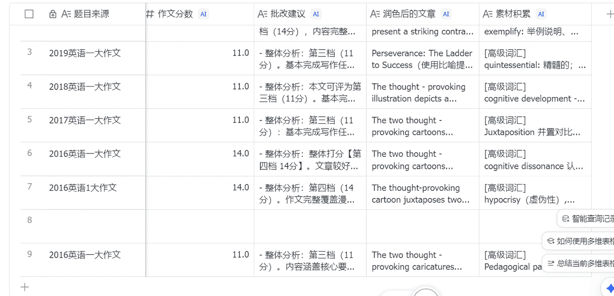

+   **输出：**接着，借助飞书的自动化工作流，会收到作文得分、写作建议、润色后的文章、可以积累的素材，也收到了自动创建的飞书任务

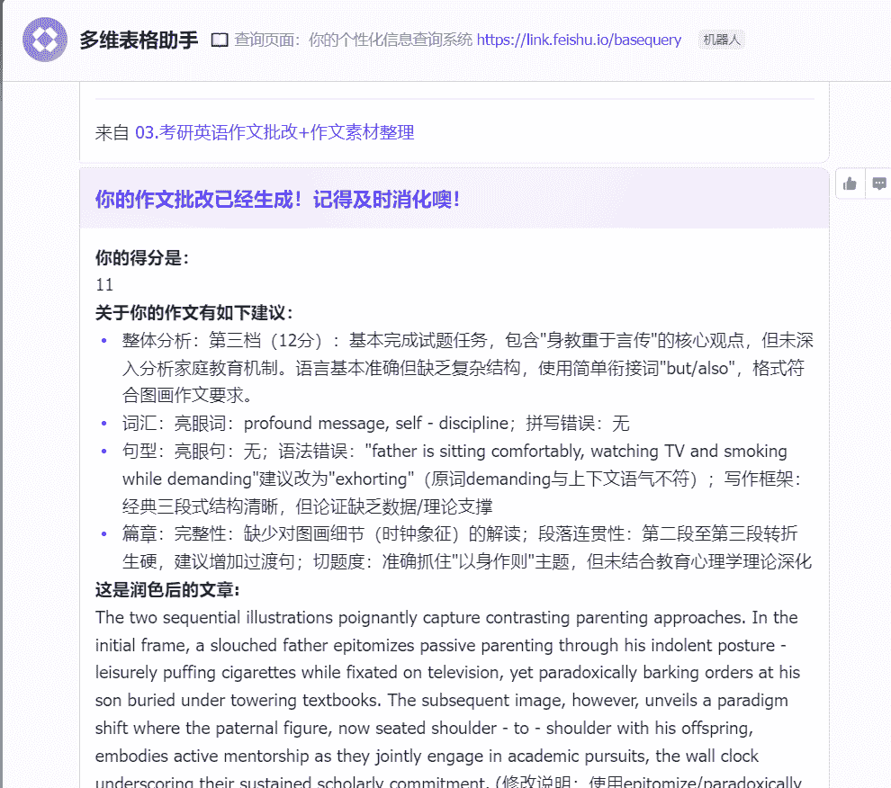

还可以点击发来的这个按钮，重新进入表单提交修改后的作文

下面是收到的学习任务

## 2.【自媒体生产力案例】流行语解读短视频脚本生成器（让老年人也能听懂流行语）

> “包的”是啥意思？包子？

> 过年在家，家里的一些小朋友们在聊天时夹杂着各种流行梗，家中一位老人想参与其中，却频繁地问“xx是什么意思”，然后感叹：“我现在都听不懂你们讲话了。” 老年人在理解年轻人的流行语时会有些吃力。他们有时挺想参与年轻人的对话，但有时候会不好意思提问，有时候我们可能也不擅长解释，而AI可以联网搜索，是跟得上潮流的，所以说不管是老年人想了解流行语，还是我们想给老年人解释一些我们的话语，都可以借助AI这个媒介。

> 那如果我们还想以此为契机，做一些面向老年人的抖音自媒体，科普流行语，文案也可以通过飞书多维表格工作流批量生成。

>

> 这个案例也很好扩展

+   比如，最近在电影院看完《哪吒2》散场时，我听见许多小朋友问：“电影里xxx为什么要xxx？”“电影里xxx说的xx是什么意思呀？”  对于孩子们的“十万个为什么"，家长们有时也难以用简单易懂的方式解释清楚。这也是可以借助AI工作流的场景

+   这个案例说白了是生成自媒体内容的案例，这个想象空间就非常大了..

+   **输入**：在表单中输入流行语。

+   **处理**：AI工作流自动解析流行语，生成通俗易懂的解释，然后生成对应的讲解流行语的短视频脚本

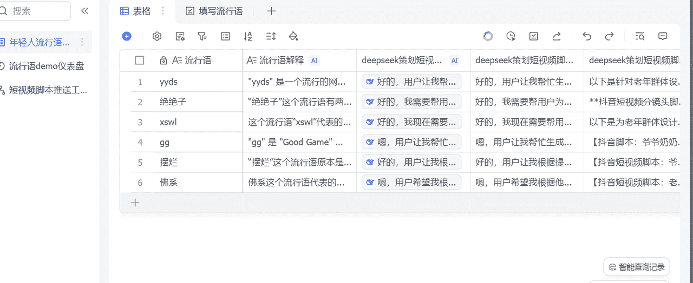

+   **输出**：返回抖音短视频脚本

## 3.【兴趣爱好赋能案例】街舞比赛海报信息提取与处理

> 下面这个案例主要是基于自己的兴趣，我是一名街舞爱好者，近期我在街舞社群和街舞老师们交流过AI的使用心得，然后想着可以继续探索一下如何利用DeepSeek + 飞书表格来进一步提高生产力，探索一些街舞相关的场景。

>

> 我平时会去搜索一些街舞比赛的信息，推送里面往往是炫酷的街舞比赛海报，海报蕴含了很多信息，但是海报不像文字信息一样直观，而且不同比赛的海报风格迥异，不方便去做赛事的整理和筛选，于是就做了如下尝试

+   案例也很好扩展，大家可以挖掘一下AI与自己的兴趣爱好结合的场景

+   **输入**：上传街舞比赛海报图片。

+   **处理**：AI工作流自动提取海报中的关键信息，如赛事名称、主办方、举办时间、地点、舞种类型等

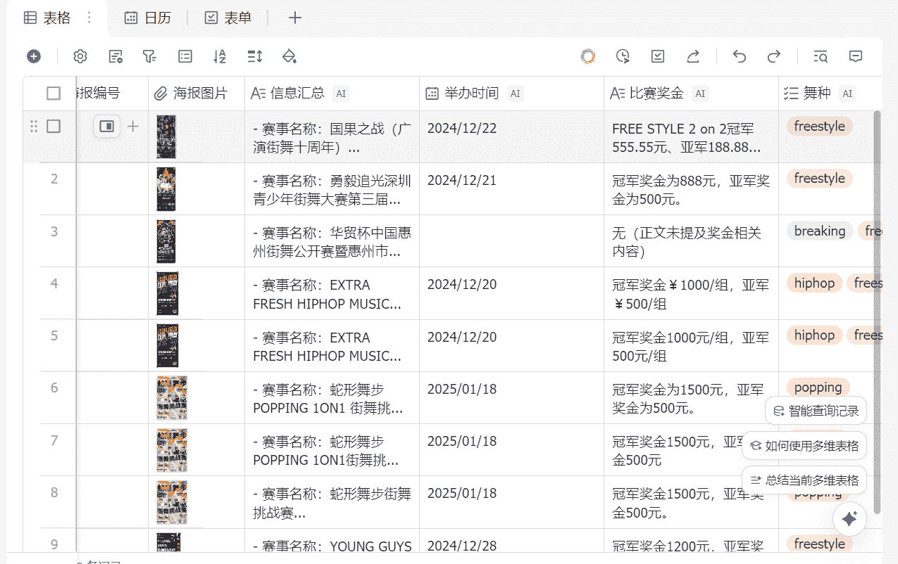

+   **输出**：生成结构化的信息汇总，并提供筛选和排序功能。

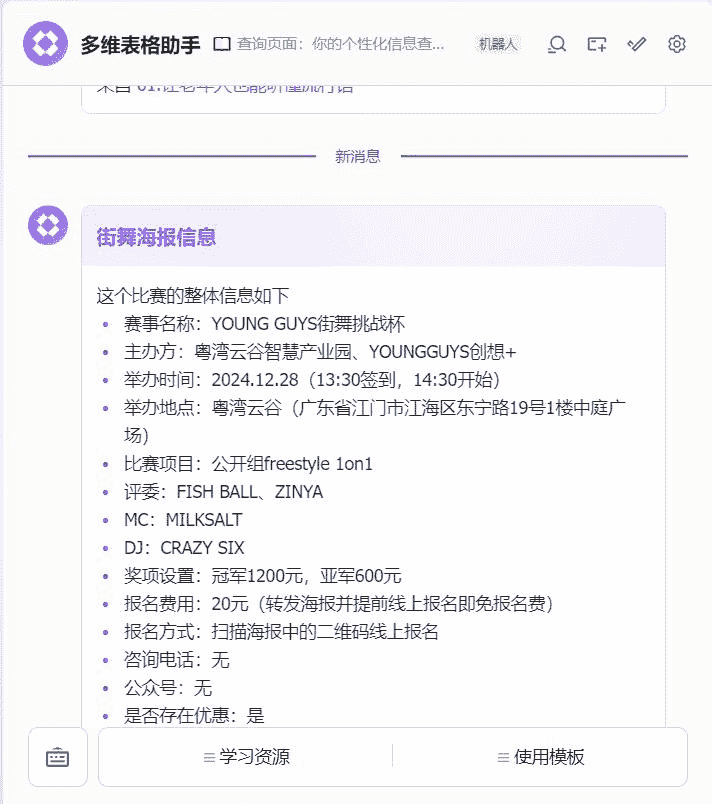

# 四.[详细搭建步骤]我的一些个人尝试

## 1.考研英语作文批改+作文素材整理+计划制定

> 本案例原先是截图+文字的形式，但是感觉这样有点乱，也不太直观，就录了些视频，也方便大家理解本文的其他截图。

+   这个视频是对处理逻辑进行讲解

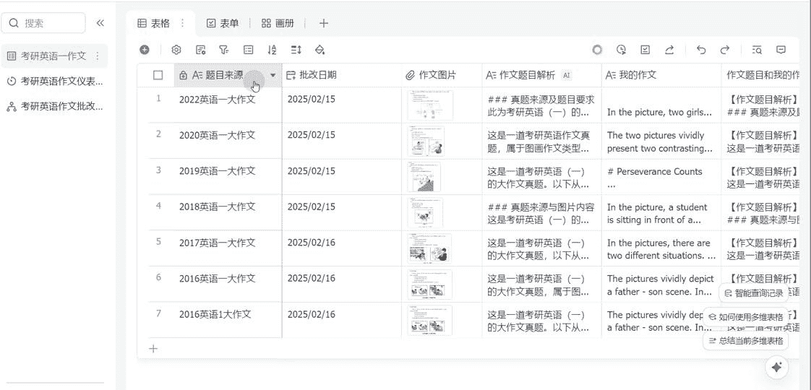

[20250216-210057.mp4](https://internal-api-drive-stream.feishu.cn/space/api/box/stream/download/all/TQ8Sb3NiooSSzcx8RXRcwxienae)

+   这个视频是演示上传之后的飞书多维表格里面的效果，看看一连串的AI是如何一起工作的！

[20250216-211131.mp4](https://internal-api-drive-stream.feishu.cn/space/api/box/stream/download/all/A2IGbRi4Ho9jQGxSH0UcMlk7nlg)

+   这个视频演示的是自动发送的消息和自动创建的学习计划

[20250216-211131.mp4](https://internal-api-drive-stream.feishu.cn/space/api/box/stream/download/all/OIXhbrv4XolglvxXBD6c5UBZnMg)

## 2.流行语解读短视频脚本生成器（让老年人也能听懂流行语）

+   哈哈，这里也用视频吧，这个视频是本案例的AI工作流

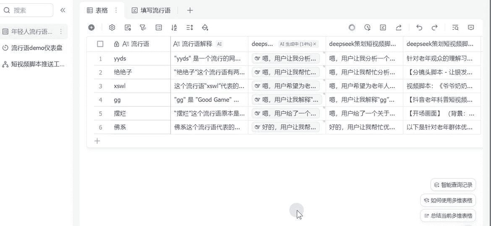

[20250216-215227.mp4](https://internal-api-drive-stream.feishu.cn/space/api/box/stream/download/all/GSG4be0aXoPoDgxbkqLcOMFTnKg)

+   这个视频是结合本案例对多维表格的仪表盘的一些功能的介绍

[20250216-215953.mp4](https://internal-api-drive-stream.feishu.cn/space/api/box/stream/download/all/A4wUb3mkHo0c1MxvzLiczFB4nwf)

## 3.街舞比赛海报信息提取与处理

> 这个案例用图文来介绍，因为这个案例其实是第一个写的，写了挺久的，不想把图文全删了😂

+   这里再介绍一下这个AI功能，可以输入需求初步搭建多维表格

我尝试输入“搭建街舞比赛海报识别系统，输入是海报图片，输出是提取出来的赛事名称、主办方、举办时间、举办地点、比赛项目、评委、MC、DJ、奖项设置、报名费用、报名方式、咨询电话、公众号以及是否存在优惠和优惠条件等信息。”我以为只是帮我把那几列生成了，结果还模拟了数据😂

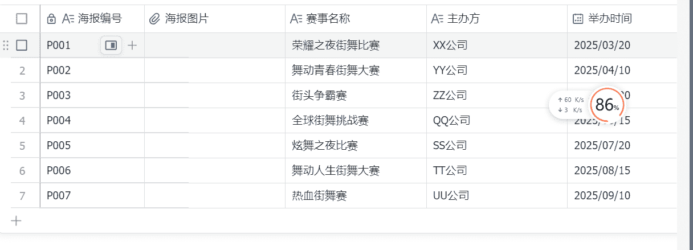

+   我先把生成的数据删掉，然后新建一列"信息汇总"

+   然后我把我写的提示词输入进去

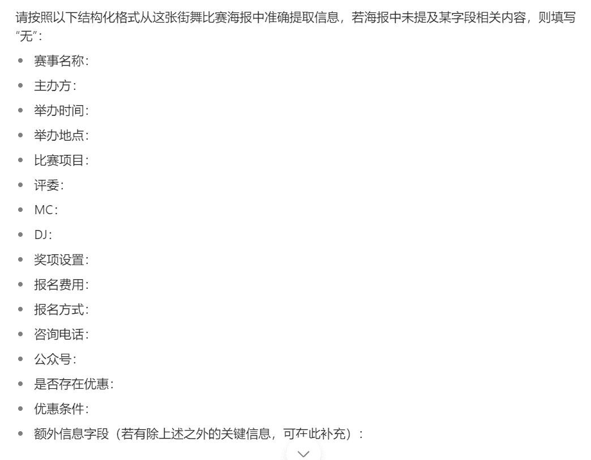

+   点击"确定"，再点击"生成",就开始批量生成“信息汇总”这一列的内容了

+   效果还可以，双击单元格可以查看提取的内容，比如第一张图的识别效果如下，整体不错，但是DJ没识别出来，有几位评委(裁判)所在的舞团也没识别出来，这里先忽略这些不足，继续往下探索。

> 这些不足可以通过单元格二次编辑来人工修正

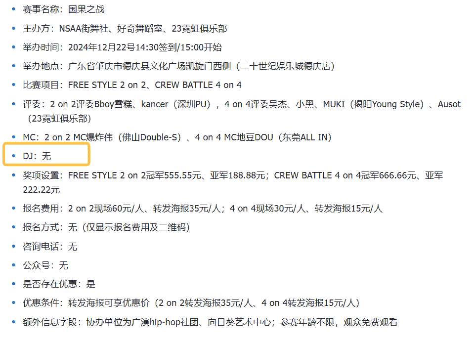

+   此时已经有了"信息汇总"这一列的结构化信息，假如我搜集了一堆街舞赛事海报，我想先看看这些比赛都是在什么时候举行，但是仅有"信息汇总"这一列我没法对一整列进行筛选等操作。所以要从中提取出日期。这里采用强大的"自定义AI自动填充"，从"信息汇总"那一列提取出时间

> "自定义AI自动填充"的好处是输出格式可以是日期，数字（比如前面那个考研英语作文批改案例，就是利用此字段输出数字）等，而其他的AI字段捷径很多只能输出文本

+   接着是比赛奖金字段，我用的是"信息提取"

+   然后是舞种，我用的是智能标签

+   前面第三部分展示的查询表是如何创建的呢？点击加号，再点击下面的“查询页面”

然后就可以自己设定查询条件，创建查询表啦

+   还可以设定仪表盘，做一些可视化的图表

+   可以做的事情还有很多，是可以不断完善的~

+   比如利用AI的联网搜索功能来评估一下比赛所请的裁判，MC, DJ的知名度，以评判一下比赛的影响力等

+   又比如，针对参加的比赛，我写了一些复盘，可以在表格里让AI辅助我复盘，然后给我生成练舞计划等

# 五.推荐一个开源的论文阅读神器模板

这个模版是我前几天刚开始学习使用飞书多维表格的AI工作流的时候了解到的，感觉十分惊艳，在此推荐一下。

+   这是一位香港教育大学的博士生搭建的模版，行文至此时，打开小红书，刚好刷到了这位博士的小红书账号，昵称是Cynthia的学术世界，主页有视频，可以去看看原视频，可以学习一下这个工作流的搭建思路，并迁移到自己的应用里面去。

+   只要在飞书多维表格新增一行，然后上传一篇论文的pdf，两分钟即可实现结构化的文献速读，每上传一篇，就得到准确率很高的结构化论文解读

+   飞书表格可以支持很多很多行，那么上传了多篇之后，就成了一个结构清晰的论文知识库

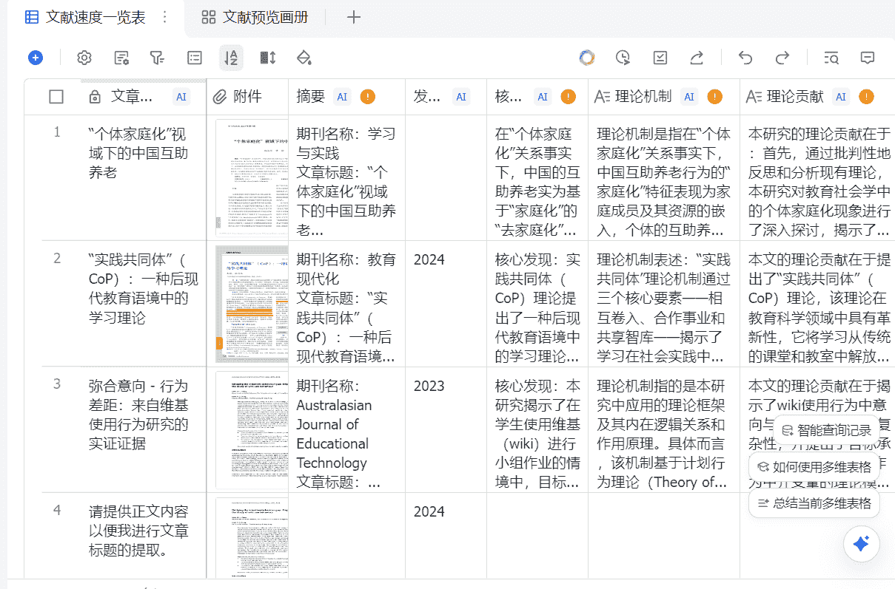

## 1. 唯一需要人工操作的步骤：上传PDF文献

+   **操作**：将需要阅读的文献以PDF格式上传**到飞书多维表格中。这是整个**流程的第一步，也是唯一需要人工操作的步骤

## 2. **AI工作流启动**

+   先用kimi从“附件”这一列的pdf中提取摘要

+   然后用信息提取的AI功能，从"摘要''这一列提取出发表时间，可以自己写提示词，自定义提取要求

+   然后用Kimi阅读助手字段捷径，从PDF中提取理论机制、理论贡献、研究设计、核心发现等信息

+   还有利用总结这个字段捷径得到论文的总结

+   还可以通过DeepSeek R1对论文的总结进行进一步提取，生成200字以内的精炼版本，然后继续对200字输出结果再进行处理

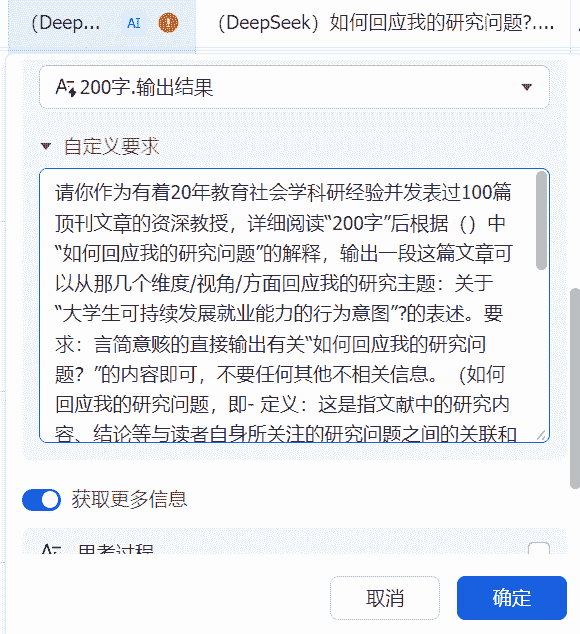

+   还能用AI搜索相关文献

+   [AI文献速读神器](https://jih7kdah80b.feishu.cn/wiki/BpSIwQSyritC1eko1OKcIvDknKb?table=ldxZQLyLDMCGvpWE)格里还有很多字段，不一一介绍了，大家可以去看看那个开源模板：

# 六.结语

DeepSeek的爆火让越来越多的人开始了解AI，尝试AI，但也带来了更多的恐慌。与其恐慌，不如去学习如何真正将AI工具融入日常生活和工作中可以发挥更大的价值。

像飞书多维表格这样的越来越强大的工具正在不断降低使用门槛，本文提到的功能也只是冰山一角。没有编程基础的朋友们也完全可以大胆尝试，去探索一些强大的工作流，从一些简单的尝试做起，让效率最大化，让自己从中受益。