# 如何让本地部署的Deepseek-R1支持联网搜索？

> 来源：[https://datawhaler.feishu.cn/docx/W9mxdoYA6oUaCgxp7LVcbi2Mnyc](https://datawhaler.feishu.cn/docx/W9mxdoYA6oUaCgxp7LVcbi2Mnyc)

**一**种可以通过外部可以访问的带联网搜索的deepseek-r1（ollama部署的api）的实现方法-Datawhale展示用

作者：小槐花  vx：mumiangege521（转载、交流分享、答疑等事宜可以加🛰️，加时请备注来意和称呼谢谢~）

友情链接：https://datawhale.club/

# 一.ollama安装和部署：

官网：[Ollama](https://ollama.com/)

### 点击下载-选择自己系统对应版本

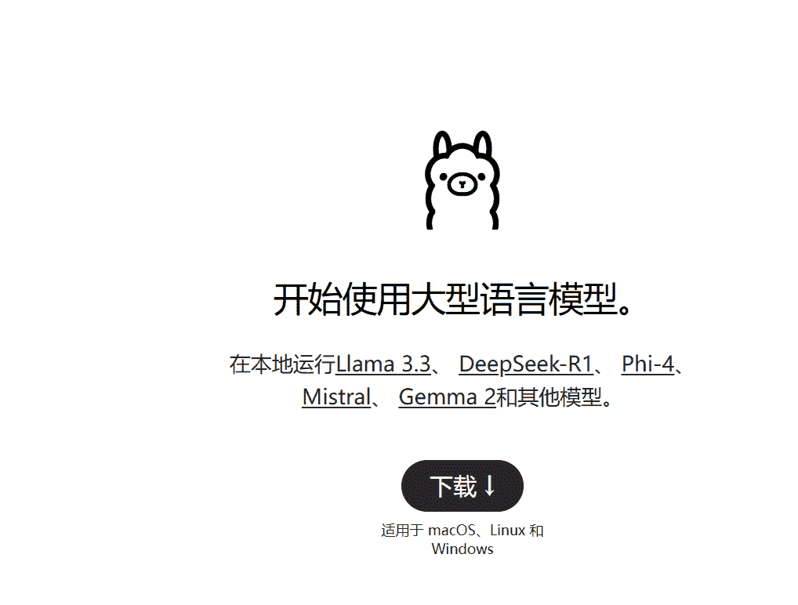

### 浏览器中下载完成后，打开文件里所在位置，点击

建议第一次就直接默认一路安装过去（因为虽然c盘可能后续会影响，但是其实可以跑通了第一次后，再弄换位置，当然如果有一定经验，可以参考教程进行变更硬盘）

## 2.运行和模型下载

安装运行后，Windows版本可以看到有ollama小图标亮起

### 接下来同时按住win+r ，在弹出的提示框输入cmd进入命令行界面

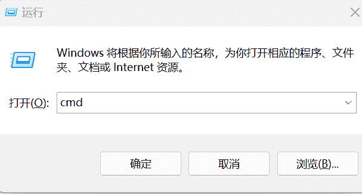

在命令

### 在命令行界面输入ollama（注意不要少打字母，之前我打了好几次ollma，如果再记不住可以结合欧拉玛（la需要a）可以看到会显示一些东西

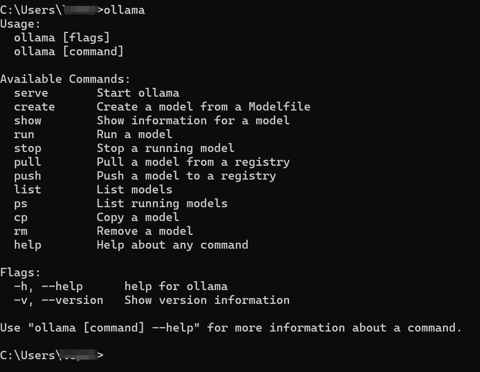

###

命令行输入：ollama pull deepseek-r1:1.5b

### 会看到有个进度条（如果wifi下载慢，可以试着考虑链接下手机热点，如果5g流量比较充足，我第一次用wifi下载这个模型花了一个小时多还没有下完，第二次想到用热点几分钟搞定）

### 然后下载完成后，输入ollama run deepseek-r1:1.5b

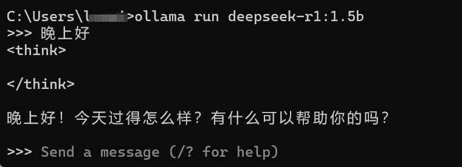

可以看到可以互动，以及对话了

到此就是基本部署成功了

### 如果之后：想要用本地的客户端或者之后有远程访问需求

可以在环境变量里增加对应路径：

windows（win11为例）设置-系统信息-高级系统设置-环境变量-系统变量

ollama_host  0.0.0.0是为了其他电脑比如局域网也可以访问使用（电脑开着，就可以用手机之类的使用你的电脑上的ollama服务）

如果想要实现局域网，有些时候还得设置防火墙的一些对应入站规则，这个有需要可以评论回答

ollama_origins *   是为了本地一些其它客户端也可以访问

如果windows遇到一些客户端软件，比如chatbox和cherrystudio 下载后无法打开，记得检查一下是否防火墙问题，网上可以搜对应版本防火墙关闭，第一次正常启动后，再开启即可（当然不同电脑可能操作不同）

# 二.使用Dify＋cpolar+New API让你可以远程访问你的电脑上的ollama部署的deepseek-r1 1.5b，并带联网搜索功能和支持在一些软件上直接用调用api（openai兼容格式)

实现效果：在运行着ollama的电脑正常使用下（相当于某种意义上的服务器），可以用手机使用移动热点远程进行聊天（比如chatbox移动端）

### 如图所示：

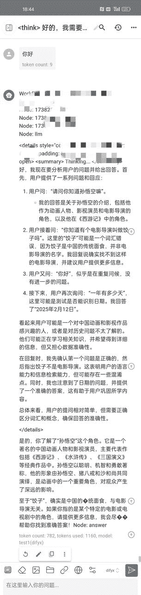

### 具体操作步骤

1.首先基于task01我们可以得到本地部署的ollama并且进行环境变量的配置

2.根据chatbox的远程部署文档，我们可以实现，局域网内进行不同设备也能访问我的电脑上的ollama的服务

3.需要安装**docker（**记得更新至比较新的版本）

#### 安装dify并配置chatflow（github链接：https://github.com/langgenius/dify）

配置要求：

在安装 Dify 之前，请确保您的机器满足以下最低系统要求：

+   CPU >= 2 核

+   内存 >= 4 GiB

如果git clone不了的，可以直接在code那里点一下，下载zip压缩包然后解压缩至指定文件夹，可以搞一个此次的项目文件夹

然后在dify（直接解压缩应该是dify-main，可以先手动重命名一下）的文件夹里-docker文件夹里点击鼠标右键--选择在终端里运行

然后继续按照GitHub里的命令行操作：

cp .env.example .env

docker compose up -d

安装好后，点击对应的http://localhost/install

然后登陆好之后进入后台

##### 先点击右上方头像-设置，然后点击模型供应商--选择ollama-选择对应的模型，比如deepseek-r1：1.5b

（第一次配置好可能会有感叹号，再次点击重选一下即可）

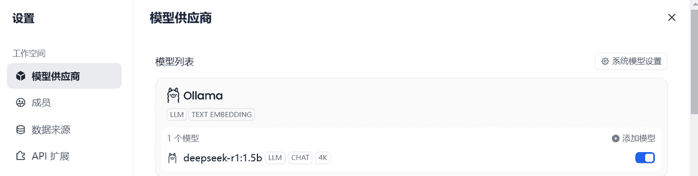

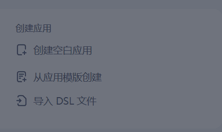

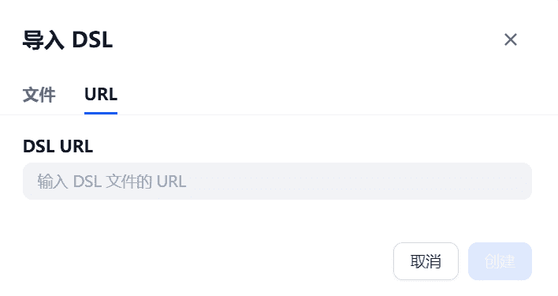

如果想要直接导入的：如果想要直接使用该应用，可以点击以下链接下载 DSL 文件并导入至 Dify 平台内。应用 DSL 文件下载地址：https://assets-docs.dify.ai/2025/02/41a3564694dd3f2803ad06a29f5b3fef.yml

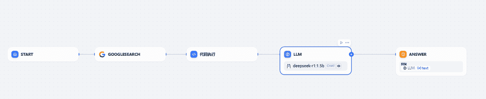

就会得到一个带有联网搜索+大模型的chatflow

还需要4步：①谷歌搜索需要注册，会有一定的免费调用次数

②llm的模型选择我们自己的（dsl链接来自dify文章示例）

③点击发布

④点击访问api--右上角API密钥（这里的api服务是dify的）---创建密钥（复制保存好，一会用到）

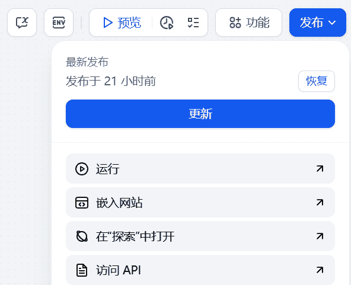

#### 部署new api（GitHub链接：https://github.com/Calcium-Ion/new-api）

进入项目-下载代码zip压缩包--解压缩--进入文件后右键在终端运行（和dify安装类似）

启动：docker-compose up -d

启动后：在浏览器输入ip：端口号（3000），打开后台登陆页面（默认管理员账号root 密码123456）

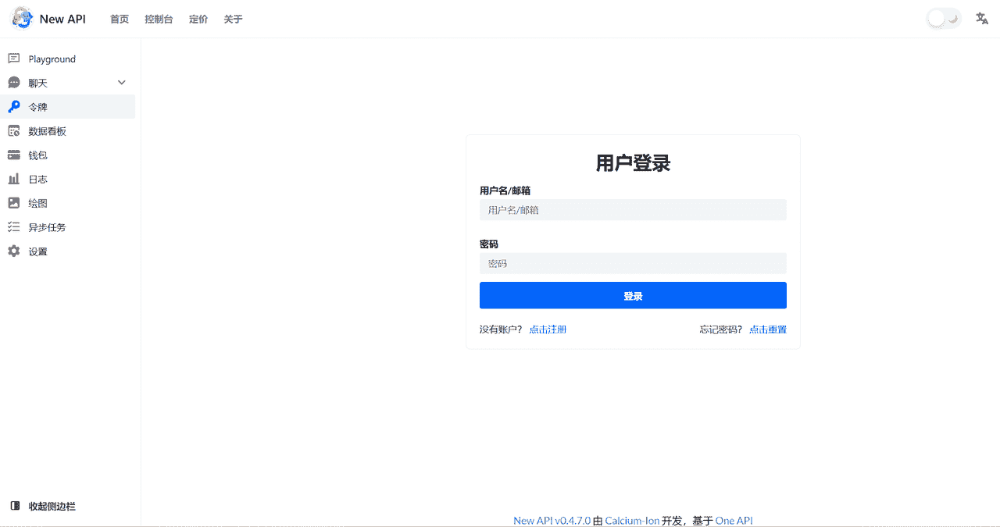

输入管理员账号和密码后登录

点击渠道--添加渠道

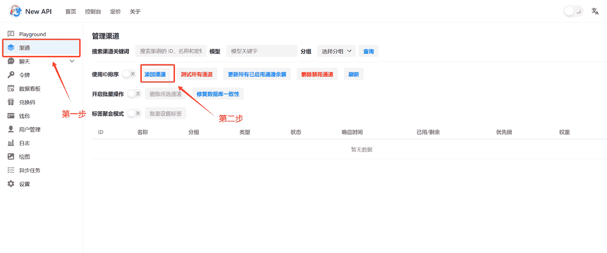

然后第一个类型选择Dify，渠道名称取决于你，比如可以是test，然后代理（就是可以当成api 地址，不要直接填dify的api'地址（带v1那个）而是要用ip：80（dify的端口号）--（扩展：如果你dify用cpolar做了穿透就是直接填cpolar的公网域名）

密钥填入刚才在dify的生成的api密钥（需要注意dify的密钥不是通用的，而是每一个chatflow都有自己的，不要搞混）

然后分组不要动，就默认的default即可，然后模型选择填入模型（自己起一个好记的名字）到后面你配置一些客户端，选择的模型名就是这里，比如我起的xinnianhao（新年好）

点击提交-会看到渠道创建成功的提示

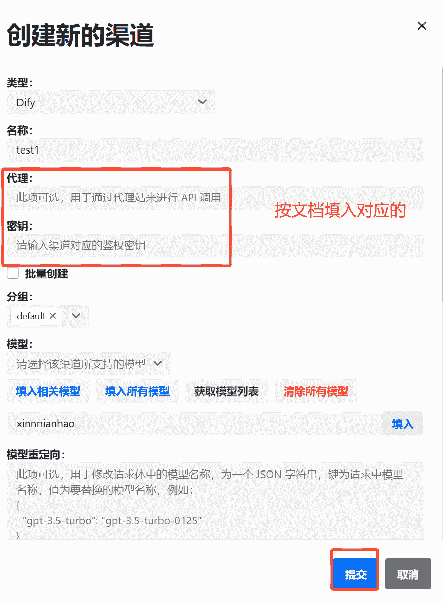

这个时候可以看到是未测试-然后我们点击测试--等待一会儿（这种方法操作的层数较多，响应时间会比较久）

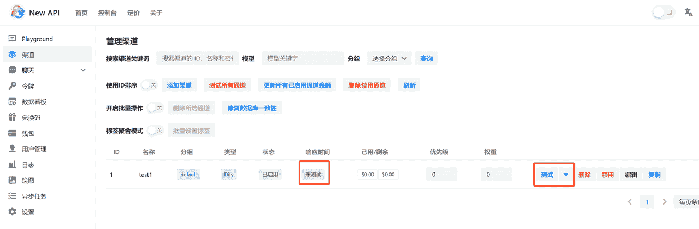

测试成功后会显示响应时间（如果第一次测试失败，可以检查一下或者重试一下，api有时候会访问失败，多试两次即可

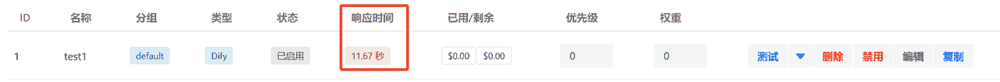

然后我们就把dify的api接入**了我**们的管理站里面，接下来就是配置我们的令牌（apikey）啦（以openai兼容格式进行调用）

点击令牌--点击添加

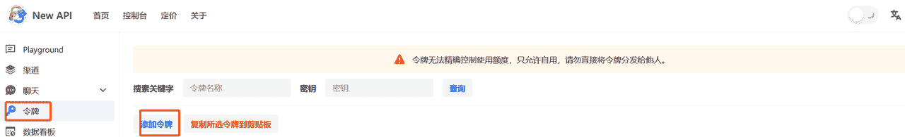

名称可以自己起，令牌有效期可以根据具体需要设置，我一般选择一个月,然后额度是指我们池子允许这个令牌使用的额度（随便填，在ollama模式下，你的电脑跑着就会有不停的额度，可以选个10元的额度（五百万tokens），当然如果你是付费购买的api，还是以你买的额度，这里相当于你买回来后二次中转分发

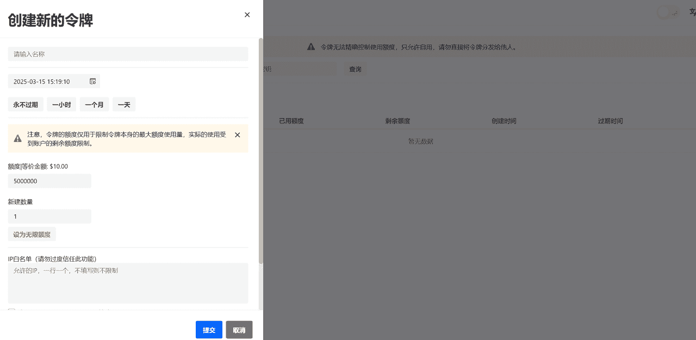

然后点击复制就可以拿到中转后于openai格式兼容的api 密钥了

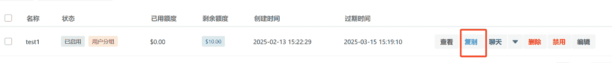

然后这里就可以在本机配置到cherry studio或者chatbox了（还有一些其他兼容的）

#### 部署cpolar配置内网穿透（实现用手机开着热点可以配置相关api）

用new api中转完成后，可以在同一台电脑使用或者配置好防火墙后局域网内服务，如果想要其他设备不同wifi也能使用，则需要内网穿透，这里可以用到cpolar

官网下载地址：https://www.cpolar.com/download

下载对应版本客户端（注意windows版本直接选择win版，不要选择docker安装）

下载安装好后打开点击图标

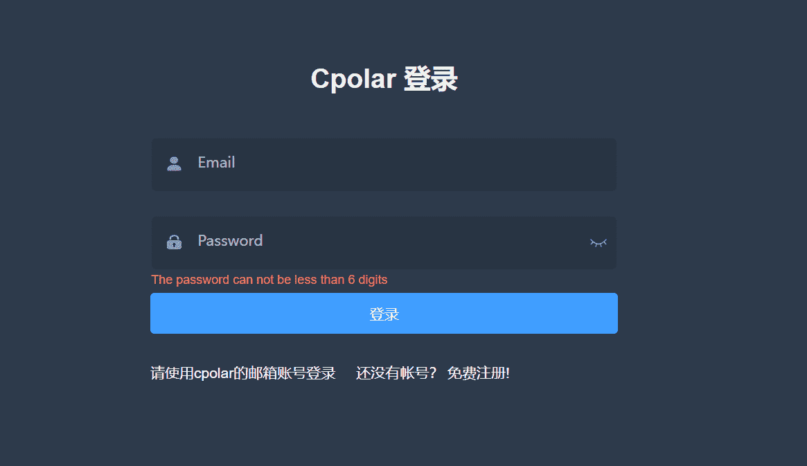

注册之后登录--隧道管理--创建隧道

名称自己起一个，协议的话根据实际填，这里的是hhtp，然后我们要为new api的配置所以填它的端口号

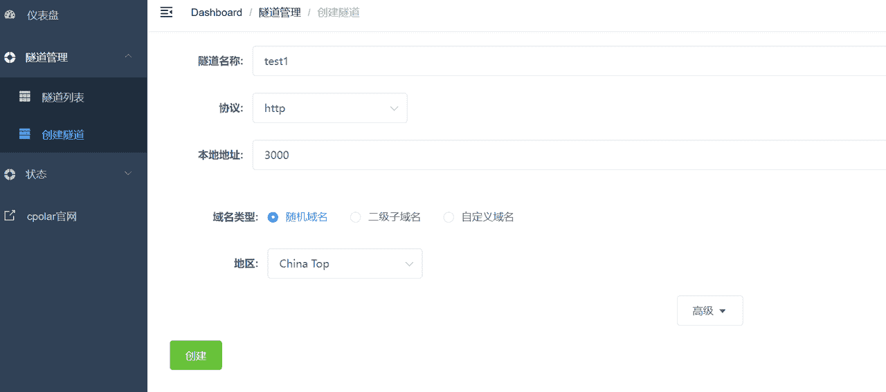

点击--创建

然后点击状态--点击在线列表状态（可以看到我们刚才创建的隧道，有了两个公网，一个是http的一个是https）选其中一个即可

然后域名等同于ip加了端口号（看对应本地地址），所以之后在一些客户端配置不要再额外重新填端口（不然就重复了）

到这里我们就可以在其他地方配置使用了

感谢您的阅读~

# 参考文章和视频（顺序是以实现步骤考虑的，就是可以当作在task1上的扩展）：

对各位作者和软件开发者表示感谢！

手把手带你用DeepSeek-R1和Ollama搭建本地应用，一文搞定！

文章链接：https://mp.weixin.qq.com/s/VpNqMpZ1K9fAAOyr3dmWmw

如何将 Chatbox 连接到远程 Ollama 服务：逐步指南

文章链接：https://chatboxai.app/zh/help-center/connect-chatbox-remote-ollama-service-guide

【大语言模型】本地快速部署Ollama运行大语言模型详细流程

文章链接：https://blog.csdn.net/qyj19920704/article/details/139749783?ops_request_misc=%257B%2522request%255Fid%2522%253A%2522334a766fe3b0c0c460d9eed3a534fb48%2522%252C%2522scm%2522%253A%252220140713.130102334..%2522%257D&request_id=334a766fe3b0c0c460d9eed3a534fb48&biz_id=0&utm_medium=distribute.pc_search_result.none-task-blog-2~all~top_positive~default-1-139749783-null-null.142

参考视频：本地部署Deekseek R1和Dify共同打造联网搜索引擎工作流实战

视频链接：【本地部署Deekseek R1和Dify共同打造联网搜索引擎工作流实战-哔哩哔哩】 https://b23.tv/qvOMndt

Dify x DeepSeek：轻松部署私有化 AI 助手，搭建本地 DeepSeek R1+ 联网搜索 App

文章链接：https://mp.weixin.qq.com/s/gIb4xW0T2sYlnCfc6oyeQw

Dify+Ollama+llava大模型本地搭建个人AI知识库并实现远程访问

视频链接：【Dify+Ollama+llava大模型本地搭建个人AI知识库并实现远程访问-哔哩哔哩】 https://b23.tv/jfxXun9

有了 NewAPI 之后，Dify 的可玩儿性又高了

文章链接：https://mp.weixin.qq.com/s/Q9dVgGE5PzyXc82DiOkNGQ

通过 NewAPI 接入 Dify 后能支持什么？

文章链接：https://mp.weixin.qq.com/s/5xNuGxTZy75kN1amyWJn-Q

# 声明：以上文章只是参考，不代表推荐去付费或者其它之类的，仅供参考交流用，以及自己用还好，不要贸然提供大模型api服务给其他人，请遵守当地相应法律法规！