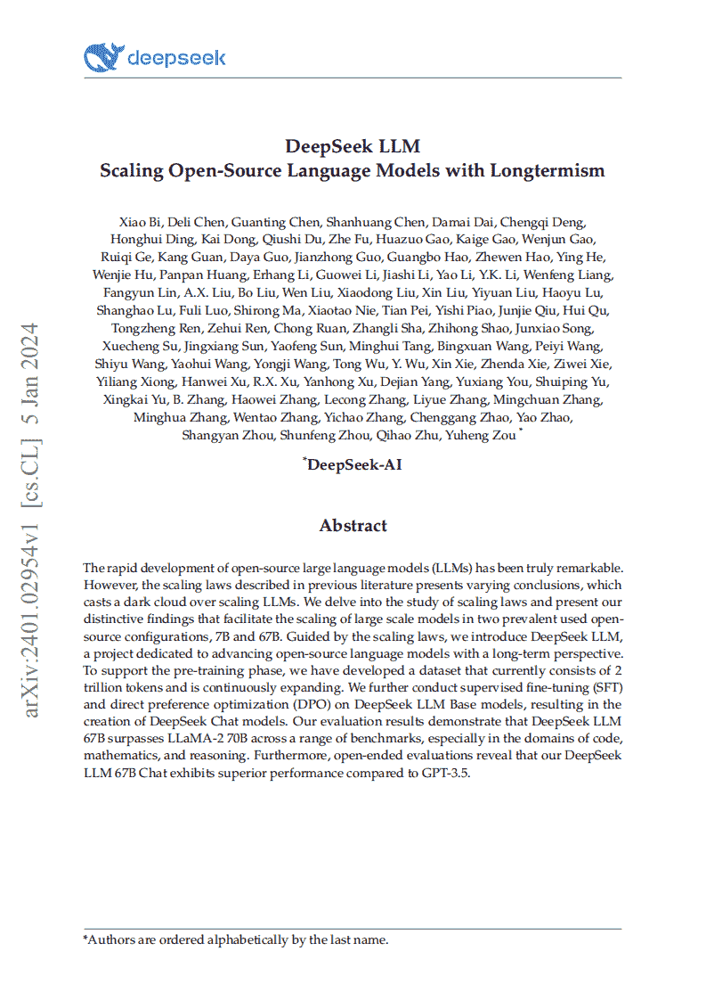
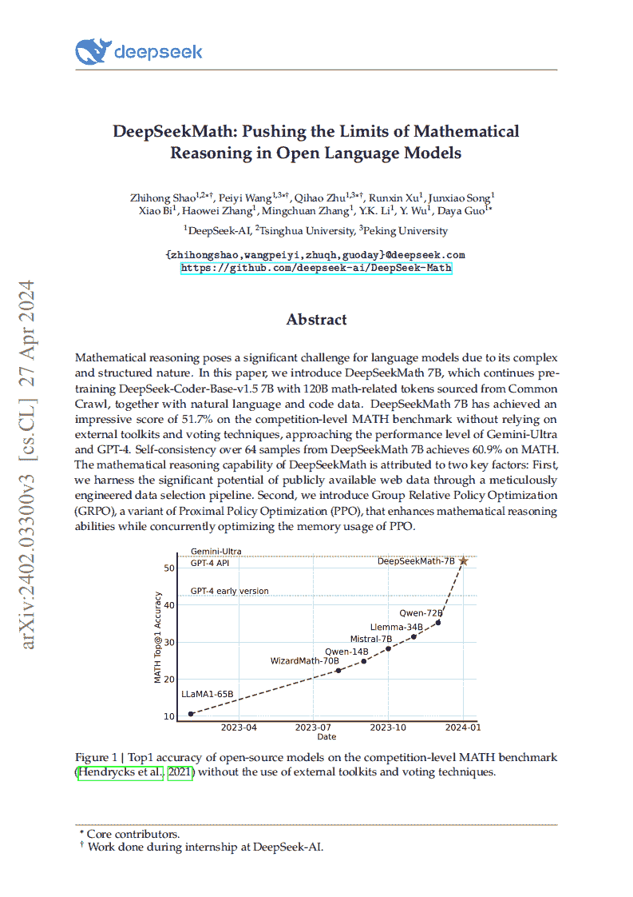
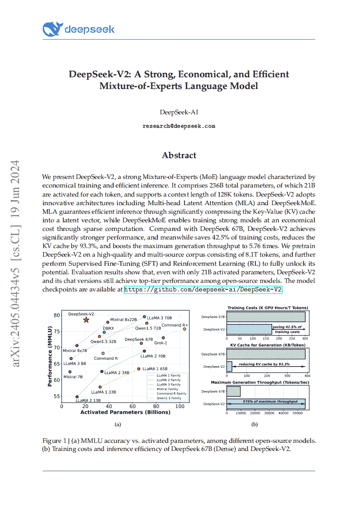
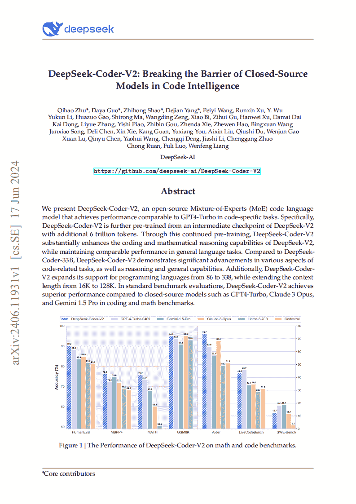
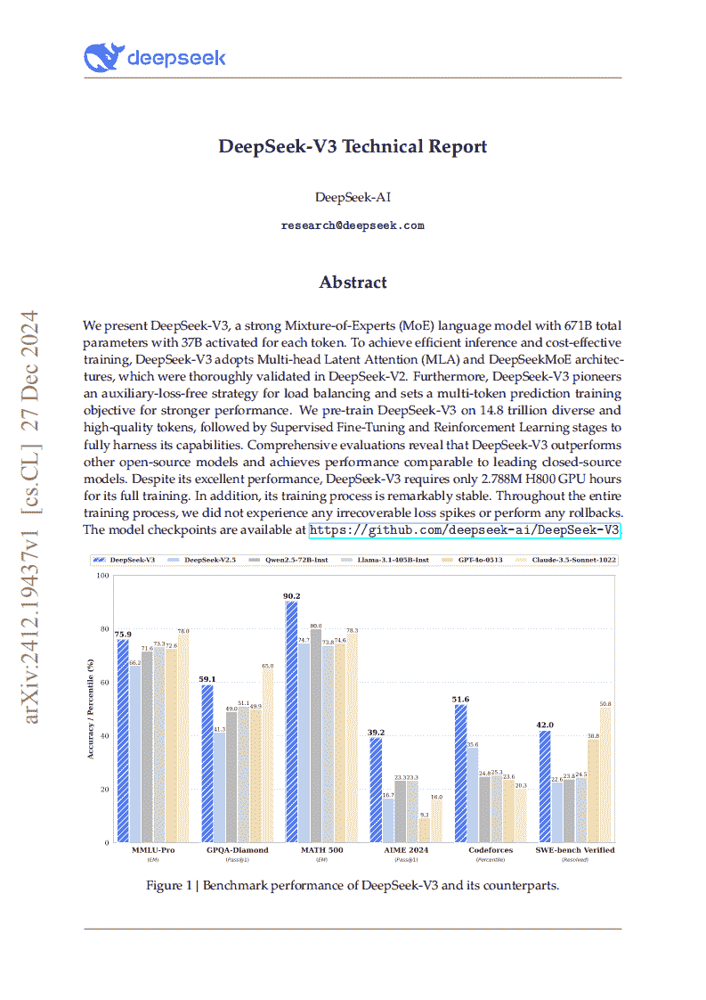
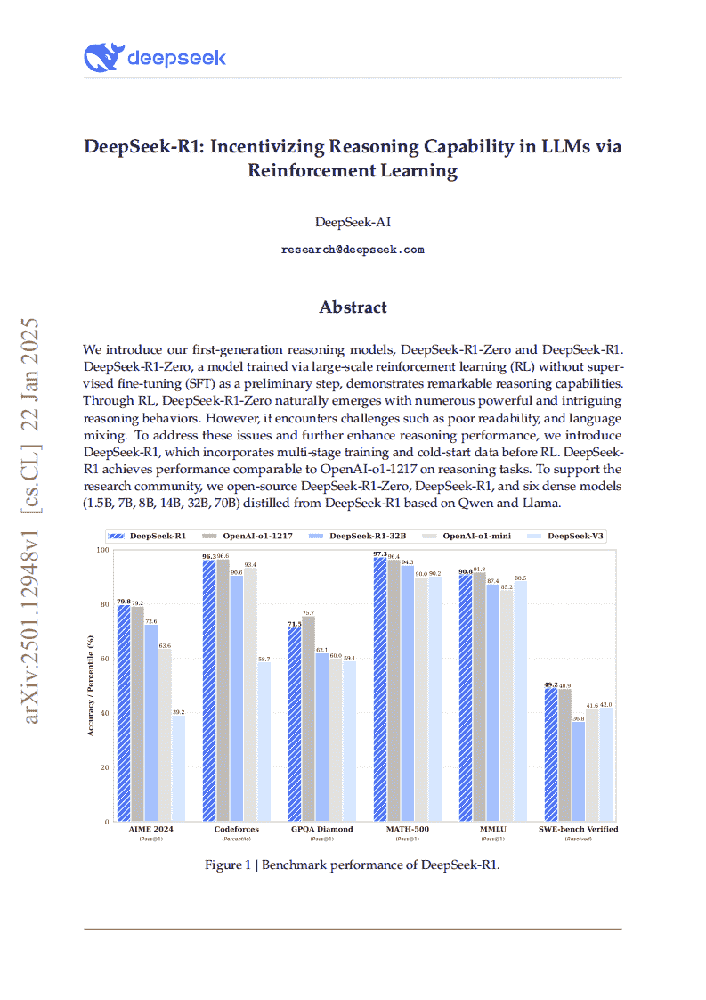
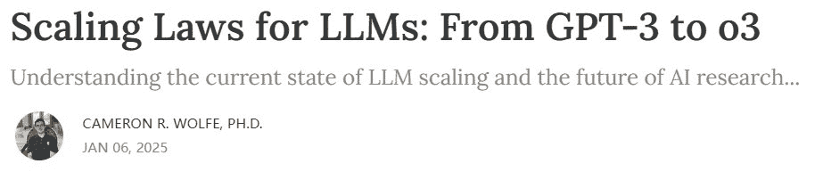

# 参考资料

> 来源：[https://datawhaler.feishu.cn/docx/JbmzdIvUmoCZlrxple3cEVYRnLd](https://datawhaler.feishu.cn/docx/JbmzdIvUmoCZlrxple3cEVYRnLd)

## 官方论文

| **论文名称**：**D**eepSeek LLM: Scaling Open-Source Language Models with Longtermism |  |
| --- | --- |
| **信息简介** | **论文摘要** |
| +   **发布时间**：2024年1月 | 开源大语言模型的快速发展令人瞩目。然而，先前文献中描述的 规模扩展（scaling）呈现出不同的结论。 |
| **论文名称**：**DeepSeekMath: Pushing the Limits of Mathem**atical Reasoning in Open Language Models |  |
| **信息简介** | **论文摘要** |
| +   **发布时间**：2024年2月 | 数学推理因为其复杂性和结构化性，对语言模型构成了重大挑战。 |
| **论文名称**：**DeepSeek-V2: A Strong, Economical, and Eff**icient Mixture-of-Experts Language Model |  |
| **信息简介** | **论文摘要** |
| +   **发布时间**：2024年5月 |  |
| **论文名称**：**DeepSeek-Coder-V2: Breaking the Barrier of C**losed-Source Models in Code Intelligence |  |
| **信息简介** | **论文摘要** |
| +   **发布时间**：2024年6月 |  |
| **论文名称**：DeepSeek-V3 Technical Report |  |
| **信息简介** | **论文摘要** |
| +   **发布时间**：2024年12月 |  |
| **论文名称**：**DeepSeek-R1: Incentivizing Reasoning Capab**ility in LLMs via Reinforcement Learning |  |
| **信息简介** | **论文摘要** |
| +   **发布时间**：2025年1月 |  |

[[24.01]DeepSeek LLM.pdf](https://internal-api-drive-stream.feishu.cn/space/api/box/stream/download/all/YK9gbrrkTo2jz3xnT6Tcdk4Dnjh)

[[24.02]DeepSeekMath- Pushing the Limits of Mathematical  Reasoning in Open Language Models.pdf](https://internal-api-drive-stream.feishu.cn/space/api/box/stream/download/all/SU2Ib8yFloWqyzxLgCncxDGonNh)

[[24.05]DeepSeek-V2.pdf](https://internal-api-drive-stream.feishu.cn/space/api/box/stream/download/all/WpOibEviMot7fQxUfUCcpI9Xn7c)

[[24.06]DeepSeek-Coder-V2.pdf](https://internal-api-drive-stream.feishu.cn/space/api/box/stream/download/all/Q5MEbqk38ojTowxAVxRcJ5Kxnpc)

[[24.12]DeepSeek-V3 Technical Report.pdf](https://internal-api-drive-stream.feishu.cn/space/api/box/stream/download/all/Vqh1baO8qooWLdxEtJHcCcUEnod)

[[25.01]DeepSeek-R1.pdf](https://internal-api-drive-stream.feishu.cn/space/api/box/stream/download/all/CommbY3zVo78tZxtraKcWo4Un61)

# 参考资料

1.  原文链接：https://cameronrwolfe.substack.com/p/llm-scaling-laws

1.