# 1.1 人工智能的基本概念和发展历史_世拓

> 来源：[https://datawhaler.feishu.cn/docx/One3dnE5botOL4x66VPcnwvVnTd](https://datawhaler.feishu.cn/docx/One3dnE5botOL4x66VPcnwvVnTd)

| 版本信息 | **内容版本号** | V1.0 |  |
| --- | --- | --- | --- |
|  | **最近更新时间** | 2024.11.24 |  |
|  | **历史更新** | 2024.11.24：V1.0内容发布 |  |
|  | **内容信息** | +   **所属版本**：**AI通识课-零基础版 ** |  |
| 贡献详情 | **最近贡献** | 马世拓、胡锐锋 |  |
|  | **内容贡献** | 马世拓 |  |
|  | **内测反馈** | 胡锐锋 | 1.  语句问题：长句要缩减为短句 |
|  | 更多贡献详情见：[致谢AI通识课贡献者们](https://datawhaler.feishu.cn/wiki/HnMiwEzpdiLvWRkfbvFcaJFLnSg) |  |  |

# 1.1.1 人工智能的基本概念与发展历史

尊敬的读者们，你们好！本章节旨在引导各位正式走进人工智能的大门。在本课程的开篇，我们将共同探索人工智能的奥秘。这是我们与各位首次会面，我们的目标是尽可能生动地阐述一个核心议题——人工智能的本质是什么？它的起源何在？它的未来又将通向何方？

通过本章节的讲解，我们期望各位能够更深刻地理解我们为何致力于将人工智能的知识和理念普及给每一个人。

## 人工智能是什么？

大家可能已经对人工智能有所了解。实际上，人工智能技术已经渗透到我们日常生活的方方面面。例如，在上班或上学的途中，我们通过人脸识别技术快速通过闸机，这是人工智能的应用之一；在通勤时，您可能会选择乘坐无人驾驶的出租车服务，如“萝卜快跑”，您可能会惊讶于没有司机的情况下，车辆如何能够准确地将您送达目的地，这同样得益于人工智能技术；回到家中，当您想要观看电视时，只需呼唤“小度小度”，智能语音助手便能响应您的需求，这也是人工智能的体现。我们生活在一个人工智能技术高度普及的城市环境中，这些技术不仅提高了我们的生活效率，也为我们带来了便利。

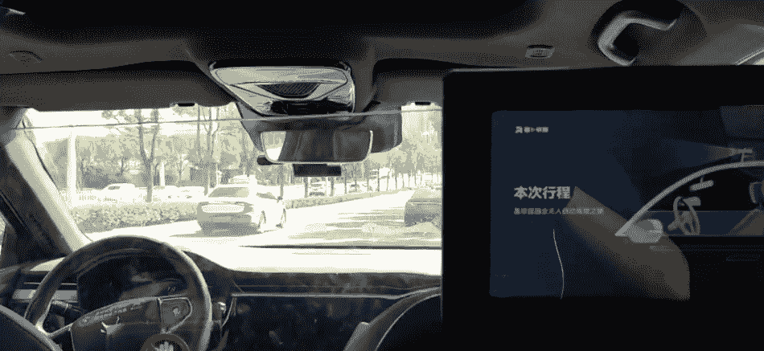

武汉，萝卜快跑

从农耕文明到工业革命，再到今天的信息化社会，新技术的出现总是伴随着生产力的提高。而每一次新技术的诞生，其目的总是为了将人类从重复、繁琐、枯燥、费力的劳动中解放出来。由于人力纺纱不仅辛苦还效率低，于是出现了纺织机；马车在费马的同时速度还不够快，于是出现了蒸汽火车……一系列的发明创造使得我们的双手被解放出来，用更高效的方式参与到劳动中。如今我们中的很多人，已经不需要付出那么辛苦的体力劳动了。这时，我们就开始想：其实很多脑力劳动也很枯燥重复，能不能有一种工具帮我们做一些脑力劳动呢？

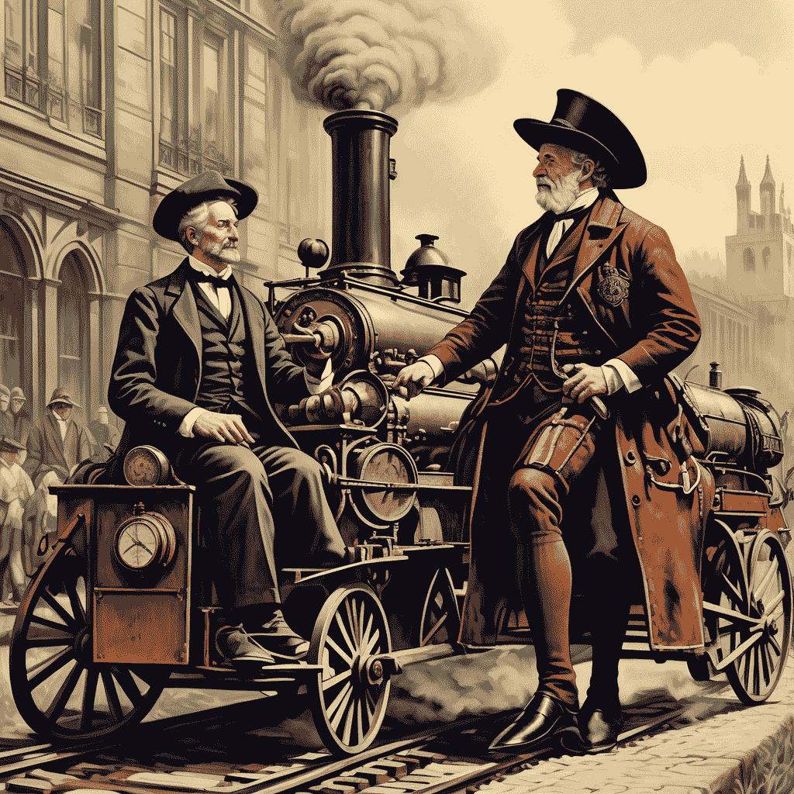

于是，各种各样的人工智能产品开始涌入市场，帮助大家做PPT、写文档、写代码、翻译……

就像今天其他很多新兴学科一样，我们还很难给“人工智能”下一个权威的、统一的定义。但我们都知道，既然有人工的智能，就有天然的智能。算术题、脑筋急转弯、下棋等等这些都是人才能做的事情，动物做不了。如果机器也能完成这些“智能”的行为，我们可以说， 认为机器已具有某种性质的 “人工智能”。不同科学或学科背景的学者对人工智能有不同的理解，提出不同的观点，人们称这些观点为符号主义(symbolism)、连接主义(connectionism)和行为主义(actionism)等，这些我们会在下一节中讲到。

人类智能是他们理解和学习事物的能力，或者说，智能是思考和理解能力，而不是本能做事的能力。 而人工智能，则是人类设计的机器或程序所执行的与人类智能相对标的行为，例如：推理、判断、证明、决策、感知、理解、生成等多种多样的任务。人工智能是机器应用算法通过数据学习和使用所学，来进行如同人类决策的能力。不过，与人类不同的是，人工智能机器不需要休息，能够一次全部分析大量信息，其误差率明显低于执行同样任务的人类计算员。

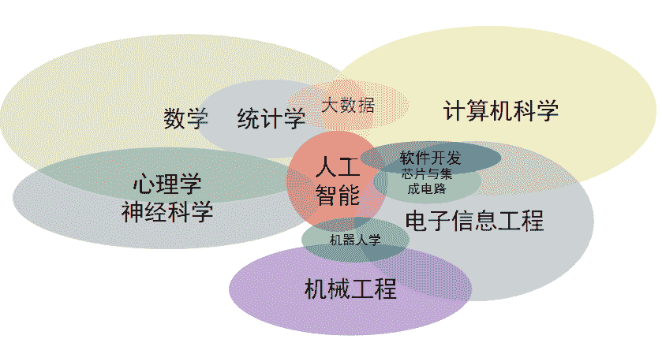

正如上图中画的一样，人工智能是数学、物理学、统计学、计算机科学、电子信息工程、控制工程、心理学、认知神经科学等多个学科交叉形成的产物。人工智能可以用来做机器人的一部分，可以用来做软件开发，可以赋能大数据，而5G代表的通信能力、芯片所代表的计算能力与存储能力又是人工智能得以发展起来的基座。这些学科彼此之间都有千丝万缕的联系，但绝对不能把它们简单地画等号。

从世界上第一台电子计算机的诞生到深度学习，从阿尔法狗大战李世石到ChatGPT的横空出世，人工智能离我们并不遥远。它们一直都在。

那么，它的起源又是怎样的？

## 人工智能从哪里来？

### 图灵的思考

早在计算机诞生之前，就已经有数学家开始了思考。罗素等人在数理逻辑领域的发展，表明逻辑推理是可以用数学语言形式化的；维纳开创了控制论，也开始用数学语言探索机器能否按照既定规则处理逻辑甚至语言。在1936年，年仅29岁的图灵创立了自动机理论，后来这个模型又被人们称为“图灵机”，是计算机重要的理论基础。图灵也是我们计算机科学领域的老祖。

在二战时期，盟军为了破解德军的密码，安排图灵和其他几个科学家合作，制造了第一台用于密码破译的机械式计算机，将大局扭转。

图灵同样在思考一个深刻的问题：“机器能否思考？”他认为，机器不仅能思考，而且人类有可能制造出会思考的机器。于是，他进一步思考：“如何判断机器能否思考？”这个问题催生了图灵测试的诞生。

图灵测试，这个概念首次出现在1950年图灵发表的一篇名为《计算机器与智能》的论文中。这个测试的核心思想是，如果一台机器能够在不提前告知人类这是一台机器的情况下，让人类无法区分它与另一个人类之间的差异，那么这台机器就通过了图灵测试，展现出了与人类相似的智能。

例如，测试者把一个人A和一台机器B隔离在两间房屋里面，然后向他们分别提问，例如“你最喜欢什么颜色”、“韩国现任总统是谁”等，如果测试者无法分辨哪个是人哪个是机器，那么这台机器就通过了图灵测试。

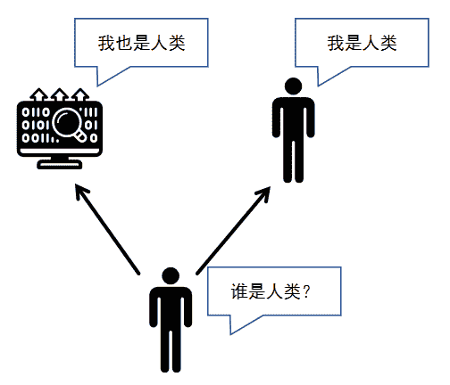

图灵的这个想法，不仅仅是一个简单的实验，它实际上是对智能的一种实验性定义。图灵认为，智能不仅仅是逻辑和计算能力，更涉及学习、理解和创造力。这个观点给了无数科学家和工程师致力于开发更智能、更人性化的机器的灵感。

### 冯·诺依曼与第一台电子计算机

二战结束后不久，在1946年，宾夕法尼亚大学，冯·诺依曼和他的团队一同制造出了世界上第一台电子计算机——埃尼阿克（ENIAC），这正式标志着我们人类进入了一个信息化的时代。埃尼阿克的诞生，不仅是计算机科学和技术的一个里程碑，也是人类智慧的一个伟大成果。这台重达30吨的庞然大物，占地约170平方米，使用了17468个电子管，耗电174千瓦，每秒能进行5000次加法运算，其计算速度比继电器计算机快1000倍。埃尼阿克最初是为了进行弹道计算而设计的专用计算机，但后来通过改变插入控制板里的接线方式来解决各种不同的问题，而成为一台通用机。

埃尼阿克的问世，极大地推动了科学研究和工业生产，它比人工计算快几十万倍，美国陆军上百名计算人员花几天都算不清楚的大炮炮弹轨迹，它只用三十秒钟就算出来了。这一发明不仅改变了工程数学，也改变了我们许多工业设计方法，有望彻底改变工程数学并改变我们许多工业设计方法。随着时间的推移，计算机技术和工业一直处于高速发展的阶段，计算机科学已成为一门发展快、渗透性强、影响深远的学科，计算机产业已在世界范围内发展成为具有战略意义的产业。埃尼阿克的诞生，宣告了一个新时代的开始，人类社会由此进入了“信息化时代”。

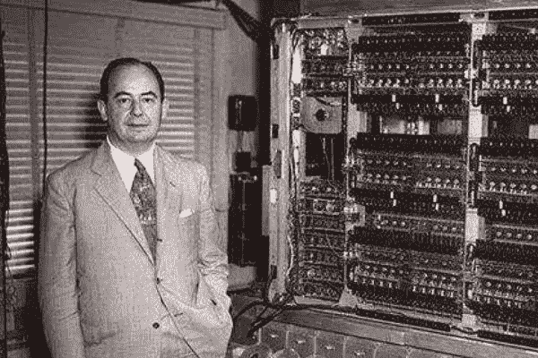

随着计算机技术的飞速发展，科学家们开始意识到，这些由电路和晶体管构成的机器，不仅仅是冷冰冰的计算工具，它们还有着更广阔的潜力。计算机的出现，解决了以往需要耗费大量人力和时间的复杂计算问题，它们在处理数据、模拟复杂系统、优化解决方案等方面展现出了惊人的能力。这不禁让科学家们开始思考一个更深层次的问题：计算机是否能够模仿人类，具备人的一些特性，从而产生智慧？

这个想法如同一颗种子，在科学家们的心中生根发芽。他们开始探索如何让计算机不仅仅是执行预设指令的机器，而是能够学习、适应，甚至在某种程度上理解人类的语言和情感。这种探索，标志着人工智能（AI）领域的诞生。

### 达特茅斯会议

1956年夏季，年轻的美国数学家和计算机专家麦卡锡(McCarthy)、数学家和神经学家明斯基 (Minsky)、IBM 公司信息中心主任朗彻斯特(Lochester)及贝尔实验室信息部数学家和信息学家香农(Shannon)共同发起，邀请IBM公司莫尔(More)和塞缪尔(Samuel)、麻省理工学院(MIT)的塞尔夫里奇(Selfridge)和索罗蒙夫(Solomonff)，以及兰德公司和卡内基·梅 隆大学(CMU)的纽厄尔(Newell)和西蒙(Simon)共10人，在美国的达特茅斯(Dartmouth)学院举办了一次长达2个月的研讨会，认真热烈地讨论用机器模拟人类智能的问题。会上，由麦卡锡提议正式使用了“人工智能”这一术语。这是人类历史上第一次人工智能研讨会，标志着国际人工智能学科的诞生，具有十分重要的历史意义。这些从事数学、心理学、信息论、计算机科学和神经学研究的杰出年轻学者，后来都成为著名的人工智能专家，为人工智能的发展做出了重要贡献。

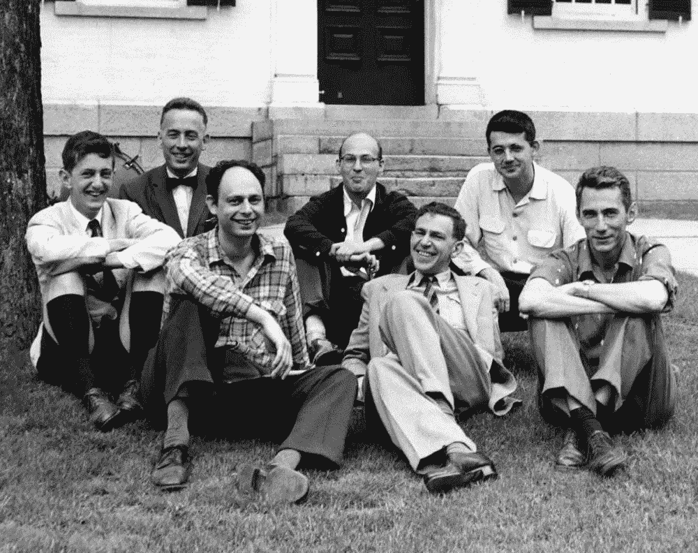

来源：从“大都会”到“银翼杀手”，这些人工智能电影永不过时_凤凰网

约翰·麦卡锡在1956年指出，人工智能研究的目标是“让机器能够使用语言、进行抽象思考和学习”。这一观点不仅为人工智能的未来发展奠定了基础，也为后来的研究指明了方向。在麦卡锡的构想中，机器不仅仅是执行简单的计算任务，而是能够像人类一样进行复杂的思维活动。

达特茅斯会议的召开，标志着人类正式展开“人工智能”学科的研究。会议的主要目标是探讨如何使用机器来模拟人类的智能行为，包括语言理解、抽象思维、学习能力等多个方面。在这次会议上，麦卡锡和其他与会者讨论了多个研究领域，包括自动计算机、编程语言、神经网络、自我改进、抽象思维和创造性等。这些议题至今仍是人工智能研究的核心内容。尽管会议没有立即产生具体的科研成果，但它为人工智能这一新兴学科的诞生奠定了坚实的基础，并激发了学术界和工业界对人工智能的广泛关注。

达特茅斯会议被广泛认为是人工智能历史上的一个里程碑，它不仅确立了“人工智能”这一术语，还为后续的研究提供了一个共同的概念框架，推动了跨学科的交流与合作，为人工智能的快速发展铺平了道路。

### 从机器学习到深度学习

我想，大家如果了解过人工智能，或许很多同学也经常听到机器学习这个词。那么，机器学习和人工智能的关系是怎样的呢？

简单来说，机器学习是实现人工智能的一种方法，或者说是一种技术手段。人工智能的目标是让机器能够像人类一样思考和学习，而机器学习就是让机器通过数据来学习，从而实现这一目标。

机器学习的目的，就是让机器能够从数据中学习规律，自动提高性能，而不需要人类明确地编程每一个细节。动机在于，世界上的数据量非常庞大，而且不断增长，人工处理这些数据不仅效率低下，而且容易出错。机器学习能够自动化地从数据中发现模式和规律，帮助我们做出更准确的预测和决策。

机器学习的用途非常广泛，它被应用于各种领域，比如：

1.  图像识别：通过机器学习，计算机可以识别照片中的人脸或者物体。

1.  语音识别：机器学习让智能助手能够理解人类的语音指令。

1.  推荐系统：电商网站和视频平台使用机器学习来推荐你可能喜欢的商品或视频。

1.  自动驾驶：机器学习帮助自动驾驶汽车识别道路标志和障碍物。

1.  医疗诊断：机器学习可以分析医学影像，辅助医生进行疾病诊断。

机器学习与人工智能的关系，可以这样理解：人工智能是目标，机器学习是实现这个目标的工具之一。人工智能的愿景是创造能够执行复杂任务的智能机器，而机器学习提供了一种方式，让机器通过学习数据来提升自己的能力，从而实现人工智能的愿景。

机器学习使得人工智能系统能够自我改进，变得更加智能。随着机器学习技术的进步，人工智能系统的能力也在不断增强，它们能够处理的任务越来越复杂，越来越接近人类的智能水平。因此，机器学习是推动人工智能发展的重要力量。

机器学习并不是一种方法，而是很多很多方法的一个统称。只要它能从数据中自主地发现规律、应用规律，以在一些基本任务（如预测）中获得好的表现，这其实就可以是一个机器学习模型。而在机器学习的诸多方法当中，通过模仿人类大脑神经元设计的“神经网络”模型获得了广泛的应用。连接主义学派获得了巨大的胜利，它也在后来衍生了机器学习的一个子学科——深度学习。

1943年，McCulloch和Pitts提出了M-P模型，这是人工神经网络的雏形，它模拟了人类神经元网络进行信息处理的数学模型。1958年，Frank Rosenblatt提出了感知机，这是人工神经网络的第一个实际应用，标志着神经网络进入了新的发展阶段。感知机的提出引起了大量科学家对人工神经网络研究的兴趣，对神经网络的发展具有里程碑式的意义。

然而，1969年，Marvin Minsky和Seymour Papert在其著作中指出，单层感知机只能解决线性问题，对于非线性问题如异或问题则无能为力，这导致了神经网络研究的第一次寒冬。在这一时期，由于感知机的局限性和缺乏有效的训练算法，神经网络的研究受到了冷落，资金和研究兴趣都大幅减少。

1986年，Rumelhart、Hinton和Williams提出了反向传播算法（Back propagation），这一算法使得多层神经网络的训练成为可能，标志着神经网络的复兴。反向传播算法有效解决了第一代神经网络模型无法处理非线性分类的问题，神经网络的研究得以突破瓶颈，重新焕发生机。1989年，LeCun等人提出了卷积神经网络（CNN），适用于图像等高维数据的处理。1997年，LSTM（长短期记忆网络）被提出，它在处理序列数据方面表现出色。

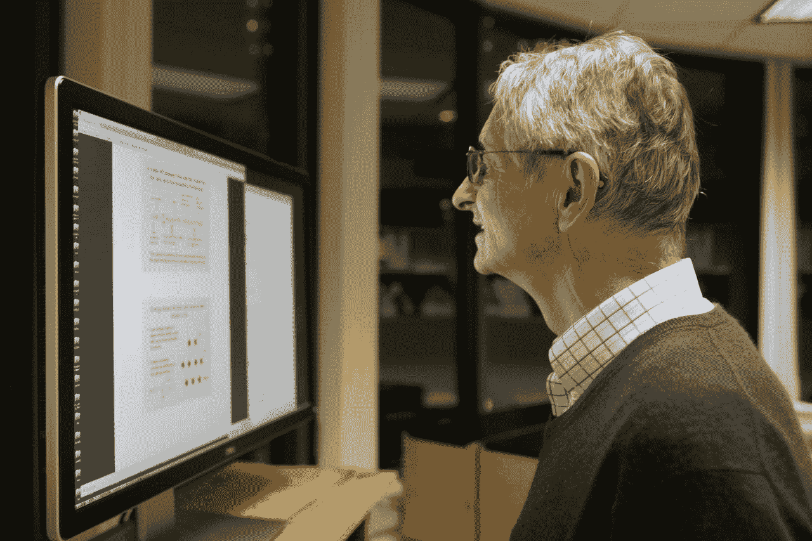

尽管有了BP算法，但由于当时计算资源受限的问题，以及支持向量机（SVM）、集成学习（ensemble learning）等其他机器学习模型的兴起，神经网络再次进入低谷。

2006年，Geoffrey Hinton和他的学生提出了深度置信网络（DBN），开启了深度学习时代。2012年，Hinton和他的学生提出AlexNet在ImageNet竞赛中取得突破性成绩，这标志着深度学习在图像识别领域的革命。自2012年至今短短12年，人工智能的研究突飞猛进，百花齐放，已经发生了翻天覆地的变化。而Hinton也因为对人工智能的开创性贡献，在2018年获得图灵奖以后又在2024年获得了诺贝尔物理学奖。

2017年，谷歌的DeepMind团队开发了一款人工智能围棋应用，并命名它为AlphaGo。为了测试它的性能，中、日韩派出各国顶尖棋手来挑战。韩国围棋九段选手李世石被AlphaGo打败，标志着在围棋这一极需智慧的任务上，人工智能的水平超越了人类。这也是人工智能首次进入普罗大众的视野。

### 大语言模型的诞生

同样在2017年，谷歌的科学家们发表了一篇具有里程碑意义的论文《Attention is All You Need》，提出了Transformer模型。这个模型以其自注意力机制和并行计算的优势，能够更好地处理长距离依赖关系，提高了模型的训练和推理效率。Transformer模型的出现，为自然语言处理（NLP）领域带来了革命性的变化，它在机器翻译、文本摘要、问答系统等多个NLP任务中取得了显著的性能提升。

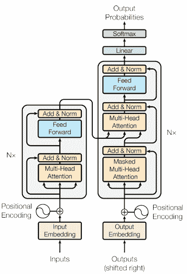

Transformer模型的成功，为后续的大模型发展奠定了基础。美国OpenAI公司的研发团队在此基础上，通过将成千上百个Transformer组装在一起，形成了震惊世界的人工智能大模型——ChatGPT。ChatGPT几乎能回答你的任何问题，还可以帮助你写文稿、分析数据等，可以说它几乎是一个万能助手。它使用了一种名为“大语言模型”的技术，并且表现出前所未有的智能水平，这一年也被称作“大模型元年”。

从2018年开始，OpenAI的GPT系列模型从GPT-1发展到GPT-4，不断提升自然语言处理能力，并实现了从大语言模型向多模态模型的进化。GPT-1结合有监督学习和无监督学习，更接近于处理特定语言任务的专家模型。GPT-2构建了泛化能力更强的语言模型，使得语言模型的通用性得到了更充分的展现。GPT-3参数量相较于GPT-2提升了两个数量级，达到了1750亿，成为真正意义上的超大语言模型。ChatGPT通过引入人类反馈的强化学习等新的训练方式，语言生成能力大幅提升，并且展现出了思维链和逻辑推理等多种能力。

自2012年至今短短12年，人工智能的研究突飞猛进，百花齐放，已经发生了翻天覆地的变化。而在这个过程中，Transformer模型和大语言模型技术起到了关键的推动作用，它们不仅推动了自然语言处理技术的发展，也为人工智能的未来发展打开了新的可能性。

## 三大学派（这一部分内容请小伙伴帮忙改一下，可以追加在此）

随着人工智能学科的发展，科学家们对智能的本质和实现方式产生了不同的理解，形成了人工智能的几大主流学派，它们各自以独特的视角和方法探索着智能的奥秘。

连接主义学派，其灵感来源于人类大脑的神经网络结构。这个学派的科学家们相信，智能的奥秘隐藏在大脑神经元的复杂连接之中。他们认为，既然人类的智慧来源于大脑，而大脑的智慧来自神经元，那么通过数学方法模拟这些神经元及其连接，就能够构建出智能系统。这一学派的代表成果包括人工神经网络和深度学习技术，它们在图像识别、语音识别和自然语言处理等领域取得了革命性的进展。联结主义学派的核心是模仿大脑的工作方式，通过大量的简单单元（神经元）和复杂的连接模式来实现智能行为。

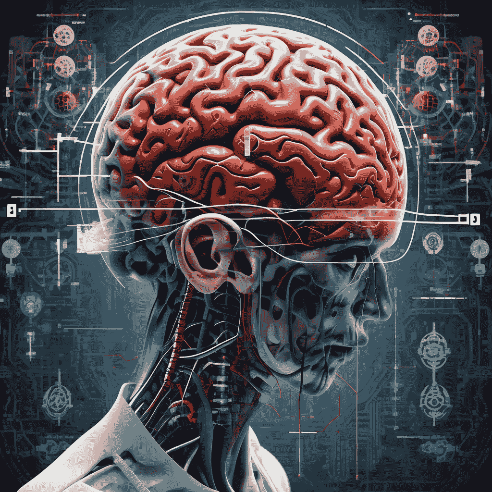

符号主义学派，也称为逻辑主义学派，其核心观点是人类智慧的本质是能够通过各种符号标记我们的语言、算术等系统，并进行推理、演绎与证明。这个学派的科学家们认为，智能可以通过符号和规则来表达，他们致力于用计算机的符号操作来模拟人的认知过程。符号主义学派的代表性成果包括专家系统和知识工程，它们通过逻辑推理和规则系统来解决复杂问题。

行为主义学派，其观点是人的智慧不是与生俱来的，而是通过行动尝试，从外界得到反馈并逐步调整的。这个学派的科学家们强调智能行为的实用性和适应性，他们认为智能可以通过与环境的互动和学习来发展。行为主义学派的代表性成果包括强化学习和遗传算法，这些技术通过模拟生物进化和学习机制来优化智能系统的行为。

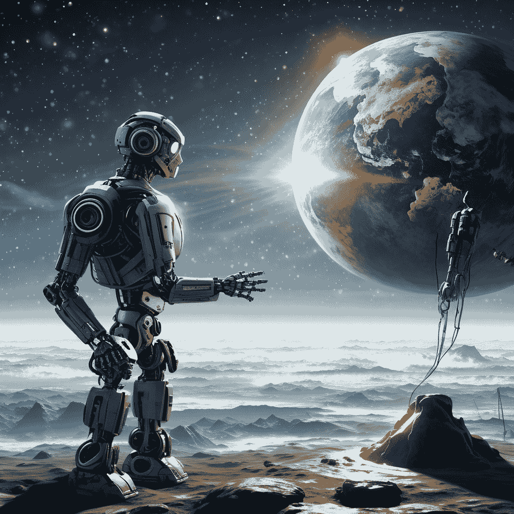

这三个学派各自从不同的角度出发，探索着人工智能的不同方面。有关这三个学派的具体研究内容与发展历程，我们将会在下一节中讨论。

## 1.1.3 人工智能到哪里去？

随着人工智能技术的飞速发展，我们正站在一个新时代的门槛上，展望着一个充满无限可能的未来。人工智能的明天，既是一个充满机遇的时代，也是一个充满挑战的时代。在这个时代，人工智能将深刻地改变我们的工作、生活和学习方式，同时也将带来一系列复杂的社会问题和伦理挑战。

让我们用一些简单的例子来向各位介绍人工智能（AI）今天的作用：

1.  智能助手： 想象一下，你有一个私人助理，它能够帮你设定提醒、回复邮件、搜索信息，甚至帮你规划一天的行程。这个助理不需要休息，24小时待命，它就是人工智能的一种体现，比如智能手机里的语音助手。

1.  推荐系统： 当你在视频网站或音乐平台上浏览时，有没有注意到推荐给你的内容总是那么合你的口味？这是因为人工智能在分析你的喜好，然后为你推荐你可能感兴趣的视频或歌曲。

1.  在线客服： 很多公司的在线客服其实是由人工智能驱动的，它们能够理解你的问题，并给出快速准确的回答，节省了大量人力成本，也提高了客户满意度。

1.  自动驾驶汽车： 虽然自动驾驶技术还在发展中，但人工智能正在让这个梦想逐步变为现实。它通过分析道路情况、交通规则和实时数据，帮助汽车安全驾驶。

1.  语言翻译： 人工智能可以实时翻译不同语言，帮助不同语言背景的人进行交流。无论是翻译软件还是在线会议中的实时字幕，都离不开AI的助力。

1.  艺术创作： 你相信吗？人工智能甚至可以创作音乐、绘画和写作。它们通过学习大量的艺术作品，然后生成新的艺术内容，为创作者提供灵感。

1.  教育： 在教育领域，人工智能可以根据学生的学习习惯和进度，提供个性化的学习计划和辅导，让学习更加高效。

1.  医疗健康： 在医疗领域，AI可以帮助医生分析医学影像，辅助诊断疾病，甚至在药物研发中发挥作用，提高医疗效率和准确性。

1.  金融： 在金融行业，人工智能可以分析大量的交易数据，预测市场趋势，帮助投资者做出更明智的投资决策。

1.  环境保护： AI还能帮助我们监测环境变化，比如通过分析卫星图像来跟踪森林砍伐情况，或者预测自然灾害，从而采取预防措施。

总的来说，人工智能就像是一个多才多艺的助手，它在很多领域都发挥着重要作用，让生活更加便捷、高效和智能。

然而，随着人工智能的广泛应用，我们也面临着一系列挑战。首先，人工智能可能会替代一些传统的工作岗位，导致就业结构的变化。这就需要我们重新思考教育和培训体系，以适应新的就业市场需求。其次，人工智能的发展可能会加剧社会不平等。技术的发展往往首先惠及少数人，如何让人工智能的红利惠及更广泛的人群，是一个亟待解决的问题。此外，随着人工智能的决策越来越复杂，如何确保其决策的透明度和可解释性，也是一个重要的挑战。我们不能让“黑箱”算法左右我们的命运。

在伦理方面，人工智能的发展也引发了深刻的讨论。例如，在自动驾驶汽车中，如果面临不可避免的事故，人工智能应该如何做出道德选择？在隐私保护方面，人工智能需要处理大量的个人数据，如何保护用户的隐私权，防止数据滥用，也是一个亟待解决的问题。此外，随着人工智能的智能水平不断提高，我们还需要考虑如何确保人工智能的安全和可控，避免其被用于恶意目的。例如，使用AI换脸、自动化的网络水军、谣言生成等内容安全，也是人工智能生态中必须严格控制管理的问题。

在国际关系方面，人工智能的竞争也日益激烈。各国都在加大投入，争夺人工智能技术的制高点。这不仅关系到经济利益，还关系到国家安全。 从2014年起，中国的人工智能已发展成为国家战略。国家最高领导人发表重要讲话，对发展中国人工智能给予高屋建瓴的指示与支持。2017年7月8日，中华人民共和国国务院发布《新一代人工智能发展规划》，提出了面向2030年中国新一代人工智能发展的指导思想、战略目标、重点任务和保障措施，部署构筑中国人工智能发展的先发优势，加快建设创新型国家和世界科技强国。朋友们，人工智能的机遇已经来了！

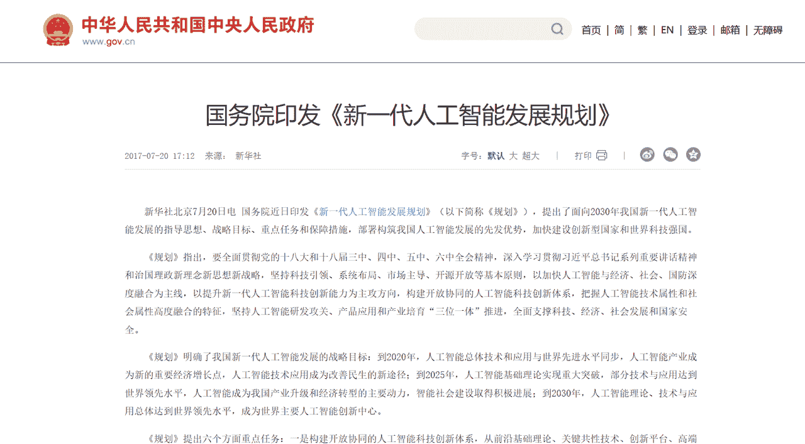

总之，人工智能的明天是一个充满机遇和挑战的时代。我们需要积极拥抱人工智能带来的变革，同时也要认真对待其带来的问题。这需要政府、企业、学术界和公众的共同努力。我们需要制定合理的政策和法规，引导人工智能的健康发展；我们需要加强教育和培训，提高公众的科技素养；我们需要加强国际合作，共同应对人工智能带来的全球性挑战。只有这样，我们才能确保人工智能的发展能够造福人类，而不是成为我们的威胁。在未来的道路上，我们既要有勇气探索未知，也要有智慧应对挑战，只有这样，我们才能迎来一个更加美好的人工智能时代。

## 参考资料

1.  蔡自兴、刘丽珏、陈白帆、蔡昱峰，《 人工智能及其应用（第7版）》，清华大学出版社

1.  [艾伦·麦席森·图灵_百度百科](https://baike.baidu.com/item/%E8%89%BE%E4%BC%A6%C2%B7%E9%BA%A6%E5%B8%AD%E6%A3%AE%C2%B7%E5%9B%BE%E7%81%B5/3940576)

1.  [约翰·冯·诺依曼_百度百科](https://baike.baidu.com/item/%E7%BA%A6%E7%BF%B0%C2%B7%E5%86%AF%C2%B7%E8%AF%BA%E4%BE%9D%E6%9B%BC/986797)

1.  从“大都会”到“银翼杀手”，这些人工智能电影永不过时_凤凰网

1.  [v](https://pica.zhimg.com/v2-9f316da6d2540700c8604337ee560442_r.jpg?source=172ae18b)2-9f316da6d2540700c8604337ee560442_r.jpg (2700×1800)

1.  深度学习(deep learning)发展史 - 知乎

1.  深度智能的崛起（三）：神经网络研究的三起三落 - 点金大数据

1.  [深度学习基础知识：介绍深度学习的发展历](https://developer.aliyun.com/article/1363333)程、基本概念和主要应用-阿里云开发者社区

1.  [[1706.03762] Atten](https://arxiv.org/abs/1706.03762)tion Is All You Need

1.  [中国政府网](https://www.gov.cn/xinwen/2017-07/20/content_5212064.htm#:~:text=%E5%9B%BD%E5%8A%A1%E9%99%A2%E5%8D%B0%E5%8F%91%E3%80%8A%E6%96%B0%E4%B8%80%E4%BB%A3%E4%BA%BA%E5%B7%A5%E6%99%BA%E8%83%BD%E5%8F%91%E5%B1%95%E8%A7%84%E5%88%92%E3%80%8B%202017-07-20%2017%3A12%20%E6%9D%A5%E6%BA%90%EF%BC%9A%20%E6%96%B0%E5%8D%8E%E7%A4%BE%20%E5%AD%97%E5%8F%B7%EF%BC%9A%20%E9%BB%98%E8%AE%A4,%E5%A4%A7%20%E8%B6%85%E5%A4%A7%20%7C%20%E6%89%93%E5%8D%B0%20%7C%20%E6%96%B0%E5%8D%8E%E7%A4%BE%E5%8C%97%E4%BA%AC7%E6%9C%8820%E6%97%A5%E7%94%B5%20%E5%9B%BD%E5%8A%A1%E9%99%A2%E8%BF%91%E6%97%A5%E5%8D%B0%E5%8F%91%E3%80%8A%E6%96%B0%E4%B8%80%E4%BB%A3%E4%BA%BA%E5%B7%A5%E6%99%BA%E8%83%BD%E5%8F%91%E5%B1%95%E8%A7%84%E5%88%92%E3%80%8B%EF%BC%88%E4%BB%A5%E4%B8%8B%E7%AE%80%E7%A7%B0%E3%80%8A%E8%A7%84%E5%88%92%E3%80%8B%EF%BC%89%EF%BC%8C%E6%8F%90%E5%87%BA%E4%BA%86%E9%9D%A2%E5%90%912030%E5%B9%B4%E6%88%91%E5%9B%BD%E6%96%B0%E4%B8%80%E4%BB%A3%E4%BA%BA%E5%B7%A5%E6%99%BA%E8%83%BD%E5%8F%91%E5%B1%95%E7%9A%84%E6%8C%87%E5%AF%BC%E6%80%9D%E6%83%B3%E3%80%81%E6%88%98%E7%95%A5%E7%9B%AE%E6%A0%87%E3%80%81%E9%87%8D%E7%82%B9%E4%BB%BB%E5%8A%A1%E5%92%8C%E4%BF%9D%E9%9A%9C%E6%8E%AA%E6%96%BD%EF%BC%8C%E9%83%A8%E7%BD%B2%E6%9E%84%E7%AD%91%E6%88%91%E5%9B%BD%E4%BA%BA%E5%B7%A5%E6%99%BA%E8%83%BD%E5%8F%91%E5%B1%95%E7%9A%84%E5%85%88%E5%8F%91%E4%BC%98%E5%8A%BF%EF%BC%8C%E5%8A%A0%E5%BF%AB%E5%BB%BA%E8%AE%BE%E5%88%9B%E6%96%B0%E5%9E%8B%E5%9B%BD%E5%AE%B6%E5%92%8C%E4%B8%96%E7%95%8C%E7%A7%91%E6%8A%80%E5%BC%BA%E5%9B%BD%E3%80%82)