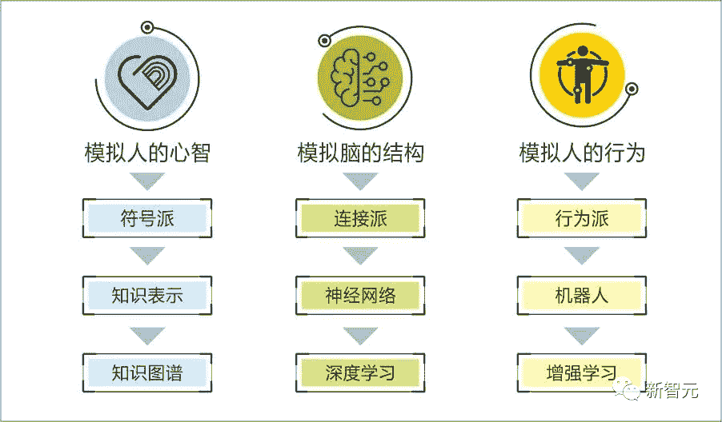
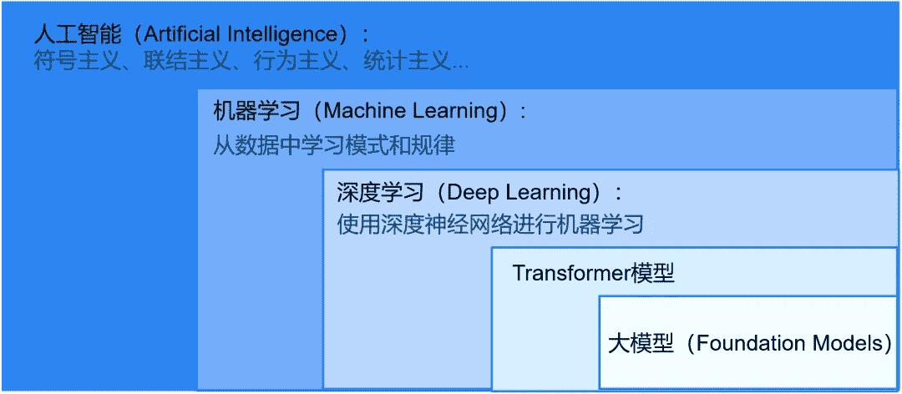

# 1.1 人工智能的三大学派_龙斐

> 来源：[https://datawhaler.feishu.cn/docx/D5fod0amqo37Znx0FMVcGaVBnib](https://datawhaler.feishu.cn/docx/D5fod0amqo37Znx0FMVcGaVBnib)

| 版本信息 | **内容版本号** | V1.0 |  |
| --- | --- | --- | --- |
|  | **最近更新时间** | 2024.11.24 |  |
|  | **历史更新** | 2024.11.24：V1.0内容发布 |  |
|  | **内容信息** | +   **所属版本**：**AI通识课-零基础版 ** |  |
| 贡献详情 | **最近贡献** |  |  |
|  | **内容贡献** | 张龙斐 | 部分段落用了GPT辅助 |
|  | **内测反馈** | 黄铭洋 | 语句、结构、勘误 |
|  | 更多贡献详情见：[致谢AI通识课贡献者们](https://datawhaler.feishu.cn/wiki/HnMiwEzpdiLvWRkfbvFcaJFLnSg) |  |  |

# 三大学派的历史沿革

人工智能在漫长的发展历程中，与其他学科一样，也分化出了不同的学派。主要有符号主义学派，联结主义学派和行为主义学派，称为人工智能的三大学派。近年来，联结主义学派下的深度学习技术推动了人工智能的快速发展，其代表性应用包括ChatGPT大语言模型、人脸识别、图像识别、语音转写等。

图？ 符号主义与联结主义发展历史

> 注：由于行为主义学派大量相关的研究并没有归入人工智能范畴里，而是放到了控制科学、人工生命、机器人学等与人工智能有密切关系的交叉学科之中，所以上图中没有体现出来（详见延伸阅读）。行为主义学派不同于心理学领域的“行为主义”，它是基于控制论出发的，逐渐融合了系统论和信息论的方法，发展出了“机器人学”等重要学科理论。它对于强化学习，智能体以及智能机器人的发展起到了至关重要的作用。

在科技的长河中，人工智能的发展仿若一部波澜壮阔的史诗。1956 年达特茅斯会议上，约翰・麦卡锡等科学家提出 “人工智能” 术语并探讨模拟人类智能之法，同年艾伦・纽厄尔、赫伯特・西蒙等人开发的逻辑理论家成功证明数学定理，开启符号主义学派大门，该学派主张以符号与规则复刻人类思维；1950 年代末弗兰克・罗森布拉特提出的感知机问世，拉开联结主义学派序幕，其模拟大脑神经元连接与学习机制以达智能；1966 年约瑟夫・魏泽堡开发的 ELIZA 登场，凭借简单模式匹配与替换技术模拟心理咨询对话，展现符号主义语言理解潜力；1970 年代贝叶斯推理兴起，众多科研人员助力其在人工智能领域用于概率推理与决策，成为符号主义重要分支；1970 年代爱德华・费根鲍姆等人开发的 DENDRAL 诞生，作为化学分析专家系统典型代表可依质谱数据推断有机化合物结构；第一次高峰以符号主义的繁荣为主，随后迅速进入第一次寒冬。

1980 年代迎来人工智能第二次高峰，专家系统成热点，众多科研机构与企业投身研发，其能模拟专家决策解决特定领域复杂难题并在多领域广泛应用；同期福岛邦彦提出的神经认知机积极尝试模拟大脑认知功能，初露锋芒于模式识别与机器学习领域，日本众多科研机构与企业参与的第五代计算机项目开启，为符号主义学派大胆尝试，约翰・霍普菲尔德提出的霍普菲尔德网络具备存储和回忆模式能力，为联结主义学派注入活力，杰弗里・辛顿等人提出的反向传播算法奠定深度学习根基，使神经网络借梯度下降学习复杂函数；1987 年卡内基梅隆大学研究团队主导的 Navlab 项目开发出世界首辆自动驾驶汽车，标志自动驾驶技术登台；随后由于个人PC的繁荣与普及，成本高昂的专家系统被逐渐舍弃，第二次寒冬到来。

1990 年代弗拉基米尔・万普尼克等人提出的 SVM 支持向量机出现，在分类和回归分析表现出色；1997 年 IBM 研究团队开发的深蓝击败世界象棋冠军加里・卡斯帕罗夫；2000 年代众多研究人员深入研究改进的 DBN 深度置信网络受关注，其由受限玻尔兹曼机堆叠而成，能学习数据多层次表示并应用于图像识别、语音识别等领域；2010 年代起深度学习崛起，众多科研机构与企业投身其中，以人工神经网络尤其是深层神经网络为核心在多领域掀起革命浪潮；2011 年 IBM 研究团队打造的 Watson 问答系统在《危险边缘》战胜人类冠军，彰显自然语言处理与认知计算威力；2012 年 Hinton 团队提出的 AlexNet 模型运用 CNN 在 Imagenet 图像识别大赛夺冠，推动卷积神经网络在图像识别领域广泛应用；2014 年伊恩・古德费洛等人提出的 GAN 生成对抗网络诞生，通过生成器与判别器对抗训练生成高质量数据，在艺术创作与数据增强潜力无限；2016 年谷歌 DeepMind 研究团队研发的 AlphaGo 战胜围棋冠军李世石，借自我对弈学习围棋策略，尽显人工智能在复杂策略游戏潜力；2017 年谷歌阿什维尼等人提出的 Transformer 模型凭自注意力机制处理序列数据，极大推动自然语言处理技术发展；2010 年代末至 2020 年代初 OpenAI 研发的 GPT 系列模型特别是 ChatGPT 通过预训练和微调实现自然语言深度理解与生成，优化对话系统；直至 2024 年约翰・霍普菲尔德与杰弗里・辛顿因在人工智能领域卓越贡献共同荣获诺贝尔物理学奖，为人工智能发展历程添上浓墨重彩一笔。

# 三大学派的概念与对比

## 2.1 三大学派的概念：

图 ？三大学派概览

1.  符号主义：
符号主义学派的思想和观点直接继承自图灵，提倡直接从功能的角度来理解智能，简而言之就是把智能视为一个黑盒，只关心这个黑盒的输入和输出，而不关心黑盒的内部结构。
为了实现智能，符号主义学派利用“符号”（Symbolic）来抽象表示现实世界，利用逻辑推理和搜索来替代人类大脑的思考、认知过程，而不去关注现实中大脑的神经网络结构，也不关注大脑是不是通过逻辑运算来完成思考和认知的。对于符号主义学派长达数十年的探索研究过程，根据研究的主要问题不同，可以将其划分为三个阶段：最初这派的学者并未过多考虑知识的来源问题，而是假设知识是先验地存储于黑盒之中的，重点解决的问题是利用现有的知识去做复杂的推理、规划、逻辑运算和判断，这个时期称为符号主义的“推理期”；后来大家发现智能的体现并不能仅依靠推理来解决，先验的知识是更重要的一环，研究重点就转变为如何获取知识、表示知识和利用知识，这个时期称为符号主义的“知识期”；最后，由于知识仅依靠人类专家总结、提炼然后输入计算机的方式无法应对世界上几乎无穷无尽的知识，研究的重点又转为如何让机器自己学习知识、发现知识这个方向，这个时期就称为符号主义的“学习期”。

1.  联结主义（有时也称“连接主义”）：
联结主义，是一种模拟人类大脑神经网络结构来构建智能的方法。
联结主义学派认为人工智能源于仿生学，主张通过模拟人类大脑的神经网络结构来实现智能。它把智能系统看作是一个由大量简单神经元组成的复杂网络，智能行为是通过神经元之间的连接强度和激活模式的变化来实现的。联结主义强调学习和适应的重要性。智能系统可以通过对大量数据的学习来自动调整神经元之间的连接强度，从而实现对不同任务的适应和优化。人工神经网络（ANN）是联结主义的核心技术，由大量的神经元组成，通过调整神经元之间的连接权重来实现对输入数据的处理和输出结果的预测。深度学习作为联结主义的重要发展方向，通过构建多层神经网络（MLP），实现对数据的多层次抽象表示，从而提高对复杂数据的处理能力。深度神经网络在图像识别、语音识别和自然语言处理等领域取得了巨大的成功。联结主义与认知神经科学，脑科学，语义学有着千丝万缕的联系。

1.  行为主义：

行为主义，是一种基于“感知——行动”的行为智能模拟方法。

行为主义学派认为人工智能源于控制论。早期的研究工作重点是模拟人在控制过程中的智能行为和作用，并进行“控制论动物”的研制。到20世纪60~70年代，播下智能控制和智能机器人的种子，并在20世纪80年代诞生了智能控制和智能机器人系统。行为主义是20世纪末才以人工智能新学派的面孔出现的，引起了许多人的兴趣。这一学派的代表作首推布鲁克斯的六足行走机器人，它被看作是新一代的“控制论动物”，是一个基于感知-动作模式模拟昆虫行为的控制系统。

1.  一些必要说明：

1.  人工智能三大学派是不同的构建智能的方法，均可应用于逻辑推理，图像识别，自然语言处理，智能体构建等应用领域。是“形式科学”在“工程技术学”的应用。

1.  三大学派虽然历史上有许多激烈的交锋，但三者都有其可取之处，我们应该取长补短。例如自动驾驶的实现均用到了三种学派的理论与方法。又例如联结主义方法构建出的大语言模型（LLM），其极强的自然语言处理能力是由“规模定律”解释的，而规模定律中“涌现”是复杂系统科学的概念，系统论与控制论密不可分，控制论又是行为主义学派的根基。

1.  “AGI”通用人工智能还有很长的路要走，至少联结主义学派的大语言模型不是最终的方案。许多著名人物对构建“AGI”的观点也有许多不同的看法。

1.  人工智能是一个“手提箱式词汇”，何谓智能没有一个清晰的定义。大多数人会认同人类是智能的，而尘埃颗粒不是。同样的道理，我们普遍认为人类比虫子更加智能。对于人类智能，智商是在单一尺度上衡量的，但我们也会探讨智能的不同维度，如情感、语言、空间、逻辑、艺术、社交等。因此，智能的定义可能是二元的（一个物体是或不是智能的）、在一个物体上的（一个物体比另一个物体更智能），或者是多维的（一个人可以具有高语言智能和低情感智能）。确实，“智能”这个词语是一个满载的手提箱，而拉链就在随时可能撑破的边缘上。

## 2.2 三大学派的对比

表？ 三大学派横向对比

图？ 大模型与人工智能的包含关系

# 三大学派融合应用

在实际应用中往往需要三大学派的理论共同作用，才能完成任务。自动驾驶是三大学派融合应用的集大成者，想象一下，你正在开一辆装配了自动驾驶系统的特斯拉，它就像是一个超级智能的机器人司机。首先，特斯拉会用符号主义学派的规则来开车，就像你玩游戏时遵守规则一样，特斯拉会遵守交通规则，比如看到红灯就停，绿灯就走。然后，特斯拉用联结主义学派的深度学习技术来进行感知和信息传递，就像是它有很多眼睛和耳朵，通过摄像头和传感器来“看”和“听”周围的环境，这样它就能识别出路上的行人、车辆和交通标志。最后，特斯拉用行为主义学派的感知-动作模型，就像是它通过实践学习如何开车，特斯拉通过与环境的互动来学习如何更好地控制车辆，比如在堵车时自动调整速度，或者在需要时自动变道。特斯拉的自动驾驶汽车就像是一个超级智能司机，帮助我们安全、有效地到达目的地。

# 延伸阅读

## 通过三大学派，如何定义“智能”

这里插一段题外话，我们应该如何定义智能，或者说什么是智能呢？为何行为主义总被排除在人工智能领域之外，为何对于人来说非常简单的驾驶任务对于机器来说却这么难？体力劳动需要高智能吗？

下面只是本书的观点，不代表正确。鼓励读者发散思考，释放创造力和想象力。

1.  智能的深度剖析：智能是一个极具复杂性且多维度的概念。从宽泛的意义层面而言，智能犹如强大的力量，赋予个体卓越的学习能力，能够轻松地理解各类知识，并巧妙地运用知识解决难题，迅速适应新的环境，同时还能进行高超的抽象思维和推理。例如，人类能够如同熟练掌握某种技能般学习语言规则，进而创造出全新的句子，这充分彰显了学习和运用知识的杰出能力。智能还具备感知能力，能够感知周围环境的各种信息，如同人类通过视觉、听觉、触觉等感官获取外界信号。此外，智能在记忆方面表现卓越，可如同小型仓库一般存储和提取信息，用于决策或解决问题，就如同学生在考试时从记忆库中提取知识点来回答问题。另外，智能包含强大的创造力，能够产生全新的想法、方法或作品，艺术家创作绘画作品和科学家提出新理论皆是创造力的精彩展现。

1.  行为主义在人工智能领域受冷落的原因：行为主义主要聚焦于可观察的行为，然而人工智能更倾向于模拟人类的认知过程和思维方式。行为主义方法在人工智能领域被认为过于浅显，仅关注输入和输出之间的行为关系，完全忽视了内在的心理和认知机制。例如，在行为主义观点之下，可能仅仅关心机器在给定任务下的动作反应，而不关心机器如何理解任务、规划行动步骤等认知层面的问题。现代人工智能更期望机器能够像人类一样理解知识、进行推理和学习，因此更倾向于认知主义等其他理论。

1.  机器完成驾驶等任务的困难之处：

1.  感知复杂性极高：对于机器来说，驾驶如同一场极具挑战性的大冒险，需要处理大量极为复杂的感知信息。人类可以轻松自然地通过视觉感知交通状况，如同侦探一般识别各种物体（如车辆、行人、交通标志等），并在不同光照和天气条件下做出准确判断。而机器要实现准确感知，需要处理来自摄像头、雷达等多种传感器的数据，并如同魔法师一般将这些数据整合起来，这是一个极其复杂的过程。

1.  情境理解难度极大：人类驾驶员能够如同神探一般理解交通场景背后的意图和规则。例如，看到路边张望的行人，人类可以如同预言家一般推测其可能要过马路，并根据车速和距离做出合适反应。机器则很难像人类一样理解这种潜在意图和情境。

1.  学习方式有限：人类通过长期实践和经验积累来学习驾驶，并能灵活地将经验应用于不同场景。机器虽可通过大量数据进行训练，但在面对特殊情况或数据未涵盖的场景时，会显得捉襟见肘。

1.  体力劳动需要高智能：像驾驶、装修和做饭等任务，虽被视为体力劳动，但实际上需要多种智能的综合运用。以装修为例，装修工人需如同空间大师一般理解空间布局（空间智能），根据客户要求和建筑结构如同机灵之人一般选择合适的材料和工具（逻辑 - 数学智能和自然观察智能），并在施工过程中如同超人一般灵活应对各种突发情况（问题解决能力和创造力）。伦敦出租车司机大脑海马体增大的例子极为引人瞩目。海马体与记忆有关，出租车司机需要记住城市的道路、建筑等复杂信息，这种记忆任务促使他们的海马体发育得更好，显示了他们在空间记忆和导航方面的高智能，如同拥有超级大脑一般强大。

## 行为主义与控制论

提到控制论大家可能首先想到自动化等传统工学学科，如著名的《工程控制论》，但控制论实则是内涵极其丰富的。这里简要介绍一下控制论的历史，以便说明为何行为主义学派属于人工智能。

“Cybernetique”一词首先由法国物理学家安德烈-马里·安培（André-Marie Ampère,1775—1836）在其著作《论科学中的哲学》里首先使用，法语为“Cybernetique”，意思是“国务管理（Civil Government），自然是属于社会科学的范畴。维纳在《控制论》的序言里面没有提安培的事，认为是自己从希腊文“KvβερvετιKσ”（原意为“操舵术”，就是掌舵的方法和技术的意思）中创造了该词。在维纳的思维框架里，《控制论》的范畴更加广阔，把社会、人类、其他生物体甚至机械体都纳入进来，他把机电伺服系统的物理反馈现象与神经生 理 学 的“目 的 性 行 为”（Purposeful Behaviors）、 哲 学 上 的“因 果 循 环 律”（Circular Causality）互相结合起来，认为人类、生物和具有智能的机器等都是通过“由负反馈和因果循环律逻辑来控制的目的性行为”来实现自身目的的，这一句话便是控制论思想的源头。全书的主旨不在于工程控制，工程控制充其量只是一个方法手段，现在自动化专业课本中提到的理论和公式在《控制论》中都没有提及。这本书的名字应该要配上它那拗口的副标题《控 制 论： 在 动 物 和 机 器 中 控 制 和 通 信 的 科 学》 （Cybernetics: On Control and Communication in the Animal and the Machine）才能贴切地反映出作者的真实意图。从副标题可见，书中讨论的主体本来就是“动物和机器”。后来控制论慢慢发展，衍生出了社会控制论、工程控制论、生物控制论和经济控制论这些分支，与人工生命、人工智能、复杂性理论慢慢形成越来越密切的联系。

# 参考资料：

1.  《智慧的疆界：从图灵机到人工智能》 周志明

1.  新智元：一个十年符号主义学者的深度讨论：如何理性看待ChatGPT？

1.  《AI3.0》［美］梅拉妮·米歇尔（Melanie Mitchell）