# 1.2 人工智能的主要任务及其应用领域_V1.0

> 来源：[https://datawhaler.feishu.cn/docx/PJyzdBizAojmCaxwlbMcAB86nPd](https://datawhaler.feishu.cn/docx/PJyzdBizAojmCaxwlbMcAB86nPd)

| 版本信息 | **内容版本号** | V1.0 |  |
| --- | --- | --- | --- |
|  | **最近更新时间** | 2024.11.24 |  |
|  | **历史更新** | 2024.11.24：V1.0内容发布 |  |
|  | **内容信息** | +   **所属版本**：**AI通识课-零基础版 ** |  |
| 贡献详情 | **最近贡献** |  |  |
|  | **内容贡献** | 吴傲 |  |
|  | **内测反馈** | 刘越 |  |
|  | 更多贡献详情见：[致谢AI通识课贡献者们](https://datawhaler.feishu.cn/wiki/HnMiwEzpdiLvWRkfbvFcaJFLnSg) |  |  |

人工智能的主要任务包括：分类、回归、计算机视觉、自然语言处理、推荐系统、语音识别和生成、决策优化、人工智能生成内容（AIGC）等，这一节将介绍这些主要任务及其应用领域。

# 分类

## **什么是分类？**

分**类是人工智能中基**本的机器学习任务之一，其主要作用是确定特定对象归属于预先定义的目标类。分类的具体含义是将输入数据划分到不同的类别中，预测结果是离散值。在分类任务中，模型通过学习输入数据的特征，找到能够区分不同类别的分界面或决策边界，当不同于训练时的陌生数据进入模型时，模型会根据学习到的分界面将其划分到相应的类别中。在过程中，通过对比图片当中物体的不同特征和属性，判断对象与各个分类类别的契合程度，确定对象所属的目标类别。

假如要分辨一个西瓜是好瓜还是坏瓜，有许多特点可以参考：比如颜色，包含青绿、乌黑或者浅白；还有瓜蒂形状，包含蜷缩、弯曲或者硬挺；另外，敲西瓜的声音也很关键，包含响亮、沉闷或者清脆。

先把已知是好瓜还是坏瓜的西瓜搜集起来，接着把这些西瓜的颜色、瓜蒂形状、敲的声音这些特点都记录下来。通过观察对比这些记录，就能总结出符合何种条件的西瓜是好瓜的结论了。

之后拿到一个新西瓜，就能够通过将这个西瓜的颜色、瓜蒂形状和敲的声音，与总结出的结论进行对比，判断出这个新西瓜是好瓜或坏瓜了。而这整个过程就是分类，即把西瓜按照好坏分到不同的组里。

## 有监督与无监督学习

有监督学习与无监督学习广泛应用在分类任务与回归任务当中。

有监督学习的目标是学习输入特征和输出标签之间的**映射**关系，如前面提及的，如何通过色泽，根蒂，敲声（输入标签），训练模型将西瓜分为好瓜与坏瓜（输出标签），以便能够对新的未见过的输入数据准确预测出相应的好瓜/坏瓜（输出标签）。在分类任务中主要应用于分类，在回归任务中主要应用在数值预测。

无监督学习旨在发现数据中的内在结构、模式或某种规律，例如数据的集聚情况、数据中的异常点等，而不是预测某个特定的输出标签或输出值。如电商平台会通过消费者的消费记录与浏览记录，通过无监督学习，能够发现一些具有相似消费习惯的人群。

有监督学习在分类任务当中常见的有二分类，多分类，以及多标签分类三种分类类型。

## 有监督分类任务

### 二分类任务

二分类任务是将数据分为两类的一种分类任务，其输出只有两个类别，通常被表示为 0 和 1，或者 -1 和 1，代表两个不同的类别或状态。二分类任务在实际中有广泛的应用场景，如垃圾邮件检测，我们可以将我们需要的邮件定义为标签“1”，把我们不需要的垃圾邮件定义为标签“0”，通过对邮件进行好坏分类，实现对垃圾邮件的检测。

### 多分类任务

多分类任务是将数据分为多个不同类别的分类任务，与二分类任务相比，其具有更高的复杂性和挑战。在多分类任务中，模型需要学习多个不同类别的特征，并能够准确地将输入数据分配到正确的类别中。

### 多标签分类

多标签分类任务相较于二分类和多分类任务更加复杂。在多标签分类中，一个样本可以同时属于多个类别，这就要求模型能够准确地预测出多个可能的类别标签。例如，一篇新闻文章可能同时与“政治”、“经济”和“国际关系”等多个标签相关。

## 分类任务的应用

### 自然语言处理

+   **新闻分类**：除了将新闻文章分为体育、政治、娱乐类别外，还可以根据地域分为国内新闻、国际新闻。例如，对于一篇报道某国选举的新闻会被归类为国际政治新闻；而关于本地足球赛事的新闻则属于本地体育新闻。

+   **情感分析**：对社交媒体评论、影评、产品评价等进行分类，判断是正面、负面还是中性情感。比如，对于一款电子产品，用户评论 “这款手机拍照效果超棒，我很喜欢” 会被归类为正面评价；而 “这手机电池续航太差了，很失望” 则是负面评价。

+   **垃圾邮件识别**：区分正常邮件和垃圾邮件。像包含促销信息、不明链接的邮件很可能被判定为垃圾邮件；而来自工作伙伴、亲朋好友关于工作事务或生活问候的邮件则属于正常邮件。

垃圾邮件分类

图片来源：作者手绘

### 计算机视觉

+   **交通场景识别**：在智能交通系统中，摄像头拍摄的图像可以识别出不同的交通工具，如轿车、卡车、摩托车，还能识别交通标志，像红灯、绿灯、限速标志等。例如，自动驾驶汽车通过识别前方车辆是轿车还是大型货车，来调整行驶速度和安全距离。

+   **安防监控识别**：在安防领域，监控摄像头可以识别人员、动物和物体，区分是正常活动还是可疑行为。比如，识别出在非工作时间进入办公区域的陌生人，或者识别出在禁区徘徊的动物。

+   **工业产品检测**：在工厂流水线上，通过相机拍摄产品图像，识别产品是否有缺陷，将合格产品和有划痕、变形等缺陷的产品进行分类。例如，对电子产品外壳进行检测，把表面光滑无瑕疵的产品和有划痕的产品分开。

外观检测识别

图片来源：作者通过AI生成

### 生物信息学

+   **物种进化研究**：根据基因序列对不同物种进行分类，研究物种之间的亲缘关系。例如，通过比较人类和黑猩猩的基因序列，发现两者有很高的相似度，从而推断在进化树上的紧密关系。

+   **疾病基因分类**：在研究遗传病时，对基因进行分类，找出与特定疾病相关的基因。比如，在研究囊性纤维化疾病时，确定 CFTR 基因的突变类型与疾病严重程度的关联，将不同突变类型的基因分类，以更好地理解疾病的发病机制。

### 医疗领域

+   **症状分类诊断**：根据患者的症状组合来诊断疾病。例如，咳嗽、发热、流涕等症状可能被归类为上呼吸道感染；而腹痛、腹泻、呕吐等症状可能指向肠胃疾病。

+   **医学影像诊断**：利用 X 光、CT、MRI 等影像资料进行疾病分类。比如，在肺部 CT 影像中，根据结节的大小、形状、密度等特征，将其分类为良性结节或恶性结节，辅助医生判断是否为肺癌。

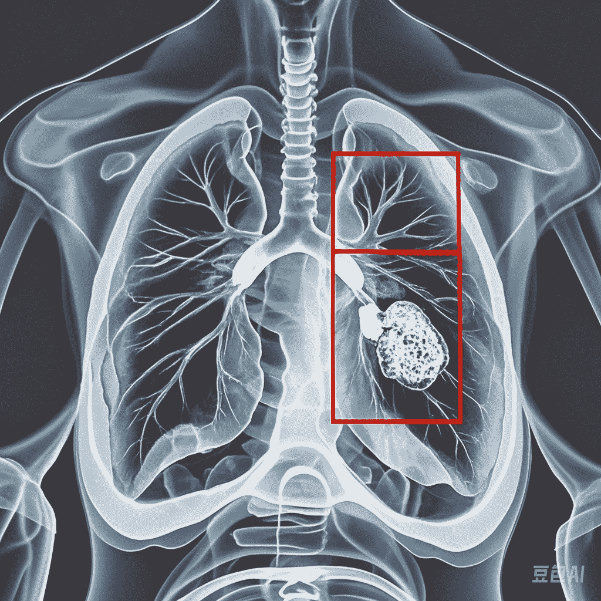

医学影像中肿瘤的识别

图片来源：作者通过AI生成

### 金融领域

+   **个人信贷评估**：银行在评估个人贷款申请时，除了信用等级分类外，还会考虑收入稳定性、资产负债情况等因素。例如，一个有稳定高收入、低负债的客户可能被评为优质信用客户，给予较高的贷款额度和较低的利率；而收入不稳定、负债高的客户信用等级较低，贷款申请可能被拒绝或给予高利率贷款。

+   **企业信用评估**：对于企业贷款，会根据企业的财务报表、行业前景、信用记录等将企业分为不同信用类别。比如，一家业绩良好、市场份额稳定、财务状况健康的企业会被评为高信用等级企业，更容易获得大额贷款和优惠融资条件；而处于亏损状态、债务违约风险高的企业信用等级低，贷款难度大。

# 回归

## 什么是回归？

回归分析是一种通过一个或多个输入变量（自变量或特征）来预测连续值输出（因变量）的方法，它在金融、医疗、营销等多个领域广**泛应**用，通过寻找变量之间的潜在关系实现对连续数值的准确预测，其算法包括线性回归、多项式回归、支持向量回归和决策树回归等，同时面临数据质量、特征选择、模型性能和解释性等方面的挑战，本文将围绕回归分析的这些方面展开探讨。

回归问题的输出是连续值，这意味着它可以取任意实数范围内的值。例如在预测房价时，房价可能是一个具体的数值，如 500 万元、120 万美元等，可以是非常广泛的数值范围。而分类问题的输出是离散标签，是有限个明确的类别。比如判断一幅图片上的动物是猫、狗或鸟，这些类别是明确且相互独立的。在数学性质上，回归输出的连续值具有无限的可能性，两个相近的数值之间还可以存在无数个其他数值。比如预测气温为 25.6℃，实际上在 25.59℃和 25.6℃之间还存在无数个可能的温度值。而分类输出的离散标签是定性的，具有明确的边界和定义。

## 回归的类型

回归任务可以按照具体算法或模型分为线性回归、非线性回归、机器学习回归以及深度学习回归。其中，机器学习回归和深度学习回归泛指用机器学习或深度学习算法来构建回归模型。

### 线性回归

线性回归是一种常用的回归算法，它通过找到最佳拟合直线来模拟因变量和自变量之间的关系。

直线是通过对图中的散点进行拟合的结果，通过直线对密集分布的点进行拟合，我们能够借助直线的函数表达式，大致预测出下一个点出现的位置。

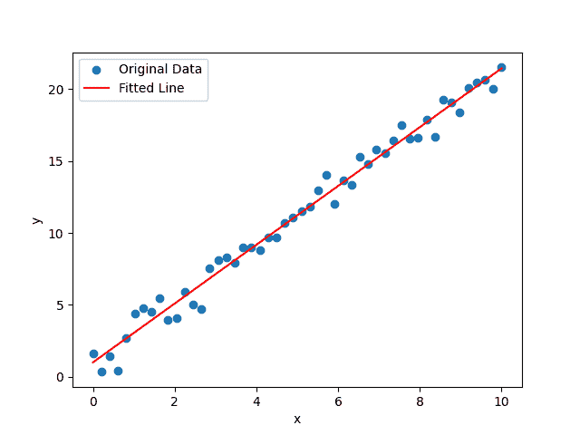

图片来源：作者通过matplotlib库绘制

### 非线性**回归**

非线性回归是一种统计方法，用于建立变量之间的非线性关系模型。与线性回归不同，非线性回归可以处理因变量与自变量之间的复杂、非线性关系。

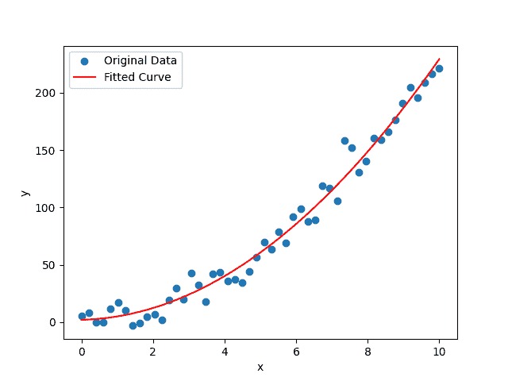

图片来源：作者通过matplotlib库绘制

### 机器学习**回归**

机器学习回归模型可以自动学习变量之间的关系，从而预测因变量的值。它可以处理大量的数据，并且可以自动调整模型参数，以提高预测精度。比如下图的决策树回归和支持向量回归。决策树回归的要点在于找到合适的条件作为决策规则，而支持向量回归的要点在于找到最佳回归超平面。

图片来源：作者通过matplotlib库绘制

### **深度学习回归**

最近几年，深度学习技术的发展也对回归模型的发展产生了巨大的影响。神经网络回归模型可以用于处理极为复杂的非线性关系，同时还可以实现端到端的学习和预测。

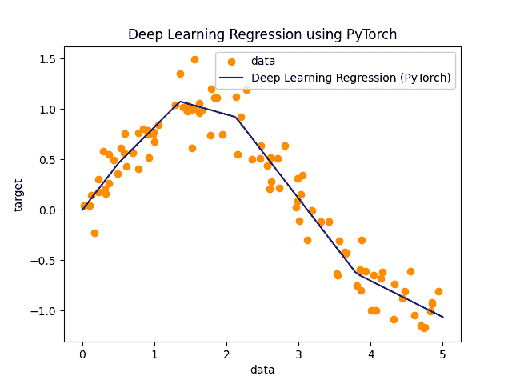

图片来源：作者通过matplotlib库绘制

## 回归的应用

回归问题在金融、医疗、营销等多个领域都有着广泛的应用，为这些领域的决策提供了重要的支持。

**在金融领域，**回归分析有着诸多重要的应用。其中，股票价格预测是一个典型的例子。例如，将某股票的价格与宏观经济指标如利率、通货膨胀率、国内生产总值增长率等进行回归分析，从而得出对该股票未来价格的预测。在基金投资中，通过对基金的历史业绩、费用比率、基金经理的经验等因素进行回归分析，找到影响基金表现的关键因素，从而筛选出优质基金。

在**医疗领域，回归分析也发挥**着重要作用。例如，通过分析患者的年龄、性别、遗传特征、生活方式和环境因素等多个自变量，建立回归模型来预测个体患某种疾病的风险。回归分析还可以用于疾病的诊断和预后评估。医生可以根据患者的症状、体征和实验室检查结果，运用回归分析模型来确定疾病的诊断依据和严重程度。

在营销领域，回归分析可用于：**预测销售额**、客户满意度等指标。对于销售额预测，企业收集历史销售数据，关注市场趋势和广告投入，建立回归模型以准确预测未来销售额，为企业制定营销策略和生产计划提供指导。企业可根据预测安排生产资源、优化广告投放、调整产品定价等策略实现利润最大化。回归分析在客户关系管理方面也出色，通过分析客户行为和特征数据，企业可预测客户忠诚度和购买意愿，对不同客户采取相应策略提高客户粘性和购买转化率。

# 计算机视觉

## 什么是计算机视觉？

### 定义

**计算机视觉（Co**mputer Vision，CV）是研究如何让机器“看”的科学，更进一步的说，就是指用摄影机和计算机代替人眼对目标进行识别、跟踪和测量等机器视觉，并进一步做图像处理，用计算机处理成为更适合人眼观察或传送给仪器检测的图像，它的主要目的是使计算机系统能够理解图像或视频数据。

计算机视觉研究相关的理论和技术，试图建立能够从图像或者多维数据中获取“信**息”**的人工智能[系统。](https://datawhaler.feishu.cn/wiki/BeInwNp4miQJHfk1aUpcJXRbnic#share-Gw0SdqA8MoBIAmx9GsDcQPwZn4c)这里所指的信息指香农定义的，可以用来帮助做一个“决定”的信息。因为感知可以看作是从感官信号中提取信息，所以计算机视觉也可以看作是研究如何使人工系统从图像或多维数据中“感知”的科学。[R]

### 基本原理

现阶段，计算机视觉的原理与人类视觉系统的工作原理类似，从原始信号摄入开始，接着进行初步处理，然后抽象，最终在顶层做出分类。目前主流的基于深度学习的计算机视觉方法，其原理跟人类大脑工作的原理比较相似，构造多层的神经网络，较低层的识别初级的图像特征（初步处理），若干底层特征组成更上一层特征（抽象），最终在顶层做出分类。

视觉神经网络和大脑视觉过程对比

### 任务分类

目前，计算机视觉的任务分类还未有固定框架，此处列举几个常见的视觉理解任务：

1.  **图像分类****：图像分**类是计算机视觉中最基础的任务之一，它的目标是将输入的图像自动归类到预定义**的类别中。例如，在人脸**识别、物体识别、场景分类等应用中，都需要用到图像分类技术。图像分类的主要流程包括特征提取和分类器设计。深度学习技术，特别是卷积神经网络（CNN）的提出（深度学习的基础网络之一），极大地推动了图像分类技术的发展。

1.  **目标检测与定位**：目标检测和定位的目标是**识别并定位**图像中的**目标对象**。与图像分类不同，目标检测不仅需要对图像进行分类，还需要确定目标对象的位置和大小。目标检测与定位技术在安防监控、智能驾驶、机器人等领域具有广泛的应用前景。

1.  **语义分割**：语义分割是计算机视觉中一项**将图像划分为若干个语义区域**的任务。每个区域对应于图像中的一种对象或背景，并为每个像素分配一个类别标签。与目标检测相比，语义分割需要对图像中的所有像素进行分类。语义分割技术在自动驾驶、人机交互等领域有广泛应用，例如用于识别道路标记、车辆和行人等。

(演示网址：https://segment-anything.com/demo)

1.  **实例分割**：实例分割的目标是识别并**分割**出图像中的**每一个特定实例对象**。这需要对每个对象的形状、位置和颜色等信息进行精确的描述和区分。与语义分割相比，实例分割需要对图像中的所有物体进行分类。实例分割技术在人体姿态估计、人脸识别等领域有重要应用。近年来，随着深度学习技术的不断发展，实例分割也取得了长足的进步。

1.  **关键点检测****：关键点检**测专注于在**图像或**视频中识别和定位特定对象的关键点。这些特征点可以是人体的关节、物体的边缘角点等。它通过识别和定位图像或视频中的关键点，为各种应用提供了基础支持。关键点检测广泛应用于人体姿态估计、行为分析、动作捕捉等领域。

计算机视觉常见任务

另外，计算机视觉需要解决的常见问题还包括：运动监测、场景重建、图像恢复等等。

## 计算机视觉怎么来的？

在20世纪中期，随着计算机科学的兴起，人们开始思考如何让机器具备类似人类的感知能力。图灵测试**作为人工**智能的一个重要概念，激发了科学家们对机器感知世界的无限遐想。在这个时期，模式识别成为了计算机视觉领域的初步探索方向。科学家们试图通过统计方法来处理图像信息，以实现简单的图像识别任务。然而，由于计算能力和数据量的限制，这一时期的研究进展相对缓慢。

[进入8](https://datawhaler.feishu.cn/wiki/BeInwNp4miQJHfk1aUpcJXRbnic#share-YElgdkSWuoL9nsxzMAEckDrcnfe)**0年代，**D**avid Ma**rr的视觉计算理论[R]为计算机视觉领域提供了重要的理论基础。Marr认为，视觉是一个分层处理的过程，从低级到高级逐渐抽象出图像的特征和含义。这一理论极大地推动了计算机视觉领域的发展。随着理论的进步，科学家们开始关注如何从图像中提取有用的特征并进行匹配。紧接着，一些局部特征描述子的发明，使得图像识别技术取得了显著的进步。这些特征描述子能够在不同的图像中找到相似的特征点，从而实现图像的匹配和识别。

2006年，**深度学习技术**的兴起为计算机视觉领域带来了革命性的变化。LeNet、AlexNet等模型的出现，使得卷积神经网络（CNN）成为图像处理领域的新宠。CNN通过模拟人类视觉系统的层次结构，能够自动学习图像的层次特征表示，从而实现高精度的图像分类和识别。

随着技术的不断发展，CNN的架构也在不断演变。VGG、GoogLeNet和ResNet等模型的出现使得CNN的性能得到了进一步提升。这些模型在图像识别、语音识别等领域取得了显著的成功。其中，ResNet通过引入残差连接解决了深度卷积神经网络训练过程中的梯度消失和梯度爆炸问题，使得网络能够达到前所未有的深度。

2020年，谷歌提出了Vision Transformers (ViT)，这是首次将Transformer架构（被开发应用于自然语言处理任务中）应用于计算机视觉任务。ViT通过将图像分成图块并转换为向量表示，再利用多层Transformer编码器进行处理，捕捉图像中的上下文依赖关系。ViT因其简单、有效和可扩展性强，成为计算机视觉领域的重要里程碑。

随着互联网的快速发展，大量的图像数据被产生和积累。同时，GPU等硬件设备的出现，极大地提升了计算能力。这使得训练更大规模的深度神经网络成为可能，从而推动了计算机视觉技术的进一步发展。深度学习的另一个重要特点是端到端学习。与传统的机器学习方法相比，深度学习不需要手动设计特征提取器，而是直接从原始像素数据中学习特征表示。这种端到端的学习方式简化了流程，提高了效率，同时也使得计算机视觉技术更加灵活和通用。

计算机视觉发展史

## 计算机视觉怎么用？

计算机视觉技术在农业、工业、制造业、医学和金融等多个领域都有广泛的应用。

### 农业领域

在农业领域，计算机视觉被**广泛应用**于监测**农作物**的健康生长。基于人工智能技术的监测方法能够准确识别农作物上的病虫害特征，如病斑、虫害痕迹等。一旦识别出病虫害问题，系统将立即触发预警机制，标记当前果树的坐标位置以及对应的病虫害问题。通过实时监测和精准防治，可以及时发现并防治病虫害，提高农田生产效率，减少损失。

### **工业领域**

**在工业领域，计算****机视觉技术**被广泛应用于产品质量控制、机器人导航和场景理解等方面。通过图像分类技术，企业可以快速识别产品缺陷，提高产品质量；目标检测与定位技术则为机器人导航提供了有力支持，使机器人能够准确抓取物体并进行装配；实例分割技术则能区分不同的零部件，提高生产效率。这些技术的应用推动了工业领域的智能化发展，提高了生产效率和质量。

### **制造业领域**

在制造业领域，计算机视**觉技术同样****在材料检验**、自动化包装等方面发挥着重要作用。通过图像分类技术，企业可以对材料进行检验，确保材料符合标准；目标检测与定位技术则用于自动化包装，确保产品正确放置于包装盒内；实例分割技术则用于生产线监控，实时监测产品的组装过程。这些技术的应用不仅提高了制造业的生产效率和质量，还降低了生产成本和风险。

### **医学领域**

在医学领域，计算机**视觉**技术被广泛应**用于疾病**诊断、病灶检测等方面。通过图**像分类技术，医生可以**快速识别医学影像中的疾病类型；目标检测与定位技术则能自动检测肿瘤的位置和大小。这些技术的应用大大提高了医疗工作的效率和准确性，为患者带来了更好的治疗效果。

### **金融领域**

在金融领域，计算机**视觉**技术同**样在**身份验证、欺诈检测**等方面发挥着**重要作用。通过图像分类技术，银行可以实现客户身份的快速验证；实例分割技术用于手写签名验证，确保交易的真实性和合法性。这些技术的应用不仅提高了金融服务的效率和安全性，还增强了客户体验。

计算机视觉在不同领域的应用

# 自然语言处理

## 什么是自然语言处理？

自然语言，指的是诸如汉语、英语、德语和法语等人类日常使用的语言，它们通过听、说、读**、写等多种方式被**广泛应用。人类语言之所以被冠以“自然”之名，是因为它是自然演化的结果，伴随着人类社会在生产生活实践中的需求变化而逐渐发展形成。相比之下，计算机编程语言则是人类为了与计算机进行精确、无误的指令交流而精心设计的符号与规则体系，它完全出自人类的创造，旨在确保指令能够完整且精确地传达给计算机执行。

自然语言处理（Natural Language Processing, NLP）专注于利用先进的计算机技术深入分析、精准理解和高效处理自然语言信息。这是一门跨学科的科学，巧妙融合了语言学、计算机科学以及数学的精髓，旨在将计算机转变为语言研究的强大引擎，通过量化分析语言信息，促进人机间以自然语言为媒介的有效通信。

实**现人机自然语****言通信的愿景**，要求计算机既能深刻领悟自然语言文本的内涵，又能以自然语言流畅表达预设的意图与思想。这一过程分解为两大核心任务：①自然语言理解（NLU），即让计算机解读并领悟文本含义；②自然语言生成（NLG），即让计算机能够创造符合语境的自然语言输出。

## 自然语言处理怎么来的？

在自然语言处理的演进历程中，逐渐形成了一套系统化的范式体系。从历史脉络来看，NLP的研究范式经历了从基于规则的范式向统计范式的转变，随后又进一步演进到基于统计机器学习的方法，并迈向了基于神经网络的深度学习范式。这一过程不仅映射了NLP技术的变迁，同时也构成了语言模型发展的主线，涵盖了以下几个关键阶段：统计语言模型、神经语言模型、预训练语言模型，以及当前的大规模语言模型。

语言模型发展示意图

### 统计语言模型

统计**语言**模**型是最**早的一种方法，它基于概率和统计学原理。简单来说，这种模型会计算词语在文本中出现的频率，然后根据这些频率预测下一个最可能出现的词。比如，如果“今天”这个词经常出现在“天气”之后，模型就会认为“天气”后面很可能跟着“今天”。这种方法相对简单，但效果有限，因为它只考虑了词的频率，而忽略了词之间的复杂关系。

### 神经语言模型

**随着深度**学习技术的发展，神经语言模型应运而生。这类模型利用神经网络强大的表征能力，能够更好地捕捉词语之间的复杂关系，比如上下文语义和语法结构。与传统的统计方法相比，神经语言模型可以更准确地理解长距离依赖性，即句子中相隔较远的词语之间的联系，从而提高语言理解的准确性。

### 预训练语言模型

预训练语言模型是近年来自然语言**处理**领域的一个重大突破。这些模型首先在大规模文本数据上进行无监督学习，以获取语言的基本模式和规律；然后可以在特定任务上进行微调，快速适应各种应用场景。这种先广泛学习后精细调整的方式，大大提高了模型的泛化能力和应用效率。

### 大规模语言模型

现在，我们正处在语言模型发展的新阶段——大规模语言模**型时**代。这些模型拥有数十亿甚至更多的参数，能够在海量的数据集上训练，具有涌现能力，展现出前所未有的语言理解和生成能力。它们不仅能够完成翻译、问答、文章创作等任务，还能进行复杂的对话交流，甚至协助科研工作。尽管功能强大，但也面临着计算资源消耗大的问题。

## 自然语言处理的应用

随着科技进步，特定应用场景下具备一定自然语言处理能力的实用系统已逐步成为现实，广泛应用于各行各业，这些系统不仅显著提升了效率并改善了用户体验，更在某些领域实现了商业化乃至产业化发展。

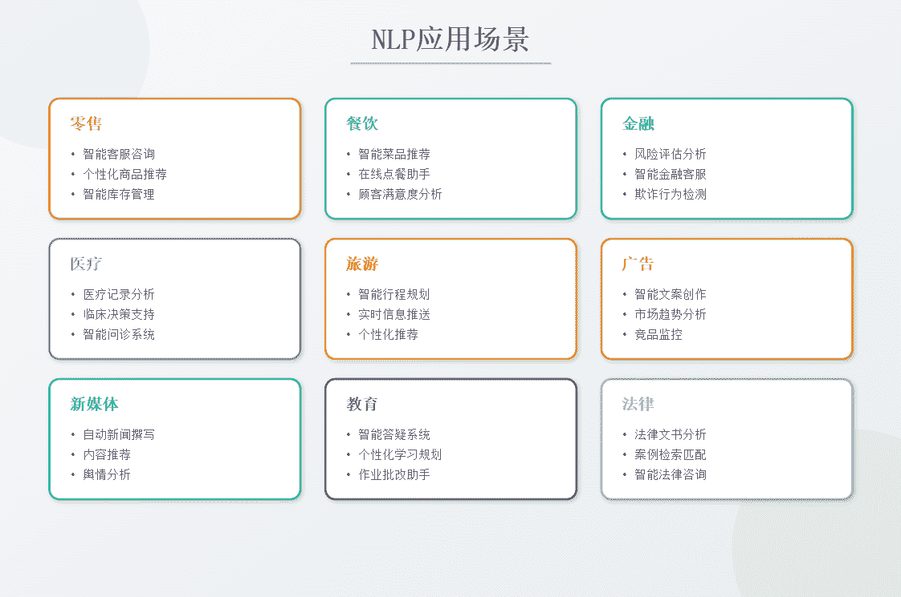

典型的自然语言处理应用实例

以下是自然语言处理在不同行业的一些具体应用：

### 金融行业

1.  **智能客服**：通过自然语言处理技术，机器人客服可以与用户进行自然对话，根据用户的需求进行智能分析和处理，提供实时的服务，缩短客户等待时间，提高工作效率。

1.  **舆情监测和风险评估**：金融行业中的舆情监测和风险评估通常需要分析大量的文本数据，情感分析技术可以通过自然语言处理技术对文本进行情感判定，细致地分析文本中所表达出的情感色彩，帮助决策者及时了解市场和用户需求的情感状态，为业务决策提供有效的数据支持。

1.  **指令分类**：在金融行业中，往往需要处理大量的投资指令，通过自然语言处理技术，可以将不同类型的指令分类，使用算法和模型进行处理和执行，提高指令处理的效率。

### 医疗领域

1.  **病历分析**：通过对患者的病历数据进行处理和分析，提取有用的信息，为医生提供诊断和治疗建议。这有助于提高医疗质量，降低医疗成本。

1.  **疾病预测**：通过对患者的个人信息、生活习惯和生物标志物等数据进行分析，预测患者可能发生的疾病。这有助于早期发现疾病，提高患者生存率。

### 教育领域

1.  **智能教育平台**：利用NLP技术构建智能教育平台，提供个性化的学习建议和辅导，提高学生的学习效果。

1.  **语言学习助手**：利用NLP技术开发语言学习助手，帮助学生在自然语言学习过程中进行实时反馈和辅导。

1.  **自动批改作业**：能够自动评估学生的作业和测试成绩，节省教师的时间，让教师有更多精力关注学生个体的需求。

### 休闲娱乐行业

1.  **游戏互动**：通过NLP技术，游戏可以理解玩家输入的文字或语音指令，并给出相应的智能回应。在角色扮演游戏中，玩家可以与NPC进行深度交流，增强游戏的沉浸感和趣味性。

1.  **聊天机器人**：在社交平台或娱乐网站上，聊天机器人可以陪伴用户聊天解闷，分享笑话、故事，甚至讨论热门的娱乐话题。

1.  **自动字幕生成**：一些视频平台利用NLP技术实现了自动字幕生成和语音识别功能，方便观众更好地理解影片内容。

1.  **智能阅读助手**：电子书中的智能阅读助手可以根据读者的阅读速度和习惯，自动调整文字显示的速度和排版，同时解答读者在阅读过程中提出的问题。

### 其他行业

1.  **机器翻译**：利用计算机将一种自然语言（源语言）转换为另一种自然语言（目标语言）的过程。这是NLP最直观的应用之一，已经广泛应用于跨国交流、在线教育等领域。

1.  **招聘与求职**：通过NLP技术，HR可以利用简历中的专业、姓名、城市和经历等信息来分类和筛选合适的候选人，提高招聘效率。

1.  **社交媒体监控**：对社交软件中的内容进行识别、分析、监控和屏蔽，一方面分析社交媒体中的文字，根据关键词匹配来推送广告；另一方面避免出现国家安全方面的潜在威胁。

1.  **定向广告**：NLP技术可以根据用户的搜索文字进行关键词匹配，向用户推送特定方向的广告，提高广告的针对性和效果。

# 推荐系统

## 什么是推荐系统？

推荐系统是一种利用数据分析来**自动预测****用户可能**感兴趣的内容或物品的系统。它的主要任务是根据用户的需求和行为，提供个性化的信息服务。推荐系统的应用场景非常广泛，几乎涵盖了所有互联网相关的服务，包括在线购物、社交媒体、视频流平台、新闻推荐等。

## 推荐系统是怎么来的？

在互**联网时代**，数以亿计的网民每天都被浩如烟海的数据所裹挟着。如何在海量信息中筛选出对自己有价值的内容，对于我们来说变得异常困难。这种情况下，信息使用的效率非但没有提升，反而因筛选难度增加而降低，我们称之为“信息过载”问题。

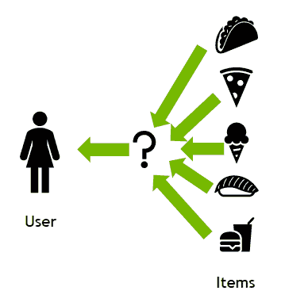

来源： https://www.nvidia.com/en-us/glossary/recommendation-system/

从**信息匮乏**到信息过载，人类社会经历了信息处理能力的飞速发展。在信息匮乏的时代，我们面临的主要问题是获取信息的渠道有限。为了解决这一问题，我们可以通过图书馆和档案馆，以及通过亲朋好友、同事等社交关系获取信息。随着互联网的普及，信息量迅速增长，我们开始面临信息过载的问题。为了解决这一问题，推荐系统应运而生。

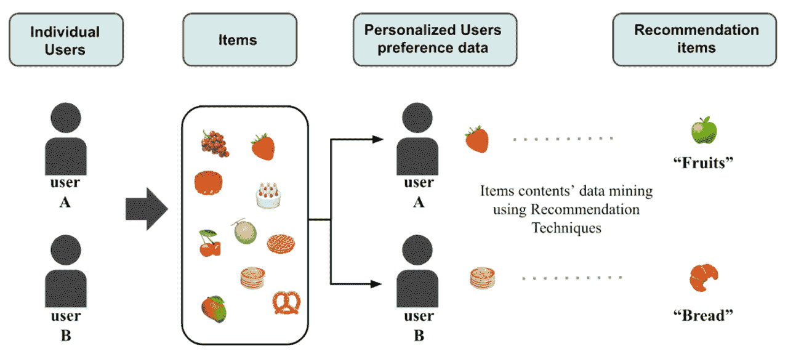

来源：https://www.linkedin.com/pulse/introduction-recommender-systems-personalized-users-santhosh-sachin-yd8fc

我们可以不再局限于依赖搜索引擎来筛选信息。通过推荐系统，我们往往不需要非常明确地表达自己的需求是什么。推荐系统就可以通过预测和展示我们可能感兴趣的内容，主动建立我们与信息之间的高效连接。现代推荐系统的精准度甚至能超越我们自身对自己的了解。

## 推荐系统的应用

推荐系统是作为一种**信息过滤系统**，旨在预测我们对某项商品或服务的评价或偏好。目前推荐系统现已在多个领域有着广泛的应用，以下是一些主要的应用领域：

+   **新闻推荐**：**在新闻推**荐**系统中，**AI会根据用户的阅读习惯、兴趣领域、点击历史等来推荐新闻内容。这样能确保用户得到个性化的新闻推送，而不是仅仅按照传统的时间顺序排列新闻。如今日头条、腾讯新闻根据用户的阅读习惯推荐新闻文章；

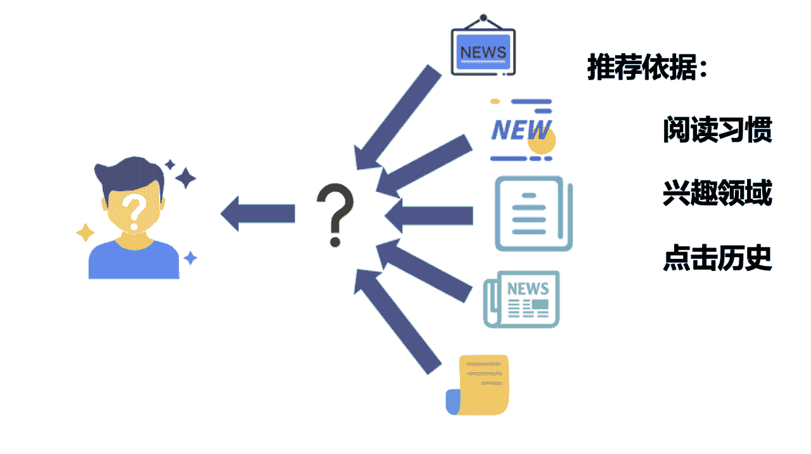

新闻推荐系统

（作者使用visio软件绘制）

+   **电商平台**：**在电商平**台**，推荐系统**基于用户的浏览历史、购买记录、搜索关键词等数据，推荐用户可能感兴趣的商品。这样不仅能提高用户的购物体验，也能增加平台的销售额。如Amazon、淘宝、京东等平台根据用户的购物历史和浏览行为推荐商品；

+   **视频流媒体平台**：**视频平台**通**过分**析用户观看的视频内容、搜索记录和点赞等数据，推荐可能感兴趣的电影、电视剧或视频。这不仅提升了用户的观看体验，也增加了平台的用户粘性。如网易云音乐、YouTube、Netflix等推荐用户可能喜欢的歌曲或视频；

+   社交**媒体：在社**交媒体平台上，推荐系统会根据用户的互动（如点赞、评论、分享）以及朋友的行为推荐帖子、图片或视频。通过社交推荐，平台能够提高用户参与度和内容互动。如Facebook、Instagram、🧣推荐可能认识的人或相似兴趣的用户。

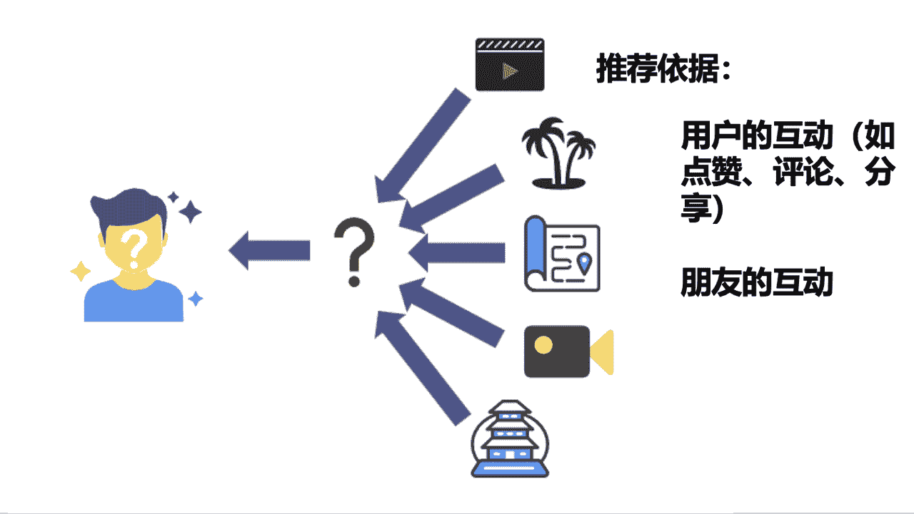

社交媒体推荐系统

（作者使用visio软件绘制）

+   **旅游和酒**店业：携程、去哪儿网等根据用户的旅行偏好推荐旅游目的地、酒店或机票。

+   **餐饮服务**业：如美团、大众点评等根据用户的口味偏好推荐餐厅和食物。

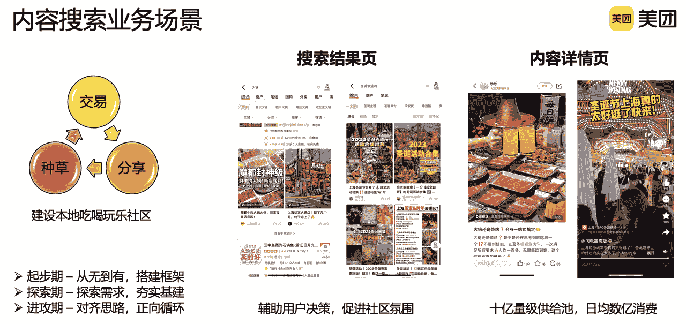

来源：https://tech.meituan.com/2024/03/21/content-search-algorithm-optimization.html

# 语音识别和生成

## 什么是语音识别和生成？

简单来说，语音识别就是让机器能听懂人类说话。当你对着手机或者其他设备说话时，语音识别技术会把你说的语音内容转化成文字。例如，你使用语音输入法，对着手机说“今天天气很好”，语音识别系统会分析语音信号，把它识别为对应的文字，然后显示在屏幕上。这就像给机器装了能听懂人类语言的“耳朵”。

图片来源：作者通过AI生成

语音生成正好相反，它是让机器能够说话。机器会根据预先设定好的文字内容，生成语音信号，然后通过扬声器等设备播放出来。比如，电子书中的文字内容可以通过语音生成技术转化为语音，这样就能像听广播一样“听书”了。就好像给机器装了会说话的“嘴巴”。

截图来源：剪辑软件必剪的AI朗读文本功能

## 语音识别和生成是怎么来的？

### 语音识别技术发展历程

1952 年，贝尔实验室发明了自动数字识别机，科学家对智能语音有了模糊的概念。1952 年贝尔实验室率先研制出语音号码识别系统——AUDERY，在严格控制的条件下，AUDERY 系统识别语音号码的准确率为 97 - 99%，但系统庞大且维护困难。2010 年开始，深度学习技术被引入到语音识别领域，这使得语音识别准确率大幅提升。随着大数据的积累和计算能力的不断提升，语音识别技术能够处理更多的语种。目前的数字语音识别系统，已经可以适配国内四川、上海、广东等多地方言。同时，个性化定制也成为可能，即让消费者可以用自己的声音“训练”他们的设备。

### 语音生成技术发展历程

**早期参数合成阶段**

+   原理与方法：基于对语音产生机理的理解，通过人工设定声道模型参数等方式来合成语音。例如，通过控制频率等一系列参数，模拟人类发音时的声带振动和声道共鸣等物理过程，从而生成语音信号 。

+   特点：这种方式能够产生清晰可懂的语音。

+   局限：合成语音的自然度较低，听起来比较机械生硬，缺乏人类语音的自然韵律和情感表达，且需要专业的语音学知识来调整参数，可定制性较差。

**波形拼接合成阶段**

+   原理与方法：预先录制大量的语音片段，然后根据待合成文本的内容和上下文，从语音库中挑选合适的语音片段进行拼接，以此来生成完整的语音。

+   特点：相比早期参数合成，波形拼接合成的语音自然度有了显著提高，能够更好地保留原始语音的音色和韵律特征。

+   局限：该方法对语音库的依赖性很强，需要大量的存储空间来存储语音片段，且拼接点处可能会出现不自然的过渡，在处理一些未包含在语音库中的词汇或语言现象时灵活性不足。

**基于统计模型的语音合成阶段**

+   原理：通过对大量语音数据的统计分析，学习语音的声学特征、音素序列与文本之间的关系，进而根据输入的文本生成相应的语音参数，再通过声码器将参数转换为语音波形。

+   特点：这种方法能够在一定程度上提高语音合成的灵活性和自然度，并且可以通过调整来适应不同的语音风格和说话人特征。基于统计分析的语音合成技术在语音导航、语音播报等领域得到了广泛应用。

+   局限：虽然基于统计模型的语音合成取得了较好的效果，但仍然存在一些问题，如对语音中的协同发音现象建模不够准确，导致在一些复杂语音环境下合成效果不理想；另外，生成的语音在情感表达和个性化方面相对较弱。

**深度学习语音合成阶段**

+   原理：深度学习技术的兴起为语音生成带来了重大变革。循环神经网络（RNN）及其变体如长短期记忆网络（LSTM）、门控循环单元（GRU），以及后来的 Transformer 架构等被广泛应用于语音合成。这些模型能够更好地处理语音序列中的长期依赖关系，学习到更复杂的语音特征和语言规律，从而生成更加自然、流畅、富有表现力的语音。

+   优势：深度学习语音合成模型可以直接从文本或其他相关特征生成高质量的语音波形，无需复杂的中间参数转换过程，大大提高了语音合成的效率和质量。同时，通过大量的语料训练，模型能够自动学习到不同说话人的语音特点、情感模式等，实现个性化语音合成和情感语音合成。

+   应用：在智能语音助手、有声读物、语音客服等众多领域得到了广泛应用，推动了语音交互技术的快速发展，使得人机语音交流更加自然、亲切，接近人与人之间的交流效果 。

## 语音识别和生成的应用

### 语音识别的应用

+   **语音控制系统**：在智能家居领域，语音控制系统让用户可以通过语音指令控制家电。例如，天猫精灵可以实现“天猫精灵，开灯”“天猫精灵，打开/关闭空调”等操作，为用户带来极大的便利。

图片来源：作者通过AI生成

+   **语音输入系统**：如今，智能手机的语音输入功能极大地提高了用户的输入效率。如华为手机内置的百度输入法华为版，语音输入被集成在空格键上，方便用户随时使用。长按带话筒图标的按钮，弹出语音识别页面，对着手机说话即可随说随输入，还会根据每句话的停顿、语气合理插入标点符号。

### 语音生成的应用

+   **文本到语音转换**：语音生成应用最多的任务，就是负责把一段文字转换成连续、流畅的语音。例如我们常在短视频平台刷到的漫画解说，电影解说，绝大多数都是利用语音生成技术，将写好的稿子进行AI配音。

+   **语调和情感调节**：语音生成系统还要识别出文字中的语调，比如在问句中让机器的声音有上扬的效果，或者在感叹句中加入强烈的情绪。这种情感调节可以让机器的语音更符合上下文，不显得“死板”。

+   **多说话人和个性化语音**：我**们希望机**器可以用更多的音色来说话，以此来满足我们多样性的需求，比如客服机器人可以模仿不同性别、年龄的声音，甚至可以模仿特定名人的语音风格进行语音合成。这种技术有个具体的名称叫做语音克隆（Voice Cloning），可以通过少量的语音样本训练出不同的声音模型，就能让机器用各种各样的声音来与人交互。

图片来源：作者通过AI生成

# 决策优化

## 什么是决策优化？

决策优化是通过运用数学模型、数据分析和算法等手段，帮助决策者在复杂的情境或者多个可选方案中，找到最优或接近最优的决策方案的过程。其目的是提高决策的质量、效率和效果，使决策能够更好地达成预定的目标。

例如，在物流配送领域，一家大型电商企业每天都需要处理海量的订单，并将商品配送到全国各地的客户手中。面对众多的仓库、运输线路以及配送车辆等资源，如何安排配送任务就成为了一个极为复杂的决策问题。通过决策优化，企业可以收集历史订单数据、交通路况信息、车辆运载能力等多方面的数据，运用数学模型计算不同仓库发货的成本、不同运输线路的时长以及车辆的调配方案。通过决策优化，不仅能够降低物流成本，还能提高配送效率。

## 决策优化是怎么来的？

1.  **管理实践需求驱动**

+   随着企业和组织规模的不断扩大，业务变得日益复杂。在传统的决策模式下，管理者凭借经验和直觉做出决策，但这种方式在面对复杂的市场环境、众多的产品选择和资源分配问题时，很容易出现偏差。例如，大型跨国公司在全球范围内进行生产布局和资源调配，需要考虑不同国家和地区的劳动力成本、原材料供应、市场需求、税收政策等多种因素。单纯依靠经验决策很难找到最优方案，这就促使了决策优化方法的产生。

+   企业面临的竞争压力也推动了决**策优化的**发展。在激烈的市场竞争中，企业需要快速、准确地做出决策，以获取竞争优势。比如，在电商行业，企业需要根据用户行为数据、库存情况、竞争对手价格等因素，实时优化商品定价和促销策略。

1.  **数学与统计学基础支撑**

+   决策优化的发展离不开数学和统计学的理论基础。线性规划、非线性规划、动态规划等数学方法为解决资源分配、生产计划等优化问题提供了工具。例如，通过线性规划可以在满足一定约束条件（如原材料供应限制、生产设备产能限制等）下，找到使利润最大化的产品生产组合。

+   概率论和数理统计为处理不确定性因素提供了方法。例如在金融投资领域，股票市场的价格波动受到众多因素影响，具有高度的不确定性。但是投资者可以利用概率论和数理统计来分析股票价格的走势，通过**收**集历史股价数据，运用统计方法计算股票价格的均值、方差等统计量，以评估其波动程度，在一定程度上量化风险，从而制定更为合理的投资策略，以此来应对股票市场复杂多变的情况。

1.  **计算机技术与算法进步推动**

+   计算机技术的飞速发展为决策优化提供了强大的计算能力。复杂的优化模型和算法需要大量的计算资源来求解，高性能计算机和云计算平台使得大规模数据处理和复杂模型求解成为可能。例如，在供应链管理中，通过计算机模拟和优化算法，可以对包含众多供应商、生产商、仓库和零售商的复杂供应链网络进行优化。

+   人工**智能**和机器学**习算**法的兴起。例如，强化学习算法可**以让系统在与**环境的交互过程中学习到最优的决策策略。在智能交通系统中，通过强化学习可以优化交通信号灯的控制策略，提高交通流量和减少拥堵。这些算法能够自动从数据中学习模式和规律，从而为决策优化提供更灵活、高效的解决方案。

## 决策优化的应用

1.  在机械制造领域，人工智能应用广泛。以汽车发动机零部件生产为例，以前是靠工人经验来设定零件的切削速度、进给量、切削深度这些参数，很难找到最好的搭配，生产效率不高，产品质量也不稳定。而机器学习算法通过学习多批次零部件加工时的各种数据，像工艺参数、加工时间、产品精度、表面光滑程度等数据。就能根据实时数据，算出不同参数组合下的加工效率，还能智能地调整参数。比如产品精度稍微高了点，但加工时间太长，就可以适当加快切削速度，稍微改下进给量，在保证产品质量合格的情况下，提高加工效率。而且随着生产一直进行，人工智能还能自己优化，不管是原材料有点变化，还是设备有点磨损，都能让工艺参数一直保持在最好的状态。

1.  在医疗领域，人工智能也发挥着重要作用。在疾病预测与诊断方面，基于机器学习的算法可以通过分析患者的病史数据和生理指标，预测个人发生某些疾病的风险，帮助医生及时采取预防措施。智能医疗影像分析利用计算机视觉技术，能够自动识别病灶、测量尺寸、评估病变程度，辅助医生做出更准确的诊断。在临床决策支持方面，基于规则引擎的系统可以将患者的病史、检查结果、用药情况等多源数据整合到一个智能决策系统中，为医生提供最优的诊疗建议。

1.  在金融领域，人工智能的应用同样广泛。例如，人工智能可以通过分析历史交易数据和市场趋势，为投资决策提供精准的建议。在信用决策方面，人工智能解决方案通过利用各种因素帮助银行和信贷机构做出更明智的信贷决策。下图是金融领域研究新型“数据投毒”攻击技术，证明证实可通过“数据投毒”造成模型失效。

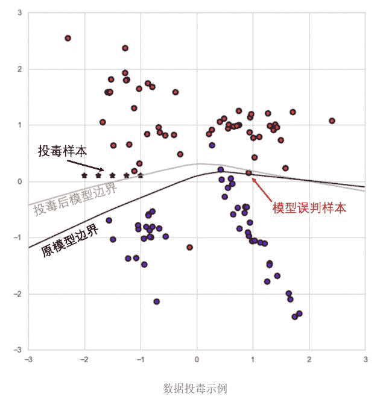

图片来源：[中国工商银行金融科技研究院安全攻防实](https://www.fcc.com.cn/art/kjzx/70/11012.shtml)验室发布《2020网络金融黑产研究报告》

# 人工智能生成内容（AIGC）

## AIGC是什么？

AIGC，即人工智**能生成内**容（Artificial I**nt**elligence Generated Content），是指利用人工智能技术自动产生文本、图片、[音频等](https://ci7ta5wy9u0.feishu.cn/docx/KiRCd4vo2o66M3xVQUwcn7rHnIb#share-ImnUdPkDKovEhexWM4hcxczTnoh)多种形式的内容。它通过学习大量数据中的模式和结构，以适当的泛化能力生成新内容。目前，AIGC广泛应用于教育、医疗、金融、社交、影视等领域，旨在提高工作效率、降低成本，并创造更多个性化和高质量的内容。AIGC影响行业之广，商业潜力之大[R]，或许未来的某天，整个世界就会因它而发生翻天覆地的变化。

AIGC应用领域

## AIGC怎么来的？——发展史

AIGC（人工智能生成内容）的发展史可以追溯到1958年，当时神经网络的概念首次被提出。随后在1965年，摩尔定律的提出预测了计算能力的飞速提升。

进入20世纪90年代，全球互联网用户开始爆炸性增长，1991年万维网的开放使得信息传播和获取变得更加便捷。同时，算法也在不断进步，1997年，IBM战胜卡斯帕罗夫，标志着计算机在复杂任务处理上的能力已经达到了一个新的高度。1989年的CNN算法则开启了深度学习的序幕。

2004年分布式技术的兴起，以及2005年存储成本的降低，都极大地推动了数据存储和处理能力的提升。2006年，深度学习兴起，为后来的AI技术发展奠定了坚实的基础。

2010年GPU开始被用于训练AI模型，标志着AI计算进入了新的阶段。2013年谷歌AI学会策略类游戏，2017年AlphaZero通吃三大棋能力的出现将AI推向了新的高度。

2018年GPT大模型的推出，以及全球互联网数据的指数级增长，都预示着AI技术将更加广泛地应用于各个领域。2020年，Alphafold实现蛋白质结构预测，进一步展现了AI在复杂任务处理上的强大能力。

而2021年ChatGPT的问世，更是将AIGC推向了一个全新的时代。2023年，生成式AI（GAI）应用广泛普及，涵盖文本、音乐、图像和视频内容创作，推动多行业创新变革。

AIGC在多个关键应用领域的发展简史如下：

### 自然语言方面

1.  **初期探索**：在自然语言处理（Natural Language Processing，NLP）领域，早期的研究主要集中在基于规则和统计的方法上，如N-gram语言模型。然而，这些方法在处理长句子和复杂语境时表现不佳。

1.  深**度学习与Transform**er架构：递归神经网络（RNNs）和长期短期记忆（LSTM）等深度学习模型被引入到语言建模任务中，提高了对长句子的建模能力。2017年，Transformer架构的提出彻底改变了NLP领域，成为许多大型语言模型的基础，如BERT和GPT系列。

1.  **ChatGPT与强化学习**：OpenAI推出的**ChatGPT**利用人类反馈的强化学习（RLHF）技术，显著提高了对话系统的性能和可靠性。这种技术使ChatGPT能够更好地理解人类语言和偏好，从而生成更加自然和连贯的对话内容。

自然语言处理发展历程

### 图像方面

1.  **早期阶段**：图像生成的早期探索主要基于规则和简单的算法。这些算法虽然能够生成一定的图像内容，但复杂度和多样性有限。

1.  **深度学习与GANs的出现**：2014年，**生成对抗网络**（GANs）的提出标志着图像生成领域的一个重要里程碑。GANs通过两个神经网络（生成器和判别器）的相互博弈，能够生成高质量且逼真的图像。此后，变分自编码器（VAEs）等其他深度学习模型也被开发出来，进一步推动了图像生成技术的发展。

1.  **近期进展**：近年来，随着**扩散模型**（diffusion）等新技术的出现，图像生成的质量和效率得到了显著提升。这些模型能够更好地控制生成过程，实现更精细的图像编辑和增强。

图像生成发展历程

### 视频生成

1.  **初步尝试**：视频生成领域的早期研究主要集中在基于规则和简单算法的尝试上，但这些方法往往难以生成高质量和连贯的视频内容。

1.  **深度学习的应用**：随着深度学习技术的快速发展，研究人员开始将这些技术应用于视频生成领域。通过训练复杂的神经网络模型，可以生成具有一定连贯性和真实感的视频片段。

1.  **未来趋势**：目前，视频生成技术仍在不断发展中，未来的研究方向可能包括提高生成视频的质量和长度、增强视频内容的多样性以及优化生成过程的效率等方面。

## AIGC怎么用？

AIGC（人工智能生成内容）的应用范围广泛，以下列举了部分应用领域及实例：

AIGC应用举例

+   文本生成：AIGC可以自动生成文章、报告、新闻等文本内容。例如，智能写作助手可以基于给定的话题生成完整的文章，也可以对已有的文章进行翻译和摘要。

文本生成示例

+   图像和视频生成：AIGC技术可以生成高质量的图像和视频。例如，在图像领域，通过学习大量的绘画作品，AI可以生成特定风格的绘画作品；在视频领域，AI可以自动剪辑和生成视频内容。

生成绘画作品示例

+   音频生成：AIGC可以用于生成音乐、语音等音频内容。例如，AI可以根据用户的输入生成特定风格的音乐，或者将文本转换为自然流畅的语音。

+   跨模态内容生成：AIGC可以实现不同模态之间的内容转换，例如根据给定的文本生成相对应的图像或视频，或根据给定的图像生成解释说明文字，或将音频转换为文字等。

跨模态内容生成示例——解释图片

+   智能数字内容编辑：AIGC可以对现有内容进行智能编辑，如视频场景剪辑、人声分离等。

+   教育领域：AIGC可以用于生成个性化的教育内容，如定制化的课程材料和智能辅导系统。

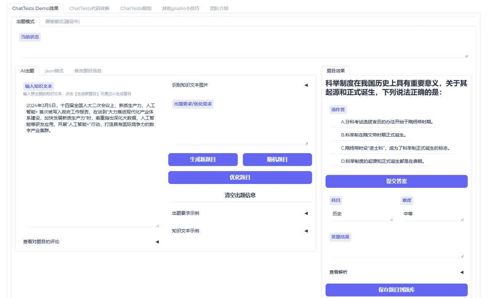

AI赋能的教育领域产品——Chattests

+   医疗领域：AIGC可以辅助医生进行诊断，生成医疗报告，甚至用于药物研发。

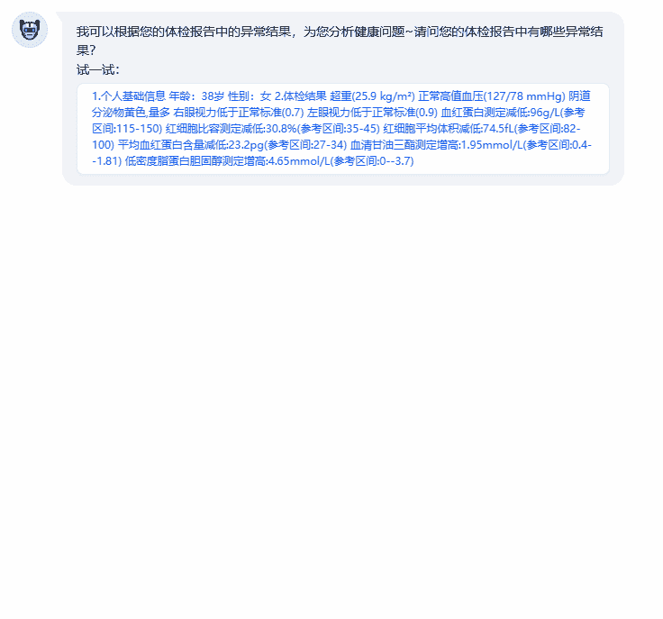

医疗报告生成示例

+   金融领域：AIGC可以用于金融分析，生成投资报告，辅助风险评估，智能投资决策等。

+   娱乐和商业营销领域：AIGC在照片、影视等多个行业十分活跃，成为数字娱乐和商业营销的重要工具。

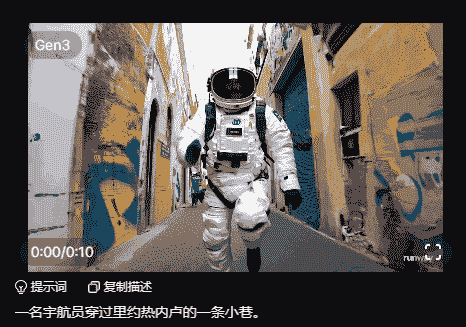

变换试衣模特

生成视频

---

# 参考资料

周志华. 机器学习[M]. 西瓜书.

2022年自然语言处理行业研究报告

《自然语言处理入门》何晗（@hankcs）著

《自然语言处理导论 》张奇 桂韬 黄萱菁  著